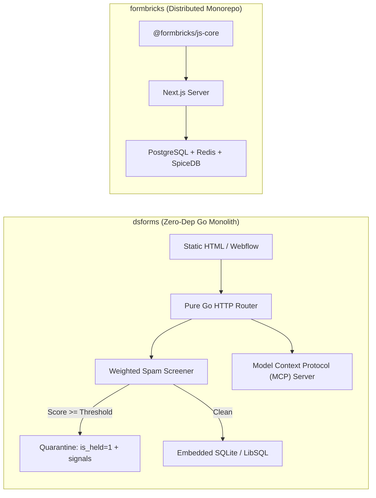
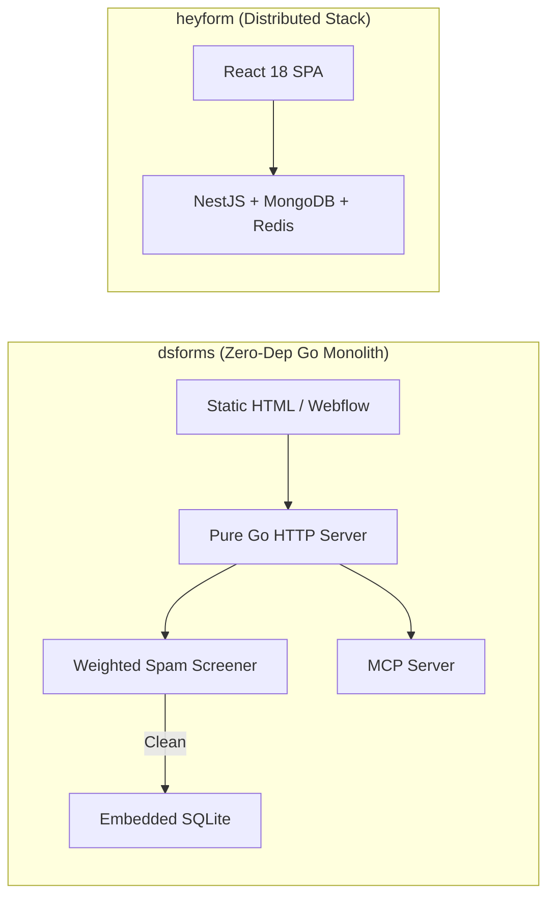
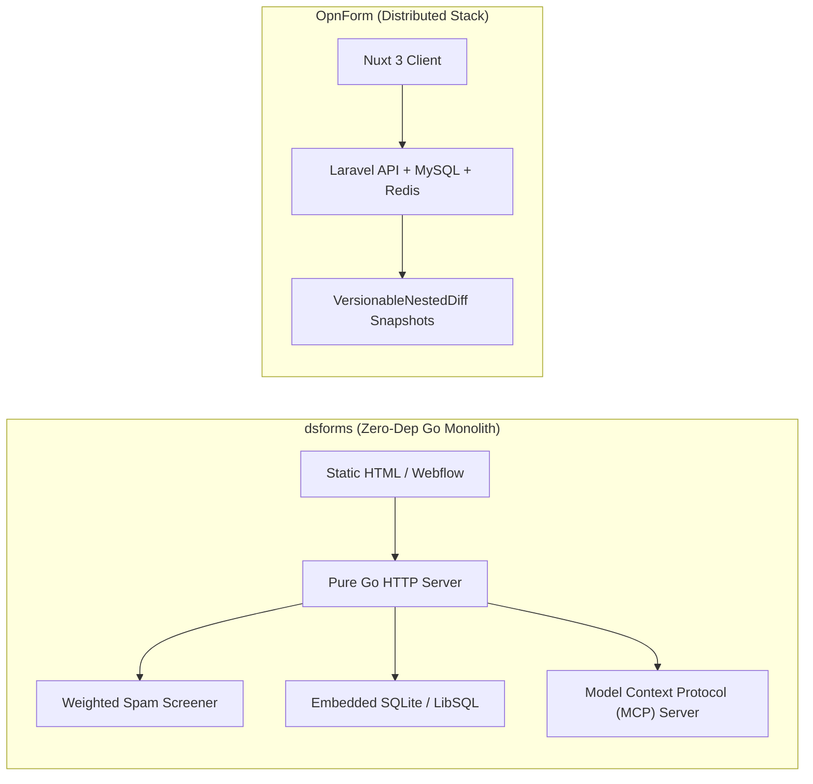
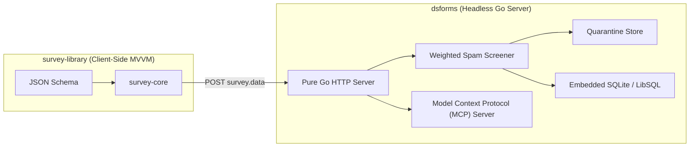

# dsforms — Comparative Analysis & Category Evaluation

> **Category**: Forms, Surveys & Feedback  
> **Architectural Role**: Headless form backend, forensic spam quarantine scoring & viral waitlist engine  
> **Primary Stack**: Go 1.22+ | Pure Go HTTP Monolith | SQLite / LibSQL (pure Go `modernc.org/sqlite`) | Goroutine Worker Channels | Model Context Protocol (MCP)  
> **Peer Solutions Compared**: `formizee`, `formbricks`, `heyform`, `OpnForm`, `LimeSurvey`, `survey-library`, `fider`, `logchimp`, `Logiq`  
> **Commercial SaaS Benchmarks**: Formspree, Basin, Waitlist API, Typeform, Formkeep  

---

## 1. Executive Overview & Technical Identity: dsforms

**dsforms** is an ultra-lightweight, self-hosted headless form ingestion backend, spam quarantine forensic engine, and viral waitlist platform written in pure Go. Engineered as a fast, zero-dependency alternative to Formspree, Basin, and Waitlist API, dsforms allows developers and marketing teams to deploy a complete form capture and pre-launch audience queue in a single static binary with zero external runtime dependencies.

### Core Architectural Profile
- **Runtime & Language**: Compiled `Go 1.22+` application running with zero external dependencies and consuming ~25MB of RAM.
- **Persistence Layer**: Embedded **SQLite / LibSQL** database compiled with pure Go (`modernc.org/sqlite`), eliminating CGO build requirements and external database server maintenance.
- **Forensic Spam Quarantine Architecture**: Replaces traditional black-box silent drops with an auditable quarantine holding queue (`is_held: 1`): incoming submissions are scored by `internal/screen` using weighted honeypot traps (`_gotcha`, `hp_field`), timing heuristics, and domain analysis. Submissions exceeding the threshold are quarantined alongside exact diagnostic records (`spam_signals`), suppressing alerts until reviewed.
- **Viral Pre-Launch Waitlist Engine**: Built-in referral gamification module (`waitlists`, `waitlist_entries`) with automated referral code generation, dynamic queue position jumping, and transactional SMTP cohort broadcasting (`internal/broadcaster`).
- **Autonomous AI Agent Operations via MCP**: Implements a native embedded **Model Context Protocol** (`internal/mcpserver`) server enabling LLM agents (Claude, custom SDR agents) to inspect inboxes, triage quarantined leads with automated PII redaction (`internal/redact`), and query conversion analytics over stdio or SSE.

---

## 2. Peer Solution Landscape (Forms, Surveys & Feedback)

Within this category, `dsforms` operates alongside the following peer solutions:

| Solution | Language & Runtime | Core Framework | Database / Cache | Queue / Concurrency | Primary Architectural Niche |
| :--- | :--- | :--- | :--- | :--- | :--- |
| **dsforms** (Current) | `Go 1.22+` | `Pure Go HTTP` | `SQLite / LibSQL (pure Go)`| `Go Worker Channels` | Zero-dependency headless form backend with forensic spam quarantine |
| **formizee** | `TypeScript / Edge` | `Hono, Turborepo` | `LibSQL / Turso, Drizzle` | `Cloudflare KV / Async` | Zero-knowledge AES-256-GCM encrypted headless form vault |
| **formbricks** | `TypeScript / Node` | `Next.js Monorepo` | `PostgreSQL, Prisma` | `BullMQ / Redis` | In-app micro-surveys, ReBAC access, telemetry |
| **heyform** | `TypeScript / Node` | `NestJS 10+, React 18` | `MongoDB, Redis` | `Bull Queue / Redis` | Conversational multi-step forms with polymorphic document answers |
| **OpnForm** | `PHP 8.2+ / TypeScript` | `Laravel 11, Nuxt 3` | `MySQL / PostgreSQL` | `Laravel Horizon / Redis` | No-code dynamic forms with versioned revisions & MCP agent drafts |
| **LimeSurvey** | `PHP 8.1+` | `Yii Framework` | `MySQL / PostgreSQL` | `PHP CLI Workers` | Enterprise statistical surveys with dynamic runtime SQL tables |
| **survey-library** | `TypeScript 5.3+` | `Framework-Agnostic MVVM` | `Pure Client-Side (BYO)`| `Synchronous / Web Workers`| Declarative JSON survey engine with AST expression evaluator |
| **fider** | `Go 1.22+` | `Go HTTP Monolith` | `PostgreSQL 14+` | `Goroutines, Channels` | Compiled CQRS public feature voting portal with sub-20ms latency |
| **logchimp** | `TypeScript / Node` | `Express.js, Vue 3` | `PostgreSQL, Knex.js` | `BullMQ / Redis` | Multi-board customer feedback roadmap with RBAC and audit trail |
| **Logiq** | `Python 3.10+` | `FastAPI, discord.py` | `SQLite / PostgreSQL` | `asyncio Event Loop` | Discord-native community ticketing bot & FastAPI REST management |

---

## 3. Deep Head-to-Head Comparative Breakdown: dsforms vs Peers

### 3.1. dsforms vs. formizee

**Comparative Focus**: `Pure Go zero-dep headless backend with quarantine scoring` vs. `Edge-native Hono + LibSQL AES-GCM vault`

```mermaid
flowchart LR
    subgraph DsformsArch ["dsforms (Zero-Dep Go Monolith)"]
        A1["Static Form (<form>)"] --> A2["Pure Go HTTP Server"]
        A2 --> A3["Weighted Spam Screener"]
        A3 -->|Score >= Threshold| A4["Quarantine: is_held=1 + signals"]
        A3 -->|Clean| A5["Embedded SQLite / LibSQL"]
        A2 --> A6["Model Context Protocol (MCP) Server"]
    end
    subgraph FormizeeArch ["formizee (Edge Hono + Vault)"]
        B1["Static Form (<form>)"] --> B2["Hono Edge Worker (workerd)"]
        B2 --> B3["AES-256-GCM Vault"]
        B3 --> B4["LibSQL / Turso SubmissionsDB"]
    end
```

#### Architectural Differences:
- **Deployment Footprint & Runtime**: dsforms is compiled into a single statically linked binary with an embedded SQLite / LibSQL database (`modernc.org/sqlite`), running with zero external dependencies on any bare-metal VPS or container (~25MB RAM). Formizee is designed for distributed edge deployments (Cloudflare Workers, Drizzle ORM, Turso / LibSQL).
- **Security & Privacy Model**: Formizee prioritizes **Data Confidentiality via Zero-Knowledge Encryption**: every submission is encrypted at the edge with AES-256-GCM before writing to disk, ensuring that server operators cannot inspect payloads. dsforms prioritizes **Data Forensics & Lead Protection via Quarantine Architecture**: incoming submissions are screened with weighted heuristics; flagged entries are placed in an isolated quarantine queue (`is_held: 1`) alongside exact diagnostic signals (`spam_signals`) to prevent silent lead drops.
- **Autonomous AI Agent Readiness**: dsforms embeds a native Model Context Protocol (MCP) server (`internal/mcpserver`), enabling AI agents (Claude, custom SDRs) to triage form inboxes, review quarantined leads with automated PII redaction (`internal/redact`), and query conversion analytics over stdio or SSE. Formizee integrates via API keys and webhook log drains.
- **Growth & Waitlists**: dsforms includes an integrated viral waitlist engine with dynamic referral queue-jumping. Formizee focuses purely on encrypted form ingestion.

#### Architectural Comparison Matrix:

| Dimension | dsforms | formizee |
| :--- | :--- | :--- |
| **Deployment Architecture** | Single compiled Go binary with embedded SQLite | Edge-native worker (Hono + Cloudflare Workers) |
| **Primary Security Innovation** | Weighted heuristic scoring with auditable quarantine holding queue | Zero-knowledge client-side AES-256-GCM encryption |
| **Spam Handling Philosophy** | Quarantine suspicious leads with diagnostic signals (no silent loss) | Block/reject malicious bots at edge |
| **AI Agent Support** | Native embedded Model Context Protocol (MCP) server with PII redaction | REST API keys and log drains |
| **Viral Growth Features** | Integrated viral waitlist engine with dynamic referral queue jumping | None |
| **Memory Footprint** | ~25 MB RAM (Compiled Go process) | ~35 MB RAM (Edge V8 isolate) |

---

### 3.2. dsforms vs. formbricks

**Comparative Focus**: `Zero-dependency pure Go headless backend with quarantine scoring` vs. `Enterprise targeted CX telemetry & ReBAC`

#### Architectural Differences:
- **Deployment Footprint & Dependencies**: dsforms compiles into a single statically linked binary with an embedded SQLite / LibSQL database (`modernc.org/sqlite`), running with zero external dependencies and consuming ~25MB of RAM. Formbricks requires a substantial infrastructure stack (Node.js runtime, PostgreSQL, Redis, and optionally SpiceDB).
- **Spam Mitigation & Quarantine Architecture**: Formbricks mitigates spam via recontact rules, API authentication, and optional CAPTCHA. dsforms implements an auditable **Quarantine Forensics Architecture**: `internal/screen` evaluates submissions against weighted honeypot traps (`_gotcha`, `hp_field`), timing heuristics, and domain analysis. Flagged leads are not discarded; they are committed to an isolated quarantine queue (`is_held: 1`) alongside exact diagnostic signals (`spam_signals`) for review.
- **Autonomous AI Agent Operations**: dsforms embeds a native Model Context Protocol (MCP) server (`internal/mcpserver`), allowing AI agents (Claude, custom SDR bots) to inspect form inboxes, triage quarantined leads with automated PII redaction (`internal/redact`), and query conversion analytics over stdio or SSE. Formbricks integrates with external agents through standard REST API endpoints.

#### Architectural Comparison Matrix:

| Dimension | dsforms | formbricks |
| :--- | :--- | :--- |
| **Runtime & Operational Model** | Single compiled Go binary with embedded SQLite | Distributed Next.js + Redis + PostgreSQL monorepo |
| **Frontend Strategy** | 100% headless: static HTML form endpoints | In-app JavaScript SDK and sandboxed modal UI |
| **Spam Defense Strategy** | Weighted heuristic scoring with auditable quarantine holding queue | Rate limits, recontact frequency, reCAPTCHA |
| **AI Agent Interface** | Native embedded Model Context Protocol (MCP) server with PII redaction | Management REST API |
| **Viral Growth Features** | Integrated viral waitlist engine with dynamic referral queue jumping | None (focused on customer satisfaction telemetry) |
| **Memory Footprint** | ~25 MB RAM | ~250 MB RAM |

---

### 3.3. dsforms vs. heyform

**Comparative Focus**: `Zero-dependency pure Go headless backend with quarantine scoring` vs. `Full-stack conversational form builder`

#### Architectural Differences:
- **Deployment Complexity & Footprint**: dsforms compiles into a single statically linked binary with an embedded SQLite / LibSQL database (`modernc.org/sqlite`), running with zero external dependencies and consuming ~25MB of RAM. HeyForm requires a distributed infrastructure setup (Node.js runtime, MongoDB cluster, Redis cache).
- **Frontend Approach**: dsforms is 100% headless, providing endpoints for standard HTML `<form action="/f/{id}">` tags without bundling frontend JavaScript. HeyForm is centered around its visual conversational form builder and animated frontend canvas.
- **Spam Defenses & Forensic Quarantine**: dsforms implements an auditable **Quarantine Architecture**: `internal/screen` evaluates weighted honeypot traps (`_gotcha`, `hp_field`), timing heuristics, and domain analysis. Flagged submissions are quarantined (`is_held: 1`) alongside exact diagnostic signals (`spam_signals`) for operator or AI agent review. HeyForm throttles submissions using IP rate-limiting (`SubmissionIpLimitModel`) and Turnstile/reCAPTCHA.

#### Architectural Comparison Matrix:

| Dimension | dsforms | heyform |
| :--- | :--- | :--- |
| **Operational Model** | Single compiled Go binary with embedded SQLite | Distributed Node.js + MongoDB + Redis cluster |
| **Frontend Strategy** | 100% headless: static HTML form endpoints | Conversational visual form builder & React canvas |
| **Spam Defense Strategy** | Weighted heuristic scoring with auditable quarantine holding queue | IP rate limiting, reCAPTCHA, Turnstile |
| **AI Agent Interface** | Native embedded Model Context Protocol (MCP) server with PII redaction | Standard REST/GraphQL APIs |
| **Viral Growth Features** | Integrated viral waitlist engine with dynamic referral queue jumping | None |
| **Memory Footprint** | ~25 MB RAM | ~300 MB RAM |

---

### 3.4. dsforms vs. OpnForm

**Comparative Focus**: `Zero-dependency pure Go headless backend with quarantine scoring` vs. `Full-stack no-code form builder`

#### Architectural Differences:
- **Deployment Footprint**: dsforms compiles into a single statically linked binary with an embedded SQLite / LibSQL database (`modernc.org/sqlite`), running with zero external dependencies and consuming ~25MB of RAM. OpnForm requires a full PHP/Laravel environment, MySQL/PostgreSQL database, and Redis with Laravel Horizon workers (~150MB RAM).
- **Frontend vs Headless**: dsforms is 100% headless, providing endpoints for standard HTML `<form action="/f/{id}">` tags without bundling frontend JavaScript. OpnForm is centered around its visual no-code builder and animated frontend canvas.
- **Spam Defenses & Forensic Quarantine**: dsforms implements an auditable **Quarantine Architecture**: `internal/screen` evaluates weighted honeypot traps (`_gotcha`, `hp_field`), timing heuristics, and domain analysis. Flagged submissions are quarantined (`is_held: 1`) alongside exact diagnostic signals (`spam_signals`) for operator or AI agent review. OpnForm mitigates spam via honeypot fields (`_hp`) and Google reCAPTCHA / Cloudflare Turnstile.
- **AI Agent Automation**: Both solutions support AI agents: dsforms embeds a native MCP server (`internal/mcpserver`) allowing AI agents to triage leads, review quarantined entries with automated PII redaction (`internal/redact`), and query conversion analytics. OpnForm provides MCP endpoints to draft and preview forms (`/api/agent-drafts/*`).

#### Architectural Comparison Matrix:

| Dimension | dsforms | OpnForm |
| :--- | :--- | :--- |
| **Operational Model** | Single compiled Go binary with embedded SQLite | Distributed PHP 8.2+ / Laravel Horizon stack |
| **Frontend Strategy** | 100% headless: static HTML form endpoints | No-code visual form builder & Nuxt 3 canvas |
| **Spam Defense Strategy** | Weighted heuristic scoring with auditable quarantine holding queue | Honeypots (`_hp`), reCAPTCHA, Turnstile |
| **AI Agent Interface** | Native embedded Model Context Protocol (MCP) server with PII redaction | Native MCP draft endpoints (`agent-drafts`) |
| **Viral Growth Features** | Integrated viral waitlist engine with dynamic referral queue jumping | None |
| **Memory Footprint** | ~25 MB RAM | ~150 MB RAM |

---

### 3.5. dsforms vs. LimeSurvey

**Comparative Focus**: `Zero-dependency pure Go headless backend with quarantine scoring` vs. `Dynamic SQL table research engine`

```mermaid
flowchart LR
    subgraph DsformsArch ["dsforms (Zero-Dep Go Monolith)"]
        A1["Static HTML (<form>)"] --> A2["Pure Go HTTP Server"]
        A2 --> A3["Weighted Spam Screener"]
        A2 --> A4["Embedded SQLite / LibSQL"]
        A2 --> A5["Model Context Protocol (MCP) Server"]
    end
    subgraph LimeSurveyArch ["LimeSurvey (Heavy Monolith)"]
        B1["PHP Yii Server"] --> B2["Dynamic SQL Tables"]
        B1 --> B3["ExpressionScript Engine"]
    end
```

#### Architectural Differences:
- **Deployment Footprint**: dsforms compiles into a single statically linked binary with an embedded SQLite / LibSQL database (`modernc.org/sqlite`), running with zero external dependencies and consuming ~25MB of RAM. LimeSurvey requires an Apache/Nginx web server, PHP-FPM runtime with multiple extensions, and a MySQL/PostgreSQL server (~180MB RAM).
- **Frontend vs Headless**: dsforms is 100% headless, providing endpoints for standard HTML `<form action="/f/{id}">` tags without bundling frontend JavaScript. LimeSurvey provides a complete server-rendered research UI with themes, multi-lingual support, and question hierarchies.
- **Spam Defenses & Security**: dsforms implements an auditable **Quarantine Architecture**: `internal/screen` evaluates weighted honeypot traps (`_gotcha`, `hp_field`), timing heuristics, and domain analysis. Flagged submissions are quarantined (`is_held: 1`) alongside exact diagnostic signals (`spam_signals`) for operator or AI agent review. LimeSurvey relies on participant token access control and optional CAPTCHA plugins.

#### Architectural Comparison Matrix:

| Dimension | dsforms | LimeSurvey |
| :--- | :--- | :--- |
| **Operational Model** | Single compiled Go binary with embedded SQLite | Traditional PHP-FPM + MySQL/PostgreSQL stack |
| **Frontend Strategy** | 100% headless: static HTML form endpoints | Complete server-rendered research layouts |
| **Spam Defense Strategy** | Weighted heuristic scoring with auditable quarantine holding queue | Closed-cohort token ACL, optional CAPTCHA |
| **AI Agent Interface** | Native embedded Model Context Protocol (MCP) server with PII redaction | RemoteControl 2 JSON-RPC / REST API |
| **Statistical Export** | CSV and JSON exports | Native SPSS syntax files, R dataframes, Stata |
| **Memory Footprint** | ~25 MB RAM | ~180 MB RAM |

---

### 3.6. dsforms vs. survey-library (SurveyJS)

**Comparative Focus**: `Zero-dependency pure Go headless backend with quarantine scoring` vs. `Client-side UI engine`

#### Architectural Differences:
- **Architectural Complementarity**: dsforms is a pure backend ingestion API with zero frontend UI. SurveyJS is a pure frontend UI rendering library with zero backend capabilities. They are complementary: developers can render complex, multi-page questionnaires using SurveyJS and submit the resulting `survey.data` directly to a dsforms endpoint (`POST /f/{id}`) for forensic spam screening and embedded SQLite persistence.
- **Spam Mitigation**: dsforms implements an auditable **Quarantine Architecture**: `internal/screen` evaluates weighted honeypot traps (`_gotcha`, `hp_field`), timing heuristics, and domain analysis, holding suspicious leads in an isolated quarantine queue (`is_held: 1`). SurveyJS handles input validation on the client.
- **Autonomous AI Agent Readiness**: dsforms embeds a native Model Context Protocol (MCP) server for autonomous agent operations and an integrated viral waitlist engine with referral queue-jumping. SurveyJS has no server components.

#### Architectural Comparison Matrix:

| Dimension | dsforms | survey-library (SurveyJS) |
| :--- | :--- | :--- |
| **Architectural Layer** | Headless backend ingestion & quarantine engine | Client-side UI rendering & state engine |
| **Runtime Environment** | Single compiled Go binary (~25 MB RAM) | Web browser memory (0 MB server RAM) |
| **Spam Defense Strategy** | Weighted heuristic scoring with auditable quarantine holding queue | Client-side input validation regexes |
| **AI Agent Interface** | Native embedded Model Context Protocol (MCP) server with PII redaction | None |
| **Integration Synergy** | Ideal lightweight backend store for SurveyJS JSON submissions | Ideal client UI renderer for dsforms backend endpoints |

---

### 3.7. dsforms vs. fider

**Comparative Focus**: `Pure Go single-binary headless backend with quarantine scoring` vs. `Go CQRS feedback voting board`

```mermaid
flowchart LR
    subgraph DsformsArch ["dsforms (Headless Ingestion Monolith)"]
        A1["Static Form (<form>)"] --> A2["Pure Go HTTP Server"]
        A2 --> A3["Weighted Spam Screener"]
        A2 --> A4["Embedded SQLite / LibSQL"]
        A2 --> A5["Model Context Protocol (MCP) Server"]
    end
    subgraph FiderArch ["fider (Community Feedback Monolith)"]
        B1["Web Browser / Voter"] --> B2["Go HTTP Server"]
        B2 --> B3["PostgreSQL Database"]
    end
```

#### Architectural Differences:
- **Domain Scope**: dsforms is a headless form backend for static websites and landing pages, featuring forensic spam screening and viral waitlists. Fider manages public feature voting boards, community discussions, and roadmaps.
- **Database & Dependencies**: dsforms embeds a pure Go SQLite / LibSQL database (`modernc.org/sqlite`), running with zero external dependencies in a single binary. Fider requires an external PostgreSQL database.
- **Spam Defenses**: dsforms implements a weighted heuristic screener (`internal/screen`) with an auditable quarantine holding queue (`is_held: 1`, `spam_signals`). Fider eliminates spam and duplicate voting through OAuth2 authentication, email verification magic links, and unique database constraints on `(user_id, post_id)`.

#### Architectural Comparison Matrix:

| Dimension | dsforms | fider |
| :--- | :--- | :--- |
| **Primary Domain** | Headless form backend & viral waitlist engine | Public customer feedback forum & voting roadmap |
| **Database Architecture** | Embedded SQLite / LibSQL (zero external DB) | Relational PostgreSQL (requires external DB) |
| **Spam & Abuse Defense** | Weighted heuristic scoring with auditable quarantine queue | OAuth2 / Magic links + unique ballot constraints |
| **AI Agent Interface** | Native embedded Model Context Protocol (MCP) server | None |
| **Memory Footprint** | ~25 MB RAM | ~40 MB RAM |

---

### 3.8. dsforms vs. logchimp

**Comparative Focus**: `Pure Go single-binary headless backend with quarantine scoring` vs. `Node.js multi-board feedback engine`

```mermaid
flowchart LR
    subgraph DsformsArch ["dsforms (Headless Ingestion Monolith)"]
        A1["Static Form (<form>)"] --> A2["Pure Go HTTP Server"]
        A2 --> A3["Weighted Spam Screener"]
        A2 --> A4["Embedded SQLite / LibSQL"]
        A2 --> A5["Model Context Protocol (MCP) Server"]
    end
    subgraph LogchimpArch ["logchimp (Multi-Board Feedback)"]
        B1["Vue 3 Web Client"] --> B2["Express.js API"]
        B2 --> B3["PostgreSQL + Knex.js"]
    end
```

#### Architectural Differences:
- **Domain Scope**: dsforms is a headless form backend for static websites and landing pages, featuring forensic spam screening and viral waitlists. Logchimp provides a multi-board feedback portal (`Boards`), interactive roadmap stages (`Roadmaps`), and product release changelogs.
- **Database & Dependencies**: dsforms compiles into a single statically linked binary with an embedded SQLite / LibSQL database (`modernc.org/sqlite`), running with zero external dependencies in a single binary (~25MB RAM). Logchimp requires Node.js, PostgreSQL, and Redis BullMQ workers (~120MB RAM).
- **Spam Mitigation**: dsforms implements an auditable **Quarantine Architecture**: `internal/screen` evaluates weighted honeypot traps (`_gotcha`, `hp_field`), timing heuristics, and domain analysis, holding suspicious leads in an isolated quarantine queue (`is_held: 1`). Logchimp uses rate limiting and user session authentication.

#### Architectural Comparison Matrix:

| Dimension | dsforms | logchimp |
| :--- | :--- | :--- |
| **Primary Domain** | Headless form backend & viral waitlist engine | Multi-board customer feedback roadmap & changelog |
| **Database Architecture** | Embedded SQLite / LibSQL (zero external DB) | Relational PostgreSQL with Knex.js SQL query builder |
| **Spam & Abuse Defense** | Weighted heuristic scoring with auditable quarantine queue | Session authentication & rate limiting |
| **AI Agent Interface** | Native embedded Model Context Protocol (MCP) server | None |
| **Memory Footprint** | ~25 MB RAM | ~120 MB RAM |

---

### 3.9. dsforms vs. Logiq

**Comparative Focus**: `Pure Go single-binary headless backend with quarantine scoring` vs. `Discord native modal engine`

```mermaid
flowchart LR
    subgraph DsformsArch ["dsforms (Headless Go Server)"]
        A1["Static Form (<form>)"] --> A2["Pure Go HTTP Server"]
        A2 --> A3["Weighted Spam Screener"]
        A2 --> A4["Quarantine: is_held=1 + signals"]
        A2 --> A5["Model Context Protocol (MCP) Server"]
    end
    subgraph LogiqArch ["Logiq (Discord Bot & Gateway)"]
        B1["Discord Interaction Modals"] --> B2["asyncio Python Bot"]
        B2 --> B3["FastAPI REST Server"]
        B2 --> B4["Private Support Channel"]
    end
```

#### Architectural Differences:
- **Ingress Channel**: dsforms is a headless HTTP endpoint for static HTML forms, Webflow landing pages, and Jamstack apps. Logiq operates inside Discord chat servers, collecting structured inputs via native modals and provisioning private triage channels.
- **Spam Mitigation**: dsforms implements an auditable **Quarantine Architecture**: `internal/screen` evaluates weighted honeypot traps (`_gotcha`, `hp_field`), timing heuristics, and domain analysis, holding suspicious leads in an isolated quarantine queue (`is_held: 1`). Logiq mitigates spam using Discord's native account verification and CAPTCHA cog checks.
- **AI Agent Automation**: dsforms embeds a native Model Context Protocol (MCP) server (`internal/mcpserver`) enabling AI agents to triage leads and review quarantined submissions with automated PII redaction (`internal/redact`). Logiq includes modular AI chat cogs for automated ticket replies.

#### Architectural Comparison Matrix:

| Dimension | dsforms | Logiq |
| :--- | :--- | :--- |
| **Primary Platform** | Web static sites and landing pages (`<form>`) | Discord servers and community chat channels |
| **Intake Mechanism** | HTTP POST to headless form API | Discord native interactive modal dialogs |
| **Workflow Outcome** | Lead stored in SQLite with webhook/email fan-out | Isolated private text channel in Discord |
| **Spam Defense Strategy** | Weighted heuristic scoring with auditable quarantine queue | Discord user verification & CAPTCHA cogs |
| **AI Agent Support** | Native Model Context Protocol (MCP) server with PII redaction | AI Chat cog (LLM sentiment & response) |
| **Runtime & Language** | Pure Go 1.22+ compiled binary (~25 MB RAM) | Python 3.10+ (`asyncio` event loop) |

---

## 4. Capability & Feature Comparison Matrix

| Dimension / Capability | dsforms | formizee | formbricks | heyform | OpnForm | LimeSurvey | survey-library | fider | logchimp | Logiq |
| :--- | :---: | :---: | :---: | :---: | :---: | :---: | :---: | :---: | :---: | :---: |
| **Headless Form API Endpoint** | ✅ Single Binary | ✅ Edge Native | ⚠️ API Routes | ❌ | ❌ | ❌ | ❌ | ❌ | ❌ | ❌ |
| **Spam Quarantine Forensics** | ✅ Weighted Scoring | ⚠️ Honeypot | ⚠️ ReCaptcha | ⚠️ Turnstile | ⚠️ Turnstile | ⚠️ Token Auth | ❌ (Client Only)| ⚠️ OAuth Check| ⚠️ Rate Limits | ⚠️ Captcha Cog |
| **AI Agent MCP Integration** | ✅ Native MCP | ⚠️ API Keys | ⚠️ REST API | ❌ | ✅ Agent Drafts| ❌ | ❌ | ❌ | ❌ | ⚠️ LLM Cog |
| **Viral Waitlist & Referrals** | ✅ Integrated | ❌ | ❌ | ❌ | ❌ | ❌ | ❌ | ❌ | ❌ | ❌ |
| **Conversational Typeform UI**| ❌ | ❌ (Headless) | ⚠️ Compact modal | ✅ Full Screen | ✅ Full Screen | ❌ | ✅ Supported | ❌ | ❌ | ❌ |
| **Targeted In-App Popups** | ❌ | ❌ | ✅ Native SDK | ⚠️ Iframe | ⚠️ Iframe | ❌ | ⚠️ UI Embed | ❌ | ❌ | ❌ |
| **Public Feature Voting** | ❌ | ❌ | ❌ | ❌ | ❌ | ❌ | ❌ | ✅ Pure CQRS | ✅ Multi-Board | ❌ |
| **Changelog & Public Roadmap** | ❌ | ❌ | ❌ | ❌ | ❌ | ❌ | ❌ | ⚠️ Basic | ✅ Integrated | ❌ |
| **Discord Chat Ticket Modals** | ❌ | ❌ | ❌ | ❌ | ❌ | ❌ | ❌ | ❌ | ❌ | ✅ Native UI |
| **Zero-Knowledge Encryption** | ❌ | ✅ AES-256-GCM | ❌ | ❌ | ❌ | ❌ | ❌ | ❌ | ❌ | ❌ |
| **Runtime Memory Footprint** | **~25 MB** | **~35 MB (Edge)** | ~250 MB | ~300 MB | ~150 MB | ~180 MB | **0 MB (Client)** | **~40 MB** | ~120 MB | ~90 MB |

---

## 5. Commercial Benchmark Positioning

When benchmarked against commercial SaaS leaders (**Formspree, Basin, Waitlist API, Formkeep**):
- **Against Formspree & Basin**: `dsforms` provides a self-hosted single executable with zero external database dependencies, completely eliminating tiered monthly subscription limits and per-submission fees.
- **Forensic Spam Quarantine**: Unlike commercial services that silently drop suspected bot submissions, dsforms saves flagged entries into an auditable quarantine holding queue (`is_held: 1`, `spam_signals`), protecting marketing teams from catastrophic false-positive lead loss.
- **Built-in Viral Waitlists**: Combines headless form endpoints with pre-launch viral referral queues, eliminating the need to purchase separate waitlist SaaS subscriptions.
- **Autonomous AI Operations**: Native Model Context Protocol (MCP) server enables AI SDR agents to inspect form submissions, review quarantined leads with PII redaction, and manage conversion pipelines directly.

---

## 6. Strategic Takeaways & Role for MarketingStudio

In the unified **MarketingStudio** architecture:
1. **Primary Component to Adopt**: Harness `dsforms` for static marketing landing pages, early-stage product waitlists, and headless contact form capture with zero infrastructure overhead.
2. **Interoperability Seam**: Deploy dsforms' native MCP server (`internal/mcpserver`) to allow MarketingStudio's AI agents to triage inbound leads, review quarantined submissions with automated PII redaction, and sync valid contacts into the CRM.
3. **Complementary Ecosystem Delegation**: Where dsforms provides lightweight headless ingestion and viral waitlists, delegate rich in-app micro-surveys to `formbricks`, conversational multi-step forms to `heyform` / `OpnForm`, and zero-knowledge encrypted vaults to `formizee`.
