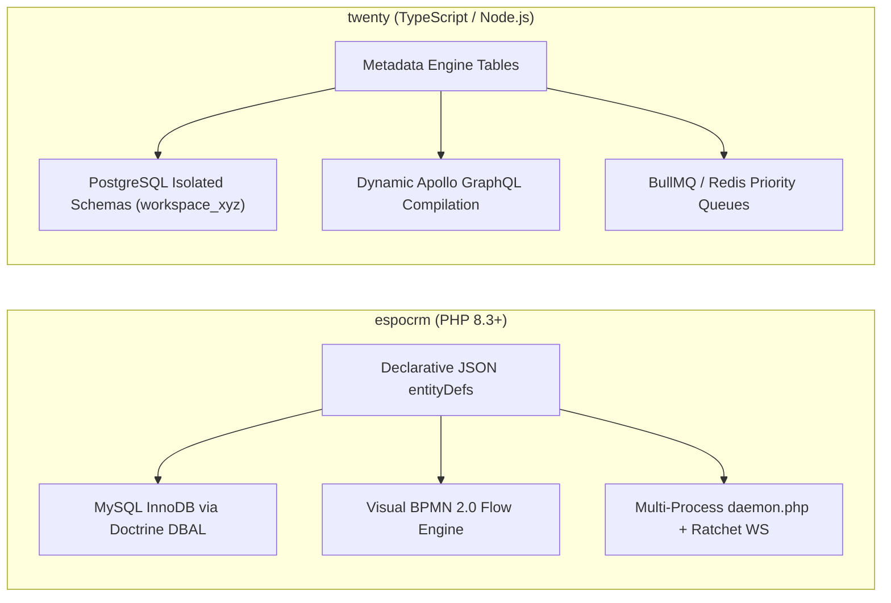
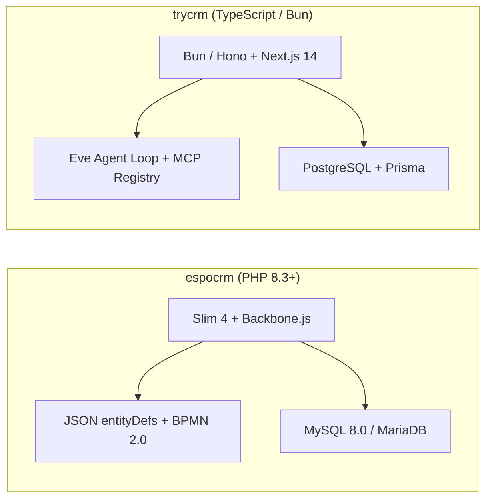
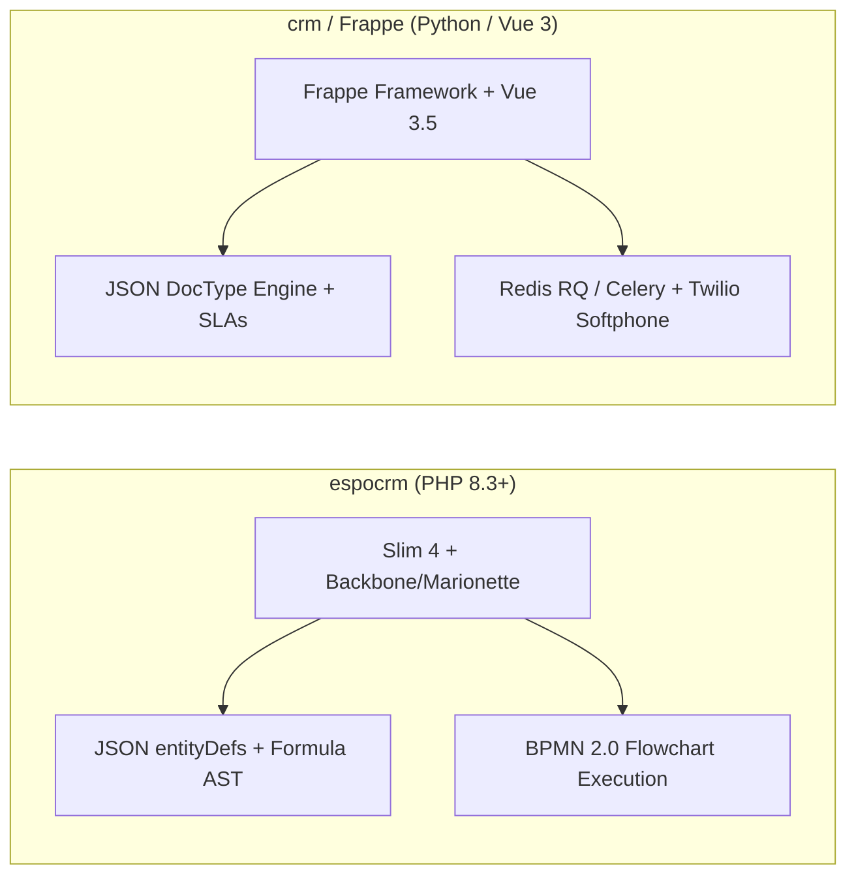
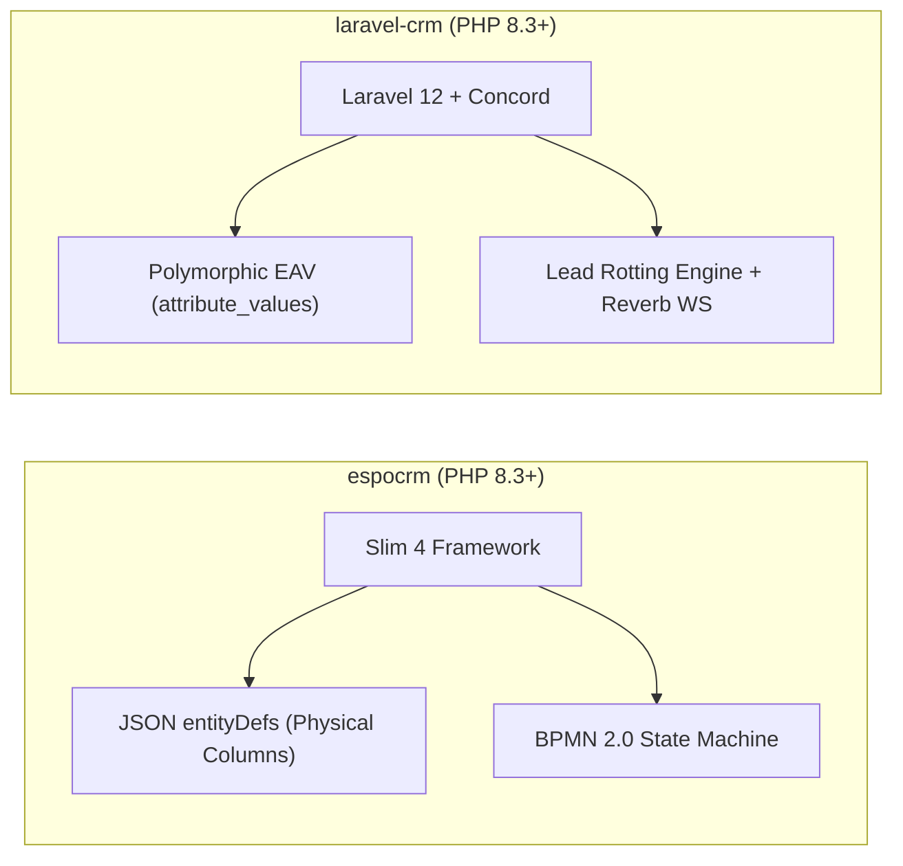
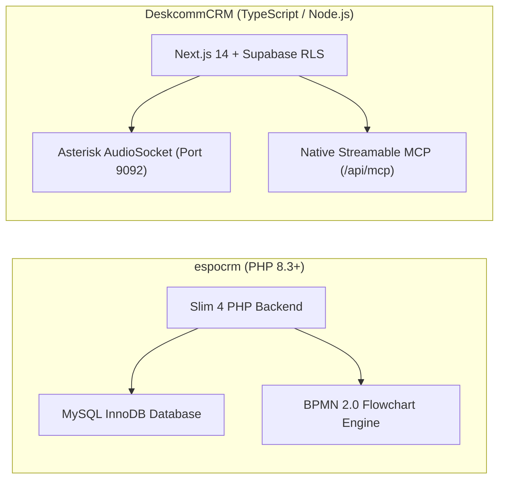
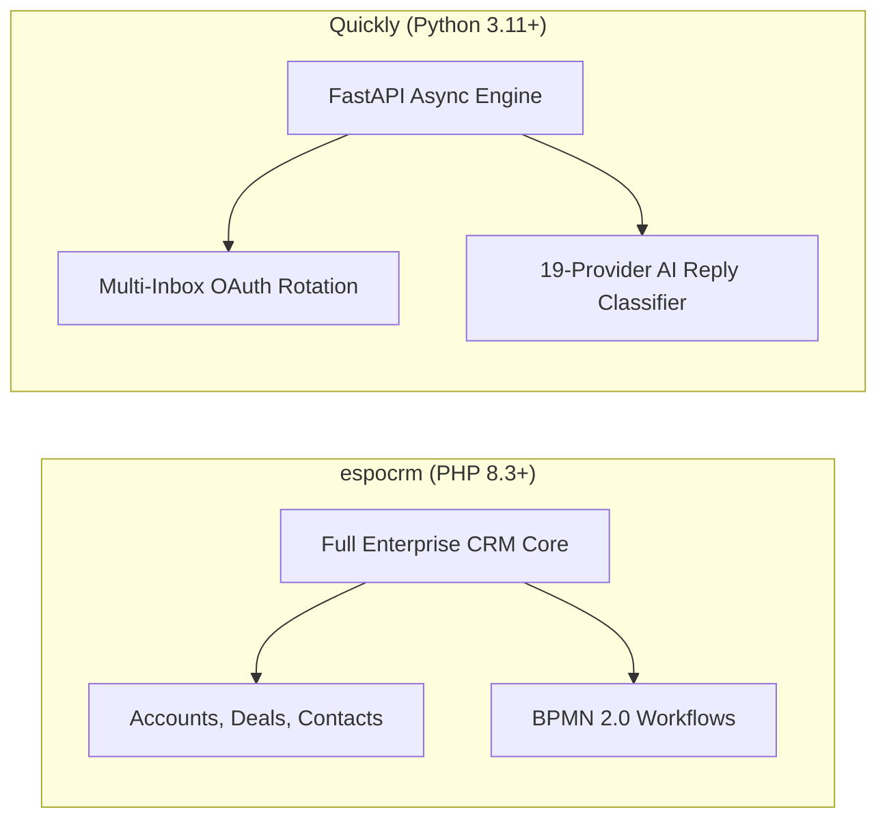
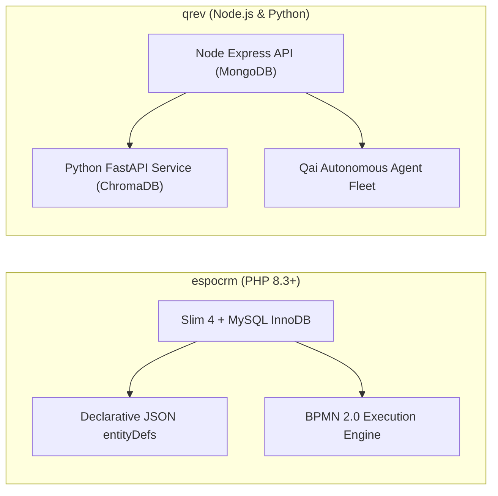
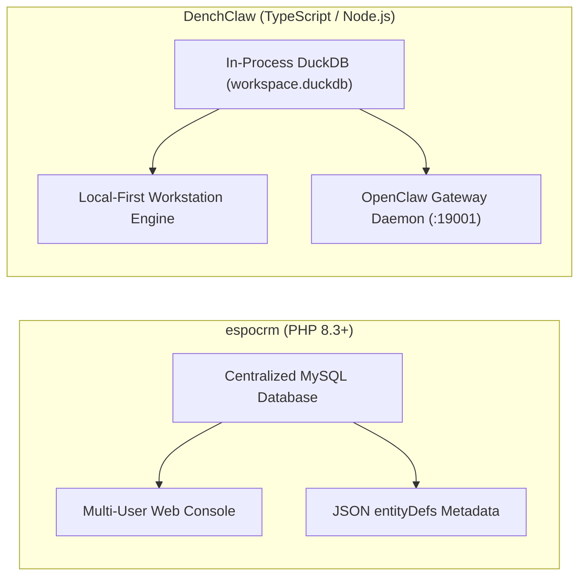
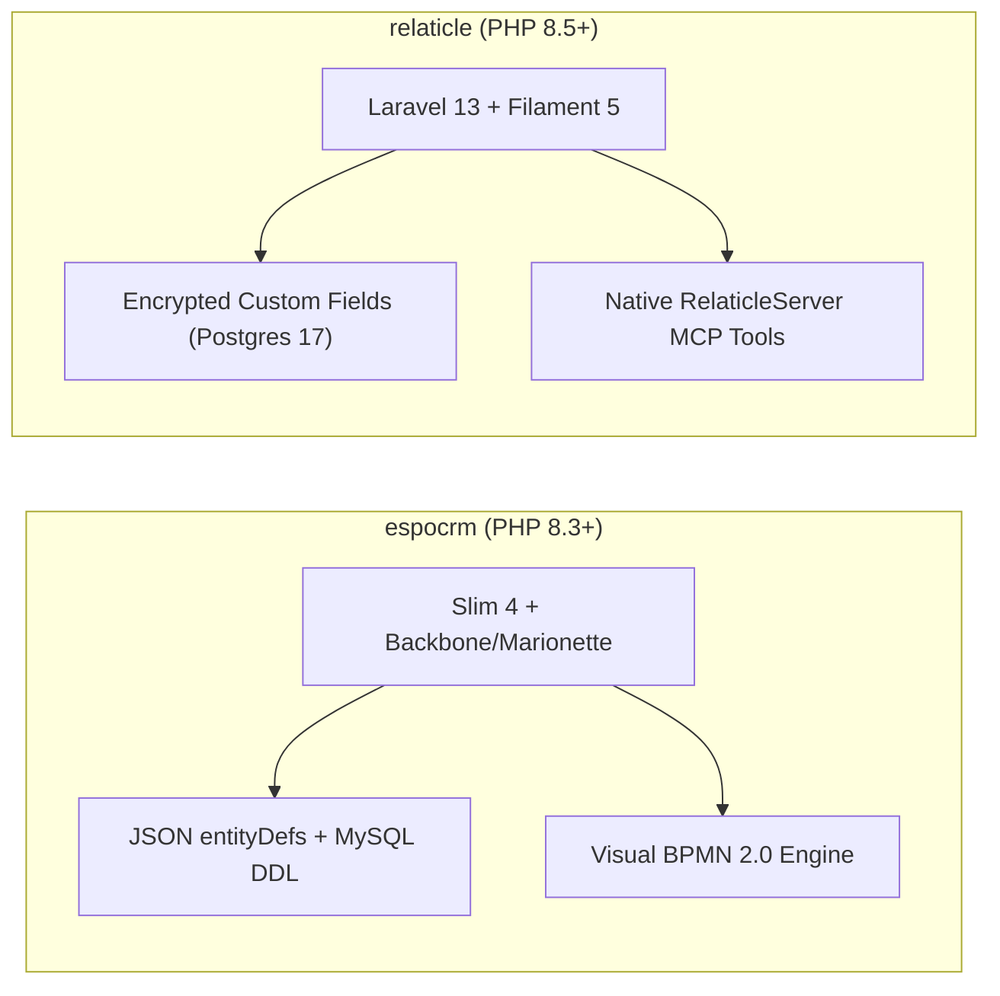

# espocrm — Comparative Analysis & Category Evaluation

> **Category**: CRM & Contact Management  
> **Architectural Role**: Enterprise customizable CRM with JSON metadata engine & BPMN 2.0 execution  
> **Primary Stack**: PHP 8.3+ | Slim 4, Doctrine DBAL 4.4, Backbone.js / Marionette | MySQL 8.0+ / MariaDB 10.6+ | Multi-Process daemon.php & Ratchet  
> **Peer Solutions Compared**: `twenty`, `trycrm`, `crm`, `laravel-crm`, `DeskcommCRM`, `Quickly`, `qrev`, `DenchClaw`, `relaticle`  
> **Commercial SaaS Benchmarks**: Salesforce, HubSpot CRM, Attio, Pipedrive, Close.com  

---

## 1. Executive Overview & Technical Identity: espocrm

**espocrm** is a mature, battle-tested open-source CRM platform engineered in modern PHP 8.3+ and MySQL/MariaDB. Operating as a sovereign enterprise system, EspoCRM's core architectural identity is anchored in its **Declarative JSON Metadata Subsystem** and its **Visual BPMN 2.0 Business Process Execution Engine** (`application/Espo/Core/BPM/`).

Rather than hardcoding database schemas or requiring developer-mediated database migrations, EspoCRM serializes all entities, relations, layouts, ACL scopes, and business formula scripts into structured JSON files (`entityDefs`). An administrative visual Entity Manager translates schema changes into physical MySQL InnoDB alterations via Doctrine DBAL 4.4 without source code deployments, while a built-in AST formula engine dynamically computes expressions and field dependencies at runtime.

### Core Architectural Profile
- **Runtime & Language**: `PHP 8.3+` (strict typing, constructor property promotion, match expressions)
- **Core Framework**: `Slim 4.15` (PSR-7 HTTP middleware, PSR-11 dependency injection) & `Backbone.js / Marionette.js` (custom single-page application)
- **Persistence Layer**: `MySQL 8.0+ / MariaDB 10.6+ (InnoDB, UTF8MB4)` via `Doctrine DBAL 4.4` and custom Espo ORM
- **Concurrency & Process Model**: Multi-process queue worker (`daemon.php` with `spatie/async` & `react/child-process`), scheduled runner (`cron.php`), and `Ratchet WebSocket` server
- **Business Process Engine**: Native BPMN 2.0 execution flowchart engine supporting conditional gateways, service tasks, timers, and approval flows
- **Domain Specialization**: Enterprise relationship management with deep JSON metadata configurability, BPM workflow automation, and granular role/team ACL

---

## 2. Peer Solution Landscape (CRM & Contact Management)

| Solution | Language & Runtime | Core Framework | Database / Persistence | Queue & Concurrency | Primary Architectural Niche |
| :--- | :--- | :--- | :--- | :--- | :--- |
| **espocrm** (Current) | `PHP 8.3+` | `Slim 4, Backbone.js` | `MySQL 8.0+ / MariaDB` | `Multi-Process daemon.php` | **JSON entityDefs, visual BPMN 2.0 & AST formula evaluator** |
| **twenty** | `TypeScript / Node.js` | `NestJS, React, Vite` | `PostgreSQL 15+, TypeORM` | `BullMQ / Redis` | Dynamic runtime schemas & in-memory GraphQL compilation |
| **trycrm** | `TypeScript / Bun` | `Bun, Hono, Next.js` | `PostgreSQL, Prisma` | `Bun Async Loop / Eve` | Agentic-first CRM with native MCP tool registry & Eve runtime |
| **crm** (Frappe) | `Python 3.10+, JS` | `Frappe, Vue 3.5` | `MariaDB 10.6+, Redis` | `Redis Queue (RQ) / Celery` | Declarative DocType metadata, built-in SLAs & Twilio WebRTC |
| **laravel-crm** (Krayin) | `PHP 8.3+` | `Laravel 12.0, Vue.js` | `MySQL 8.0, Eloquent` | `Laravel Queue / Reverb` | Modular composer packages via Concord & polymorphic typed EAV |
| **DeskcommCRM** | `TypeScript / Node.js`| `Next.js 14, Supabase` | `PostgreSQL 16, pgvector` | `AudioSocket TCP / Workers`| Asterisk AudioSocket binary TCP telephony & streamable MCP |
| **Quickly** | `Python 3.11+` | `FastAPI, Next.js 14` | `PostgreSQL, SQLAlchemy` | `Asyncio Slot Reservation` | High-velocity multi-inbox rotation, jitter scheduler & MCP |
| **qrev** | `Node.js & Python` | `Express & FastAPI` | `MongoDB & ChromaDB` | `Node-cron & FastTasks` | Dual-runtime Qai superagent orchestrator & LangChain RAG |
| **DenchClaw** | `TypeScript / Node.js`| `Next.js 15, DuckDB` | `In-Process DuckDB` | `In-Process SQL / OpenClaw`| Embedded columnar SQL, OpenClaw AI Gateway & Composio MCP |
| **relaticle** | `PHP 8.5+` | `Laravel 13, Filament 5`| `PostgreSQL 17+ (ULID)` | `Laravel Horizon / Redis` | Native `RelaticleServer` MCP tools, per-field encryption & ULIDs |

---

## 3. Deep Head-to-Head Comparative Breakdown: espocrm vs Peers

### 3.1. espocrm vs. twenty

#### Metadata Engine & Schema Provisioning
- **espocrm**: Stores schema definitions as JSON metadata in `application/Espo/Resources/metadata/entityDefs/` and custom overrides in `custom/Espo/Custom/Resources/metadata/entityDefs/`. When custom entities or fields are created in the Entity Manager, Espo merges the JSON tree and runs physical MySQL `ALTER TABLE` DDL queries through Doctrine DBAL 4.4. A proprietary AST Formula Parser (`application/Espo/Core/Formula/`) executes dynamic attribute computations.
- **twenty**: Manages object and field definitions in core PostgreSQL relational tables (`core.custom_object`, `core.custom_field`). Custom entities are dynamically provisioned in isolated PostgreSQL schemas (`workspace_<id>.<entity>`), and Apollo GraphQL types/mutations are dynamically synthesized in memory without restarting.

#### Workflow Automation & Process Models
- **espocrm**: Features an enterprise-grade **BPMN 2.0 process engine** (`application/Espo/Core/BPM/`). Supports visual flowcharts, conditional gateways, user decision tasks, approval loops, timed delays, and automated service calls.
- **twenty**: Relies on a modern event-bus architecture (`EventEmitter2`) feeding BullMQ job workers. While event triggers and webhooks execute cleanly, it lacks visual BPMN 2.0 modeling or multi-step approval state machines.

#### Concurrency & Queuing Architecture
- **espocrm**: Operates a long-running multi-threaded queue worker (`daemon.php`) utilizing `spatie/async` and `react/child-process`, alongside periodic `cron.php` executions. WebSockets run on Ratchet (`websocket.php`).
- **twenty**: Node.js/NestJS application cluster backed by Redis-based BullMQ queues, offering fine-grained queue concurrency, job progress tracking, and dead-letter queues.

#### API Design & Agent Ergonomics
- **espocrm**: Slim 4 REST API with Bearer token and HMAC signature authentication. Lacks native Model Context Protocol (MCP) tool integration.
- **twenty**: Apollo GraphQL API with auto-generated schema mutations, accompanied by native MCP server integration (`packages/twenty-agent-skills`).

#### Architectural Tradeoffs Matrix: espocrm vs. twenty

| Dimension | espocrm | twenty | Architectural Evaluation |
| :--- | :--- | :--- | :--- |
| **Workflow Complexity** | Full visual BPMN 2.0 engine | Queue-triggered webhooks | **espocrm** is dramatically superior for complex business processes |
| **API Modality** | RESTful JSON API (Slim 4) | In-memory Apollo GraphQL | **twenty** provides superior client query flexibility |
| **Schema Isolation** | Shared MySQL database + ACL | Dedicated PostgreSQL schemas | **twenty** delivers true database-level tenant isolation |
| **AI Agent Ergonomics** | Traditional REST endpoints | Native MCP server tools | **twenty** integrates natively with LLM agents |

---

### 3.2. espocrm vs. trycrm

#### Architectural Focus & Target Audience
- **espocrm**: Built for human enterprise revenue teams requiring structured data governance, strict multi-tier role/team access controls, audit streams, and formal sales pipeline stages.
- **trycrm**: Built for autonomous AI sales agents (SDRs). Agents possess their own workspaces, permission grants, tool registries, and execution loops alongside human operators.

#### Schema Extensibility & Metadata
- **espocrm**: Deep JSON metadata architecture (`entityDefs`) that alters relational database tables and generates UI layouts dynamically.
- **trycrm**: Static Prisma ORM schema (`schema.prisma`). Extensibility relies on unstructured JSON fact tables (`ContactFact`, `ContactBrief`) extracted by LLMs from email threads and Slack channels.

#### Concurrency & Execution Runtimes
- **espocrm**: Multi-process PHP CLI daemons (`daemon.php`, `cron.php`) with MySQL InnoDB row locks.
- **trycrm**: High-speed Bun 1.1+ runtime with Hono API microservices, executing autonomous LLM loops via the Eve framework.

#### Architectural Tradeoffs Matrix: espocrm vs. trycrm

| Dimension | espocrm | trycrm | Architectural Evaluation |
| :--- | :--- | :--- | :--- |
| **Primary Operator** | Human sales reps & managers | Autonomous AI digital sales agents | Distinct operational paradigms |
| **Schema Depth** | Full custom entity relational DDL | Static schema with JSON facts | **espocrm** supports complex enterprise data models |
| **Agent Tool Calling** | Requires custom API integration | Native Model Context Protocol (MCP) | **trycrm** is purpose-built for agentic tool use |
| **Execution Latency** | Traditional PHP-FPM / CLI overhead | Ultra-low latency Bun runtime | **trycrm** boots and executes requests faster |

---

### 3.3. espocrm vs. crm (Frappe CRM)

#### Metadata Philosophy: entityDefs vs. DocTypes
- **espocrm**: Uses JSON metadata files in `entityDefs/`. Formula expressions are interpreted via Espo's internal AST parser. Layouts and view definitions are decoupled into `clientDefs` and `recordDefs`.
- **crm (Frappe CRM)**: Uses Frappe's declarative **DocType** architecture. Modifying DocTypes adjusts MariaDB tables via `bench migrate`. Form layouts and client-side logic are governed by `crm_fields_layout` and `crm_form_script`.

#### UI/UX & Real-Time Collaboration
- **espocrm**: Client interface is built with Backbone.js, Marionette.js, devtheorem/php-handlebars, and jQuery. While stable, it lacks the reactive performance and modern component ecosystem of modern frontend frameworks.
- **crm (Frappe CRM)**: Built with modern Vue 3.5, Pinia, TailwindCSS, and `frappe-ui`. UI updates are reactive and instantaneous, with document lock indicators and real-time Socket.io updates.

#### Telephony & Communication Channels
- **espocrm**: Supports basic CTI webhooks and third-party Asterisk integration plugins.
- **crm (Frappe CRM)**: Delivers an embedded browser softphone out of the box using `@twilio/voice-sdk` and Exotel, complete with audio recording playback in the activity timeline.

#### Architectural Tradeoffs Matrix: espocrm vs. crm (Frappe)

| Dimension | espocrm | crm (Frappe CRM) | Architectural Evaluation |
| :--- | :--- | :--- | :--- |
| **Frontend Modernity** | Backbone.js / Marionette (Legacy) | Vue 3.5 / TailwindCSS (Modern) | **crm** provides a vastly superior user experience |
| **Workflow Capabilities** | Full BPMN 2.0 visual flow editor | DocType state machine workflows | **espocrm** provides more advanced multi-branch workflows |
| **VoIP Softphone** | Third-party plugin required | Native Twilio Voice SDK in browser | **crm** supports zero-config browser calling |
| **ERP Ecosystem** | Standalone CRM | Seamless Frappe ERPNext integration | **crm** shares ERP ledger, items, and invoices |

---

### 3.4. espocrm vs. laravel-crm (Krayin CRM)

#### Persistence: Physical Columns vs. Polymorphic EAV
- **espocrm**: When custom fields are created in the Entity Manager, Espo executes physical `ALTER TABLE` statements against MySQL InnoDB tables. Fields exist as physical database columns, allowing native indexing and high-speed multi-column SQL queries.
- **laravel-crm**: Employs an Entity-Attribute-Value (EAV) model (`packages/Webkul/Attribute`). Dynamic fields are stored as rows in `attribute_values` across typed columns (`text_value`, `integer_value`, etc.). While this avoids DDL table alterations, it incurs severe SQL join overhead when generating filtered reports across multiple custom attributes.

#### Modular Architecture
- **espocrm**: Structured as a unified core engine with extensible custom packages (`custom/Espo/Custom/`).
- **laravel-crm**: Built as modular Laravel composer packages orchestrated via Konekt Concord (`packages/Webkul/Lead`, `packages/Webkul/Contact`, `packages/Webkul/Quote`). Developers can swap or extend individual packages via Eloquent proxies.

#### Real-Time & WebSockets
- **espocrm**: Custom Ratchet WebSocket server daemon (`websocket.php`).
- **laravel-crm**: Native **Laravel Reverb** WebSocket server, broadcasting live pipeline stage updates and activity completions directly into Vue.js Kanban components.

#### Architectural Tradeoffs Matrix: espocrm vs. laravel-crm

| Dimension | espocrm | laravel-crm | Architectural Evaluation |
| :--- | :--- | :--- | :--- |
| **Query Performance** | High (Native MySQL columns & indexes) | Low-Medium (Multi-join EAV tables) | **espocrm** scales significantly better for analytical reporting |
| **Schema Migration Risk** | DDL table alteration locks | Zero DDL operations (row inserts) | **laravel-crm** eliminates migration lock risks |
| **Workflow Engine** | Visual BPMN 2.0 execution | Event-driven automation rules | **espocrm** supports more complex decision logic |
| **Quotation Engine** | Basic quotes / invoices | Native multi-currency & tax PDF quotes | **laravel-crm** has a deeper quotation-to-close workflow |

---

### 3.5. espocrm vs. DeskcommCRM

#### Telephony Architecture: Webhooks vs. Binary AudioSocket
- **espocrm**: Telephony integration relies on asynchronous HTTP webhooks or Asterisk AMI event polling to match incoming caller IDs and log call duration. Audio playback requires external file links.
- **DeskcommCRM**: Directly interfaces with Asterisk PBX via **AudioSocket** over raw TCP (port 9092). Captures raw binary PCM audio bidirectionally and pipes it into streaming speech-to-text and LLM inference engines, enabling real-time conversational AI phone agents with sub-second latency.

#### Multi-Tenancy & Data Security
- **espocrm**: Multi-tenancy is enforced at the application layer through User, Team, and Role ACL rules evaluated by `AclManager.php`.
- **DeskcommCRM**: Enforces multi-tenancy at the PostgreSQL kernel level using Supabase Row-Level Security (RLS) policies scoped to `organization_id`, supplemented by deterministic `pgcrypto` column encryption.

#### AI Agent Ergonomics
- **espocrm**: REST API with standard endpoints.
- **DeskcommCRM**: Exposes a native WebStandard Streamable Model Context Protocol (MCP) server at `/api/mcp`, featuring an intelligent AI-to-human escalation tool (`handoff.ts`).

#### Architectural Tradeoffs Matrix: espocrm vs. DeskcommCRM

| Dimension | espocrm | DeskcommCRM | Architectural Evaluation |
| :--- | :--- | :--- | :--- |
| **Telephony Depth** | Basic CDR webhook logging | Real-time Asterisk AudioSocket binary TCP | **DeskcommCRM** is engineered specifically for voice dialers |
| **BPM & Workflow** | Enterprise BPMN 2.0 engine | Basic Next.js background workers | **espocrm** supports far more complex business logic |
| **Custom Schema** | Visual Entity Manager (JSON) | Static Supabase / Prisma schema | **espocrm** allows non-developers to extend schemas |
| **AI Protocol** | Traditional REST API | Native Streamable MCP server | **DeskcommCRM** connects natively with AI agents |

---

### 3.6. espocrm vs. Quickly

#### Functional Specialization
- **espocrm**: Enterprise customer database of record, tracking complex B2B sales cycles, accounts, contact hierarchies, meetings, and support cases.
- **Quickly**: High-velocity cold email automation engine. Bypasses shared SMTP pools by dispatching sequences through Google Workspace and Microsoft 365 OAuth 2.0 APIs with automated inbox rotation and randomized jitter.

#### Concurrency & Execution Architecture
- **espocrm**: Synchronous PHP-FPM for HTTP requests and multi-process CLI daemons (`daemon.php`) for asynchronous processing.
- **Quickly**: Fully asynchronous Python 3.11+ ASGI architecture built on FastAPI, Uvicorn, and SQLAlchemy 2.0 with `asyncpg`. Slot reservation logic (`queue_logic.py`) balances email dispatch across hundreds of inboxes simultaneously.

#### AI Capabilities
- **espocrm**: Relies on formula scripts and manual email templates.
- **Quickly**: Integrates a 19-provider AI classification engine (`ai_classifier.py`) that analyzes prospect email replies using local or cloud LLMs, categorizing intent into actionable states (`interested`, `not_interested`, `out_of_office`).

#### Architectural Tradeoffs Matrix: espocrm vs. Quickly

| Dimension | espocrm | Quickly | Architectural Evaluation |
| :--- | :--- | :--- | :--- |
| **Core Domain** | Full lifecycle CRM system | Cold outreach & sequence execution | Complementary systems in GTM stack |
| **Inbox Protection** | Single SMTP/IMAP account sync | Multi-inbox OAuth rotation with jitter | **Quickly** avoids spam filters during cold prospecting |
| **Email Triage** | Manual human inbox reading | Automated 19-provider AI classification | **Quickly** auto-triages inbound prospect replies |
| **BPM & Lead Routing** | Visual BPMN 2.0 flow editor | Fixed sequence timing loops | **espocrm** handles complex multi-stage approvals |

---

### 3.7. espocrm vs. qrev

#### System Architecture & Stack Decoupling
- **espocrm**: Monolithic PHP/MySQL application with integrated queue workers and WebSocket daemons.
- **qrev**: Decoupled multi-runtime platform splitting operational CRM CRUD (Node.js/Express with MongoDB) from compute-intensive agentic workflows (Python FastAPI monorepo with LangChain, LlamaIndex, and ChromaDB).

#### Data Modeling & Unstructured Enrichment
- **espocrm**: Strict relational data model in MySQL. Dynamic attributes require explicit schema definitions in `entityDefs`.
- **qrev**: Flexible document storage in MongoDB combined with ChromaDB vector embeddings. Accommodates raw scraped data, executive bios, and company dossiers without predefined schema constraints.

#### Autonomous Prospecting
- **espocrm**: Automates actions on existing records using BPMN 2.0 workflows.
- **qrev**: Employs an autonomous digital worker fleet orchestrated by **Qai**, running Playwright web scrapers to gather company intelligence, verify email deliverability, and generate personalized multi-touch sequences.

#### Architectural Tradeoffs Matrix: espocrm vs. qrev

| Dimension | espocrm | qrev | Architectural Evaluation |
| :--- | :--- | :--- | :--- |
| **Data Integrity** | Strict relational foreign keys & ACID | NoSQL document flexibility & vector stores | **espocrm** guarantees enterprise data consistency |
| **Autonomous Prospecting** | Not supported natively | Autonomous web crawling & dossier synthesis | **qrev** actively discovers and enriches leads |
| **Deployment Simplicity** | Single PHP/MySQL container/server | Multi-service Node.js + Python + ChromaDB | **espocrm** is substantially easier to maintain |
| **Workflow Engine** | Enterprise BPMN 2.0 flows | Agent task loop execution | **espocrm** excels at structured human team processes |

---

### 3.8. espocrm vs. DenchClaw

#### Topology & Deployment Strategy
- **espocrm**: Centralized web application hosted on cloud or on-premise servers. Designed for distributed human sales teams collaborating across regional branches.
- **DenchClaw**: Local-first sales operating system engineered to run directly on an individual operator's workstation. Stores all customer interactions in an embedded DuckDB file (`workspace.duckdb`).

#### Analytical Performance & Query Engine
- **espocrm**: Relies on MySQL InnoDB indexing. Large analytical aggregations across custom fields are subject to relational row-scanning and network latency.
- **DenchClaw**: Leverages DuckDB's in-process vectorized columnar SQL engine. Executes filtering, deduplication, and relationship scoring (`strength-score.ts`) across hundreds of thousands of records in sub-millisecond timeframes.

#### Agent Sandboxing & Local Tool Execution
- **espocrm**: Server-side PHP script execution with restricted system access.
- **DenchClaw**: Integrates with the local OpenClaw gateway daemon and Composio MCP tools, allowing AI agents to run shell scripts, fetch live URLs, and interface directly with 150+ authenticated SaaS applications.

#### Architectural Tradeoffs Matrix: espocrm vs. DenchClaw

| Dimension | espocrm | DenchClaw | Architectural Evaluation |
| :--- | :--- | :--- | :--- |
| **Multi-User Collaboration** | Comprehensive Team/Role ACL | Single-user local workstation file | **espocrm** is built for collaborative teams |
| **Analytical Query Speed** | MySQL network latency (5-25ms) | In-process vectorized DuckDB (<1ms) | **DenchClaw** is dramatically faster for local data processing |
| **Data Custody** | Stored on central MySQL server | 100% sovereign local DuckDB file | **DenchClaw** guarantees total data sovereignty |
| **Workflow Automation**| Visual BPMN 2.0 flowcharts | OpenClaw gateway subagents & crons | **espocrm** provides visual governance for human reps |

---

### 3.9. espocrm vs. relaticle

#### Modern PHP Stack: Slim 4/Backbone vs. Laravel 13/Filament 5
- **espocrm**: Built on Slim 4 with a legacy Backbone.js/Marionette frontend. While highly functional, the frontend architecture relies on older JavaScript patterns (jQuery, Marionette views, Handlebars templates).
- **relaticle**: Engineered on cutting-edge PHP 8.5+ and **Laravel 13**, featuring an administrative user interface powered by **Filament 5**, **Livewire 4**, and TailwindCSS. Delivers sub-50ms reactive updates and modern component encapsulation.

#### Dynamic Fields & Data Security
- **espocrm**: Dynamically alters MySQL InnoDB tables when fields are added. Values are stored as unencrypted relational columns.
- **relaticle**: Dynamic custom fields (`CustomField`, `CustomFieldValue`) are persisted in PostgreSQL 17+ with native JSONB and per-field AES application encryption. Eliminates DDL table alteration downtime while safeguarding sensitive attributes.

#### AI Agent Protocol (MCP)
- **espocrm**: Traditional RESTful endpoints requiring custom API client integration.
- **relaticle**: Features a native Model Context Protocol (MCP) server (`App\Mcp\Servers\RelaticleServer`), exposing structured tools (`GetCrmSchemaTool`, `ListPeopleTool`, `ListOpportunitiesTool`, `AggregateOpportunitiesTool`) directly to Claude, Cursor, and autonomous agents.

#### Architectural Tradeoffs Matrix: espocrm vs. relaticle

| Dimension | espocrm | relaticle | Architectural Evaluation |
| :--- | :--- | :--- | :--- |
| **Frontend Architecture** | Backbone.js / Marionette (Legacy) | Filament 5 / Livewire 4 (Modern) | **relaticle** provides a vastly modern reactive UI |
| **Workflow Capabilities** | Visual BPMN 2.0 process engine | Laravel Horizon jobs & event listeners | **espocrm** is superior for visual process design |
| **AI Agent Readiness** | Traditional REST API | Native Model Context Protocol (MCP) | **relaticle** connects natively with AI agents |
| **Field Encryption** | Global database encryption only | Per-field AES application encryption | **relaticle** provides granular data security at rest |

---

## 4. Capability & Feature Comparison Matrix

| Dimension / Capability | espocrm | twenty | trycrm | crm (Frappe) | laravel-crm | DeskcommCRM | Quickly | qrev | DenchClaw | relaticle |
| :--- | :---: | :---: | :---: | :---: | :---: | :---: | :---: | :---: | :---: | :---: |
| **Dynamic Custom Objects** | ✅ JSON Meta | ✅ Full DDL | ⚠️ JSON facts | ✅ DocType | ⚠️ EAV | ❌ Static | ❌ Static | ⚠️ Mongo | ✅ DuckDB EAV | ✅ Encrypted EAV |
| **Native MCP / AI Skills** | ❌ REST only | ✅ Full SDK | ✅ Native Core | ❌ RPC only | ❌ REST only | ✅ Streamable | ✅ Streamable | ⚠️ LangChain | ✅ Composio MCP | ✅ RelaticleServer |
| **Visual BPMN Workflows** | ✅ Enterprise | ⚠️ BullMQ flows| ⚠️ Agent Tasks | ⚠️ Doc Workflow| ⚠️ Event Rules | ❌ | ⚠️ Sequences | ⚠️ Agent Loop | ⚠️ Gateway Crons| ⚠️ Horizon Jobs |
| **Modern Reactive UI** | ❌ Backbone | ✅ Linear UX | ✅ Linear UX | ⚠️ Vue/Desk | ❌ Blade | ⚠️ Next.js | ⚠️ Tailwind | ⚠️ React | ✅ Next.js 15 | ✅ Filament 5 |
| **Embedded Softphone / CTI** | ⚠️ Plugin | ❌ | ❌ | ✅ Twilio SDK | ❌ | ✅ AudioSocket | ❌ | ❌ | ❌ | ❌ |
| **GraphQL API** | ❌ (REST) | ✅ Auto-gen | ❌ (REST) | ❌ (REST) | ❌ (REST) | ❌ (REST) | ❌ (REST) | ❌ (REST) | ❌ (In-Process) | ❌ (REST) |
| **Multi-Tenant Schemas** | ⚠️ Role ACL | ✅ Schema/Tenant| ⚠️ Org ID | ✅ Frappe Sites| ⚠️ Channels | ✅ Postgres RLS| ⚠️ Single-team | ⚠️ Org ID | ✅ Local File | ✅ Workspace Model |
| **Resource Footprint** | ~120 MB RAM | ~500 MB RAM | ~150 MB RAM | ~400 MB RAM | ~100 MB RAM | ~200 MB RAM | **~60 MB RAM** | ~250 MB RAM | ~100 MB RAM | ~120 MB RAM |

---

## 5. Commercial Benchmark Positioning

When benchmarked against commercial SaaS leaders (**Salesforce, HubSpot CRM, Attio, Pipedrive, Close.com**):
- **Against Salesforce**: EspoCRM matches Salesforce's complex workflow automation through its native **BPMN 2.0 flow engine**, multi-tier role/team ACLs, and visual Entity Manager, eliminating expensive per-user enterprise licensing.
- **Against HubSpot CRM**: EspoCRM provides full control over data residency and eliminates tiered pricing penalties as contact lists grow into the millions.
- **Against Pipedrive**: EspoCRM provides visual sales pipelines alongside deeper account/contact relationship graphs, activity streams, and email synchronization.
- **Data Sovereignty**: 100% on-premise or private cloud deployment ensures strict compliance with European GDPR, German BDSG, and enterprise data privacy regulations.

---

## 6. Strategic Takeaways & Role for MarketingStudio

In the unified **MarketingStudio** architecture:
1. **Primary Component to Adopt**: Harvest EspoCRM's **BPMN 2.0 Process Execution Engine** (`application/Espo/Core/BPM/`) as the visual business process automation standard for multi-stage approval flows and lead routing rules.
2. **Formula Scripting Reference**: Adopt Espo's AST-based Formula Engine patterns for computing dynamic customer lifetime values (LTV), deal health scores, and commission percentages.
3. **Integration Seam**: Utilize EspoCRM's battle-tested REST API controllers and webhook dispatchers to synchronize core sales pipeline stages with MarketingStudio's unified PostgreSQL metadata layer.
