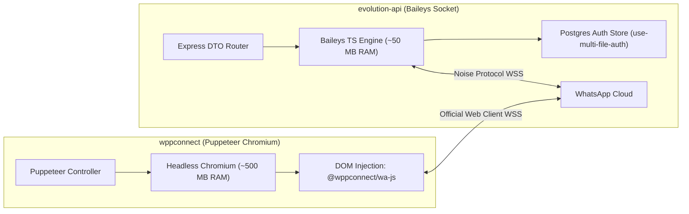
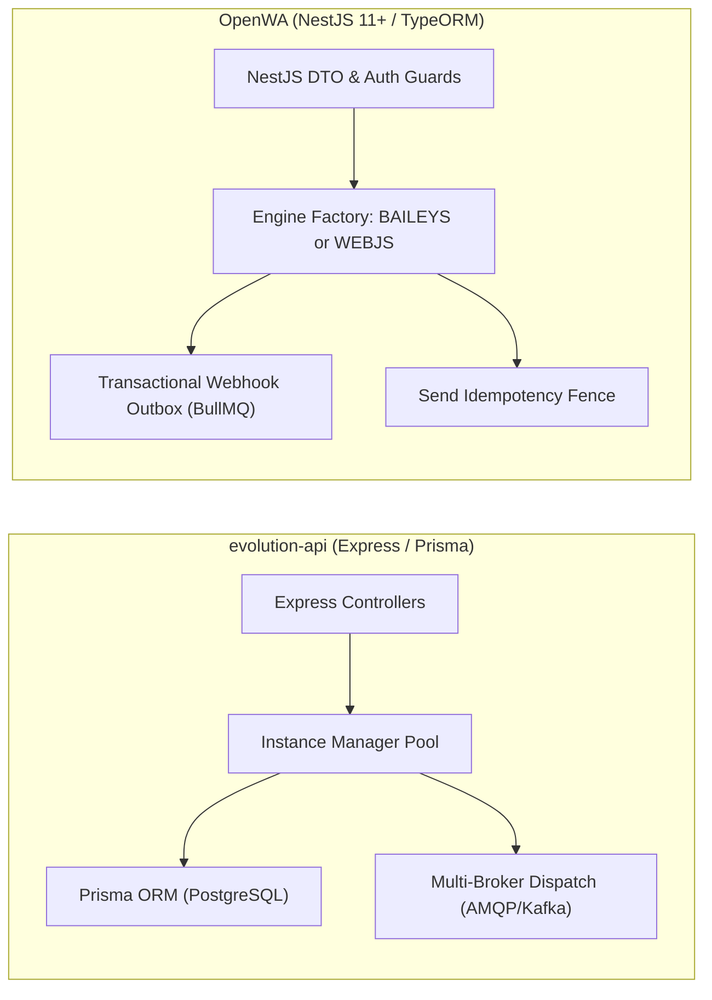
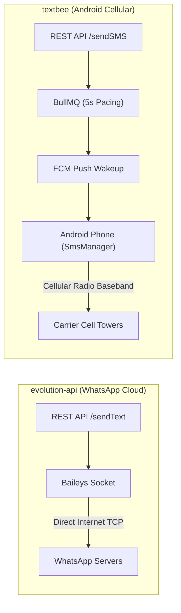
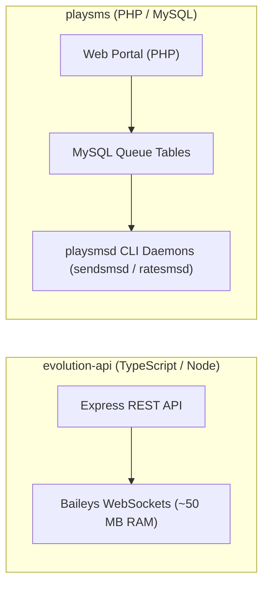
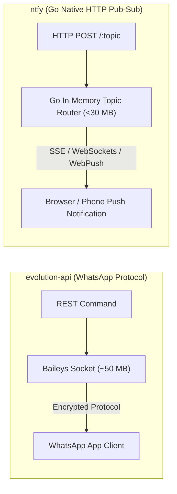

# evolution-api — Comparative Analysis & Category Evaluation

> **Category**: WhatsApp & Messaging Gateways  
> **Architectural Role**: Multi-instance WhatsApp binary socket API & session manager  
> **Primary Stack**: TypeScript 5.3+, Node.js 20+ | Express, Baileys v6.x, Prisma | PostgreSQL / MySQL / MongoDB, Redis 7+ | RabbitMQ / Kafka / SQS / BullMQ  
> **Peer Solutions Compared**: `wppconnect`, `OpenWA`, `textbee`, `playsms`, `ntfy`  
> **Commercial SaaS Benchmarks**: WhatsApp Cloud API (Meta), Twilio WhatsApp, Respond.io, MessageBird, Sent.dm  

---

## 1. Executive Overview & Technical Identity: evolution-api

**evolution-api** represents the high-density multi-tenant standard within the **WhatsApp & Messaging Gateways** domain, distinguished by its core focus on **Pure TypeScript Baileys socket execution (~50MB RAM per instance), database-persisted multi-file authentication (PostgreSQL/Redis), and enterprise message broker dispatch (RabbitMQ/Kafka/SQS)**.

### Core Architectural Profile
- **Runtime & Language**: `TypeScript 5.3+`, `Node.js 20+ LTS`
- **Core Framework**: `Express 4.x`, `@whiskeysockets/baileys` (v6.x), `Prisma ORM (v5.x)`
- **Persistence Layer**: `PostgreSQL 14+` or `MySQL 8.0+` (Auth state, instance configs, message history), `Redis 7+` (Presence, caches)
- **Concurrency & Queue Model**: `EventEmitter2` internal bus + `amqplib` (RabbitMQ) / `kafkajs` (Kafka) / `@aws-sdk/client-sqs` (SQS)
- **Domain Specialization**: `High-concurrency WhatsApp multi-instance REST API, native Opus voice notes & webhook dispatch`

---

## 2. Peer Solution Landscape (WhatsApp & Messaging Gateways)

Within this category, `evolution-api` operates alongside the following peer solutions:

| Solution | Language & Runtime | Core Framework | Database / Cache | Queue / Concurrency | Primary Architectural Niche |
| :--- | :--- | :--- | :--- | :--- | :--- |
| **evolution-api** (Current) | `TypeScript / Node 20+`| `Express, Baileys, Prisma` | `PostgreSQL / MySQL, Redis`| `RabbitMQ / Kafka / SQS` | **Direct binary socket WhatsApp with minimal RAM & DB auth** |
| **wppconnect** | `TypeScript / Node 20+`| `Express, Puppeteer` | `Local Disk / SQLite` | `Node Event Emitters` | Complete browser-level WhatsApp Web emulation via Chromium DOM |
| **OpenWA** | `TypeScript / Node 22+`| `NestJS 11+, TypeORM` | `PostgreSQL, Redis` | `BullMQ Transactional Outbox`| Pluggable dual-engine (Baileys & WWebJS) with send idempotency |
| **textbee** | `TypeScript & Kotlin` | `NestJS 11+, Android SDK` | `MongoDB 7+, Redis` | `BullMQ Pacing Engine` | Decentralized carrier SMS using physical Android handsets |
| **playsms** | `PHP 8.1+` | `Native PHP, CLI Daemons` | `MySQL 8.0+` | `playsmsd Background Daemons`| Classical carrier-grade SMS portal with prefix rating & SMPP |
| **ntfy** | `Go 1.26+` | `Native Go net/http` | `SQLite / PostgreSQL` | `Go Channels / sync.Map` | Ultra-fast zero-dependency push notification daemon (<30MB) |

---

## 3. Deep Head-to-Head Comparative Breakdown: evolution-api vs Peers

### 3.1. evolution-api vs. wppconnect

**Comparative Focus**: `Direct binary socket WhatsApp with minimal RAM` vs. `Headless Chromium DOM injection`

#### Architectural & Stack Differences
- **Engine Architecture & Memory Footprint**: Evolution API connects directly to WhatsApp's multi-device servers using **Baileys**, implementing the binary protocol over secure WebSockets using the **Noise Protocol Framework** and Protocol Buffers. Each active instance consumes only **40 MB – 80 MB of RAM**. WPPConnect launches an entire headless Google Chromium browser process via Puppeteer Extra per session, consuming **400 MB – 750 MB of RAM** per active WhatsApp number.
- **Session Auth Persistence**: Evolution API overrides standard Baileys file storage with custom database auth state providers (`use-multi-file-auth-state-prisma.ts` and `use-multi-file-auth-state-redis-db.ts`). Cryptographic session keys, pre-keys, and creds are written directly into PostgreSQL or Redis, allowing instances to survive container redeployments and auto-scaling without disk loss. WPPConnect caches session credentials in browser localStorage/IndexedDB serialized to local disk (`FileTokenStore`), which is vulnerable to corruption during unclean container termination.
- **Anti-Ban Mechanics vs Protocol Breaks**: WPPConnect runs inside the real WhatsApp Web client DOM; its network traffic is 100% indistinguishable from human browser usage, providing high immunity against automated reverse-engineering bans. Evolution API's pure socket protocol is resilient against browser crashes, but requires periodic upstream library updates whenever Meta modifies binary protobuf definitions.

#### Where evolution-api Excels over wppconnect
- **10x Higher Instance Density**: Host 50–100 active WhatsApp numbers on a modest 4 GB VPS, compared to only 5–8 sessions on WPPConnect.
- **Cloud-Native Database Session Storage**: Seamless container orchestration in Kubernetes/Docker without requiring persistent disk volumes.
- **Enterprise Event Ingress**: Native pub/sub streaming to RabbitMQ, Apache Kafka, AWS SQS, and NATS.

#### Where wppconnect Holds an Advantage over evolution-api
- **Official Browser Integrity**: Lower risk of protocol-level account bans during massive outbound campaigns.
- **Advanced WhatsApp Web Features**: Native access to WhatsApp Channels (Newsletters), Communities, Catalogs, and Polls via injected DOM modules (`Store.*`).
- **Client-Side Rendering**: Native Web Audio and Canvas support directly executed inside the browser engine.

#### Architectural Tradeoffs Matrix

| Architectural Dimension | evolution-api | wppconnect |
| :--- | :--- | :--- |
| **Underlying Engine** | `@whiskeysockets/baileys` (Pure TypeScript Socket)| `puppeteer` + `@wppconnect/wa-js` (Chromium DOM) |
| **RAM Footprint (per session)**| **~40 - 80 MB RAM** | ~400 - 750 MB RAM |
| **Auth Persistence** | PostgreSQL, MySQL, Redis (`Prisma Auth Store`) | Local Disk JSON / Memory (`FileTokenStore`) |
| **Event Broker Integration** | RabbitMQ, Apache Kafka, AWS SQS, NATS, Webhooks | Node EventEmitter / Webhooks |
| **Container Portability** | Stateless containers (all state in database) | Stateful containers (requires persistent browser volumes)|
| **Media Transcoding** | Server-side ffmpeg / sharp | Native in-browser Web Audio / HTML5 Canvas |
| **Best-Fit Deployment** | Multi-tenant SaaS, high-volume CRMs, API gateways| Single-tenant desktop tools, bot automation needing Newsletters|

---

### 3.2. evolution-api vs. OpenWA

**Comparative Focus**: `High-density Baileys gateway` vs. `NestJS pluggable dual-engine with transactional outbox`

#### Architectural & Stack Differences
- **Engine Flexibility (Dual-Engine Abstraction)**: Evolution API is locked into the Baileys binary socket engine. OpenWA implements a pluggable `WhatsAppEngine` interface that allows individual sessions to dynamically select between **Baileys** (socket) and **WWebJS** (Puppeteer Chromium) via configuration flag (`config.engine`), giving operators the freedom to run high-risk marketing numbers on Puppeteer and transactional numbers on Baileys.
- **Delivery Reliability & Transactional Outbox**: OpenWA incorporates the **Transactional Outbox Pattern**: incoming events and delivery receipts are atomically saved to `webhook_outbox_events` in PostgreSQL before BullMQ dispatches them with exponential backoff. Evolution API publishes events asynchronously via EventEmitter2 directly to webhooks or brokers; unhandled webhook receiver downtime can lead to dropped notifications unless RabbitMQ is provisioned.
- **Framework & Enterprise RBAC**: OpenWA is engineered on NestJS 11+ and TypeORM with cryptographic API key hashing and strict session-scoped authorization guards. Evolution API is built on Express 4.x and Prisma with global API key and instance token checks.

#### Where evolution-api Excels over OpenWA
- **Cloud-Native Auth Storage in DB**: Evolution API’s PostgreSQL/Redis auth store is more mature and hardened for large-scale multi-instance clustering.
- **Turnkey Integration Connectors**: Built-in, zero-code integrations for Chatwoot, Typebot, Dify, Flowise, and OpenAI Assistants.
- **Native Enterprise Brokers**: First-class support for Kafka, AWS SQS, RabbitMQ, and NATS.

#### Where OpenWA Holds an Advantage over evolution-api
- **Pluggable Dual-Engine Architecture**: Toggle between Baileys and Puppeteer per session without changing application code.
- **Transactional Webhook Outbox**: Zero-event-loss architecture during downstream system outages.
- **Send Idempotency Engine**: Dedicated `send_idempotency_keys` table prevents duplicate messages during network retries.

#### Architectural Tradeoffs Matrix

| Architectural Dimension | evolution-api | OpenWA |
| :--- | :--- | :--- |
| **Core Architecture** | Modular Express monolith with Prisma | Modular NestJS 11+ with TypeORM |
| **WhatsApp Drivers Supported**| Baileys only | **Dual-Engine (Baileys + WhatsApp-Web.js)** |
| **Webhook Delivery Reliability**| Real-time HTTP push or AMQP/Kafka brokers | **Transactional Outbox Pattern (BullMQ + PostgreSQL)**|
| **Duplicate Prevention** | Application-level deduplication | **Send Idempotency Key Fence (`send_idempotency_keys`)**|
| **Turnkey CRM Integrations** | Chatwoot, Typebot, Dify, Flowise, OpenAI | Custom Webhooks & REST API |
| **API Architecture** | Express REST Endpoints | NestJS Swagger OpenAPI 3.0 + DTO Validation |
| **Best-Fit Deployment** | Multi-instance CRM & SaaS communication hubs | Enterprise marketing platforms requiring strict delivery SLAs|

---

### 3.3. evolution-api vs. textbee

**Comparative Focus**: `Zero-cost WhatsApp gateway` vs. `Zero-cost Android cellular SMS gateway`

#### Architectural & Stack Differences
- **Channel Medium & Transport**: Evolution API communicates over the internet directly to WhatsApp's multi-device servers via encrypted TCP WebSockets. Textbee bridges internet REST requests to physical Android smartphones over Firebase Cloud Messaging (FCM), commanding the handset's native `SmsManager` to dispatch cellular SMS through local SIM cards.
- **Carrier Economics**: Evolution API delivers rich multimedia, voice notes, and interactive buttons over WhatsApp at \$0.00 cost. Textbee delivers standard telecom SMS (160 characters) at \$0.00 carrier cost by exploiting unlimited consumer cellular SIM plans.
- **Latency & Reliability**: Evolution API transmits messages in under 200 milliseconds. Textbee requires 3–8 seconds per SMS due to FCM wakeup delays, local device queuing, and a mandatory 5-second anti-spam pacing interval between transmissions to prevent carrier SIM bans.

#### Where evolution-api Excels over textbee
- **Sub-Second Transmission Latency**: Instantaneous delivery over WhatsApp WebSockets.
- **Rich Media & Interactive UI**: Native support for Opus PTT audio, documents, location pins, and clickable buttons.
- **No Physical Hardware Dependency**: Runs entirely in cloud Docker containers without requiring physical mobile phones plugged into chargers.

#### Where textbee Holds an Advantage over evolution-api
- **Universal SMS Reach**: Reaches any mobile phone globally without requiring the recipient to have WhatsApp installed.
- **Zero Third-Party Aggregator Fees**: Replaces expensive Twilio SMS fees (\$0.01 - \$0.05/SMS) with unlimited local carrier SIMs.
- **Dual-SIM Slot Routing**: Dynamically chooses SIM 1 or SIM 2 based on destination mobile carrier prefix.

#### Architectural Tradeoffs Matrix

| Architectural Dimension | evolution-api | textbee |
| :--- | :--- | :--- |
| **Messaging Channel** | WhatsApp Multi-Device | Cellular Carrier SMS (GSM / LTE) |
| **Hardware Requirement** | Zero (Cloud VPS / Docker container) | Physical Android smartphone(s) with SIM cards |
| **Message Throughput** | ~20 - 50 msgs/second per instance | 1 msg every 5 seconds per SIM (Carrier Pacing) |
| **Delivery Latency** | < 200 ms | ~3 - 8 seconds (FCM Push + Radio handoff) |
| **Rich Media Capabilities** | Audio PTT, Video, Documents, Images, Polls | Plaintext SMS (160 chars) / Basic MMS |
| **Recipient Prerequisite**| Must have WhatsApp installed | Any cellular mobile handset |
| **Best-Fit Deployment** | Rich customer engagement, chat support, D2C sales| 2FA verification codes, local SMS alerts, notifications|

---

### 3.4. evolution-api vs. playsms

**Comparative Focus**: `Modern WhatsApp API microservice` vs. `Classical telecom SMS portal & daemon engine`

#### Architectural & Stack Differences
- **Architectural Generation**: Evolution API is an event-driven TypeScript microservice designed for cloud-native containerized architectures. playSMS is a classical LAMP portal written in PHP, relying on Linux background CLI daemons (`playsmsd.php`) polling MySQL database tables.
- **Channel Protocols**: Evolution API speaks the WhatsApp Noise Protocol. playSMS is an SMS routing engine that speaks SMPP v3.4 (via Jasmin or Kannel), GSM AT commands (via Gammu modems), and HTTP aggregator APIs.
- **Billing & User Quotas**: playSMS features a built-in telco rating and credit engine (`playsms_featureSimplerate`) that calculates SMS segment costs per country prefix and deducts user credit balances. Evolution API has no concept of billing credits, delegating quotas to upstream API consumers.

#### Where evolution-api Excels over playsms
- **Modern WhatsApp Protocol Support**: Full-featured WhatsApp business automation with zero telco hardware.
- **Asynchronous Event-Driven Throughput**: Sub-second event dispatching via WebSockets and enterprise message brokers.
- **Cloud-Native Deployment**: Packaged as standard Docker containers without requiring Linux system userspace daemons.

#### Where playsms Holds an Advantage over playsms
- **Telecom Carrier SMPP & Modem Routing**: Interfaces directly with telecom trunks and hardware GSM modems.
- **Prefix Rating & Prepaid Credit Billing**: Complete multi-tier credit management for commercial SMS resellers.
- **SMS Keyword Automation**: Built-in interactive SMS autoreplies, voting polls, and SMS-to-email routing.

#### Architectural Tradeoffs Matrix

| Architectural Dimension | evolution-api | playsms |
| :--- | :--- | :--- |
| **Primary Channel** | WhatsApp Multi-Device | Telecom Carrier SMS |
| **Runtime Architecture** | Event-driven Node.js / Express microservice | PHP Web Portal + Linux CLI Daemons (`playsmsd`) |
| **Protocol Integration** | WhatsApp WebSockets (Noise Protocol) | SMPP v3.4, GSM AT Commands, HTTP REST |
| **Billing & Rating** | None (Delegated to upstream platform) | Built-in prefix rate billing & prepaid credits |
| **Storage Engine** | PostgreSQL / MySQL / Mongo + Redis | MySQL 8.0+ / MariaDB queue tables |
| **Best-Fit Deployment** | WhatsApp-driven SaaS, marketing CRM inboxes | Commercial SMS resellers, telecom aggregators |

---

### 3.5. evolution-api vs. ntfy

**Comparative Focus**: `Two-way conversational WhatsApp gateway` vs. `Lightweight HTTP pub-sub push server`

#### Architectural & Stack Differences
- **Domain Specialization**: Evolution API is an interactive, bi-directional WhatsApp conversational gateway enabling two-way customer communication. `ntfy` is a high-speed, one-way HTTP publish-subscribe notification server designed to broadcast real-time system alerts to browsers and mobile devices.
- **Operational Complexity**: Evolution API requires managing WhatsApp multi-device authentication states, QR scanning, session persistence in databases, and proxy configurations. `ntfy` is a zero-dependency compiled Go binary that sends push alerts via simple curl commands: `curl -d "Lead qualified!" ntfy.sh/alerts`.
- **Client Requirements**: Evolution API delivers messages to standard WhatsApp mobile applications. `ntfy` delivers notifications to desktop browsers (via SSE/WebPush), iOS/Android mobile apps, and UnifiedPush-compatible clients.

#### Where evolution-api Excels over ntfy
- **Bi-Directional Customer Conversations**: Ingest customer replies, manage chat threads, and route conversations to human agents.
- **Universal Consumer Reach**: Over 2.7 billion active WhatsApp users already have the app installed.
- **Rich Media & Formatting**: Supports native Opus voice recordings, PDF documents, and interactive buttons.

#### Where ntfy Holds an Advantage over evolution-api
- **Negligible Footprint & Zero Dependencies**: Single Go binary consuming under 30 MB of RAM with zero databases required.
- **Zero Account Ban Risk**: Plain HTTP pub-sub completely free from Meta terms of service or carrier spam detection.
- **Instant Implementation**: Fire alerts from any script, cron job, or microservice using standard HTTP POST requests.

#### Architectural Tradeoffs Matrix

| Architectural Dimension | evolution-api | ntfy |
| :--- | :--- | :--- |
| **Primary Domain Focus** | Bi-directional conversational WhatsApp API | One-way HTTP pub-sub push notification server |
| **Runtime & Language** | TypeScript / Node.js 20+ | Compiled Go 1.26+ (Zero dependencies) |
| **Client Requirement** | WhatsApp consumer mobile application | Desktop browser / ntfy mobile app / UnifiedPush |
| **Delivery Model** | End-to-end encrypted messaging via Meta servers| Direct HTTP streaming (SSE, WebSockets, WebPush) |
| **Base Production RAM** | ~50 MB RAM per active session | **< 30 MB RAM total** |
| **Best-Fit Deployment** | Customer support, conversational sales, lead nurture| Internal DevOps alerts, transactional push notifications|

---

## 4. Capability & Feature Comparison Matrix

| Dimension / Capability | evolution-api | wppconnect | OpenWA | textbee | playsms | ntfy |
| :--- | :---: | :---: | :---: | :---: | :---: | :---: |
| **Primary Channel** | WhatsApp | WhatsApp | WhatsApp | Android SMS | Telecom SMS | Push Alerts |
| **Underlying Engine** | Baileys Socket | Chromium Web | Dual Engine | Android Intent / FCM | Modem / SMPP | HTTP / WebPush |
| **RAM per Active Session**| **~50 MB** | ~500 MB | ~80 MB / ~350 MB | ~30 MB (Mobile App) | ~25 MB | **< 30 MB (Total)** |
| **Session DB Storage** | **Postgres / Redis DB** | Local Disk Only | Postgres / BullMQ | MongoDB Documents | MySQL Queue Tables | SQLite / Postgres |
| **Broker Integration** | RabbitMQ / Kafka / SQS | Node Event Emitters | BullMQ Outbox | BullMQ Pacing | DB Polling Daemons | In-Memory Channels |
| **Turnkey Bot Connectors**| Chatwoot / Typebot / Dify| None | Custom Webhooks | Custom Webhooks | SMS Autoreply | Action Buttons |
| **Anti-Ban Resilience** | Moderate (Protobuf updates)| **High (Official Web Client)**| Pluggable Engine Switch | Carrier Pacing (5s delay)| MNO Authorized Trunks| N/A |

---

## 5. Commercial Benchmark Positioning

When benchmarked against commercial SaaS leaders (**WhatsApp Cloud API (Meta), Twilio WhatsApp / SMS, Respond.io, Pushover, Sent.dm**):
- **Against Meta WhatsApp Cloud API**: `evolution-api` eliminates per-message Meta conversation charges (\$0.03–\$0.15/msg), eliminates the strict 24-hour customer service session window, and allows instant onboarding of existing mobile numbers.
- **Against Twilio WhatsApp**: Evolution API eliminates Twilio’s \$0.005 markup fee per message plus Meta conversation costs, delivering unlimited messaging on self-hosted infrastructure.
- **Against Respond.io**: Evolution API serves as the underlying WhatsApp connectivity engine for open-source helpdesks like Chatwoot, replicating Respond.io's multi-agent WhatsApp inbox capabilities at zero recurring software cost.

---

## 6. Strategic Takeaways & Role for MarketingStudio

In the unified **MarketingStudio** architecture:
1. **Primary Component to Adopt**: Standardize on `evolution-api` as the primary **WhatsApp Connectivity Spine** for all conversational marketing, automated lead replies, and sales rep chat inboxes.
2. **Utilize PostgreSQL Auth Persistence**: Store all Baileys authentication states and session keys directly in MarketingStudio's core PostgreSQL database (`use-multi-file-auth-state-prisma.ts`), ensuring WhatsApp numbers survive server updates without QR rescans.
3. **Bridge with Chatwoot Shared Inbox**: Connect Evolution API webhooks directly to Chatwoot's API inboxes for unified live-agent customer support dispatch.
