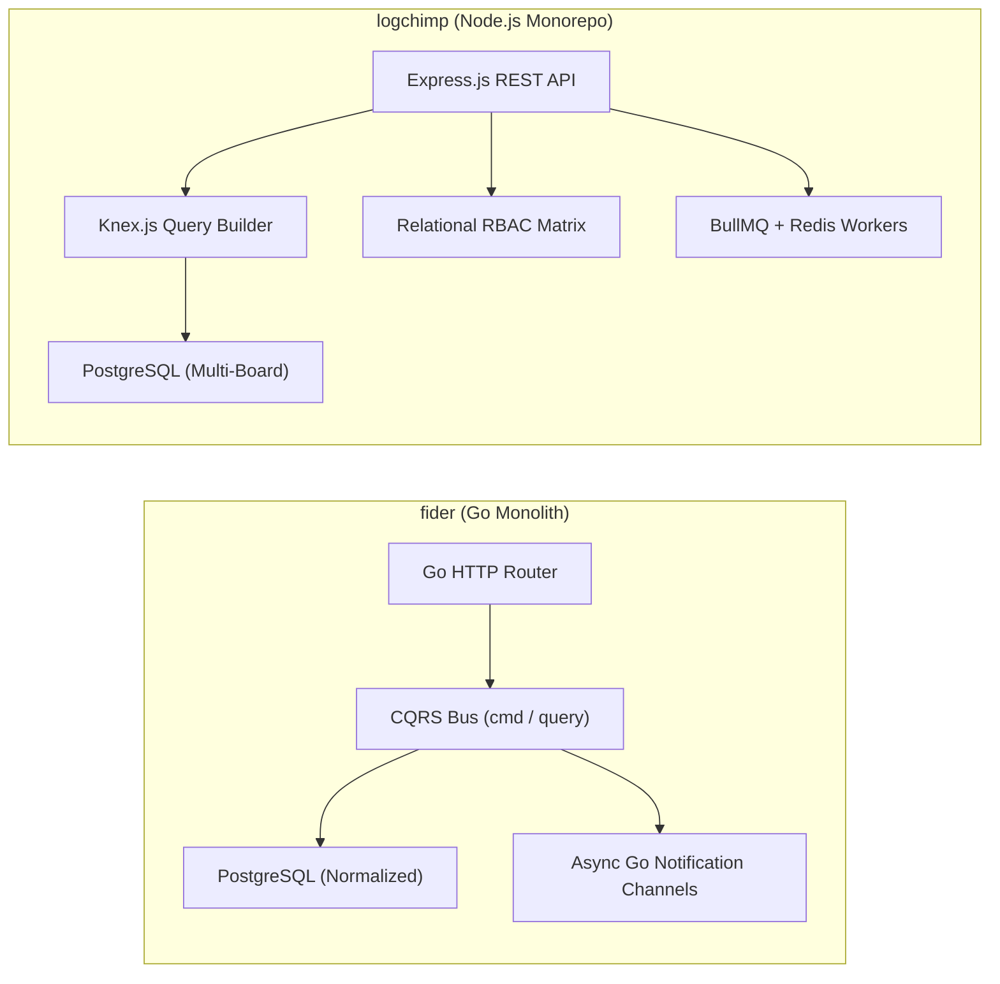
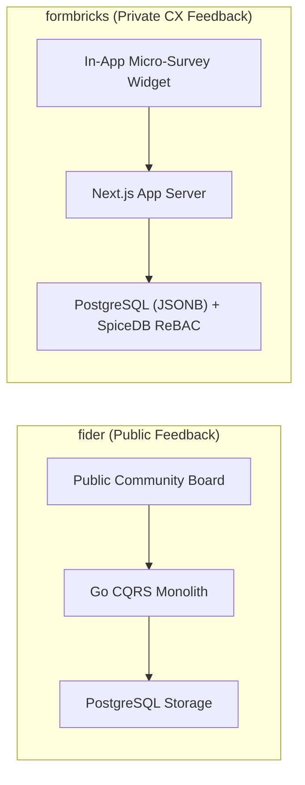
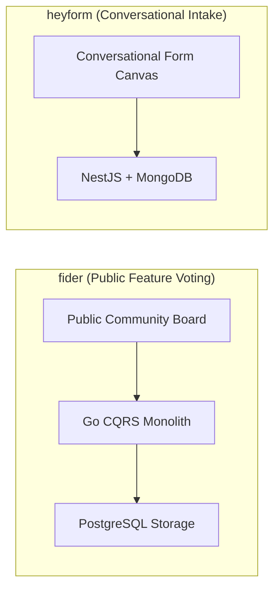
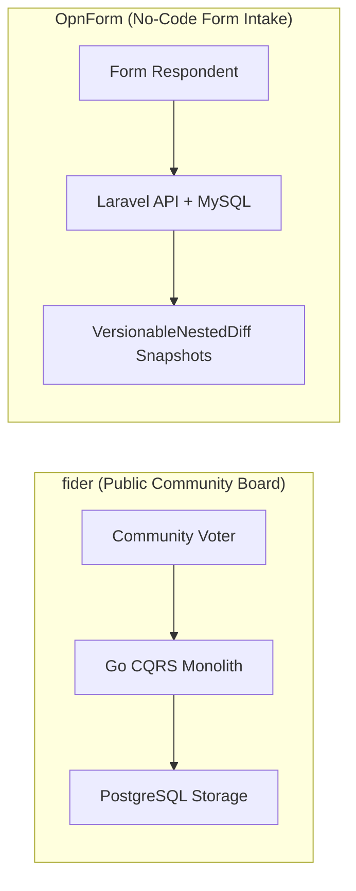
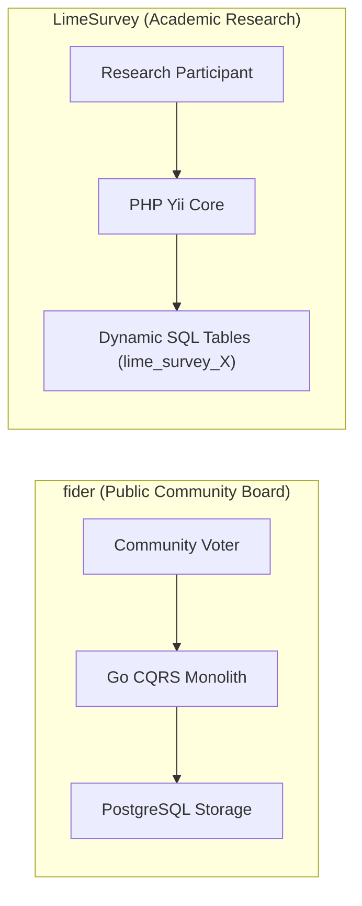
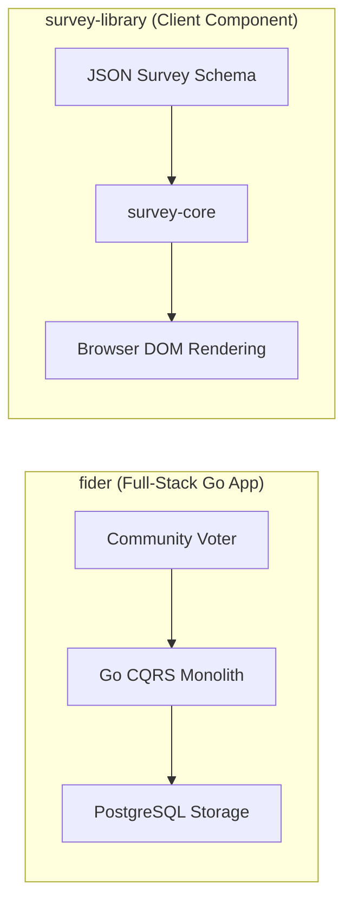
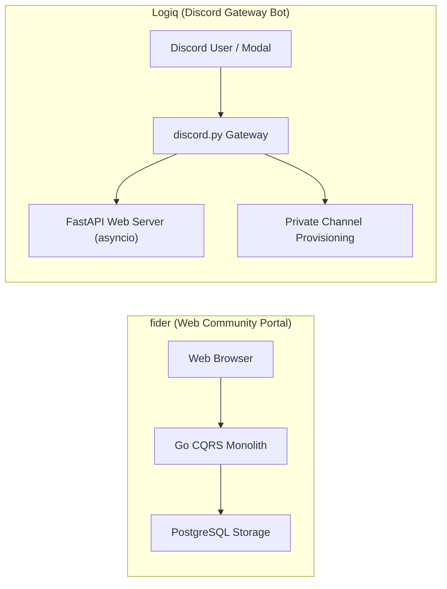

# fider — Comparative Analysis & Category Evaluation

> **Category**: Forms, Surveys & Feedback  
> **Architectural Role**: Public customer feedback forum, feature voting board & CQRS roadmap engine  
> **Primary Stack**: Go (Golang) 1.22+ | Go HTTP Monolith, React 18, esbuild | PostgreSQL 14+, pgx | Goroutines & Channels  
> **Peer Solutions Compared**: `logchimp`, `formbricks`, `heyform`, `OpnForm`, `formizee`, `LimeSurvey`, `survey-library`, `Logiq`, `dsforms`  
> **Commercial SaaS Benchmarks**: Canny.io, UserVoice, Upvoty, Productboard  

---

## 1. Executive Overview & Technical Identity: fider

**Fider** is an open-source customer feedback platform and feature voting engine engineered as an ultra-fast, self-hosted alternative to Canny, UserVoice, and Productboard. Designed to bridge the communication gap between product teams and their user communities, Fider enables software companies to collect, organize, and prioritize feature requests, bug reports, and product suggestions through transparent community upvoting and closed-loop public roadmaps.

### Core Architectural Profile
- **Runtime & Language**: Compiled `Go 1.22+` application delivering sub-20ms API response times with ~40MB RAM usage.
- **Architectural Pattern**: **Command Query Responsibility Segregation (CQRS)** pattern across business domains (`app/models/cmd` for state mutations and `app/models/query` for reads).
- **Frontend Architecture**: `React 18` Single-Page Application bundled via `esbuild` and embedded directly into the Go executable via `go:embed`.
- **Persistence Layer**: `PostgreSQL 14+` utilizing standard SQL queries via the high-performance `pgx` driver.
- **Multi-Tenancy**: Built-in tenant resolution middleware matching incoming Host headers to `tenants.subdomain` or custom CNAME records.
- **Community Governance & De-duplication**: Real-time client-side debounced duplicate detection during idea drafting (`GET /api/v1/posts?query={text}`), canonical duplicate proposal merging (`OriginalPost`), and automated email notifications to all upvoters when a post transitions across roadmap stages (`Planned`, `Started`, `Completed`).
- **Authentication**: Verified email magic links and OAuth2 providers (Google, GitHub, Facebook).

---

## 2. Peer Solution Landscape (Forms, Surveys & Feedback)

Within this category, `fider` operates alongside the following peer solutions:

| Solution | Language & Runtime | Core Framework | Database / Cache | Queue / Concurrency | Primary Architectural Niche |
| :--- | :--- | :--- | :--- | :--- | :--- |
| **fider** (Current) | `Go 1.22+` | `Go HTTP Monolith` | `PostgreSQL 14+` | `Goroutines, Channels` | Compiled CQRS public feature voting portal with sub-20ms latency |
| **logchimp** | `TypeScript / Node` | `Express.js, Vue 3` | `PostgreSQL, Knex.js` | `BullMQ / Redis` | Multi-board customer feedback roadmap with RBAC and audit trail |
| **formbricks** | `TypeScript / Node` | `Next.js Monorepo` | `PostgreSQL, Prisma` | `BullMQ / Redis` | In-app micro-surveys, ReBAC access, telemetry |
| **heyform** | `TypeScript / Node` | `NestJS 10+, React 18` | `MongoDB, Redis` | `Bull Queue / Redis` | Conversational multi-step forms with polymorphic document answers |
| **OpnForm** | `PHP 8.2+ / TypeScript` | `Laravel 11, Nuxt 3` | `MySQL / PostgreSQL` | `Laravel Horizon / Redis` | No-code dynamic forms with versioned revisions & MCP agent drafts |
| **formizee** | `TypeScript / Edge` | `Hono, Turborepo` | `LibSQL / Turso, Drizzle` | `Cloudflare KV / Async` | Zero-knowledge AES-256-GCM encrypted headless form vault |
| **LimeSurvey** | `PHP 8.1+` | `Yii Framework` | `MySQL / PostgreSQL` | `PHP CLI Workers` | Enterprise statistical surveys with dynamic runtime SQL tables |
| **survey-library** | `TypeScript 5.3+` | `Framework-Agnostic MVVM` | `Pure Client-Side (BYO)`| `Synchronous / Web Workers`| Declarative JSON survey engine with AST expression evaluator |
| **Logiq** | `Python 3.10+` | `FastAPI, discord.py` | `SQLite / PostgreSQL` | `asyncio Event Loop` | Discord-native community ticketing bot & FastAPI REST management |
| **dsforms** | `Go 1.22+` | `Pure Go HTTP` | `SQLite / LibSQL (pure Go)`| `Go Worker Channels` | Zero-dependency headless form backend with forensic spam quarantine |

---

## 3. Deep Head-to-Head Comparative Breakdown: fider vs Peers

### 3.1. fider vs. logchimp

**Comparative Focus**: `Compiled Go CQRS single-binary board` vs. `Node.js multi-board feedback portal with RBAC and changelogs`

#### Architectural Differences:
- **Runtime Performance & Footprint**: Fider is written in compiled Go 1.22+, consuming ~40MB of RAM and serving requests with sub-20ms latency. Logchimp is built on TypeScript/Node.js with Express.js, Knex.js, and Redis BullMQ (~120MB RAM).
- **Board Organization & Granularity**: Fider focuses on a single unified feedback board per tenant with tag-based filtering. Logchimp provides dedicated multi-board categorization (`Boards` with custom URLs and visibility toggles) alongside integrated product release changelogs.
- **Architectural Pattern**: Fider strictly implements Command Query Responsibility Segregation (CQRS) (`app/models/cmd` for mutations and `app/models/query` for reads). Logchimp implements traditional MVC controllers with Knex.js queries and an immutable activity timeline (`posts_activity`).
- **Access Control**: Fider uses simple role flags (`administrator`, `collaborator`, `visitor`). Logchimp implements a complete relational RBAC model (`roles`, `permissions`, `roles_users`, `permissions_roles`).

#### Architectural Comparison Matrix:

| Dimension | fider | logchimp |
| :--- | :--- | :--- |
| **Runtime & Language** | Compiled Go 1.22+ (~40 MB RAM, <20ms latency) | TypeScript / Node.js 20+ (~120 MB RAM) |
| **Architectural Model** | Command Query Responsibility Segregation (CQRS) | Express.js controllers + Knex.js query builder |
| **Board Organization** | Single unified board with tag filtering | Partitioned multi-board separation (`Boards`) |
| **Changelog Engine** | Roadmap stage statuses only | Dedicated user-facing product release changelog |
| **Access Control** | Simple tenant roles (`administrator`, `visitor`) | Normalized relational RBAC matrix |

---

### 3.2. fider vs. formbricks

**Comparative Focus**: `Public Go CQRS feature voting portal` vs. `Targeted in-app private CX telemetry & ReBAC`

#### Architectural Differences:
- **Domain Focus**: Fider is an open community suggestion portal where users publicly submit ideas, upvote proposals, and track official roadmap progress. Formbricks collects private feedback from targeted users inside web/mobile apps to calculate NPS and optimize customer journeys.
- **Execution Architecture**: Fider is a compiled Go binary with PostgreSQL (~40MB RAM). Formbricks is a distributed TypeScript Next.js monorepo relying on BullMQ, Redis, and SpiceDB ReBAC (~250MB RAM).
- **De-duplication & Merging**: Fider implements real-time client-side debounced duplicate detection during idea drafting and canonical proposal merging (`OriginalPost`). Formbricks aggregates responses anonymously or links them to customer CRM profiles.

#### Architectural Comparison Matrix:

| Dimension | fider | formbricks |
| :--- | :--- | :--- |
| **Core Feedback Model** | Public, democratic community voting board | Private, targeted, discrete in-app questionnaires |
| **Runtime & Performance** | Compiled Go 1.22+ binary (~40 MB RAM, <20ms latency) | TypeScript / Node.js (~250 MB RAM) |
| **Architectural Pattern** | Go HTTP Monolith with strict CQRS command/query separation | Next.js App Router + Prisma ORM |
| **Roadmap & Voter Fan-out** | Built-in public roadmap stages with automatic voter notifications | Not supported (analytics reporting only) |
| **Access & Verification** | OAuth2 (Google/GitHub) and verified email magic links | Client-side user ID / anonymous session cookies |

---

### 3.3. fider vs. heyform

**Comparative Focus**: `Public feature voting board` vs. `Conversational Typeform-style multi-step forms`

#### Architectural Differences:
- **Functional Paradigm**: Fider is an open community portal for democratic feature prioritization. HeyForm collects private data from respondents through structured, multi-step conversational questionnaires.
- **Runtime Performance & Stack**: Fider is a compiled Go 1.22+ binary with PostgreSQL (~40MB RAM). HeyForm runs on Node.js/NestJS with MongoDB and Redis (~300MB RAM).
- **Data Modeling**: Fider uses a normalized relational schema with strict constraints on `(user_id, post_id)` to eliminate ballot stuffing. HeyForm stores submissions as polymorphic document arrays in MongoDB.

#### Architectural Comparison Matrix:

| Dimension | fider | heyform |
| :--- | :--- | :--- |
| **Core Interaction** | Public collaborative idea suggestion and upvoting | Private multi-step questionnaires |
| **Runtime & Language** | Compiled Go 1.22+ binary (~40 MB RAM, <20ms latency) | TypeScript / Node.js 20+ (~300 MB RAM) |
| **Architectural Model** | Go HTTP Monolith with strict CQRS command/query separation | NestJS GraphQL / REST Controllers |
| **Roadmap & Notification** | Public roadmap stages with automatic voter email updates | Webhooks / Zapier / Slack integration |
| **Database Storage** | Normalized relational PostgreSQL | MongoDB document store |

---

### 3.4. fider vs. OpnForm

**Comparative Focus**: `Public community voting board` vs. `No-code dynamic forms with versioning & MCP drafts`

#### Architectural Differences:
- **Functional Paradigm**: Fider is an open community suggestion portal where users publicly submit ideas, upvote proposals, and track official roadmap progress. OpnForm is an intake engine for capturing structured data, lead inquiries, and customer feedback.
- **Runtime Performance & Stack**: Fider is a compiled Go 1.22+ binary with PostgreSQL (~40MB RAM) delivering sub-20ms latency. OpnForm runs on PHP 8.2+ and Laravel with Horizon (~150MB RAM).
- **Data Modeling**: Fider uses a normalized relational schema. OpnForm encapsulates dynamic forms inside Eloquent JSON properties with automated versioning snapshots (`VersionableNestedDiff`).

#### Architectural Comparison Matrix:

| Dimension | fider | OpnForm |
| :--- | :--- | :--- |
| **Core Interaction** | Public collaborative idea suggestion and upvoting | Private or public structured data intake |
| **Runtime & Language** | Compiled Go 1.22+ binary (~40 MB RAM, <20ms latency) | PHP 8.2+ / TypeScript (~150 MB RAM) |
| **Architectural Model** | Go HTTP Monolith with strict CQRS command/query separation | Laravel REST API + Horizon queues |
| **Roadmap & Notification** | Public roadmap stages with automatic voter email updates | Webhooks / Notion / Slack integration |
| **Database Storage** | Normalized relational PostgreSQL | MySQL / PostgreSQL with Eloquent JSON |

---

### 3.5. fider vs. formizee

**Comparative Focus**: `Public community voting board` vs. `Edge-native zero-knowledge encrypted headless form vault`

```mermaid
flowchart LR
    subgraph FiderArch ["fider (Public Feature Voting)"]
        A1["Community Voter"] --> A2["Go CQRS Engine"]
        A2 --> A3["PostgreSQL Database"]
    end
    subgraph FormizeeArch ["formizee (Private Headless Vault)"]
        B1["Static Form (<form>)"] --> B2["Hono Edge Worker"]
        B2 --> B3["AES-256-GCM Vault"]
    end
```

#### Architectural Differences:
- **Core Domain**: Fider is an open, public feedback board where users suggest ideas, upvote proposals, and track official roadmap progress. Formizee is a private ingestion gateway for contact forms, customer inquiries, and lead generation.
- **Data Privacy**: Fider deliberately displays customer ideas and upvotes publicly to foster democratic community prioritization. Formizee encrypts all incoming data at the edge with AES-256-GCM so nobody except the workspace key holder can view submissions.
- **Stack & Architecture**: Fider is a compiled Go 1.22+ binary with PostgreSQL (~40MB RAM). Formizee runs on TypeScript/Hono at the edge on Cloudflare Workers (~35MB RAM).

#### Architectural Comparison Matrix:

| Dimension | fider | formizee |
| :--- | :--- | :--- |
| **Core Interaction** | Public community idea suggestion and upvoting | Private headless submission ingestion |
| **Data Privacy** | Public community board with verified voter accounts | Zero-knowledge client-side AES-256-GCM encryption |
| **Runtime & Language** | Compiled Go 1.22+ binary (~40 MB RAM, <20ms latency) | TypeScript / Edge workerd (Hono) |
| **Roadmap & Notification** | Public roadmap stages with automatic voter email updates | Webhooks, log drains, and email alerts |
| **Persistence** | Normalized relational PostgreSQL | LibSQL / Turso distributed SQLite |

---

### 3.6. fider vs. LimeSurvey

**Comparative Focus**: `Public community feedback portal` vs. `Enterprise statistical research & dynamic SQL tables`

#### Architectural Differences:
- **Domain Purpose**: Fider is an open community suggestion portal where users publicly submit feature ideas, upvote proposals, and track official roadmap progress. LimeSurvey conducts private, rigorous research studies across sampled populations.
- **Runtime Performance & Stack**: Fider is a compiled Go 1.22+ binary with PostgreSQL (~40MB RAM) delivering sub-20ms response times. LimeSurvey runs on PHP 8.1+ and the Yii Framework (~180MB RAM) dynamically generating dedicated relational SQL tables per survey.
- **Statistical Export**: LimeSurvey generates native syntax files for SPSS, R, and Stata. Fider manages community feature lists and upvoting counts.

#### Architectural Comparison Matrix:

| Dimension | fider | LimeSurvey |
| :--- | :--- | :--- |
| **Core Interaction** | Public collaborative idea suggestion and upvoting | Private multi-page research questionnaires |
| **Runtime & Language** | Compiled Go 1.22+ binary (~40 MB RAM, <20ms latency) | PHP 8.1+ / Yii Framework (~180 MB RAM) |
| **Architectural Model** | Go HTTP Monolith with strict CQRS command/query separation | Dynamic SQL DDL per survey |
| **Roadmap & Notification** | Public roadmap stages with automatic voter email updates | Plugin event dispatcher (`afterSurveyComplete`) |
| **Database Storage** | Normalized relational PostgreSQL | Dedicated relational tables per survey |

---

### 3.7. fider vs. survey-library (SurveyJS)

**Comparative Focus**: `Compiled Go CQRS feedback board` vs. `Framework-agnostic client-side MVVM JSON engine`

#### Architectural Differences:
- **Architectural Scope**: Fider is an end-to-end compiled web application with backend server, PostgreSQL persistence, authentication, and email notifications. SurveyJS is a pure client-side library with zero backend code.
- **Domain Purpose**: Fider manages public feature voting boards and roadmaps. SurveyJS renders complex, multi-page questionnaires, evaluation matrices, and quizzes inside web applications.

#### Architectural Comparison Matrix:

| Dimension | fider | survey-library (SurveyJS) |
| :--- | :--- | :--- |
| **Architectural Layer** | Compiled Go 1.22+ backend monolith with React frontend | Client-side frontend component library |
| **Persistence** | Relational PostgreSQL with CQRS handlers | None (Bring Your Own Backend) |
| **Runtime Footprint** | ~40 MB RAM (<20ms latency) | 0 MB server RAM (runs in browser) |
| **Primary Use Case** | Public customer feedback portals and voting roadmaps | Complex multi-page forms and enterprise questionnaires |

---

### 3.8. fider vs. Logiq

**Comparative Focus**: `Web public voting portal` vs. `Discord-native modal ticketing & channel triage`

#### Architectural Differences:
- **Ingress Platform**: Fider provides a web-based community portal accessible via any web browser. Logiq operates inside Discord chat servers, interacting with users via persistent buttons and native modal dialogs (`discord.ui.Modal`).
- **Workflow Pipeline**: Fider publishes submitted suggestions to an open community voting board. Logiq provisions isolated private Discord text channels (`ticket-{username}`) with role-based permission overwrites.
- **Concurrency & Runtime**: Fider is a compiled Go binary utilizing Goroutines. Logiq runs a single-process concurrent Python 3.10+ application inside an `asyncio` event loop.

#### Architectural Comparison Matrix:

| Dimension | fider | Logiq |
| :--- | :--- | :--- |
| **Platform Ingress** | Web browsers (React 18 SPA) | Discord client via native interaction modals |
| **Submission Output** | Public community suggestion card on voting board | Isolated private support text channel in Discord |
| **Runtime & Language** | Compiled Go 1.22+ (~40 MB RAM) | Python 3.10+ (discord.py + FastAPI via asyncio) |
| **Persistence** | Relational PostgreSQL | SQLite / PostgreSQL / MongoDB |
| **Best Architectural Fit** | Public feature discovery and transparent roadmaps | Community customer support within Discord |

---

### 3.9. fider vs. dsforms

**Comparative Focus**: `Go CQRS feedback voting board` vs. `Pure Go single-binary headless backend with quarantine scoring`

```mermaid
flowchart LR
    subgraph FiderArch ["fider (Community Feedback Monolith)"]
        A1["Web Browser / Voter"] --> A2["Go HTTP Server"]
        A2 --> A3["PostgreSQL Database"]
    end
    subgraph DsformsArch ["dsforms (Headless Ingestion Monolith)"]
        B1["Static Form (<form>)"] --> B2["Pure Go HTTP Server"]
        B2 --> B3["Weighted Spam Screener"]
        B2 --> B4["Embedded SQLite / LibSQL"]
        B2 --> B5["Model Context Protocol (MCP) Server"]
    end
```

#### Architectural Differences:
- **Domain Scope**: Fider manages public feature voting boards, community discussions, and roadmaps. dsforms is a headless form backend for static websites and landing pages, featuring forensic spam screening and viral waitlists.
- **Database & Dependencies**: Fider requires an external PostgreSQL database. dsforms embeds a pure Go SQLite / LibSQL database (`modernc.org/sqlite`), running with zero external dependencies in a single binary.
- **Spam Defenses**: Fider eliminates spam and duplicate voting through OAuth2 authentication, email verification magic links, and unique database constraints on `(user_id, post_id)`. dsforms implements a weighted heuristic screener (`internal/screen`) with an auditable quarantine holding queue (`is_held: 1`, `spam_signals`).
- **AI Agent Automation**: dsforms embeds a native Model Context Protocol (MCP) server for autonomous agent operations. Fider manages user interactions through its web interface.

#### Architectural Comparison Matrix:

| Dimension | fider | dsforms |
| :--- | :--- | :--- |
| **Primary Domain** | Public customer feedback forum & voting roadmap | Headless form backend & viral waitlist engine |
| **Database Architecture** | Relational PostgreSQL (requires external DB) | Embedded SQLite / LibSQL (zero external DB) |
| **Spam & Abuse Defense** | OAuth2 / Magic links + unique ballot constraints | Weighted heuristic scoring with auditable quarantine queue |
| **AI Agent Interface** | None | Native embedded Model Context Protocol (MCP) server |
| **Memory Footprint** | ~40 MB RAM | ~25 MB RAM |

---

## 4. Capability & Feature Comparison Matrix

| Dimension / Capability | fider | logchimp | formbricks | heyform | OpnForm | formizee | LimeSurvey | survey-library | Logiq | dsforms |
| :--- | :---: | :---: | :---: | :---: | :---: | :---: | :---: | :---: | :---: | :---: |
| **Public Feature Voting** | ✅ Pure CQRS | ✅ Multi-Board | ❌ | ❌ | ❌ | ❌ | ❌ | ❌ | ❌ | ❌ |
| **Changelog & Public Roadmap** | ⚠️ Basic | ✅ Integrated | ❌ | ❌ | ❌ | ❌ | ❌ | ❌ | ❌ | ❌ |
| **Duplicate Idea De-duplication**| ✅ Real-Time | ⚠️ Manual | ❌ | ❌ | ❌ | ❌ | ❌ | ❌ | ❌ | ❌ |
| **Automated Voter Fan-out** | ✅ Built-in | ✅ Built-in | ❌ | ❌ | ❌ | ❌ | ❌ | ❌ | ❌ | ❌ |
| **Conversational Typeform UI**| ❌ | ❌ | ⚠️ Compact modal | ✅ Full Screen | ✅ Full Screen | ❌ (Headless) | ❌ | ✅ Supported | ❌ | ❌ |
| **Targeted In-App Popups** | ❌ | ❌ | ✅ Native SDK | ⚠️ Iframe | ⚠️ Iframe | ❌ | ❌ | ⚠️ UI Embed | ❌ | ❌ |
| **Headless Form API Endpoint** | ❌ | ❌ | ⚠️ API Routes | ❌ | ❌ | ✅ Edge Native | ❌ | ❌ | ❌ | ✅ Single Binary |
| **Discord Chat Ticket Modals** | ❌ | ❌ | ❌ | ❌ | ❌ | ❌ | ❌ | ❌ | ✅ Native UI | ❌ |
| **Viral Waitlist & Referrals** | ❌ | ❌ | ❌ | ❌ | ❌ | ❌ | ❌ | ❌ | ❌ | ✅ Integrated |
| **AI Agent MCP Integration** | ❌ | ❌ | ⚠️ REST API | ❌ | ✅ Agent Drafts| ⚠️ API Keys | ❌ | ❌ | ⚠️ LLM Cog | ✅ Native MCP |
| **Runtime Memory Footprint** | **~40 MB** | ~120 MB | ~250 MB | ~300 MB | ~150 MB | **~35 MB (Edge)** | ~180 MB | **0 MB (Client)** | ~90 MB | **~25 MB** |

---

## 5. Commercial Benchmark Positioning

When benchmarked against commercial SaaS leaders (**Canny.io, UserVoice, Upvoty, Productboard**):
- **Against Canny.io & Upvoty**: `fider` delivers the core feature suggestion and upvoting workflow with zero software licensing costs, sub-20ms response times, and complete data ownership.
- **De-duplication Intelligence**: Real-time debounced title search surfaces existing proposals as users type, preventing duplicate suggestions before they are created.
- **Operational Simplicity**: Written in compiled Go with minimal external requirements (PostgreSQL), Fider is trivial to deploy and maintain on small virtual servers.

---

## 6. Strategic Takeaways & Role for MarketingStudio

In the unified **MarketingStudio** architecture:
1. **Primary Component to Adopt**: Harness `fider` for public product roadmap transparency, customer feature request prioritization, and community sentiment tracking.
2. **Interoperability Seam**: Utilize Fider's outbound webhook triggers on post creation and status transitions to feed product signals directly into MarketingStudio's roadmap and CRM modules.
3. **Complementary Ecosystem Delegation**: Where Fider handles public feedback boards, delegate private in-app micro-surveys to `formbricks`, conversational intake to `heyform` / `OpnForm`, and headless static form ingestion to `formizee` / `dsforms`.
