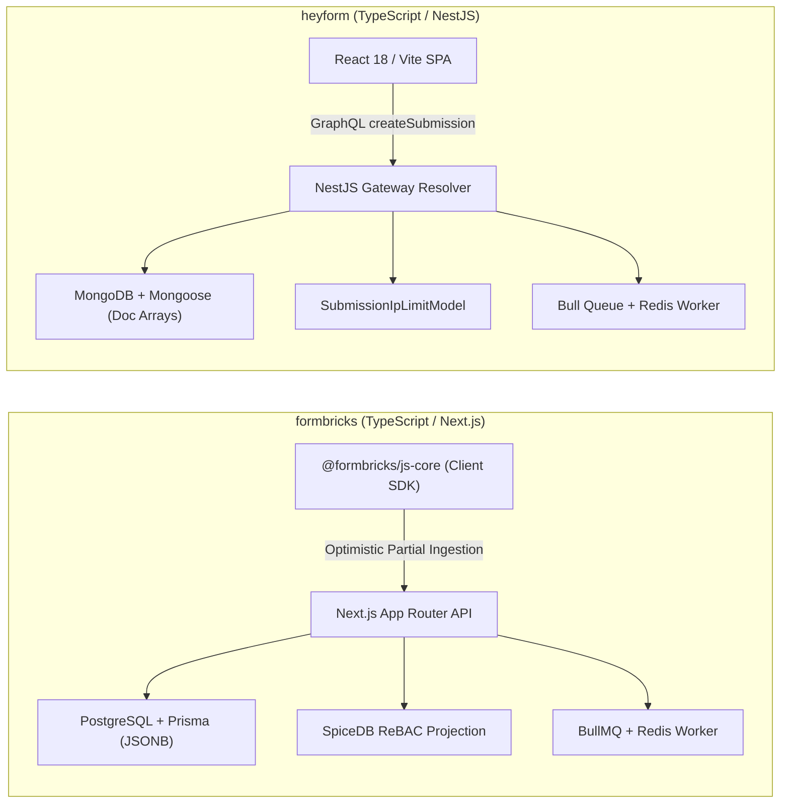
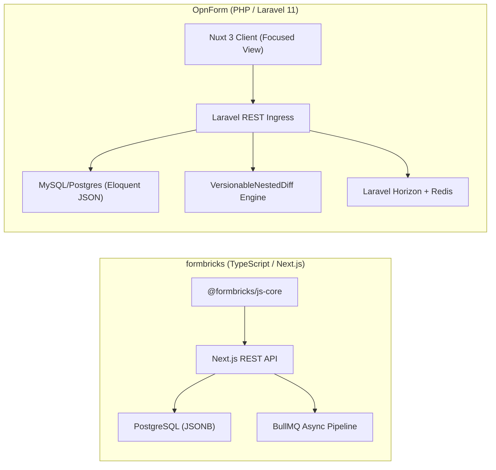
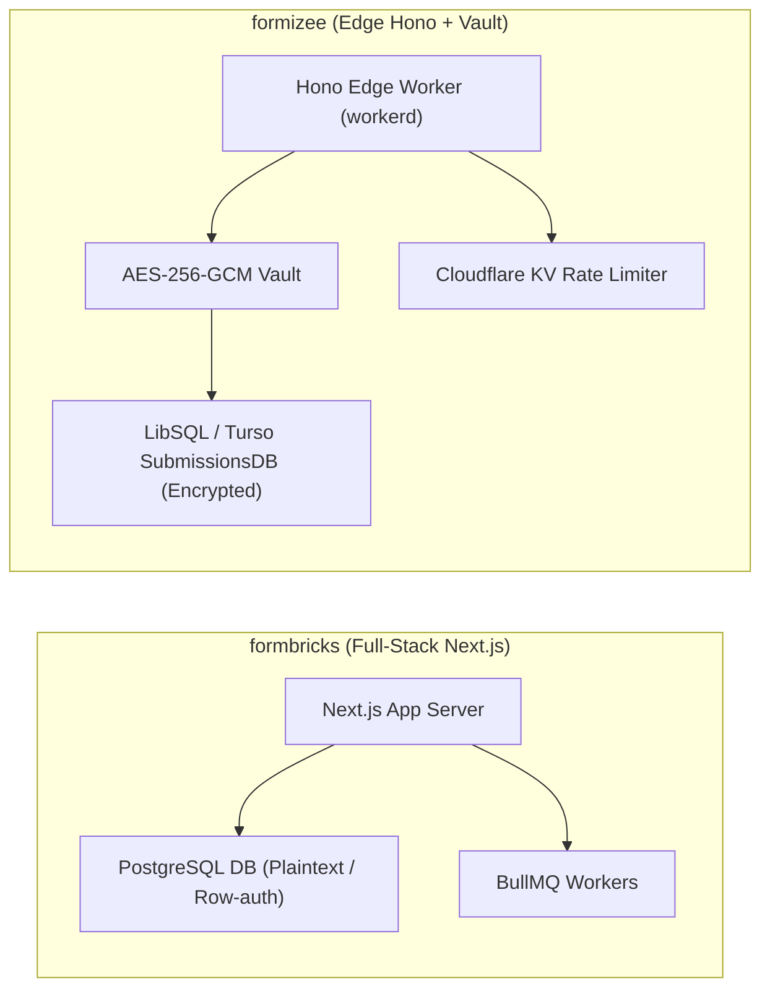
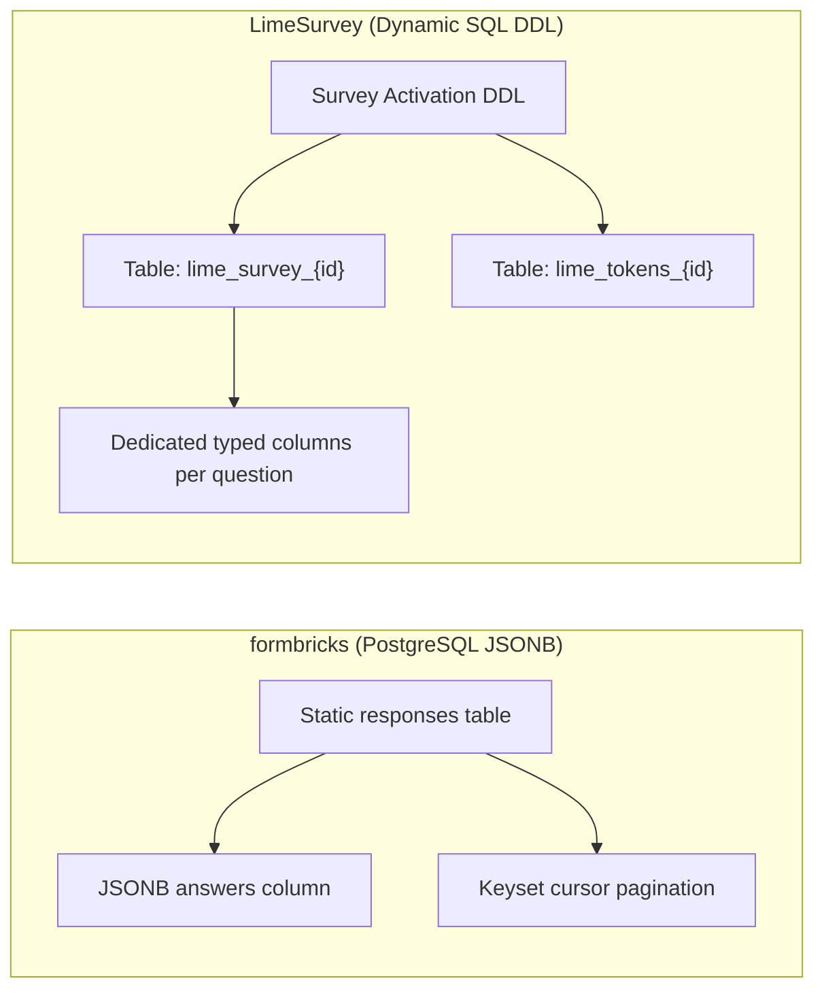
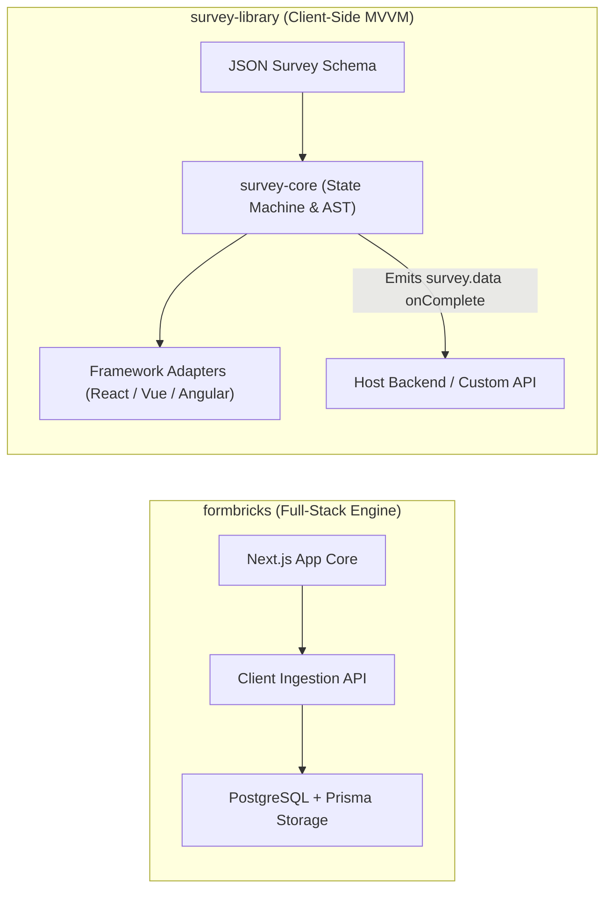
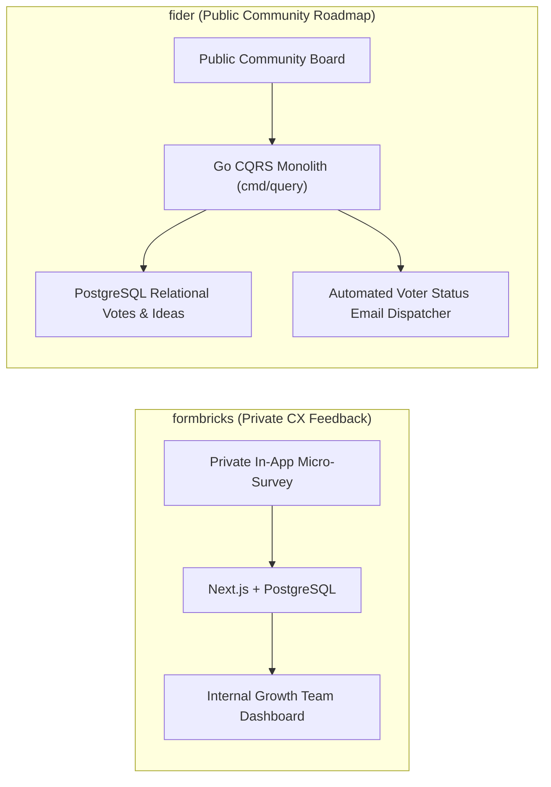
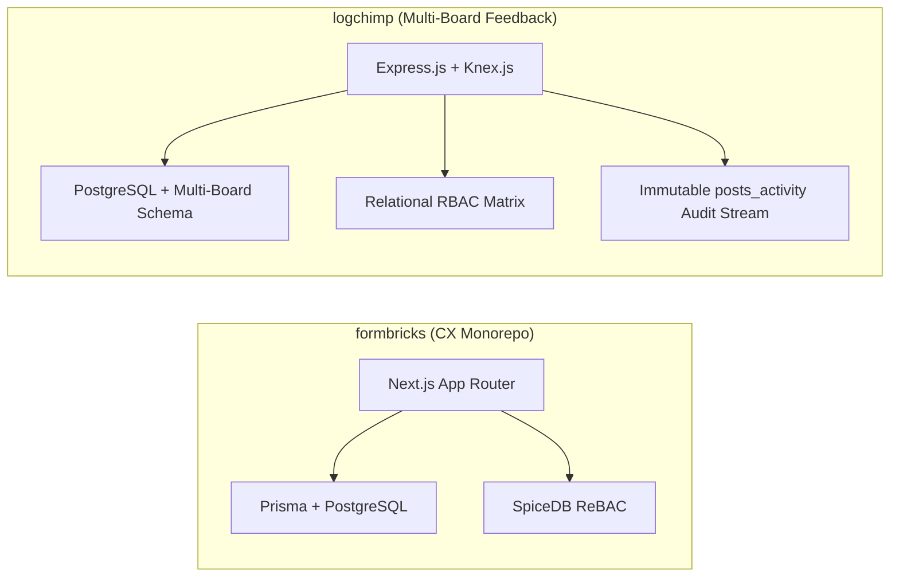
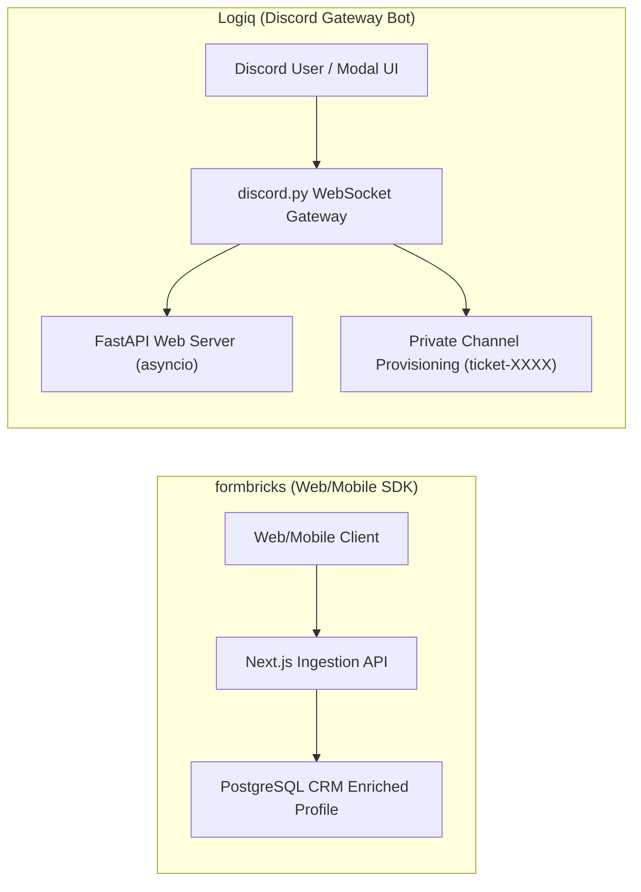
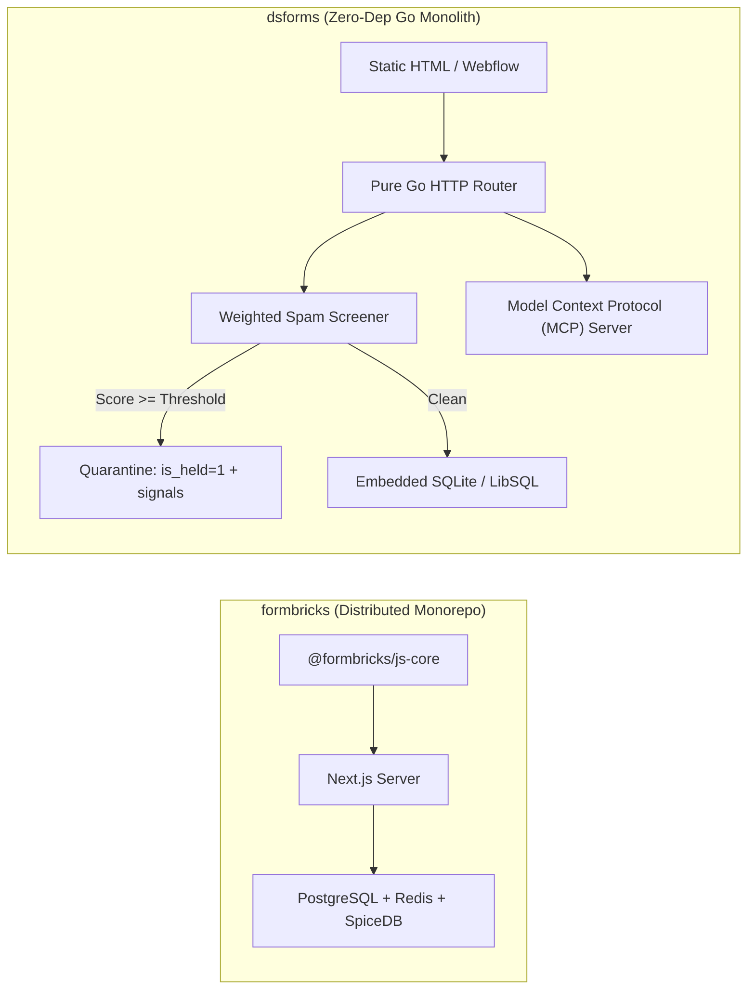

# formbricks — Comparative Analysis & Category Evaluation

> **Category**: Forms, Surveys & Feedback  
> **Architectural Role**: In-app micro-surveys, CX telemetry & keyset-paginated ingestion  
> **Primary Stack**: TypeScript / Node 20+ | Next.js 15/16 App Router Monorepo | PostgreSQL 15+, Prisma ORM | Redis 7+, BullMQ | SpiceDB ReBAC  
> **Peer Solutions Compared**: `heyform`, `OpnForm`, `formizee`, `LimeSurvey`, `survey-library`, `fider`, `logchimp`, `Logiq`, `dsforms`  
> **Commercial SaaS Benchmarks**: Qualtrics, Typeform, SurveyMonkey, PostHog Surveys, Canny.io  

---

## 1. Executive Overview & Technical Identity: formbricks

**formbricks** is an enterprise-grade Experience Management (XM) platform and targeted micro-survey engine. Engineered as an open-source, privacy-first alternative to Qualtrics, SurveyMonkey, and PostHog Surveys, Formbricks enables product, marketing, and customer success teams to deploy hyper-targeted surveys directly inside web and mobile applications, as standalone web links, or embedded within email workflows.

### Core Architectural Profile
- **Runtime & Language**: `TypeScript / Node 20+` in a Turborepo monorepo (`apps/web`, `packages/js-core`, `packages/surveys`, `packages/database`, `packages/jobs`).
- **Core Framework**: `Next.js 15/16` with React Server Components, App Router, and Better-Auth.
- **Persistence Layer**: `PostgreSQL 15+` mapped via `Prisma ORM`, utilizing JSONB columns for dynamic question definitions and response payloads.
- **Authorization & Access Control**: Relationship-Based Access Control (ReBAC) projected into `SpiceDB / Authzed` alongside multi-tenant PostgreSQL row schemas.
- **Client Execution Engine**: Zero-dependency `@formbricks/js-core` SDK running client-side event tracking, action matching (`trackAction`), and recontact interval gating (`recontactDays`) with zero network roundtrips for trigger evaluations.
- **Ingestion & Pagination Model**: Optimistic partial response streaming (`POST` initial answer, subsequent `PUT` updates) and keyset cursor pagination `(created_at, id) < ($1, $2)` eliminating relational `OFFSET` degradation.

---

## 2. Peer Solution Landscape (Forms, Surveys & Feedback)

Within this category, `formbricks` operates alongside the following peer solutions:

| Solution | Language & Runtime | Core Framework | Database / Cache | Queue / Concurrency | Primary Architectural Niche |
| :--- | :--- | :--- | :--- | :--- | :--- |
| **formbricks** (Current) | `TypeScript / Node` | `Next.js Monorepo` | `PostgreSQL, Prisma` | `BullMQ / Redis` | In-app micro-surveys, ReBAC access, telemetry |
| **heyform** | `TypeScript / Node` | `NestJS 10+, React 18` | `MongoDB, Redis` | `Bull Queue / Redis` | Conversational multi-step forms with polymorphic document answers |
| **OpnForm** | `PHP 8.2+ / TypeScript` | `Laravel 11, Nuxt 3` | `MySQL / PostgreSQL` | `Laravel Horizon / Redis` | No-code dynamic forms with versioned revisions & MCP agent drafts |
| **formizee** | `TypeScript / Edge` | `Hono, Turborepo` | `LibSQL / Turso, Drizzle` | `Cloudflare KV / Async` | Zero-knowledge AES-256-GCM encrypted headless form vault |
| **LimeSurvey** | `PHP 8.1+` | `Yii Framework` | `MySQL / PostgreSQL` | `PHP CLI Workers` | Enterprise statistical surveys with dynamic runtime SQL tables |
| **survey-library** | `TypeScript 5.3+` | `Framework-Agnostic MVVM` | `Pure Client-Side (BYO)`| `Synchronous / Web Workers`| Declarative JSON survey engine with AST expression evaluator |
| **fider** | `Go 1.22+` | `Go HTTP Monolith` | `PostgreSQL 14+` | `Goroutines, Channels` | Compiled CQRS public feature voting portal with sub-20ms latency |
| **logchimp** | `TypeScript / Node` | `Express.js, Vue 3` | `PostgreSQL, Knex.js` | `BullMQ / Redis` | Multi-board customer feedback roadmap with RBAC and audit trail |
| **Logiq** | `Python 3.10+` | `FastAPI, discord.py` | `SQLite / PostgreSQL` | `asyncio Event Loop` | Discord-native community ticketing bot & FastAPI REST management |
| **dsforms** | `Go 1.22+` | `Pure Go HTTP` | `SQLite / LibSQL (pure Go)`| `Go Worker Channels` | Zero-dependency headless form backend with forensic spam quarantine |

---

## 3. Deep Head-to-Head Comparative Breakdown: formbricks vs Peers

### 3.1. formbricks vs. heyform

**Comparative Focus**: `In-app micro-survey telemetry & ReBAC` vs. `Conversational Typeform-style multi-step forms`

#### Architectural Differences:
- **Ingestion Pipeline & Client Execution**: Formbricks deploys `@formbricks/js-core`, a lightweight client SDK that downloads compiled survey trigger trees on app boot. Action tracking (`trackAction("pricing_viewed")`) and attribute evaluations occur locally in the client browser with zero network latency. Response capture is incremental: answering question 1 emits `POST /api/v1/client/{envId}/responses`, while later questions stream `PUT` updates to capture drop-off points. In contrast, HeyForm uses a centralized NestJS GraphQL API (`createSubmission` mutation) where the entire conversational form is rendered as a standalone or embedded React SPA, submitting answer payloads upon form completion.
- **Schema & Data Storage**: Formbricks uses PostgreSQL with Prisma ORM, storing survey structures and user responses in structured relational rows enriched with GIN-indexed `JSONB` fields. Responses are queried via high-throughput keyset cursor pagination `(created_at, id) < ($1, $2)`. HeyForm uses MongoDB with Mongoose, storing answers as polymorphic document arrays (`answers: [{ questionId, value, type }]`), which simplifies arbitrary nested question definitions but makes complex analytical cross-survey SQL joins inefficient.
- **Logic & Branching Engines**: Formbricks focuses on user targeting criteria (cohort attributes, URL paths, click actions, recontact frequency guards). HeyForm implements conversational visual logic jumps (`Logic[]` supporting boolean operators `IS`, `IS_NOT`, `GREATER_THAN`) and internal runtime variables (`Variable[]`) for real-time quiz scoring and conditional question redirects.
- **Security & Authorization**: Formbricks features fine-grained multi-tenant workspace isolation using relationship-based access control (ReBAC) projected into SpiceDB / Authzed. HeyForm relies on standard JWT authentication with role arrays (`owner`, `admin`, `member`) and IP rate limiting (`SubmissionIpLimitModel`).

#### Architectural Comparison Matrix:

| Dimension | formbricks | heyform |
| :--- | :--- | :--- |
| **Primary Ingestion Architecture** | Keyset-paginated client SDK with partial step streaming | GraphQL mutation resolver with monolithic completion submit |
| **Data Storage Model** | Relational PostgreSQL with GIN-indexed JSONB columns | Document-oriented MongoDB with polymorphic subdocument arrays |
| **Logic & Trigger Engine** | Client-side event tracking, user cohorts, recontact guards | Visual logic jump graph with arithmetic runtime variables |
| **Access Control & Permissions** | Zanzibar-style ReBAC (SpiceDB / Authzed) + Prisma rows | Application-level RBAC (`owner`, `admin`, `member`) |
| **Spam & Anti-Abuse Defenses** | Workspace API keys, recontact limits, IP throttling | IP rate-limiting (`SubmissionIpLimitModel`), Turnstile, reCAPTCHA |
| **Best Architectural Fit** | In-app product feedback, NPS/CSAT micro-surveys | Standalone conversational lead generation & interactive intake |

---

### 3.2. formbricks vs. OpnForm

**Comparative Focus**: `Targeted in-app telemetry & ReBAC` vs. `No-code dynamic forms with nested versioning & MCP drafts`

#### Architectural Differences:
- **Ingestion & Auto-Save Mechanics**: Formbricks executes partial response upserts per step via its client SDK. OpnForm implements debounced auto-save endpoints (`/api/open/forms/{slug}/partial-submissions`), allowing users filling out multi-page forms to save in-progress state with `status: partial` in MySQL.
- **Schema Management & Versioning**: OpnForm stores form structures, validation blocks, and themes in Eloquent dynamic JSON properties (`properties`). It features an automated `VersionableNestedDiff` engine that snapshots the prior 5 form revisions, enabling instant rollbacks if a marketing operator introduces breaking changes. Formbricks stores survey configurations in PostgreSQL, managing versioning via immutable survey state snapshots without automated nested diffing.
- **AI Agent Integration**: OpnForm natively provides Model Context Protocol (MCP) and AI Agent endpoints (`/api/agent-drafts/*`), allowing autonomous agents to draft, preview, and generate production forms programmatically. Formbricks interacts with agents via standard REST API tokens.
- **Stack & Concurrency**: Formbricks runs entirely in modern TypeScript/Node 20+ with BullMQ and Redis, whereas OpnForm utilizes PHP 8.2+, Laravel 11, and Laravel Horizon for queue supervision.

#### Architectural Comparison Matrix:

| Dimension | formbricks | OpnForm |
| :--- | :--- | :--- |
| **Runtime & Language** | TypeScript / Node 20+ (Next.js 15/16) | PHP 8.2+ (Laravel 11) / Vue 3 (Nuxt 3) |
| **Schema Evolution** | PostgreSQL JSONB with Prisma migrations | Eloquent JSON properties with `VersionableNestedDiff` snapshots |
| **Form Display Styles** | Sandboxed in-app popups, slide-ins, embed iframe | Dual styles: `classic` full-page and `focused` conversational |
| **AI Agent Readiness** | Management REST API | Native AI Agent draft endpoints and Model Context Protocol (MCP) |
| **Queue & Worker Engine** | Redis 7+ BullMQ background jobs | Redis + Laravel Horizon supervisor |
| **Best Architectural Fit** | Product-led growth (PLG) telemetry & targeted in-app NPS | Operational team form building, Notion sync, and AI form generation |

---

### 3.3. formbricks vs. formizee

**Comparative Focus**: `Full-stack in-app survey suite` vs. `Edge-native zero-knowledge encrypted headless form vault`

#### Architectural Differences:
- **Presentation Layer**: Formbricks provides an end-to-end presentation engine (`packages/survey-ui`, `@formbricks/js-core`, and React embed modals). Formizee is 100% headless: it provides zero client UI, allowing developers to point standard HTML5 `<form action="https://api.formizee.com/v1/f/{slug}">` tags or custom React/Svelte hooks directly to its API.
- **Security & Cryptographic Storage**: Formbricks secures submission data via relational row-level isolation and database authentication. Formizee adopts a **Zero-Knowledge Vault Architecture**: every submission is encrypted at the edge using AES-GCM 256-bit encryption with a unique initialization vector (`data_iv`) and ciphertext (`data_cipher_text`) before touching disk. The host platform cannot read submission contents; only client sessions possessing workspace decryption keys can view responses.
- **Runtime Footprint & Edge Ingestion**: Formbricks runs on a centralized Node.js runtime (~250MB RAM). Formizee runs on the ultra-lightweight Hono framework compiled to Cloudflare Workers / workerd, executing in isolated edge V8 isolates with sub-50ms ingestion latency globally.

#### Architectural Comparison Matrix:

| Dimension | formbricks | formizee |
| :--- | :--- | :--- |
| **Frontend Strategy** | Rich UI suite: in-app modals, slide-ins, standalone links | 100% headless: static HTML form targets and React hooks |
| **Data Encryption at Rest** | Database-level encryption / plaintext relational storage | Zero-knowledge client-side AES-256-GCM encrypted vault |
| **Ingestion Runtime** | Centralized Node.js / Next.js server (~250 MB RAM) | Distributed Cloudflare Workers / Hono edge isolates (~35 MB RAM) |
| **Database Engine** | PostgreSQL with Prisma ORM | LibSQL / Turso SQLite with Drizzle ORM |
| **Target Use Case** | In-app user journey feedback & customer sentiment | Static marketing sites, Jamstack, privacy-compliant contact forms |

---

### 3.4. formbricks vs. LimeSurvey

**Comparative Focus**: `Modern product micro-surveys` vs. `Enterprise scientific research & dynamic SQL tables`

#### Architectural Differences:
- **Database Schema Architecture**: Formbricks persists all survey responses in a fixed PostgreSQL `Response` table with JSONB payloads. LimeSurvey dynamically creates dedicated relational tables (`lime_survey_{surveyId}` and `lime_tokens_{surveyId}`) via DDL upon survey activation. Every question, sub-question, and comment becomes a strongly typed SQL column (e.g. `1234X5X6SQ001`), optimizing execution plans for massive statistical cohorts and avoiding EAV degradation.
- **Logic & Mathematical Capabilities**: Formbricks supports visual condition rules for question jumping. LimeSurvey provides the **ExpressionScript Engine** (`em_manager_helper.php`), supporting micro-syntax relevance equations (`relevance: "((Q1.NAOK == 'Y') and (Q2_SQ1.NAOK >= 4))"`), dynamic mathematical scoring, quota screening, and cross-question piping across 80+ localized languages.
- **Research Export & Analytics**: Formbricks exports to CSV/JSON and streams to webhooks. LimeSurvey generates native syntax and data export packages formatted specifically for academic statistical tools including SPSS (`.sps`, `.dat`), R dataframes, and Stata.
- **Participant Privacy & Anonymity**: LimeSurvey enforces cryptographic participant token decoupling: token tables track single-use completion status, but when anonymized mode is active, foreign keys connecting tokens to response rows are purged upon commit.

#### Architectural Comparison Matrix:

| Dimension | formbricks | LimeSurvey |
| :--- | :--- | :--- |
| **Database Architecture** | Fixed PostgreSQL schema with JSONB columns | Dynamic DDL: dedicated SQL table per activated survey |
| **Logic Engine Complexity** | Visual step jumping & user attribute matching | ExpressionScript AST engine with micro-syntax equations |
| **Statistical Analysis** | Basic descriptive charts & NPS summaries | Native SPSS syntax files, R dataframes, and quota monitoring |
| **Participant Governance** | In-app user tracking & public links | Closed-cohort token management with cryptographic anonymization |
| **Modern Stack Fit** | Modern TypeScript, React Server Components, Next.js | Traditional PHP 8.1+ monolith with Yii Framework |

---

### 3.5. formbricks vs. survey-library (SurveyJS)

**Comparative Focus**: `Full-stack Experience Management suite` vs. `Framework-agnostic client-side MVVM JSON engine`

#### Architectural Differences:
- **Architectural Boundary**: Formbricks is an end-to-end full-stack SaaS platform providing an admin UI, survey builder, API gateway, telemetry collectors, and PostgreSQL storage. SurveyJS (`survey-library`) is a pure client-side library. It has zero backend opinions: it accepts a standardized JSON survey schema, handles user interaction and validation inside the browser, and emits a structured `survey.data` object on completion for the host app to store.
- **Framework Portability**: Formbricks' survey UI is tightly integrated with React and Next.js. SurveyJS implements a framework-agnostic core (`packages/survey-core`) that binds via two-way reactive observables to native adapters: `survey-react-ui`, `survey-vue3-ui`, `survey-angular-ui`, and plain JavaScript.
- **Expression Evaluation**: SurveyJS includes an embedded tokenizing expression parser (`ExpressionRunner`) supporting complex ternary expressions, dynamic matrix grids (`matrixdynamic`), dynamic panel iterators (`paneldynamic`), and declarative cascading REST lookups (`choicesRestful`).

#### Architectural Comparison Matrix:

| Dimension | formbricks | survey-library (SurveyJS) |
| :--- | :--- | :--- |
| **System Boundary** | Full-stack platform (DB, Backend, Jobs, Dashboard, SDK) | Pure client-side component library (Bring Your Own Backend) |
| **Framework Support** | React / Next.js / Iframe embed | Framework-agnostic: React, Vue 3, Angular, Knockout, Web Components |
| **Complex Form Types** | Multi-step cards, NPS ratings, single/multi-choice | Dynamic matrix grids, panel iterators, cascading REST lookups |
| **Backend Coupling** | Locked to PostgreSQL, Prisma, Redis, Next.js | Completely decoupled; emits raw JSON to any backend |
| **Operational Overhead** | Requires managing Node.js servers, Redis, and PostgreSQL | Zero server infrastructure; runs 100% in browser memory |

---

### 3.6. formbricks vs. fider

**Comparative Focus**: `In-app private CX telemetry` vs. `Public Go CQRS feature voting & roadmap board`

#### Architectural Differences:
- **Domain Purpose**: Formbricks collects private feedback from targeted users to drive CX improvements, calculate NPS, and optimize onboarding. Fider is an open customer feedback portal where users publicly submit feature suggestions, upvote proposals, and track official roadmap progress.
- **Software Architecture & Concurrency**: Formbricks is a TypeScript Next.js monorepo relying on BullMQ and Redis for async tasks. Fider is a compiled, single-binary Go 1.22+ application implementing Command Query Responsibility Segregation (CQRS) (`app/models/cmd` for state mutations, `app/models/query` for reads). Fider achieves sub-20ms API response times with ~40MB RAM usage.
- **Community Governance & De-duplication**: Fider implements real-time client-side debounced duplicate detection during idea drafting, duplicate proposal linking (`OriginalPost`), and automatic notification fan-out to all upvoters when a post transitions from `Planned` to `Started` or `Completed`.

#### Architectural Comparison Matrix:

| Dimension | formbricks | fider |
| :--- | :--- | :--- |
| **Core Feedback Model** | Private, targeted, discrete in-app questionnaires | Public, open, democratic community voting board |
| **Runtime & Performance** | TypeScript / Node.js (~250 MB RAM) | Compiled Go 1.22+ binary (~40 MB RAM, <20ms latency) |
| **Architectural Pattern** | Next.js App Router + Prisma ORM | Go HTTP Monolith with strict CQRS command/query separation |
| **Roadmap & Voter Fan-out** | Not supported (analytics reporting only) | Built-in public roadmap stages with automatic voter notifications |
| **Access & Verification** | Client-side user ID / anonymous session cookies | OAuth2 (Google/GitHub) and verified email magic links |

---

### 3.7. formbricks vs. logchimp

**Comparative Focus**: `Targeted CX telemetry` vs. `Multi-board feedback tracking with RBAC and changelogs`

#### Architectural Differences:
- **Domain Focus**: Formbricks captures point-in-time user sentiment via micro-surveys. Logchimp organizes public or private feature discovery across multiple categorized `Boards` (e.g. "Core App", "Integrations", "Mobile"), connecting submitted ideas to interactive roadmap columns and product changelogs.
- **Backend Architecture & Querying**: Formbricks uses Prisma ORM on Next.js. Logchimp uses **Express.js** and **Knex.js**, executing finely tuned SQL queries and maintaining an immutable audit log (`posts_activity`) tracking every status modification and moderator action.
- **Access Control Models**: Formbricks utilizes relationship-based access control (ReBAC) projected into SpiceDB. Logchimp uses a traditional relational RBAC model (`roles`, `permissions`, `roles_users`, `permissions_roles`) to govern administrative rights across boards and roadmap stages.

#### Architectural Comparison Matrix:

| Dimension | formbricks | logchimp |
| :--- | :--- | :--- |
| **Feedback Topology** | Contextual micro-survey popups | Partitioned multi-board suggestion portals |
| **Roadmap & Changelog** | None (focused on telemetry ingestion) | Integrated roadmap stages and public release changelogs |
| **Database Access Layer** | Prisma ORM with PostgreSQL JSONB | Knex.js query builder with relational PostgreSQL |
| **Audit & Timeline** | Response telemetry (TTC) | Immutable activity stream (`posts_activity`) documenting state changes |
| **Access Control** | Zanzibar ReBAC via SpiceDB / Authzed | Normalized relational RBAC (`roles`, `permissions`) |

---

### 3.8. formbricks vs. Logiq

**Comparative Focus**: `Web/mobile in-app micro-surveys` vs. `Discord-native modal ticketing & community triage`

#### Architectural Differences:
- **Touchpoint Environment**: Formbricks operates within web browsers and mobile apps via JavaScript SDKs and iframes. Logiq operates entirely within Discord's communication ecosystem, utilizing Discord's WebSocket Gateway to render interactive buttons and native modal dialogs (`discord.ui.Modal`).
- **Submission Workflow & Channel Provisioning**: Formbricks records answers to database tables. Logiq transforms form submissions into interactive support channels: submitting a modal dynamically provisions an isolated text channel (`ticket-{username}`) with atomic Discord role permission overwrites (`@everyone` denied access; ticket creator and staff granted access).
- **Concurrency & Runtime**: Formbricks uses multi-process Node.js with Next.js and BullMQ. Logiq runs as a single-process asynchronous Python 3.10+ application, running a Discord gateway bot and a FastAPI ASGI server concurrently inside a single `asyncio` event loop.

#### Architectural Comparison Matrix:

| Dimension | formbricks | Logiq |
| :--- | :--- | :--- |
| **Ingress Touchpoint** | Web and mobile apps via `@formbricks/js-core` SDK | Discord servers via native interaction buttons and modals |
| **Intake Mechanism** | Sandboxed modal cards / slide-ins | Native Discord modal dialogs (`discord.ui.Modal`) |
| **Workflow Output** | Database response record & webhook dispatch | Isolated private support channel with role permission clamping |
| **Runtime & Language** | TypeScript / Node.js 20+ (Next.js) | Python 3.10+ with `asyncio` (discord.py + FastAPI) |
| **Archival & Export** | CSV/JSON exports and CRM webhooks | Searchable HTML/JSON ticket transcript generation |

---

### 3.9. formbricks vs. dsforms

**Comparative Focus**: `Enterprise targeted CX telemetry` vs. `Zero-dependency pure Go headless backend with quarantine scoring`

#### Architectural Differences:
- **Deployment Footprint & Dependencies**: Formbricks requires a substantial infrastructure stack (Node.js runtime, PostgreSQL, Redis, and optionally SpiceDB). dsforms compiles into a single statically linked binary with an embedded SQLite / LibSQL database (`modernc.org/sqlite`), running with zero external dependencies and consuming ~25MB of RAM.
- **Spam Mitigation & Quarantine Architecture**: Formbricks mitigates spam via recontact rules, API authentication, and optional CAPTCHA. dsforms implements an auditable **Quarantine Forensics Architecture**: `internal/screen` evaluates submissions against weighted honeypot traps (`_gotcha`, `hp_field`), timing heuristics, and domain analysis. Flagged leads are not discarded; they are committed to an isolated quarantine queue (`is_held: 1`) alongside exact diagnostic signals (`spam_signals`) for review.
- **Autonomous AI Agent Operations**: dsforms embeds a native Model Context Protocol (MCP) server (`internal/mcpserver`), allowing AI agents (Claude, custom SDR bots) to inspect form inboxes, triage quarantined leads with automated PII redaction (`internal/redact`), and query conversion analytics over stdio or SSE. Formbricks integrates with external agents through standard REST API endpoints.
- **Viral Growth Capabilities**: dsforms includes an integrated viral waitlist engine (`waitlists`, `waitlist_entries`) with automatic referral code generation and dynamic queue-jumping. Formbricks focuses strictly on post-launch CX telemetry.

#### Architectural Comparison Matrix:

| Dimension | formbricks | dsforms |
| :--- | :--- | :--- |
| **Runtime & Operational Model** | Distributed Next.js + Redis + PostgreSQL monorepo | Single compiled Go binary with embedded SQLite |
| **Frontend Strategy** | In-app JavaScript SDK and sandboxed modal UI | 100% headless: static HTML form endpoints |
| **Spam Defense Strategy** | Rate limits, recontact frequency, reCAPTCHA | Weighted heuristic scoring with auditable quarantine holding queue |
| **AI Agent Interface** | Management REST API | Native embedded Model Context Protocol (MCP) server with PII redaction |
| **Viral Growth Features** | None (focused on customer satisfaction telemetry) | Integrated viral waitlist engine with dynamic referral queue jumping |
| **Memory Footprint** | ~250 MB RAM | ~25 MB RAM |

---

## 4. Capability & Feature Comparison Matrix

| Dimension / Capability | formbricks | heyform | OpnForm | formizee | LimeSurvey | survey-library | fider | logchimp | Logiq | dsforms |
| :--- | :---: | :---: | :---: | :---: | :---: | :---: | :---: | :---: | :---: | :---: |
| **Targeted In-App Popups** | ✅ Native SDK | ⚠️ Iframe | ⚠️ Iframe | ❌ | ❌ | ⚠️ UI Embed | ❌ | ❌ | ❌ | ❌ |
| **Conversational Typeform UI**| ⚠️ Compact modal | ✅ Full Screen | ✅ Full Screen | ❌ (Headless) | ❌ | ✅ Supported | ❌ | ❌ | ❌ | ❌ |
| **Headless Form API Endpoint** | ⚠️ API Routes | ❌ | ❌ | ✅ Edge Native | ❌ | ❌ | ❌ | ❌ | ❌ | ✅ Single Binary |
| **Public Feature Voting** | ❌ | ❌ | ❌ | ❌ | ❌ | ❌ | ✅ Pure CQRS | ✅ Multi-Board | ❌ | ❌ |
| **Changelog & Public Roadmap** | ❌ | ❌ | ❌ | ❌ | ❌ | ❌ | ⚠️ Basic | ✅ Integrated | ❌ | ❌ |
| **Discord Chat Ticket Modals** | ❌ | ❌ | ❌ | ❌ | ❌ | ❌ | ❌ | ❌ | ✅ Native UI | ❌ |
| **Viral Waitlist & Referrals** | ❌ | ❌ | ❌ | ❌ | ❌ | ❌ | ❌ | ❌ | ❌ | ✅ Integrated |
| **AI Agent MCP Integration** | ⚠️ REST API | ❌ | ✅ Agent Drafts| ⚠️ API Keys | ❌ | ❌ | ❌ | ❌ | ⚠️ LLM Cog | ✅ Native MCP |
| **Statistical Analysis (SPSS/R)**| ❌ | ❌ | ❌ | ❌ | ✅ Native | ⚠️ Analytics Pack| ❌ | ❌ | ❌ | ❌ |
| **Logic Jumps & Math AST** | ✅ Visual Rules | ✅ Visual Logic | ✅ Dynamic Logic| ❌ | ✅ ExpressionScript| ✅ ExpressionRunner| ❌ | ❌ | ❌ | ❌ |
| **Zero-Knowledge Encryption** | ❌ | ❌ | ❌ | ✅ AES-256-GCM | ❌ | ❌ | ❌ | ❌ | ❌ | ❌ |
| **Spam Quarantine Forensics** | ⚠️ ReCaptcha | ⚠️ Turnstile | ⚠️ Turnstile | ⚠️ Honeypot | ⚠️ Token Auth | ❌ (Client Only)| ⚠️ OAuth Check| ⚠️ Rate Limits | ⚠️ Captcha Cog | ✅ Weighted Scoring |
| **Runtime Memory Footprint** | ~250 MB | ~300 MB | ~150 MB | **~35 MB (Edge)** | ~180 MB | **0 MB (Client)** | **~40 MB** | ~120 MB | ~90 MB | **~25 MB** |

---

## 5. Commercial Benchmark Positioning

When benchmarked against commercial SaaS leaders (**Qualtrics, Typeform, SurveyMonkey, PostHog, Canny.io**):
- **Against Qualtrics & PostHog Surveys**: `formbricks` delivers identical non-intrusive in-app intercept capabilities, event-driven user targeting, and cohort segmentation without expensive per-response pricing or proprietary tracking scripts.
- **Data Sovereignty & Privacy**: Formbricks runs entirely in self-hosted environments backed by PostgreSQL, ensuring full compliance with GDPR, HIPAA, and CCPA standards.
- **Enterprise Access Governance**: ReBAC projection via SpiceDB matches enterprise-grade authorization patterns required by large multi-tenant SaaS deployments.

---

## 6. Strategic Takeaways & Role for MarketingStudio

In the unified **MarketingStudio** architecture:
1. **Primary Component to Adopt**: Harness `formbricks`'s proven patterns in `In-app micro-survey telemetry & user targeting`. Deploy `@formbricks/js-core` inside MarketingStudio's client applications to trigger contextual CSAT, NPS, and onboarding surveys.
2. **Interoperability Seam**: Expose standardized webhook endpoints connecting Formbricks' `response.created` events with MarketingStudio's unified PostgreSQL metadata pipeline and customer profile graph.
3. **Complementary Ecosystem Delegation**: Where Formbricks specializes in in-app CX telemetry, delegate static landing page capture to `formizee` / `dsforms`, conversational lead intake to `heyform` / `OpnForm`, and public feature roadmapping to `fider` / `logchimp`.
