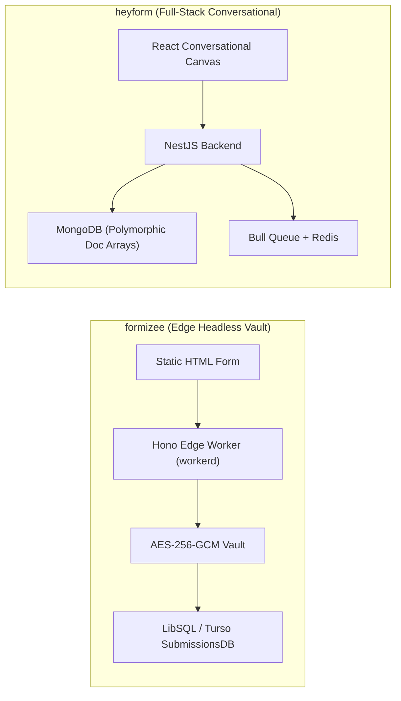
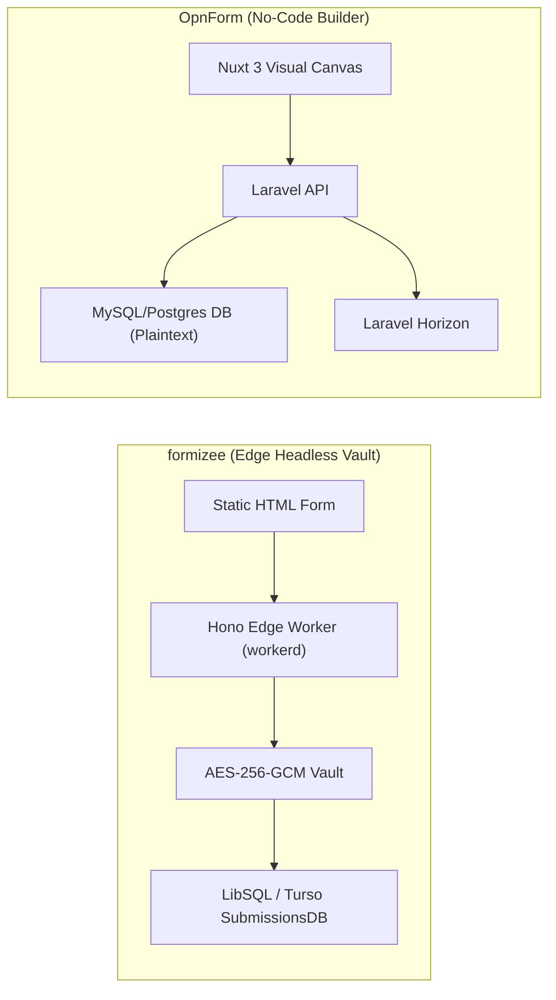
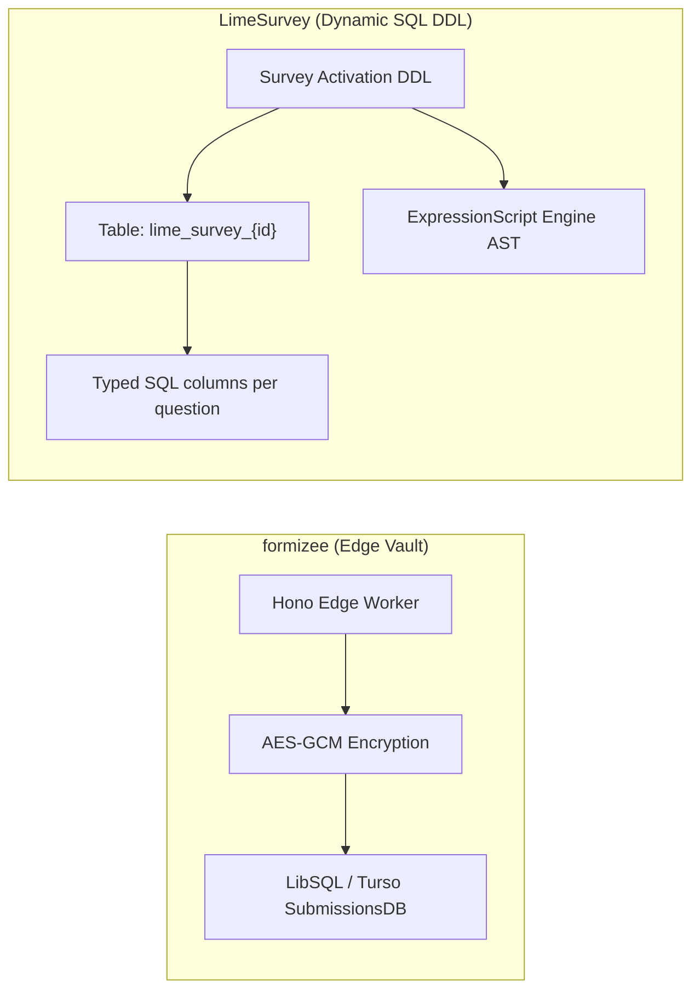
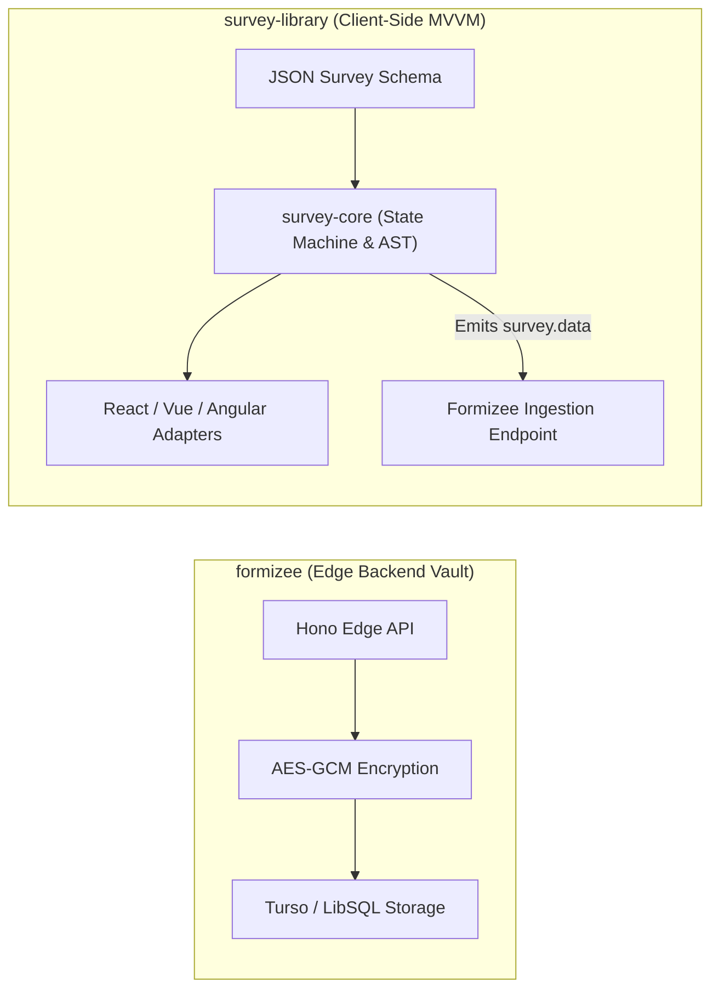
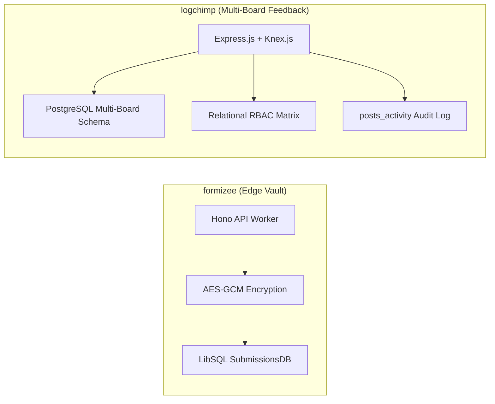

# formizee — Comparative Analysis & Category Evaluation

> **Category**: Forms, Surveys & Feedback  
> **Architectural Role**: Zero-knowledge encrypted headless form backend & edge-native submission vault  
> **Primary Stack**: TypeScript 5.5+ | Turborepo, Hono | Cloudflare Workers / workerd, LibSQL / Turso | Drizzle ORM | AES-256-GCM Vault  
> **Peer Solutions Compared**: `formbricks`, `heyform`, `OpnForm`, `LimeSurvey`, `survey-library`, `fider`, `logchimp`, `Logiq`, `dsforms`  
> **Commercial SaaS Benchmarks**: Formspree, Basin, Formkeep, Getform  

---

## 1. Executive Overview & Technical Identity: formizee

**Formizee** is an open-source, edge-native form backend and headless submission ingestion engine built for high-security environments, developers, and privacy-conscious enterprises. Engineered as an encrypted, modern alternative to Formspree, Basin, and Formkeep, Formizee decouples the visual form UI from backend ingestion: frontend developers write standard HTML `<form action="https://api.formizee.com/v1/f/{slug}">` markup or use headless React hooks, while Formizee handles spam filtering, file attachments, email notifications, and end-to-end encrypted storage.

### Core Architectural Profile
- **Runtime & Language**: `TypeScript 5.5+` compiled to Cloudflare Workers (`workerd` runtime) or Node.js 20+.
- **Web Framework**: **Hono**, an ultra-fast, lightweight web framework designed for edge environments.
- **Persistence Layer**: **LibSQL / Turso** distributed SQLite databases mapped via **Drizzle ORM** across dual schemas:
  - `schemas/main`: Workspaces, Users, Endpoints, API Keys.
  - `schemas/submissions`: Endpoints, Databases, Submissions, File Uploads.
- **Security & Cryptographic Vault**: **Zero-Knowledge Vault Architecture** (`apps/vault`) encrypting incoming payloads at the edge using AES-GCM 256-bit encryption with a unique initialization vector (`data_iv`) and ciphertext (`data_cipher_text`) prior to database write. Plaintext data is decryptable solely using client-held encryption keys.
- **Spam Mitigation**: Transparent honeypot traps (`_gotcha`, `_hp`), Akismet integration, and IP reputation scoring without user-facing CAPTCHA friction.
- **Object Storage**: Cloudflare R2 / S3 encrypted file storage for secure user uploads.

---

## 2. Peer Solution Landscape (Forms, Surveys & Feedback)

Within this category, `formizee` operates alongside the following peer solutions:

| Solution | Language & Runtime | Core Framework | Database / Cache | Queue / Concurrency | Primary Architectural Niche |
| :--- | :--- | :--- | :--- | :--- | :--- |
| **formizee** (Current) | `TypeScript / Edge` | `Hono, Turborepo` | `LibSQL / Turso, Drizzle` | `Cloudflare KV / Async` | Zero-knowledge AES-256-GCM encrypted headless form vault |
| **formbricks** | `TypeScript / Node` | `Next.js Monorepo` | `PostgreSQL, Prisma` | `BullMQ / Redis` | In-app micro-surveys, ReBAC access, telemetry |
| **heyform** | `TypeScript / Node` | `NestJS 10+, React 18` | `MongoDB, Redis` | `Bull Queue / Redis` | Conversational multi-step forms with polymorphic document answers |
| **OpnForm** | `PHP 8.2+ / TypeScript` | `Laravel 11, Nuxt 3` | `MySQL / PostgreSQL` | `Laravel Horizon / Redis` | No-code dynamic forms with versioned revisions & MCP agent drafts |
| **LimeSurvey** | `PHP 8.1+` | `Yii Framework` | `MySQL / PostgreSQL` | `PHP CLI Workers` | Enterprise statistical surveys with dynamic runtime SQL tables |
| **survey-library** | `TypeScript 5.3+` | `Framework-Agnostic MVVM` | `Pure Client-Side (BYO)`| `Synchronous / Web Workers`| Declarative JSON survey engine with AST expression evaluator |
| **fider** | `Go 1.22+` | `Go HTTP Monolith` | `PostgreSQL 14+` | `Goroutines, Channels` | Compiled CQRS public feature voting portal with sub-20ms latency |
| **logchimp** | `TypeScript / Node` | `Express.js, Vue 3` | `PostgreSQL, Knex.js` | `BullMQ / Redis` | Multi-board customer feedback roadmap with RBAC and audit trail |
| **Logiq** | `Python 3.10+` | `FastAPI, discord.py` | `SQLite / PostgreSQL` | `asyncio Event Loop` | Discord-native community ticketing bot & FastAPI REST management |
| **dsforms** | `Go 1.22+` | `Pure Go HTTP` | `SQLite / LibSQL (pure Go)`| `Go Worker Channels` | Zero-dependency headless form backend with forensic spam quarantine |

---

## 3. Deep Head-to-Head Comparative Breakdown: formizee vs Peers

### 3.1. formizee vs. formbricks

**Comparative Focus**: `Edge-native zero-knowledge encrypted headless form vault` vs. `Full-stack in-app CX micro-surveys`

```mermaid
flowchart LR
    subgraph FormizeeArch ["formizee (Edge Hono + Vault)"]
        A1["Static HTML Form (<form>)"] --> A2["Hono Edge Worker (workerd)"]
        A2 --> A3["AES-256-GCM Vault"]
        A3 --> A4["LibSQL / Turso SubmissionsDB (Encrypted)"]
        A2 --> A5["Cloudflare KV Rate Limiter"]
    end
    subgraph FormbricksArch ["formbricks (Full-Stack Next.js)"]
        B1["@formbricks/js-core"] --> B2["Next.js App Server"]
        B2 --> B3["PostgreSQL DB (Plaintext / Row-auth)"]
        B2 --> B4["SpiceDB ReBAC"]
        B2 --> B5["BullMQ Workers"]
    end
```

#### Architectural Differences:
- **Presentation Layer**: Formizee is 100% headless: it provides zero client UI, allowing developers to point standard HTML5 `<form action="https://api.formizee.com/v1/f/{slug}">` tags or custom React/Svelte hooks directly to its API. Formbricks provides an end-to-end presentation engine (`packages/survey-ui`, `@formbricks/js-core`, and React embed modals).
- **Security & Cryptographic Storage**: Formbricks secures submission data via relational row-level isolation and database authentication. Formizee adopts a **Zero-Knowledge Vault Architecture**: every submission is encrypted at the edge using AES-GCM 256-bit encryption with a unique initialization vector (`data_iv`) and ciphertext (`data_cipher_text`) before touching disk. The host platform cannot read submission contents; only client sessions possessing workspace decryption keys can view responses.
- **Runtime Footprint & Edge Ingestion**: Formbricks runs on a centralized Node.js runtime (~250MB RAM). Formizee runs on the ultra-lightweight Hono framework compiled to Cloudflare Workers / workerd, executing in isolated edge V8 isolates with sub-50ms ingestion latency globally.

#### Architectural Comparison Matrix:

| Dimension | formizee | formbricks |
| :--- | :--- | :--- |
| **Frontend Strategy** | 100% headless: static HTML form targets and React hooks | Rich UI suite: in-app modals, slide-ins, standalone links |
| **Data Encryption at Rest** | Zero-knowledge client-side AES-256-GCM encrypted vault | Database-level encryption / plaintext relational storage |
| **Ingestion Runtime** | Distributed Cloudflare Workers / Hono edge isolates (~35 MB RAM) | Centralized Node.js / Next.js server (~250 MB RAM) |
| **Database Engine** | LibSQL / Turso SQLite with Drizzle ORM | PostgreSQL with Prisma ORM |
| **Target Use Case** | Static marketing sites, Jamstack, privacy-compliant contact forms | In-app user journey feedback & customer sentiment |

---

### 3.2. formizee vs. heyform

**Comparative Focus**: `Edge-native zero-knowledge encrypted headless form vault` vs. `Conversational React/NestJS form builder`

#### Architectural Differences:
- **Presentation Strategy**: Formizee provides no visual UI, accepting submissions from any web form. HeyForm provides a rich conversational UI with full-screen layouts, animated question transitions, and keyboard ergonomics.
- **Security & Cryptography**: HeyForm stores submissions in plaintext in MongoDB, relying on network security and database authentication. Formizee operates a **Zero-Knowledge Encrypted Vault**: all submissions are encrypted at the edge with AES-256-GCM (`data_iv` and `data_cipher_text`) before persisting into LibSQL / Turso SQLite.
- **Ingestion Latency**: HeyForm routes requests through a centralized Node.js/NestJS server cluster (~300MB RAM). Formizee executes in lightweight edge V8 isolates via Hono on Cloudflare Workers (~35MB RAM), delivering sub-50ms ingestion globally.

#### Architectural Comparison Matrix:

| Dimension | formizee | heyform |
| :--- | :--- | :--- |
| **User Interface** | 100% headless (BYO HTML/React UI) | Complete conversational React 18 SPA |
| **Data Security** | Zero-knowledge client-side AES-256-GCM encryption | Standard database access control |
| **Execution Environment** | Global edge V8 workers (~35 MB RAM, <50ms latency) | Centralized Node.js runtime (~300 MB RAM) |
| **Database Engine** | LibSQL / Turso SQLite (Drizzle ORM) | MongoDB (Mongoose) |
| **Best Architectural Fit** | Static landing pages & privacy-sensitive lead capture | High-conversion conversational intake flows |

---

### 3.3. formizee vs. OpnForm

**Comparative Focus**: `Edge-native zero-knowledge encrypted headless form vault` vs. `No-code visual dynamic forms`

#### Architectural Differences:
- **Presentation Strategy**: Formizee is 100% headless: it provides no frontend UI, ingesting submissions directly from static HTML `<form action="...">` tags. OpnForm is a complete visual form builder with full UI rendering, pre-built themes, and drag-and-drop input blocks.
- **Data Security & Cryptography**: Formizee deploys a **Zero-Knowledge Vault**: all submissions are encrypted at the edge with AES-256-GCM (`data_iv` and `data_cipher_text`) before persisting into LibSQL / Turso SQLite. OpnForm stores submissions in plaintext in MySQL/PostgreSQL.
- **Runtime Footprint**: Formizee executes in lightweight edge V8 isolates via Hono on Cloudflare Workers (~35MB RAM), delivering sub-50ms ingestion latency globally. OpnForm runs on a standard PHP-FPM / Laravel Horizon stack (~150MB RAM).

#### Architectural Comparison Matrix:

| Dimension | formizee | OpnForm |
| :--- | :--- | :--- |
| **UI Rendering** | 100% headless (BYO HTML/React UI) | Full no-code canvas, classic and focused layouts |
| **Data Security** | Zero-knowledge client-side AES-256-GCM encryption | Relational row permissions (plaintext storage) |
| **Ingestion Runtime** | Global edge V8 workers (~35 MB RAM, <50ms latency) | PHP 8.2+ / Laravel Horizon (~150 MB RAM) |
| **Database Engine** | LibSQL / Turso SQLite (Drizzle ORM) | MySQL 8.0+ / PostgreSQL (Eloquent ORM) |
| **Target Use Case** | Static marketing sites & privacy-critical contact forms | Visual lead generation, intake forms, Notion sync |

---

### 3.4. formizee vs. LimeSurvey

**Comparative Focus**: `Edge headless encrypted vault` vs. `Academic research, dynamic SQL tables & ExpressionScript`

#### Architectural Differences:
- **Database Architecture**: Formizee persists encrypted blobs into LibSQL / Turso SQLite. LimeSurvey executes runtime DDL on survey activation, dynamically generating dedicated relational SQL tables (`lime_survey_{surveyId}` and `lime_tokens_{surveyId}`) where every question maps to a typed SQL column.
- **Logic & Branching**: Formizee does not evaluate form logic—it accepts arbitrary JSON or form-data payloads. LimeSurvey includes the **ExpressionScript Engine** (`em_manager_helper.php`), allowing complex micro-syntax boolean equations, mathematical modeling, and quota screening across 80+ localized languages.
- **Deployment Footprint**: Formizee runs at the edge with sub-50ms global latency and ~35MB RAM. LimeSurvey requires a dedicated PHP/Apache/MySQL server environment (~180MB RAM).

#### Architectural Comparison Matrix:

| Dimension | formizee | LimeSurvey |
| :--- | :--- | :--- |
| **Data Architecture** | Schemaless encrypted vault (LibSQL) | Dynamic DDL: dedicated SQL table per survey |
| **Logic Engine Complexity** | None (pure headless ingestion) | ExpressionScript AST with micro-syntax equations |
| **Security Paradigm** | Zero-knowledge client-side AES-256-GCM | Token-based cryptographic anonymity decoupling |
| **Statistical Export** | Decrypted JSON/CSV export | Native SPSS syntax files, R dataframes, and Stata packages |
| **Execution Tier** | Global Edge Workers (sub-50ms latency) | Traditional server-rendered PHP monolith |

---

### 3.5. formizee vs. survey-library (SurveyJS)

**Comparative Focus**: `Edge backend encrypted vault` vs. `Framework-agnostic client-side MVVM JSON engine`

#### Architectural Differences:
- **Architectural Complementarity**: Formizee is a pure backend ingestion API with zero frontend UI. SurveyJS is a pure client-side library with zero backend. They are complementary: developers can render complex, multi-page surveys using SurveyJS and submit the resulting `survey.data` directly to a Formizee endpoint (`POST /v1/f/{slug}`) for zero-knowledge encrypted storage.
- **Data Validation & Logic**: SurveyJS executes deep AST expression evaluation (`ExpressionRunner`), cascading REST lookups (`choicesRestful`), and input validations inside the browser. Formizee focuses purely on edge ingestion, rate limiting, honeypot checking, and encryption.

#### Architectural Comparison Matrix:

| Dimension | formizee | survey-library (SurveyJS) |
| :--- | :--- | :--- |
| **Architectural Layer** | Backend ingestion API & encrypted vault | Client-side UI rendering & state engine |
| **Logic & Calculation** | None (ingests submitted payloads) | Full in-memory AST evaluator & dynamic matrices |
| **Encryption** | Zero-knowledge AES-256-GCM at edge | None (relies on host ingestion endpoint) |
| **Server Requirements** | Cloudflare Workers / Node.js + LibSQL | Zero server infrastructure (100% browser runtime) |
| **Integration Synergy** | Ideal backend vault for SurveyJS JSON submissions | Ideal client UI renderer for Formizee headless endpoints |

---

### 3.6. formizee vs. fider

**Comparative Focus**: `Headless form intake vault` vs. `Compiled Go CQRS public feature voting portal`

```mermaid
flowchart LR
    subgraph FormizeeArch ["formizee (Private Headless Vault)"]
        A1["Static Form (<form>)"] --> A2["Hono Edge Worker"]
        A2 --> A3["AES-256-GCM Vault"]
    end
    subgraph FiderArch ["fider (Public Feature Voting)"]
        B1["Public Community Board"] --> B2["Go CQRS Monolith (cmd/query)"]
        B2 --> B3["PostgreSQL Relational Votes & Ideas"]
    end
```

#### Architectural Differences:
- **Core Domain**: Formizee is a private ingestion gateway for contact forms, customer inquiries, and lead generation. Fider is an open, public feedback board where users suggest ideas, upvote proposals, and track official roadmap progress.
- **Data Privacy**: Formizee encrypts all incoming data at the edge with AES-256-GCM so nobody except the workspace key holder can view submissions. Fider deliberately displays customer ideas and upvotes publicly to foster democratic community prioritization.
- **Stack & Architecture**: Formizee runs on TypeScript/Hono at the edge. Fider is a compiled Go 1.22+ binary with PostgreSQL (~40MB RAM) running a Command Query Responsibility Segregation (CQRS) architecture.

#### Architectural Comparison Matrix:

| Dimension | formizee | fider |
| :--- | :--- | :--- |
| **Core Interaction** | Private headless submission ingestion | Public community idea suggestion and upvoting |
| **Data Privacy** | Zero-knowledge client-side AES-256-GCM encryption | Public community board with verified voter accounts |
| **Runtime & Language** | TypeScript / Edge workerd (Hono) | Compiled Go 1.22+ binary (~40 MB RAM, <20ms latency) |
| **Roadmap & Notification** | Webhooks, log drains, and email alerts | Public roadmap stages with automatic voter email updates |
| **Persistence** | LibSQL / Turso distributed SQLite | Normalized relational PostgreSQL |

---

### 3.7. formizee vs. logchimp

**Comparative Focus**: `Headless form intake vault` vs. `Multi-board feedback tracking with RBAC and changelogs`

#### Architectural Differences:
- **Functional Paradigm**: Formizee ingests arbitrary HTML form data privately into an encrypted vault. Logchimp organizes community feedback across partitioned `Boards`, interactive roadmap columns, and product release changelogs.
- **Database Modeling**: Formizee uses dual Drizzle ORM schemas in LibSQL, isolating administrative metadata from encrypted submission payloads. Logchimp uses **Express.js** and **Knex.js** with PostgreSQL, maintaining a normalized relational schema with an immutable activity log (`posts_activity`).
- **Access Governance**: Formizee relies on API keys and workspace private encryption keys. Logchimp implements a complete relational RBAC model (`roles`, `permissions`, `roles_users`, `permissions_roles`).

#### Architectural Comparison Matrix:

| Dimension | formizee | logchimp |
| :--- | :--- | :--- |
| **Primary Domain** | Private headless form intake & encrypted storage | Multi-board feedback management and public roadmaps |
| **Database Architecture** | Dual Drizzle schemas in LibSQL / Turso | Relational PostgreSQL with Knex.js SQL query builder |
| **Encryption at Rest** | Zero-knowledge AES-256-GCM | Standard database authentication |
| **Public Transparency** | Strictly private (encrypted vault) | Public feedback boards, roadmaps, and release changelogs |
| **Runtime Footprint** | ~35 MB RAM (Edge V8 isolate) | ~120 MB RAM (Node.js runtime) |

---

### 3.8. formizee vs. Logiq

**Comparative Focus**: `Headless web form vault` vs. `Discord-native modal ticketing & channel triage`

```mermaid
flowchart LR
    subgraph FormizeeArch ["formizee (Web Headless Vault)"]
        A1["Web Browser (<form>)"] --> A2["Hono Edge API"]
        A2 --> A3["AES-GCM Encrypted Vault"]
    end
    subgraph LogiqArch ["Logiq (Discord Gateway Bot)"]
        B1["Discord User / Interactive Modal"] --> B2["discord.py WebSocket Gateway"]
        B2 --> B3["FastAPI Web Server (asyncio)"]
        B2 --> B4["Private Channel Provisioning (ticket-XXXX)"]
    end
```

#### Architectural Differences:
- **Ingress Platform**: Formizee accepts HTTP requests from static websites, Jamstack applications, and mobile apps. Logiq operates inside Discord chat servers, interacting with users via persistent buttons and native modal dialogs (`discord.ui.Modal`).
- **Workflow Pipeline**: Formizee encrypts submissions and fires outbound webhooks or email alerts. Logiq provisions isolated private Discord text channels (`ticket-{username}`) with role-based permission overwrites (`@everyone` denied access; ticket creator and staff roles granted access).
- **Runtime Environment**: Formizee runs on TypeScript/Hono across Cloudflare Workers. Logiq runs a single-process concurrent Python 3.10+ application, running a Discord gateway bot and a FastAPI ASGI server inside an `asyncio` event loop.

#### Architectural Comparison Matrix:

| Dimension | formizee | Logiq |
| :--- | :--- | :--- |
| **Platform Ingress** | Web browsers & static sites (`<form>`) | Discord client via native interaction modals |
| **Submission Output** | Encrypted database record & webhook dispatches | Isolated private support text channel in Discord |
| **Encryption Model** | Zero-knowledge client-side AES-256-GCM | Standard database access permissions |
| **Runtime & Language** | TypeScript / Edge workerd (Hono) | Python 3.10+ (discord.py + FastAPI via asyncio) |
| **Persistence** | LibSQL / Turso SQLite (Drizzle ORM) | SQLite / PostgreSQL / MongoDB |

---

### 3.9. formizee vs. dsforms

**Comparative Focus**: `Edge Hono + LibSQL AES-GCM vault` vs. `Pure Go single-binary headless backend with quarantine scoring`

```mermaid
flowchart LR
    subgraph FormizeeArch ["formizee (Edge Hono + Vault)"]
        A1["Static Form (<form>)"] --> A2["Hono Edge Worker (workerd)"]
        A2 --> A3["AES-256-GCM Vault"]
        A3 --> A4["LibSQL / Turso SubmissionsDB"]
    end
    subgraph DsformsArch ["dsforms (Zero-Dep Go Monolith)"]
        B1["Static Form (<form>)"] --> B2["Pure Go HTTP Server"]
        B2 --> B3["Weighted Spam Screener"]
        B3 -->|Score >= Threshold| B4["Quarantine: is_held=1 + signals"]
        B3 -->|Clean| B5["Embedded SQLite / LibSQL"]
        B2 --> B6["Model Context Protocol (MCP) Server"]
    end
```

#### Architectural Differences:
- **Deployment Footprint & Runtime**: Formizee is designed for edge deployments (Cloudflare Workers, Drizzle ORM, Turso / LibSQL). dsforms is compiled into a single statically linked binary with an embedded SQLite / LibSQL database (`modernc.org/sqlite`), running with zero external dependencies on any bare-metal VPS or container (~25MB RAM).
- **Security & Privacy Model**: Formizee prioritizes **Data Confidentiality via Zero-Knowledge Encryption**: every submission is encrypted at the edge with AES-256-GCM before writing to disk, ensuring that server operators cannot inspect payloads. dsforms prioritizes **Data Forensics & Lead Protection via Quarantine Architecture**: incoming submissions are screened with weighted heuristics; flagged entries are placed in an isolated quarantine queue (`is_held: 1`) alongside exact diagnostic signals (`spam_signals`) to prevent silent lead drops.
- **Autonomous AI Agent Readiness**: dsforms embeds a native Model Context Protocol (MCP) server (`internal/mcpserver`), enabling AI agents (Claude, custom SDRs) to triage form inboxes, review quarantined leads with automated PII redaction (`internal/redact`), and query conversion analytics over stdio or SSE. Formizee integrates via API keys and webhook log drains.
- **Growth & Waitlists**: dsforms includes an integrated viral waitlist engine with dynamic referral queue-jumping. Formizee focuses purely on encrypted form ingestion.

#### Architectural Comparison Matrix:

| Dimension | formizee | dsforms |
| :--- | :--- | :--- |
| **Deployment Architecture** | Edge-native worker (Hono + Cloudflare Workers) | Single compiled Go binary with embedded SQLite |
| **Primary Security Innovation** | Zero-knowledge client-side AES-256-GCM encryption | Weighted heuristic scoring with auditable quarantine holding queue |
| **Spam Handling Philosophy** | Block/reject malicious bots at edge | Quarantine suspicious leads with diagnostic signals (no silent loss) |
| **AI Agent Support** | REST API keys and log drains | Native embedded Model Context Protocol (MCP) server with PII redaction |
| **Viral Growth Features** | None | Integrated viral waitlist engine with dynamic referral queue jumping |
| **Memory Footprint** | ~35 MB RAM (Edge V8 isolate) | ~25 MB RAM (Compiled Go process) |

---

## 4. Capability & Feature Comparison Matrix

| Dimension / Capability | formizee | formbricks | heyform | OpnForm | LimeSurvey | survey-library | fider | logchimp | Logiq | dsforms |
| :--- | :---: | :---: | :---: | :---: | :---: | :---: | :---: | :---: | :---: | :---: |
| **Headless Form API Endpoint** | ✅ Edge Native | ⚠️ API Routes | ❌ | ❌ | ❌ | ❌ | ❌ | ❌ | ❌ | ✅ Single Binary |
| **Zero-Knowledge Encryption** | ✅ AES-256-GCM | ❌ | ❌ | ❌ | ❌ | ❌ | ❌ | ❌ | ❌ | ❌ |
| **Conversational Typeform UI**| ❌ (Headless) | ⚠️ Compact modal | ✅ Full Screen | ✅ Full Screen | ❌ | ✅ Supported | ❌ | ❌ | ❌ | ❌ |
| **Targeted In-App Popups** | ❌ | ✅ Native SDK | ⚠️ Iframe | ⚠️ Iframe | ❌ | ⚠️ UI Embed | ❌ | ❌ | ❌ | ❌ |
| **Public Feature Voting** | ❌ | ❌ | ❌ | ❌ | ❌ | ❌ | ✅ Pure CQRS | ✅ Multi-Board | ❌ | ❌ |
| **Changelog & Public Roadmap** | ❌ | ❌ | ❌ | ❌ | ❌ | ❌ | ⚠️ Basic | ✅ Integrated | ❌ | ❌ |
| **Discord Chat Ticket Modals** | ❌ | ❌ | ❌ | ❌ | ❌ | ❌ | ❌ | ❌ | ✅ Native UI | ❌ |
| **Viral Waitlist & Referrals** | ❌ | ❌ | ❌ | ❌ | ❌ | ❌ | ❌ | ❌ | ❌ | ✅ Integrated |
| **AI Agent MCP Integration** | ⚠️ API Keys | ⚠️ REST API | ❌ | ✅ Agent Drafts| ❌ | ❌ | ❌ | ❌ | ⚠️ LLM Cog | ✅ Native MCP |
| **Statistical Analysis (SPSS/R)**| ❌ | ❌ | ❌ | ❌ | ✅ Native | ⚠️ Analytics Pack| ❌ | ❌ | ❌ | ❌ |
| **Logic Jumps & Math AST** | ❌ | ✅ Visual Rules | ✅ Visual Logic | ✅ Dynamic Logic| ✅ ExpressionScript| ✅ ExpressionRunner| ❌ | ❌ | ❌ | ❌ |
| **Spam Quarantine Forensics** | ⚠️ Honeypot | ⚠️ ReCaptcha | ⚠️ Turnstile | ⚠️ Turnstile | ⚠️ Token Auth | ❌ (Client Only)| ⚠️ OAuth Check| ⚠️ Rate Limits | ⚠️ Captcha Cog | ✅ Weighted Scoring |
| **Runtime Memory Footprint** | **~35 MB (Edge)** | ~250 MB | ~300 MB | ~150 MB | ~180 MB | **0 MB (Client)** | **~40 MB** | ~120 MB | ~90 MB | **~25 MB** |

---

## 5. Commercial Benchmark Positioning

When benchmarked against commercial SaaS leaders (**Formspree, Basin, Formkeep, Getform**):
- **Against Formspree & Basin**: `formizee` delivers an open-source, edge-native alternative that eliminates tiered submission fees and vendor lock-in.
- **Zero-Knowledge Security**: Solves the biggest risk of cloud form backends—plaintext lead exposure—by encrypting all payloads with AES-256-GCM before writing to disk.
- **Global Edge Performance**: Running Hono on Cloudflare Workers delivers sub-50ms ingestion latency worldwide, far outpacing centralized US-based form endpoints.

---

## 6. Strategic Takeaways & Role for MarketingStudio

In the unified **MarketingStudio** architecture:
1. **Primary Component to Adopt**: Harness `formizee`'s edge-native Hono architecture and zero-knowledge encrypted vault pattern for high-security static site lead capture (landing pages, documentation contact forms).
2. **Interoperability Seam**: Utilize Formizee's outbound HMAC-signed webhooks and log drains to stream verified, decrypted submissions into MarketingStudio's CRM pipeline.
3. **Complementary Ecosystem Delegation**: Where Formizee provides high-security headless ingestion, delegate in-app micro-surveys to `formbricks`, conversational forms to `heyform` / `OpnForm`, and viral waitlists to `dsforms`.
