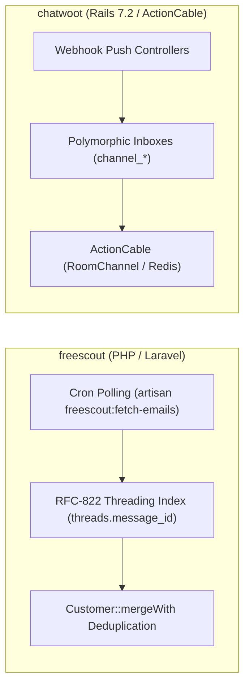
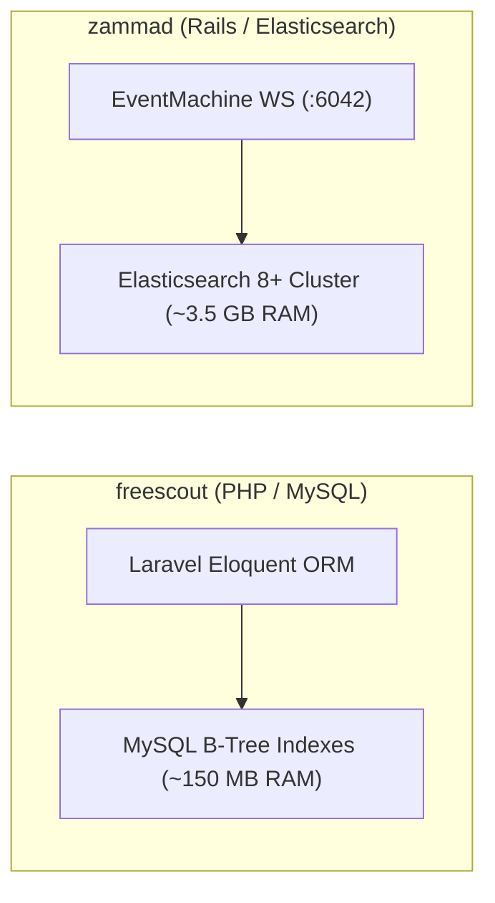
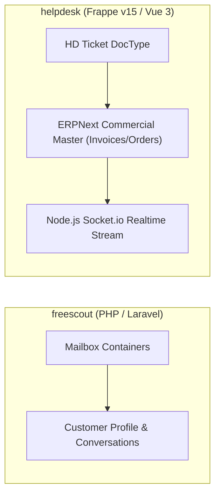
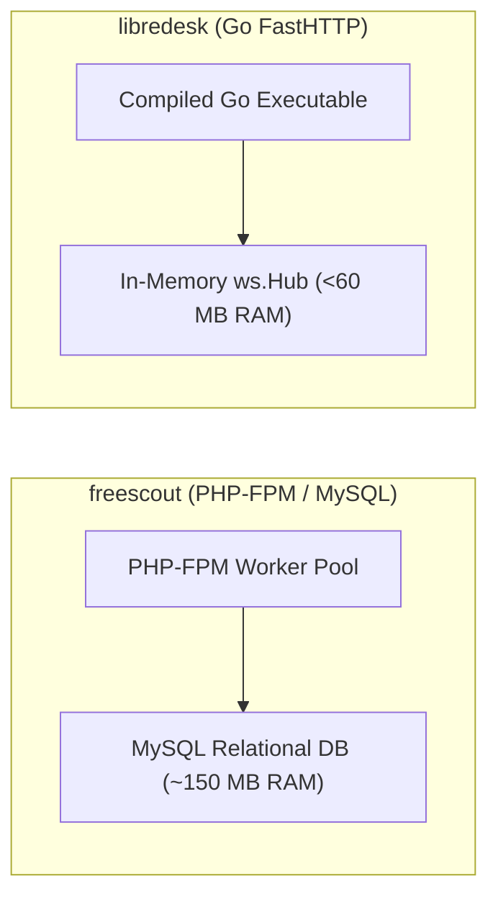
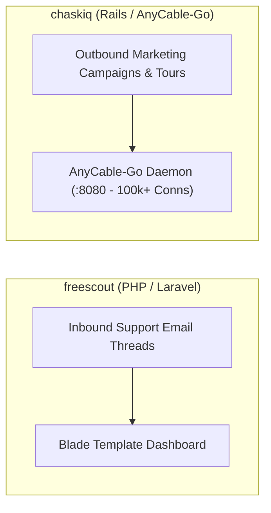
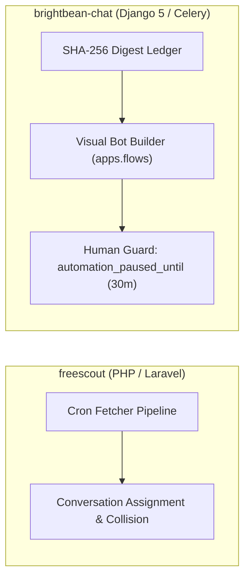

# freescout — Comparative Analysis & Category Evaluation

> **Category**: Omnichannel Helpdesk & Support  
> **Architectural Role**: Lightweight shared mailbox, RFC-822 email threading & Help Scout alternative  
> **Primary Stack**: PHP 8.1-8.3 | Laravel Framework, Blade | MySQL 8+ / MariaDB / PostgreSQL | Database / Redis Queue  
> **Peer Solutions Compared**: `chatwoot`, `zammad`, `helpdesk`, `libredesk`, `chaskiq`, `brightbean-chat`  
> **Commercial SaaS Benchmarks**: Help Scout, Front, Zendesk, Freshdesk, Groove  

---

## 1. Executive Overview & Technical Identity: freescout

**freescout** represents the minimalist, low-overhead shared mailbox standard within the **Omnichannel Helpdesk & Support** domain, distinguished by its core focus on **Lightweight PHP/Laravel infrastructure (<150MB RAM), robust RFC-822 email threading, and an extensible module architecture**.

### Core Architectural Profile
- **Runtime & Language**: `PHP 8.1 - 8.3` (PHP-FPM)
- **Core Framework**: `Laravel Framework 5.5 LTS base` (modernized with PHP 8.x typing), `Blade`, `Bootstrap/jQuery`
- **Persistence Layer**: `MySQL 8.0+`, `MariaDB 10.3+`, or `PostgreSQL` via Eloquent ORM
- **Concurrency & Queue Model**: Linux System Cron (`artisan schedule:run`) + Laravel Queue Worker (`artisan queue:work`)
- **Domain Specialization**: `Shared email inboxes, conversation assignment & collision detection`

---

## 2. Peer Solution Landscape (Omnichannel Helpdesk & Support)

Within this category, `freescout` operates alongside the following peer solutions:

| Solution | Language & Runtime | Core Framework | Database / Cache | Queue / Concurrency | Primary Architectural Niche |
| :--- | :--- | :--- | :--- | :--- | :--- |
| **freescout** (Current) | `PHP 8.1-8.3` | `Laravel 5.5 LTS, Blade` | `MySQL 8+ / MariaDB / Postgres` | `Laravel Queue / CLI Cron` | **Low-overhead shared email inboxes with modular add-ons** |
| **chatwoot** | `Ruby 3.4+` | `Rails 7.2, Vue 3` | `PostgreSQL 14+, Redis` | `Sidekiq + ActionCable` | Polymorphic multi-channel inbox & real-time live chat |
| **zammad** | `Ruby 3.4+` | `Rails 8.1, TypeScript` | `PostgreSQL/MySQL + Elastic 8+` | `Delayed::Job + EventMachine WS` | Enterprise ITIL ticketing, dynamic Object Manager & audit trails |
| **helpdesk** | `Python 3.10+, Node 20+`| `Frappe Framework v15, Vue 3`| `MariaDB, Redis, SQLite` | `Python RQ + Node Socket.io` | SLA policies & seamless integration with Frappe/ERPNext apps |
| **libredesk** | `Go 1.25+` | `FastHTTP, Fastglue` | `PostgreSQL 15+, pgvector` | `Native Goroutines + FastHTTP WS` | Sub-60MB RAM footprint with compiled high-concurrency Go |
| **chaskiq** | `Ruby 3.3.5+, Node 20+` | `Rails 7.2, React 18` | `PostgreSQL, Redis, Nightfury` | `Sidekiq + AnyCable-Go WS` | Intercom-style proactive tours, campaigns & outbound messages |
| **brightbean-chat** | `Python 3.11+, Node 20+`| `Django 5, Django Ninja` | `PostgreSQL 15+, Redis` | `Celery + Django Channels` | Multi-tenant visual flow automation with human-takeover contract |

---

## 3. Deep Head-to-Head Comparative Breakdown: freescout vs Peers

### 3.1. freescout vs. chatwoot

**Comparative Focus**: `Low-overhead shared email inboxes` vs. `Polymorphic multi-channel live chat`

#### Architectural & Stack Differences
- **Channel Ingress & Threading Mechanics**: FreeScout is tailored specifically for email workflows. It polls IMAP/OAuth2 servers via a scheduled CLI command (`artisan freescout:fetch-emails`), parsing MIME bodies with `mews/purifier` and matching RFC-822 headers (`Message-ID`, `In-Reply-To`, `References`) against `threads.message_id` to maintain unbroken email threads. Chatwoot ingests real-time push webhooks across 10+ digital channels, storing channel configurations in polymorphic tables.
- **Real-Time Streaming & Presence**: Chatwoot employs persistent ActionCable WebSockets over Redis for instant agent presence and typing indicators. FreeScout defaults to HTTP polling or external Pusher connections, minimizing persistent server processes.
- **Resource Footprint & Hosting**: FreeScout runs on standard PHP-FPM and MySQL, consuming ~150 MB RAM on a basic LAMP/LEMP stack. Chatwoot requires multi-container deployments with Rails, Sidekiq, and Redis, consuming ~2.5 GB RAM.

#### Where freescout Excels over chatwoot
- **16x Lower Memory Footprint**: Deploys on virtually any shared host or low-cost \$5/month VPS.
- **Pure Email Workflow Purity**: Faithfully reproduces Help Scout’s intuitive shared mailbox workflows without complex chat channel clutter.
- **Pluggable Module Marketplace**: Over 50+ drop-in add-ons in `Modules/` allow extending features (WhatsApp, SLA, Canned Responses) without touching core code.

#### Where chatwoot Holds an Advantage over freescout
- **True Omnichannel Breadth**: Native, first-class live chat widgets, WhatsApp Cloud API, Instagram DMs, and Telegram bots.
- **Instant Real-Time Collaboration**: Sub-second agent presence, typing indicators, and immediate list updates without browser polling.
- **Modern REST & Platform APIs**: Fully documented RESTful endpoints for programmatic workspace provisioning.

#### Architectural Tradeoffs Matrix

| Architectural Dimension | freescout | chatwoot |
| :--- | :--- | :--- |
| **Primary Domain Focus** | Shared email mailbox & customer threading | Omnichannel conversational customer engagement |
| **Runtime & Execution** | PHP 8.1+ / Laravel (Request-response) | Ruby 3.4 / Rails 7.2 / Sidekiq (Worker queues) |
| **Ingress Pattern** | Cron-based IMAP/OAuth polling (`fetch-emails`) | Real-time push webhooks & REST API |
| **Real-Time Collaboration**| HTTP polling / Pusher WebSockets | Native Rails ActionCable over Redis Pub/Sub |
| **Base Production RAM** | **~150 MB RAM** | ~2,500 MB RAM |
| **Extensibility Model** | Pluggable module directories (`Modules/*`) | Core code modification / API integrations |
| **Best-Fit Deployment** | Lean support teams managing high-volume email | High-growth startups with active social and web channels |

---

### 3.2. freescout vs. zammad

**Comparative Focus**: `Minimalist shared mailbox` vs. `Enterprise ITIL ticketing with Elasticsearch`

#### Architectural & Stack Differences
- **Architecture Complexity**: Zammad is an enterprise ITIL suite running on Rails 8.1, Elasticsearch 8+, Redis, and EventMachine daemons. FreeScout is a single-container PHP application relying on MySQL and local cron scheduling.
- **Search Capabilities**: Zammad indexes all ticket bodies, notes, and raw MIME attachments into an Elasticsearch cluster, delivering sub-millisecond query results across millions of tickets. FreeScout searches via standard MySQL full-text or B-tree indexes, adequate for small-to-medium datasets (<100,000 conversations) but subject to table scan degradation at massive enterprise scale.
- **Ticket Lifecycle & Governance**: Zammad enforces formal ITIL ticket states (`AASM`), time accounting, and multi-calendar SLAs. FreeScout models conversations using clean numerical constants (`STATUS_ACTIVE`, `STATUS_PENDING`, `STATUS_CLOSED`).

#### Where freescout Excels over zammad
- **Radically Simple Deployment**: Zero JVM dependencies; installs in minutes on any LAMP server.
- **Minimal Resource Overhead**: 20x lower RAM usage (~150MB vs ~3.5GB).
- **Streamlined Agent Onboarding**: Minimalist UI eliminates enterprise ticketing friction, enabling agents to be productive immediately.

#### Where zammad Holds an Advantage over freescout
- **Enterprise Search at Hyperscale**: Clustered Elasticsearch searches millions of tickets and attachments in milliseconds.
- **Live Shared Draft Synchronization**: Agents see peer typing drafts in real time (`SharedDraftZoom`).
- **Dynamic Schema Customization**: Object Manager allows adding custom fields at runtime without migrations.

#### Architectural Tradeoffs Matrix

| Architectural Dimension | freescout | zammad |
| :--- | :--- | :--- |
| **Primary Domain Focus** | Minimalist shared email support | Enterprise ITIL ticketing & governance |
| **Infrastructure Stack** | PHP 8, Laravel, MySQL / MariaDB | Rails 8, Elasticsearch 8+, Redis, EventMachine |
| **Search Mechanism** | MySQL B-Tree / Full-Text indexes | Clustered Elasticsearch / OpenSearch |
| **Real-Time Collaboration**| Browser polling / Pusher | EventMachine WebSocket Server (`em-websocket :6042`) |
| **Base Production RAM** | **~150 MB RAM** | ~3,500 MB RAM |
| **SLA Enforcement** | Basic optional module | Enterprise multi-calendar, holiday-aware rules |
| **Best-Fit Deployment** | Startups, small businesses, lean support teams | Enterprise IT service desks, regulated corporations |

---

### 3.3. freescout vs. helpdesk (Frappe)

**Comparative Focus**: `PHP shared mailbox` vs. `Python/Frappe DocType ticketing integrated with ERPNext`

#### Architectural & Stack Differences
- **Commercial Context Integration**: FreeScout isolates customer data inside its helpdesk tables (`customers`, `conversations`). Frappe Helpdesk lives directly inside the Frappe bench, providing native zero-ETL access to ERPNext commercial DocTypes (`Customer`, `Sales Order`, `Subscription`).
- **Real-Time Architecture**: FreeScout uses standard HTTP polling or Pusher. Frappe Helpdesk runs an independent Node.js Socket.io microservice that broadcasts Redis change events emitted by Python WSGI workers.
- **SLA Mechanics**: FreeScout uses basic time triggers via modules. Frappe Helpdesk incorporates **Hold-Time SLA Pausing**, dynamically pausing resolution clocks during customer-wait states.

#### Where freescout Excels over helpdesk
- **Broad Hosting Compatibility**: Runs on standard LAMP stacks without requiring Python WSGI, Gunicorn, or Frappe Bench tooling.
- **Pure Email Focus**: Uncluttered, purpose-built shared mailbox interface.
- **Simpler Codebase**: Standard Laravel architecture familiar to millions of PHP developers.

#### Where helpdesk Holds an Advantage over freescout
- **Direct ERP Commercial Context**: Support agents see open invoices and warranty contracts directly alongside tickets.
- **Hold-Time SLA Pausing**: Eliminates unfair agent penalties during external dependency delays.
- **High-Performance Vue 3 SPA**: Fast reactive dashboard powered by `frappe-ui`.

#### Architectural Tradeoffs Matrix

| Architectural Dimension | freescout | helpdesk (Frappe) |
| :--- | :--- | :--- |
| **Primary Domain Focus** | Shared email mailbox | ERP-integrated customer support |
| **Runtime & Framework** | PHP 8.1+ / Laravel | Python 3.10+ / Frappe Framework v15 |
| **Real-Time Transport** | HTTP Polling / Pusher | Standalone Node.js Socket.io server |
| **Commercial Integration**| Isolated database | Direct in-memory ERPNext DocType access |
| **SLA Engine** | Module add-on | Multi-calendar with hold-time pausing |
| **Base Production RAM** | **~150 MB RAM** | ~500 MB - 1 GB RAM |
| **Best-Fit Deployment** | Lean support teams wanting a Help Scout clone | Companies running their commercial operations on ERPNext |

---

### 3.4. freescout vs. libredesk

**Comparative Focus**: `PHP/Laravel shared mailbox` vs. `High-concurrency compiled Go binary`

#### Architectural & Stack Differences
- **Language & Runtime Model**: FreeScout executes via PHP-FPM, initializing the Laravel framework per request or cron cycle. LibreDesk is a single compiled Go binary executing natively with `valyala/fasthttp`, maintaining persistent goroutines and in-memory caches.
- **Ingress Performance**: FreeScout polls IMAP mailboxes on a 60-second cron schedule. LibreDesk establishes persistent IMAP IDLE push streams (`go-imap/v2`), processing incoming emails with sub-second latency.
- **Real-Time Architecture**: FreeScout relies on client polling. LibreDesk embeds a high-concurrency WebSocket hub (`ws.Hub`) distributing events across memory channels with sub-millisecond broadcast latency at <60MB RAM.

#### Where freescout Excels over libredesk
- **Battle-Tested Maturity**: Over half a decade of production hardening, hundreds of edge-case bug fixes, and an active module ecosystem.
- **Comprehensive Help Scout Feature Set**: Polished canned responses, multi-mailbox user permissions, auto-replies, and customer merging UI.
- **Accessible PHP Ecosystem**: Easy for non-Go developers to inspect, customize, and extend.

#### Where libredesk Holds an Advantage over freescout
- **Superior Memory & CPU Efficiency**: Less than 60 MB base RAM vs 150 MB+, with instant Go compiled execution.
- **Persistent Push Ingress**: IMAP IDLE captures incoming emails the instant they arrive on the mail server.
- **Native Vector Embeddings**: Direct PostgreSQL `pgvector` integration for autonomous AI copilot knowledge retrieval.

#### Architectural Tradeoffs Matrix

| Architectural Dimension | freescout | libredesk |
| :--- | :--- | :--- |
| **Primary Domain Focus** | Minimalist shared email mailbox | Compiled high-concurrency support engine |
| **Runtime & Execution** | PHP 8.1+ / Laravel (Interpreted) | Go 1.25 compiled binary (Machine code) |
| **Email Ingress** | Cron-based IMAP polling (1-min delay) | Persistent IMAP IDLE push streams (`go-imap/v2`)|
| **Real-Time Engine** | HTTP Polling / Pusher | Native Go FastHTTP WebSockets (`ws.Hub`) |
| **Base Production RAM** | ~150 MB RAM | **< 60 MB RAM** |
| **Ecosystem Maturity** | Highly mature, 50+ modular add-ons | Emerging cloud-native architecture |
| **Best-Fit Deployment** | Established small businesses needing Help Scout | High-scale, low-latency API and modern webchat |

---

### 3.5. freescout vs. chaskiq

**Comparative Focus**: `Inbound email shared mailbox` vs. `Conversational marketing & AnyCable-Go`

#### Architectural & Stack Differences
- **Functional Paradigm**: FreeScout is dedicated to inbound customer support email management. Chaskiq is a conversational marketing suite (Intercom clone) that unites inbound live chat with outbound email marketing campaigns (`Campaign`), in-app popup banners (`Banner`), and interactive product walkthroughs (`Tour`).
- **WebSocket Scale**: FreeScout relies on HTTP polling. Chaskiq offloads WebSockets to **AnyCable-Go** (port 8080), supporting over 100,000 concurrent visitor connections.
- **Frontend Stack**: FreeScout uses server-rendered Blade templates with Bootstrap/jQuery. Chaskiq is a modern React 18 single-page application powered by Apollo GraphQL.

#### Where freescout Excels over chaskiq
- **Resource Footprint**: Consumes ~150 MB RAM compared to Chaskiq's ~2.0 GB RAM footprint.
- **Dedicated Email Workflow**: Superior RFC-822 header threading and collision prevention for pure email support.
- **Operational Simplicity**: Simple PHP/MySQL deployment with zero Redis or gRPC daemon requirements.

#### Where chaskiq Holds an Advantage over freescout
- **Outbound Marketing & Product Tours**: Interactive onboarding tours and targeted marketing email sequences.
- **Massive Webchat Concurrency**: AnyCable-Go sustains viral live chat visitor traffic with minimal CPU.
- **Behavioral Visitor Segmentation**: Dynamic audience segments (`Segment`) triggered by real-time user events.

#### Architectural Tradeoffs Matrix

| Architectural Dimension | freescout | chaskiq |
| :--- | :--- | :--- |
| **Primary Domain Focus** | Inbound shared email support | Conversational marketing & product tours |
| **Frontend Architecture** | Server-rendered Blade + jQuery | React 18 SPA + Apollo GraphQL |
| **Real-Time Engine** | HTTP Polling / Pusher | AnyCable-Go WebSocket daemon (port 8080) |
| **Outbound Marketing** | None (Support email only) | Drip campaigns, in-app tours, popups |
| **Base Production RAM** | **~150 MB RAM** | ~2,000 MB RAM |
| **Best-Fit Deployment** | Support teams focused exclusively on email | SaaS companies focused on growth, activation & tours |

---

### 3.6. freescout vs. brightbean-chat

**Comparative Focus**: `PHP shared mailbox` vs. `Django visual flow automation & human takeover contract`

#### Architectural & Stack Differences
- **Core Technology Stack**: FreeScout is built on PHP 8.1+ and Laravel. Brightbean-Chat is built on Python 3.11+ and Django 5 (ASGI) with Celery and Django Channels.
- **Automation Paradigm**: FreeScout handles automation through canned responses and optional auto-reply modules. Brightbean-Chat features a full visual drag-and-drop conversational bot builder (`apps.flows`) executing complex decision trees across WhatsApp and webchat.
- **Human vs. Bot Protection**: Brightbean-Chat enforces a 30-minute automation suppression timer (`automation_paused_until`) when a human agent sends a message. FreeScout focuses on human-to-human collision detection (preventing two agents from replying to the same email simultaneously).

#### Where freescout Excels over brightbean-chat
- **Lightweight Infrastructure**: ~150 MB RAM vs ~350 MB+ RAM.
- **Battle-Tested Email Ingestion**: Deep RFC-822 header parsing, inline image CID extraction, and spam filtering.
- **Simple Extensibility**: Modular plugin structure in `Modules/`.

#### Where brightbean-chat Holds an Advantage over brightbean-chat
- **Visual Conversational Bot Builder**: Build complex multi-step branching chatbots without code.
- **Deterministic Human Takeover**: Prevents bots from interrupting human conversations.
- **Built-in WhatsApp & SMS Rate Limiting**: `SendBucket` token-bucket limiter avoids carrier bans during broadcasts.

#### Architectural Tradeoffs Matrix

| Architectural Dimension | freescout | brightbean-chat |
| :--- | :--- | :--- |
| **Primary Domain Focus** | Shared email mailbox | Visual chatbot automation & shared inbox |
| **Backend Architecture** | PHP 8.1+ / Laravel (Sync/Cron) | Python 3.11+ / Django 5 (ASGI / Celery) |
| **Bot Automation** | Canned responses / auto-reply add-ons | Native visual flow builder (`apps.flows`) |
| **Human Protection** | Agent-to-agent collision warnings | Human-to-bot 30-min pause (`automation_paused_until`)|
| **Messaging Focus** | Email (IMAP/SMTP) | WhatsApp, Telegram, SMS, WebChat |
| **Best-Fit Deployment** | Small email-driven support desks | WhatsApp-first sales, automated lead triage |

---

## 4. Capability & Feature Comparison Matrix

| Dimension / Capability | freescout | chatwoot | zammad | helpdesk | libredesk | chaskiq | brightbean-chat |
| :--- | :---: | :---: | :---: | :---: | :---: | :---: | :---: |
| **Primary Architectural Niche** | **Low-overhead shared email inboxes** | Polymorphic multi-channel inbox & live chat | Elasticsearch ITIL ticketing & dynamic schema | SLA policies & ERPNext commercial context | Sub-60MB RAM footprint with Go binary | Intercom-style proactive tours & AnyCable | Visual flow automation & human-takeover contract |
| **Runtime Language** | `PHP 8.1+` | `Ruby 3.4+` | `Ruby 3.4+` | `Python / JS` | `Go 1.25+` | `Ruby 3.3+` | `Python 3.11+` |
| **Database Persistence** | `MySQL / MariaDB` | `PostgreSQL, Redis` | `PostgreSQL/MySQL + Elastic` | `MariaDB, Redis` | `PostgreSQL, pgvector`| `PostgreSQL, Redis` | `PostgreSQL, Redis` |
| **Real-Time Streaming** | HTTP Polling / Pusher | ActionCable WebSockets | EventMachine WebSockets | Node.js Socket.io | Native Go FastHTTP WS | AnyCable-Go Daemon | Django Channels (ASGI) |
| **Search Engine Engine** | MySQL B-Tree Indexes | PostgreSQL GIN Trigrams | Elasticsearch 8+ Cluster | SQLite Local Cache | PostgreSQL Trigrams | PostgreSQL JSONB | PostgreSQL Indexes |
| **Base Production RAM** | **~150 MB RAM** | ~2.5 GB RAM | ~3.5 GB RAM | ~500 MB RAM | **< 60 MB RAM** | ~2.0 GB RAM | ~350 MB RAM |

---

## 5. Commercial Benchmark Positioning

When benchmarked against commercial SaaS leaders (**Help Scout, Front, Zendesk, Freshdesk, Groove**):
- **Against Help Scout**: `freescout` is an exact open-source 1:1 functional clone of Help Scout, reproducing its shared mailbox interface, conversation assignment, and agent collision warnings at zero recurring license cost.
- **Against Front**: While Front charges \$19–\$99 per seat per month, `freescout` offers self-hosted shared email collaboration with unlimited mailboxes and agents.
- **Against Zendesk / Freshdesk**: FreeScout eliminates the heavy ticket forms and enterprise bureaucracy of traditional helpdesks, making it the preferred choice for customer-centric teams prioritizing human email communication.

---

## 6. Strategic Takeaways & Role for MarketingStudio

In the unified **MarketingStudio** architecture:
1. **Primary Component to Adopt**: Harvest FreeScout's **RFC-822 Header Threading Logic** (`Message-ID`, `In-Reply-To`, `References` mapping against conversation threads) to ensure customer email replies never spawn duplicate tickets.
2. **Incorporate Agent Collision Detection**: Adopt FreeScout's visual collision warning indicators to alert agents when a teammate is currently viewing or drafting a reply.
3. **Reference Customer Merging Mechanics**: Utilize FreeScout's atomic `Customer::mergeWith` routine as a baseline for consolidating customer email aliases across MarketingStudio's CRM contacts.
