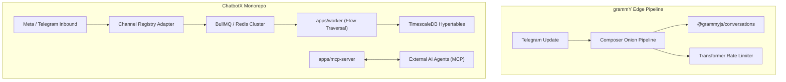
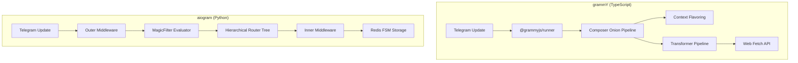
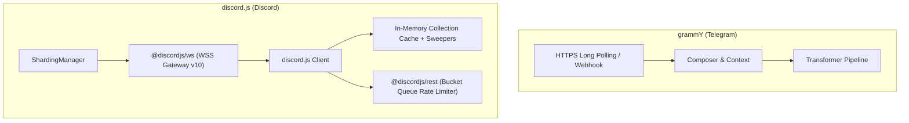
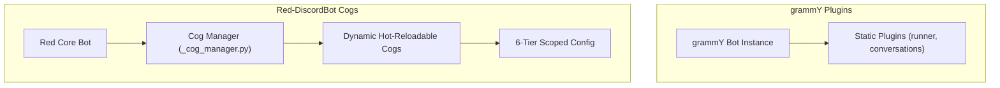
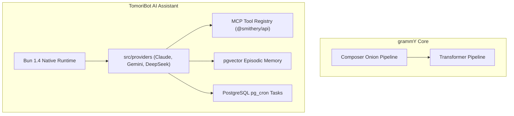

# grammY — Comparative Analysis & Category Evaluation

> **Category**: Conversational AI & Bots  
> **Architectural Role**: Universal Type-Safe Telegram Bot Framework for TypeScript & Modern Runtimes  
> **Primary Stack**: TypeScript, Deno, Node.js, Bun, Cloudflare Workers, Composer Onion Architecture, Transformer Pipeline  
> **Peer Solutions Compared**: `botpress`, `ChatbotX`, `aiogram`, `discord.js`, `Red-DiscordBot`, `TomoriBot`  
> **Commercial SaaS Benchmarks**: ManyChat, Botpress Cloud, Voiceflow, Drift  

---

## 1. Executive Overview & Technical Identity: grammY

**grammY** is the premiere, ultra-modern TypeScript framework for building Telegram bots and conversational applications. Built from the ground up to replace legacy libraries like Telegraf, grammY combines native TypeScript typing, cross-runtime portability (Deno, Node.js, Bun, Cloudflare Workers, Fastly), a composable onion-layer middleware architecture (`Composer`), compile-time *Filter Queries*, and an extensible *Context Flavoring* system.

### Core Architectural Profile
- **Runtime & Language**: `TypeScript 5.0+; runs natively on Node.js, Deno, Bun, and Cloudflare Workers (V8 Isolates)`
- **Middleware Engine**: `Koa-style Onion Middleware model via Composer with next() cascades`
- **Type Safety Paradigm**: `Context Flavoring (intersection types) & Filter Query type narrowing`
- **Concurrency & Polling**: `Queue-based worker pools with backpressure control via @grammyjs/runner`
- **Outbound Request Pacing**: `Transformer Pipeline (bot.api.config.use) with auto-retry and token throttling`
- **State & Session Storage**: `Pluggable session() middleware (Redis, PostgreSQL, Keyv, In-Memory)`
- **Dialogue Engine**: `@grammyjs/conversations (linear async-await generators) + Session middleware`
- **Primary Architectural Niche**: `Universal type-safe Telegram bot framework with transformer rate-limiting`
- **License**: `MIT`

---

## 2. Peer Solution Landscape (Conversational AI & Bots)

| Solution | Language & Runtime | Core Architecture | Database / Cache | Queue / Concurrency | Primary Architectural Niche |
| :--- | :--- | :--- | :--- | :--- | :--- |
| **grammY** (Current) | `TypeScript / Deno / Node` | Composer Onion Middleware, Web APIs | `Redis, PostgreSQL, Keyv, Memory` | `Runner Engine (@grammyjs/runner)` | Cross-runtime type-safe Telegram framework with transformer pipelines |
| **botpress** | `TypeScript / Node 22+` | Monorepo Studio + QuickJS VM (`llmz`) | `PostgreSQL, DynamoDB, Vector DB` | In-Process Event Loop & Sandboxing | Hybrid visual FSM & sandboxed LLM agent runtime |
| **ChatbotX** | `TypeScript / Node 24+` | Turborepo, Next.js 15, MCP Server | `PostgreSQL 16+, TimescaleDB, Redis 7+` | `BullMQ / Redis Cluster` | Agentic chat marketing, social comment automation & MCP funnels |
| **aiogram** | `Python 3.10-3.14` | AsyncIO, uvloop, aiohttp, Pydantic v2 | `Redis (hiredis), Motor (MongoDB)` | `AsyncIO Event Loop` | High-throughput asynchronous Telegram dispatching with hierarchical routers |
| **discord.js** | `TypeScript / Node 18-22+` | Modular Monorepo (`@discordjs/ws`, `rest`) | `In-Memory Collection Cache + Sweepers` | `REST Bucket Queues + Sharding` | Low-level object-oriented Discord WebSocket client & REST bucket manager |
| **Red-DiscordBot** | `Python 3.9-3.12+` | discord.py 2.x, Dynamic Cogs Lifecycle | `Red Config (JSON flat, Mongo, Postgres)` | `AsyncIO Task Loop + Cog Manager` | Hot-reloadable modular Discord bot platform with 6-tier scoped Config |
| **TomoriBot** | `TypeScript / Bun 1.4+` | Bun Native Runtime, discord.js 14.25 | `PostgreSQL 16+, pgvector, pg_cron` | `Bun Event Loop + Provider Streaming` | Multi-provider LLM assistant with pgvector RAG, MCP tool registry & presets |

---

## 3. Deep Head-to-Head Comparative Breakdown: grammY vs Peers

### 3.1. grammY vs. botpress

**Comparative Focus**: `Universal Type-Safe Edge Framework with Onion Middleware` vs. `Visual Flow Studio & Sandboxed QuickJS VM`

```mermaid
flowchart TD
    subgraph GrammyPipeline ["grammY Pipeline"]
        GM_In["Telegram Inbound Update"] --> GM_Runner["@grammyjs/runner (Worker Queue)"]
        GM_Runner --> GM_Composer["Composer (Onion Middlewares)"]
        GM_Composer --> GM_Session["ctx.session (Pluggable Storage)"]
        GM_Composer --> GM_Handler["Handler (ctx.reply)"]
        GM_Handler --> GM_Trans["Transformer Pipeline (Throttler/429 Retry)"]
        GM_Trans --> GM_Out["Native Web Fetch API"]
    end

    subgraph BotpressStudio ["botpress Studio & Engine"]
        BP_In["Telegram Webhook"] --> BP_Integ["integrations/telegram"]
        BP_Integ --> BP_API["packages/chat-api"]
        BP_API --> BP_Cognitive["packages/cognitive"]
        BP_Cognitive --> BP_LLMz["packages/llmz (QuickJS Sandbox)"]
        BP_LLMz <--> BP_Flow["Flow Engine Visual Canvas"]
        BP_Flow --> BP_DB["PostgreSQL / DynamoDB"]
    end
```

#### Runtime Topology, Event Loops & Concurrency Models
- **grammY** is built strictly upon standard Web APIs (`fetch`, `AbortController`, `Streams`). With zero binary dependencies, it executes uniformly across Node.js, Deno, Bun, or serverless edge environments (Cloudflare Workers). When running high-load polling, `@grammyjs/runner` manages update queuing with worker pools and backpressure.
- **botpress** requires a heavy multi-container Node.js deployment including Studio, Chat API, PostgreSQL, and DynamoDB. Telegram updates are routed through an integration plugin that normalizes payloads into Botpress-specific models.

#### Dialogue State Management & Authoring
- **grammY** uses the `session()` middleware with pluggable storage adapters (Redis, PostgreSQL, Keyv). For multi-step flows, `@grammyjs/conversations` allows developers to write linear async/await generator functions, preserving code readability.
- **botpress** provides a visual drag-and-drop node graph canvas where dialogue paths are defined visually. Execution can switch to `packages/llmz` for autonomous QuickJS sandboxed tool calling.

#### Outbound Rate Limiting
- **grammY** features an outbound *Transformer Pipeline* (`bot.api.config.use`). Transformers intercept outgoing HTTP requests, automatically pacing calls to respect Telegram's 30 msg/sec limit and retrying upon 429 status codes (`@grammyjs/auto-retry`).
- **botpress** relies on internal integration queues and generic HTTP retry logic.

#### Architectural Comparison Matrix: grammY vs. botpress

| Architectural Dimension | grammY | botpress |
| :--- | :--- | :--- |
| **Runtime Portability** | Universal (Node, Deno, Bun, Cloudflare Workers) | Node.js 22+ (Server / Docker stack) |
| **Authoring Paradigm** | Code-first TypeScript with Filter Queries | Visual drag-and-drop node canvas |
| **Middleware Model** | Koa-style Onion Middleware (`Composer`) | Webhook and SDK plugin hooks |
| **Outbound Pacing** | Outbound Transformer Pipeline (`@grammyjs/auto-retry`)| Integration-level retry queues |
| **Memory Footprint** | Extremely low (<50MB RAM on edge) | Heavy (Multi-service monorepo + DB) |
| **Multi-Channel Scope** | Dedicated Telegram Bot API | Omnichannel (Web, WhatsApp, Slack, Teams, TG) |

#### Distinct Strengths & Tradeoffs
- **Where grammY Excels**: Zero server infrastructure footprint (runs on Cloudflare Workers), compile-time type narrowing, and granular outbound rate limiting on Telegram.
- **Where botpress Holds an Advantage**: Visual conversational authoring for non-engineers, out-of-the-box omnichannel deployment, and native RAG document indexing.

---

### 3.2. grammY vs. ChatbotX

**Comparative Focus**: `Universal Type-Safe Edge Engine & Transformer Stack` vs. `Omnichannel Marketing Platform with BullMQ & MCP`

#### Runtime Topology, Event Loops & Concurrency Models
- **grammY** operates as a lightweight in-process or serverless library. Concurrency is handled either via `@grammyjs/runner` or through distributed serverless worker invocations.
- **ChatbotX** is a full-stack marketing platform built on Next.js 15 and Node 24. It delegates all execution to a BullMQ worker cluster over Redis 7+, optimizing for long-running drip sequences, delayed marketing broadcasts, and social comment scraping.

#### State Management, Storage & Analytics
- **grammY** focuses on session persistence (`ctx.session`) via pluggable adapters, keeping state minimal and operational.
- **ChatbotX** leverages PostgreSQL (via Kysely ORM) for comprehensive lead attributes and TimescaleDB hypertables for time-series conversion tracking, read receipt logging, and cohort analytics.

#### AI Agent Protocols
- **grammY** integrates AI through standard TypeScript SDK calls inside handlers.
- **ChatbotX** features a dedicated Model Context Protocol server (`apps/mcp-server`), exposing CRM contact profiles, funnel triggers, and variable mutators to external AI agents over standardized RPC.

#### Architectural Comparison Matrix: grammY vs. ChatbotX

| Architectural Dimension | grammY | ChatbotX |
| :--- | :--- | :--- |
| **Primary Domain** | Telegram bot engineering & custom applications | Omnichannel chat marketing & social lead capture |
| **Deployment Footprint** | Lightweight single file or serverless worker | Multi-service Docker monorepo (Next.js + BullMQ) |
| **Marketing Automation** | Code-defined sequences | Visual flow canvas & drip campaign manager |
| **Analytics Engine** | Application-level logging | TimescaleDB hypertables & continuous aggregates |
| **AI Agent Interface** | Direct TypeScript SDK invocation | Native Model Context Protocol (MCP) server |
| **Channel Scope** | Dedicated Telegram Bot API | Meta (WhatsApp/IG/Messenger), Telegram, Socials |

#### Distinct Strengths & Tradeoffs
- **Where grammY Excels**: Unmatched TypeScript ergonomics, serverless edge hosting, sub-second response latency, and low hosting costs.
- **Where ChatbotX Holds an Advantage**: Turnkey visual builder, automated comment-to-DM triggers on Instagram/Facebook, TimescaleDB analytics, and first-class MCP server support.

---

### 3.3. grammY vs. aiogram

**Comparative Focus**: `TypeScript Universal + Composer Onion + Runner Engine` vs. `Python AsyncIO + Two-Tier Middleware + Redis FSM`

#### Runtime Topology, Event Loops & Concurrency Models
- **grammY** executes across Node.js, Deno, Bun, and Cloudflare Workers. It uses `@grammyjs/runner` for queue-based polling worker pools.
- **aiogram** executes on Python's `asyncio` loop, optionally accelerated by C-based `uvloop` and `aiodns`.

#### Middleware & Typing Systems
- **grammY** implements a single onion-layer middleware engine (`Composer`). It relies on TypeScript's type system, using compile-time *Filter Queries* (`bot.on('message:photo')`) and *Context Flavoring* (`Context & SessionFlavor<Data>`) for zero-overhead type narrowing.
- **aiogram** separates middlewares into two discrete rings (Outer pre-filter vs. Inner post-filter) and validates all objects at runtime using Pydantic v2. It uses `magic-filter` (`F.text.startswith('/start')`) for declarative filtering.

#### Dialogue State: Linear Generators vs. Redis FSM
- **grammY** provides `@grammyjs/conversations`, enabling developers to write linear async functions where execution pauses and resumes with `await conversation.wait()`.
- **aiogram** enforces an explicit Finite State Machine (`StatesGroup`), requiring developers to define explicit states and manage transitions via `FSMContext` backed by Redis.

#### Architectural Comparison Matrix: grammY vs. aiogram

| Architectural Dimension | grammY | aiogram |
| :--- | :--- | :--- |
| **Language & Typing** | TypeScript 5.0+ / Compile-time narrowing | Python 3.10-3.14 / Runtime Pydantic v2 |
| **Runtime Portability** | Universal (Node, Deno, Bun, Cloudflare Workers) | Python VM (Linux / Docker) |
| **Middleware Paradigm** | Onion Middleware (`Composer`) | Two-tier (Outer pre-filter vs. Inner post-filter)|
| **Outbound Pacing** | Outbound Transformer Pipeline (`@grammyjs/auto-retry`)| Client session pooling / Custom throttling |
| **Conversational Flow** | Linear async generators (`@grammyjs/conversations`)| Explicit Finite State Machine (`StatesGroup`) |
| **Mini Apps Support** | High (TypeScript type safety for InitData) | High (Pydantic validation for InitData) |

#### Distinct Strengths & Tradeoffs
- **Where grammY Excels**: Modern TypeScript ergonomics, zero-dependency edge portability (Cloudflare Workers), and the composable outbound transformer pipeline.
- **Where aiogram Holds an Advantage**: Native synergy with Python's AI/ML ecosystem (PyTorch, LangChain), two-tier middleware separation, and robust distributed Redis FSM.

---

### 3.4. grammY vs. discord.js

**Comparative Focus**: `Universal Telegram Onion Engine` vs. `Object-Oriented Discord WebSocket Gateway & Cache Infrastructure`

#### Runtime Topology, Event Loops & Concurrency Models
- **grammY** interfaces with Telegram's stateless HTTPS Bot API. It does not maintain persistent socket connections and scales elastically over HTTP webhooks.
- **discord.js** manages Discord's persistent WebSocket Gateway v10. It coordinates continuous socket heartbeats, sequence numbers, and worker-process sharding via `ShardingManager`.

#### State Management & Caching
- **grammY** maintains no local entity cache. It relies on external session stores (`session()`) and fetches data on-demand.
- **discord.js** maintains massive in-memory `Collection` maps representing active guilds, roles, channels, and members, using automated `Sweepers` to prevent heap exhaustion.

#### Rate Limiting Architecture
- **grammY** handles Telegram's 30 msg/sec global limit via its outbound *Transformer Pipeline*.
- **discord.js** manages Discord's dynamic route-specific bucket hashes via `@discordjs/rest`, using sequential FIFO sub-queues per bucket.

#### Architectural Comparison Matrix: grammY vs. discord.js

| Architectural Dimension | grammY | discord.js |
| :--- | :--- | :--- |
| **Target Platform** | Telegram Bot API | Discord Gateway v10 & REST API |
| **Network Protocol** | Stateless HTTPS Webhooks & Polling | Stateful Bidirectional WebSocket (WSS v10) |
| **State Architecture** | Stateless with external session adapters | Heavy in-memory `Collection` cache + Sweepers |
| **Rate Limiting** | Outbound Transformer Pipeline | Route-specific Bucket Hash FIFO sub-queues |
| **Execution Targets** | Node, Deno, Bun, Cloudflare Workers | Node.js 18+ (Requires persistent process) |

#### Distinct Strengths & Tradeoffs
- **Where grammY Excels**: Serverless edge execution, zero-overhead memory footprint, and streamlined Telegram API ergonomics.
- **Where discord.js Holds an Advantage**: Definitive object-oriented Discord Gateway client, rich component builders (Buttons, Select Menus, Modals), and guild cache management.

---

### 3.5. grammY vs. Red-DiscordBot

**Comparative Focus**: `Universal TypeScript Framework` vs. `Modular Self-Hosted Discord Micro-Kernel`

#### Runtime Topology, Event Loops & Concurrency Models
- **grammY** is a TypeScript developer framework. Applications are compiled and deployed via standard Node/Deno/Docker or edge scripts.
- **Red-DiscordBot** is a complete Python community bot platform with a dynamic Cog micro-kernel. Cogs can be installed, updated, or reloaded at runtime from remote Git repositories without restarting the bot.

#### State & Configuration Scoping
- **grammY** uses the `session()` middleware with custom session keys (e.g., scoping by chat or user).
- **Red-DiscordBot** features the 6-tier hierarchical `Config` engine (`redbot.core.config`), providing out-of-the-box scoping across `GLOBAL`, `GUILD`, `CHANNEL`, `ROLE`, `USER`, and `MEMBER` dimensions.

#### Architectural Comparison Matrix: grammY vs. Red-DiscordBot

| Architectural Dimension | grammY | Red-DiscordBot |
| :--- | :--- | :--- |
| **Language & Stack** | TypeScript 5.0+ / Standard Web APIs | Python 3.9-3.12+ / discord.py 2.x |
| **Target Platform** | Telegram Bot API | Discord Communities |
| **Modularity Model** | Build-time plugins & middleware | Runtime hot-reloadable Cogs via Git |
| **Configuration Engine** | Pluggable session adapters | 6-Tier Scoped Config (JSON, Mongo, Postgres) |
| **Deployment Footprint** | Single file or serverless edge (<50MB) | Dedicated Python process with local storage |

#### Distinct Strengths & Tradeoffs
- **Where grammY Excels**: Extreme developer ergonomics in TypeScript, edge serverless execution, and precise Telegram API support.
- **Where Red-DiscordBot Holds an Advantage**: Zero-downtime hot-reloading of features, turn-key community moderation, economy, and music systems.

---

### 3.6. grammY vs. TomoriBot

**Comparative Focus**: `Universal Telegram Middleware Engine` vs. `Bun-Native Multi-Provider AI Assistant with pgvector`

#### Runtime Topology, Event Loops & Concurrency Models
- **grammY** runs across all JavaScript runtimes (Deno, Node, Bun, Workers), focusing on pure Telegram protocol transformation and middleware composition.
- **TomoriBot** runs specifically on Bun 1.4+, interfacing with Discord Gateway v10 via `discord.js` and streaming generative AI responses to community channels.

#### AI Reasoning, Memory & Tool Calling
- **grammY** provides no built-in AI models or memory vectors.
- **TomoriBot** provides a complete multi-provider LLM gateway with automatic failover, standardized tool execution via the Model Context Protocol (MCP), persistent episodic memory via PostgreSQL `pgvector`, and SillyTavern character presets.

#### Architectural Comparison Matrix: grammY vs. TomoriBot

| Architectural Dimension | grammY | TomoriBot |
| :--- | :--- | :--- |
| **Language & Runtime** | TypeScript 5.0+ / Universal Web APIs | TypeScript 5.9+ / Bun 1.4+ |
| **Target Platform** | Telegram Bot API | Discord Gateway & Matrix Appservice Bridge |
| **AI Integration** | None (Developer brings own SDK) | Built-in Multi-Provider Gateway (10+ models) |
| **Tool Calling Standard** | Custom handler functions | Industry-standard Model Context Protocol (MCP) |
| **Long-Term Memory** | External session storage | PostgreSQL `pgvector` cosine similarity embeddings |
| **Job Scheduling** | External timers | PostgreSQL in-database `pg_cron` jobs |

#### Distinct Strengths & Tradeoffs
- **Where grammY Excels**: Cross-runtime edge portability, compile-time type narrowing, and granular outbound rate limiting on Telegram.
- **Where TomoriBot Holds an Advantage**: Turnkey multi-provider LLM orchestration, standardized MCP tool discovery, episodic memory with pgvector, and native Bun performance.

---

## 4. Capability & Feature Comparison Matrix

| Dimension / Capability | grammY | botpress | ChatbotX | aiogram | discord.js | Red-DiscordBot | TomoriBot |
| :--- | :---: | :---: | :---: | :---: | :---: | :---: | :---: |
| **Primary Platform** | **Telegram** | Omnichannel | Omnichannel / Meta | **Telegram** | **Discord** | **Discord** | **Discord** |
| **Runtime Portability** | **Universal Edge** | Node Server | Node Server | Python VM | Node Server | Python VM | Bun Native |
| **Middleware Model** | **Onion (Composer)**| Event Hooks | Route Handlers | Two-Tier | Event Emitter | Command Checks | Event Listeners |
| **Context Flavoring** | ✅ Compile-Time | ❌ | ❌ | ❌ | ❌ | ❌ | ❌ |
| **Outbound Pacing** | ✅ Transformer | ⚠️ Internal | ✅ BullMQ Limiter | ⚠️ Session | ✅ Bucket Queues | ✅ Discord.py | ⚠️ Provider Retries |
| **Visual Flow Canvas** | ❌ | ✅ Advanced | ✅ Visual Builder | ❌ | ❌ | ❌ | ❌ |
| **Native MCP Server / Client**| ❌ | ⚠️ Zui Tools | ✅ Native Server | ❌ | ❌ | ❌ | ✅ Native Client |
| **Vector RAG Ingestion** | ❌ | ✅ Native Plugin | ✅ pgvector Core | ❌ | ❌ | ⚠️ Community Cog | ✅ Native pgvector |
| **Hot-Reloading Architecture**| ❌ | ❌ | ❌ | ❌ | ❌ | ✅ Native Cogs | ❌ |

---

## 5. Commercial Benchmark Positioning

When benchmarked against commercial SaaS leaders (**ManyChat, Botpress Cloud, Voiceflow, Drift**):
- **Serverless & Edge Costs**: grammY is the only framework that runs natively inside Cloudflare Workers or Deno Deploy, allowing bots to scale to millions of requests with virtually zero idle server hosting costs.
- **Enterprise Type Safety**: Context Flavoring and Filter Queries guarantee compile-time safety, preventing the runtime undefined property exceptions common in loosely typed bot scripts.
- **Protocol Completeness**: Directly tracks Telegram Bot API releases with zero delay via `@grammyjs/types`.

---

## 6. Strategic Takeaways & Role for MarketingStudio

In the unified **MarketingStudio** architecture:
1. **Primary Component to Adopt**: Standardize on `grammY` as MarketingStudio's primary TypeScript Telegram automation engine for customer onboarding, notification bots, and Telegram Mini Apps.
2. **Rate Limiting Blueprint**: Adopt grammY's outbound *Transformer Pipeline* pattern across MarketingStudio's outbound messaging adapters to eliminate 429 rate limit errors.
3. **Peer Coexistence**: Use `grammY` for fast, lightweight Telegram bots and edge workers, while routing visual customer journeys through `botpress` and `ChatbotX`.
