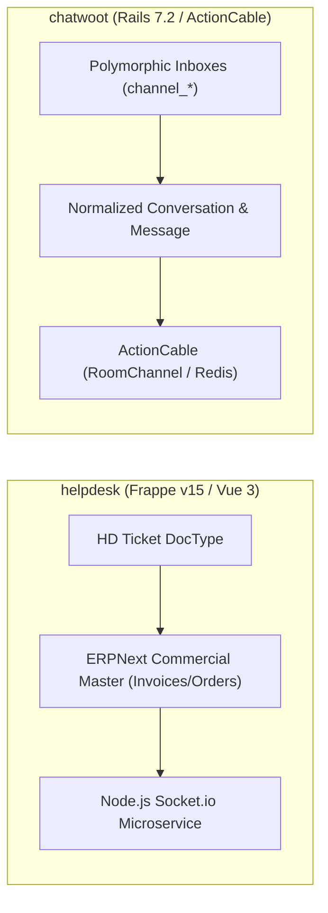
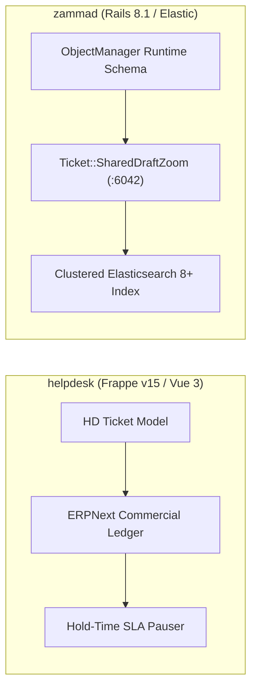
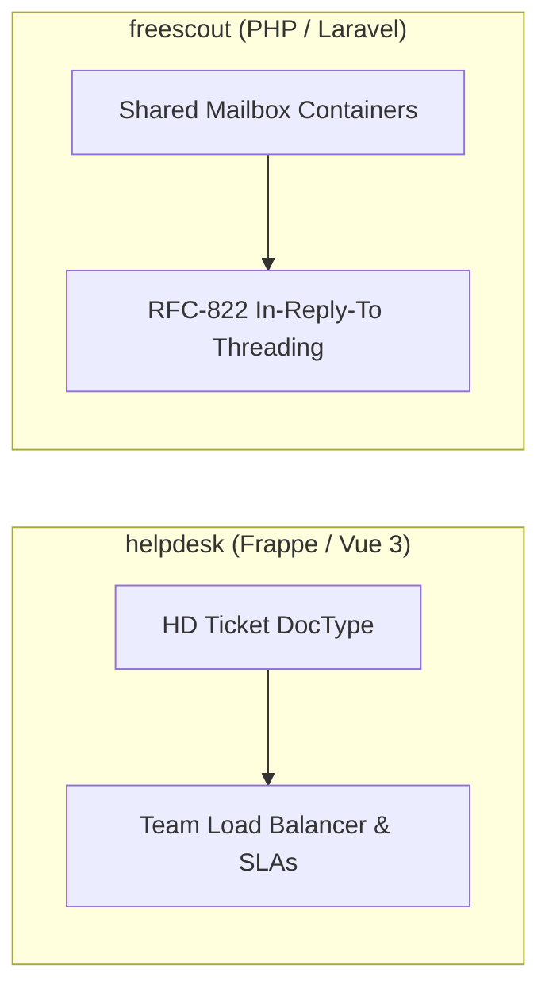
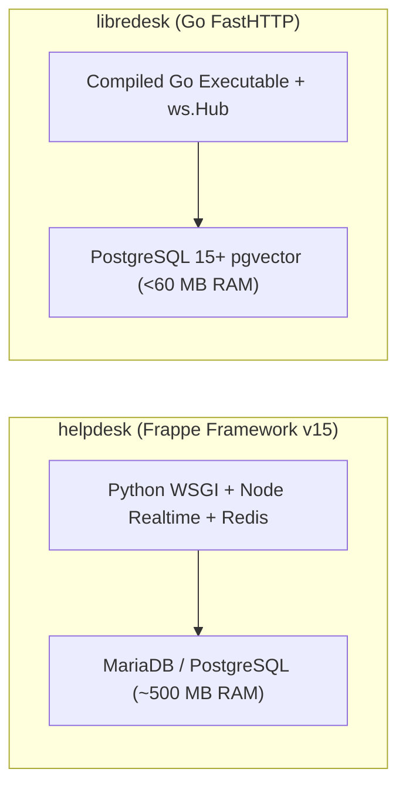
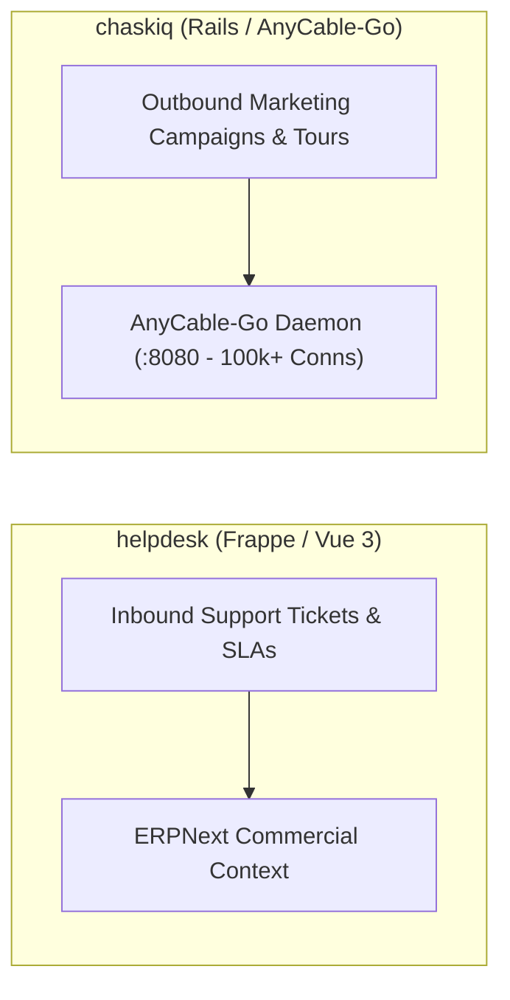
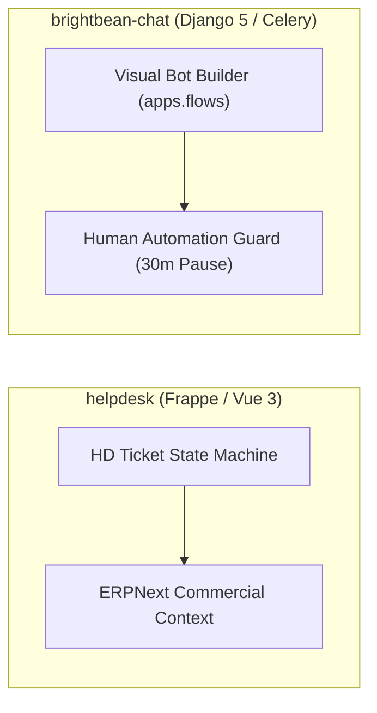

# helpdesk — Comparative Analysis & Category Evaluation

> **Category**: Omnichannel Helpdesk & Support  
> **Architectural Role**: Metadata DocType helpdesk deeply bound to ERPNext commercial ledgers  
> **Primary Stack**: Python 3.10+, Node.js 20+ | Frappe Framework v15, Vue 3, Frappe UI | MariaDB 10.6+ / PostgreSQL, Redis | Python RQ + Node Socket.io  
> **Peer Solutions Compared**: `chatwoot`, `zammad`, `freescout`, `libredesk`, `chaskiq`, `brightbean-chat`  
> **Commercial SaaS Benchmarks**: Zendesk, Freshdesk, ServiceNow, Jira Service Management, Salesforce Service Cloud  

---

## 1. Executive Overview & Technical Identity: helpdesk

**helpdesk** (Frappe Helpdesk) represents the enterprise commercial operations standard within the **Omnichannel Helpdesk & Support** domain, distinguished by its core focus on **Native integration with ERPNext commercial ledgers, DocType metadata flexibility, dynamic hold-time SLA pausing, and real-time Vue 3 SPA performance**.

### Core Architectural Profile
- **Runtime & Language**: `Python 3.10+` (WSGI / Gunicorn), `Node.js 20+` (Socket.io microservice)
- **Core Framework**: `Frappe Framework v15`, `Vue.js 3 Composition API`, `Frappe UI`, `Tailwind CSS`
- **Persistence Layer**: `MariaDB 10.6+` (default) or `PostgreSQL 14+`, `Redis 7+` (Cache & Pub/Sub), `SQLite` (`search_sqlite.py`)
- **Concurrency & Queue Model**: Python RQ (Redis Queue: short, default, long pools) + Standalone Node.js Socket.io real-time server
- **Domain Specialization**: `ERP-integrated customer support ticketing, SLA hold-time management & team dispatch`

---

## 2. Peer Solution Landscape (Omnichannel Helpdesk & Support)

Within this category, `helpdesk` operates alongside the following peer solutions:

| Solution | Language & Runtime | Core Framework | Database / Cache | Queue / Concurrency | Primary Architectural Niche |
| :--- | :--- | :--- | :--- | :--- | :--- |
| **helpdesk** (Current) | `Python 3.10+, Node 20+`| `Frappe Framework v15, Vue 3`| `MariaDB, Redis, SQLite` | `Python RQ + Node Socket.io` | **SLA policies & seamless integration with Frappe/ERPNext apps** |
| **chatwoot** | `Ruby 3.4+` | `Rails 7.2, Vue 3` | `PostgreSQL 14+, Redis` | `Sidekiq + ActionCable` | Polymorphic multi-channel inbox & real-time live chat |
| **zammad** | `Ruby 3.4+` | `Rails 8.1, TypeScript` | `PostgreSQL/MySQL + Elastic 8+` | `Delayed::Job + EventMachine WS` | Enterprise ITIL ticketing, dynamic Object Manager & audit trails |
| **freescout** | `PHP 8.1-8.3` | `Laravel 5.5 LTS, Blade` | `MySQL 8+ / MariaDB / Postgres` | `Laravel Queue / CLI Cron` | Low-overhead shared email inboxes with modular add-ons |
| **libredesk** | `Go 1.25+` | `FastHTTP, Fastglue` | `PostgreSQL 15+, pgvector` | `Native Goroutines + FastHTTP WS` | Sub-60MB RAM footprint with compiled high-concurrency Go |
| **chaskiq** | `Ruby 3.3.5+, Node 20+` | `Rails 7.2, React 18` | `PostgreSQL, Redis, Nightfury` | `Sidekiq + AnyCable-Go WS` | Intercom-style proactive tours, campaigns & outbound messages |
| **brightbean-chat** | `Python 3.11+, Node 20+`| `Django 5, Django Ninja` | `PostgreSQL 15+, Redis` | `Celery + Django Channels` | Multi-tenant visual flow automation with human-takeover contract |

---

## 3. Deep Head-to-Head Comparative Breakdown: helpdesk vs Peers

### 3.1. helpdesk vs. chatwoot

**Comparative Focus**: `ERPNext commercial context & hold-time SLAs` vs. `Polymorphic multi-channel live chat`

#### Architectural & Stack Differences
- **Commercial Data Binding**: Frappe Helpdesk lives inside the Frappe bench, giving agents immediate in-memory access to ERPNext customer records, open invoices, active warranty subscriptions, and shipment tracking without third-party webhooks. Chatwoot operates as an independent conversational customer communication platform with no native ERP links.
- **Real-Time Streaming Engine**: Chatwoot runs ActionCable directly inside Ruby. Frappe Helpdesk decouples Python WSGI from WebSockets using an independent **Node.js Socket.io** microservice (`helpdesk/realtime/index.js`) that consumes doc change events from Redis Pub/Sub, preventing Python worker thread blocking.
- **SLA Policy Mechanics**: Chatwoot tracks basic business hours. Frappe Helpdesk implements **Hold-Time SLA Pausing**: when a ticket transitions to `On Hold` (*Waiting on Customer*), the SLA clock halts, and upon resumption, `total_hold_time` is dynamically computed and added to `resolution_by`.

#### Where helpdesk Excels over chatwoot
- **Direct ERP Commercial Intelligence**: Support reps see customer financial standing, order history, and subscription renewals directly in the ticket sidebar.
- **Dynamic Hold-Time SLA Pausing**: Ensures accurate agent SLA reporting by pausing countdowns during external delays.
- **DocType Extensibility**: Add custom fields, automated client scripts, and workflow transitions via the Frappe GUI without deployments.

#### Where chatwoot Holds an Advantage over helpdesk
- **Turnkey Omnichannel Ingress**: Native out-of-the-box connectors for WhatsApp Cloud API, Instagram DMs, Facebook Pages, and Telegram bots.
- **Embeddable Live Chat Widget**: Mature, pre-compiled JavaScript widget (`chatwoot-widget.js`) with proactive messages and visitor tracking.
- **Standalone Cloud-Native Deployment**: Easier to deploy as an isolated customer service microservice without running a Frappe Bench environment.

#### Architectural Tradeoffs Matrix

| Architectural Dimension | helpdesk (Frappe) | chatwoot |
| :--- | :--- | :--- |
| **Primary Domain Focus** | Commercial ERP customer support ticketing | Omnichannel conversational customer engagement |
| **Commercial Integration**| Native in-memory ERPNext DocType linking | External REST webhooks & custom CRM sync |
| **Real-Time Engine** | Standalone Node.js Socket.io microservice | Rails ActionCable over Redis Pub/Sub |
| **SLA Controller** | Multi-calendar with hold-time pausing | Static threshold timers with Sidekiq Cron |
| **Local Search** | SQLite local client search (`search_sqlite.py`)| PostgreSQL GIN Trigram indexes (`pg_trgm`) |
| **Base Production RAM** | ~500 MB - 1 GB RAM (Bench + Node Realtime) | ~2.5 GB RAM (Rails + Sidekiq) |
| **Best-Fit Deployment** | Enterprises running ERPNext commercial backends | SaaS companies, D2C brands, social chat support |

---

### 3.2. helpdesk vs. zammad

**Comparative Focus**: `ERP-integrated ticketing & hold-time SLAs` vs. `Elasticsearch ITIL ticketing & dynamic Object Manager`

#### Architectural & Stack Differences
- **Ecosystem Architecture**: Zammad is an independent enterprise ITIL ticketing engine written in Ruby on Rails 8.1 requiring an Elasticsearch cluster. Frappe Helpdesk is a Python/Frappe DocType application executing within the Frappe ecosystem alongside ERPNext.
- **Search Capabilities**: Zammad indexes all ticket bodies and attachments into a clustered Elasticsearch 8+ engine, delivering sub-millisecond query results across millions of tickets. Frappe Helpdesk combines MariaDB/PostgreSQL relational querying with an optimized SQLite local search index (`search_sqlite.py`).
- **Real-Time Agent Collaboration**: Zammad provides live shared-draft synchronization (`Ticket::SharedDraftZoom`) over EventMachine WebSockets. Frappe Helpdesk broadcasts real-time document change events via Node.js Socket.io to its Vue 3 SPA interface.

#### Where helpdesk Excels over zammad
- **Direct ERP Financial & Order Context**: Instant access to sales invoices, quotations, and shipment deliveries inside the ticket view.
- **Hold-Time Clock Pausing**: Automatically pauses SLA timers during customer-wait states, preventing false SLA breaches.
- **Lighter Hardware Footprint**: Does not require an Elasticsearch JVM cluster, running on 500 MB – 1 GB RAM.

#### Where zammad Holds an Advantage over helpdesk
- **Hyperscale Search Across Millions of Tickets**: Clustered Elasticsearch outperforms MariaDB/SQLite full-text queries at massive enterprise volume.
- **Live Shared Draft Synchronization**: Agents see real-time peer typing text and avatar badges.
- **Deep ITIL Service Management**: Formal audit logging per article and CTI telephony PBX screen-pops.

#### Architectural Tradeoffs Matrix

| Architectural Dimension | helpdesk (Frappe) | zammad |
| :--- | :--- | :--- |
| **Primary Domain Focus** | Commercial ERP customer ticketing | Enterprise ITIL ticketing & governance |
| **Underlying Framework** | Python 3.10+ / Frappe Framework v15 (WSGI) | Ruby on Rails 8.1 (Puma) |
| **Real-Time Architecture**| Standalone Node.js Socket.io server (:9000) | Standalone EventMachine daemon (:6042) |
| **Search Engine Engine** | SQLite local client cache (`search_sqlite.py`)| Clustered Elasticsearch 8+ / OpenSearch |
| **ERP Commercial Link** | Direct native DocType access (ERPNext) | External REST API webhooks |
| **SLA Hold Pausing** | Native dynamic hold-time calculation | Static escalation timestamps |
| **Best-Fit Deployment** | Businesses managing sales and support in ERPNext | Large enterprise IT departments requiring pure ITIL |

---

### 3.3. helpdesk vs. freescout

**Comparative Focus**: `Frappe/ERP ticketing suite` vs. `Low-overhead PHP shared email mailbox`

#### Architectural & Stack Differences
- **Application Scale & Complexity**: FreeScout is a focused PHP/Laravel shared mailbox application consuming ~150 MB RAM, designed exclusively for email workflows. Frappe Helpdesk is a full-featured customer support suite built on Python, MariaDB, Redis, and Node.js Socket.io.
- **Email Threading vs. Commercial Ticketing**: FreeScout excels at parsing RFC-822 email headers (`In-Reply-To`, `References`) to maintain unbroken customer email threads. Frappe Helpdesk treats inbound emails as support tickets (`HD Ticket`), routing them through team assignment rules (`HDAssignmentRule`) and binding them to commercial customer ledgers.
- **Real-Time Engine**: FreeScout uses client HTTP polling or external Pusher. Frappe Helpdesk uses an internal Node.js Socket.io server streaming live document events.

#### Where helpdesk Excels over freescout
- **Direct ERP Commercial Integration**: Access to invoices, orders, and warranty contracts directly alongside tickets.
- **Advanced Dynamic SLAs**: Multi-calendar SLA policies with hold-time pausing.
- **Reactive Vue 3 Single Page Application**: Sub-second UI state updates powered by `frappe-ui`.

#### Where freescout Holds an Advantage over helpdesk
- **3x Lower Resource Footprint**: ~150 MB RAM on any basic LAMP/LEMP virtual server.
- **Pure Email Shared Mailbox UX**: Exact replica of Help Scout's minimalist interface.
- **Modular Extension Ecosystem**: Over 50+ drop-in modules in `Modules/` without modifying core code.

#### Architectural Tradeoffs Matrix

| Architectural Dimension | helpdesk (Frappe) | freescout |
| :--- | :--- | :--- |
| **Primary Domain Focus** | Commercial ERP customer ticketing | Minimalist shared email mailbox |
| **Runtime & Framework** | Python 3.10+ / Frappe v15 / Node.js | PHP 8.1+ / Laravel Framework |
| **Real-Time Transport** | Node.js Socket.io microservice | HTTP Long-Polling / Pusher WebSockets |
| **Commercial Context** | Direct native DocType access (ERPNext) | Isolated database |
| **Base Production RAM** | ~500 MB - 1 GB RAM | **~150 MB RAM** |
| **Best-Fit Deployment** | Companies running commercial operations on ERPNext | Small support teams focused exclusively on email |

---

### 3.4. helpdesk vs. libredesk

**Comparative Focus**: `Frappe/ERP ticketing suite` vs. `Sub-60MB high-throughput Go binary`

#### Architectural & Stack Differences
- **Compilation & Memory Footprint**: Frappe Helpdesk requires Python WSGI, Gunicorn, Redis, and a Node.js Socket.io process (~500 MB - 1 GB RAM). LibreDesk compiles into a single native Go binary running on `valyala/fasthttp`, consuming under 60 MB of RAM.
- **Email Ingress Processing**: Frappe Helpdesk polls email servers via background RQ queues. LibreDesk establishes persistent IMAP IDLE push listeners (`go-imap/v2`) and pooled SMTP dispatch (`knadh/smtppool/v2`).
- **AI & Vector Retrieval**: Frappe Helpdesk uses standard keyword searches. LibreDesk integrates PostgreSQL `pgvector` directly into Go background routines for autonomous AI copilot knowledge retrieval.

#### Where helpdesk Excels over libredesk
- **ERP Commercial Integration**: Native in-memory access to ERPNext customer records, invoices, and warranties.
- **Dynamic SLA Hold-Time Pausing**: Pauses SLA countdowns during external dependency delays.
- **Comprehensive DocType UI Framework**: Rich admin desk with configurable permissions, forms, and client scripts.

#### Where libredesk Holds an Advantage over helpdesk
- **10x Lower Resource Footprint**: Under 60 MB RAM base RSS with instant native execution.
- **Persistent Wire-Speed Email Ingress**: IMAP IDLE captures incoming emails the instant they hit the mail server.
- **Native Vector AI Copilot**: Built-in semantic document search via PostgreSQL `pgvector`.

#### Architectural Tradeoffs Matrix

| Architectural Dimension | helpdesk (Frappe) | libredesk |
| :--- | :--- | :--- |
| **Primary Domain Focus** | Commercial ERP customer ticketing | High-performance compiled support engine |
| **Runtime & Execution** | Python 3.10+ / WSGI + Node.js (Interpreted) | Go 1.25 compiled binary (Machine code) |
| **Email Ingress** | Scheduled background RQ polling | Persistent IMAP IDLE push streams (`go-imap/v2`)|
| **Real-Time Architecture**| Node.js Socket.io microservice | In-memory `ws.Hub` with `sync.RWMutex` |
| **Base Production RAM** | ~500 MB - 1 GB RAM | **< 60 MB RAM** |
| **Best-Fit Deployment** | Businesses running their operations on ERPNext | High-concurrency cloud-native backends, micro-nodes |

---

### 3.5. helpdesk vs. chaskiq

**Comparative Focus**: `ERP commercial ticketing` vs. `Conversational marketing, tours & AnyCable-Go`

#### Architectural & Stack Differences
- **Operational Objective**: Frappe Helpdesk is designed for resolving inbound customer support issues while inspecting commercial ERP orders. Chaskiq is engineered for conversational marketing: acquiring visitors via live chat, running onboarding product tours (`Tour`), and dispatching targeted marketing campaigns (`Campaign`).
- **WebSocket Scale**: Frappe Helpdesk uses Node.js Socket.io for internal agent collaboration. Chaskiq uses **AnyCable-Go** (port 8080), sustaining over 100,000 simultaneous persistent visitor socket connections with minimal CPU.
- **API & Data Representation**: Frappe Helpdesk exposes whitelisted Python RPC endpoints. Chaskiq is built on Apollo GraphQL (`graphql-ruby`) with React 18.

#### Where helpdesk Excels over chaskiq
- **Deep ERP Commercial Visibility**: Agents see customer billing, order fulfillment, and warranty claims directly inside the ticket.
- **Enterprise SLA Hold-Time Logic**: Sophisticated SLA tracking with calendar awareness and hold-time pausing.
- **Team Load Balancing**: Automated team queues (`HD Team`) and round-robin agent assignment rules.

#### Where chaskiq Holds an Advantage over helpdesk
- **Outbound Marketing & Product Tours**: Interactive UI walkthroughs and targeted drip campaigns.
- **AnyCable WebSocket Scalability**: Effortlessly handles viral traffic spikes on public website widgets.
- **Dynamic Audience Segmentation**: Evaluates real-time visitor attributes and geolocation via `Segment`.

#### Architectural Tradeoffs Matrix

| Architectural Dimension | helpdesk (Frappe) | chaskiq |
| :--- | :--- | :--- |
| **Primary Domain Focus** | Commercial ERP customer ticketing | Conversational marketing & product tours |
| **Real-Time Engine** | Standalone Node.js Socket.io server | **AnyCable-Go (Go gRPC daemon, 100k+ conns)** |
| **Commercial Context** | Direct native DocType access (ERPNext) | External CRM webhooks |
| **Outbound Capabilities** | Notification emails & auto-replies | Drip campaigns, in-app tours, popup banners |
| **Base Production RAM** | ~500 MB - 1 GB RAM | ~2,000 MB RAM |
| **Best-Fit Deployment** | B2B, wholesale, manufacturing on ERPNext | Product-led growth SaaS, visitor onboarding |

---

### 3.6. helpdesk vs. brightbean-chat

**Comparative Focus**: `ERP commercial ticketing` vs. `Django visual flow automation & human takeover contract`

#### Architectural & Stack Differences
- **Ecosystem & Framework**: Frappe Helpdesk is built on Python/Frappe Framework v15 with MariaDB. Brightbean-Chat is built on Python 3.11+ and Django 5 with PostgreSQL and Celery.
- **Automation Model**: Frappe Helpdesk automates triage via assignment rules and saved replies. Brightbean-Chat features a visual drag-and-drop conversational bot builder (`apps.flows`) executing multi-step branching decision trees across WhatsApp and webchat.
- **Human vs. Bot Protection**: Brightbean-Chat enforces a strict **Human Automation Guard**: sending an agent reply sets `automation_paused_until = now() + 30m`, shutting down automated flows while a human agent is active. Frappe Helpdesk focuses on agent routing and SLA tracking.

#### Where helpdesk Excels over brightbean-chat
- **ERP Commercial Integration**: Instant access to sales orders, invoices, and subscriptions in ERPNext.
- **Dynamic Hold-Time SLA Pausing**: Pauses SLA timers during customer-wait states.
- **Team Queue Balancing**: Advanced assignment rules based on agent capacity and availability flags.

#### Where brightbean-chat Holds an Advantage over brightbean-chat
- **Visual Drag-and-Drop Bot Builder**: Non-technical users can build complex branching chatbots without code.
- **Deterministic Human Takeover**: Prevents bots from interrupting human conversations.
- **Built-in WhatsApp & SMS Rate Limiting**: `SendBucket` token-bucket limiter prevents carrier bans.

#### Architectural Tradeoffs Matrix

| Architectural Dimension | helpdesk (Frappe) | brightbean-chat |
| :--- | :--- | :--- |
| **Primary Domain Focus** | Commercial ERP customer ticketing | Visual chatbot automation & shared inbox |
| **Framework & ORM** | Frappe Framework v15 (MariaDB/Postgres) | Django 5 (PostgreSQL / Django ORM) |
| **Bot Automation Engine** | Rule assignments & saved replies | Native visual flow graph (`apps.flows`) |
| **Human Takeover** | Manual status change | Deterministic 30-min pause (`automation_paused_until`)|
| **Commercial Context** | Direct native DocType access (ERPNext) | External CRM webhooks |
| **Best-Fit Deployment** | Commercial enterprises running ERPNext | Marketing lead generation, automated WhatsApp bots|

---

## 4. Capability & Feature Comparison Matrix

| Dimension / Capability | helpdesk | chatwoot | zammad | freescout | libredesk | chaskiq | brightbean-chat |
| :--- | :---: | :---: | :---: | :---: | :---: | :---: | :---: |
| **Primary Architectural Niche** | **SLA policies & ERPNext commercial context** | Polymorphic multi-channel inbox & live chat | Elasticsearch ITIL ticketing & dynamic schema | Low-overhead shared email inboxes | Sub-60MB RAM footprint with Go binary | Intercom-style proactive tours & AnyCable | Visual flow automation & human-takeover contract |
| **Runtime Language** | `Python / JS` | `Ruby 3.4+` | `Ruby 3.4+` | `PHP 8.1+` | `Go 1.25+` | `Ruby 3.3+` | `Python 3.11+` |
| **Database Persistence** | `MariaDB, Redis` | `PostgreSQL, Redis` | `PostgreSQL/MySQL + Elastic` | `MySQL / MariaDB` | `PostgreSQL, pgvector`| `PostgreSQL, Redis` | `PostgreSQL, Redis` |
| **Real-Time Streaming** | Node.js Socket.io | ActionCable WebSockets | EventMachine WebSockets | HTTP Polling / Pusher | Native Go FastHTTP WS | AnyCable-Go Daemon | Django Channels (ASGI) |
| **Search Engine Engine** | SQLite Local Cache | PostgreSQL GIN Trigrams | Elasticsearch 8+ Cluster | MySQL B-Tree Indexes | PostgreSQL Trigrams | PostgreSQL JSONB | PostgreSQL Indexes |
| **Base Production RAM** | ~500 MB RAM | ~2.5 GB RAM | ~3.5 GB RAM | **~150 MB RAM** | **< 60 MB RAM** | ~2.0 GB RAM | ~350 MB RAM |

---

## 5. Commercial Benchmark Positioning

When benchmarked against commercial SaaS leaders (**Zendesk, Freshdesk, ServiceNow, Jira Service Management, Salesforce Service Cloud**):
- **Against Salesforce Service Cloud**: Frappe Helpdesk replicates Salesforce's deep connection between customer support cases and commercial billing/order records, but with zero recurring seat licenses and full data sovereignty.
- **Against Zendesk / Freshdesk**: For organizations using ERPNext for accounting, inventory, and sales, Frappe Helpdesk eliminates the need for expensive third-party Zendesk integration connectors.
- **Against Intercom**: Frappe Helpdesk is an operational helpdesk rather than a lightweight chat messenger; teams prioritizing conversational sales and marketing popups will find `chatwoot` or `chaskiq` more appropriate.

---

## 6. Strategic Takeaways & Role for MarketingStudio

In the unified **MarketingStudio** architecture:
1. **Primary Component to Adopt**: Replicate Frappe Helpdesk's **Hold-Time SLA Pausing Logic** to ensure agents are never penalized while tickets are awaiting client responses.
2. **Incorporate ERP Commercial Linking**: Connect MarketingStudio's CRM contacts and customer deals directly into the support view so agents have instantaneous financial context.
3. **Reference Real-Time Decoupling**: Adopt Frappe's architectural separation of Python/backend workers from real-time WebSockets via an independent Node.js or Go streaming service.
