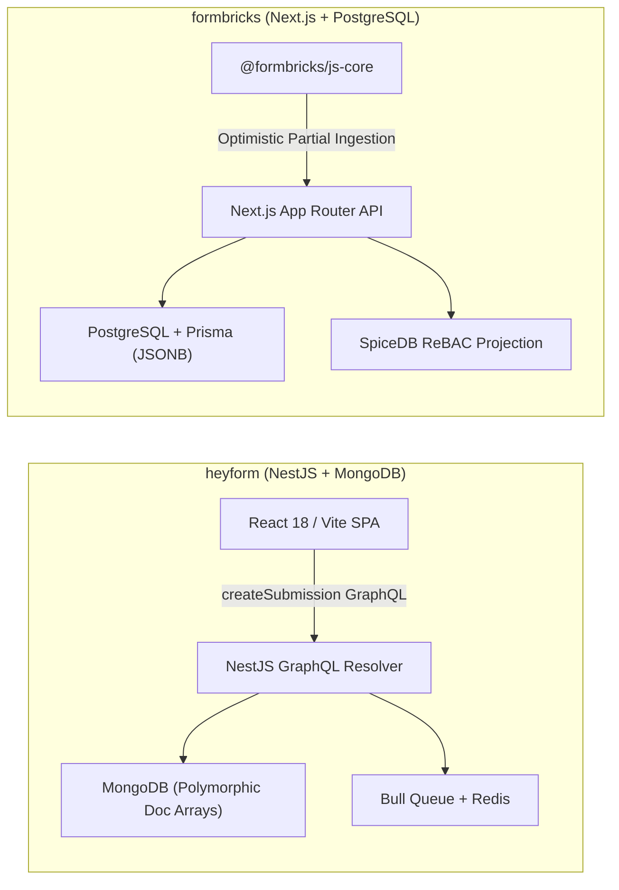
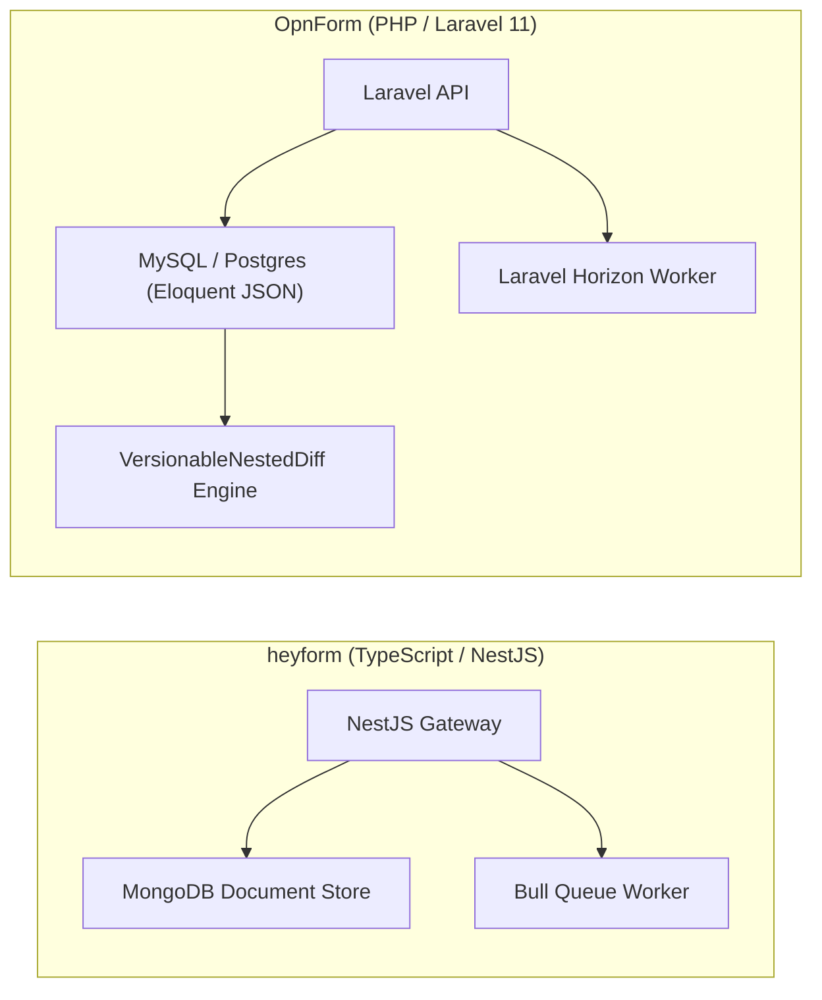
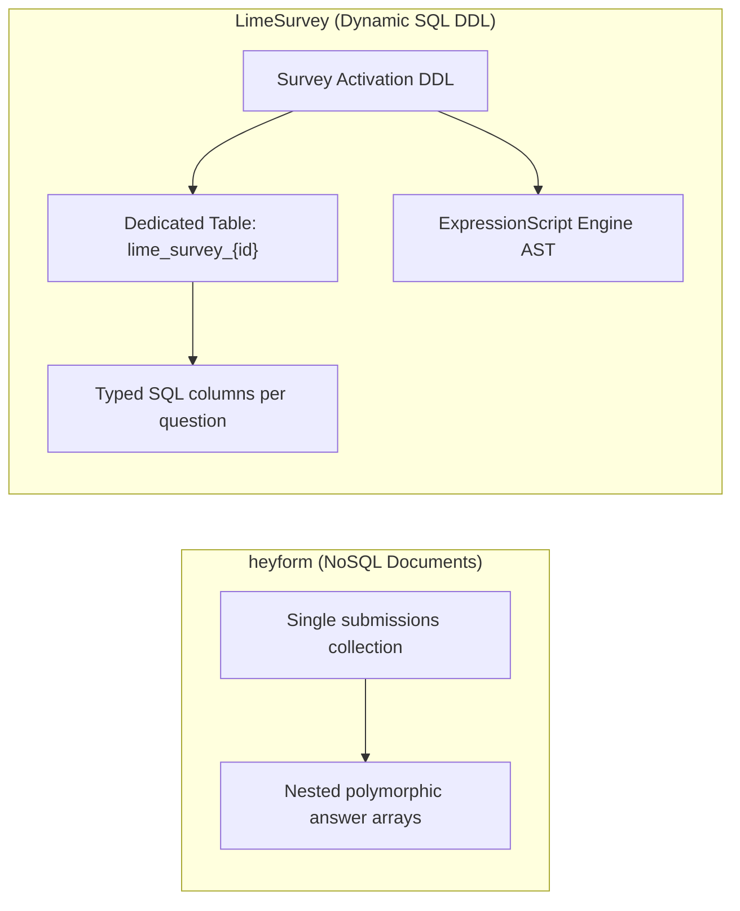
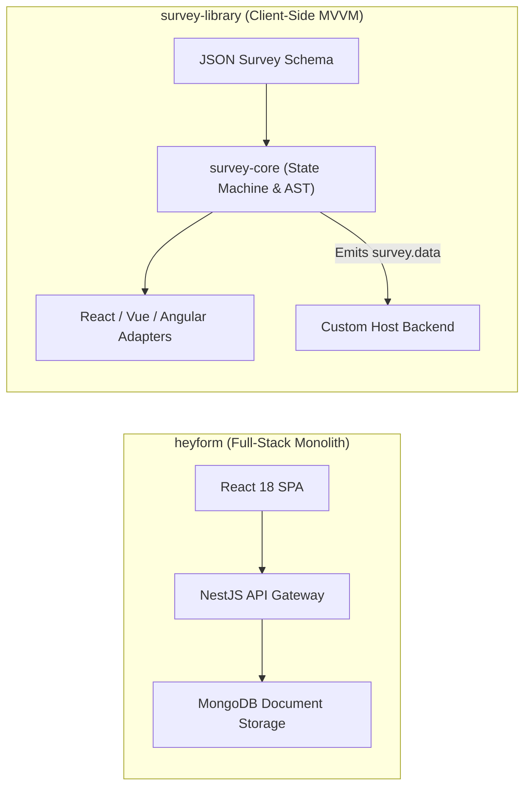
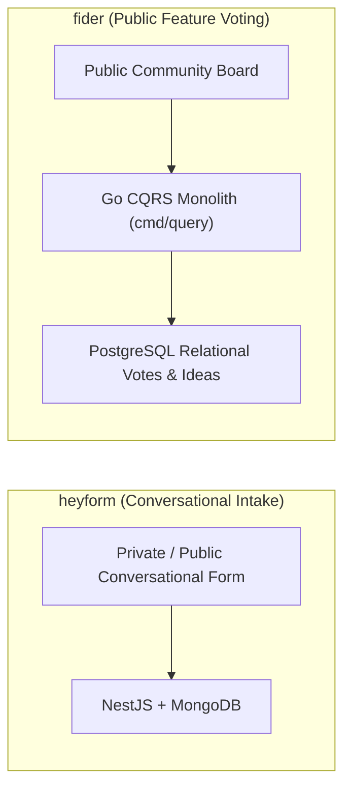
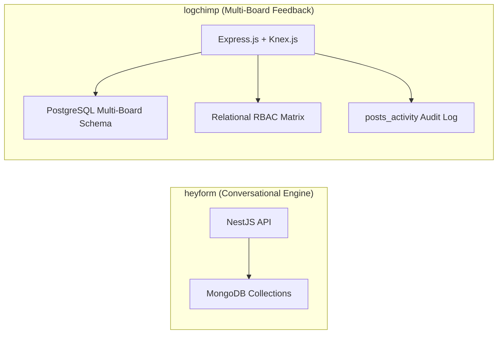
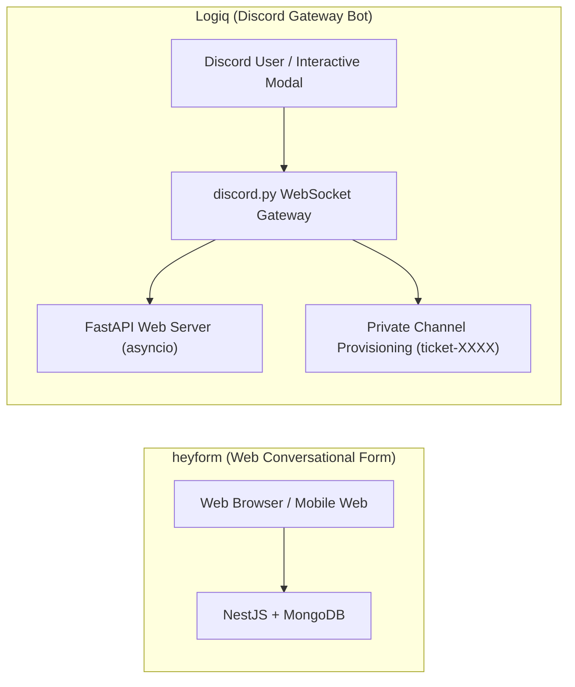
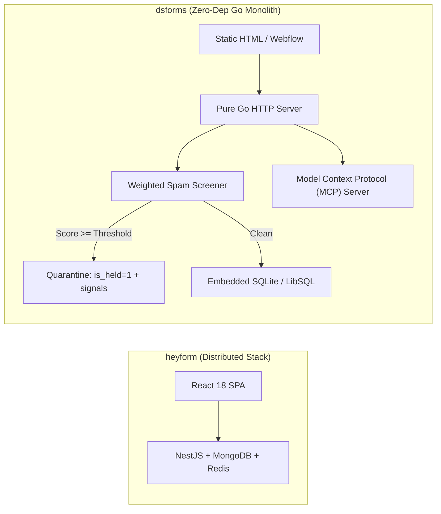

# heyform — Comparative Analysis & Category Evaluation

> **Category**: Forms, Surveys & Feedback  
> **Architectural Role**: Conversational multi-step forms, polymorphic document storage & Typeform alternative  
> **Primary Stack**: TypeScript / Node 20+ | NestJS 10+, React 18, Vite | MongoDB 6.0+, Mongoose ODM | Redis 7+, Bull Queue  
> **Peer Solutions Compared**: `formbricks`, `OpnForm`, `formizee`, `LimeSurvey`, `survey-library`, `fider`, `logchimp`, `Logiq`, `dsforms`  
> **Commercial SaaS Benchmarks**: Typeform, Formkeep, JotForm, SurveyMonkey  

---

## 1. Executive Overview & Technical Identity: heyform

**HeyForm** is a modern, open-source conversational form builder and interactive feedback engine engineered as a high-fidelity alternative to Typeform, JotForm, and Formkeep. Designed around the principle of focused, one-question-at-a-time form rendering, HeyForm maximizes completion rates for lead generation, customer intake questionnaires, quizzes, and event registrations.

### Core Architectural Profile
- **Runtime & Language**: `TypeScript / Node 20+` monorepo managed via `pnpm workspaces`.
- **Core Framework**: `NestJS 10+` utilizing a hybrid API architecture: GraphQL resolvers (`/graphql`) for administrative form authoring and submissions, alongside REST controllers for uploads and webhooks.
- **Frontend Engine**: `React 18` Single-Page Application bundled via `Vite` (`packages/webapp`), delivering conversational keyboard shortcuts (Enter to advance, A–Z for choices, 1–10 for ratings).
- **Persistence Layer**: `MongoDB 6.0+` with `Mongoose ODM`, persisting forms, themes, and polymorphic answer subdocuments (`answers: [{ questionId, value, type }]`).
- **Asynchronous Workers**: `Redis 7+` Bull Queue workers (`submission-notification.queue`, `integration.queue`) executing webhook fan-outs and email alerts.
- **Anti-Abuse & Rate Limiting**: Centralized IP throttling via `SubmissionIpLimitModel`, Google reCAPTCHA v3 / Cloudflare Turnstile, and honeypot validation.

---

## 2. Peer Solution Landscape (Forms, Surveys & Feedback)

Within this category, `heyform` operates alongside the following peer solutions:

| Solution | Language & Runtime | Core Framework | Database / Cache | Queue / Concurrency | Primary Architectural Niche |
| :--- | :--- | :--- | :--- | :--- | :--- |
| **heyform** (Current) | `TypeScript / Node` | `NestJS 10+, React 18` | `MongoDB, Redis` | `Bull Queue / Redis` | Conversational multi-step forms with polymorphic document answers |
| **formbricks** | `TypeScript / Node` | `Next.js Monorepo` | `PostgreSQL, Prisma` | `BullMQ / Redis` | In-app micro-surveys, ReBAC access, telemetry |
| **OpnForm** | `PHP 8.2+ / TypeScript` | `Laravel 11, Nuxt 3` | `MySQL / PostgreSQL` | `Laravel Horizon / Redis` | No-code dynamic forms with versioned revisions & MCP agent drafts |
| **formizee** | `TypeScript / Edge` | `Hono, Turborepo` | `LibSQL / Turso, Drizzle` | `Cloudflare KV / Async` | Zero-knowledge AES-256-GCM encrypted headless form vault |
| **LimeSurvey** | `PHP 8.1+` | `Yii Framework` | `MySQL / PostgreSQL` | `PHP CLI Workers` | Enterprise statistical surveys with dynamic runtime SQL tables |
| **survey-library** | `TypeScript 5.3+` | `Framework-Agnostic MVVM` | `Pure Client-Side (BYO)`| `Synchronous / Web Workers`| Declarative JSON survey engine with AST expression evaluator |
| **fider** | `Go 1.22+` | `Go HTTP Monolith` | `PostgreSQL 14+` | `Goroutines, Channels` | Compiled CQRS public feature voting portal with sub-20ms latency |
| **logchimp** | `TypeScript / Node` | `Express.js, Vue 3` | `PostgreSQL, Knex.js` | `BullMQ / Redis` | Multi-board customer feedback roadmap with RBAC and audit trail |
| **Logiq** | `Python 3.10+` | `FastAPI, discord.py` | `SQLite / PostgreSQL` | `asyncio Event Loop` | Discord-native community ticketing bot & FastAPI REST management |
| **dsforms** | `Go 1.22+` | `Pure Go HTTP` | `SQLite / LibSQL (pure Go)`| `Go Worker Channels` | Zero-dependency headless form backend with forensic spam quarantine |

---

## 3. Deep Head-to-Head Comparative Breakdown: heyform vs Peers

### 3.1. heyform vs. formbricks

**Comparative Focus**: `Conversational Typeform-style multi-step forms` vs. `In-app micro-survey telemetry & ReBAC`

#### Architectural Differences:
- **Ingestion Pipeline & Client Rendering**: HeyForm serves standalone, immersive conversational forms via a React 18 SPA. Answers are compiled in client memory and submitted as a single payload via GraphQL mutation `createSubmission`. Formbricks delivers a lightweight SDK (`@formbricks/js-core`) that embeds targeted micro-surveys directly into host web applications, executing trigger evaluations locally without network latency and streaming partial answers incrementally.
- **Data Modeling**: HeyForm stores forms and submissions in MongoDB using Mongoose document schemas. Answer data is represented as an array of polymorphic subdocuments (`answers: [{ questionId, value, type }]`). Formbricks utilizes PostgreSQL with Prisma, storing responses in a normalized schema with GIN-indexed JSONB payloads and keyset cursor pagination `(created_at, id) < ($1, $2)`.
- **Logic & Calculation Engines**: HeyForm implements visual logic jump rules (`Logic[]`) supporting boolean expressions (`IS`, `IS_NOT`, `GREATER_THAN`) and internal runtime variables (`Variable[]`) for real-time quiz scoring, price calculators, and conditional redirects. Formbricks focuses primarily on client-side targeting rules (URL matches, user cohort traits, recontact intervals).

#### Architectural Comparison Matrix:

| Dimension | heyform | formbricks |
| :--- | :--- | :--- |
| **Primary Ingestion Architecture** | GraphQL mutation resolver with monolithic completion submit | Keyset-paginated client SDK with partial step streaming |
| **Database Engine** | MongoDB 6.0+ (Mongoose ODM) | PostgreSQL 15+ (Prisma ORM) |
| **Answer Schema** | Polymorphic subdocument arrays in BSON | Normalized relational rows with JSONB columns |
| **Logic Engine** | Visual jump rules with mathematical runtime variables | Client-side event tracking, user cohorts, recontact guards |
| **Best Architectural Fit** | Standalone conversational lead generation & interactive intake | In-app product feedback, NPS/CSAT micro-surveys |

---

### 3.2. heyform vs. OpnForm

**Comparative Focus**: `NestJS/MongoDB conversational builder` vs. `Laravel 11/MySQL no-code engine with nested versioning`

#### Architectural Differences:
- **Database & Version Control**: HeyForm leverages MongoDB for schemaless flexibility, allowing rapid question mutation without database migrations. OpnForm uses MySQL/PostgreSQL with Eloquent dynamic JSON properties (`properties`) and incorporates `VersionableNestedDiff` snapshot versioning, preserving the last 5 revisions of form definitions for atomic rollback capabilities.
- **Partial Submission Recovery**: OpnForm natively provides debounced auto-save endpoints (`POST /api/open/forms/{slug}/partial-submissions`), allowing operators to recapture leads who drop out mid-form. HeyForm submits upon final completion.
- **AI Agent Automation**: OpnForm features native Model Context Protocol (MCP) and AI Agent endpoints (`/api/agent-drafts/*`), allowing autonomous agents to draft and deploy complete forms programmatically. HeyForm relies on manual canvas building or REST endpoints.

#### Architectural Comparison Matrix:

| Dimension | heyform | OpnForm |
| :--- | :--- | :--- |
| **Backend Framework** | NestJS 10+ (TypeScript / Node 20+) | Laravel 10/11 (PHP 8.2+) |
| **Data Storage** | MongoDB 6.0+ document collections | MySQL 8.0+ / PostgreSQL with Eloquent JSON |
| **Schema Versioning** | Standard document overwrite | Automated `VersionableNestedDiff` diff snapshots |
| **Partial Auto-Save** | Client memory state; single final submission | Debounced server-side auto-save (`status: partial`) |
| **AI Agent Support** | Standard REST/GraphQL APIs | Native Model Context Protocol (MCP) draft endpoints |

---

### 3.3. heyform vs. formizee

**Comparative Focus**: `Conversational visual builder` vs. `Edge-native zero-knowledge encrypted headless form vault`

```mermaid
flowchart LR
    subgraph HeyFormArch ["heyform (Full-Stack Conversational)"]
        A1["React Conversational Canvas"] --> A2["NestJS Backend"]
        A2 --> A3["MongoDB (Plaintext/Hashed Storage)"]
    end
    subgraph FormizeeArch ["formizee (Edge Headless Vault)"]
        B1["Static HTML Form (<form>)"] --> B2["Hono Edge Worker (workerd)"]
        B2 --> B3["AES-256-GCM Vault"]
        B3 --> B4["LibSQL / Turso SubmissionsDB"]
    end
```

#### Architectural Differences:
- **Presentation Strategy**: HeyForm provides a rich conversational UI with full-screen layouts, animated question transitions, and keyboard ergonomics. Formizee is entirely headless: it provides zero client UI, allowing developers to point static HTML `<form>` tags or React hooks to an edge ingestion endpoint.
- **Security & Cryptography**: HeyForm stores submissions in plaintext in MongoDB, relying on network security and database authentication. Formizee operates a **Zero-Knowledge Encrypted Vault**: all submissions are encrypted at the edge with AES-256-GCM (`data_iv` and `data_cipher_text`) before persisting into LibSQL / Turso SQLite.
- **Ingestion Latency**: HeyForm routes requests through a centralized Node.js/NestJS server cluster (~300MB RAM). Formizee executes in lightweight edge V8 isolates via Hono on Cloudflare Workers (~35MB RAM), delivering sub-50ms ingestion globally.

#### Architectural Comparison Matrix:

| Dimension | heyform | formizee |
| :--- | :--- | :--- |
| **User Interface** | Complete conversational React 18 SPA | 100% headless (BYO HTML/React UI) |
| **Data Security** | Standard database access control | Zero-knowledge client-side AES-256-GCM encryption |
| **Execution Environment** | Centralized Node.js runtime (~300 MB RAM) | Global edge V8 workers (~35 MB RAM, <50ms latency) |
| **Database Engine** | MongoDB (Mongoose) | LibSQL / Turso SQLite (Drizzle ORM) |
| **Best Architectural Fit** | High-conversion conversational intake flows | Static landing pages & privacy-sensitive lead capture |

---

### 3.4. heyform vs. LimeSurvey

**Comparative Focus**: `Conversational marketing intake` vs. `Scientific research, dynamic SQL tables & ExpressionScript`

#### Architectural Differences:
- **Database Architecture**: HeyForm stores all submissions in a single MongoDB collection. LimeSurvey executes runtime DDL on survey activation, dynamically generating dedicated relational SQL tables (`lime_survey_{surveyId}` and `lime_tokens_{surveyId}`) where every question maps to a typed column, optimizing query plans for large-scale academic cohorts.
- **Logic & Mathematical AST**: HeyForm supports visual logic jumps and basic runtime variables. LimeSurvey includes the **ExpressionScript Engine** (`em_manager_helper.php`), allowing complex micro-syntax boolean equations (`relevance: "((Q1.NAOK == 'Y') and (Q2_SQ1.NAOK >= 4))"`), dynamic mathematical modeling, and quota screening across 80+ localized languages.
- **Data Export & Analysis**: HeyForm exports CSV/JSON data. LimeSurvey generates native syntax and data export files for SPSS (`.sps`, `.dat`), R dataframes, and Stata.

#### Architectural Comparison Matrix:

| Dimension | heyform | LimeSurvey |
| :--- | :--- | :--- |
| **Data Architecture** | Document-oriented NoSQL collection | Dynamic DDL: dedicated SQL table per survey |
| **Logic Engine Complexity** | Visual jump rules with basic variables | ExpressionScript AST with micro-syntax equations |
| **Statistical Export** | CSV and JSON exports | Native SPSS syntax files, R dataframes, and Stata packages |
| **Participant Control** | Open public links and IP rate limiting | Closed-cohort token management with cryptographic anonymization |
| **Primary Domain** | Marketing intake & conversational lead gen | Academic research, clinical trials & government surveys |

---

### 3.5. heyform vs. survey-library (SurveyJS)

**Comparative Focus**: `Full-stack conversational application` vs. `Framework-agnostic client-side MVVM JSON engine`

#### Architectural Differences:
- **System Boundary**: HeyForm is an end-to-end full-stack SaaS platform comprising a visual form builder, GraphQL backend, database storage, and Redis queues. SurveyJS is a pure client-side library. It has zero backend dependencies, parsing a declarative JSON schema and emitting `survey.data` upon completion for any arbitrary backend to store.
- **UI Framework Independence**: HeyForm's frontend is strictly coupled to React 18 and Vite. SurveyJS implements a framework-agnostic MVVM core (`@surveyjs/survey-core`) with native rendering adapters for React, Vue 3, Angular, and Vanilla Web Components.
- **Form Complexity**: SurveyJS natively supports nested panels, dynamic matrix grids (`matrixdynamic`), panel iterators, and cascading asynchronous REST lookups (`choicesRestful`). HeyForm focuses on linear conversational question sequences.

#### Architectural Comparison Matrix:

| Dimension | heyform | survey-library (SurveyJS) |
| :--- | :--- | :--- |
| **Architecture Boundary** | Full-stack platform (API, DB, UI, Queues) | Pure client-side component engine (BYO Backend) |
| **UI Framework Binding** | React 18 only | Framework-agnostic: React, Vue 3, Angular, Knockout |
| **Complex Form Hierarchies** | Linear conversational steps | Dynamic matrices, panel iterators, cascading REST lookups |
| **Server Requirements** | Node.js, MongoDB, Redis | Zero server infrastructure; 100% browser runtime |
| **License** | AGPLv3 / Commercial | MIT (Core Engine) |

---

### 3.6. heyform vs. fider

**Comparative Focus**: `Conversational intake forms` vs. `Compiled Go CQRS public feature voting portal`

#### Architectural Differences:
- **Functional Paradigm**: HeyForm collects private data from respondents through structured, multi-step questionnaires. Fider is an open community platform where customers publicly suggest features, upvote proposals, and track official roadmap progress.
- **Runtime Performance & Stack**: HeyForm runs on Node.js/NestJS with MongoDB and Redis (~300MB RAM). Fider is a compiled Go 1.22+ binary with PostgreSQL (~40MB RAM) that uses strict Command Query Responsibility Segregation (CQRS) (`app/models/cmd` and `app/models/query`), delivering sub-20ms response times.
- **Community Governance**: Fider includes real-time duplicate idea detection, duplicate post merging (`OriginalPost`), and automated email notifications to all voters when an idea changes status.

#### Architectural Comparison Matrix:

| Dimension | heyform | fider |
| :--- | :--- | :--- |
| **Core Interaction** | Private multi-step questionnaires | Public collaborative idea suggestion and upvoting |
| **Runtime & Language** | TypeScript / Node.js 20+ (~300 MB RAM) | Compiled Go 1.22+ binary (~40 MB RAM, <20ms latency) |
| **Architectural Model** | NestJS GraphQL / REST Controllers | Go HTTP Monolith with strict CQRS command/query separation |
| **Roadmap & Notification** | Webhooks / Zapier / Slack integration | Public roadmap stages with automatic voter email updates |
| **Database Storage** | MongoDB document store | Normalized relational PostgreSQL |

---

### 3.7. heyform vs. logchimp

**Comparative Focus**: `Conversational intake forms` vs. `Multi-board feedback tracking with RBAC and changelogs`

#### Architectural Differences:
- **Product Scope**: HeyForm handles structured form intake and lead capture. Logchimp provides a multi-board feedback portal (`Boards`), interactive roadmap stages (`Roadmaps`), and product release changelogs.
- **Database & Query Layer**: HeyForm uses MongoDB with Mongoose document schemas. Logchimp uses **Express.js** and **Knex.js** with PostgreSQL, maintaining relational integrity across users, boards, posts, votes, and an immutable audit timeline (`posts_activity`).
- **Access Control**: HeyForm uses application-level team roles (`owner`, `admin`, `member`). Logchimp implements a complete relational RBAC model (`roles`, `permissions`, `roles_users`, `permissions_roles`) for fine-grained board governance.

#### Architectural Comparison Matrix:

| Dimension | heyform | logchimp |
| :--- | :--- | :--- |
| **Primary Domain** | Conversational form building and intake | Multi-board feedback management and public roadmaps |
| **Database Layer** | MongoDB document store | PostgreSQL with Knex.js SQL query builder |
| **Audit Trails** | Basic timestamps | Immutable activity stream (`posts_activity`) |
| **Access Control** | Team role arrays | Granular relational RBAC matrix |
| **Public Transparency** | Forms can be public or password-protected | Public feedback boards, roadmaps, and release changelogs |

---

### 3.8. heyform vs. Logiq

**Comparative Focus**: `Web/mobile conversational forms` vs. `Discord-native modal ticketing & community triage`

#### Architectural Differences:
- **Delivery Surface**: HeyForm serves forms via desktop and mobile web browsers. Logiq executes inside Discord chat servers, interacting with users through persistent UI buttons and native modal dialogs (`discord.ui.Modal`).
- **Submission Output**: HeyForm saves responses as database records and forwards webhooks. Logiq converts modal submissions into interactive, private Discord text channels (`ticket-{username}`) with role-based permission overwrites (`@everyone` denied access; ticket creator and staff roles granted access).
- **Concurrency & Architecture**: HeyForm runs on Node.js/NestJS with multi-process workers. Logiq runs a single-process concurrent Python 3.10+ application, running a Discord gateway bot and a FastAPI server within an `asyncio` event loop.

#### Architectural Comparison Matrix:

| Dimension | heyform | Logiq |
| :--- | :--- | :--- |
| **Platform Ingress** | Web browsers (React 18 SPA) | Discord client via native interaction modals |
| **Submission Output** | Database document & webhook dispatches | Isolated private support text channel in Discord |
| **Runtime & Language** | TypeScript / Node.js 20+ (NestJS) | Python 3.10+ (discord.py + FastAPI via asyncio) |
| **Persistence** | MongoDB document cluster | SQLite / PostgreSQL / MongoDB |
| **Archival Format** | CSV, JSON, webhook payloads | Searchable HTML/JSON ticket transcripts |

---

### 3.9. heyform vs. dsforms

**Comparative Focus**: `Full-stack conversational form builder` vs. `Zero-dependency pure Go headless backend with quarantine scoring`

#### Architectural Differences:
- **Deployment Complexity & Footprint**: HeyForm requires a distributed infrastructure setup (Node.js runtime, MongoDB cluster, Redis cache). dsforms compiles into a single statically linked binary with an embedded SQLite / LibSQL database (`modernc.org/sqlite`), running with zero external dependencies and consuming ~25MB of RAM.
- **Frontend Approach**: HeyForm is centered around its visual conversational form builder and animated frontend canvas. dsforms is 100% headless, providing endpoints for standard HTML `<form action="/f/{id}">` tags without bundling frontend JavaScript.
- **Spam Defenses & Forensic Quarantine**: HeyForm throttles submissions using IP rate-limiting (`SubmissionIpLimitModel`) and Turnstile/reCAPTCHA. dsforms implements an auditable **Quarantine Architecture**: `internal/screen` evaluates weighted honeypot traps (`_gotcha`, `hp_field`), timing heuristics, and domain analysis. Flagged submissions are quarantined (`is_held: 1`) alongside exact diagnostic signals (`spam_signals`) for operator or AI agent review.
- **AI Agent & Viral Features**: dsforms embeds a native Model Context Protocol (MCP) server for autonomous agent operations and an integrated viral waitlist engine with referral queue-jumping. HeyForm provides standard management REST/GraphQL APIs.

#### Architectural Comparison Matrix:

| Dimension | heyform | dsforms |
| :--- | :--- | :--- |
| **Operational Model** | Distributed Node.js + MongoDB + Redis cluster | Single compiled Go binary with embedded SQLite |
| **Frontend Strategy** | Conversational visual form builder & React canvas | 100% headless: static HTML form endpoints |
| **Spam Defense Strategy** | IP rate limiting, reCAPTCHA, Turnstile | Weighted heuristic scoring with auditable quarantine holding queue |
| **AI Agent Interface** | Standard REST/GraphQL APIs | Native embedded Model Context Protocol (MCP) server with PII redaction |
| **Viral Growth Features** | None | Integrated viral waitlist engine with dynamic referral queue jumping |
| **Memory Footprint** | ~300 MB RAM | ~25 MB RAM |

---

## 4. Capability & Feature Comparison Matrix

| Dimension / Capability | heyform | formbricks | OpnForm | formizee | LimeSurvey | survey-library | fider | logchimp | Logiq | dsforms |
| :--- | :---: | :---: | :---: | :---: | :---: | :---: | :---: | :---: | :---: | :---: |
| **Conversational Typeform UI**| ✅ Full Screen | ⚠️ Compact modal | ✅ Full Screen | ❌ (Headless) | ❌ | ✅ Supported | ❌ | ❌ | ❌ | ❌ |
| **Targeted In-App Popups** | ⚠️ Iframe | ✅ Native SDK | ⚠️ Iframe | ❌ | ❌ | ⚠️ UI Embed | ❌ | ❌ | ❌ | ❌ |
| **Headless Form API Endpoint** | ❌ | ⚠️ API Routes | ❌ | ✅ Edge Native | ❌ | ❌ | ❌ | ❌ | ❌ | ✅ Single Binary |
| **Public Feature Voting** | ❌ | ❌ | ❌ | ❌ | ❌ | ❌ | ✅ Pure CQRS | ✅ Multi-Board | ❌ | ❌ |
| **Changelog & Public Roadmap** | ❌ | ❌ | ❌ | ❌ | ❌ | ❌ | ⚠️ Basic | ✅ Integrated | ❌ | ❌ |
| **Discord Chat Ticket Modals** | ❌ | ❌ | ❌ | ❌ | ❌ | ❌ | ❌ | ❌ | ✅ Native UI | ❌ |
| **Viral Waitlist & Referrals** | ❌ | ❌ | ❌ | ❌ | ❌ | ❌ | ❌ | ❌ | ❌ | ✅ Integrated |
| **AI Agent MCP Integration** | ❌ | ⚠️ REST API | ✅ Agent Drafts| ⚠️ API Keys | ❌ | ❌ | ❌ | ❌ | ⚠️ LLM Cog | ✅ Native MCP |
| **Statistical Analysis (SPSS/R)**| ❌ | ❌ | ❌ | ❌ | ✅ Native | ⚠️ Analytics Pack| ❌ | ❌ | ❌ | ❌ |
| **Logic Jumps & Math AST** | ✅ Visual Logic | ✅ Visual Rules | ✅ Dynamic Logic| ❌ | ✅ ExpressionScript| ✅ ExpressionRunner| ❌ | ❌ | ❌ | ❌ |
| **Zero-Knowledge Encryption** | ❌ | ❌ | ❌ | ✅ AES-256-GCM | ❌ | ❌ | ❌ | ❌ | ❌ | ❌ |
| **Spam Quarantine Forensics** | ⚠️ Turnstile | ⚠️ ReCaptcha | ⚠️ Turnstile | ⚠️ Honeypot | ⚠️ Token Auth | ❌ (Client Only)| ⚠️ OAuth Check| ⚠️ Rate Limits | ⚠️ Captcha Cog | ✅ Weighted Scoring |
| **Runtime Memory Footprint** | ~300 MB | ~250 MB | ~150 MB | **~35 MB (Edge)** | ~180 MB | **0 MB (Client)** | **~40 MB** | ~120 MB | ~90 MB | **~25 MB** |

---

## 5. Commercial Benchmark Positioning

When benchmarked against commercial SaaS leaders (**Typeform, Formkeep, JotForm, SurveyMonkey**):
- **Against Typeform**: `heyform` provides an open-source, unmetered conversational alternative that eliminates Typeform's aggressive tiered response caps and seat fees while ensuring complete data sovereignty.
- **Customization & Logic**: Provides visual conditional logic jumping and arithmetic variable calculation suitable for lead qualification quizzes and intake questionnaires.
- **Data Sovereignty**: Direct self-hosting backed by MongoDB and Redis keeps all customer survey data private and compliant with GDPR regulations.

---

## 6. Strategic Takeaways & Role for MarketingStudio

In the unified **MarketingStudio** architecture:
1. **Primary Component to Adopt**: Harness `heyform`'s conversational visual builder for standalone lead intake, customer discovery interviews, and high-conversion landing page forms.
2. **Interoperability Seam**: Configure HeyForm's outbound webhook workers to stream completed `createSubmission` payloads with HMAC validation directly into MarketingStudio's CRM pipeline.
3. **Complementary Ecosystem Delegation**: Where HeyForm provides conversational web forms, delegate in-app micro-surveys to `formbricks`, static headless ingestion to `formizee` / `dsforms`, and community feature roadmaps to `fider` / `logchimp`.
