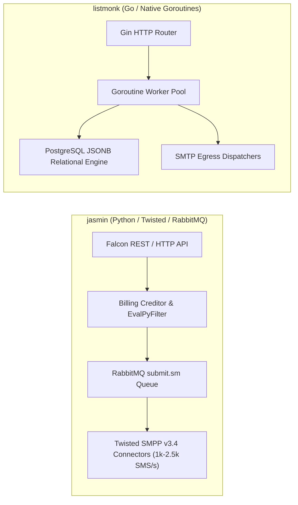
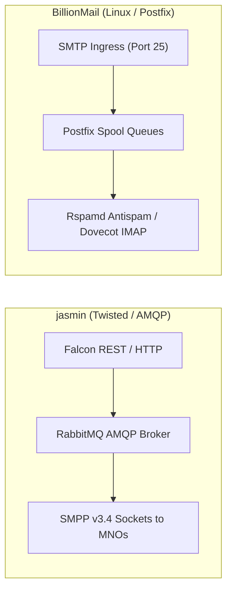
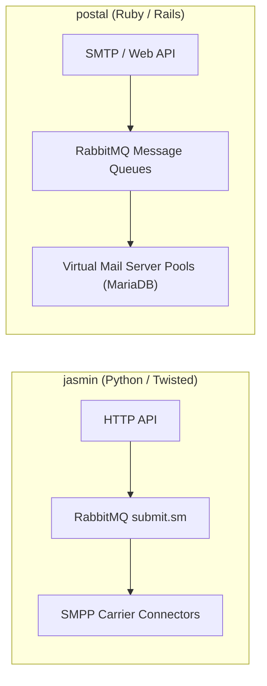
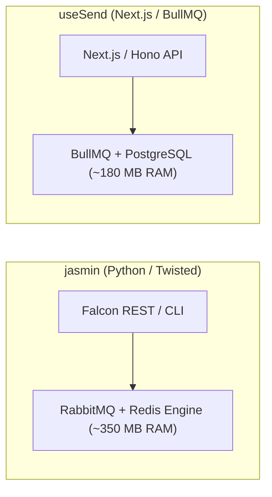
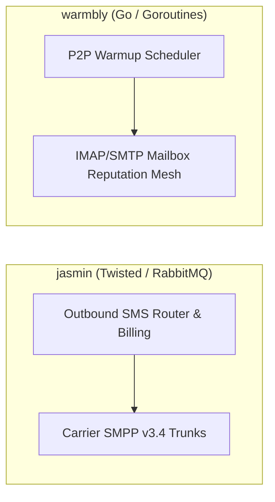

# jasmin — Comparative Analysis & Category Evaluation

> **Category**: Email Infrastructure & Delivery / Telecom Messaging  
> **Architectural Role**: Carrier-grade SMS gateway, SMPP v3.4 protocol bridge & telecom router  
> **Primary Stack**: Python 3.10+ | Twisted Async, Falcon REST | Redis 7+, RabbitMQ 3.12+ | Asynchronous Twisted Reactor + AMQP  
> **Peer Solutions Compared**: `listmonk`, `BillionMail`, `postal`, `useSend`, `warmbly`  
> **Commercial SaaS Benchmarks**: Twilio SMS, Infobip, Sinch, MessageBird, Sinch Mailgun, Amazon SES  

---

## 1. Executive Overview & Technical Identity: jasmin

**jasmin** represents the carrier-grade telecom interconnect standard within the **Email Infrastructure & Delivery / Telecom Messaging** domain, distinguished by its core focus on **Native SMPP v3.4 protocol bridging to HTTP/REST, asynchronous Twisted networking, RabbitMQ AMQP message buffering, programmable Python interceptors (`EvalPyFilter`), and real-time prepaid billing quotas**.

### Core Architectural Profile
- **Runtime & Language**: `Python 3.10+` (Twisted asynchronous networking reactor)
- **Core Framework**: `Twisted~=23.10.0`, `smpp.twisted3`, `smpp.pdu3`, `Falcon 3.1+` (REST API)
- **Persistence Layer**: `Redis 7+` (`txredisapi` non-blocking store for routes, users, quotas, and DLR maps)
- **Concurrency & Queue Model**: RabbitMQ 3.12+ (`txAMQP3`: `submit.sm`, `deliver.sm`, `dlr` queues)
- **Domain Specialization**: `Carrier-grade telecom MNO interconnect, SMPP-to-HTTP bridging & wire-speed SMS routing`

---

## 2. Peer Solution Landscape (Email Infrastructure & Delivery)

Within this category, `jasmin` operates alongside the following peer solutions:

| Solution | Language & Runtime | Core Framework | Database / Cache | Queue / Concurrency | Primary Architectural Niche |
| :--- | :--- | :--- | :--- | :--- | :--- |
| **jasmin** (Current) | `Python 3.10+` | `Twisted Async, Falcon` | `Redis, RabbitMQ` | `Twisted Event Loop + AMQP` | **Direct telecommunication MNO interconnect & SMPP v3.4 router** |
| **listmonk** | `Go 1.21+` | `Gin / Native Go` | `PostgreSQL (JSONB)` | `Goroutine Worker Pool` | Raw bulk email throughput on minimal RAM |
| **BillionMail** | `Shell / Docker` | `Multi-container Linux` | `MySQL 8.0, Redis` | `Postfix Spool Queues` | Hardened Postfix/Dovecot/Rspamd mail server |
| **postal** | `Ruby 3.2+` | `Rails 7, EventMachine` | `MariaDB / MySQL, RabbitMQ` | `RabbitMQ Queues` | Virtual mail server isolation & inbound webhooks |
| **useSend** | `TypeScript / Node` | `Next.js 14, Hono` | `PostgreSQL, Drizzle ORM` | `BullMQ / Redis` | Modern serverless developer experience (Resend clone) |
| **warmbly** | `Go 1.21+` | `Gin / Native Go` | `PostgreSQL, Redis` | `Goroutine Workers + Cron` | Peer-to-peer mailbox reputation ramp & spam rescue |

---

## 3. Deep Head-to-Head Comparative Breakdown: jasmin vs Peers

### 3.1. jasmin vs. listmonk

**Comparative Focus**: `Carrier-grade telecom SMPP v3.4 routing` vs. `Raw bulk email newsletter throughput`

#### Architectural & Stack Differences
- **Protocol Specialization**: Jasmin is purpose-built for the telecommunications industry, translating high-level HTTP/REST commands into binary **SMPP v3.4** Protocol Data Units (PDUs) to terminate traffic into mobile network operator (MNO) SMSCs. listmonk is an email newsletter engine designed to dispatch high-volume marketing emails via SMTP pools or HTTP mail APIs (SES, SendGrid).
- **Concurrency & Networking Engine**: Jasmin operates under Python's event-driven **Twisted reactor**, using `smpp.twisted3` to maintain persistent, bidirectional TCP carrier binds (TRX, TX, RX) and asynchronous AMQP queues (`txAMQP3`). listmonk relies on native Go runtime goroutines and channels, achieving ultra-high single-process concurrency with negligible RAM overhead.
- **Routing & Interceptors**: Jasmin features an advanced rule-based router supporting `StaticMTRoute`, `RandomRoundrobinMTRoute`, and `FailoverMTRoute` evaluated against user groups, destination prefixes, and custom Python interceptors (`EvalPyFilter`). listmonk executes SQL queries directly against PostgreSQL JSONB tables to segment subscriber lists.

#### Where jasmin Excels over listmonk
- **Telecom Operator Direct Interconnect**: Speaks native binary SMPP v3.4 with window sliding and enquire_link keep-alives.
- **Programmable Python Interceptors**: Dynamically rewrite message bodies, inject mandatory compliance opt-outs, or swap sender IDs at runtime.
- **Real-Time Prepaid Billing Ledger**: Integrated creditor (`Bills.py`) that checks floating-point balances and deducts per-segment SMS rates in real time.

#### Where listmonk Holds an Advantage over jasmin
- **10x Lower Resource Footprint**: Pure Go binary executing bulk operations with <50 MB RAM, compared to Jasmin's multi-service Python/RabbitMQ/Redis stack.
- **Turnkey Email Marketing UI**: Polished web dashboard with visual campaign composers, list managers, and analytics.
- **Zero External Message Broker**: Direct database-backed queueing in PostgreSQL eliminates the need to manage RabbitMQ clusters.

#### Architectural Tradeoffs Matrix

| Architectural Dimension | jasmin | listmonk |
| :--- | :--- | :--- |
| **Primary Messaging Protocol**| Telecom SMPP v3.4 (Binary PDUs) | Email SMTP / HTTP Mail APIs |
| **Runtime & Concurrency** | Python 3.10+ / Twisted Reactor | Go 1.21+ / Native Goroutines |
| **Message Broker** | **RabbitMQ 3.12+ (AMQP Queues)** | Native Go Channels + PostgreSQL |
| **Dynamic Interceptors** | **Python Scriptable Hooks (`EvalPyFilter`)**| SQL template functions & Go transforms |
| **Real-Time Billing Engine** | **Native Prepaid Creditor (`Bills.py`)** | None (Unmetered self-hosted software) |
| **Base Production RAM** | ~350 MB RAM (Jasmin + RabbitMQ + Redis) | **< 60 MB RAM (Single Go Binary)** |
| **Best-Fit Deployment** | Telecom SMS aggregation, wholesale MNO interconnect| Massive bulk email marketing and newsletters |

---

### 3.2. jasmin vs. BillionMail

**Comparative Focus**: `Carrier-grade telecom SMPP gateway` vs. `Hardened multi-container Postfix mail server`

#### Architectural & Stack Differences
- **Telecom Gateway vs. Full-Stack Mail Server**: Jasmin is a specialized telecom router bridging HTTP to carrier SMSCs. BillionMail is an all-in-one Linux email infrastructure stack combining Postfix (MTA), Dovecot (IMAP/POP3), Rspamd (anti-spam filtering), and OpenDKIM for email deliverability.
- **Queueing Mechanics**: Jasmin buffers outbound SMS in RabbitMQ memory/disk queues (`submit.sm`), decoupling HTTP senders from telecom network fluctuations. BillionMail relies on Postfix's battle-tested multi-stage disk spool queues (`incoming`, `active`, `deferred`, `bounce`).
- **State Management**: Jasmin stores active routing rules, user quotas, and bidirectional DLR hash maps in Redis (`txredisapi`). BillionMail stores mailbox credentials, domain routing, and quotas in MySQL and local Linux files.

#### Where jasmin Excels over BillionMail
- **Wire-Speed Telecom Throughput**: Processes 1,000–2,500 SMS/sec over binary SMPP sockets.
- **REST-to-Carrier Abstraction**: Exposes high-performance Falcon REST endpoints for programmatic message dispatching.
- **Microsecond DLR Reconciliation**: Reconciles carrier delivery receipts in microseconds via Redis hash lookups.

#### Where BillionMail Holds an Advantage over jasmin
- **Complete Inbound & Outbound Email Sovereignty**: Full self-hosted mail server capable of receiving, filtering, and storing email.
- **Hardened Email Deliverability**: Built-in automated DNS configuration for SPF, DKIM, DMARC, and PTR records.
- **Native Anti-Spam Pipeline**: Integrated Rspamd scanning and greylisting engine.

#### Architectural Tradeoffs Matrix

| Architectural Dimension | jasmin | BillionMail |
| :--- | :--- | :--- |
| **Primary Protocol** | Telecom SMPP v3.4 | Email SMTP / IMAP / POP3 |
| **Core Software Engine** | Python Twisted Reactor | Postfix MTA + Dovecot + Rspamd |
| **Queue Architecture** | RabbitMQ AMQP Broker | Postfix File-System Spool Queues |
| **State Storage** | Redis 7+ in-memory database | MySQL 8.0+ Relational Database |
| **Throughput Benchmark** | 1,000 - 2,500 SMS / second | 100 - 300 Emails / second (Spool bound) |
| **Best-Fit Deployment** | High-volume carrier SMS termination | Sovereign enterprise email server hosting |

---

### 3.3. jasmin vs. postal

**Comparative Focus**: `Telecom SMPP router & billing engine` vs. `Rails-based virtual mail server with RabbitMQ`

#### Architectural & Stack Differences
- **Shared Architecture Patterns (RabbitMQ Queues)**: Both Jasmin and Postal recognize that direct external network transmission requires durable, decoupled queuing. Both utilize **RabbitMQ** as their core message broker. However, Postal uses RabbitMQ to buffer outbound SMTP emails across virtual mail servers, while Jasmin uses RabbitMQ to buffer binary `submit_sm` PDUs across carrier SMPP connectors.
- **Language & Runtime**: Jasmin is written in Python using Twisted for non-blocking asynchronous event handling. Postal is written in Ruby on Rails 7, using EventMachine and Fast Server daemons.
- **Multi-Tenancy & Partitioning**: Postal isolates tenants into **Virtual Mail Servers**, each with distinct API credentials, domain pools, and IP pools. Jasmin organizes multi-tenancy around **Users** and **Groups**, enforcing floating-point credit balances and SMS rate cards in Redis.

#### Where jasmin Excels over postal
- **Telecom MNO Termination**: Native SMPP v3.4 protocol support with binary PDU encoding and decoding.
- **Scriptable Message Interceptors**: Programmable `EvalPyFilter` hooks for dynamic content rewriting.
- **Prepaid Rating & Billing Engine**: Real-time credit deductions based on destination country and mobile prefix.

#### Where postal Holds an Advantage over postal
- **Turnkey Transactional Email Suite**: Direct open-source alternative to SendGrid, Postmark, and Mailgun.
- **Rich Web Management UI**: Polished dashboard for inspecting delivery logs, raw SMTP transcripts, and bounce statistics.
- **Virtual Mail Server Isolation**: Perfect multi-tenant isolation for SaaS platforms managing multiple customer domains.

#### Architectural Tradeoffs Matrix

| Architectural Dimension | jasmin | postal |
| :--- | :--- | :--- |
| **Messaging Channel** | Telecom Carrier SMS | Transactional Email (SMTP/HTTP) |
| **Queue Subsystem** | RabbitMQ AMQP (`submit.sm`, `dlr`) | RabbitMQ AMQP (Postal Workers) |
| **Multi-Tenancy Model** | Users & Groups with Credit Quotas | Virtual Mail Servers with IP Pools |
| **Runtime Engine** | Python 3.10+ / Twisted Reactor | Ruby 3.2+ / Rails 7 / EventMachine |
| **Primary Persistence** | Redis 7+ in-memory store | MariaDB / MySQL Relational Database |
| **Best-Fit Deployment** | Telecom SMS aggregation, wholesale carrier links| Multi-tenant SaaS transactional email routing |

---

### 3.4. jasmin vs. useSend

**Comparative Focus**: `Carrier-grade telecom SMPP router` vs. `Modern TypeScript/Next.js transactional email API`

#### Architectural & Stack Differences
- **Developer Experience vs. Telecom Engineering**: `useSend` is a modern developer-first transactional email engine (open-source Resend alternative) built with Next.js 14, Hono, React Email templates, and Drizzle ORM. Jasmin is an industrial telecommunications protocol router engineered in Python Twisted, designed to interface with telecom switches and SMSCs.
- **Queueing & State**: `useSend` uses Redis BullMQ and PostgreSQL to queue outbound emails. Jasmin uses RabbitMQ AMQP queues and Redis in-memory lookup maps to sustain wire-speed SMS routing.
- **Protocol Boundary**: `useSend` connects to upstream SMTP servers or cloud email APIs. Jasmin speaks the binary SMPP v3.4 telecommunications protocol.

#### Where jasmin Excels over useSend
- **Direct Carrier Telephony Interconnect**: Direct binary socket communication with mobile network operators.
- **Massive Concurrency & Throughput**: Wire-speed SMPP throughput (up to 2,500 SMS/sec) with connection pooling.
- **Telecom Compliance & Interceptors**: Programmable `EvalPyFilter` handles GSM 03.38 character set conversions and concatenation.

#### Where useSend Holds an Advantage over useSend
- **Modern Developer Experience**: React Email template rendering, TypeScript types, and modern REST APIs.
- **Serverless & Edge-Friendly Architecture**: Lightweight Next.js/Hono architecture deployed easily to cloud environments.
- **Clean Relational Schema**: Type-safe database queries via Drizzle ORM and PostgreSQL.

#### Architectural Tradeoffs Matrix

| Architectural Dimension | jasmin | useSend |
| :--- | :--- | :--- |
| **Primary Protocol** | Telecom SMPP v3.4 | Transactional Email (SMTP/REST) |
| **Core Technology Stack**| Python Twisted, RabbitMQ, Redis | TypeScript, Next.js 14, Hono, Drizzle ORM |
| **Template Engine** | None (GSM 03.38 Plaintext/UCS-2) | **React Email (Component-driven HTML templates)**|
| **Queue Subsystem** | RabbitMQ AMQP | BullMQ / Redis |
| **Target Audience** | Telecom engineers, SMS aggregators | Web developers, modern SaaS startups |
| **Best-Fit Deployment** | Direct cellular carrier SMS termination | Transactional product emails, password resets |

---

### 3.5. jasmin vs. warmbly

**Comparative Focus**: `Carrier-grade telecom SMPP router` vs. `P2P automated email warmup network`

#### Architectural & Stack Differences
- **Functional Paradigm**: Jasmin is an outbound and inbound SMS routing engine connecting software systems to telecommunication carriers. `warmbly` is a specialized email deliverability system that coordinates a peer-to-peer network of mailboxes to artificially exchange emails, rescue messages from spam folders, and build sender reputation.
- **Network Scope**: Jasmin operates at the telecom protocol layer (SMPP v3.4). `warmbly` operates at the application layer, connecting to third-party mailboxes via IMAP/SMTP pools.
- **Runtime & Performance**: `warmbly` is written in Go, using native goroutines to manage hundreds of concurrent mailbox sessions with minimal memory (<50 MB RAM). Jasmin uses Python Twisted and RabbitMQ to manage carrier SMPP binds (~350 MB RAM).

#### Where jasmin Excels over warmbly
- **Carrier Telephony Termination**: Speaks SMPP v3.4 to mobile operators with wire-speed throughput.
- **Real-Time Prepaid Billing**: Full credit accounting and prefix rate calculation.
- **High-Throughput Delivery Receipts**: Ingests and reconciles thousands of DLR callbacks per second.

#### Where warmbly Holds an Advantage over warmbly
- **Autonomous Deliverability Optimization**: Automatically warms up cold email domains to ensure 99%+ inbox placement.
- **Spam Rescue Automation**: Reads IMAP spam folders, marks messages as important, and moves them to the primary inbox.
- **Minimalist Go Binary**: Ultra-lightweight resource footprint with zero external message broker dependencies.

#### Architectural Tradeoffs Matrix

| Architectural Dimension | jasmin | warmbly |
| :--- | :--- | :--- |
| **Primary Function** | Carrier SMS routing & SMPP bridging | Automated email mailbox reputation warmup |
| **Protocol Layer** | SMPP v3.4 (Telecom Transport) | IMAP / SMTP (Application Layer) |
| **Runtime & Execution** | Python Twisted Reactor | Go 1.21+ / Goroutines |
| **Queue Mechanism** | RabbitMQ AMQP Broker | Native Go Channels + Cron |
| **Deliverability Focus** | GSM 03.38 encoding & carrier throughput| SPF/DKIM validation & spam rescue algorithms |
| **Best-Fit Deployment** | Wholesale SMS routing, carrier termination | Cold outreach infrastructure, inbox deliverability |

---

## 4. Capability & Feature Comparison Matrix

| Dimension / Capability | jasmin | listmonk | BillionMail | postal | useSend | warmbly |
| :--- | :---: | :---: | :---: | :---: | :---: | :---: |
| **Primary Architectural Niche** | **Carrier-grade SMPP router & telecom bridge** | Raw bulk email throughput | Hardened Postfix mail server | Virtual mail server isolation | Modern serverless developer API | P2P mailbox warmup network |
| **Primary Channel** | **Telecom SMS (SMPP)** | Bulk Email | Full Mailbox Email | Transactional Email | Transactional Email | Email Reputation |
| **Runtime Engine** | Python Twisted | Native Go | Postfix/Dovecot | Ruby on Rails 7 | TypeScript / Hono | Native Go |
| **Queue Subsystem** | **RabbitMQ AMQP** | Go Channels | Postfix Spool | **RabbitMQ AMQP** | BullMQ / Redis | Go Channels |
| **Dynamic Interceptors** | **✅ Python EvalPyFilter**| ❌ | ❌ (Rspamd rules)| ❌ | ❌ | ❌ |
| **Real-Time Billing Engine** | **✅ Bills.py Creditor** | ❌ | ❌ | ⚠️ Quotas | ❌ | ❌ |
| **Base Production RAM** | ~350 MB RAM | **< 60 MB RAM** | ~500 MB RAM | ~1.5 GB RAM | ~180 MB RAM | **< 50 MB RAM** |

---

## 5. Commercial Benchmark Positioning

When benchmarked against commercial SaaS leaders (**Twilio SMS, Infobip, Sinch, MessageBird, Amazon SES**):
- **Against Twilio SMS**: `jasmin` provides the backend infrastructure required to build a self-hosted Twilio competitor, terminating SMPP traffic directly into wholesale mobile operators and bypassing retail markups.
- **Against Infobip / Sinch**: Jasmin provides telecom operators and aggregators with an open-source SMPP gateway that matches commercial carrier switches in routing speed and flexibility.
- **Against Commercial SMS Gateways**: Jasmin's programmable Python interceptors (`EvalPyFilter`) allow custom message transformation logic that would otherwise require expensive proprietary carrier add-ons.

---

## 6. Strategic Takeaways & Role for MarketingStudio

In the unified **MarketingStudio** architecture:
1. **Primary Component to Adopt**: Deploy `jasmin` as MarketingStudio's **Wholesale Telecom SMS Engine** when outbound campaign volume exceeds domestic Android SIM capacity (>10,000 SMS/day).
2. **Utilize SMPP Carrier Binds**: Establish persistent SMPP v3.4 binds to wholesale telecommunications providers, eliminating retail API markups.
3. **Incorporate Real-Time Credit Quotas**: Leverage Jasmin's `Bills.py` creditor to enforce prepaid account balances and prefix rate cards for multi-tenant clients.
4. **Deploy Scriptable Interceptors**: Use `EvalPyFilter` to sanitize destination phone numbers into E.164 format and inject mandatory regulatory opt-out disclaimers before carrier dispatch.
