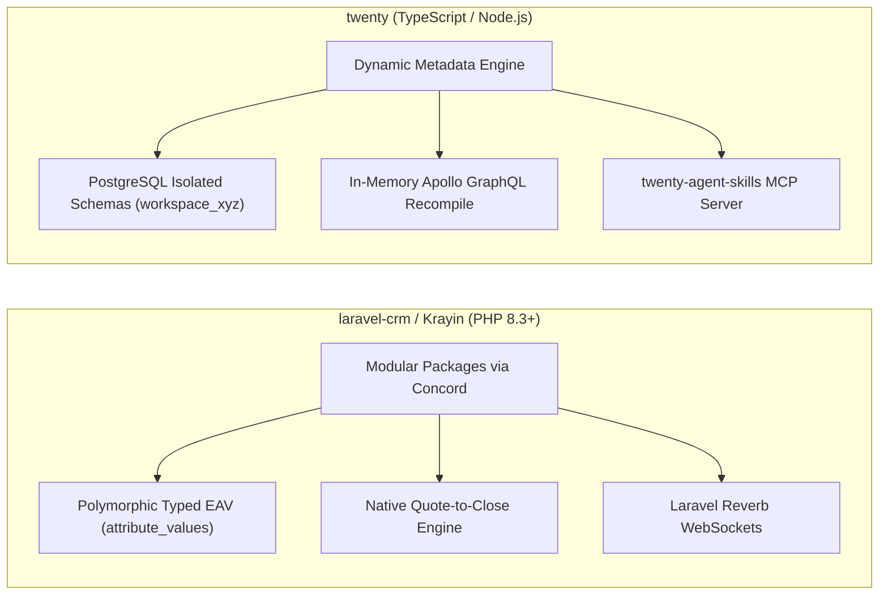
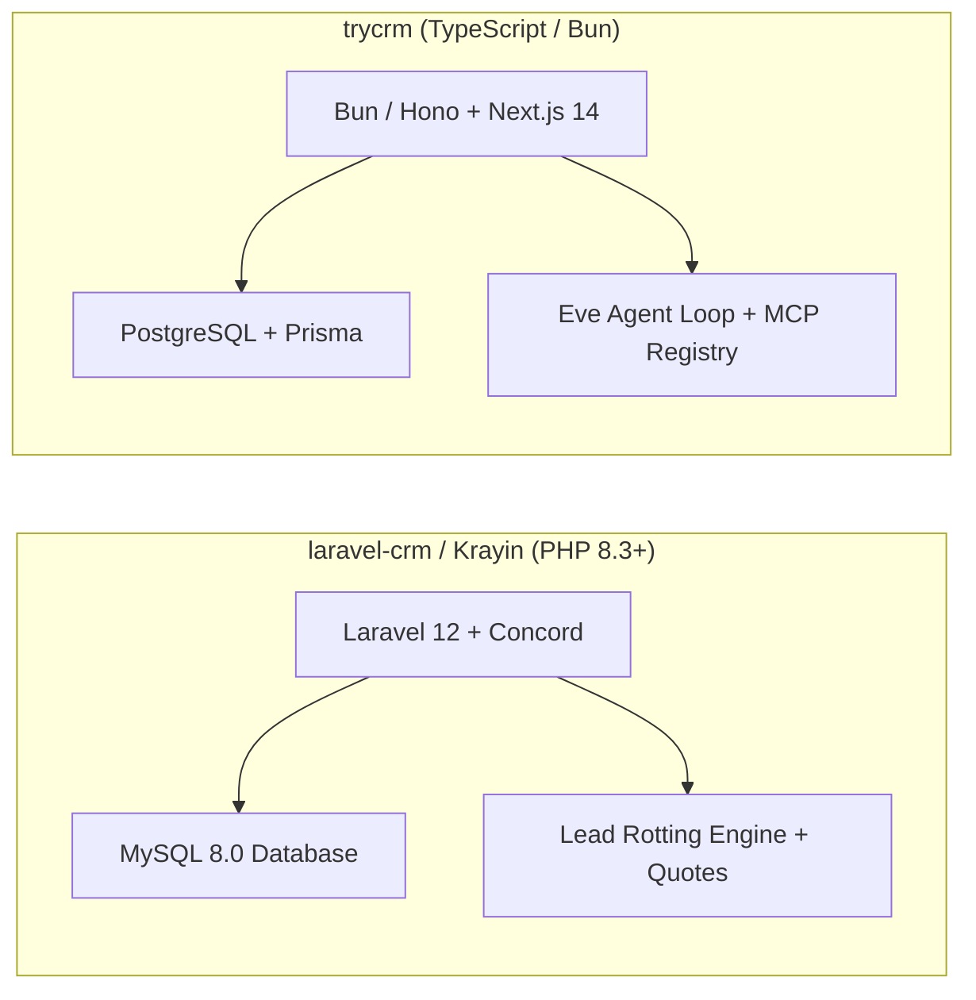
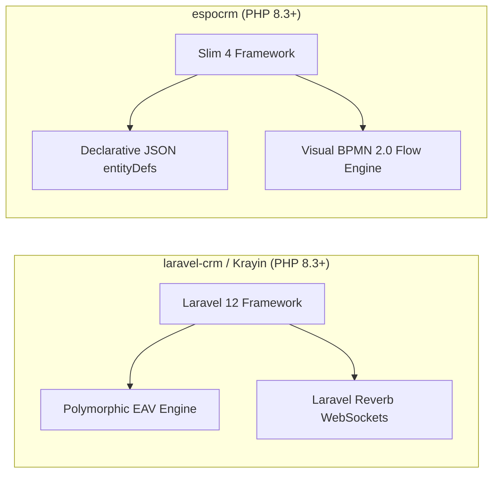
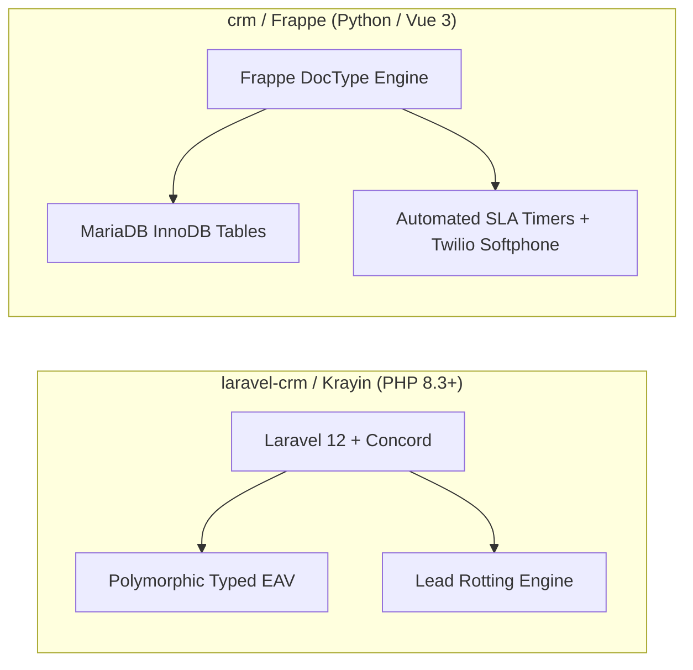
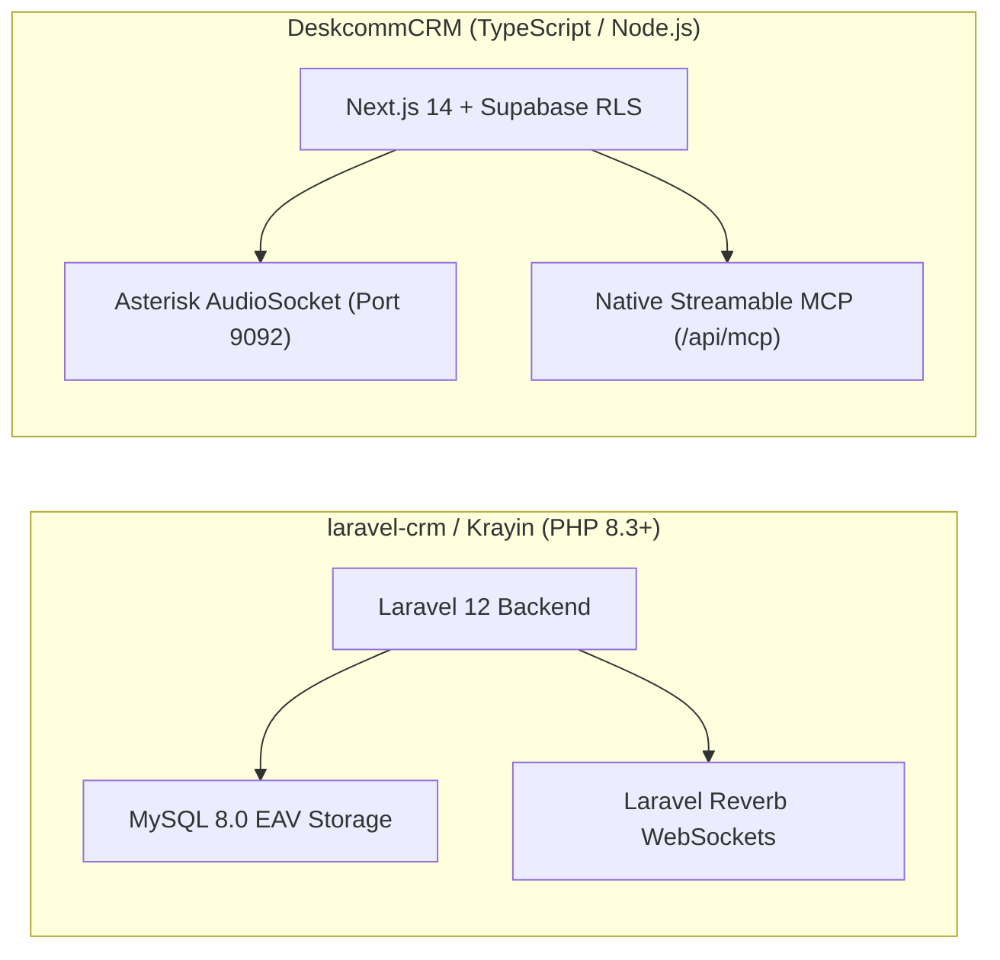
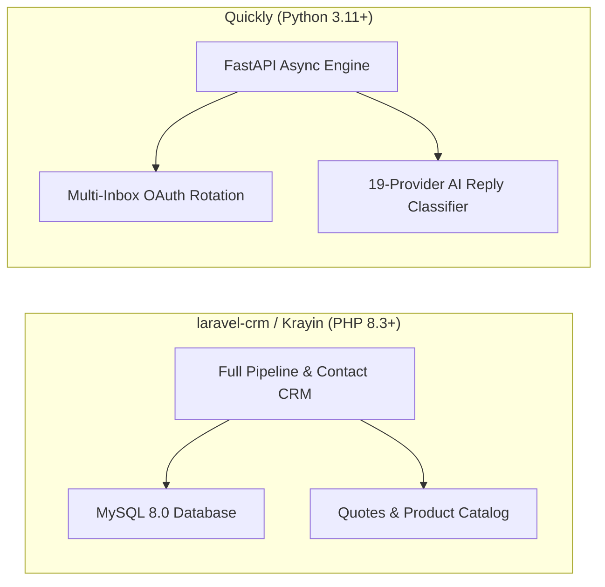
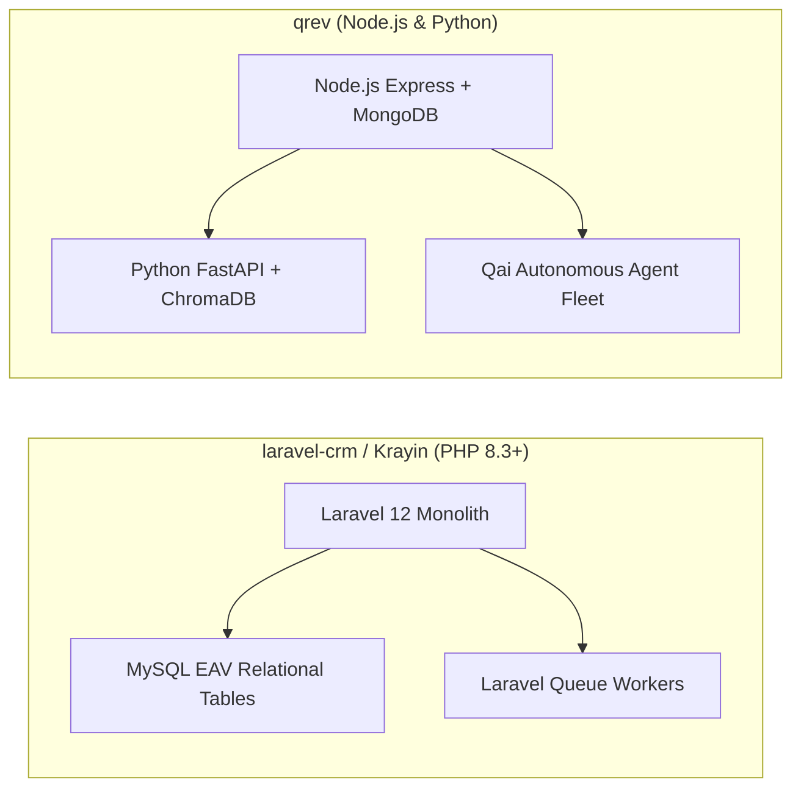
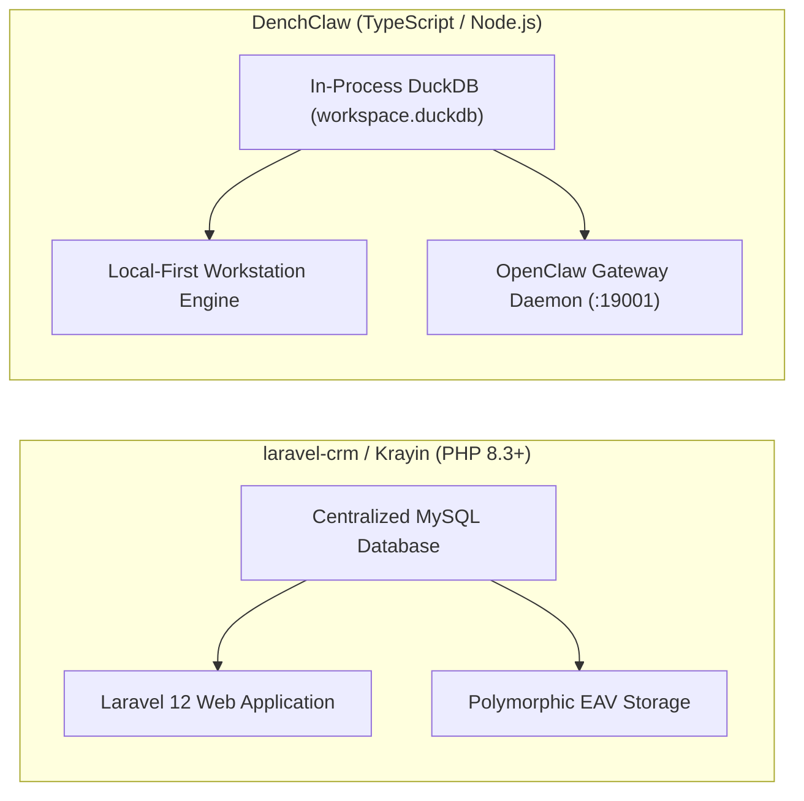
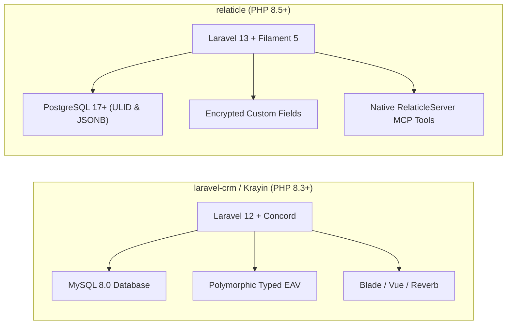

# laravel-crm (Krayin CRM) — Comparative Analysis & Category Evaluation

> **Category**: CRM & Contact Management  
> **Architectural Role**: Enterprise modular Laravel CRM with polymorphic typed EAV & quotation engine  
> **Primary Stack**: PHP 8.3+ | Laravel 12.0, Vue.js, TailwindCSS | MySQL 8.0 (InnoDB), Eloquent ORM | Laravel Queue & Laravel Reverb  
> **Peer Solutions Compared**: `twenty`, `trycrm`, `espocrm`, `crm`, `DeskcommCRM`, `Quickly`, `qrev`, `DenchClaw`, `relaticle`  
> **Commercial SaaS Benchmarks**: Salesforce, HubSpot CRM, Attio, Pipedrive, Close.com  

---

## 1. Executive Overview & Technical Identity: laravel-crm (Krayin CRM)

**laravel-crm** (commercially distributed as **Krayin CRM**) is an enterprise-grade open-source customer relationship management platform engineered by Webkul atop the Laravel 12 framework (`krayin/laravel-crm`). Designed specifically for businesses and agencies invested in the PHP/Laravel ecosystem, Krayin introduces a decoupled, package-based architecture (`packages/Webkul/`) orchestrated via Konekt Concord.

Krayin's architectural identity centers on its **Polymorphic Typed-Column Entity-Attribute-Value (EAV) Engine** (`packages/Webkul/Attribute`), its **Lead Rotting Algorithm**, and its **Native Quotation-to-Close Engine** (`packages/Webkul/Quote`). By storing custom attributes across dedicated typed columns in `attribute_values`, administrators can provision custom fields dynamically without executing risky DDL table alterations.

### Core Architectural Profile
- **Runtime & Language**: `PHP 8.3+` (modern typed properties, attributes, and match expressions)
- **Application Framework**: `Laravel 12.0` (`laravel/framework` ^12.0)
- **Modular Package Engine**: `Konekt Concord 1.17` for package discovery, proxy models, and modular Eloquent overrides
- **Data Access Layer**: `Prettus L5 Repository 3.0` decoupling database queries from controllers
- **Persistence Layer**: `MySQL 8.0+ (InnoDB UTF8MB4)` with Eloquent ORM
- **Dynamic Field Storage**: Polymorphic typed-column EAV (`attribute_values` with `text_value`, `integer_value`, `boolean_value`, `float_value`, `date_value`, `datetime_value`, `json_value`)
- **Real-Time WebSockets**: `Laravel Reverb 1.12` and Pusher PHP server for instant pipeline stage broadcasts
- **Domain Specialization**: Modular Laravel CRM with native quotation generation, lead rotting tracking, and zero-DDL custom fields

---

## 2. Peer Solution Landscape (CRM & Contact Management)

| Solution | Language & Runtime | Core Framework | Database / Persistence | Queue & Concurrency | Primary Architectural Niche |
| :--- | :--- | :--- | :--- | :--- | :--- |
| **laravel-crm** (Current) | `PHP 8.3+` | `Laravel 12.0, Vue.js` | `MySQL 8.0, Eloquent` | `Laravel Queue / Reverb` | **Modular Concord packages, typed EAV & quotation engine** |
| **twenty** | `TypeScript / Node.js` | `NestJS, React, Vite` | `PostgreSQL 15+, TypeORM` | `BullMQ / Redis` | Dynamic runtime schemas & in-memory GraphQL compilation |
| **trycrm** | `TypeScript / Bun` | `Bun, Hono, Next.js` | `PostgreSQL, Prisma` | `Bun Async Loop / Eve` | Agentic-first CRM with native MCP tool registry & Eve runtime |
| **espocrm** | `PHP 8.3+` | `Slim 4, Backbone.js` | `MySQL 8.0+ / MariaDB` | `Multi-Process daemon.php` | Visual BPMN 2.0 flow execution engine & JSON entityDefs |
| **crm** (Frappe) | `Python 3.10+, JS` | `Frappe, Vue 3.5` | `MariaDB 10.6+, Redis` | `Redis Queue (RQ) / Celery` | Declarative DocType metadata, built-in SLAs & Twilio WebRTC |
| **DeskcommCRM** | `TypeScript / Node.js`| `Next.js 14, Supabase` | `PostgreSQL 16, pgvector` | `AudioSocket TCP / Workers`| Asterisk AudioSocket binary TCP telephony & streamable MCP |
| **Quickly** | `Python 3.11+` | `FastAPI, Next.js 14` | `PostgreSQL, SQLAlchemy` | `Asyncio Slot Reservation` | High-velocity multi-inbox rotation, jitter scheduler & MCP |
| **qrev** | `Node.js & Python` | `Express & FastAPI` | `MongoDB & ChromaDB` | `Node-cron & FastTasks` | Dual-runtime Qai superagent orchestrator & LangChain RAG |
| **DenchClaw** | `TypeScript / Node.js`| `Next.js 15, DuckDB` | `In-Process DuckDB` | `In-Process SQL / OpenClaw`| Embedded columnar SQL, OpenClaw AI Gateway & Composio MCP |
| **relaticle** | `PHP 8.5+` | `Laravel 13, Filament 5`| `PostgreSQL 17+ (ULID)` | `Laravel Horizon / Redis` | Native `RelaticleServer` MCP tools, per-field encryption & ULIDs |

---

## 3. Deep Head-to-Head Comparative Breakdown: laravel-crm vs Peers

### 3.1. laravel-crm vs. twenty

#### Metadata Engine & Field Storage
- **laravel-crm**: Resolves custom attributes through a typed **Entity-Attribute-Value (EAV)** engine (`packages/Webkul/Attribute`). Dynamic fields are declared in `attributes`, while data is persisted across typed columns (`text_value`, `integer_value`, `boolean_value`, `date_value`, `json_value`) in `attribute_values`. Adding custom fields requires zero DDL table alterations.
- **twenty**: Issues real SQL DDL queries (`CREATE TABLE`, `ALTER TABLE`) inside dedicated PostgreSQL schemas (`workspace_<id>`). Custom attributes exist as physical database columns with native B-tree indexes, instantly recompiled into the Apollo GraphQL schema.

#### Query Performance at Scale
- **laravel-crm**: Querying or sorting across multiple custom fields requires multi-table self-joins against `attribute_values`. On tables with hundreds of thousands of leads, complex EAV joins become a database bottleneck.
- **twenty**: Because fields are native PostgreSQL columns within workspace schemas, filtering and sorting execute directly via native indexes without self-joins.

#### Quotation-to-Close vs. Custom Objects
- **laravel-crm**: Features an out-of-the-box **Quotation-to-Close engine** (`packages/Webkul/Quote`), complete with product inventories, SKUs, tax calculations, multi-currency conversions, and automated PDF rendering via DomPDF/mPDF.
- **twenty**: Focuses on custom object relationships (companies, people, opportunities) and delegating invoicing to third-party billing integrations.

#### Architectural Tradeoffs Matrix: laravel-crm vs. twenty

| Dimension | laravel-crm | twenty | Architectural Evaluation |
| :--- | :--- | :--- | :--- |
| **Schema Flexibility** | Polymorphic typed EAV (Zero DDL) | Dynamic PostgreSQL Schemas (DDL) | **laravel-crm** avoids table alteration locks |
| **Query Performance** | EAV multi-join overhead on large sets | Native indexed columns | **twenty** scales significantly better for complex queries |
| **Quotation Engine** | Native PDF quotation generator | External integration required | **laravel-crm** handles direct sales quotations |
| **AI Protocol (MCP)** | Standard Laravel Sanctum REST | Native Model Context Protocol (MCP) | **twenty** connects natively with AI agents |

---

### 3.2. laravel-crm vs. trycrm

#### Primary Design Target
- **laravel-crm**: Engineered for human sales representatives and sales managers who need structured pipeline stages, product quotations, and email sync.
- **trycrm**: Engineered for autonomous AI digital sales agents (SDRs). Focuses on giving AI agents tool registries (MCP), memory buffers, and autonomous execution loops.

#### Product Catalog & Quotations
- **laravel-crm**: Includes native product catalogs, inventory tracking, tax rules, and multi-currency PDF quote generation.
- **trycrm**: Lacks inventory and quotation subsystems, focusing on AI lead research, fact extraction, and outreach.

#### Concurrency & Runtime Efficiency
- **laravel-crm**: Traditional PHP-FPM execution with Laravel Queue workers.
- **trycrm**: Modern Bun 1.1+ runtime with Hono API microservices, delivering ultra-low memory usage (~150 MB RAM) and high agent execution throughput.

#### Architectural Tradeoffs Matrix: laravel-crm vs. trycrm

| Dimension | laravel-crm | trycrm | Architectural Evaluation |
| :--- | :--- | :--- | :--- |
| **Operational Target** | Human sales teams & agencies | Autonomous AI sales agents | Distinct architectural paradigms |
| **Quotation Generation**| Full PDF quote engine with taxes/SKUs | Not supported | **laravel-crm** supports direct deal closing |
| **AI Agent Tooling** | Traditional REST endpoints | Native Model Context Protocol (MCP) | **trycrm** is purpose-built for agentic tool use |
| **Runtime Engine** | PHP 8.3+ / Laravel 12 | Bun 1.1+ / Hono | **trycrm** has faster startup and lower overhead |

---

### 3.3. laravel-crm vs. espocrm

#### PHP Architectural Paradigms: Full-Stack Laravel vs. Micro-Framework Slim 4
- **laravel-crm**: Built on Laravel 12, taking full advantage of the Laravel ecosystem: Eloquent ORM, Blade/Vue templates, Prettus repositories, and Laravel Reverb WebSockets.
- **espocrm**: Built on Slim 4 and a custom ORM atop Doctrine DBAL 4.4, with a legacy Backbone.js/Marionette frontend.

#### Custom Fields: EAV vs. Physical Columns
- **laravel-crm**: Dynamic attributes stored in `attribute_values` (EAV). Zero DDL changes when adding fields.
- **espocrm**: Dynamic fields modify MySQL InnoDB tables directly via Doctrine DBAL alter statements. Fields exist as real columns with native indexes.

#### Workflow Automation
- **laravel-crm**: Uses event-driven automation rules (`packages/Webkul/Automation`), triggering actions on model lifecycle events.
- **espocrm**: Features an enterprise **BPMN 2.0 visual flowchart engine** (`application/Espo/Core/BPM/`) supporting complex conditional routing, timer delays, and approval hierarchies.

#### Architectural Tradeoffs Matrix: laravel-crm vs. espocrm

| Dimension | laravel-crm | espocrm | Architectural Evaluation |
| :--- | :--- | :--- | :--- |
| **Framework Ecosystem** | Standard Laravel 12 ecosystem | Custom framework on Slim 4 | **laravel-crm** is easier for Laravel developers to extend |
| **Custom Field Queries**| EAV multi-table joins | Native MySQL columns | **espocrm** provides faster reporting on custom fields |
| **Process Modeling** | Basic event triggers & actions | Full visual BPMN 2.0 engine | **espocrm** handles complex multi-step approvals |
| **Quotation Engine** | Comprehensive PDF quote generation | Basic quotes/invoices | **laravel-crm** provides deeper quotation capabilities |

---

### 3.4. laravel-crm vs. crm (Frappe CRM)

#### Lead Hygiene Strategy: Rotting Days vs. Active SLAs
- **laravel-crm**: Employs passive **lead rotting algorithms** (`rotten_days`), visually highlighting stalled opportunities on Kanban boards when they exceed configured day thresholds in a stage.
- **crm (Frappe CRM)**: Employs active, granular **SLA timers** (`crm_service_level_agreement`) that monitor first-response and rolling-response targets in minutes, triggering automatic manager escalation alerts.

#### Telephony & Calling
- **laravel-crm**: Telephony requires external integration or manual call logging.
- **crm (Frappe CRM)**: Integrates an embedded browser softphone via `@twilio/voice-sdk` and Exotel, automatically recording call durations and audio files into `crm_call_log`.

#### Custom Fields & Metaprogramming
- **laravel-crm**: Polymorphic typed EAV table without DDL migrations.
- **crm (Frappe CRM)**: Declarative DocType engine modifying MariaDB tables during `bench migrate`.

#### Architectural Tradeoffs Matrix: laravel-crm vs. crm (Frappe)

| Dimension | laravel-crm | crm (Frappe CRM) | Architectural Evaluation |
| :--- | :--- | :--- | :--- |
| **Lead Stagnation** | Passive stage rotting days | Active minute-level SLA timers | **crm** actively prevents leads from going cold |
| **VoIP Softphone** | Not supported natively | Native Twilio Voice SDK in browser | **crm** supports direct browser phone calls |
| **Quotation Engine** | Built-in PDF quote engine with SKUs | Delegates to Frappe ERPNext | **laravel-crm** is self-contained for quoting |
| **Extensibility Model** | Modular Composer packages | Frappe DocType apps | Both offer robust ecosystem extension patterns |

---

### 3.5. laravel-crm vs. DeskcommCRM

#### Telephony Architecture
- **laravel-crm**: Traditional web CRM without built-in PBX connectivity.
- **DeskcommCRM**: Telephony-first sales operating system. Features native **AudioSocket** integration with Asterisk PBX 20+ over raw TCP (port 9092), streaming raw binary PCM audio directly into LLM voice pipelines with sub-second latency.

#### AI Agent Ergonomics
- **laravel-crm**: Standard REST API secured via Laravel Sanctum tokens.
- **DeskcommCRM**: Official Model Context Protocol (MCP) server at `/api/mcp`, featuring an intelligent AI-to-human escalation tool (`handoff.ts`).

#### Multi-Tenancy & Security
- **laravel-crm**: Single shared database segmented by roles and sales channels.
- **DeskcommCRM**: Multi-tenant PostgreSQL database on Supabase enforcing Row-Level Security (RLS) policies per `organization_id`, with deterministic `pgcrypto` column encryption.

#### Architectural Tradeoffs Matrix: laravel-crm vs. DeskcommCRM

| Dimension | laravel-crm | DeskcommCRM | Architectural Evaluation |
| :--- | :--- | :--- | :--- |
| **Telephony Capabilities** | None | Real-time Asterisk AudioSocket binary TCP | **DeskcommCRM** is purpose-built for outbound dialers |
| **Quotation Engine** | Full multi-currency & tax PDF quotes | Basic deal records | **laravel-crm** excels at quotation generation |
| **AI Protocol** | Traditional REST endpoints | Native Streamable MCP server | **DeskcommCRM** connects natively with AI agents |
| **Tenant Isolation** | Application-level channels | Database-level Row-Level Security (RLS) | **DeskcommCRM** provides stronger tenant isolation |

---

### 3.6. laravel-crm vs. Quickly

#### Functional Role in Sales Stack
- **laravel-crm**: Mid-funnel and bottom-funnel CRM. Manages contact records, deal stages, rotting deals, and quotation PDFs.
- **Quickly**: Top-of-funnel cold outreach engine. Dispatches email sequences across Google Workspace and Microsoft 365 OAuth inboxes with automated sender rotation and jitter.

#### Asynchronous Queuing Model
- **laravel-crm**: Laravel Queue with Redis or database drivers, executing background mail sync via `webklex/laravel-imap`.
- **Quickly**: Python `asyncio` loop with `asyncpg` connection pool. Custom slot reservation algorithm (`queue_logic.py`) balances email dispatch across hundreds of inboxes simultaneously.

#### Architectural Tradeoffs Matrix: laravel-crm vs. Quickly

| Dimension | laravel-crm | Quickly | Architectural Evaluation |
| :--- | :--- | :--- | :--- |
| **Funnel Position** | Middle/Bottom-funnel deals & quotes | Top-funnel cold email sequences | Highly complementary solutions |
| **Outbound Emailing** | Transactional single-mailbox mail | Multi-inbox OAuth rotation with jitter | **Quickly** avoids spam filters during cold outreach |
| **AI Reply Triage** | Manual inbox reading | 19-provider AI reply classifier | **Quickly** auto-categorizes prospect intent |
| **Data Model** | Rich EAV contacts, deals & quotes | Optimized sequencing models | **laravel-crm** handles broader CRM entity scopes |

---

### 3.7. laravel-crm vs. qrev

#### Architecture & Agent Fleet
- **laravel-crm**: Monolithic Laravel 12 application with modular packages. Built for human data entry and workflow rules.
- **qrev**: Decoupled multi-runtime platform with an autonomous agent fleet led by **Qai**. Runs Playwright background web scrapers, queries ChromaDB vector stores, and synthesizes personalized outreach copy automatically.

#### Data Modeling
- **laravel-crm**: Relational MySQL database with polymorphic typed EAV.
- **qrev**: Flexible MongoDB document database combined with ChromaDB embeddings for unstructured company research.

#### Architectural Tradeoffs Matrix: laravel-crm vs. qrev

| Dimension | laravel-crm | qrev | Architectural Evaluation |
| :--- | :--- | :--- | :--- |
| **Data Structure** | Relational EAV in MySQL | MongoDB documents + ChromaDB vectors | **laravel-crm** guarantees relational ACID integrity |
| **Autonomous Prospecting** | Not supported natively | Autonomous Playwright web scrapers | **qrev** discovers and enriches leads automatically |
| **Deployment Footprint** | Single PHP/MySQL server | Multi-service Node.js + Python + ChromaDB | **laravel-crm** is substantially simpler to host |
| **Quotation Engine** | Built-in PDF quotation engine | Not supported | **laravel-crm** handles formal sales proposals |

---

### 3.8. laravel-crm vs. DenchClaw

#### Topology & Deployment Model
- **laravel-crm**: Centralized, cloud-hosted web application for team collaboration across multiple users and sales channels.
- **DenchClaw**: Local-first sovereign sales workspace running directly on an individual operator's workstation. Stores customer data in an embedded columnar DuckDB file (`workspace.duckdb`).

#### Query Speed: MySQL EAV vs. Columnar DuckDB
- **laravel-crm**: Stores custom attributes across `attribute_values` in MySQL. Large analytical queries suffer from multi-table join latency.
- **DenchClaw**: Stores custom attributes in an in-process vectorized columnar DuckDB database. Analytical filtering and relationship scoring across hundreds of thousands of entries execute in sub-millisecond timeframes.

#### Architectural Tradeoffs Matrix: laravel-crm vs. DenchClaw

| Dimension | laravel-crm | DenchClaw | Architectural Evaluation |
| :--- | :--- | :--- | :--- |
| **Collaboration** | Multi-user web console | Single-user local workstation file | **laravel-crm** is built for collaborative sales teams |
| **Analytical Query Speed** | MySQL network latency (10-30ms) | In-process vectorized DuckDB (<1ms) | **DenchClaw** is dramatically faster for local analytics |
| **Data Sovereignty** | Stored on central MySQL server | 100% sovereign local DuckDB file | **DenchClaw** guarantees total local data custody |
| **Quotation Engine** | Built-in PDF quotation generator | None | **laravel-crm** handles customer billing & quotes |

---

### 3.9. laravel-crm vs. relaticle

#### Framework Evolution: Laravel 12 vs. Laravel 13 & Filament 5
- **laravel-crm**: Built on Laravel 12 with a traditional Blade and Vue.js frontend, using Konekt Concord for modular composer packages.
- **relaticle**: Built on modern PHP 8.5+ and **Laravel 13**, with an administrative frontend powered by **Filament 5**, **Livewire 4**, and TailwindCSS. Features sub-50ms reactive updates and single-responsibility action classes.

#### Custom Fields: Typed EAV vs. Encrypted JSONB
- **laravel-crm**: Custom attributes stored in `attribute_values` across typed columns (`text_value`, `integer_value`, etc.) in MySQL. Values are unencrypted.
- **relaticle**: Custom attributes stored in PostgreSQL 17+ using native JSONB with per-field AES application encryption (`CustomFieldValue`). Combines zero-DDL flexibility with strict data security compliance (GDPR/HIPAA).

#### Primary Keys & Agent Protocol
- **laravel-crm**: Standard auto-increment integer IDs; traditional Laravel Sanctum REST API.
- **relaticle**: Chronological **ULIDs** for high-velocity B-tree indexing; native Model Context Protocol server (`App\Mcp\Servers\RelaticleServer`) exposing structured tools directly to AI agents.

#### Architectural Tradeoffs Matrix: laravel-crm vs. relaticle

| Dimension | laravel-crm | relaticle | Architectural Evaluation |
| :--- | :--- | :--- | :--- |
| **UI Architecture** | Blade / Vue.js / Reverb | Filament 5 / Livewire 4 / TailwindCSS | **relaticle** delivers a modern, reactive admin console |
| **Custom Field Security** | Unencrypted MySQL EAV columns | Per-field AES encrypted PostgreSQL JSONB | **relaticle** secures sensitive customer data at rest |
| **AI Agent Ergonomics** | Traditional REST endpoints | Native Model Context Protocol (MCP) | **relaticle** connects natively with AI agents |
| **Quotation Engine** | Built-in PDF quotation generator | Activity timeline & deals | **laravel-crm** handles product catalog & quotes |

---

## 4. Capability & Feature Comparison Matrix

| Dimension / Capability | laravel-crm | twenty | trycrm | espocrm | crm (Frappe) | DeskcommCRM | Quickly | qrev | DenchClaw | relaticle |
| :--- | :---: | :---: | :---: | :---: | :---: | :---: | :---: | :---: | :---: | :---: |
| **Dynamic Custom Objects** | ⚠️ EAV | ✅ Full DDL | ⚠️ JSON facts | ✅ DocType | ✅ JSON Meta | ❌ Static | ❌ Static | ⚠️ Mongo | ✅ DuckDB EAV | ✅ Encrypted EAV |
| **Native MCP / AI Skills** | ❌ REST only | ✅ Full SDK | ✅ Native Core | ❌ REST only | ❌ RPC only | ✅ Streamable | ✅ Streamable | ⚠️ LangChain | ✅ Composio MCP | ✅ RelaticleServer |
| **Quotation-to-Close** | ✅ Native PDF | ❌ | ❌ | ⚠️ ERPNext | ⚠️ Basic | ❌ | ❌ | ❌ | ❌ | ⚠️ Deals only |
| **Lead Rotting / SLAs** | ✅ Rotting Days | ⚠️ BullMQ flows| ❌ | ⚠️ BPM Timers | ✅ Active SLAs | ❌ | ❌ | ❌ | ❌ | ⚠️ Horizon Jobs |
| **Modern Reactive UI** | ❌ Blade/Vue | ✅ Linear UX | ✅ Linear UX | ❌ Backbone | ⚠️ Vue/Desk | ⚠️ Next.js | ⚠️ Tailwind | ⚠️ React | ✅ Next.js 15 | ✅ Filament 5 |
| **Embedded Softphone / CTI** | ❌ | ❌ | ❌ | ⚠️ Plugin | ✅ Twilio SDK | ✅ AudioSocket | ❌ | ❌ | ❌ | ❌ |
| **Multi-Tenant Schemas** | ⚠️ Channels | ✅ Schema/Tenant| ⚠️ Org ID | ⚠️ Role ACL | ✅ Frappe Sites| ✅ Postgres RLS| ⚠️ Single-team | ⚠️ Org ID | ✅ Local File | ✅ Workspace Model |
| **Resource Footprint** | ~100 MB RAM | ~500 MB RAM | ~150 MB RAM | ~120 MB RAM | ~400 MB RAM | ~200 MB RAM | **~60 MB RAM** | ~250 MB RAM | ~100 MB RAM | ~120 MB RAM |

---

## 5. Commercial Benchmark Positioning

When benchmarked against commercial SaaS leaders (**Salesforce, HubSpot CRM, Attio, Pipedrive, Close.com**):
- **Against Salesforce**: Krayin CRM eliminates expensive per-user licensing and vendor lock-in while providing a clean, customizable Laravel codebase that internal PHP development teams can extend freely.
- **Against Pipedrive**: Krayin replicates Pipedrive's intuitive drag-and-drop sales pipelines and visual lead rotting indicators, supplemented by a native PDF quotation engine.
- **Against HubSpot CRM**: Krayin provides complete data sovereignty and eliminates aggressive contact-tier pricing escalations.
- **Data Sovereignty**: 100% self-hosted on private MySQL servers, ensuring complete compliance with organizational data ownership requirements.

---

## 6. Strategic Takeaways & Role for MarketingStudio

In the unified **MarketingStudio** architecture:
1. **Primary Component to Adopt**: Harvest Krayin CRM's **Native Quotation-to-Close Engine** (`packages/Webkul/Quote`), integrating product catalogs, tax rules, multi-currency conversions, and automated PDF proposal generation.
2. **Lead Rotting Pattern**: Adopt Krayin's visual lead rotting algorithm (`rotten_days`) on pipeline stages to give sales managers instant visibility into stagnant deals.
3. **Modular Package Reference**: Utilize Krayin's package decoupling patterns via Concord for structuring modular CRM extensions.
