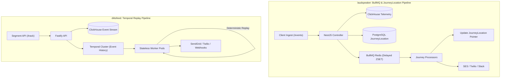
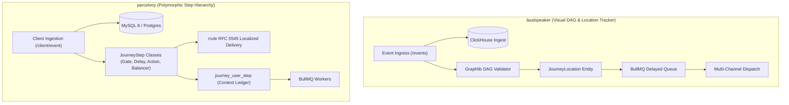
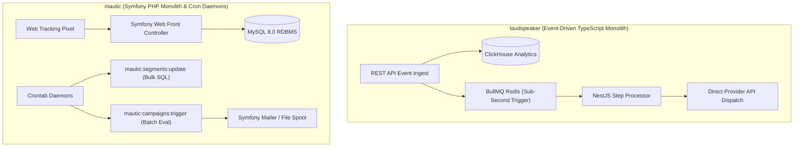
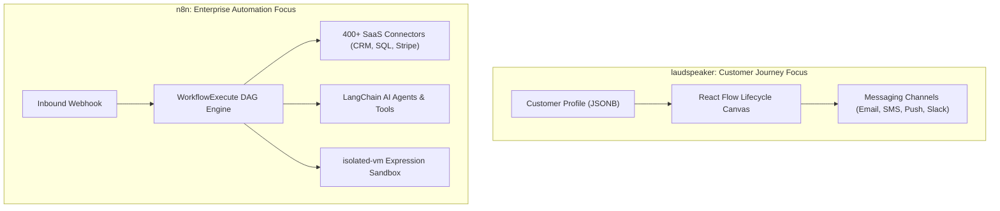

# laudspeaker — Comparative Analysis & Category Evaluation

> **Category**: Customer Lifecycle & Journeys  
> **Architectural Role**: Visual multi-channel customer journey builder & hybrid event analytics  
> **Primary Stack**: TypeScript / Node.js 18+ | NestJS 10, React 18 | PostgreSQL 16 (TypeORM) + ClickHouse 23+ | BullMQ / Redis  
> **Peer Solutions Compared**: `dittofeed`, `notifuse`, `parcelvoy`, `mautic`, `n8n`  
> **Commercial SaaS Benchmarks**: Customer.io, Braze, Segment, HubSpot Marketing Hub, Zapier, Make.com  

---

## 1. Executive Overview & Technical Identity: laudspeaker

**laudspeaker** is an open-source, event-driven customer journey and messaging platform engineered as a self-hostable alternative to Braze, Customer.io, and Iterable. Designed with a modular **NestJS** backend and an interactive **React Flow** canvas, Laudspeaker empowers product and growth marketing teams to design complex, multi-channel user journeys (Email, SMS, Push, In-App Modals, Slack, and Webhooks) backed by a dual-database persistence tier (PostgreSQL for transactional metadata and ClickHouse for high-throughput event analytics).

### Core Architectural Profile
- **Runtime & Language**: `TypeScript / Node.js 18+ LTS`
- **Core Frameworks**: `NestJS 10` (Modular architecture, Express engine), `React 18` (Vite, TailwindCSS, React Flow canvas)
- **Multi-Model Storage Tier**: `PostgreSQL 16` (Workspaces, customers, visual layout, `JourneyLocation` pointers via TypeORM) + `ClickHouse 23+` (High-velocity telemetry event stream, open/click metrics)
- **Queue & Workflow Engine**: `BullMQ` + `Redis` (Delayed job queues, priority scheduling, backoff retries)
- **Graph & Time Modeling**: `@dagrejs/graphlib` (Topological sorting, cycle validation) + `@js-temporal/polyfill` (RFC-compliant timezone and duration calculations)
- **Primary Architectural Niche**: Highly accessible, marketer-friendly visual DAG journey automation without heavy distributed orchestration overhead

---

## 2. Peer Solution Landscape (Customer Lifecycle & Journeys)

Within the Customer Lifecycle & Journeys domain, `laudspeaker` operates alongside five distinct architectural peers:

| Solution | Language & Runtime | Core Framework | Database / Cache | Queue / Concurrency | Primary Architectural Niche |
| :--- | :--- | :--- | :--- | :--- | :--- |
| **laudspeaker** (Current) | `TypeScript / Node.js 18+` | `NestJS 10, React 18` | `PostgreSQL + ClickHouse` | `BullMQ / Redis` | **Visual React Flow journey canvas with `JourneyLocation` state pointers** |
| **dittofeed** | `TypeScript / Node.js 20+` | `Fastify, Next.js` | `PostgreSQL + ClickHouse` | `Temporal.io Workflows` | Durable temporal workflows & streaming ClickHouse analytics |
| **notifuse** | `Go 1.25+` | `Native Go DDD` | `PostgreSQL / AlloyDB` | `Goroutine Worker Pools` | In-process Go Liquid/MJML compilation & multi-MTA gateway |
| **parcelvoy** | `TypeScript / Node.js 18+` | `Koa 2, Knex` | `MySQL 8 / PostgreSQL` | `BullMQ / Redis` | Polymorphic journey steps with RFC 5545 RRULE timezone scheduling |
| **mautic** | `PHP 8.2+` | `Symfony 7.4, Twig` | `MySQL / PostgreSQL` | `Symfony Messenger + Cron` | Monolithic marketing automation, lead scoring & set-based segmentation |
| **n8n** | `TypeScript Monorepo` | `Node.js 20+, Vue 3` | `PostgreSQL / SQLite` | `WorkflowExecute DAG + BullMQ` | 400+ SaaS connectors & `isolated-vm` sandboxed execution |

---

## 3. Deep Head-to-Head Comparative Breakdown: laudspeaker vs Peers

### 3.1. laudspeaker vs. dittofeed

**Comparative Focus**: `BullMQ Delayed ZSETs & Visual Usability` vs. `Temporal Event Sourcing & Ingestion Scale`

#### Pipeline Topologies, Workflow Engines & Queue Mechanics
- **State Machine Mechanics**: `laudspeaker` orchestrates customer journeys through **BullMQ** delayed jobs managed in Redis. Step transitions are evaluated sequentially: when a customer enters a delay node (e.g., wait 3 days), a job is pushed to a Redis sorted set (`ZSET`) with an execution timestamp. When the job fires, the worker checks PostgreSQL to see if the customer is still eligible. In contrast, `dittofeed` delegates execution to **Temporal.io**, where workflows are defined as persistent code. Timers and conditional waits are managed by Temporal's internal clustering with event-sourced replay.
- **State Tracking Paradigms**: Laudspeaker relies on the `JourneyLocation` entity (`journey_id`, `customer_id`, `step_id`, `step_entry_at`, `step_entry`). If an active journey is modified or paused, customers remain locked at their current `JourneyLocation`. Dittofeed requires no relational state pointer; execution state is preserved in Temporal's append-only event history.

#### Database Storage & Telemetry Architecture
- **Dual-Store Division of Labor**: Both platforms integrate ClickHouse and PostgreSQL, but their utilization patterns differ. `laudspeaker` stores rich customer profiles (`user_attributes: jsonb`, `system_attributes: jsonb`, `other_ids: text[]`) in PostgreSQL via TypeORM, using ClickHouse primarily for raw event ingestion and campaign delivery statistics. `dittofeed` leverages ClickHouse directly for complex behavioral segmentation queries, keeping PostgreSQL strictly for minimal workspace configuration.

#### Failure Modes, Crash Recovery & Bottlenecks
- **Crash Recovery & Redis Footprint**: If a Laudspeaker worker crashes mid-task, BullMQ re-queues the job based on backoff settings. However, if Redis runs out of memory due to millions of concurrently scheduled delayed jobs, Redis eviction policies can drop jobs unless memory limits are generously provisioned. Dittofeed has zero Redis memory pressure; all workflow state resides on disk within Temporal's persistence store. If a Dittofeed worker crashes, Temporal's cluster assigns the workflow to a new worker, which deterministically reconstructs state in milliseconds.
- **Visual Canvas Reliability**: Laudspeaker validates graph structure at publish time using `@dagrejs/graphlib`, guaranteeing that loops, deadlocks, and disconnected nodes are rejected before enrollment. Dittofeed validates journey graphs via JSON Schema and TypeScript AST checks.

#### Architectural Comparison Matrix: laudspeaker vs. dittofeed

| Metric / Dimension | laudspeaker | dittofeed |
| :--- | :--- | :--- |
| **Workflow Engine** | BullMQ (Redis delayed ZSET) | Temporal.io (Code-as-workflow) |
| **State Tracking** | `JourneyLocation` composite pointer table | Centralized append-only event log |
| **Delayed Job Scalability**| Bounded by Redis RAM capacity | Unbounded (Disk-backed database) |
| **Crash Recovery** | BullMQ job retry + Location check | Deterministic event replay |
| **Visual Canvas** | React Flow + Graphlib (Highly accessible) | React Flow (Developer / Marketer hybrid) |
| **Identity Resolution** | PostgreSQL `other_ids: text[]` array | Segment `identify` traits + user ID |

#### Where laudspeaker Excels over dittofeed
- **Operational Simplicity**: Runs cleanly on standard Node.js, PostgreSQL, ClickHouse, and Redis without operating a separate Temporal.io cluster.
- **User Experience**: The React Flow canvas offers superior visual clarity for non-technical growth marketers, with intuitive node editors for in-app modals, Slack, and email.
- **Flexible Attribute Schemas**: JSONB customer columns (`user_attributes`) allow marketing teams to ingest arbitrary custom traits without database migrations.

#### Where dittofeed Holds an Advantage over laudspeaker
- **Industrial Workflow Durability**: Zero dropped journey state across server crashes, worker restarts, or cluster migrations thanks to Temporal.io.
- **High-Velocity Segmentation**: Executes complex behavioral queries directly over billions of raw ClickHouse event rows.
- **Segment CDP Compatibility**: Ready-to-use client SDKs adhering strictly to Segment's standard `identify` and `track` specifications.

---

### 3.2. laudspeaker vs. notifuse

**Comparative Focus**: `Visual Multi-Step DAG Journey Builder` vs. `Go-Native In-Process MJML Compilation & Delivery Speed`

```mermaid
flowchart TD
    subgraph LaudspeakerArch ["laudspeaker (Visual Journey Canvas)"]
        LS_Canvas["React Flow Canvas Editor"] --> LS_DAG["Dagrejs Graphlib Validation"]
        LS_DAG --> LS_Bull["BullMQ Step Processors"]
        LS_Bull --> LS_NodeRender["Node.js Template Rendering"]
        LS_NodeRender --> LS_Send["SES / Twilio / FCM / Slack"]
    end

    subgraph NotifuseArch ["notifuse (High-Throughput Go Binary)"]
        NF_API["REST / Broadcast API"] --> NF_Pool["Goroutine Worker Pools"]
        NF_Pool --> NF_GoLiquid["liquidgo In-Process Engine"]
        NF_GoLiquid --> NF_GoMJML["gomjml Pure Go Compiler"]
        NF_GoMJML --> NF_Classifier["3-Way Bounce Classifier"]
        NF_Classifier --> NF_MTA["Multi-MTA Gateway (SES / Postmark)"]
    end
```

#### Pipeline Topologies, Workflow Engines & Queue Mechanics
- **Lifecycle Engine vs. Notification Gateway**: `laudspeaker` is built to solve multi-step customer lifecycle funnels. It evaluates whether a user completed onboarding, branches based on behavioral events, waits for timed delays, and executes A/B test splits. `notifuse` intentionally eschews multi-stage journey logic, focusing exclusively on being an ultra-high-throughput notification gateway that ingests payloads, compiles responsive templates, and saturates delivery pipelines via Go goroutines.
- **Concurrency Paradigms**: Laudspeaker uses Node.js asynchronous event loops distributed across Redis-backed BullMQ workers. Notifuse runs compiled native Go code leveraging lightweight goroutines (`GOMAXPROCS`), communicating through in-memory Go channels and PostgreSQL row-level locks.

#### Database Storage & Telemetry Architecture
- **Dual-Database vs. Single AlloyDB/PostgreSQL**: Laudspeaker maintains PostgreSQL 16 for customer profiles and ClickHouse 23+ for event telemetry. Notifuse runs entirely on PostgreSQL 16 / Google Cloud AlloyDB. By keeping the stack minimal, Notifuse simplifies deployment while relying on database indexing for contact lookups.
- **Template Rendering Overhead**: Laudspeaker compiles templates inside Node.js, which creates significant CPU and memory spikes when personalizing hundreds of thousands of HTML emails. Notifuse compiles MJML and parses Liquid tags directly in Go using `gomjml` and `liquidgo`. Compiling in-process without spawning external Node.js subprocesses allows Notifuse to achieve sub-millisecond compile times (>10,000 emails/second).

#### Failure Modes, Crash Recovery & Bottlenecks
- **Bounce Classification**: Notifuse features an advanced 3-way bounce classification state machine (`BounceClassificationHard`, `SoftCount`, `SoftIgnore`) that normalizes inconsistent provider webhooks. Laudspeaker tracks delivery outcomes in ClickHouse but relies on simpler provider webhook mappings.
- **Resource Bottlenecks**: Laudspeaker’s primary bottleneck during large email blasts is Node.js CPU utilization during template rendering. Notifuse’s bottleneck is almost exclusively network I/O and external MTA rate limits.

#### Architectural Comparison Matrix: laudspeaker vs. notifuse

| Metric / Dimension | laudspeaker | notifuse |
| :--- | :--- | :--- |
| **System Scope** | Visual multi-step journey orchestration | High-performance notification delivery gateway |
| **Core Runtime** | TypeScript / Node.js 18+ (NestJS 10) | Go 1.25+ (Compiled static binary) |
| **Email Template Compiler** | Node.js HTML / Handlebars | In-process Go (`liquidgo` + `gomjml`) |
| **Rendering Performance** | ~300 emails/sec per core | **10,000+ emails/sec per core** |
| **Visual Journey Canvas** | Yes (React Flow + `@dagrejs/graphlib`) | No (API & developer focused) |
| **Persistence Tier** | PostgreSQL 16 + ClickHouse 23+ | PostgreSQL 16 / Google Cloud AlloyDB |

#### Where laudspeaker Excels over notifuse
- **Visual Journey Canvas**: Growth marketers can design complex, conditional drip campaigns without engineering assistance.
- **Event-Driven Lifecycle State**: Manages multi-day delays, event waits, and multivariate A/B testing splits.
- **Omnichannel Messaging**: Built-in support for in-app modals, mobile push, and Slack webhooks in addition to email and SMS.

#### Where notifuse Holds an Advantage over laudspeaker
- **Blazing Render & Dispatch Velocity**: In-process Go MJML compilation delivers orders-of-magnitude faster throughput with lower memory.
- **Zero-Dependency Footprint**: Single compiled binary; eliminates Redis, ClickHouse, and Node.js operational overhead.
- **Transactional IP Protection**: Hardcoded `is_transactional_only` provider roles prevent marketing campaigns from burning critical sender reputations.

---

### 3.3. laudspeaker vs. parcelvoy

**Comparative Focus**: `React Flow Canvas & ClickHouse Analytics` vs. `Polymorphic Step Classes & RRULE Timezone Scheduling`

#### Pipeline Topologies, Workflow Engines & Queue Mechanics
- **DAG Validation vs. Polymorphic Classes**: `laudspeaker` validates its visual canvas as a monolithic graph schema using `@dagrejs/graphlib`. `parcelvoy` implements an object-oriented pattern where each canvas node is a dedicated TypeScript class inheriting from `JourneyStep` (`JourneyEntrance`, `JourneyDelay`, `JourneyAction`, `JourneyGate`, `JourneyExperiment`, `JourneyBalancer`, `JourneyExit`).
- **Context Accumulation**: Parcelvoy’s `journey_user_step` table aggregates data from previous steps via `getDataMap()`. This allows downstream actions (e.g., an SMS sent 3 days later) to interpolate data captured at the entrance trigger. Laudspeaker passes event payloads through BullMQ job data and queries customer JSONB attributes at execution time.
- **Traffic Smoothing**: Parcelvoy features a dedicated `JourneyBalancer` step that throttles user flow into subsequent steps, preventing downstream webhook or sales overload. Laudspeaker relies on global BullMQ worker rate limits.

#### Timezone & Recurrence Mechanics
- **RRULE Scheduling**: Parcelvoy integrates `rrule` (RFC 5545) with `date-fns-tz` to ensure that messages arrive during the recipient's daytime hours. Laudspeaker uses `@js-temporal/polyfill` for standard duration and timezone calculations, but lacks native RFC 5545 recurring schedule compilation.

#### Database Storage & Telemetry Architecture
- **ClickHouse Analytics vs. Relational Storage**: Laudspeaker streams events into ClickHouse, allowing it to calculate conversion funnels and open/click metrics without relational table locking. Parcelvoy relies entirely on MySQL 8.0 or PostgreSQL 15+, using Knex ORM. Under high event velocity, Parcelvoy’s relational database requires aggressive indexing and table partitioning to maintain performance.

#### Failure Modes, Crash Recovery & Bottlenecks
- **State Recovery**: Both platforms utilize BullMQ backed by Redis for queue orchestration. Laudspeaker validates progression against `JourneyLocation`; Parcelvoy validates progression against `journey_user_step.ended_at`. If a worker dies mid-job, both systems retry cleanly. However, Parcelvoy’s MySQL-backed architecture is more vulnerable to connection pool exhaustion during massive blast campaigns compared to Laudspeaker’s hybrid ClickHouse setup.

#### Architectural Comparison Matrix: laudspeaker vs. parcelvoy

| Metric / Dimension | laudspeaker | parcelvoy |
| :--- | :--- | :--- |
| **Canvas Architecture** | React Flow + Graphlib DAG validation | Visual Canvas + Polymorphic `JourneyStep` classes |
| **Telemetry Persistence** | ClickHouse 23+ columnar warehouse | MySQL 8.0 / PostgreSQL relational tables |
| **Timezone Delivery** | Standard JS-Temporal calculations | Native RFC 5545 RRULE localized scheduling |
| **Traffic Shaping** | Global queue rate limiting | Dedicated `JourneyBalancer` canvas step |
| **Mobile Push Gateways** | FCM / APNs core adapters | `node-pushnotifications` (Unified APNs HTTP/2 + FCM) |
| **Context Retention** | Re-queried customer JSONB attributes | Accumulated step data maps (`getDataMap`) |

#### Where laudspeaker Excels over parcelvoy
- **High-Velocity Telemetry Ingestion**: ClickHouse absorbs high-frequency event streams without relational lock contention.
- **Modern NestJS Architecture**: Clean modular dependency injection structure with TypeORM and NestJS microservices.
- **Multi-Identifier Stitching**: `customer.other_ids: text[]` array enables flexible cross-device identity merging.

#### Where parcelvoy Holds an Advantage over laudspeaker
- **Precision Timezone Scheduling**: Native RRULE support guarantees contacts receive messages at local daylight hours globally.
- **Extensible Step Subclassing**: Adding new journey primitives (e.g., AI decision nodes) is straightforward via `JourneyStep` inheritance.
- **Traffic Balancers**: `JourneyBalancer` prevents sudden event spikes from overwhelming outbound APIs and sales teams.

---

### 3.4. laudspeaker vs. mautic

**Comparative Focus**: `Modern TypeScript/ClickHouse Event-Driven Canvas` vs. `Enterprise PHP Marketing Monolith`

#### Pipeline Topologies, Workflow Engines & Queue Mechanics
- **Event-Driven Real-Time vs. Cron-Polled Batching**: `laudspeaker` is built for event-driven marketing: inbound telemetry triggers BullMQ jobs that evaluate journeys within seconds. `mautic` operates on a batch polling model: cron daemons trigger Symfony console commands (`mautic:segments:update`, `mautic:campaigns:trigger`) on 1- to 5-minute schedules.
- **Set-Based Database Segmentation**: Mautic utilizes set-based database queries (`INSERT INTO lead_lists_leads SELECT ...`) to recalculate segment memberships in bulk across millions of leads. Laudspeaker evaluates segment criteria using dynamic PostgreSQL JSONB queries (`user_attributes`), which is more flexible for custom schemas but slower on multimillion-row tables unless paired with ClickHouse.

#### Database Storage & Telemetry Architecture
- **Hybrid Storage vs. Monolithic RDBMS**: Mautic stores all application data—leads, dynamic attributes, campaign logs, landing pages, forms, and email tracking stats—inside MySQL or PostgreSQL. Laudspeaker offloads telemetry and analytics to ClickHouse, isolating PostgreSQL from clickstream load.

#### Deliverability, Governance & Suppression
- **Do-Not-Contact (DNC) Registry**: Mautic features an enterprise-grade `DoNotContact` entity tracking hard bounces, manual unsubscribes, and spam complaints across email, SMS, and push. It automatically monitors inbound IMAP bounce mailboxes (`MonitoredEmail/`). Laudspeaker relies on customer attribute flags (`system_attributes.email_bounced`) and webhook callbacks.

#### Failure Modes, Crash Recovery & Bottlenecks
- **Cron Overlap & Deadlocks**: In Mautic, concurrent cron workers can lock tables on large MySQL databases, creating delivery backlogs. Laudspeaker’s BullMQ queues use Redis atomic locks (`SET NX PX`), guaranteeing that jobs execute independently without database locking.

#### Architectural Comparison Matrix: laudspeaker vs. mautic

| Metric / Dimension | laudspeaker | mautic |
| :--- | :--- | :--- |
| **Runtime & Language** | TypeScript / Node.js 18+ (NestJS 10) | PHP 8.2+ / Symfony 7.4 |
| **Trigger Responsiveness** | Real-time event streaming (< 2s) | Polled via Cron (1 to 5 min) |
| **Data Architecture** | PostgreSQL (Metadata) + ClickHouse (Events) | MySQL / PostgreSQL monolithic RDBMS |
| **Marketing Scope** | Journeys & multi-channel messaging | Full marketing suite (Forms, Pages, Lead scoring) |
| **Suppression Governance** | Attribute flags & provider callbacks | Immutable multi-channel `DoNotContact` registry |
| **Queue Technology** | BullMQ + Redis | Symfony Messenger + Cron Daemons |

#### Where laudspeaker Excels over mautic
- **Sub-Second Trigger Responsiveness**: Reacts to user behavioral telemetry immediately rather than waiting for cron intervals.
- **Modern Developer Stack**: TypeScript, NestJS, and React vs. legacy PHP/Symfony bundle architecture.
- **ClickHouse Analytics**: Eliminates database lock contention by writing event streams to columnar storage.

#### Where mautic Holds an Advantage over laudspeaker
- **Comprehensive Marketing Tools**: Native drag-and-drop landing page builders, progressive profiling web forms, and lead scoring.
- **Deliverability Governance**: Centralized Do-Not-Contact registry with automated IMAP bounce mailbox parsing.
- **Set-Based Database Segmentation**: Bulk SQL segment rebuilds handle massive static audiences with minimal memory usage.

---

### 3.5. laudspeaker vs. n8n

**Comparative Focus**: `Specialized Customer Journey Canvas` vs. `Universal Systems Integration & AI Agents`

#### Pipeline Topologies, Workflow Engines & Queue Mechanics
- **Customer Lifecycle DAG vs. Universal Workflow DAG**: `laudspeaker`’s canvas is purpose-built for user communication: nodes represent message actions, delay timers, and segment filters tied to individual customer IDs. `n8n` is an unconstrained integration DAG: nodes ingest arbitrary JSON item arrays, query external databases, call REST APIs, and execute custom code.
- **Item Lineage Semantics**: n8n tracks paired-item lineage across complex transformations, ensuring data integrity during loops and list splitting. Laudspeaker operates on single-customer context envelopes.
- **Code Sandboxing**: n8n executes user expressions and JavaScript snippets inside secure V8 isolates (`isolated-vm`), preventing rogue scripts from crashing the worker process. Laudspeaker uses standard Handlebars and lodash expression parsers.

#### Database Storage & Telemetry Architecture
- **Customer 360 vs. Stateless Orchestration**: Laudspeaker maintains an active customer ledger in PostgreSQL with flexible JSONB attributes and historical events in ClickHouse. n8n does not maintain a customer database; it persists workflow definitions, encrypted credentials (AES-256-GCM), and execution run snapshots.

#### Failure Modes, Crash Recovery & Bottlenecks
- **Error Inspection & Replay**: n8n provides an interactive UI to inspect the exact input/output payloads of every node in a failed run and re-trigger execution from that exact step. Laudspeaker logs failed delivery jobs in BullMQ, requiring manual re-queuing or automated backoff retries.

#### Architectural Comparison Matrix: laudspeaker vs. n8n

| Metric / Dimension | laudspeaker | n8n |
| :--- | :--- | :--- |
| **Primary Domain** | Customer onboarding & lifecycle journeys | Universal API orchestration & AI workflows |
| **Canvas Engine** | React Flow (`@dagrejs/graphlib`) | Vue 3 / VueFlow DAG engine |
| **Integration Breadth**| Core messaging channels (SES, Twilio, Slack) | 400+ SaaS apps, databases, and APIs |
| **AI Capabilities** | None (Rule-based journeys) | Native LangChain nodes (Agents, Memory, Vector DBs) |
| **Customer 360 Ledger**| PostgreSQL JSONB + ClickHouse telemetry | None (Stateless execution engine) |
| **Code Execution** | Handlebars templating | `isolated-vm` sandboxed JavaScript/Python |

#### Where laudspeaker Excels over n8n
- **Native Customer Engagement**: Built-in concepts for customers, segments, message templates, and delivery attribution.
- **Long-Running Journey Timers**: Optimized for multi-week user onboarding and re-engagement campaigns.
- **Event-Driven Segmentation**: ClickHouse integration enables behavioral segmentation over historical event data.

#### Where n8n Holds an Advantage over laudspeaker
- **Massive SaaS Ecosystem**: Connects seamlessly with 400+ external platforms (CRMs, payment gateways, ERPs).
- **Autonomous AI Agents**: Visually construct self-healing conversational agents with tool calling and vector retrieval.
- **Granular Execution Debugging**: Step-by-step visual payload inspection and one-click replay from failed nodes.

---

## 4. Capability & Feature Comparison Matrix

| Capability / Dimension | laudspeaker | dittofeed | notifuse | parcelvoy | mautic | n8n |
| :--- | :---: | :---: | :---: | :---: | :---: | :---: |
| **Primary Architectural Role** | **Visual Journey Canvas** | Streaming Lifecycle CDP | High-Speed Notification Gateway | Modular Multi-Channel Lifecycle | Monolithic Marketing Automation | Multi-System DAG Automation |
| **Workflow Engine** | **BullMQ + Graphlib** | Temporal.io | Goroutine Pools | BullMQ + Step Classes | Symfony Messenger + Cron | `WorkflowExecute` DAG |
| **Telemetry Analytical Store** | **ClickHouse** | **ClickHouse** | ❌ (Postgres only) | ❌ (MySQL/Postgres) | ❌ (MySQL/Postgres) | ❌ (Relational only) |
| **In-Process MJML Compilation**| ❌ (Node.js) | ❌ (Node.js) | **✅ Pure Go (`gomjml`)** | ❌ (Handlebars) | ❌ (Twig) | ❌ (Node.js) |
| **Timezone-Aware Delivery** | ⚠️ JS-Temporal | ⚠️ Code offsets | ❌ | **✅ RFC 5545 RRULE** | ⚠️ Timezone shifts | ✅ Cron Node |
| **Traffic Smoothing / Balancer**| ⚠️ Queue limits | ⚠️ Worker limits | ⚠️ Provider limits | **✅ `JourneyBalancer`** | ⚠️ Queue delays | ⚠️ Wait nodes |
| **Do-Not-Contact Registry** | ⚠️ Attribute flags | ⚠️ Workspace lists | ✅ Universal 3-way | ✅ Multi-topic preferences | **✅ Dedicated DNC entity**| ⚠️ Manual lookup |
| **400+ SaaS Integrations** | ❌ Core channels | ❌ Core channels | ❌ Core channels | ❌ Core channels | ⚠️ Legacy plugins | **✅ Native Ecosystem** |
| **Sandboxed Code Execution** | ❌ | ❌ | ❌ | ❌ | ❌ | **✅ `isolated-vm`** |
| **License** | **MIT** | **MIT** | BSL 1.1 / AGPL-3.0 | **MIT** | GPL-3.0 | Fair-Code (SUEL) |

---

## 5. Commercial Benchmark Positioning

When evaluated against commercial SaaS benchmarks (**Customer.io, Braze, Segment, HubSpot, Zapier**):
- **Against Customer.io / Braze**: `laudspeaker` provides an accessible, self-hostable visual journey builder that eliminates monthly tracked user (MTU) pricing penalties. By coupling PostgreSQL with ClickHouse, it avoids the relational performance traps that plague traditional marketing tools while maintaining lower operational complexity than Temporal-backed systems.
- **Against HubSpot Marketing Hub**: Laudspeaker offers a modern, API-first alternative for SaaS product teams who want to trigger onboarding messages directly from product telemetry rather than relying on clunky CRM integrations.
- **Against Zapier / Make**: Laudspeaker focuses specifically on customer lifecycle state, whereas Zapier and Make excel at multi-app data piping without maintaining persistent customer profile ledgers.

---

## 6. Strategic Takeaways & Role for MarketingStudio

In the unified **MarketingStudio** architecture:

1. **Adopt laudspeaker's Visual Journey Canvas & DAG Validation**: Implement Laudspeaker’s React Flow canvas architecture, using `@dagrejs/graphlib` to validate journey graphs prior to activation. This provides growth marketers with an intuitive, drag-and-drop interface for composing branching lifecycles.
2. **Utilize Atomic `JourneyLocation` State Pointers**: Model customer journey progression using composite primary keys (`journey_id`, `customer_id`, `step_id`, `step_entry_at`). This cleanly decouples journey execution from UI mutations and enables seamless pausing and resuming of active funnels.
3. **Harmonize with Peer Strengths**:
   - Utilize **dittofeed's** Temporal engine for mission-critical, multi-week enterprise customer workflows.
   - Offload high-volume email compilation to **notifuse's** in-process Go MJML compiler during broadcast sends.
   - Adopt **parcelvoy's** RRULE timezone engine and `JourneyBalancer` traffic smoothing to protect downstream systems.
   - Bridge outbound lifecycle events into **n8n** to trigger external CRM updates, Slack alerts, and autonomous AI agents.
