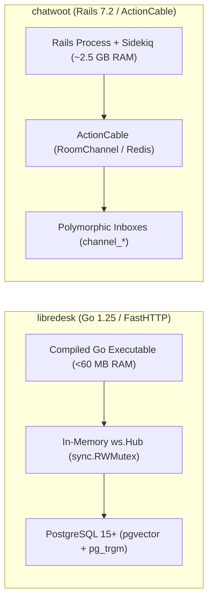
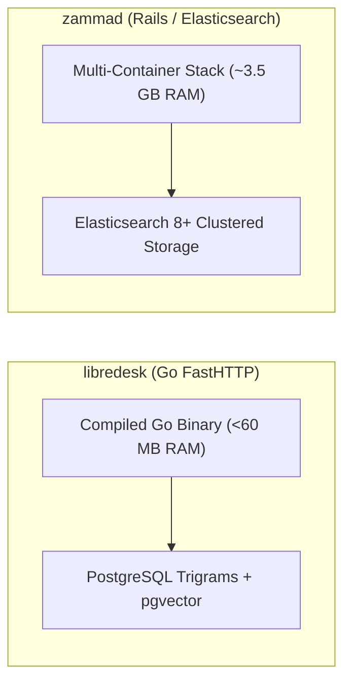
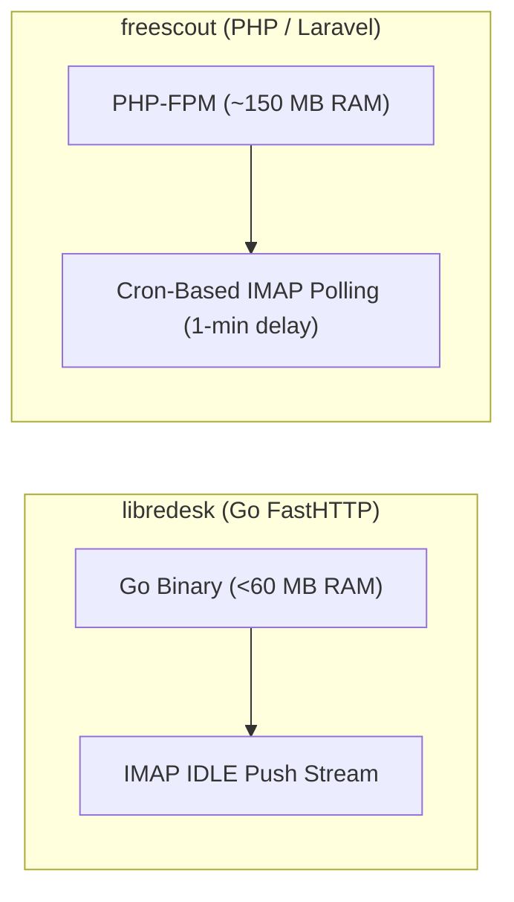
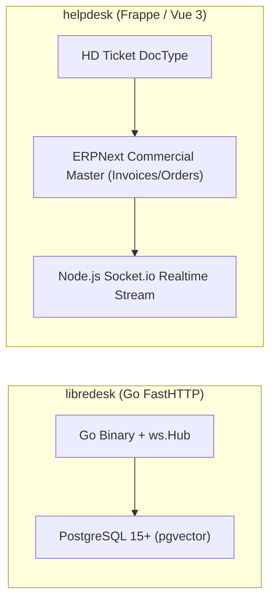
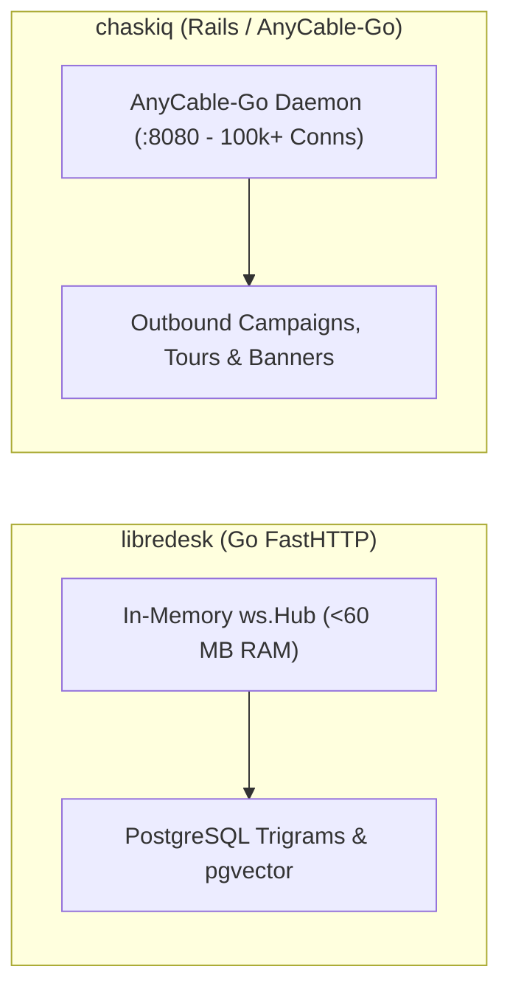
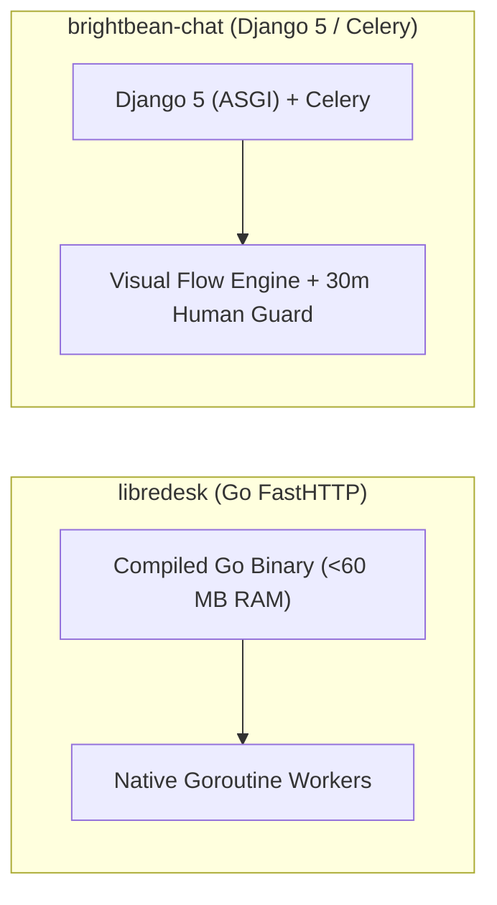

# libredesk — Comparative Analysis & Category Evaluation

> **Category**: Omnichannel Helpdesk & Support  
> **Architectural Role**: Ultra-high-throughput compiled Go support engine & knowledge hub  
> **Primary Stack**: Go 1.25+ | FastHTTP, Fastglue | PostgreSQL 15+ (sqlx, pgvector), Redis 7+ | Native Goroutines + FastHTTP WebSockets  
> **Peer Solutions Compared**: `chatwoot`, `zammad`, `freescout`, `helpdesk`, `chaskiq`, `brightbean-chat`  
> **Commercial SaaS Benchmarks**: Intercom, Zendesk, Help Scout, Front, Crisp, LiveChat  

---

## 1. Executive Overview & Technical Identity: libredesk

**libredesk** represents the cloud-native, compiled systems-engineering standard within the **Omnichannel Helpdesk & Support** domain, distinguished by its core focus on **Sub-60MB base RSS, wire-speed FastHTTP concurrency, an in-memory WebSocket hub (`ws.Hub`), and native vector copilot embeddings (`pgvector`)**.

### Core Architectural Profile
- **Runtime & Language**: `Go 1.25+` (Strict static typing, native compilation)
- **Core Framework**: `valyala/fasthttp`, `zerodha/fastglue`, `React / Vite` frontend
- **Persistence Layer**: `PostgreSQL 15+` (`sqlx`, `pg_trgm` trigrams, `pgvector`), `Redis 7+` (`go-redis/v9`), `fastcache`
- **Concurrency & Queue Model**: Native Goroutines + Redis Stream consumers (`streamqueue`) + in-memory concurrent `ws.Hub`
- **Domain Specialization**: `High-concurrency omnichannel inbox, IMAP IDLE push streams & vector knowledge search`

---

## 2. Peer Solution Landscape (Omnichannel Helpdesk & Support)

Within this category, `libredesk` operates alongside the following peer solutions:

| Solution | Language & Runtime | Core Framework | Database / Cache | Queue / Concurrency | Primary Architectural Niche |
| :--- | :--- | :--- | :--- | :--- | :--- |
| **libredesk** (Current) | `Go 1.25+` | `FastHTTP, Fastglue` | `PostgreSQL 15+, pgvector` | `Native Goroutines + FastHTTP WS` | **Sub-60MB RAM footprint with compiled high-concurrency Go** |
| **chatwoot** | `Ruby 3.4+` | `Rails 7.2, Vue 3` | `PostgreSQL 14+, Redis` | `Sidekiq + ActionCable` | Polymorphic multi-channel inbox & real-time live chat |
| **zammad** | `Ruby 3.4+` | `Rails 8.1, TypeScript` | `PostgreSQL/MySQL + Elastic 8+` | `Delayed::Job + EventMachine WS` | Enterprise ITIL ticketing, dynamic Object Manager & audit trails |
| **freescout** | `PHP 8.1-8.3` | `Laravel 5.5 LTS, Blade` | `MySQL 8+ / MariaDB / Postgres` | `Laravel Queue / CLI Cron` | Low-overhead shared email inboxes with modular add-ons |
| **helpdesk** | `Python 3.10+, Node 20+`| `Frappe Framework v15, Vue 3`| `MariaDB, Redis, SQLite` | `Python RQ + Node Socket.io` | SLA policies & seamless integration with Frappe/ERPNext apps |
| **chaskiq** | `Ruby 3.3.5+, Node 20+` | `Rails 7.2, React 18` | `PostgreSQL, Redis, Nightfury` | `Sidekiq + AnyCable-Go WS` | Intercom-style proactive tours, campaigns & outbound messages |
| **brightbean-chat** | `Python 3.11+, Node 20+`| `Django 5, Django Ninja` | `PostgreSQL 15+, Redis` | `Celery + Django Channels` | Multi-tenant visual flow automation with human-takeover contract |

---

## 3. Deep Head-to-Head Comparative Breakdown: libredesk vs Peers

### 3.1. libredesk vs. chatwoot

**Comparative Focus**: `Sub-60MB compiled Go binary & native pgvector` vs. `Polymorphic multi-channel Rails suite`



#### Architectural & Stack Differences
- **Runtime Performance & Memory Efficiency**: LibreDesk is a single compiled Go binary utilizing `valyala/fasthttp` (zero-memory allocation HTTP engine) consuming **under 60 MB of RAM**. Chatwoot is a Ruby on Rails application running Puma, Redis, and multi-threaded Sidekiq worker pools, consuming **~2.5 GB of RAM**.
- **WebSocket Streaming Architecture**: Chatwoot relies on Rails ActionCable over Redis Pub/Sub, with agent presence tracked in Redis Sorted Sets. LibreDesk embeds a concurrent, thread-safe in-memory WebSocket hub (`ws.Hub`) written in Go:
  ```go
  type Hub struct {
      convSubsList map[int64]map[*Client]bool
      convSubsOpen map[int64]map[*Client]bool
      mu           sync.RWMutex
  }
  ```
  Distributes JSON-RPC payloads directly to memory channels with sub-millisecond broadcast latency and zero thread contention.
- **AI Knowledge Architecture**: Chatwoot delegates AI features to external LLM endpoints. LibreDesk incorporates native vector embeddings via PostgreSQL `pgvector`, allowing autonomous AI copilot routines to retrieve semantically relevant documentation directly in Go routines.

#### Where libredesk Excels over chatwoot
- **40x Lower Memory Footprint**: Runs easily on \$5/month edge instances or micro-containers.
- **Wire-Speed Email Ingress**: Persistent IMAP IDLE push listeners (`go-imap/v2`) and pooled SMTP delivery (`knadh/smtppool/v2`) capture and send mail instantly.
- **Native Vector Copilot**: Direct `pgvector` semantic retrieval without external orchestrator bloat.

#### Where chatwoot Holds an Advantage over libredesk
- **Turnkey Omnichannel Connectors**: Native support for Meta Graph APIs, Twilio WhatsApp, Telegram, and Line.
- **Rich Dashboard UI**: Mature Vue 3 interface with extensive keyboard shortcuts, agent capacity limits, and CSAT surveys.
- **Extensive Community & Ecosystem**: Broad enterprise adoption, extensive documentation, and active plugin contributors.

#### Architectural Tradeoffs Matrix

| Architectural Dimension | libredesk | chatwoot |
| :--- | :--- | :--- |
| **Primary Domain Focus** | High-performance compiled support engine | Omnichannel conversational customer engagement |
| **Runtime & Execution** | Go 1.25 compiled binary (Machine code) | Ruby 3.4 / Rails 7.2 / Sidekiq (Interpreted) |
| **Real-Time Engine** | In-memory `ws.Hub` with `sync.RWMutex` | Rails ActionCable over Redis Pub/Sub |
| **Base Production RAM** | **< 60 MB RAM** | ~2,500 MB RAM |
| **AI Knowledge Retrieval**| Native PostgreSQL `pgvector` embeddings | External LLM API calls |
| **Email Ingress** | Persistent IMAP IDLE push streams | Push webhooks / ActionMailbox |
| **Best-Fit Deployment** | High-load cloud-native backends, micro-instances | Established support centers requiring rich UI |

---

### 3.2. libredesk vs. zammad

**Comparative Focus**: `Ultra-lightweight Go binary` vs. `Enterprise ITIL ticketing with Elasticsearch`



#### Architectural & Stack Differences
- **Resource Footprint & Infrastructure**: Zammad requires a heavy multi-container stack (Rails 8.1, Elasticsearch 8+, Redis, DelayedJob, EventMachine) consuming 3.5 GB+ RAM. LibreDesk runs from a single binary consuming <60 MB RAM with PostgreSQL.
- **Search Architecture**: Zammad offloads full-text search to a dedicated Elasticsearch cluster. LibreDesk uses PostgreSQL GIN trigrams (`pg_trgm`) for fuzzy text searches and `pgvector` for semantic similarity.
- **Ticketing Philosophy**: Zammad enforces enterprise ITIL compliance with dynamic runtime schemas (`ObjectManager`), CTI telephony, and complex multi-calendar SLAs. LibreDesk provides a high-velocity, lightweight conversation state machine.

#### Where libredesk Excels over zammad
- **60x Lower Memory Overhead**: Runs on tiny virtual servers (<60MB vs 3,500MB+).
- **Single-Binary Deployment**: Zero external JVM or search cluster management overhead.
- **Sub-Millisecond API Response Times**: FastHTTP delivers microsecond-level latency on message routing.

#### Where zammad Holds an Advantage over libredesk
- **Hyperscale Search Across Millions of Tickets**: Clustered Elasticsearch handles massive ticket archives with zero performance loss.
- **Live Shared Draft Synchronization**: Agents see real-time peer typing text and avatar badges (`SharedDraftZoom`).
- **Dynamic Schema Customization**: Object Manager allows adding custom fields at runtime without migrations.

#### Architectural Tradeoffs Matrix

| Architectural Dimension | libredesk | zammad |
| :--- | :--- | :--- |
| **Primary Domain Focus** | High-throughput compiled support engine | Enterprise ITIL ticketing & governance |
| **Runtime & Execution** | Go 1.25 compiled binary | Ruby on Rails 8.1 / Delayed::Job |
| **Search Mechanism** | PostgreSQL `pg_trgm` + `pgvector` | **Clustered Elasticsearch 8+ / OpenSearch** |
| **Real-Time Streaming** | FastHTTP WebSockets (`ws.Hub`) | EventMachine WebSocket (`em-websocket :6042`) |
| **Base Production RAM** | **< 60 MB RAM** | ~3,500 MB RAM |
| **Custom Schema Fields** | Static PostgreSQL migrations | Dynamic runtime `ObjectManager` |
| **Best-Fit Deployment** | High-load cloud-native backends, cost-sensitive VPS | Large enterprise IT departments requiring pure ITIL |

---

### 3.3. libredesk vs. freescout

**Comparative Focus**: `Compiled Go support engine` vs. `Low-overhead PHP shared email mailbox`



#### Architectural & Stack Differences
- **Execution & Concurrency Model**: FreeScout runs on PHP-FPM, processing requests synchronously and polling mailboxes via a 60-second cron cycle. LibreDesk is a compiled Go binary running persistent goroutines, maintaining active IMAP IDLE push sockets that process incoming emails the instant they land on the server.
- **Real-Time WebSocket Hub**: FreeScout defaults to HTTP polling. LibreDesk provides a native in-memory WebSocket hub (`ws.Hub`) streaming instant conversation updates to agents.
- **Resource Footprint**: Both solutions are lightweight, but LibreDesk achieves even lower memory consumption (<60 MB vs ~150 MB) while handling significantly higher concurrent traffic.

#### Where libredesk Excels over freescout
- **Persistent Wire-Speed Email Ingress**: IMAP IDLE captures incoming emails in real time without cron latency.
- **High-Concurrency Native WebSockets**: Sub-millisecond live updates across thousands of concurrent clients.
- **Native AI Vector Embeddings**: Direct PostgreSQL `pgvector` integration for automated support drafting.

#### Where freescout Holds an Advantage over libredesk
- **Mature Help Scout Ecosystem**: Extensive production history with over 50+ drop-in modules in `Modules/`.
- **Accessible PHP/Laravel Codebase**: Easy for PHP developers to inspect, modify, and host on shared servers.
- **Turnkey Customer Merge & Collision UI**: Polished, battle-tested agent workflow controls.

#### Architectural Tradeoffs Matrix

| Architectural Dimension | libredesk | freescout |
| :--- | :--- | :--- |
| **Primary Domain Focus** | High-performance compiled support engine | Minimalist shared email mailbox |
| **Runtime & Execution** | Go 1.25 compiled binary | PHP 8.1+ / Laravel Framework |
| **Email Ingress** | **Persistent IMAP IDLE push streams** | Cron-based IMAP polling (1-min delay) |
| **Real-Time Engine** | Native Go FastHTTP WebSockets (`ws.Hub`) | HTTP Polling / Pusher WebSockets |
| **Base Production RAM** | **< 60 MB RAM** | ~150 MB RAM |
| **Module Ecosystem** | Core code Go modules | 50+ drop-in Laravel modules (`Modules/*`) |
| **Best-Fit Deployment** | High-scale, low-latency API and modern webchat | Small support teams focused exclusively on email |

---

### 3.4. libredesk vs. helpdesk (Frappe)

**Comparative Focus**: `Compiled Go binary (<60MB RAM)` vs. `Python/Frappe DocType ticketing integrated with ERPNext`



#### Architectural & Stack Differences
- **Compilation vs. Metadata DocTypes**: LibreDesk compiles into a high-speed native Go binary consuming <60 MB RAM. Frappe Helpdesk is a metadata-driven Python/DocType framework running on Gunicorn, Redis, and a Node.js Socket.io microservice (~500 MB - 1 GB RAM).
- **Commercial Context Binding**: LibreDesk isolates support conversations in its normalized schema. Frappe Helpdesk has native in-memory DocType links to ERPNext customer records, invoices, orders, and warranty contracts.
- **SLA Mechanics**: LibreDesk calculates standard business-hour SLAs. Frappe Helpdesk incorporates **Hold-Time SLA Pausing**, dynamically halting countdown clocks during customer-wait states.

#### Where libredesk Excels over helpdesk
- **10x Lower Resource Footprint**: Under 60 MB RAM base RSS with instant Go execution.
- **Persistent Push Email Ingress**: IMAP IDLE captures incoming emails instantaneously.
- **Native Vector Copilot**: Built-in semantic document search via PostgreSQL `pgvector`.

#### Where helpdesk Holds an Advantage over libredesk
- **Direct ERP Commercial Integration**: Instant access to sales orders, invoices, and subscriptions in ERPNext.
- **Dynamic SLA Hold-Time Pausing**: Prevents unfair SLA penalties while awaiting external customer feedback.
- **Rich DocType Customizability**: Define custom fields, client scripts, and workflow states via GUI.

#### Architectural Tradeoffs Matrix

| Architectural Dimension | libredesk | helpdesk (Frappe) |
| :--- | :--- | :--- |
| **Primary Domain Focus** | High-performance compiled support engine | Commercial ERP customer ticketing |
| **Runtime & Execution** | Go 1.25 compiled binary | Python 3.10+ / WSGI + Node.js |
| **Commercial Integration**| Isolated database | Direct native DocType access (ERPNext) |
| **Email Ingress** | Persistent IMAP IDLE push streams | Scheduled background RQ polling |
| **Base Production RAM** | **< 60 MB RAM** | ~500 MB - 1 GB RAM |
| **Best-Fit Deployment** | High-concurrency cloud-native backends, micro-nodes | Commercial enterprises running ERPNext |

---

### 3.5. libredesk vs. chaskiq

**Comparative Focus**: `Compiled Go support engine` vs. `Conversational marketing, tours & AnyCable-Go`



#### Architectural & Stack Differences
- **Operational Objective**: LibreDesk is focused on high-throughput support ticketing and fast agent triage. Chaskiq is engineered for conversational marketing: acquiring visitors via live chat, running onboarding product tours (`Tour`), and dispatching targeted marketing campaigns (`Campaign`).
- **WebSocket Architecture**: LibreDesk embeds an in-memory WebSocket hub (`ws.Hub`) directly inside its single Go binary. Chaskiq uses **AnyCable-Go** (port 8080) as a standalone daemon communicating via gRPC to Rails controllers.
- **API Architecture**: LibreDesk uses FastHTTP REST endpoints. Chaskiq uses an Apollo GraphQL schema (`ChaskiqSchema`) with React 18.

#### Where libredesk Excels over chaskiq
- **30x Lower Memory Footprint**: Less than 60 MB RAM vs ~2.0 GB RAM.
- **Single-Binary Simplicity**: No external Node.js, Redis, or gRPC daemon dependencies.
- **Native Vector AI Copilot**: Direct PostgreSQL `pgvector` integration for instant automated knowledge retrieval.

#### Where chaskiq Holds an Advantage over libredesk
- **Outbound Marketing & Product Tours**: Interactive UI walkthroughs and targeted marketing email sequences.
- **Massive Webchat Concurrency**: AnyCable-Go sustains viral live chat visitor traffic with minimal CPU.
- **Behavioral Audience Targeting**: Automatically triggers messages based on real-time visitor event tracking (`Segment`).

#### Architectural Tradeoffs Matrix

| Architectural Dimension | libredesk | chaskiq |
| :--- | :--- | :--- |
| **Primary Domain Focus** | High-performance compiled support engine | Conversational marketing & product tours |
| **WebSocket Architecture**| In-memory `ws.Hub` in single Go binary | Standalone AnyCable-Go daemon via gRPC |
| **Outbound Capabilities** | Transactional replies & auto-assign | Drip campaigns, in-app tours, popup banners |
| **Frontend Architecture** | React / Vite SPA | React 18 SPA + Apollo GraphQL |
| **Base Production RAM** | **< 60 MB RAM** | ~2,000 MB RAM |
| **Best-Fit Deployment** | High-concurrency cloud-native backends, micro-nodes | Product-led growth SaaS, visitor onboarding |

---

### 3.6. libredesk vs. brightbean-chat

**Comparative Focus**: `Compiled Go support engine` vs. `Django visual flow automation & human takeover contract`



#### Architectural & Stack Differences
- **Runtime Stack**: LibreDesk is a compiled Go binary utilizing FastHTTP and PostgreSQL `pgvector`. Brightbean-Chat is built on Python 3.11+ and Django 5 with Celery workers, Redis, and Django Channels.
- **Automation Philosophy**: LibreDesk automates support via native round-robin assignment and vector AI embeddings. Brightbean-Chat features a visual drag-and-drop conversational bot builder (`apps.flows`) that executes interactive decision trees across WhatsApp and webchat.
- **Human-Takeover Contract**: Brightbean-Chat enforces a strict 30-minute automation suppression timer (`automation_paused_until`) when a human agent sends a message. LibreDesk uses agent locking and conversation status updates.

#### Where libredesk Excels over brightbean-chat
- **6x Lower Memory Overhead**: Under 60 MB RAM vs ~350 MB+ RAM.
- **Wire-Speed Execution**: FastHTTP delivers microsecond-level latency on message routing.
- **Native Vector AI Embeddings**: Built-in semantic document search via PostgreSQL `pgvector`.

#### Where brightbean-chat Holds an Advantage over brightbean-chat
- **Visual Drag-and-Drop Bot Builder**: Non-technical team members can visually design complex chatbot flows.
- **Deterministic Human-Takeover Guard**: Eliminates bot interference during live human customer conversations.
- **Outbound Pacing Limiter**: Built-in `SendBucket` token-bucket rate limiter prevents WhatsApp bans during bulk campaigns.

#### Architectural Tradeoffs Matrix

| Architectural Dimension | libredesk | brightbean-chat |
| :--- | :--- | :--- |
| **Primary Domain Focus** | High-performance compiled support engine | Visual chatbot automation & shared inbox |
| **Runtime & Backend** | Go 1.25 compiled binary | Python 3.11 / Django 5 (ASGI) / Celery |
| **Bot Automation Engine** | AI vector retrieval + rule assigner | Native visual flow graph (`apps.flows`) |
| **Human Takeover** | Manual status change | Deterministic 30-min pause (`automation_paused_until`)|
| **Base Production RAM** | **< 60 MB RAM** | ~350 MB RAM |
| **Best-Fit Deployment** | High-load cloud-native backends, micro-instances | Marketing lead generation, automated WhatsApp bots|

---

## 4. Capability & Feature Comparison Matrix

| Dimension / Capability | libredesk | chatwoot | zammad | freescout | helpdesk | chaskiq | brightbean-chat |
| :--- | :---: | :---: | :---: | :---: | :---: | :---: | :---: |
| **Primary Architectural Niche** | **Sub-60MB RAM footprint with Go binary** | Polymorphic multi-channel inbox & live chat | Elasticsearch ITIL ticketing & dynamic schema | Low-overhead shared email inboxes | SLA policies & ERPNext commercial context | Intercom-style proactive tours & AnyCable | Visual flow automation & human-takeover contract |
| **Runtime Language** | `Go 1.25+` | `Ruby 3.4+` | `Ruby 3.4+` | `PHP 8.1+` | `Python / JS` | `Ruby 3.3+` | `Python 3.11+` |
| **Database Persistence** | `PostgreSQL, pgvector`| `PostgreSQL, Redis` | `PostgreSQL/MySQL + Elastic` | `MySQL / MariaDB` | `MariaDB, Redis` | `PostgreSQL, Redis` | `PostgreSQL, Redis` |
| **Real-Time Streaming** | Native Go FastHTTP WS | ActionCable WebSockets | EventMachine WebSockets | HTTP Polling / Pusher | Node.js Socket.io | AnyCable-Go Daemon | Django Channels (ASGI) |
| **Search Engine Engine** | PostgreSQL Trigrams | PostgreSQL GIN Trigrams | Elasticsearch 8+ Cluster | MySQL B-Tree Indexes | SQLite Local Cache | PostgreSQL JSONB | PostgreSQL Indexes |
| **Base Production RAM** | **< 60 MB RAM** | ~2.5 GB RAM | ~3.5 GB RAM | **~150 MB RAM** | ~500 MB RAM | ~2.0 GB RAM | ~350 MB RAM |

---

## 5. Commercial Benchmark Positioning

When benchmarked against commercial SaaS leaders (**Intercom, Zendesk, Help Scout, Front, Crisp, LiveChat**):
- **Against Crisp / LiveChat**: `libredesk` matches their real-time live chat widget performance and agent presence while keeping hosting costs near zero on minimal cloud infrastructure.
- **Against Intercom / Zendesk**: LibreDesk offers orders of magnitude lower memory overhead and eliminates recurring per-seat fees, making it the ideal engine for high-traffic platforms that want to self-host.
- **Against Help Scout**: LibreDesk delivers real-time WebSocket updates and instant IMAP IDLE push streams rather than polling, resulting in faster message turnaround.

---

## 6. Strategic Takeaways & Role for MarketingStudio

In the unified **MarketingStudio** architecture:
1. **Primary Component to Adopt**: Harvest LibreDesk's **Native Go WebSocket Hub Architecture** (`ws.Hub`) for ultra-high-throughput agent presence and typing broadcast with minimal memory overhead.
2. **Adopt PostgreSQL pgvector Knowledge Retrieval**: Integrate LibreDesk's vector embedding tables to power MarketingStudio's AI Copilot for autonomous support reply drafting.
3. **Reference IMAP IDLE Push Stream Pattern**: Utilize `emersion/go-imap/v2` streaming to capture incoming customer emails in real time without polling latency.
