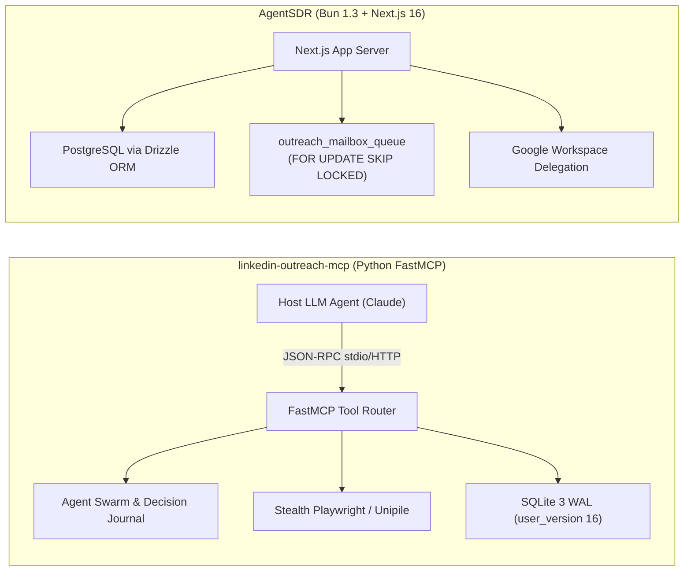
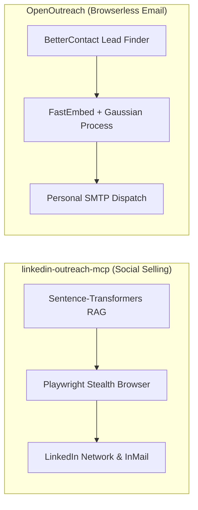
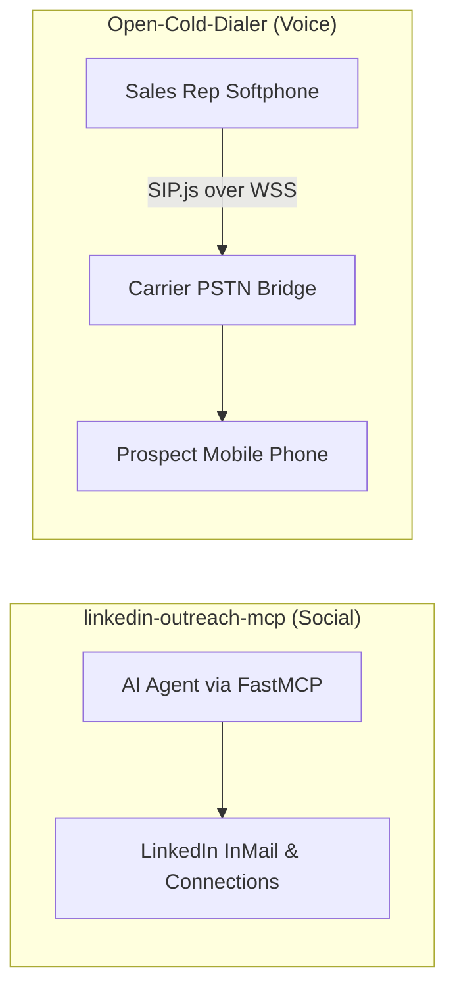
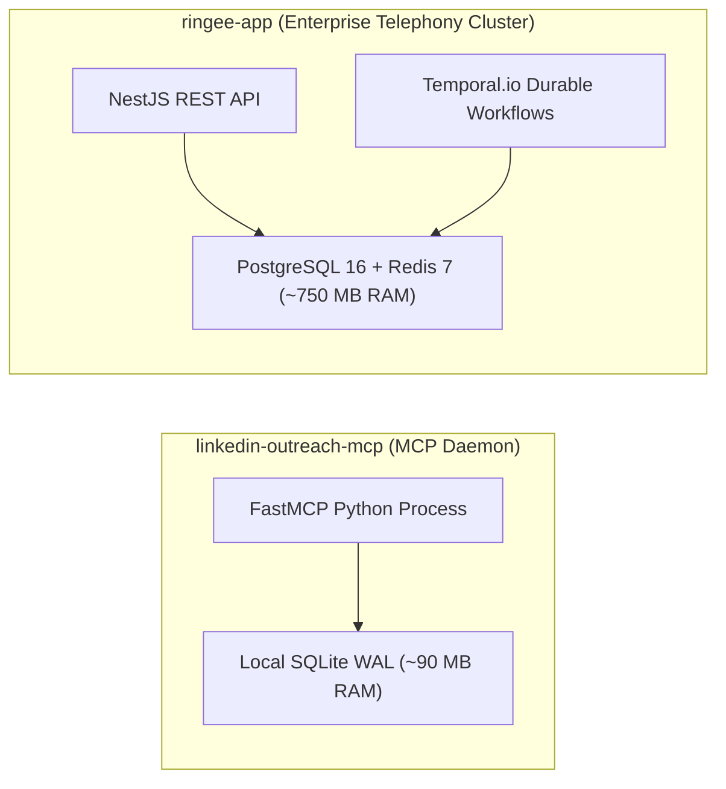

# linkedin-outreach-mcp — Comparative Analysis & Category Evaluation

> **Category**: Cold Outreach & AI SDR  
> **Architectural Role**: Autonomous LinkedIn social selling agent & Model Context Protocol (MCP) tool daemon  
> **Primary Stack**: Python 3.10+, FastMCP SDK 1.30+ | SQLite 3 (WAL, user_version 16) | Playwright / Unipile | Sentence-Transformers RAG | MIT  
> **Peer Solutions Compared**: `AgentSDR`, `OpenOutreach`, `Open-Cold-Dialer`, `ringee-app`  
> **Commercial SaaS Benchmarks**: HeyReach.io, Apollo.io, Clay.com, Taplio, Expandi  

---

## 1. Executive Overview & Technical Identity: linkedin-outreach-mcp

**linkedin-outreach-mcp** (packaged as `heylead`) is an enterprise-grade Model Context Protocol (MCP) server that empowers Large Language Models (Claude Code, Cursor, Gemini, OpenAI) to operate as fully autonomous LinkedIn Sales Development Representatives (SDRs). Rather than presenting a rigid monolithic web UI, HeyLead exposes over 60 high-level, typed MCP tools allowing host AI agents to execute end-to-end social selling: generating buyer personas (ICPs), cloning the user's authentic tone of voice, discovering prospects, executing multi-touch nurture cadences, detecting intent signals, and autonomously negotiating calendar meetings.

### Core Architectural Profile
- **Runtime & Language**: `Python >= 3.10` (tested up to Python 3.13)
- **Protocol Standard**: Model Context Protocol (`mcp>=1.30.0,<2.0.0`) via `stdio` or `streamable-http`
- **Persistence Layer**: Embedded `SQLite 3` with `PRAGMA journal_mode=WAL`, schema versioning (`PRAGMA user_version = 16`), and an auditable agent decision ledger
- **Concurrency & Backoff**: `asyncio` coroutines with 12-stage exponential retry backoff and randomized jitter to prevent SQLite concurrency deadlocks
- **Security & Secret Storage**: OS Keychain / Windows Credential Vault integration via `keyring>=24.0.0` and `cryptography>=50.0.0`
- **Execution & Stealth**: Dual-engine support via `playwright>=1.40.0` / `browser-use` for local stealth automation or `Unipile` cloud API gateway
- **AI & Memory**: Local semantic vector embeddings via `sentence-transformers` and `firecrawl-py` corporate scrapers

---

## 2. Peer Solution Landscape (Cold Outreach & AI SDR)

Within this category, `linkedin-outreach-mcp` operates alongside four specialized peer solutions:

| Solution | Language & Runtime | Core Framework | Database & ORM | Queue & Concurrency Model | Primary Architectural Niche |
| :--- | :--- | :--- | :--- | :--- | :--- |
| **linkedin-outreach-mcp** (Current) | `Python 3.10+` | `FastMCP SDK 1.30+` | `SQLite 3 (WAL, v16)` | `Asyncio Coroutines + Jitter Backoff` | Stealth LinkedIn automation for LLM agent swarms |
| **AgentSDR** | `TypeScript / Bun 1.3` | `Next.js 16, React 19` | `PostgreSQL 15+, Drizzle` | `Postgres FOR UPDATE SKIP LOCKED` | Autonomous multi-channel AI SDR & inbox rotator |
| **OpenOutreach** | `Python 3.11+` | `Django 5.2+ (Headless)` | `SQLite 3 (WAL + IMMEDIATE)` | `Synchronous Bounded Batches` | Active-learning lead discovery & waterfall resolution |
| **Open-Cold-Dialer** | `TypeScript / Node 20+` | `React 18, Vite, Express` | `SQLite / Supabase, Drizzle` | `SIP.js Client Event Loop over WSS` | Carrier-agnostic browser WebRTC power dialer |
| **ringee-app** | `TypeScript / Node 20+` | `NestJS 11, Next.js 14` | `PostgreSQL 16, Prisma` | `Temporal.io Durable Workflows` | Enterprise contact center & power dialer cluster |

---

## 3. Deep Head-to-Head Comparative Breakdown: linkedin-outreach-mcp vs Peers

### 3.1. linkedin-outreach-mcp vs. AgentSDR

**Comparative Focus**: Specialized MCP tool daemon for social selling vs. multi-tenant web application and cold email delivery core.

#### Architectural & Stack Differences
- **Interface & Tool Invocation**: `linkedin-outreach-mcp` does not provide an end-user UI; it is an AI-native daemon exposing 60+ typed MCP tools over Standard I/O (`stdio`) or streaming HTTP (`streamable-http`). The orchestrator is an external AI coding assistant or autonomous agent. `AgentSDR` is a human-facing web application with Next.js App Router, AG Grid spreadsheets, and built-in Kanban pipelines.
- **Social Channel Specialization**: `linkedin-outreach-mcp` focuses deeply on LinkedIn's anti-abuse boundaries: tone-of-voice cloning from published articles, localized business-hour sending (08:00–22:00 in prospect timezone), weekly invitation limits (max 20 invites/day), and intent signal tracking (job transitions, post likes). `AgentSDR` treats LinkedIn as an auxiliary channel bridged via the third-party Unipile SDK, with core focus placed on Google Workspace cold email rotation.
- **Persistence & Secret Management**: `linkedin-outreach-mcp` persists data to an embedded SQLite database (`PRAGMA user_version = 16`) and stores credentials inside encrypted OS keychains via `keyring`. `AgentSDR` runs a multi-tenant PostgreSQL database with Drizzle ORM, storing organization-scoped API secrets in encrypted database fields.
- **Failure Modes & Crash Recovery**: If a LinkedIn selector changes or a checkpoint is triggered, `linkedin-outreach-mcp`'s Coordinator Agent logs the error into `agent_decisions`, marks an emergency hold on the campaign, and notifies the host LLM via typed JSON-RPC errors. In AgentSDR, LinkedIn operations rely entirely on Unipile API availability; if Unipile fails, the task aborts without internal browser retry mechanisms.

#### Architectural Comparison Matrix: linkedin-outreach-mcp vs. AgentSDR

| Dimension | linkedin-outreach-mcp | AgentSDR |
| :--- | :--- | :--- |
| **Primary Interface** | 60+ Model Context Protocol (MCP) Tools | Next.js 16 Web Dashboard, AG Grid & REST APIs |
| **Process Topology** | Lightweight Python MCP Daemon | In-process Web Server & Bun cron scheduler |
| **Social Engineering** | Native Playwright stealth automation + Unipile | External Unipile API Gateway integration |
| **Anti-Detection Mechanics** | Tone cloning, human jitter, business hours | Externalized to Unipile cloud servers |
| **Agent Swarm Logic** | 4 in-process sub-agents with decision ledger | Monolithic LLM sentiment classifier prompt |
| **Secret Storage** | Native OS Keychain (`keyring`) | PostgreSQL database-level encryption |
| **Primary Failure Mode** | LinkedIn account challenge or DOM drift | Google Workspace API quota exhaustion |
| **Recovery Strategy** | Emergency campaign hold & auditable journal | Database transaction rollback on tick failure |

---

### 3.2. linkedin-outreach-mcp vs. OpenOutreach

**Comparative Focus**: Social selling MCP daemon vs. browserless active-learning email discovery CLI.

#### Architectural & Stack Differences
- **Channel Execution Philosophy**: `OpenOutreach` is 100% browserless. It resolves leads through licensed B2B data providers (BetterContact) and delivers cold emails via standard personal SMTP, eliminating web scraping risks. `linkedin-outreach-mcp` directly automates the LinkedIn browser DOM using Playwright, simulating user mouse movements, typing delays, and page scrolls.
- **Protocol & Interaction Model**: `OpenOutreach` is executed via CLI verbs (`openoutreach find`, `openoutreach send`) and standard Unix pipes. `linkedin-outreach-mcp` is an active server maintaining stateful JSON-RPC connections with LLM hosts.
- **Concurrency & Database Locking**: Both solutions utilize SQLite with Write-Ahead Logging (WAL). However, `OpenOutreach` uses Django's `IMMEDIATE` transaction mode for synchronous batch writes, while `linkedin-outreach-mcp` implements a 12-stage exponential backoff with randomized jitter to handle rapid concurrent tool requests from multi-agent swarms.
- **Calendar & Meeting Conversion**: `linkedin-outreach-mcp` includes native Google Calendar integration (`book_meeting.py`), autonomously negotiating available time slots and scheduling invites when positive intent is classified. `OpenOutreach` injects static booking links (Cal.com / Calendly) into outbound email copy.

#### Architectural Comparison Matrix: linkedin-outreach-mcp vs. OpenOutreach

| Dimension | linkedin-outreach-mcp | OpenOutreach |
| :--- | :--- | :--- |
| **Primary Outbound Channel** | LinkedIn Connection Requests & InMail | Verified B2B Cold Email (Personal SMTP) |
| **Platform Risk** | Moderate (Subject to LinkedIn anti-bot rules) | Zero (Browserless via licensed B2B endpoints) |
| **Client Interface** | Model Context Protocol (`stdio` / HTTP) | Zero-daemon CLI commands (`uv tool`) |
| **Search & Discovery** | Semantic RAG persona search & engagement tracking | FastEmbed + Gaussian Process active-learning walks |
| **Calendar Automation** | Native Google Calendar slot booking API | Plaintext booking URL injection in copy |
| **Database Concurrency** | 12-stage exponential jitter backoff | Django `IMMEDIATE` transaction locking |
| **Tone Adaptation** | LLM historical post analysis & voice cloning | Product documentation markdown injection |
| **Primary Bottleneck** | Weekly LinkedIn invitation quotas (100/week) | Personal mailbox daily send caps (30–50/day) |

---

### 3.3. linkedin-outreach-mcp vs. Open-Cold-Dialer

**Comparative Focus**: Asynchronous social outreach MCP tool vs. real-time browser WebRTC telephony power dialer.

#### Architectural & Stack Differences
- **Domain Specialization**: `linkedin-outreach-mcp` automates text-based social prospecting where touches occur over hours or days with randomized human delays. `Open-Cold-Dialer` manages real-time, synchronous telecommunications where calls occur in seconds over WebRTC audio channels.
- **Protocol & Network Transport**: `linkedin-outreach-mcp` communicates over HTTP/JSON-RPC (MCP) and HTTPS (Playwright/Unipile). `Open-Cold-Dialer` operates SIP over secure WebSockets (`wss://`) and negotiates DTLS-SRTP RTP audio streams directly between the browser and VoIP carrier proxies (SignalWire, Telnyx, Twilio, Asterisk).
- **Persistence & State**: `linkedin-outreach-mcp` stores rich conversational histories, prompt logs, and decision rationale in SQLite WAL. `Open-Cold-Dialer` stores structured call logs, objection battle cards, and DNC lists using Drizzle ORM over `better-sqlite3` or Supabase.

#### Architectural Comparison Matrix: linkedin-outreach-mcp vs. Open-Cold-Dialer

| Dimension | linkedin-outreach-mcp | Open-Cold-Dialer |
| :--- | :--- | :--- |
| **Outbound Vector** | LinkedIn Messaging, Connections, InMail | Direct Voice Calling (PSTN / Mobile) |
| **Execution Plane** | Autonomous AI agent via Model Context Protocol | Human SDR softphone interface |
| **Network Protocols** | MCP (JSON-RPC), HTTPS, Playwright CDP | SIP over WSS, WebRTC DTLS-SRTP, RTP |
| **Runtime Engine** | Python 3.10+ (FastMCP daemon) | Node 20+ (Express) + React 18 / Vite |
| **Call / Touch Guidance**| Tone-of-voice synthesizer & prompt playbooks | Dynamic objection-handling battle cards |
| **Persistence Layer** | SQLite WAL (v16 schema) + OS Keychain | SQLite (`better-sqlite3`) / Supabase via Drizzle |
| **Primary Failure Mode** | LinkedIn account challenge or session expiry | WebRTC ICE connection failure / NAT blockage |

---

### 3.4. linkedin-outreach-mcp vs. ringee-app

**Comparative Focus**: Single-user social selling MCP daemon vs. distributed multi-tenant enterprise contact center platform.

#### Architectural & Stack Differences
- **System Architecture & Scale**: `linkedin-outreach-mcp` is an in-process tool daemon designed to run locally alongside an AI assistant or on a small VPS (~90 MB RAM). `ringee-app` is a distributed, multi-tenant enterprise contact center platform backed by NestJS, Next.js, PostgreSQL 16, Redis 7, and Temporal.io (~750 MB+ RAM).
- **Workflow Orchestration**: `linkedin-outreach-mcp` coordinates multi-agent interactions via an internal swarm (Coordinator, Reply Agent, Closer) backed by a decision ledger table in SQLite. `ringee-app` orchestrates campaigns using **Temporal.io** (`@temporalio/workflow`), executing durable workflows that survive node failures and power dial thousands of phone leads concurrently.
- **Channel Scope**: `linkedin-outreach-mcp` is laser-focused on LinkedIn social selling. `ringee-app` is built for telecom voice: area-code matched caller ID pools, carrier-side dual-channel call recording, automatic speech-to-text segmentation, and bi-directional CRM sync (HubSpot, Attio).

#### Architectural Comparison Matrix: linkedin-outreach-mcp vs. ringee-app

| Dimension | linkedin-outreach-mcp | ringee-app |
| :--- | :--- | :--- |
| **Architecture Topology** | Single-node MCP daemon | Distributed microservice cluster |
| **Target Channel** | LinkedIn Network & InMail | Inbound/Outbound Telephony & WebRTC |
| **Orchestration Model** | In-process agent swarm & decision ledger | Temporal.io event-sourced durable workflows |
| **Database & ORM** | SQLite 3 (WAL, user_version 16) | PostgreSQL 16 via Prisma ORM 6.16 |
| **State Caching** | Local memory + SQLite exponential backoff | Redis 7.x (presence, distributed lockouts) |
| **Telephony Support** | None | Full Telnyx Call Control V2 & WebRTC core |
| **Deployment Footprint** | Minimal (~90 MB RAM) | High (~750 MB RAM across containers) |

---

## 4. Capability & Feature Comparison Matrix

| Dimension / Capability | linkedin-outreach-mcp | AgentSDR | OpenOutreach | Open-Cold-Dialer | ringee-app |
| :--- | :---: | :---: | :---: | :---: | :---: |
| **Model Context Protocol (MCP)** | ✅ 60+ Typed Tools | ❌ | ⚠️ Skill only | ❌ | ❌ |
| **Tone-of-Voice Cloning** | ✅ Historic Post Analysis | ❌ | ❌ | ❌ | ❌ |
| **LinkedIn Automation (Stealth)** | ✅ Playwright + Human Jitter| ⚠️ Unipile API Gateway | ❌ (Zero ToS surface) | ❌ | ❌ |
| **Intent Signal Monitoring** | ✅ Job changes & post likes| ❌ | ❌ | ❌ | ❌ |
| **Autonomous Calendar Booking**| ✅ Google Calendar API | ⚠️ Webhook hookup | ⚠️ Plaintext link | ❌ | ❌ |
| **Auditable Decision Journal** | ✅ `agent_decisions` Table | ❌ | ⚠️ CSV reasons | ❌ | ⚠️ Post-call notes |
| **Cold Email Cadences** | ❌ | ✅ Full Multi-Inbox | ✅ Deterministic | ❌ | ❌ |
| **WebRTC Voice Calling** | ❌ | ✅ Built-in Softphone | ❌ | ✅ SIP.js WebRTC | ✅ Headless Core |
| **Local Presence Caller ID** | ❌ | ❌ | ❌ | ❌ | ✅ Area Code Pools |
| **Memory Footprint (Baseline)** | **~90 MB RAM** | ~250 MB RAM | ~60 MB RAM | ~120 MB RAM | ~750 MB RAM |

---

## 5. Commercial Benchmark Positioning

When benchmarked against commercial social selling platforms (**HeyReach.io, Taplio, Expandi, Lemlist**):
- **Against HeyReach.io**: HeyReach leads the market in multi-account LinkedIn sending clusters. `linkedin-outreach-mcp` provides the underlying stealth automation primitives as an open MCP server; when paired with proxy rotation, it replicates HeyReach's capabilities with complete data privacy and zero software subscription fees.
- **Against Taplio**: Taplio provides AI-generated LinkedIn posts and simple outreach. HeyLead goes significantly further by analyzing historical content to distill mathematical tone-of-voice signatures and automating bidirectional direct messaging and meeting scheduling.
- **Against Expandi**: Expandi requires hosted cloud infrastructure and third-party credential handoff. `linkedin-outreach-mcp` runs locally on the operator's machine or private server, keeping LinkedIn session cookies and passwords encrypted inside the local OS Keychain (`keyring`).

---

## 6. Strategic Takeaways & Role for MarketingStudio

In MarketingStudio's outbound architecture:
1. **Primary Component to Adopt**: Deploy `linkedin-outreach-mcp` as MarketingStudio's **standardized social selling interface**, allowing host AI coding agents and autonomous orchestrators to execute LinkedIn prospecting via typed Model Context Protocol tool calls.
2. **Incorporate Tone-of-Voice Synthesis**: Port HeyLead's voice signature extractor (`src/heylead/ai/`) into MarketingStudio to guarantee that all outbound copy (email, LinkedIn, SMS) mirrors the founder's authentic writing cadence.
3. **Synergistic Integration**:
   - Combine with `OpenOutreach` to cross-reference discovered company domains with target executive LinkedIn profiles.
   - Forward positive meeting intents into `AgentSDR` or MarketingStudio CRM pipelines to track deal stage progression automatically.
