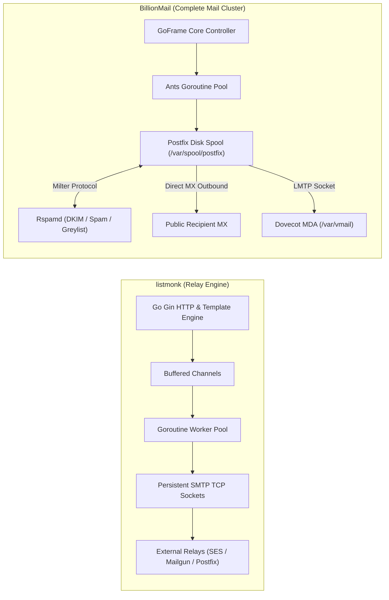
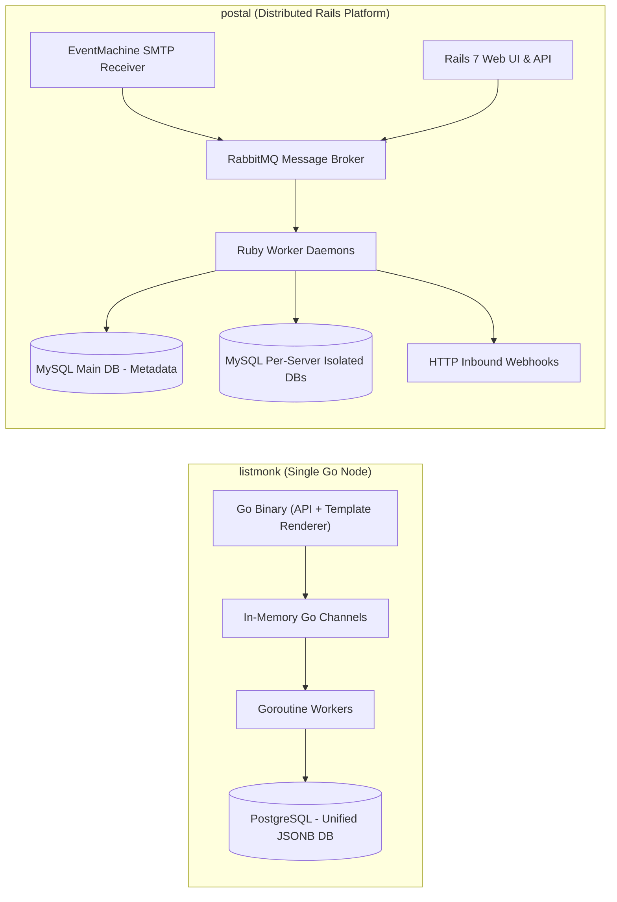
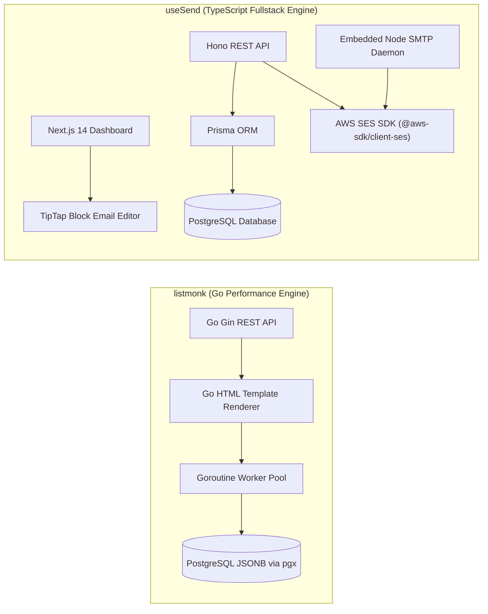
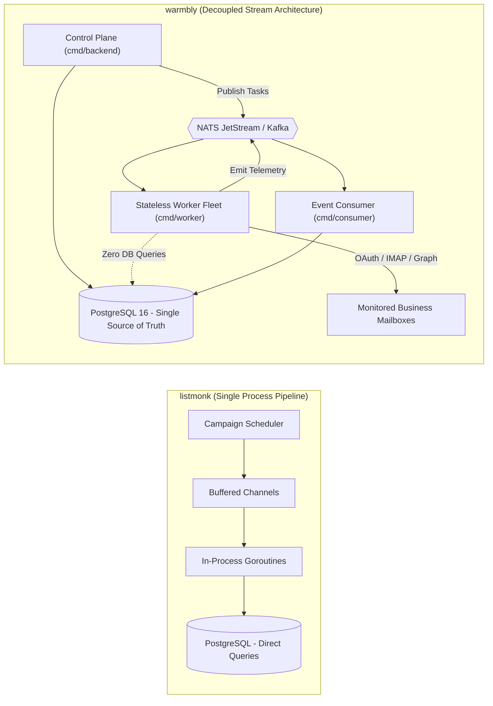
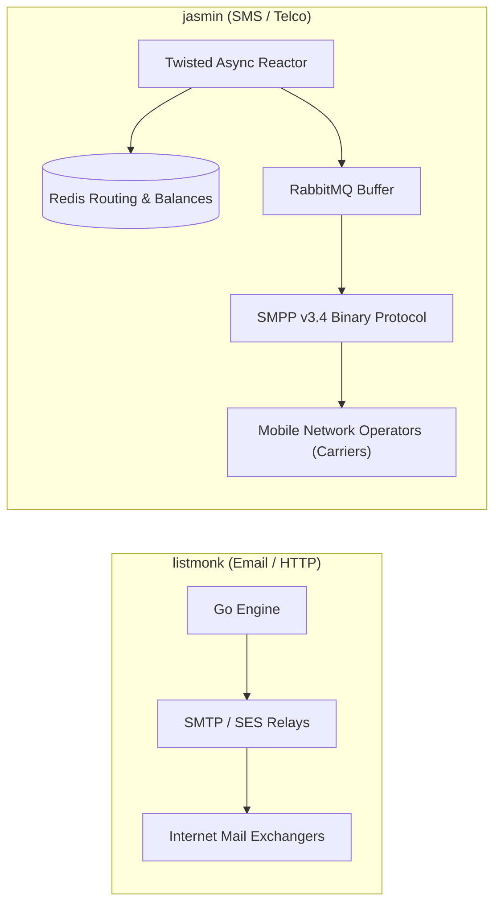

# listmonk — Comparative Analysis & Category Evaluation

> **Category**: Email Infrastructure & Delivery  
> **Architectural Role**: High-throughput newsletter & mass transactional dispatch engine  
> **Primary Stack**: Go 1.21+ | Gin / Native Go | PostgreSQL 13+ (JSONB) | Goroutine Worker Pool + Persistent TCP Socket Pools  
> **Peer Solutions Compared**: `BillionMail`, `postal`, `useSend`, `warmbly`, `jasmin`  
> **Commercial SaaS Benchmarks**: SendGrid, Postmark, Amazon SES, Mailchimp, Brevo  

---

## 1. Executive Overview & Technical Identity: listmonk

**listmonk** represents the benchmark for raw sending throughput and computational efficiency within the **Email Infrastructure & Delivery** domain. Designed as a self-contained Go monolith, it dispenses with bloated application runtimes, third-party broker dependencies, and heavy ORM abstractions. Instead, listmonk pairs PostgreSQL's native `JSONB` capabilities with an in-process goroutine worker pool, achieving sustained dispatch rates of 1,500 to 3,500+ messages per second while consuming less than 50MB of RAM under peak load.

### Core Architectural Profile
- **Runtime & Language**: `Go 1.21+` (statically linked binary, zero external runtime dependencies)
- **Core Framework**: `Gin / Native Go HTTP` with high-performance routing and embedded static Vue 3 admin SPA
- **Persistence Layer**: `PostgreSQL 13+` utilizing native `JSONB`, GIN indexing, and `pgx` connection pooling
- **Concurrency & Queue Model**: In-process buffered Go channels, token-bucket rate limiting, and persistent TCP connection pools
- **Domain Specialization**: High-throughput opt-in list management, newsletter campaigns, and transactional email relay

---

## 2. Peer Solution Landscape (Email Infrastructure & Delivery)

Within this category, `listmonk` operates alongside the following peer solutions:

| Solution | Language & Runtime | Core Framework | Database / Cache | Queue / Concurrency | Primary Architectural Niche |
| :--- | :--- | :--- | :--- | :--- | :--- |
| **listmonk** (Current) | `Go 1.21+` | `Gin / Native Go` | `PostgreSQL 13+ (JSONB)` | `Goroutine Pool + TCP Sockets` | **Raw bulk throughput on minimal RAM** |
| **BillionMail** | `Go 1.24 / Docker` | `GoFrame v2, Postfix, Dovecot` | `PostgreSQL 17.4, Redis 7.4` | `Postfix Spool + Ants Pool` | Turnkey ISP-grade mail cluster & IP warmup |
| **postal** | `Ruby 3.2+` | `Rails 7, EventMachine` | `MariaDB / MySQL, RabbitMQ` | `RabbitMQ Queues + Ruby Workers` | Virtualized multi-tenant MTA & inbound webhooks |
| **useSend** | `TypeScript / Node` | `Next.js 14, Hono` | `PostgreSQL (Prisma ORM)` | `SES SDK Async + Node SMTP` | Modern developer experience & visual block canvas |
| **warmbly** | `Go 1.26` | `Gin, pgx/v5, go-redis` | `PostgreSQL 16+, Redis 7+` | `NATS JetStream + Stateless Fleet` | Agentic cold email, peer warmup & unibox |
| **jasmin** | `Python 3.9+` | `Twisted Async` | `Redis, RabbitMQ` | `Twisted Deferreds + AMQP` | Carrier-grade SMS gateway & SMPP v3.4 router |

---

## 3. Deep Head-to-Head Comparative Breakdown: listmonk vs Peers

### 3.1. listmonk vs. BillionMail

**Comparative Focus**: `In-Process Lightweight Relay Engine` vs. `Full Turnkey Linux Mail Transfer Cluster`

#### Detailed Architectural Contrast
- **Delivery Pipeline Topology**: `listmonk` is strictly an outbound mail client and campaign manager; it contains no inbound MX listener, no local mailbox storage, and no spam filter. It delegates final SMTP delivery to external relays over pooled TCP sockets. In contrast, `BillionMail` is an ISP-grade autonomous mail server orchestrating Postfix (MTA), Dovecot (IMAP/POP3), and Rspamd (milter inspection) via Docker bridge networking and Unix sockets, terminating MX records directly.
- **Queue Mechanics & Concurrency**: `listmonk` streams campaign subscriber IDs from PostgreSQL in batches (`LIMIT 5000`), pushing them into buffered in-memory Go channels consumed by a configurable pool of goroutines. `BillionMail` uses `panjf2000/ants/v2` goroutine pools inside its Go core (`core-manage`), but delegates message delivery state to Postfix's three-tier disk spool (`incoming`, `active`, `deferred`).
- **Database Modeling & Schema**: `listmonk` relies on PostgreSQL with a rich `JSONB` column on the `subscribers` table, allowing dynamic subscriber attributes without schema migrations and query segmentation via PostgreSQL GIN indexes and SQL CTEs. `BillionMail` utilizes PostgreSQL 17.4 with strict relational tables (`bm_domain`, `bm_mailbox`, `bm_sender_ip_mail_provider`), which Postfix and Dovecot query dynamically via `.cf` SQL lookup maps.
- **Warmup & Deliverability**: `listmonk` requires external deliverability management and pre-warmed IPs. `BillionMail` embeds an automated daily ramp algorithm (`WarmupDailyUpstairs` with 30% daily step-ups), provider-specific destination throttling, and dual-selector RSA DKIM key management.

#### Architectural Tradeoffs Matrix: listmonk vs. BillionMail

| Dimension | listmonk | BillionMail | Architectural Implication |
| :--- | :--- | :--- | :--- |
| **Throughput** | **1,500–3,500 msgs/sec** | **500–1,200 msgs/sec** | listmonk avoids disk spooling and milter parsing overhead; BillionMail is bounded by disk I/O and synchronous spam scoring. |
| **Fault Tolerance** | **Moderate** (In-memory buffer) | **Extreme** (Postfix disk spool) | A sudden server crash drops uncommitted in-memory listmonk chunks; Postfix guarantees zero message loss across reboots. |
| **Operational Overhead** | **Very Low** (Single binary + DB) | **Substantial** (6+ Docker containers) | listmonk requires zero sysadmin maintenance; BillionMail requires monitoring Postfix queues, Dovecot LMTP sockets, and Rspamd. |
| **System Scope** | **Relay & Campaign Manager** | **Full Self-Hosted Mail Server** | listmonk cannot receive inbound emails or host user inboxes; BillionMail replaces third-party email providers completely. |

---

### 3.2. listmonk vs. postal

**Comparative Focus**: `Single-Binary Go Dispatcher` vs. `Distributed Multi-Tenant Rails/RabbitMQ MTA`

#### Detailed Architectural Contrast
- **Delivery Pipeline Topology**: `listmonk` executes end-to-end within a single Go process, reading contacts, rendering templates, and issuing SMTP commands. `postal` is a distributed multi-tier mail platform modeled after SendGrid: incoming and outgoing emails are ingested via Rails REST APIs or an EventMachine SMTP listener, serialized, and placed onto a persistent RabbitMQ message bus where decoupled Ruby workers execute DNS MX resolution and SMTP dispatch.
- **Queue Mechanics & Concurrency**: `listmonk` achieves peak concurrency with minimal latency via lightweight Go goroutines and channel synchronization. `postal` relies on RabbitMQ queues, providing durable buffering, message deduplication, and worker distribution across multiple physical servers, though with higher serialization and process context-switching overhead.
- **Data Isolation & Multi-Tenancy**: `listmonk` is primarily single-tenant with logical list separation. `postal` provides true multi-tenant virtualization: organizations can create independent "Mail Servers", each backed by its own isolated MySQL message database (`schema_template.sql`), separate IP pool assignments, and private API credentials.
- **Inbound Webhook Routing**: `listmonk` only processes inbound bounce and unsubscribe webhooks from upstream providers. `postal` acts as an inbound MX gateway, receiving incoming emails, extracting attachments, parsing MIME parts, and streaming structured JSON payloads to user HTTP webhook endpoints.

#### Architectural Tradeoffs Matrix: listmonk vs. postal

| Dimension | listmonk | postal | Architectural Implication |
| :--- | :--- | :--- | :--- |
| **Throughput** | **1,500–3,500 msgs/sec** | **400–800 msgs/sec** | listmonk's native Go concurrency vastly outperforms Ruby EventMachine and RabbitMQ serialization latency. |
| **Fault Tolerance** | **Moderate** (Application-level cursors) | **Very High** (RabbitMQ persistence) | Postal queues survive worker crashes and process kills without message corruption; listmonk restarts from DB offsets. |
| **Operational Overhead** | **Minimal** (Single binary + Postgres) | **High** (Rails, RabbitMQ, MySQL) | Postal requires running Ruby worker pools, RabbitMQ cluster maintenance, and managing dynamic MySQL schemas. |
| **Multi-Tenancy** | **Logical Tags & Lists** | **Hard Virtual Mail Server Isolation** | Postal allows provisioning virtual mail servers with dedicated IP pools and webhook destinations; listmonk is single-tenant. |

---

### 3.3. listmonk vs. useSend

**Comparative Focus**: `High-Volume Go Campaign Engine` vs. `Developer-First TypeScript/Hono & SES Platform`

#### Detailed Architectural Contrast
- **Delivery Pipeline Topology**: `listmonk` is optimized for batch-oriented marketing distributions, rendering millions of recipient templates server-side with compiled Go text templates. `useSend` is architected as an agile transactional platform inspired by Resend: developer applications trigger transactional emails via a lightweight Hono API, which validates payloads against Prisma ORM and executes direct calls to Amazon SES via `@aws-sdk/client-ses`.
- **Composition & Template UX**: `listmonk` provides code-oriented HTML and Markdown editing with Go template variables (`{{ .Subscriber.Attribs.first_name }}`). `useSend` integrates `@usesend/email-editor`, a drag-and-drop canvas built on TipTap and Radix UI, allowing non-technical marketers to assemble block-based responsive emails without raw HTML coding.
- **Data Modeling & Schema**: `listmonk` uses raw SQL queries with `pgx` and `sqlx` against a PostgreSQL schema optimized for fast scans and JSONB filtering. `useSend` manages schema definitions via Prisma ORM (`apps/web/prisma/schema.prisma`), generating strongly typed TypeScript entities (`Domain`, `Email`, `ApiKey`, `Team`) with complete compile-time type safety.
- **Sending Throughput**: `listmonk`'s raw sending throughput exceeds `useSend` by an order of magnitude; `useSend`'s velocity is throttled by HTTP API round-trips to AWS SES and Prisma query compilation overhead.

#### Architectural Tradeoffs Matrix: listmonk vs. useSend

| Dimension | listmonk | useSend | Architectural Implication |
| :--- | :--- | :--- | :--- |
| **Throughput** | **1,500–3,500 msgs/sec** | **300–600 msgs/sec** | listmonk streams persistent TCP sessions; useSend is constrained by AWS SES REST latency and Node.js event loops. |
| **Developer Experience** | **Pragmatic REST / Swagger** | **Exceptional TypeScript Monorepo** | useSend provides end-to-end type safety, modern SDKs, and clean Turborepo modularity; listmonk is traditional Go/Vue. |
| **Template Authoring** | **Raw HTML / Markdown** | **Visual Drag-and-Drop Canvas** | useSend includes a modern block editor; listmonk requires pre-compiled HTML templates. |
| **Memory Footprint** | **<50 MB** | **~250 MB** | listmonk's compiled Go binary is drastically lighter than Next.js App Router and Node.js runtime instances. |

---

### 3.4. listmonk vs. warmbly

**Comparative Focus**: `Opt-in Bulk Newsletter Dispatcher` vs. `Decoupled Agentic Cold Outreach & Peer Warmup Platform`

#### Detailed Architectural Contrast
- **System Architecture & Data Access**: `listmonk`'s workers query PostgreSQL directly within the monolithic application process. `warmbly` strictly enforces a control-plane and execution-plane separation: the backend schedules warmup tasks and cadence steps, publishing execution envelopes to a distributed message bus (**NATS JetStream** or Apache Kafka). A fleet of stateless Go workers pulls tasks, performs IMAP/SMTP/OAuth operations, and emits events back to NATS. **Warmbly workers never connect to PostgreSQL**, eliminating DB connection pool starvation.
- **Domain Specialization**: `listmonk` is engineered for opt-in bulk distribution (sending millions of marketing emails to consenting subscribers as fast as possible). `warmbly` is engineered for cold outbound deliverability (pacing sends to 20–50 emails/day per mailbox, rotating multi-inbox pools across Google Workspace and Microsoft 365, and executing peer-to-peer warmup exchanges with automated spam rescues).
- **Agentic & AI Capabilities**: `listmonk` contains no AI or agentic abstractions. `warmbly` embeds an official **Model Context Protocol (MCP)** server and an agent framework (`ai_inbox_agent.go`), allowing LLMs to inspect prospect replies in the unified inbox (`unibox`), classify sentiment, and draft context-aware follow-ups.
- **Concurrency Strategy**: `listmonk` maximizes throughput via goroutine worker pools. `warmbly` uses Redis 7+ distributed locks (`redsync`) and sliding-window rate limiters to enforce human-like delays (jitter, randomized reading intervals, and time-of-day sending windows).

#### Architectural Tradeoffs Matrix: listmonk vs. warmbly

| Dimension | listmonk | warmbly | Architectural Implication |
| :--- | :--- | :--- | :--- |
| **Throughput & Pacing** | **Maximum Velocity** (Thousands/sec) | **Humanized Pacing** (Tens/day per account) | listmonk aims to flush marketing queues instantly; warmbly deliberately throttles sends to protect sender reputation. |
| **Database Scalability** | **Connection Bound** (pgx pool) | **Infinite Worker Scale** (Stateless NATS) | warmbly workers never touch PostgreSQL, preventing connection limits from capping worker fleet expansion. |
| **Deliverability Logic** | **Basic Bounce Categorization** | **Autonomous Peer Warmup & Spam Rescue** | warmbly actively trains ISP algorithms (moving emails from spam to inbox); listmonk relies on pre-warmed IPs. |
| **AI / MCP Integration** | **None** | **Native Model Context Protocol Server** | warmbly can be orchestrated directly by AI agents (Claude, Cursor); listmonk is strictly human-operated. |

---

### 3.5. listmonk vs. jasmin

**Comparative Focus**: `Application-Layer Email Dispatcher` vs. `Carrier-Grade SMS / SMPP v3.4 Gateway`

#### Detailed Architectural Contrast
- **Protocol & Network Tier**: `listmonk` operates at the application layer over ASCII-based SMTP and REST HTTP protocols, routing marketing emails across the public internet. `jasmin` operates at the telecommunications layer, implementing the binary **SMPP v3.4** (Short Message Peer-to-Peer) protocol to communicate directly with cellular Mobile Network Operators (MNOs) and SMS aggregators.
- **Concurrency & Runtime**: `listmonk` utilizes Go's preemptive multi-threaded goroutine scheduler. `jasmin` is built on Python's event-driven **Twisted** asynchronous reactor, using Twisted Deferreds and non-blocking I/O to manage hundreds of concurrent SMPP carrier binds.
- **State & Routing Infrastructure**: `listmonk` persists state to PostgreSQL. `jasmin` relies on an in-memory Redis core to execute Least-Cost Routing (LCR), evaluate real-time user credit balances, enforce rate-limiting token buckets, and buffer unacknowledged messages across RabbitMQ queues during carrier link disruptions.

#### Architectural Tradeoffs Matrix: listmonk vs. jasmin

| Dimension | listmonk | jasmin | Architectural Implication |
| :--- | :--- | :--- | :--- |
| **Primary Medium** | **Email (HTML, MIME, Attachments)** | **SMS (160-char text, UCS2, binary SMPP PDUs)** | Solves fundamentally different communication layers (Email vs Cellular Carrier SMS). |
| **Throughput & Latency**| **1,500–3,500 msgs/sec** | **1,000–2,500 SMS/sec** (Sub-second telco routing) | Both achieve extreme throughput, but Jasmin must handle binary ACK/DLR protocol receipts. |
| **Routing Intelligence** | **Static Relay Assignment** | **Least-Cost Routing (LCR) & Interconnect Rules** | Jasmin dynamically routes SMS to the cheapest carrier gateway based on mobile country codes (MCC/MNC). |
| **Operational Stack** | **Go + PostgreSQL** | **Python Twisted + Redis + RabbitMQ** | Jasmin requires telco engineering expertise and specialized SMPP server configuration. |

---

## 4. Capability & Feature Comparison Matrix

| Dimension / Capability | listmonk | BillionMail | postal | useSend | warmbly | jasmin |
| :--- | :---: | :---: | :---: | :---: | :---: | :---: |
| **Primary Architectural Niche** | **Raw bulk throughput on minimal RAM** | Turnkey ISP-grade mail cluster & IP warmup | Virtualized multi-tenant MTA & inbound webhooks | Modern developer experience & visual block canvas | Agentic cold email, peer warmup & unibox | Carrier-grade SMS gateway & SMPP v3.4 router |
| **Runtime Language** | `Go 1.21+` | `Go 1.24 / Docker` | `Ruby 3.2+` | `TypeScript / Node` | `Go 1.26` | `Python 3.9+` |
| **Database Persistence** | `PostgreSQL (JSONB)` | `PostgreSQL 17.4, Redis` | `MariaDB / MySQL` | `PostgreSQL (Prisma)` | `PostgreSQL 16, Redis` | `Redis, RabbitMQ` |
| **Async Execution Model** | `Goroutine Pool + TCP Sockets` | `Postfix Spool + Ants Pool` | `RabbitMQ + Ruby Workers` | `SES SDK Async + Node SMTP`| `NATS JetStream + Stateless Fleet` | `Twisted Deferreds + AMQP` |
| **Public MX Receiver (Inbound)**| ❌ Relay only | ✅ Postfix + Dovecot | ✅ EventMachine SMTP | ❌ Relay only | ❌ Client polling only | ✅ Carrier SMS Gateway |
| **Visual Drag-and-Drop Editor**| ❌ HTML / Markdown | ❌ | ❌ | ✅ TipTap Canvas | ❌ | ❌ |
| **Automated Peer Warmup** | ❌ | ⚠️ Rate ramp only | ❌ | ❌ | ✅ Peer Network + Spam Rescue| ❌ |
| **Inbound Webhook Streaming** | ⚠️ Bounces/Unsub only | ❌ | ✅ Full JSON Inbound | ⚠️ SES events only | ⚠️ Unibox sync only | ✅ DLR receipts |
| **Native AI / MCP Support** | ❌ | ❌ | ❌ | ❌ | ✅ First-Party MCP Server | ❌ |
| **Peak Throughput** | **1,500–3,500+ msgs/sec** | **500–1,200 msgs/sec** | **400–800 msgs/sec** | **300–600 msgs/sec** | **20–100/day per box** | **1,000–2,500 SMS/sec** |
| **Resource Footprint (RAM)** | **<50 MB** | **~1.5 GB** | **~1.2 GB** | **~250 MB** | **~80 MB** | **~300 MB** |

---

## 5. Commercial Benchmark Positioning

When benchmarked against commercial SaaS leaders (**SendGrid, Postmark, Amazon SES, Mailchimp, Brevo**):
- **Raw Cost Efficiency**: `listmonk` eliminates the exponential pricing tiers of Mailchimp and SendGrid. Sending 10 million marketing emails costs only the raw compute VPS (\$10/mo) plus raw upstream bandwidth (e.g. Amazon SES at \$0.10 per 1,000 emails, or \$0 with self-hosted relays).
- **Data Sovereignty & Privacy**: Subscriber lists, dynamic JSONB segmentation attributes, and open/click tracking records reside entirely in a private PostgreSQL database, ensuring GDPR/CCPA compliance without third-party vendor lock-in.
- **Operational Simplicity**: Unlike complex distributed systems, listmonk ships as a single statically compiled Go binary with an embedded Vue 3 frontend, requiring no redis brokers, node daemons, or background cron managers.

---

## 6. Strategic Takeaways & Role for MarketingStudio

In the unified **MarketingStudio** architecture:
1. **Primary Component to Adopt**: Adopt listmonk's core Go dispatch architecture and PostgreSQL JSONB subscriber model for high-throughput marketing newsletters and mass announcement broadcasts.
2. **Interoperability Seam**: Expose high-speed internal gRPC / REST APIs connecting MarketingStudio's workflow automation engine to listmonk's campaign dispatch queues.
3. **Peer Coexistence**:
   - Pair `listmonk` with `useSend`'s visual block canvas for email authoring.
   - Route transactional events through `postal` for dedicated virtual server isolation and inbound webhook processing.
   - Utilize `warmbly` to pre-warm new outbound mailboxes before assigning them to cold sequences.
   - Deploy `BillionMail` where complete on-premise mail server independence (zero third-party relay dependency) is required.
