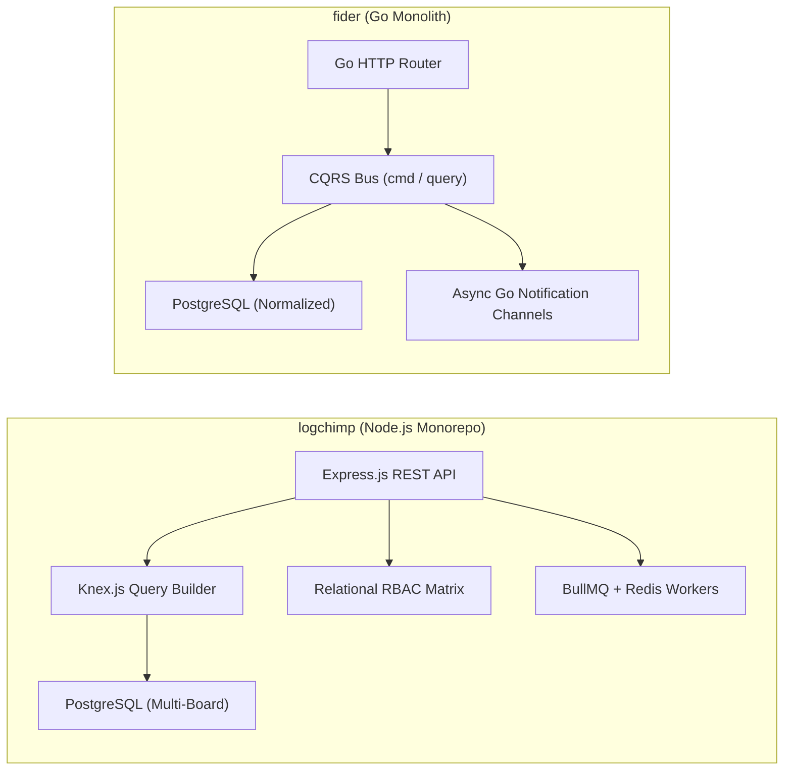
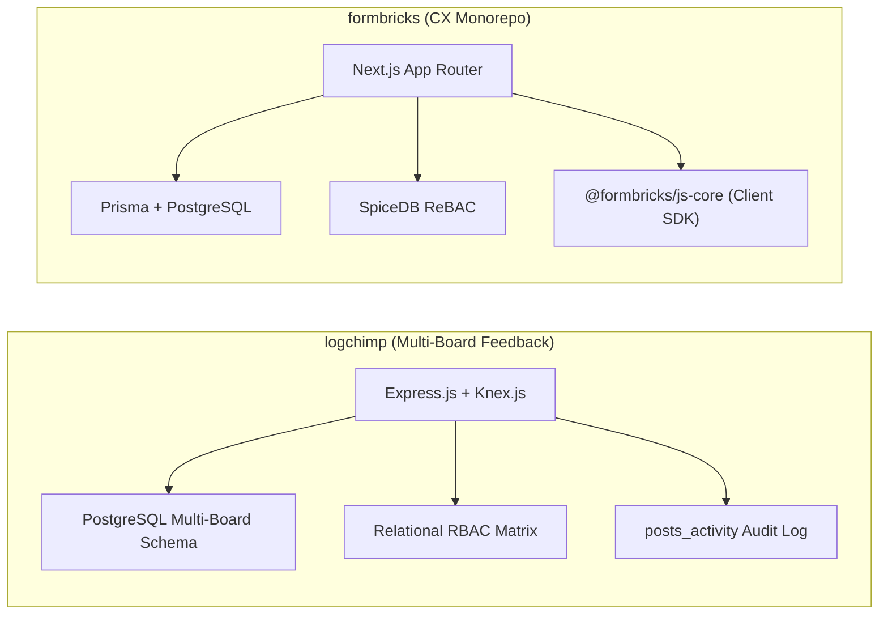
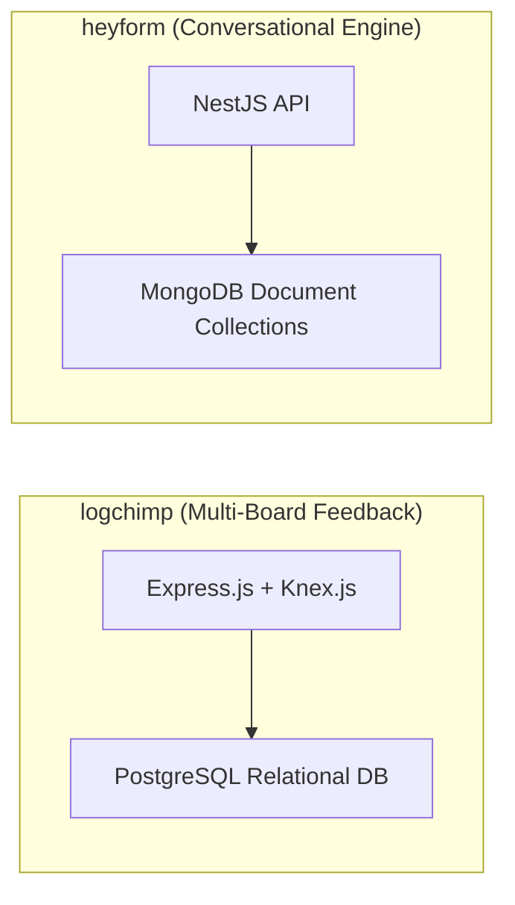
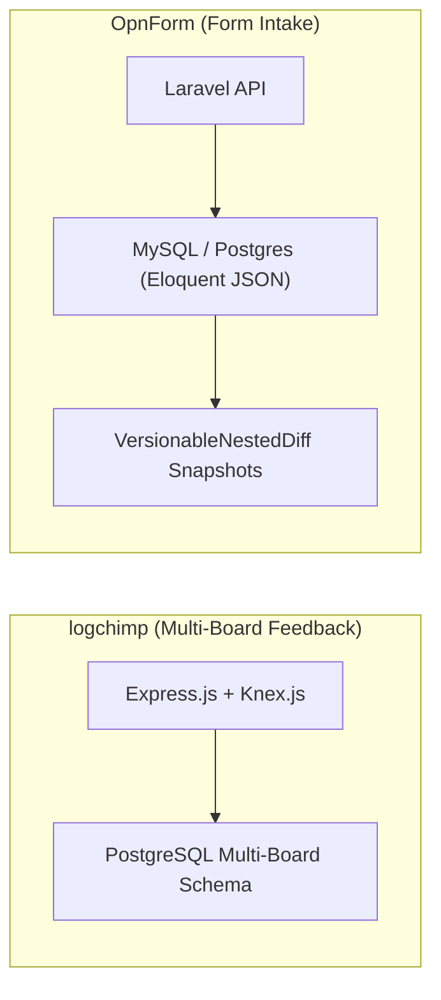
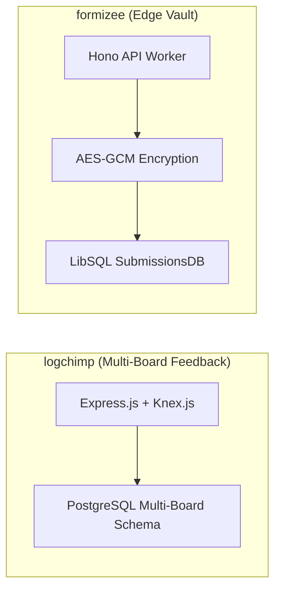
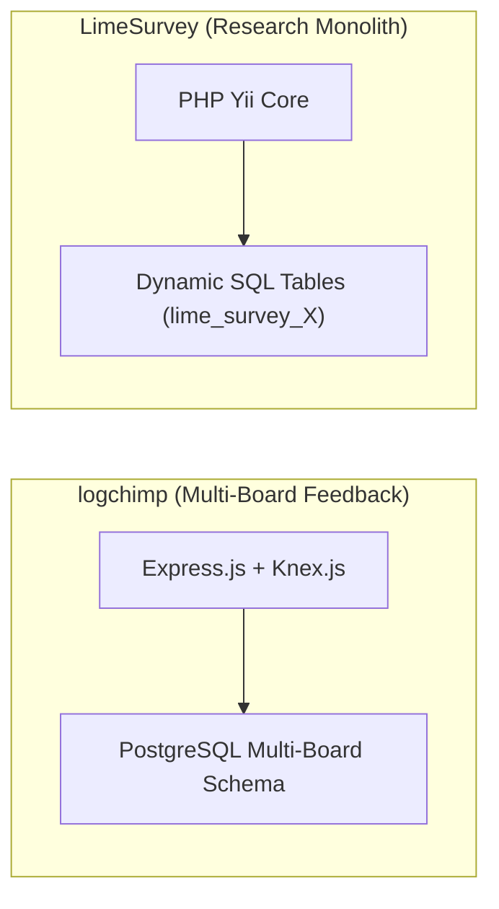
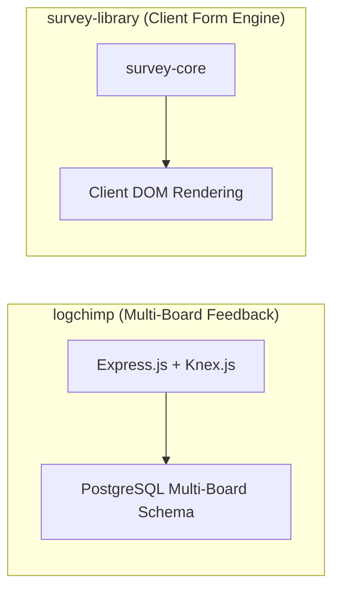
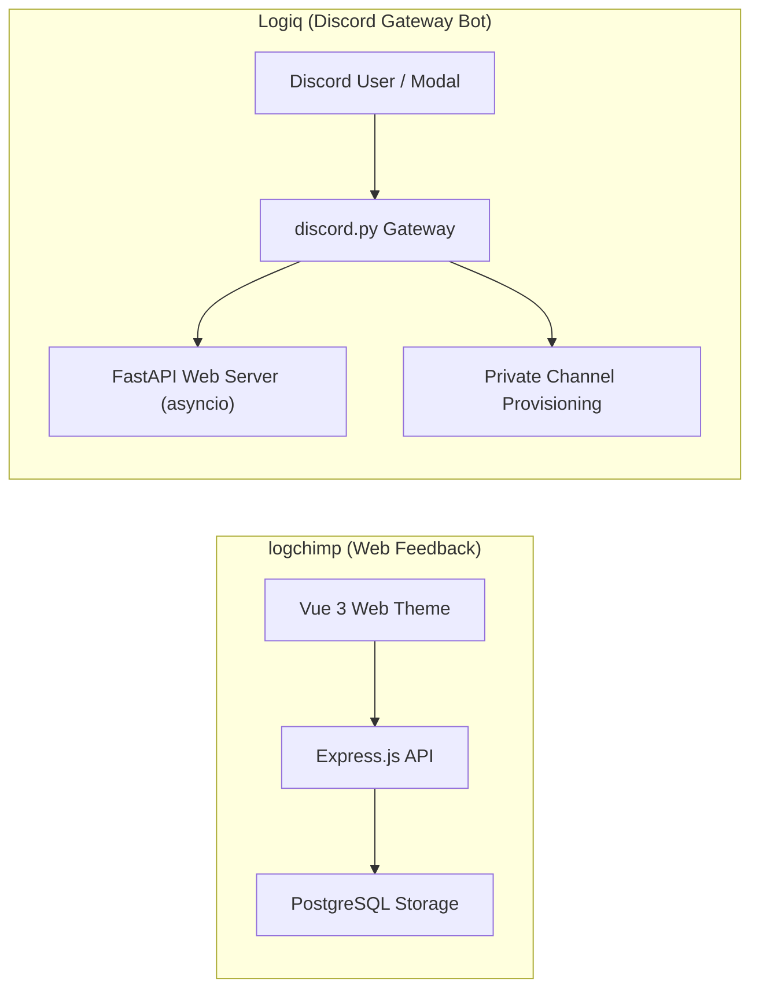

# logchimp — Comparative Analysis & Category Evaluation

> **Category**: Forms, Surveys & Feedback  
> **Architectural Role**: Multi-board product feedback management, interactive roadmaps & changelog engine  
> **Primary Stack**: TypeScript / Node.js 20+ | Express.js, Knex.js, Vue 3, Vite | PostgreSQL 14+, Redis 7+ | BullMQ Workers  
> **Peer Solutions Compared**: `fider`, `formbricks`, `heyform`, `OpnForm`, `formizee`, `LimeSurvey`, `survey-library`, `Logiq`, `dsforms`  
> **Commercial SaaS Benchmarks**: Canny.io, Upvoty, Aha!, Productboard  

---

## 1. Executive Overview & Technical Identity: logchimp

**Logchimp** is an open-source product feedback management platform and interactive roadmap engine designed for modern software teams. Engineered as an extensible, developer-friendly alternative to Canny, Upvoty, and Aha!, Logchimp provides SaaS companies with a centralized hub to track user feedback, aggregate feature votes, categorize requests across multiple boards, and showcase product momentum through a dynamic public roadmap and changelog.

### Core Architectural Profile
- **Runtime & Language**: `TypeScript / Node.js 20+` monorepo using `pnpm workspaces`.
- **Backend Architecture**: **Express.js** REST API (`packages/server`) utilizing **Knex.js** for SQL query building, connection pooling, and relational migrations.
- **Frontend Architecture**: **Vue 3** theme (`packages/theme`) bundled with **Vite**, delivering fast client routing and rich Markdown formatting.
- **Persistence & Caching**: **PostgreSQL 14+** for relational data persistence, paired with **Redis 7+** for fast query caching and cache invalidation.
- **Asynchronous Processing**: **BullMQ** workers (`EmailWorker`, `ActivityWorker`) executing transactional email broadcasts and activity stream logging.
- **Multi-Board Partitioning**: Separates user feedback across dedicated `Boards` with custom URLs, brand colors, and visibility toggles (e.g. "Web App", "Integrations", "Mobile").
- **Audit Trails & RBAC**: Maintains an immutable timeline (`posts_activity`) documenting every status change, comment, and moderator intervention on a post, governed by a granular relational RBAC model (`roles`, `permissions`, `roles_users`, `permissions_roles`).

---

## 2. Peer Solution Landscape (Forms, Surveys & Feedback)

Within this category, `logchimp` operates alongside the following peer solutions:

| Solution | Language & Runtime | Core Framework | Database / Cache | Queue / Concurrency | Primary Architectural Niche |
| :--- | :--- | :--- | :--- | :--- | :--- |
| **logchimp** (Current) | `TypeScript / Node` | `Express.js, Vue 3` | `PostgreSQL, Knex.js` | `BullMQ / Redis` | Multi-board customer feedback roadmap with RBAC and audit trail |
| **fider** | `Go 1.22+` | `Go HTTP Monolith` | `PostgreSQL 14+` | `Goroutines, Channels` | Compiled CQRS public feature voting portal with sub-20ms latency |
| **formbricks** | `TypeScript / Node` | `Next.js Monorepo` | `PostgreSQL, Prisma` | `BullMQ / Redis` | In-app micro-surveys, ReBAC access, telemetry |
| **heyform** | `TypeScript / Node` | `NestJS 10+, React 18` | `MongoDB, Redis` | `Bull Queue / Redis` | Conversational multi-step forms with polymorphic document answers |
| **OpnForm** | `PHP 8.2+ / TypeScript` | `Laravel 11, Nuxt 3` | `MySQL / PostgreSQL` | `Laravel Horizon / Redis` | No-code dynamic forms with versioned revisions & MCP agent drafts |
| **formizee** | `TypeScript / Edge` | `Hono, Turborepo` | `LibSQL / Turso, Drizzle` | `Cloudflare KV / Async` | Zero-knowledge AES-256-GCM encrypted headless form vault |
| **LimeSurvey** | `PHP 8.1+` | `Yii Framework` | `MySQL / PostgreSQL` | `PHP CLI Workers` | Enterprise statistical surveys with dynamic runtime SQL tables |
| **survey-library** | `TypeScript 5.3+` | `Framework-Agnostic MVVM` | `Pure Client-Side (BYO)`| `Synchronous / Web Workers`| Declarative JSON survey engine with AST expression evaluator |
| **Logiq** | `Python 3.10+` | `FastAPI, discord.py` | `SQLite / PostgreSQL` | `asyncio Event Loop` | Discord-native community ticketing bot & FastAPI REST management |
| **dsforms** | `Go 1.22+` | `Pure Go HTTP` | `SQLite / LibSQL (pure Go)`| `Go Worker Channels` | Zero-dependency headless form backend with forensic spam quarantine |

---

## 3. Deep Head-to-Head Comparative Breakdown: logchimp vs Peers

### 3.1. logchimp vs. fider

**Comparative Focus**: `Node.js multi-board feedback portal with RBAC and changelogs` vs. `Compiled Go CQRS single-binary board`

#### Architectural Differences:
- **Board Organization & Scope**: Logchimp allows teams to partition feedback into multiple categorized `Boards` (e.g. "Mobile App", "Integrations", "API"), each with independent visibility and URL slugs, while also offering an integrated public changelog. Fider focuses on a single unified feedback board per tenant with tag filtering.
- **Runtime Performance & Footprint**: Fider is written in compiled Go 1.22+, consuming ~40MB of RAM and serving requests with sub-20ms latency. Logchimp is built on TypeScript/Node.js with Express.js, Knex.js, and Redis BullMQ (~120MB RAM).
- **Access Control & Auditability**: Logchimp implements a complete relational RBAC model (`roles`, `permissions`, `roles_users`, `permissions_roles`) and records every moderator action in an immutable `posts_activity` audit table. Fider uses simple tenant roles (`administrator`, `visitor`).

#### Architectural Comparison Matrix:

| Dimension | logchimp | fider |
| :--- | :--- | :--- |
| **Board Organization** | Partitioned multi-board separation (`Boards`) | Single unified board with tag filtering |
| **Changelog Engine** | Dedicated user-facing product release changelog | Roadmap stage statuses only |
| **Access Control** | Normalized relational RBAC matrix | Simple tenant roles (`administrator`, `visitor`) |
| **Runtime & Language** | TypeScript / Node.js 20+ (~120 MB RAM) | Compiled Go 1.22+ binary (~40 MB RAM, <20ms latency) |
| **Audit Logging** | Immutable activity stream (`posts_activity`) | Basic timestamp updates |

---

### 3.2. logchimp vs. formbricks

**Comparative Focus**: `Multi-board feedback tracking with RBAC and changelogs` vs. `Targeted in-app private CX telemetry & ReBAC`

#### Architectural Differences:
- **Domain Purpose**: Logchimp organizes public or private feature discovery across multiple categorized `Boards`, connecting submitted ideas to interactive roadmap columns and product changelogs. Formbricks captures point-in-time user sentiment via micro-surveys embedded into web apps.
- **Backend Architecture & Querying**: Logchimp uses **Express.js** and **Knex.js**, executing finely tuned SQL queries and maintaining an immutable audit log (`posts_activity`). Formbricks uses Prisma ORM on Next.js with PostgreSQL JSONB columns and keyset cursor pagination.
- **Access Control Models**: Logchimp uses a traditional relational RBAC model (`roles`, `permissions`, `roles_users`, `permissions_roles`). Formbricks utilizes relationship-based access control (ReBAC) projected into SpiceDB.

#### Architectural Comparison Matrix:

| Dimension | logchimp | formbricks |
| :--- | :--- | :--- |
| **Feedback Topology** | Partitioned multi-board suggestion portals | Contextual micro-survey popups |
| **Roadmap & Changelog** | Integrated roadmap stages and public release changelogs | None (focused on telemetry ingestion) |
| **Database Access Layer** | Knex.js query builder with relational PostgreSQL | Prisma ORM with PostgreSQL JSONB |
| **Audit & Timeline** | Immutable activity stream (`posts_activity`) | Response telemetry (TTC) |
| **Access Control** | Normalized relational RBAC (`roles`, `permissions`) | Zanzibar ReBAC via SpiceDB / Authzed |

---

### 3.3. logchimp vs. heyform

**Comparative Focus**: `Multi-board feedback & roadmap` vs. `Conversational Typeform-style multi-step forms`

#### Architectural Differences:
- **Product Scope**: Logchimp provides a multi-board feedback portal (`Boards`), interactive roadmap stages (`Roadmaps`), and product release changelogs. HeyForm handles structured form intake and lead capture through conversational flows.
- **Database Architecture**: Logchimp uses **Express.js** and **Knex.js** with PostgreSQL, maintaining relational integrity across users, boards, posts, votes, and an immutable audit timeline (`posts_activity`). HeyForm uses MongoDB with Mongoose document schemas.
- **Access Control**: Logchimp implements a complete relational RBAC model (`roles`, `permissions`, `roles_users`, `permissions_roles`) for fine-grained board governance. HeyForm uses application-level team roles (`owner`, `admin`, `member`).

#### Architectural Comparison Matrix:

| Dimension | logchimp | heyform |
| :--- | :--- | :--- |
| **Primary Domain** | Multi-board feedback management and public roadmaps | Conversational form building and intake |
| **Database Layer** | PostgreSQL with Knex.js SQL query builder | MongoDB document store |
| **Audit Trails** | Immutable activity stream (`posts_activity`) | Basic timestamps |
| **Access Control** | Granular relational RBAC matrix | Team role arrays |
| **Public Transparency** | Public feedback boards, roadmaps, and release changelogs | Forms can be public or password-protected |

---

### 3.4. logchimp vs. OpnForm

**Comparative Focus**: `Multi-board feedback tracking with RBAC and changelogs` vs. `No-code dynamic forms with versioning & MCP drafts`

#### Architectural Differences:
- **Product Scope**: Logchimp provides a multi-board feedback portal (`Boards`), interactive roadmap stages (`Roadmaps`), and product release changelogs. OpnForm handles structured form intake, Notion synchronization, and AI agent drafts.
- **Database & Query Layer**: Logchimp uses **Express.js** and **Knex.js** with PostgreSQL. OpnForm uses Eloquent ORM with dynamic JSON columns and snapshot versioning (`VersionableNestedDiff`).
- **Access Control**: Logchimp implements a complete relational RBAC model (`roles`, `permissions`, `roles_users`, `permissions_roles`). OpnForm uses standard Laravel workspace roles.

#### Architectural Comparison Matrix:

| Dimension | logchimp | OpnForm |
| :--- | :--- | :--- |
| **Primary Domain** | Multi-board feedback management and public roadmaps | Form building, lead intake & Notion sync |
| **Database Layer** | PostgreSQL with Knex.js SQL query builder | MySQL / PostgreSQL with Eloquent ORM |
| **Audit Trails** | Immutable activity stream (`posts_activity`) | Revision snapshots (`VersionableNestedDiff`) |
| **Access Control** | Granular relational RBAC matrix | Workspace roles |
| **Public Transparency** | Public feedback boards, roadmaps, and release changelogs | Public or private forms |

---

### 3.5. logchimp vs. formizee

**Comparative Focus**: `Multi-board feedback tracking with RBAC and changelogs` vs. `Edge-native zero-knowledge encrypted headless form vault`

#### Architectural Differences:
- **Functional Paradigm**: Logchimp organizes community feedback across partitioned `Boards`, interactive roadmap columns, and product release changelogs. Formizee ingests arbitrary HTML form data privately into an encrypted vault.
- **Database Modeling**: Logchimp uses **Express.js** and **Knex.js** with PostgreSQL, maintaining a normalized relational schema with an immutable activity log (`posts_activity`). Formizee uses dual Drizzle ORM schemas in LibSQL, isolating administrative metadata from encrypted submission payloads.
- **Access Governance**: Logchimp implements a complete relational RBAC model (`roles`, `permissions`, `roles_users`, `permissions_roles`). Formizee relies on API keys and workspace private encryption keys.

#### Architectural Comparison Matrix:

| Dimension | logchimp | formizee |
| :--- | :--- | :--- |
| **Primary Domain** | Multi-board feedback management and public roadmaps | Private headless form intake & encrypted storage |
| **Database Architecture** | Relational PostgreSQL with Knex.js SQL query builder | Dual Drizzle schemas in LibSQL / Turso |
| **Encryption at Rest** | Standard database authentication | Zero-knowledge AES-256-GCM |
| **Public Transparency** | Public feedback boards, roadmaps, and release changelogs | Strictly private (encrypted vault) |
| **Runtime Footprint** | ~120 MB RAM (Node.js runtime) | ~35 MB RAM (Edge V8 isolate) |

---

### 3.6. logchimp vs. LimeSurvey

**Comparative Focus**: `Multi-board feedback tracking with RBAC and changelogs` vs. `Enterprise statistical research & dynamic SQL tables`

#### Architectural Differences:
- **Product Scope**: Logchimp provides a multi-board feedback portal (`Boards`), interactive roadmap stages (`Roadmaps`), and product release changelogs. LimeSurvey is designed for scientific questionnaires and multi-lingual statistical research.
- **Database Modeling**: Logchimp uses **Express.js** and **Knex.js** with PostgreSQL, maintaining relational integrity across users, boards, posts, votes, and an immutable audit timeline (`posts_activity`). LimeSurvey provisions dedicated relational tables for each survey.
- **Access Control**: Logchimp implements a complete relational RBAC model (`roles`, `permissions`, `roles_users`, `permissions_roles`) for fine-grained board governance. LimeSurvey manages survey-level permissions and participant tokens.

#### Architectural Comparison Matrix:

| Dimension | logchimp | LimeSurvey |
| :--- | :--- | :--- |
| **Primary Domain** | Multi-board feedback management and public roadmaps | Scientific research & statistical surveys |
| **Database Layer** | PostgreSQL with Knex.js SQL query builder | Dynamic SQL tables per survey |
| **Audit Trails** | Immutable activity stream (`posts_activity`) | Survey event logs |
| **Access Control** | Granular relational RBAC matrix | Survey permission tables & token ACL |
| **Public Transparency** | Public feedback boards, roadmaps, and release changelogs | Private or public research surveys |

---

### 3.7. logchimp vs. survey-library (SurveyJS)

**Comparative Focus**: `Multi-board feedback tracking with RBAC and changelogs` vs. `Framework-agnostic client-side MVVM JSON engine`

#### Architectural Differences:
- **Domain Focus**: Logchimp organizes public or private feature discovery across multiple categorized `Boards`, connecting submitted ideas to interactive roadmap columns and product changelogs. SurveyJS is an in-browser form renderer.
- **Backend Requirements**: Logchimp is a Node.js/Express application utilizing Knex.js, PostgreSQL, and Redis BullMQ workers. SurveyJS requires no backend server.

#### Architectural Comparison Matrix:

| Dimension | logchimp | survey-library (SurveyJS) |
| :--- | :--- | :--- |
| **Primary Domain** | Multi-board feedback management and public roadmaps | Client-side form and survey rendering |
| **Backend Layer** | Express.js + Knex.js on PostgreSQL | None (Bring Your Own Backend) |
| **Audit Trails** | Immutable activity stream (`posts_activity`) | None |
| **Access Control** | Granular relational RBAC matrix | Controlled by host application |
| **Runtime Footprint** | ~120 MB RAM | 0 MB server RAM |

---

### 3.8. logchimp vs. Logiq

**Comparative Focus**: `Web multi-board feedback portal` vs. `Discord-native modal ticketing & channel triage`

#### Architectural Differences:
- **Ingress Platform**: Logchimp provides a web-based community portal accessible via any web browser. Logiq operates inside Discord chat servers, interacting with users via persistent buttons and native modal dialogs (`discord.ui.Modal`).
- **Workflow Pipeline**: Logchimp organizes feedback onto categorized boards and public roadmap columns. Logiq provisions isolated private Discord text channels (`ticket-{username}`) with role-based permission overwrites.
- **Concurrency & Runtime**: Logchimp runs on Node.js/Express with BullMQ workers. Logiq runs a single-process concurrent Python 3.10+ application inside an `asyncio` event loop.

#### Architectural Comparison Matrix:

| Dimension | logchimp | Logiq |
| :--- | :--- | :--- |
| **Platform Ingress** | Web browsers (Vue 3 SPA) | Discord client via native interaction modals |
| **Submission Output** | Post categorized on board / roadmap stage | Isolated private support text channel in Discord |
| **Runtime & Language** | TypeScript / Node.js 20+ (~120 MB RAM) | Python 3.10+ (discord.py + FastAPI via asyncio) |
| **Persistence** | PostgreSQL with Knex.js | SQLite / PostgreSQL / MongoDB |
| **Best Architectural Fit** | Multi-board product discovery and changelogs | Community customer support within Discord |

---

### 3.9. logchimp vs. dsforms

**Comparative Focus**: `Node.js multi-board feedback engine` vs. `Pure Go single-binary headless backend with quarantine scoring`

```mermaid
flowchart LR
    subgraph LogchimpArch ["logchimp (Multi-Board Feedback)"]
        A1["Vue 3 Web Client"] --> A2["Express.js API"]
        A2 --> A3["PostgreSQL + Knex.js"]
    end
    subgraph DsformsArch ["dsforms (Headless Ingestion Monolith)"]
        B1["Static Form (<form>)"] --> B2["Pure Go HTTP Server"]
        B2 --> B3["Weighted Spam Screener"]
        B2 --> B4["Embedded SQLite / LibSQL"]
        B2 --> B5["Model Context Protocol (MCP) Server"]
    end
```

#### Architectural Differences:
- **Domain Scope**: Logchimp provides a multi-board feedback portal (`Boards`), interactive roadmap stages (`Roadmaps`), and product release changelogs. dsforms is a headless form backend for static websites and landing pages, featuring forensic spam screening and viral waitlists.
- **Database & Dependencies**: Logchimp requires Node.js, PostgreSQL, and Redis BullMQ workers (~120MB RAM). dsforms compiles into a single statically linked binary with an embedded SQLite / LibSQL database (`modernc.org/sqlite`), running with zero external dependencies in a single binary (~25MB RAM).
- **Spam Mitigation**: Logchimp uses rate limiting and user session authentication. dsforms implements an auditable **Quarantine Architecture**: `internal/screen` evaluates weighted honeypot traps (`_gotcha`, `hp_field`), timing heuristics, and domain analysis, holding suspicious leads in an isolated quarantine queue (`is_held: 1`).
- **AI Agent Automation**: dsforms embeds a native Model Context Protocol (MCP) server for autonomous agent operations. Logchimp manages user interactions through its web interface.

#### Architectural Comparison Matrix:

| Dimension | logchimp | dsforms |
| :--- | :--- | :--- |
| **Primary Domain** | Multi-board customer feedback roadmap & changelog | Headless form backend & viral waitlist engine |
| **Database Architecture** | Relational PostgreSQL with Knex.js SQL query builder | Embedded SQLite / LibSQL (zero external DB) |
| **Spam & Abuse Defense** | Session authentication & rate limiting | Weighted heuristic scoring with auditable quarantine queue |
| **AI Agent Interface** | None | Native embedded Model Context Protocol (MCP) server |
| **Memory Footprint** | ~120 MB RAM | ~25 MB RAM |

---

## 4. Capability & Feature Comparison Matrix

| Dimension / Capability | logchimp | fider | formbricks | heyform | OpnForm | formizee | LimeSurvey | survey-library | Logiq | dsforms |
| :--- | :---: | :---: | :---: | :---: | :---: | :---: | :---: | :---: | :---: | :---: |
| **Public Feature Voting** | ✅ Multi-Board | ✅ Pure CQRS | ❌ | ❌ | ❌ | ❌ | ❌ | ❌ | ❌ | ❌ |
| **Changelog & Public Roadmap** | ✅ Integrated | ⚠️ Basic | ❌ | ❌ | ❌ | ❌ | ❌ | ❌ | ❌ | ❌ |
| **Granular Relational RBAC** | ✅ Dedicated | ❌ | ⚠️ SpiceDB | ⚠️ Roles | ⚠️ Roles | ⚠️ API Keys | ⚠️ Survey ACL | ❌ | ⚠️ Discord | ❌ |
| **Immutable Activity Log** | ✅ Dedicated | ❌ | ⚠️ TTC Telemetry| ❌ | ⚠️ Revisions | ⚠️ Logdrain | ⚠️ Event Log | ❌ | ⚠️ Transcripts | ⚠️ Signals |
| **Conversational Typeform UI**| ❌ | ❌ | ⚠️ Compact modal | ✅ Full Screen | ✅ Full Screen | ❌ (Headless) | ❌ | ✅ Supported | ❌ | ❌ |
| **Targeted In-App Popups** | ❌ | ❌ | ✅ Native SDK | ⚠️ Iframe | ⚠️ Iframe | ❌ | ❌ | ⚠️ UI Embed | ❌ | ❌ |
| **Headless Form API Endpoint** | ❌ | ❌ | ⚠️ API Routes | ❌ | ❌ | ✅ Edge Native | ❌ | ❌ | ❌ | ✅ Single Binary |
| **Discord Chat Ticket Modals** | ❌ | ❌ | ❌ | ❌ | ❌ | ❌ | ❌ | ❌ | ✅ Native UI | ❌ |
| **Viral Waitlist & Referrals** | ❌ | ❌ | ❌ | ❌ | ❌ | ❌ | ❌ | ❌ | ❌ | ✅ Integrated |
| **AI Agent MCP Integration** | ❌ | ❌ | ⚠️ REST API | ❌ | ✅ Agent Drafts| ⚠️ API Keys | ❌ | ❌ | ⚠️ LLM Cog | ✅ Native MCP |
| **Runtime Memory Footprint** | ~120 MB | **~40 MB** | ~250 MB | ~300 MB | ~150 MB | **~35 MB (Edge)** | ~180 MB | **0 MB (Client)** | ~90 MB | **~25 MB** |

---

## 5. Commercial Benchmark Positioning

When benchmarked against commercial SaaS leaders (**Canny.io, Upvoty, Aha!, Productboard**):
- **Against Canny.io & Upvoty**: `logchimp` delivers complete multi-board feedback separation, public roadmap columns, and user-facing changelogs without expensive per-tracked-user pricing.
- **Enterprise RBAC**: Features a full relational role-based access control schema (`roles`, `permissions`, `roles_users`), enabling granular governance across boards and administrative teams.
- **Audit Compliance**: Maintains an immutable timeline of events (`posts_activity`), providing a full audit trail of feature request lifecycles.

---

## 6. Strategic Takeaways & Role for MarketingStudio

In the unified **MarketingStudio** architecture:
1. **Primary Component to Adopt**: Harness `logchimp` for multi-board product feedback tracking, structured roadmap visibility, and customer-facing changelog updates.
2. **Interoperability Seam**: Utilize Logchimp's REST API and PostgreSQL database to synchronize upvoted customer ideas into MarketingStudio's CRM and feature prioritization backlog.
3. **Complementary Ecosystem Delegation**: Where Logchimp provides multi-board roadmaps and changelogs, delegate in-app micro-surveys to `formbricks`, conversational intake to `heyform` / `OpnForm`, and headless static form ingestion to `formizee` / `dsforms`.
