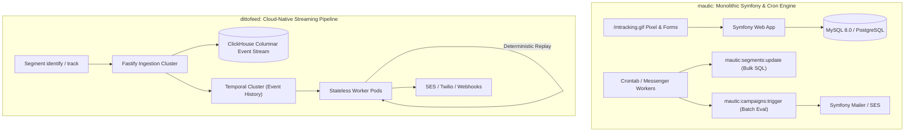
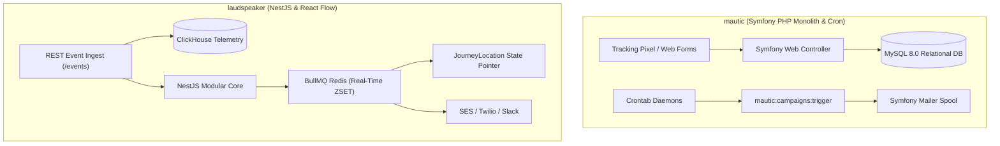
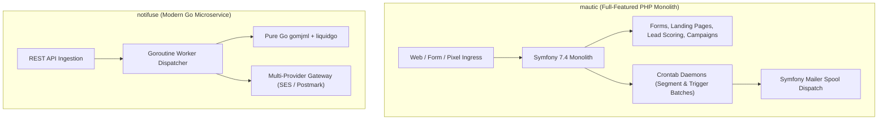
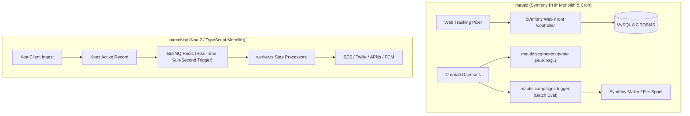
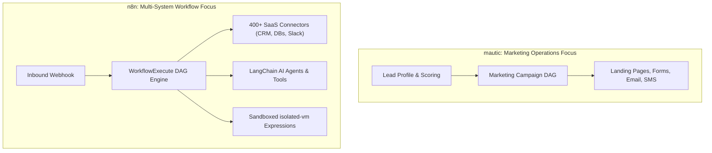

# mautic — Comparative Analysis & Category Evaluation

> **Category**: Customer Lifecycle & Journeys  
> **Architectural Role**: Enterprise marketing automation monolith, dynamic segmentation & lead scoring  
> **Primary Stack**: PHP 8.2+ / 8.3 | Symfony 7.4, Twig | MySQL 8.0+ / MariaDB / PostgreSQL 16+ | Symfony Messenger + Cron  
> **Peer Solutions Compared**: `dittofeed`, `laudspeaker`, `notifuse`, `parcelvoy`, `n8n`  
> **Commercial SaaS Benchmarks**: HubSpot Marketing Hub, Marketo, ActiveCampaign, Customer.io, Braze  

---

## 1. Executive Overview & Technical Identity: mautic

**mautic** is the world’s most widely adopted open-source marketing automation platform, providing enterprise marketing teams with an autonomous, self-hosted alternative to proprietary suites like HubSpot, Marketo, and ActiveCampaign. Built on PHP 8.2+ and Symfony 7.4, Mautic unifies cross-channel customer journeys, real-time lead scoring, dynamic demographic and behavioral segmentation, progressive web forms, landing page hosting, asset tracking, and omnichannel messaging (Email, SMS, Web Push, and Webhooks).

The platform's strength lies in its battle-tested, modular bundle architecture (`LeadBundle`, `CampaignBundle`, `EmailBundle`, `ChannelBundle`, `FormBundle`) and its high-volume queue infrastructure powered by **Symfony Messenger** and asynchronous cron daemons. Mautic enables marketing operations teams to track millions of anonymous web visitors, stitch identities upon form submission, execute multi-branch campaign logic (Decisions, Conditions, Actions), and execute bulk email broadcasts without licensing fees or subscriber paywalls.

### Core Architectural Profile
- **Runtime & Language**: `PHP 8.2+ / 8.3` (OPcache & JIT-optimized for high-throughput batch loops)
- **Core Framework**: `Symfony 7.4` (`symfony/framework-bundle`, `symfony/messenger`, `symfony/mailer`, `symfony/event-dispatcher`)
- **Persistence Layer**: `Doctrine ORM 3.x` with support for `MySQL 8.0+`, `MariaDB 10.11+`, and `PostgreSQL 16+`
- **Asynchronous Processing**: `Symfony Messenger` (utilizing Redis, RabbitMQ, or Doctrine queues) paired with CLI daemons (`bin/console mautic:*`)
- **Segmentation Model**: Asynchronous set-based SQL recalculation (`INSERT INTO ... SELECT`)
- **Governance & Compliance**: Immutable multi-channel `DoNotContact` registry with automated RFC 3464 DSN IMAP bounce monitoring
- **Primary Architectural Niche**: Complete, self-hosted all-in-one marketing automation suite with deep CRM and lead scoring heritage

---

## 2. Peer Solution Landscape (Customer Lifecycle & Journeys)

Within the Customer Lifecycle & Journeys domain, `mautic` operates alongside five distinct architectural peers:

| Solution | Language & Runtime | Core Framework | Database / Cache | Queue / Concurrency | Primary Architectural Niche |
| :--- | :--- | :--- | :--- | :--- | :--- |
| **mautic** (Current) | `PHP 8.2+` | `Symfony 7.4, Twig` | `MySQL / PostgreSQL` | `Symfony Messenger + Cron` | **Monolithic marketing automation, lead scoring & set-based segmentation** |
| **dittofeed** | `TypeScript / Node.js 20+` | `Fastify, Next.js` | `PostgreSQL + ClickHouse` | `Temporal.io Workflows` | Durable temporal workflows & streaming ClickHouse analytics |
| **laudspeaker** | `TypeScript / Node.js 18+` | `NestJS 10, React 18` | `PostgreSQL + ClickHouse` | `BullMQ / Redis` | Visual React Flow journey canvas with `JourneyLocation` state pointers |
| **notifuse** | `Go 1.25+` | `Native Go DDD` | `PostgreSQL / AlloyDB` | `Goroutine Worker Pools` | In-process Go Liquid/MJML compilation & multi-MTA gateway |
| **parcelvoy** | `TypeScript / Node.js 18+` | `Koa 2, Knex` | `MySQL 8 / PostgreSQL` | `BullMQ / Redis` | Polymorphic journey steps with RFC 5545 RRULE timezone scheduling |
| **n8n** | `TypeScript Monorepo` | `Node.js 20+, Vue 3` | `PostgreSQL / SQLite` | `WorkflowExecute DAG + BullMQ` | 400+ SaaS connectors & `isolated-vm` sandboxed execution |

---

## 3. Deep Head-to-Head Comparative Breakdown: mautic vs Peers

### 3.1. mautic vs. dittofeed

**Comparative Focus**: `All-in-One Enterprise Marketing Suite & Set-Based SQL` vs. `Temporal Event Sourcing & ClickHouse Streaming CDP`

#### Pipeline Topologies, Workflow Engines & Queue Mechanics
- **Scheduled Batch Daemons vs. Streaming Event Sourcing**: `mautic` operates primarily on a scheduled polling topology. Inbound web hits (`/mtracking.gif`) and form submissions write records to relational tables; background cron daemons execute batch commands (`bin/console mautic:segments:update`, `bin/console mautic:campaigns:trigger`, `bin/console mautic:emails:send`) every 1 to 5 minutes. `dittofeed` evaluates triggers and executes workflow steps in sub-second streaming real-time via Fastify, Kafka/ClickHouse, and **Temporal.io** code workflows.
- **Workflow State Durability**: In Mautic, journey progress is tracked via `campaign_lead_event_log`. If a cron worker crashes mid-batch, remaining events are re-evaluated on the next cron run. In Dittofeed, Temporal maintains an append-only event history; if a worker crashes, another worker resumes execution via deterministic replay with zero dropped state.

#### Database Storage & Segmentation Architecture
- **Set-Based Relational SQL vs. Columnar Analytics**: Mautic recalculates dynamic segments by running optimized SQL queries (`INSERT INTO lead_lists_leads SELECT ...`). By offloading set math directly to MySQL, Mautic can re-index hundreds of thousands of contacts efficiently in batches. Dittofeed evaluates segments via vectorized ClickHouse SQL queries over billions of event rows. While Mautic's relational schema can experience table locks under millions of raw events, Dittofeed's ClickHouse store handles high-frequency telemetry effortlessly.

#### Failure Modes, Crash Recovery & Bottlenecks
- **Cron Overlap & Table Contention**: Mautic's most common failure mode is crontab backlog: if an email spool or segment rebuild runs longer than its crontab frequency, concurrent Symfony processes can lock tables on MySQL, stalling campaign progression. Dittofeed eliminates this by decoupling ingestion from execution and utilizing Temporal's distributed task queues.
- **Feature Scope**: Mautic includes dynamic progressive forms, landing pages, asset tracking, and point-based lead scoring out of the box. Dittofeed focuses strictly on event tracking and customer journeys, delegating forms and CMS tasks to external frontends.

#### Architectural Comparison Matrix: mautic vs. dittofeed

| Metric / Dimension | mautic | dittofeed |
| :--- | :--- | :--- |
| **Architecture** | PHP 8.2+ / Symfony 7.4 monolith | TypeScript / Node.js cloud-native microservices |
| **Trigger Latency** | Polled via Cron (1 to 5 minutes) | **Sub-second streaming (< 500ms)** |
| **Segmentation Model** | Set-based SQL (`INSERT INTO ... SELECT`) | Real-time vectorized ClickHouse SQL |
| **Workflow Engine** | Symfony Messenger + CLI Cron daemons | Temporal.io (Deterministic code workflows) |
| **Telemetry Persistence** | MySQL 8.0 / PostgreSQL relational tables | **ClickHouse 23+ columnar warehouse** |
| **Marketing Scope** | **Full marketing suite (Forms, Pages, Lead scoring)** | Customer journeys & messaging focus |
| **Suppression Governance** | **Immutable multi-channel `DoNotContact` registry** | Workspace subscription groups |

#### Where mautic Excels over dittofeed
- **Turnkey Marketing Automation**: Built-in landing page builder, progressive profiling web forms, asset tracking, and lead scoring.
- **Enterprise Suppression Management**: Centralized Do-Not-Contact registry with automated RFC 3464 IMAP bounce monitoring.
- **Set-Based Batch Segmentation**: Bulk SQL segment rebuilds update millions of static records with minimal memory overhead.

#### Where dittofeed Holds an Advantage over mautic
- **Real-Time Responsiveness**: Instantaneous trigger execution without waiting for cron execution intervals.
- **Modern Cloud-Native Stack**: TypeScript, Fastify, Next.js, and Segment-compatible APIs vs. legacy PHP/Symfony bundle architecture.
- **Telemetry Scale**: Absorbs high-frequency clickstream data in ClickHouse without degrading transactional database performance.

---

### 3.2. mautic vs. laudspeaker

**Comparative Focus**: `Enterprise PHP Marketing Monolith` vs. `Modern TypeScript/ClickHouse Event-Driven Canvas`

#### Pipeline Topologies, Workflow Engines & Queue Mechanics
- **Monolithic Polling vs. Event-Driven Real-Time**: `mautic` relies on scheduled background daemons to evaluate journeys in batches, resulting in 1- to 5-minute execution latencies. `laudspeaker` reacts to events in real time: inbound telemetry triggers BullMQ jobs that advance customer states through the journey graph in sub-second latency.
- **Visual Canvas Design**: Laudspeaker provides a sleek, modern React Flow canvas validated via `@dagrejs/graphlib`, making it easy for growth marketers to compose branching lifecycles. Mautic uses a legacy Symfony/Twig visual campaign builder that, while functional, lacks modern reactive canvas features.

#### Database Storage & Telemetry Architecture
- **Single RDBMS vs. Hybrid ClickHouse**: Mautic stores all application data—leads, dynamic attributes, campaign logs, landing pages, forms, and email tracking stats—inside MySQL or PostgreSQL. Laudspeaker offloads telemetry and analytics to ClickHouse, isolating PostgreSQL from clickstream load.

#### Deliverability, Governance & Suppression
- **Do-Not-Contact (DNC) Registry**: Mautic features an enterprise-grade `DoNotContact` entity tracking hard bounces, manual unsubscribes, and spam complaints across email, SMS, and push. It automatically monitors inbound IMAP bounce mailboxes (`MonitoredEmail/`). Laudspeaker relies on customer attribute flags (`system_attributes.email_bounced`) and webhook callbacks.

#### Failure Modes, Crash Recovery & Bottlenecks
- **Cron Overlap & Deadlocks**: In Mautic, concurrent cron workers can lock tables on large MySQL databases, creating delivery backlogs. Laudspeaker’s BullMQ queues use Redis atomic locks (`SET NX PX`), guaranteeing that jobs execute independently without database locking.

#### Architectural Comparison Matrix: mautic vs. laudspeaker

| Metric / Dimension | mautic | laudspeaker |
| :--- | :--- | :--- |
| **Runtime & Language** | PHP 8.2+ / Symfony 7.4 | TypeScript / Node.js 18+ (NestJS 10) |
| **Trigger Responsiveness** | Polled via Cron (1 to 5 min) | **Real-time event streaming (< 2s)** |
| **Data Architecture** | MySQL / PostgreSQL monolithic RDBMS | PostgreSQL (Metadata) + ClickHouse (Events) |
| **Marketing Scope** | **Full marketing suite (Forms, Pages, Lead scoring)** | Journeys & multi-channel messaging |
| **Suppression Governance** | **Immutable multi-channel `DoNotContact` registry** | Attribute flags & provider callbacks |
| **Queue Technology** | Symfony Messenger + Cron Daemons | BullMQ + Redis |

#### Where mautic Excels over laudspeaker
- **Comprehensive Marketing Tools**: Native drag-and-drop landing page builders, progressive profiling web forms, and lead scoring.
- **Deliverability Governance**: Centralized Do-Not-Contact registry with automated IMAP bounce mailbox parsing.
- **Set-Based Database Segmentation**: Bulk SQL segment rebuilds handle massive static audiences with minimal memory usage.

#### Where laudspeaker Holds an Advantage over mautic
- **Sub-Second Trigger Responsiveness**: Reacts to user behavioral telemetry immediately rather than waiting for cron intervals.
- **Modern Developer Stack**: TypeScript, NestJS, and React vs. legacy PHP/Symfony bundle architecture.
- **ClickHouse Analytics**: Eliminates database lock contention by writing event streams to columnar storage.

---

### 3.3. mautic vs. notifuse

**Comparative Focus**: `Full-Featured Marketing Automation Monolith` vs. `High-Speed In-Process Go MJML Gateway`

#### Pipeline Topologies, Workflow Engines & Queue Mechanics
- **Monolith vs. Microservice**: `mautic` is a complete marketing automation suite with deep feature breadth (landing pages, web forms, asset downloads, lead scoring, and drip campaigns). `notifuse` is an ultra-fast notification delivery gateway written in Go 1.25+, focused purely on template compilation, MTA routing, and bounce normalization.
- **Execution Speed**: Notifuse renders and dispatches notifications instantly upon API call using persistent in-memory goroutines. Mautic evaluates campaigns and spools emails via background cron commands (`bin/console mautic:*`), introducing 1- to 5-minute polling latencies.

#### Database Storage & Template Rendering Architecture
- **In-Process Go Compilation vs. PHP Twig**: Mautic compiles templates using Twig and GrapesJS inside PHP. Notifuse parses templates in native Go via `liquidgo` and compiles MJML via `gomjml`. Notifuse renders personalized emails at sub-millisecond speeds (>10,000 emails/second), using a fraction of the CPU and RAM consumed by Mautic.

#### Deliverability, Governance & Suppression
- **IMAP Parsing vs. Webhook Normalization**: Mautic monitors bounce and unsubscribe mailboxes via IMAP (`MonitoredEmail/`), reading raw RFC 3464 delivery status notifications. Notifuse normalizes HTTP webhooks from SES, Postmark, and SendGrid using its universal 3-way bounce classifier (`BounceClassificationHard`, `SoftCount`, `SoftIgnore`) and enforces `is_transactional_only` provider roles.

#### Architectural Comparison Matrix: mautic vs. notifuse

| Metric / Dimension | mautic | notifuse |
| :--- | :--- | :--- |
| **System Architecture** | PHP 8.2+ / Symfony 7.4 monolith | Lightweight Go 1.25+ microservice |
| **Execution Latency** | Polled via Cron (1 to 5 min) | **Instantaneous (Sub-second)** |
| **Template Compilation** | PHP Twig + GrapesJS | **In-process Go `gomjml` + `liquidgo`** |
| **Compilation Speed** | ~200 emails/sec | **10,000+ emails/sec per core** |
| **Marketing Scope** | **Full marketing suite (Forms, Pages, Scores)** | Notification infrastructure & broadcasts |
| **Deployment Footprint** | Complex (PHP-FPM, Web server, Cron, DB) | **Single static binary + PostgreSQL** |

#### Where mautic Excels over notifuse
- **Full Marketing Suite**: Built-in landing page builder, progressive forms, and point-based lead scoring.
- **Inbound IMAP Mailbox Monitoring**: Connects directly to mailbox feedback loops to catch bounces and unsubscribe replies.
- **Set-Based Database Segmentation**: Bulk SQL segment rebuilds handle massive static audiences with minimal memory usage.

#### Where notifuse Holds an Advantage over mautic
- **Modern Cloud-Native Performance**: Sub-second execution latency, minimal RAM footprint, and instant startup times.
- **Email Compilation Speed**: Pure Go MJML compilation is vastly faster than PHP Twig/HTML rendering.
- **Operational Simplicity**: A single compiled Go binary replaces complex PHP-FPM, Nginx, and crontab configurations.

---

### 3.4. mautic vs. parcelvoy

**Comparative Focus**: `Enterprise PHP Marketing Monolith` vs. `Modern TypeScript/Koa Lifecycle Engine with RRULE Timezones`

#### Pipeline Topologies, Workflow Engines & Queue Mechanics
- **Scheduled Batching vs. Real-Time Event Evaluation**: `mautic` operates on a batch polling model: cron daemons trigger Symfony console commands (`mautic:segments:update`, `mautic:campaigns:trigger`) on 1- to 5-minute schedules. `parcelvoy` reacts to user events in real-time: inbound telemetry triggers BullMQ jobs that advance user steps in sub-second latency.
- **Polymorphic Step Classes**: Parcelvoy structures journey nodes as modular TypeScript subclasses inheriting from `JourneyStep` (`JourneyGate`, `JourneyDelay`, `JourneyAction`, `JourneyBalancer`). Mautic models campaigns as normalized database records (`campaign_events`) evaluated by a centralized executioner service.

#### Timezone & Recurrence Mechanics
- **RRULE Localized Scheduling**: Parcelvoy integrates `rrule` (RFC 5545) with `date-fns-tz` to ensure that messages arrive during the recipient's local daytime hours. Mautic supports basic contact timezone offsets, but lacks native RFC 5545 recurrence rules for complex calendar scheduling.
- **Mobile Push Infrastructure**: Parcelvoy features deep native support for Apple APNs (HTTP/2) and Firebase Cloud Messaging via `node-pushnotifications`. Mautic supports web push notifications via plugins, but lacks first-class mobile APNs connection pooling.

#### Architectural Comparison Matrix: mautic vs. parcelvoy

| Metric / Dimension | mautic | parcelvoy |
| :--- | :--- | :--- |
| **Runtime & Language** | PHP 8.2+ / Symfony 7.4 | TypeScript / Node.js 18+ (Koa 2) |
| **Trigger Responsiveness** | Polled via Cron (1 to 5 min) | **Real-time event streaming (< 2s)** |
| **Timezone-Aware Delivery** | Timezone offsets | **Native RFC 5545 RRULE localized scheduling** |
| **Marketing Scope** | **Full marketing suite (Forms, Pages, Lead scoring)** | Multi-channel lifecycle messaging |
| **Mobile Push Gateways** | Basic web push plugin | **Native APNs (HTTP/2) & Google FCM** |
| **Traffic Smoothing** | Queue sleep delays | **Dedicated `JourneyBalancer` canvas step** |

#### Where mautic Excels over parcelvoy
- **Comprehensive Marketing Tools**: Native drag-and-drop landing page builders, progressive profiling web forms, and lead scoring.
- **Deliverability Governance**: Centralized Do-Not-Contact registry with automated IMAP bounce mailbox parsing.
- **Set-Based Database Segmentation**: Bulk SQL segment rebuilds handle massive static audiences with minimal memory usage.

#### Where parcelvoy Holds an Advantage over mautic
- **Sub-Second Trigger Responsiveness**: Reacts to user behavioral telemetry immediately rather than waiting for cron intervals.
- **Modern Developer Stack**: TypeScript, Koa 2, Knex, and modern React UI vs. legacy PHP/Symfony bundle architecture.
- **First-Class Mobile Push**: Native support for APNs HTTP/2 and Firebase FCM with device token management.
- **Traffic Balancers**: `JourneyBalancer` prevents sudden marketing blasts from overwhelming sales teams and downstream APIs.

---

### 3.5. mautic vs. n8n

**Comparative Focus**: `All-in-One Marketing Automation Suite` vs. `Universal Integration DAG & LangChain AI Agents`

#### Pipeline Topologies, Workflow Engines & Queue Mechanics
- **Marketing Suite vs. Integration Mesh**: `mautic` is engineered for marketing practitioners: it provides turnkey landing pages, lead capture forms, point-based lead scoring, and automated email nurturing funnels. `n8n` is an unconstrained integration and automation engine: it processes arbitrary Directed Acyclic Graphs where data flows as arrays of JSON items (`INodeExecutionData[]`) between 400+ third-party service nodes and LangChain AI components.
- **Execution Sandboxing**: n8n executes user expressions and JavaScript snippets inside secure V8 isolates (`isolated-vm`), preventing rogue scripts from crashing the worker process. Mautic executes custom logic through Symfony event listeners and PHP plugins.

#### Database Storage & Telemetry Architecture
- **Customer CRM vs. Stateless Orchestration**: Mautic maintains an active customer CRM database in MySQL with custom fields, company associations, lead scores, and tracking histories. n8n does not maintain a customer database; it persists workflow definitions, encrypted credentials (AES-256-GCM), and execution run snapshots.

#### Architectural Comparison Matrix: mautic vs. n8n

| Metric / Dimension | mautic | n8n |
| :--- | :--- | :--- |
| **Primary Domain** | All-in-one marketing automation & CRM | Universal API orchestration & AI workflows |
| **Canvas Engine** | Symfony Campaign DAG builder | Vue 3 / VueFlow DAG engine |
| **Integration Ecosystem**| Legacy PHP plugins | **400+ SaaS apps, databases, and APIs** |
| **AI Agent Capabilities** | None | **Native LangChain nodes (Agents, Memory, Tools)** |
| **Lead Scoring & Forms** | **Native progressive forms, pages & scores** | None (Relies on external tools) |
| **Code Execution** | PHP plugins & Symfony events | **`isolated-vm` sandboxed JavaScript/Python** |

#### Where mautic Excels over n8n
- **Turnkey Marketing Functionality**: Native landing pages, progressive profiling forms, and point-based lead scoring.
- **Native Customer CRM**: Stores persistent lead profiles, timeline histories, and company associations.
- **Deliverability Governance**: Centralized Do-Not-Contact registry with automated IMAP bounce mailbox parsing.

#### Where n8n Holds an Advantage over mautic
- **Massive SaaS Ecosystem**: Connects seamlessly with 400+ external platforms (CRMs, payment gateways, ERPs).
- **Autonomous AI Agents**: Visually compose multi-step AI agents with tool calling and vector retrieval via `@n8n/nodes-langchain`.
- **Modern Cloud Execution**: Decoupled webhook receivers and BullMQ worker fleets with sub-second execution speeds.

---

## 4. Capability & Feature Comparison Matrix

| Capability / Dimension | mautic | dittofeed | laudspeaker | notifuse | parcelvoy | n8n |
| :--- | :---: | :---: | :---: | :---: | :---: | :---: |
| **Primary Architectural Role** | **Monolithic Marketing Automation** | Streaming Lifecycle CDP | Visual Journey Canvas | High-Speed Notification Gateway | Modular Multi-Channel Lifecycle | Multi-System DAG Automation |
| **Lead Scoring & Tracking** | **✅ Deep Out-of-box** | ⚠️ Custom queries | ❌ | ❌ | ❌ | ⚠️ Manual nodes |
| **Landing Pages & Web Forms** | **✅ Built-in GrapesJS** | ❌ | ❌ | ❌ | ❌ | ❌ |
| **Do-Not-Contact Registry** | **✅ Dedicated DNC + IMAP** | ⚠️ Workspace lists | ⚠️ Attribute flags | ✅ Universal 3-way | ✅ Multi-topic preferences | ⚠️ Manual lookup |
| **Set-Based SQL Segmentation** | **✅ Bulk `INSERT ... SELECT`** | ❌ (ClickHouse) | ❌ (JSONB queries) | ❌ (Relational) | ❌ (Knex builder) | ❌ |
| **Workflow Engine** | Symfony Messenger + Cron | **Temporal.io** | BullMQ + Graphlib | Goroutine Pools | BullMQ + Step Classes | `WorkflowExecute` DAG |
| **Telemetry Analytical Store** | ❌ (MySQL/Postgres) | **✅ ClickHouse** | **✅ ClickHouse** | ❌ (Postgres only) | ❌ (MySQL/Postgres) | ❌ (Relational only) |
| **In-Process MJML Compilation**| ❌ (Twig) | ❌ (Node.js) | ❌ (Node.js) | **✅ Pure Go (`gomjml`)** | ❌ (Handlebars) | ❌ (Node.js) |
| **400+ SaaS Integrations** | ⚠️ Legacy plugins | ❌ Core channels | ❌ Core channels | ❌ Core channels | ❌ Core channels | **✅ Native Ecosystem** |
| **License** | GPL-3.0 | **MIT** | **MIT** | BSL 1.1 / AGPL-3.0 | **MIT** | Fair-Code (SUEL) |

---

## 5. Commercial Benchmark Positioning

When evaluated against commercial SaaS benchmarks (**HubSpot Marketing Hub, Marketo, ActiveCampaign, Customer.io**):
- **Against HubSpot Marketing Hub**: `mautic` is the only open-source project that matches HubSpot’s functional breadth: landing page builders, dynamic progressive profiling forms, point-based lead scoring, asset tracking, and drip sequences. It eliminates punitive per-contact pricing tiers, allowing organizations to manage millions of contacts at pure infrastructure cost.
- **Against Marketo**: Mautic provides the same enterprise lead lifecycle governance and multi-channel campaign triggers, but requires modern containerization and queue tuning to eliminate historical PHP cron backlogs.
- **Against Customer.io / Braze**: Mautic is marketer-focused and form-driven, whereas Customer.io and Braze are event-driven and developer-focused. For modern SaaS onboarding driven by real-time product telemetry, Mautic’s cron-polled architecture introduces higher latency than modern TypeScript/Go engines.

---

## 6. Strategic Takeaways & Role for MarketingStudio

In the unified **MarketingStudio** architecture:

1. **Replicate mautic's Set-Based Segmentation Architecture**: For complex demographic lists, run asynchronous background query builders that populate segment pivot tables via bulk SQL `INSERT INTO ... SELECT`. This set-based approach handles multimillion-contact databases with minimal CPU and memory overhead.
2. **Adopt the Centralized Do-Not-Contact (DNC) Registry Model**: Implement Mautic’s unified `DoNotContact` entity across email, SMS, and push channels. Automatically capture hard bounces, manual unsubscribes, and spam complaints in an immutable suppression ledger to guarantee GDPR and CAN-SPAM compliance.
3. **Harmonize with Peer Strengths**:
   - Utilize **dittofeed's** ClickHouse ingestion and Temporal engine for real-time streaming product telemetry.
   - Offload high-volume email compilation to **notifuse's** in-process Go MJML engine to reduce CPU costs during massive campaign sends.
   - Borrow **parcelvoy's** RRULE timezone engine and `JourneyBalancer` traffic smoothing to protect downstream sales teams.
   - Bridge outbound lifecycle events into **n8n** to trigger external CRM updates, Slack alerts, and autonomous AI agents.
