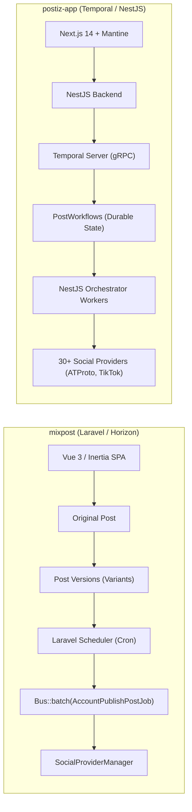
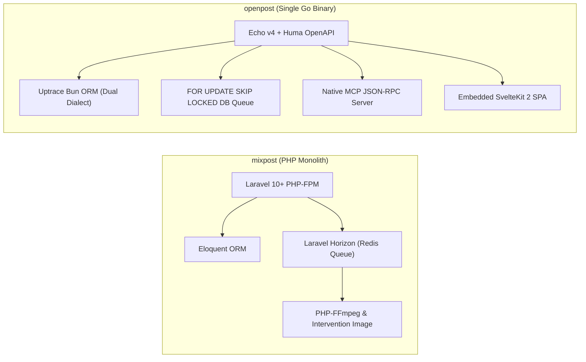
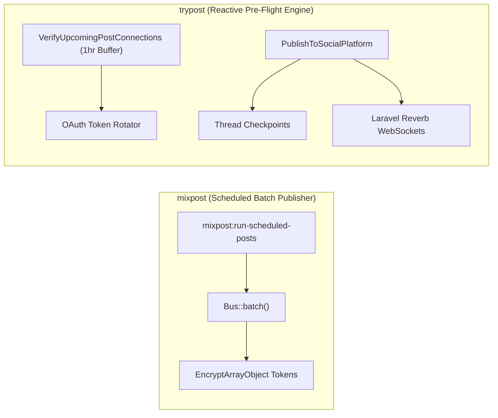
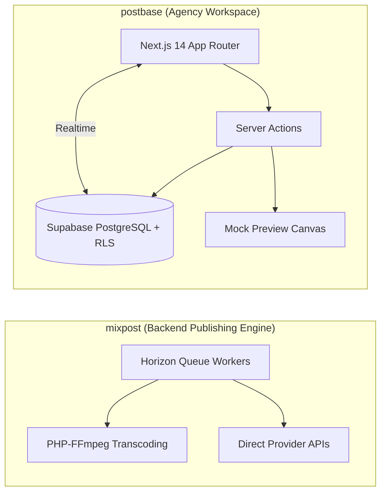

# mixpost — Comparative Analysis & Category Evaluation

> **Category**: Social Media Management  
> **Architectural Role**: Self-hosted social media publishing engine & embeddable Laravel package  
> **Primary Stack**: PHP 8.2+ | Laravel 10/11/12, Inertia.js, Vue 3 | MySQL / PostgreSQL | Laravel Queue + Horizon (`Bus::batch()`)  
> **Peer Solutions Compared**: `postiz-app`, `openpost`, `trypost`, `postbase`  
> **Commercial SaaS Benchmarks**: Buffer, Hootsuite, Later, Sprout Social  

---

## 1. Executive Overview & Technical Identity: mixpost

**mixpost** is the battle-tested PHP/Laravel standard within the **Social Media Management** domain. Designed both as a standalone application and as an embeddable Laravel composer package (`inovector/mixpost`), Mixpost enables agencies, SaaS creators, and businesses to embed enterprise-grade social scheduling directly into their existing applications with zero per-account recurring subscription fees.

Mixpost's architectural distinction is its **"Original vs. Variant" inheritance model** (`mixpost_post_versions`). Marketers author a single root post, then override character lengths, media ratios, or hashtags for specific networks without duplicating content records. Delivery is governed by Laravel's asynchronous `Bus::batch()` with `allowFailures()` semantics, ensuring that a transient API failure or credential revoke on one social channel (e.g., Instagram) never aborts concurrent dispatch to others.

### Core Architectural Profile
- **Runtime & Language**: `PHP 8.2+` (strict typing, enums, readonly properties) + Vue 3 single-page application
- **Core Framework**: `Laravel 10/11/12` + `Inertia.js` (eliminates client-side REST boilerplate)
- **Persistence Layer**: `MySQL 8.0+` or `PostgreSQL 14+` managed via `Eloquent ORM` with encrypted token storage (`EncryptArrayObject`)
- **Concurrency & Queue Model**: `Laravel Horizon` + Redis, orchestrating batch dispatches and asynchronous media pipelines (`Intervention/Image`, `php-ffmpeg`)
- **Domain Specialization**: Battle-tested multi-network scheduling (X, Facebook, Instagram, LinkedIn, Mastodon, YouTube, Pinterest), video chunking, and embeddable package modularity

---

## 2. Peer Solution Landscape (Social Media Management)

Within this category, `mixpost` operates alongside the following peer solutions:

| Solution | Language & Runtime | Core Framework | Database & ORM | Queue & Scheduler | Supported Platforms | License |
| :--- | :--- | :--- | :--- | :--- | :--- | :--- |
| **mixpost** (Current) | `PHP 8.2+ / TS` | `Laravel, Inertia.js, Vue 3` | `MySQL / PostgreSQL (Eloquent)`| `Laravel Queue + Horizon` | 8+ Networks (X, FB, IG, LinkedIn, Masto, YouTube) | MIT |
| **postiz-app** | `TypeScript / Node 22+`| `NestJS 10, Next.js 14` | `PostgreSQL (Prisma 6.5)` | `Temporal.io Durable Workflows` | 30+ Networks (inc. TikTok, Bluesky, Nostr, Reddit) | AGPL-3.0 |
| **openpost** | `Go 1.26+` | `Echo v4, Huma v2, SvelteKit 2`| `SQLite / PostgreSQL (Bun ORM)` | `SKIP LOCKED DB Queue` | X, Meta, LinkedIn, YouTube, Bluesky + Native MCP | AGPL-3.0 |
| **trypost** | `PHP 8.2+ / JS` | `Laravel 13, Vue 3, Reka UI` | `PostgreSQL / MySQL (Eloquent)` | `Horizon + Reverb WebSockets` | 13+ Networks (Pre-flight verifiers & checkpoints)| AGPL-3.0-only |
| **postbase** | `TypeScript / Node 20+`| `Next.js 14, Shadcn UI` | `PostgreSQL (Supabase RLS)` | `Server Actions + Realtime` | X, LinkedIn, Instagram (Kanban Approvals) | MIT |

---

## 3. Deep Head-to-Head Comparative Breakdown: mixpost vs Peers

### 3.1. mixpost vs. postiz-app

**Comparative Focus**: `Modular Laravel Package & Variant Inheritance` vs. `Temporal.io Durable Workflows & 30+ Networks`

#### Detailed Architectural Contrast
- **Workflow & Scheduling Durability**: `mixpost` relies on the standard Laravel scheduler running every minute (`mixpost:run-scheduled-posts`), gathering due posts and dispatching them into Redis queues monitored by Laravel Horizon. If a worker node crashes mid-upload or a social network rate-limits a post, retries depend on Horizon's configured retry counters. In contrast, `postiz-app` orchestrates every post as a **Temporal.io durable workflow** (`PostWorkflow`). State, execution timers, and backoff sleep intervals are preserved across process reboots and multi-day API outages without duplicate dispatches or state corruption.
- **Error Handling Primitives**: `postiz-app` implements sophisticated domain error primitives: `PublishedWithError` (handles two-phase uploads where video succeeds but thumbnail fails, avoiding duplicate video uploads on retry) and `RefreshToken` (pauses the publish workflow, triggers out-of-band OAuth refresh, and resumes publishing). `mixpost` uses standard try/catch blocks within isolated job instances, logging failures to `mixpost_post_accounts.errors`.
- **Platform Breadth & Ecosystem**: `mixpost` focuses on 8 core networks (X, Facebook, Instagram, LinkedIn, Mastodon, YouTube, Pinterest). `postiz-app` supports over 30 networks, including decentralized protocols (Bluesky AT Protocol, Nostr, Farcaster) and modern community channels (Reddit, Discord, Lemmy).
- **Embeddability**: `mixpost` can be installed directly into any existing Laravel application via `composer require inovector/mixpost`, inheriting the host app's authentication and database connections. `postiz-app` is a distributed multi-service monorepo requiring standalone infrastructure (Temporal, Redis, PostgreSQL).

#### Architectural Tradeoffs Matrix: mixpost vs. postiz-app

| Dimension | mixpost | postiz-app | Architectural Implication |
| :--- | :--- | :--- | :--- |
| **Fault Durability** | **High** (`Bus::batch()` + Horizon) | **Extreme** (Temporal.io Durable Execution) | Postiz workflows survive multi-day API outages and server reboots; Mixpost relies on Redis job retries. |
| **Platform Breadth** | **8 Core Networks** | **30+ Networks (inc. Web3/Decentralized)** | Postiz reaches decentralized ATProto and Discord; Mixpost covers traditional marketing platforms. |
| **Operational Overhead** | **Moderate** (Standard PHP/Laravel + Redis)| **High** (NestJS + Next.js + Temporal Cluster + Redis) | Mixpost runs on existing PHP hosting; Postiz requires operating a dedicated Temporal gRPC cluster. |
| **Integration Model** | **Embeddable Composer Package** | **Standalone Monorepo Microservices** | Mixpost drops into existing Laravel apps; Postiz runs as an isolated SaaS system. |

---

### 3.2. mixpost vs. openpost

**Comparative Focus**: `Modular PHP/Laravel Ecosystem` vs. `Single Go Binary + SKIP LOCKED DB Queue + MCP Server`

#### Detailed Architectural Contrast
- **Deployment Topology & Runtime**: `mixpost` requires a traditional PHP server environment (PHP-FPM, Nginx, Composer dependencies, Redis, and supervisor daemons for Horizon). `openpost` compiles everything into a **single static Go binary** containing the Echo HTTP router, Huma v2 OpenAPI engine, embedded SvelteKit 2 SPA, and an in-process queue supervisor.
- **Queue Subsystem**: `mixpost` depends on external Redis instances managed through Laravel Horizon. `openpost` eliminates external queue brokers entirely by utilizing a transactional database queue with `FOR UPDATE SKIP LOCKED` on PostgreSQL (or serialized advisory locks on SQLite), featuring an automated 15-minute heartbeat stale-job watcher.
- **AI Agent Automation**: `openpost` natively implements the **Model Context Protocol (MCP)** over stdio and SSE, exposing publication scheduling, media generation, and calendar queries directly to AI agents (Claude Code, Cursor). `mixpost` provides optional OpenAI caption generation but lacks an agent protocol layer.
- **Variant Inheritance**: `mixpost` excels with its `mixpost_post_versions` inheritance engine, allowing seamless per-network overrides. `openpost` relies on a structured segment model (`PublicationSegment`) that unifies multi-tweet thread creation across Twitter, Bluesky, and Threads.

#### Architectural Tradeoffs Matrix: mixpost vs. openpost

| Dimension | mixpost | openpost | Architectural Implication |
| :--- | :--- | :--- | :--- |
| **Operational Simplicity**| **Moderate** (PHP-FPM + Redis + Horizon) | **Minimal** (Single Go binary + zero broker) | OpenPost runs on a \$5 VPS with zero external dependencies; Mixpost requires PHP infrastructure. |
| **Content Inheritance** | **Advanced Original vs. Variant Model** | **Thread Segment Builder** | Mixpost provides superior multi-network post customization; OpenPost excels at thread splitting. |
| **AI / Agent Interface** | **Basic OpenAI Text API** | **Native First-Party MCP Server** | OpenPost can be driven directly by autonomous AI agents; Mixpost is human-operated. |
| **Ecosystem Alignment** | **PHP / Laravel Applications** | **Go / SvelteKit Microservices** | Mixpost is ideal for Laravel ecosystems; OpenPost is ideal for single-binary container stacks. |

---

### 3.3. mixpost vs. trypost

**Comparative Focus**: `Embeddable Package & Variant Versions` vs. `Real-Time Reverb WebSockets & Pre-Flight Verifiers`

#### Detailed Architectural Contrast
- **Proactive Failure Prevention**: `mixpost` refreshes tokens via daily scheduled tasks; if a token is revoked or corrupted at the moment of publishing, the job fails and logs an error in `mixpost_post_accounts`. `trypost` introduces an automated **Pre-Flight Connection Verifier** (`VerifyUpcomingPostConnections`): it scans posts due in the next 60 minutes, validates access tokens against live upstream APIs, executes refresh rotations ahead of time, and alerts admins via `PostAtRisk` emails if re-authentication is required.
- **Multi-Part Thread Fault Tolerance**: When publishing multi-tweet threads, `trypost` maintains stateful checkpoints (`PublishCheckpoint`, `ThreadProgress`). If Twitter rate-limits the sequence midway, subsequent retries resume from the exact failed tweet rather than duplicating initial tweets. `mixpost` treats multi-item posts as atomic batches without intermediate resume cursors.
- **Real-Time Client Architecture**: `trypost` incorporates **Laravel Reverb**, a first-party WebSocket server, pushing instant publishing progress, calendar updates, and analytics synchronization to connected clients. `mixpost` relies on standard Inertia.js navigation and client polling.

#### Architectural Tradeoffs Matrix: mixpost vs. trypost

| Dimension | mixpost | trypost | Architectural Implication |
| :--- | :--- | :--- | :--- |
| **Pre-Flight Verification** | **Passive (Fail on publish)** | **Active (1hr Pre-Flight Scan & Rotation)**| TryPost prevents runtime failures before jobs trigger; Mixpost detects failures during publish. |
| **Thread Resiliency** | **Batch Atomic Attempt** | **Stateful Thread Checkpoints** | TryPost resumes interrupted threads mid-sequence; Mixpost must re-evaluate the full post. |
| **Real-Time Updates** | **Inertia Navigation & Polling** | **Laravel Reverb WebSockets (Sub-second)** | TryPost provides instant feedback during publishing; Mixpost requires page reloads/polling. |
| **Modularity** | **Embeddable Package & Standalone** | **Monolithic Standalone Application** | Mixpost can be installed inside existing Laravel projects; TryPost is a dedicated portal. |

---

### 3.4. mixpost vs. postbase

**Comparative Focus**: `Industrial Multi-Platform Engine & FFmpeg` vs. `Collaborative Agency Kanban & Supabase RLS`

#### Detailed Architectural Contrast
- **Publishing Pipeline Depth**: `mixpost` is a hardened publishing engine supporting video chunking, FFmpeg poster extraction, and resilient queue retry policies across 8 networks. `postbase` is an agency workflow workspace built on Next.js 14 and Supabase, prioritizing collaborative drafting stages (`Draft` -> `Needs Review` -> `Approved` -> `Scheduled`) and client presentation.
- **Data & Realtime Layer**: `postbase` leverages Supabase PostgreSQL with Row Level Security (RLS) policies enforcing agency client boundaries, and Supabase Realtime for live updates. `mixpost` manages security in Laravel application middleware and Eloquent scopes.

#### Architectural Tradeoffs Matrix: mixpost vs. postbase

| Dimension | mixpost | postbase | Architectural Implication |
| :--- | :--- | :--- | :--- |
| **Video & Media Pipeline** | **FFmpeg Poster & Chunked Uploads** | **Basic Direct S3 Uploads** | Mixpost handles complex video reels and transcoding; Postbase handles static images. |
| **Approval Workflow** | **Single / Multi-Workspace Roles** | **Formal Kanban Sign-off Pipeline** | Postbase specializes in agency-client review workflows; Mixpost focuses on publishing execution. |
| **Runtime Architecture** | **Laravel PHP + Horizon + Redis** | **Next.js 14 + Supabase Serverless** | Postbase deploys to Vercel/Supabase; Mixpost runs on containerized PHP infrastructure. |

---

## 4. Capability & Feature Comparison Matrix

| Dimension / Capability | mixpost | postiz-app | openpost | trypost | postbase |
| :--- | :---: | :---: | :---: | :---: | :---: |
| **Primary Architectural Niche** | **Battle-tested multi-network scheduling & video chunking** | Temporal.io durable workflows & 30+ networks | Single Go binary + SKIP LOCKED DB queue + MCP | Reverb WebSockets & pre-flight verifiers | Supabase-backed agency review kanban |
| **Runtime Language** | `PHP 8.2+ / TS` | `TypeScript / Node 22+` | `Go 1.26+` | `PHP 8.2+ / JS` | `TypeScript / Node` |
| **Framework** | `Laravel, Inertia, Vue 3` | `NestJS 10, Next.js 14` | `Echo v4, Huma v2, Svelte 2` | `Laravel 13, Vue 3, Inertia` | `Next.js 14, Shadcn UI` |
| **Database Persistence** | `MySQL / PostgreSQL (Eloquent)`| `PostgreSQL (Prisma 6.5)` | `SQLite / PostgreSQL (Bun ORM)`| `PostgreSQL / MySQL (Eloquent)`| `PostgreSQL (Supabase RLS)` |
| **Queue / Concurrency** | `Laravel Queue + Horizon` | `Temporal.io + BullMQ` | `SKIP LOCKED DB Queue` | `Horizon + Reverb WS` | `Server Actions + Realtime` |
| **Supported Platforms** | **8+ Networks** | **30+ Networks** | 6+ Networks | 13+ Networks | 3 Networks |
| **Variant Content Inheritance**| ✅ Advanced Post Versions | ⚠️ Variant inputs | ⚠️ Segment builder | ⚠️ Network tabs | ❌ |
| **Video Chunking / Transcode**| ✅ PHP-FFmpeg | ✅ Sharp / FFmpeg | ✅ Go Media Codec | ✅ Chunked Uploader | ❌ |
| **Native MCP Server** | ❌ | ⚠️ Tool wrapper | ✅ First-Party MCP | ❌ | ❌ |
| **Embeddable Package** | ✅ Composer Package | ❌ Standalone only | ❌ Standalone binary | ❌ Standalone only | ❌ Standalone only |

---

## 5. Commercial Benchmark Positioning

When benchmarked against commercial SaaS leaders (**Buffer, Hootsuite, Later, Sprout Social**):
- **Elimination of SaaS Tolls**: SaaS platforms charge steep per-social-account fees (\$15–\$25/month per profile). A business managing 30 brand accounts pays \$450–\$750/month on Buffer; Mixpost eliminates this recurring cost entirely.
- **Data & Credential Sovereignty**: Mixpost stores third-party OAuth access tokens and client secrets within encrypted database fields on private infrastructure, preventing catastrophic leaks from third-party social aggregator breaches.
- **Package Extensibility**: Unlike SaaS platforms with rigid UIs, Mixpost's code can be extended, overridden, and styled to match proprietary agency portals.

---

## 6. Strategic Takeaways & Role for MarketingStudio

In the unified **MarketingStudio** architecture:
1. **Primary Component to Adopt**: Adopt Mixpost's "Original vs. Variant" inheritance entity model (`mixpost_post_versions`) for MarketingStudio's multi-platform post composer.
2. **Video Processing Seam**: Replicate Mixpost's background chunked upload and video poster generation pipelines to ensure video reels comply with Instagram and TikTok specs.
3. **Peer Coexistence**:
   - Utilize `mixpost`'s variant inheritance logic for authoring.
   - Employ `postiz-app`'s Temporal durable execution when scheduling mission-critical posts across 30+ networks.
   - Integrate `trypost`'s pre-flight OAuth verifier to eliminate unexpected publishing failures.
   - Use `openpost`'s native MCP server to allow AI agents to manage publishing workflows.
