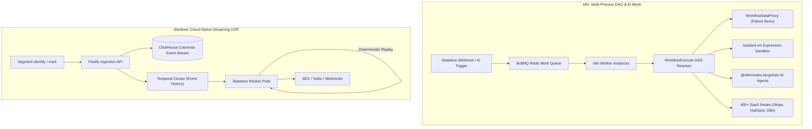
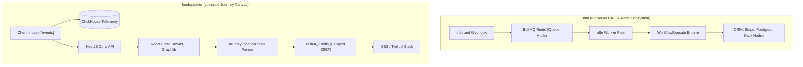
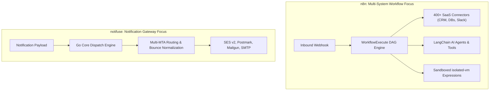
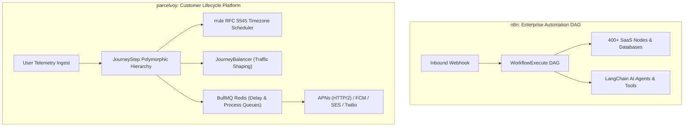
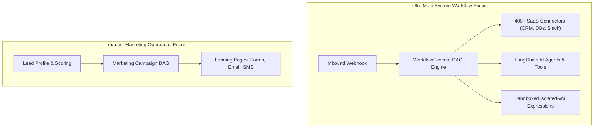

# n8n — Comparative Analysis & Category Evaluation

> **Category**: Customer Lifecycle & Journeys  
> **Architectural Role**: Universal workflow automation, systems integration & autonomous AI agent orchestration  
> **Primary Stack**: TypeScript Monorepo | Node.js 20+, Vue 3 | PostgreSQL 16 / MySQL / SQLite | Custom DAG + BullMQ  
> **Peer Solutions Compared**: `dittofeed`, `laudspeaker`, `notifuse`, `parcelvoy`, `mautic`  
> **Commercial SaaS Benchmarks**: Zapier, Make.com, Workato, Tray.io, Customer.io, HubSpot  

---

## 1. Executive Overview & Technical Identity: n8n

**n8n** is an enterprise-grade, fair-code workflow automation and systems integration engine designed to connect heterogeneous APIs, operational databases, SaaS platforms, and artificial intelligence agents. Built as a high-performance modular TypeScript monorepo, n8n provides an interactive visual node canvas backed by a deterministic Directed Acyclic Graph (DAG) execution engine (`WorkflowExecute`).

In modern enterprise automation and RevOps infrastructure, organizations are crippled by per-task SaaS subscription models (e.g., Zapier, Make), opaque third-party cloud data residency, and rigid integration logic. n8n solves these operational barriers by offering complete self-hosted control, raw code-level execution flexibility (sandboxed Node.js and Python via `isolated-vm`), zero telemetry leakage, and native support for LangChain-driven autonomous agent graphs (`@n8n/nodes-langchain`).

### Core Architectural Profile
- **Runtime & Language**: `TypeScript / Node.js 20+ / 22 LTS` (Turborepo & pnpm workspace monorepo)
- **Frontend Canvas**: `Vue 3`, `Pinia`, `VueFlow`, `Tailwind CSS`
- **Persistence Layer**: `TypeORM 0.3.x` with support for `PostgreSQL 16+`, `MySQL 8.0+`, and `SQLite`
- **Execution & Scaling Architecture**: Multi-process topology featuring dedicated stateless webhook daemons, `n8n Main` coordinators, and `n8n Worker` fleets managed via `BullMQ` and `Redis 7.x`
- **DAG Execution Core**: `WorkflowExecute` engine with paired-item data lineage semantics
- **Sandboxed Expression Runtime**: `isolated-vm` memory-bounded V8 isolates with `IdleScalingPool`
- **Primary Architectural Niche**: Universal multi-system API orchestration, 400+ SaaS connectors, and visual LangChain AI agent pipelines

---

## 2. Peer Solution Landscape (Customer Lifecycle & Journeys)

Within the Customer Lifecycle & Journeys domain, `n8n` operates alongside five distinct architectural peers:

| Solution | Language & Runtime | Core Framework | Database / Cache | Queue / Concurrency | Primary Architectural Niche |
| :--- | :--- | :--- | :--- | :--- | :--- |
| **n8n** (Current) | `TypeScript Monorepo` | `Node.js 20+, Vue 3` | `PostgreSQL / SQLite` | `WorkflowExecute DAG + BullMQ` | **400+ SaaS connectors & `isolated-vm` sandboxed execution** |
| **dittofeed** | `TypeScript / Node.js 20+` | `Fastify, Next.js` | `PostgreSQL + ClickHouse` | `Temporal.io Workflows` | Durable temporal workflows & streaming ClickHouse analytics |
| **laudspeaker** | `TypeScript / Node.js 18+` | `NestJS 10, React 18` | `PostgreSQL + ClickHouse` | `BullMQ / Redis` | Visual React Flow journey canvas with `JourneyLocation` state pointers |
| **notifuse** | `Go 1.25+` | `Native Go DDD` | `PostgreSQL / AlloyDB` | `Goroutine Worker Pools` | In-process Go Liquid/MJML compilation & multi-MTA gateway |
| **parcelvoy** | `TypeScript / Node.js 18+` | `Koa 2, Knex` | `MySQL 8 / PostgreSQL` | `BullMQ / Redis` | Polymorphic journey steps with RFC 5545 RRULE timezone scheduling |
| **mautic** | `PHP 8.2+` | `Symfony 7.4, Twig` | `MySQL / PostgreSQL` | `Symfony Messenger + Cron` | Monolithic marketing automation, lead scoring & set-based segmentation |

---

## 3. Deep Head-to-Head Comparative Breakdown: n8n vs Peers

### 3.1. n8n vs. dittofeed

**Comparative Focus**: `Universal API Integration DAG & LangChain AI Nodes` vs. `Temporal Event Sourcing & ClickHouse Streaming CDP`

#### Pipeline Topologies, Workflow Engines & Queue Mechanics
- **General-Purpose DAG vs. Customer Lifecycle Engine**: `n8n` is an unconstrained workflow automation engine. Its execution core (`WorkflowExecute`) models workflows as Directed Acyclic Graphs where data flows as arrays of JSON items (`INodeExecutionData[]`) between 400+ third-party service nodes, SQL databases, and LLM agent chains. `dittofeed` is purpose-built for customer relationship management: it models stateful user journeys that evaluate customer traits, wait for behavioral triggers, and dispatch multi-channel messages via **Temporal.io**.
- **Paired-Item Semantics vs. User Context**: n8n retains "Paired Item" lineage across every node transformation, ensuring that downstream nodes know exactly which input item produced an output item during list splitting, loops, or batch transformations. Dittofeed operates on unified customer identities and event payloads.

#### Database Storage & Telemetry Architecture
- **Stateless Execution vs. Columnar Event Storage**: Dittofeed stores raw behavioral telemetry in ClickHouse MergeTree tables, allowing it to compute dynamic segments over billions of events. n8n does not store customer clickstream histories; it persists workflow graph definitions, execution run logs (`execution_data`), and AES-256-GCM encrypted credentials in PostgreSQL or SQLite.

#### Failure Modes, Crash Recovery & Bottlenecks
- **Sandboxed Execution**: n8n protects worker processes by executing user expressions and custom JavaScript/Python code inside isolated V8 isolates (`isolated-vm`). A rogue script or infinite loop in user code cannot crash the worker daemon. Dittofeed executes compiled TypeScript workflow code managed by Temporal workers.
- **Execution Recovery**: In n8n, failed executions record the full state of every node in `execution_data`. Users can inspect data at the exact failed node and re-execute manually or configure automated retries. Dittofeed relies on Temporal's automatic retry policies and deterministic replay.

#### Architectural Comparison Matrix: n8n vs. dittofeed

| Metric / Dimension | n8n | dittofeed |
| :--- | :--- | :--- |
| **Primary Domain** | Universal workflow automation & AI RevOps | Event-driven customer engagement & streaming CDP |
| **Workflow Engine** | `WorkflowExecute` DAG + BullMQ | Temporal.io (Deterministic code workflows) |
| **Integration Ecosystem**| **400+ SaaS apps, databases, and APIs** | Core messaging channels (SES, Twilio, Postmark) |
| **AI Orchestration** | **Native LangChain agents, vector stores & tools** | None (Rule-based journeys) |
| **Code Sandboxing** | **`isolated-vm` memory-bounded V8 isolates** | None (Precompiled TypeScript workers) |
| **Customer 360 Storage** | None (Stateless operational state) | **ClickHouse 23+ columnar warehouse + Postgres** |
| **Segment Ingestion** | Custom webhooks / HTTP | **Native Segment-compatible `identify`/`track`** |

#### Where n8n Excels over dittofeed
- **Vast Connector Ecosystem**: Instantly connects marketing workflows to hundreds of SaaS platforms, CRMs, internal databases, and Slack.
- **Generative AI & Agent Workflows**: Visually assemble multi-step autonomous AI agents with tools, memory, and LLMs via `@n8n/nodes-langchain`.
- **Visual Expression Debugging**: Interactive Vue 3 canvas lets developers test individual nodes with live payloads and custom JavaScript sandbox execution.

#### Where dittofeed Holds an Advantage over n8n
- **Customer Lifecycle Abstractions**: Native concepts for user traits, behavioral segments, frequency capping, and channel opt-ins.
- **Columnar Telemetry Warehouse**: ClickHouse allows querying millions of historical user events for segmentation, which n8n cannot perform natively.
- **Segment CDP Compatibility**: Ready-to-use client SDKs and REST ingestion endpoints.

---

### 3.2. n8n vs. laudspeaker

**Comparative Focus**: `Multi-System Automation Mesh & Sandboxed VM` vs. `Visual React Flow Customer Journey Canvas & ClickHouse Analytics`

#### Pipeline Topologies, Workflow Engines & Queue Mechanics
- **Integration Nodes vs. Lifecycle Canvas**: `n8n` executes Directed Acyclic Graphs designed to transfer and manipulate data across multiple services (e.g., *Stripe payment received -> Enrich via Clearbit -> Update PostgreSQL -> Alert Slack*). `laudspeaker`’s canvas is specifically designed for customer lifecycle funnels (e.g., *User signed up -> Wait 2 days -> If activated, send Tip email, else send SMS*).
- **Delayed Execution Mechanics**: Laudspeaker uses BullMQ delayed sorted sets (`ZSET`) to hold users at delay nodes, validating progression via the `JourneyLocation` entity (`journey_id`, `customer_id`, `step_id`). n8n handles delays via Wait nodes that persist execution state and resume execution after a timer or webhook callback.

#### Database Storage & Telemetry Architecture
- **Customer Profile Persistence**: Laudspeaker maintains an active customer ledger in PostgreSQL with flexible JSONB attributes (`user_attributes`) and historical event telemetry in ClickHouse. n8n does not maintain a customer database; it persists workflow definitions, encrypted credentials (AES-256-GCM), and execution run snapshots.

#### Architectural Comparison Matrix: n8n vs. laudspeaker

| Metric / Dimension | n8n | laudspeaker |
| :--- | :--- | :--- |
| **Primary Domain** | Universal API orchestration & AI workflows | Customer onboarding & lifecycle journeys |
| **Canvas Engine** | Vue 3 / VueFlow DAG engine | React Flow (`@dagrejs/graphlib` validation) |
| **Integration Breadth**| **400+ SaaS apps, databases, and APIs** | Core messaging channels (SES, Twilio, Slack) |
| **AI Capabilities** | **Native LangChain nodes (Agents, Memory, Tools)**| None (Rule-based journeys) |
| **Customer 360 Ledger**| None (Stateless execution engine) | **PostgreSQL JSONB + ClickHouse telemetry** |
| **Code Execution** | **`isolated-vm` sandboxed JavaScript/Python** | Handlebars templating |

#### Where n8n Excels over laudspeaker
- **Massive SaaS Ecosystem**: Connects seamlessly with 400+ external platforms (CRMs, payment gateways, ERPs).
- **Autonomous AI Agents**: Visually construct self-healing conversational agents with tool calling and vector retrieval.
- **Granular Execution Debugging**: Step-by-step visual payload inspection and one-click replay from failed nodes.

#### Where laudspeaker Holds an Advantage over n8n
- **Native Customer Engagement**: Built-in concepts for customers, segments, message templates, and delivery attribution.
- **Long-Running Journey Timers**: Optimized for multi-week user onboarding and re-engagement campaigns.
- **Event-Driven Segmentation**: ClickHouse integration enables behavioral segmentation over historical event data.

---

### 3.3. n8n vs. notifuse

**Comparative Focus**: `Universal Workflow Automation Engine` vs. `High-Speed In-Process Go MJML Compilation & Gateway`

#### Pipeline Topologies, Workflow Engines & Queue Mechanics
- **Workflow Automation vs. Notification Infrastructure**: `n8n` is designed to automate complex, multi-service business logic using visual DAGs. `notifuse` is an infrastructure component engineered to solve delivery abstraction: it decouples business applications from specific email/SMS vendors while providing template compilation and bounce governance.
- **Execution Runtime**: n8n runs on Node.js using an async event loop, coordinating worker fleets via BullMQ and Redis. Notifuse runs as a compiled Go binary utilizing lightweight goroutine pools and database transaction locks, achieving extreme concurrency with minimal resource consumption.

#### Database Storage & Template Rendering Architecture
- **Email Compilation Velocity**: n8n relies on Node.js email nodes (e.g., SendGrid, SES, SMTP nodes) that perform basic HTML or text substitution. Notifuse provides a complete, in-process Liquid and MJML compiler (`gomjml`) with responsive multi-device HTML generation. Notifuse renders personalized emails at sub-millisecond speeds (>10,000 emails/second), using a fraction of the CPU and RAM consumed by Node.js renderers.

#### Deliverability, Governance & Suppression
- **Bounce Classification**: Notifuse features an advanced 3-way bounce classification engine (`bounce_classification.go`) that categorizes discordant webhooks from SES, Postmark, and SendGrid into `Hard`, `SoftCount`, and `SoftIgnore`. n8n provides generic webhook receiver nodes, requiring manual rule composition to handle provider bounces.

#### Architectural Comparison Matrix: n8n vs. notifuse

| Metric / Dimension | n8n | notifuse |
| :--- | :--- | :--- |
| **Primary Domain** | Multi-system workflow automation & RevOps | Notification delivery gateway & template compilation |
| **Runtime & Language** | TypeScript / Node.js 20+ Monorepo | **Go 1.25+ (Static binary)** |
| **Email Template Engine** | Node.js HTML / Basic substitution | **Pure Go `gomjml` + `liquidgo`** |
| **Compilation Speed** | ~300 emails/sec per core | **10,000+ emails/sec per core** |
| **Third-Party Connectors** | **400+ SaaS apps, databases, and APIs** | Email/SMS providers (SES, Postmark, Twilio) |
| **AI Agent Orchestration** | **Native LangChain nodes (Agents, Memory, Tools)** | None |

#### Where n8n Excels over notifuse
- **Vast Connector Ecosystem**: Instantly connects workflows to 400+ external services (Stripe, HubSpot, Salesforce, Postgres).
- **Autonomous AI Agents**: Visually compose multi-step AI agents with tool calling and vector retrieval via `@n8n/nodes-langchain`.
- **Interactive Visual Debugging**: Inspect live execution payloads at every step of a workflow with one-click retry.

#### Where notifuse Holds an Advantage over n8n
- **Dedicated Notification Infrastructure**: Designed specifically to handle multi-MTA routing, provider failover, and responsive MJML compilation.
- **High-Velocity Email Compilation**: Compiles personalized MJML templates orders of magnitude faster than Node-based pipelines.
- **MTA Deliverability Governance**: Universal 3-way bounce classification and transactional IP protection.

---

### 3.4. n8n vs. parcelvoy

**Comparative Focus**: `Universal Systems Integration & AI Agents` vs. `Specialized Customer Lifecycle & Push Engine`

#### Pipeline Topologies, Workflow Engines & Queue Mechanics
- **Universal DAG vs. Polymorphic Lifecycle Steps**: `n8n` executes Directed Acyclic Graphs where nodes represent arbitrary APIs, databases, and AI agents. `parcelvoy` decomposes customer journeys into modular, executable node types inheriting from `JourneyStep` (`JourneyEntrance`, `JourneyDelay`, `JourneyAction`, `JourneyGate`, `JourneyExperiment`, `JourneyBalancer`, `JourneyExit`).
- **Timezone Scheduling via RRULE**: Parcelvoy integrates `rrule` (RFC 5545) with `date-fns-tz` to ensure that messages arrive during the recipient's local daytime hours. n8n supports basic cron triggers with timezones, but lacks contact-level dynamic timezone projection within workflow delay nodes.
- **Traffic Balancing**: Parcelvoy includes a `JourneyBalancer` step type that dynamically throttles user flow into subsequent steps, preventing downstream webhook or sales overload. n8n relies on Wait nodes or manual queue rate limiters.

#### Database Storage & Telemetry Architecture
- **Customer & Device Ledger**: Parcelvoy maintains an active user profile ledger in MySQL/PostgreSQL with indexed mobile device tokens (`devices: Device[]`). n8n does not maintain a customer database; it persists workflow definitions, encrypted credentials (AES-256-GCM), and execution run snapshots.

#### Architectural Comparison Matrix: n8n vs. parcelvoy

| Metric / Dimension | n8n | parcelvoy |
| :--- | :--- | :--- |
| **Primary Domain** | Universal API orchestration & AI workflows | Customer lifecycle messaging & mobile push |
| **Canvas Engine** | Vue 3 / VueFlow DAG engine | Modular `JourneyStep` node hierarchy |
| **Integration Breadth**| **400+ SaaS apps, databases, and APIs** | Core messaging channels (SES, Twilio, APNs, FCM) |
| **Timezone-Aware Delivery**| Cron node with timezone | **Native RFC 5545 RRULE localized scheduling** |
| **Mobile Push Gateways** | Webhook push | **Native Apple APNs (HTTP/2) & Google FCM** |
| **Traffic Smoothing** | Manual Wait nodes | **Dedicated `JourneyBalancer` canvas step** |

#### Where n8n Excels over parcelvoy
- **Massive SaaS Ecosystem**: Connects seamlessly with 400+ external platforms (CRMs, payment gateways, ERPs).
- **Autonomous AI Agents**: Visually construct self-healing conversational agents with tool calling and vector retrieval.
- **Granular Execution Debugging**: Step-by-step visual payload inspection and one-click replay from failed nodes.

#### Where parcelvoy Holds an Advantage over n8n
- **Native Customer Engagement**: Built-in concepts for users, segments, message templates, mobile device tokens, and channel subscriptions.
- **Precision Timezone Scheduling**: Native RRULE support guarantees contacts receive messages at local daylight hours globally.
- **Mobile Push Infrastructure**: Deep native APNs HTTP/2 and Firebase FCM integration.
- **Traffic Balancers**: `JourneyBalancer` prevents sudden marketing blasts from overwhelming sales teams and downstream APIs.

---

### 3.5. n8n vs. mautic

**Comparative Focus**: `Modern Cloud-Native Integration DAG & AI Agents` vs. `All-in-One Enterprise Marketing Suite`

#### Pipeline Topologies, Workflow Engines & Queue Mechanics
- **Multi-Service Automation vs. Marketing Suite**: `n8n` is an unconstrained integration and automation engine: it processes arbitrary Directed Acyclic Graphs where data flows as arrays of JSON items (`INodeExecutionData[]`) between 400+ third-party service nodes and LangChain AI components. `mautic` is engineered for marketing practitioners: it provides turnkey landing pages, lead capture forms, point-based lead scoring, and automated email nurturing funnels.
- **Execution Runtime**: n8n operates with sub-second execution latency using decoupled webhook receivers and BullMQ worker fleets. Mautic evaluates campaigns and spools emails via background cron commands (`bin/console mautic:*`), introducing 1- to 5-minute polling latencies.

#### Database Storage & Telemetry Architecture
- **Customer CRM vs. Operational Execution Data**: Mautic maintains an active customer CRM database in MySQL with custom fields, company associations, lead scores, and tracking histories. n8n does not maintain a customer database; it persists workflow definitions, encrypted credentials (AES-256-GCM), and execution run snapshots.

#### Deliverability, Governance & Suppression
- **Suppression Management**: Mautic features an enterprise-grade `DoNotContact` entity that automatically ingests RFC 3464 DSN bounce emails and RFC 8058 List-Unsubscribe headers via inbound IMAP mailbox monitoring (`MonitoredEmail/`). n8n handles email via generic integration nodes, delegating suppression management to external providers.

#### Architectural Comparison Matrix: n8n vs. mautic

| Metric / Dimension | n8n | mautic |
| :--- | :--- | :--- |
| **Primary Domain** | Universal API orchestration & AI workflows | All-in-one marketing automation & CRM |
| **Canvas Engine** | Vue 3 / VueFlow DAG engine | Symfony Campaign DAG builder |
| **Integration Ecosystem**| **400+ SaaS apps, databases, and APIs** | Legacy PHP plugins |
| **AI Agent Capabilities** | **Native LangChain nodes (Agents, Memory, Tools)**| None |
| **Lead Scoring & Forms** | None (Relies on external tools) | **Native progressive forms, pages & scores** |
| **Code Execution** | **`isolated-vm` sandboxed JavaScript/Python** | PHP plugins & Symfony events |

#### Where n8n Excels over mautic
- **Massive SaaS Ecosystem**: Connects seamlessly with 400+ external platforms (CRMs, payment gateways, ERPs).
- **Autonomous AI Agents**: Visually compose multi-step AI agents with tool calling and vector retrieval via `@n8n/nodes-langchain`.
- **Modern Cloud Execution**: Decoupled webhook receivers and BullMQ worker fleets with sub-second execution speeds.

#### Where mautic Holds an Advantage over n8n
- **Turnkey Marketing Functionality**: Native landing pages, progressive profiling forms, and point-based lead scoring.
- **Native Customer CRM**: Stores persistent lead profiles, timeline histories, and company associations.
- **Deliverability Governance**: Centralized Do-Not-Contact registry with automated IMAP bounce mailbox parsing.

---

## 4. Capability & Feature Comparison Matrix

| Capability / Dimension | n8n | dittofeed | laudspeaker | notifuse | parcelvoy | mautic |
| :--- | :---: | :---: | :---: | :---: | :---: | :---: |
| **Primary Architectural Role** | **Multi-System DAG Automation** | Streaming Lifecycle CDP | Visual Journey Canvas | High-Speed Notification Gateway | Modular Multi-Channel Lifecycle | Monolithic Marketing Automation |
| **400+ SaaS Integrations** | **✅ Native Ecosystem** | ❌ Core channels | ❌ Core channels | ❌ Core channels | ❌ Core channels | ⚠️ Legacy plugins |
| **Native AI Agent / LLM Nodes**| **✅ `@n8n/nodes-langchain`** | ❌ | ❌ | ⚠️ SDK wrapper | ❌ | ❌ |
| **Sandboxed Code Execution** | **✅ `isolated-vm`** | ❌ | ❌ | ❌ | ❌ | ❌ |
| **Workflow Engine** | **`WorkflowExecute` DAG** | Temporal.io | BullMQ + Graphlib | Goroutine Pools | BullMQ + Step Classes | Symfony Messenger + Cron |
| **Customer 360 & Profiles** | ❌ (Stateless engine) | **✅ ClickHouse + Postgres** | **✅ Postgres JSONB** | ⚠️ Basic contacts | **✅ Relational profiles** | **✅ Deep CRM & Scores** |
| **Timezone-Aware Delivery** | ⚠️ Cron node with TZ | ⚠️ Code offsets | ⚠️ JS-Temporal | ❌ | **✅ RFC 5545 RRULE** | ⚠️ Timezone shifts |
| **In-Process MJML Compilation**| ❌ (Node.js) | ❌ (Node.js) | ❌ (Node.js) | **✅ Pure Go (`gomjml`)** | ❌ (Handlebars) | ❌ (Twig) |
| **Do-Not-Contact Registry** | ⚠️ Manual lookup | ⚠️ Workspace lists | ⚠️ Attribute flags | ✅ Universal 3-way | ✅ Multi-topic preferences | **✅ Dedicated DNC entity**|
| **License** | **Fair-Code (SUEL)** | MIT | MIT | BSL 1.1 / AGPL-3.0 | MIT | GPL-3.0 |

---

## 5. Commercial Benchmark Positioning

When evaluated against commercial SaaS benchmarks (**Zapier, Make.com, Workato, Tray.io, HubSpot**):
- **Against Zapier / Make.com**: `n8n` is widely recognized as the premier self-hosted alternative. It completely eliminates punitive per-task pricing tiers, keeps sensitive customer data within private cloud VPCs, and offers deep code-level execution flexibility (custom JavaScript/Python with `isolated-vm` isolation).
- **Against Workato / Tray.io**: n8n delivers enterprise-grade integration capabilities at a fraction of the cost, with advanced LangChain AI agent orchestration that proprietary integration platforms struggle to match.
- **Against Customer Lifecycle Platforms (Customer.io, HubSpot)**: n8n excels at systems integration and multi-app orchestration rather than persistent customer clickstream tracking or visual email drip sequences.

---

## 6. Strategic Takeaways & Role for MarketingStudio

In the unified **MarketingStudio** architecture:

1. **Adopt n8n as the Universal Systems Integration & Automation Backbone**: Rather than custom-building hundreds of fragile third-party integrations, embed n8n as MarketingStudio's integration mesh. This allows marketing and RevOps teams to connect external CRMs, payment gateways, internal databases, and Slack directly into marketing workflows.
2. **Deploy LangChain Autonomous AI Agents**: Utilize n8n’s native `@n8n/nodes-langchain` integration to orchestrate AI SDR agents, automated content enrichment, and customer support ticket routing within marketing funnels.
3. **Incorporate `isolated-vm` Sandboxing**: Adopt n8n's expression runtime architecture (`WorkflowDataProxy` + `isolated-vm`) to allow users to author custom dynamic expressions and code snippets securely without risking main process crashes.
4. **Harmonize with Peer Strengths**:
   - Utilize **dittofeed's** ClickHouse ingestion and Temporal engine for real-time streaming product telemetry.
   - Offload high-volume email compilation to **notifuse's** in-process Go MJML engine to reduce CPU costs during massive campaign sends.
   - Adopt **parcelvoy's** RRULE timezone engine and `JourneyBalancer` traffic smoothing to protect downstream systems.
   - Use **laudspeaker's** React Flow visual canvas for marketer-facing onboarding flows.
