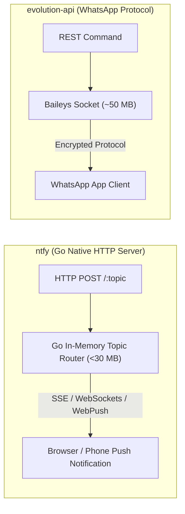
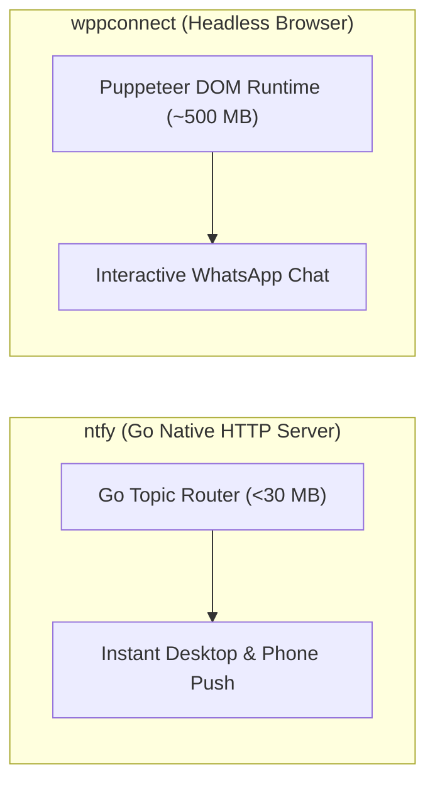
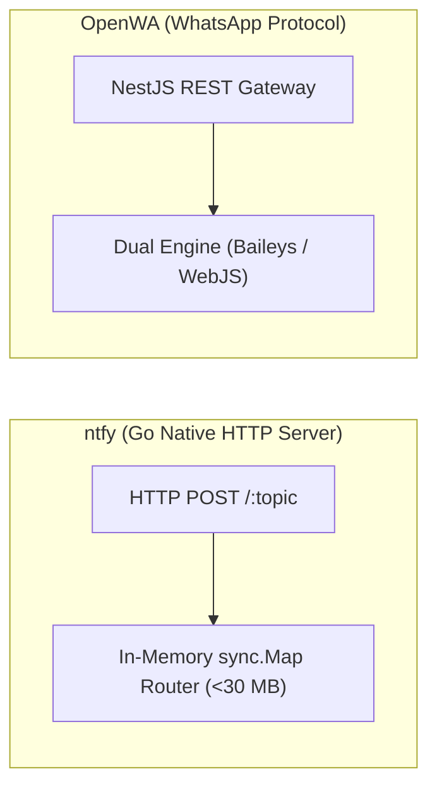
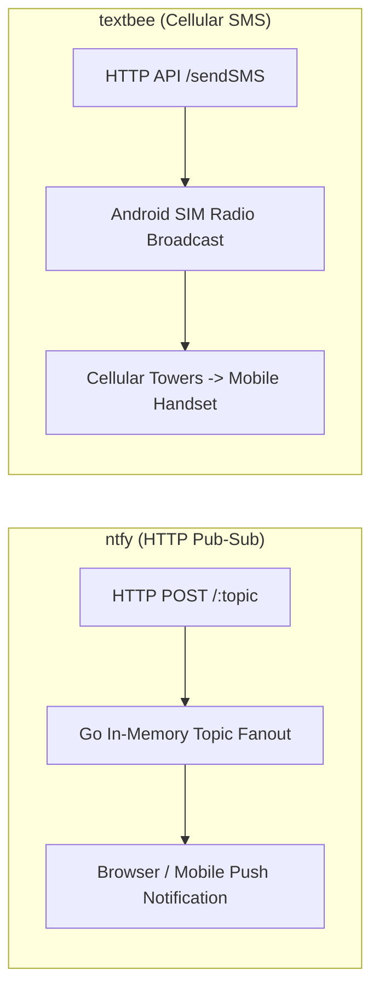
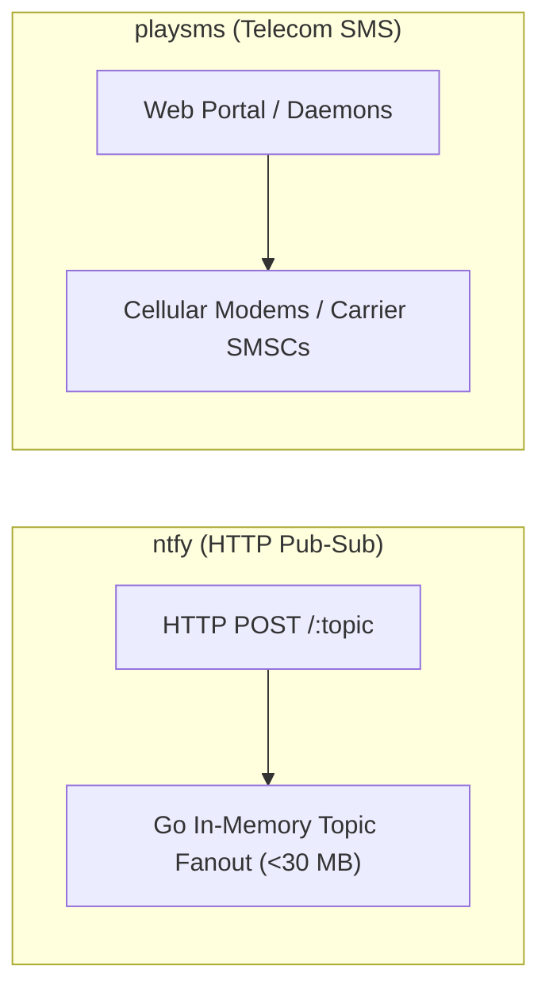

# ntfy — Comparative Analysis & Category Evaluation

> **Category**: WhatsApp & Messaging Gateways  
> **Architectural Role**: High-performance HTTP pub-sub push notification engine & mobile gateway  
> **Primary Stack**: Go 1.26+ | Native Go (`net/http`), Gorilla WebSockets | SQLite / PostgreSQL, S3 | In-Memory `sync.Map` Topic Router + SSE/WS  
> **Peer Solutions Compared**: `evolution-api`, `wppconnect`, `OpenWA`, `textbee`, `playsms`  
> **Commercial SaaS Benchmarks**: Pushover, OneSignal, Firebase Cloud Messaging (FCM), Pushbullet, Amazon SNS  

---

## 1. Executive Overview & Technical Identity: ntfy

**ntfy** represents the lightweight, zero-dependency push notification standard within the **WhatsApp & Messaging Gateways** domain, distinguished by its core focus on **Pure Go compilation (<30MB base RAM), multi-protocol HTTP pub-sub streaming (SSE, WebSockets, WebPush, UnifiedPush), actionable interactive buttons, and simple curl-based message publication**.

### Core Architectural Profile
- **Runtime & Language**: `Go 1.26+` (Native compilation, zero runtime dependencies)
- **Core Framework**: Go standard library `net/http`, `gorilla/websocket`, `webpush-go`
- **Persistence Layer**: `SQLite 3` (`mattn/go-sqlite3`) or clustered `PostgreSQL` (`jackc/pgx/v5`), local disk or S3 attachments
- **Concurrency & Queue Model**: In-memory pub-sub topic router (`*sync.Map`) + Go channels + token-bucket rate limiter (`visitor.go`)
- **Domain Specialization**: `Instant mobile push alerts, actionable desktop notifications & UnifiedPush relay`

---

## 2. Peer Solution Landscape (WhatsApp & Messaging Gateways)

Within this category, `ntfy` operates alongside the following peer solutions:

| Solution | Language & Runtime | Core Framework | Database / Cache | Queue / Concurrency | Primary Architectural Niche |
| :--- | :--- | :--- | :--- | :--- | :--- |
| **ntfy** (Current) | `Go 1.26+` | `Native Go net/http` | `SQLite / PostgreSQL` | `Go Channels / sync.Map` | **Ultra-fast zero-dependency push notification daemon (<30MB)** |
| **evolution-api** | `TypeScript / Node 20+`| `Express, Baileys, Prisma` | `PostgreSQL / MySQL, Redis`| `RabbitMQ / Kafka / SQS` | Direct binary socket WhatsApp with minimal RAM & DB auth |
| **wppconnect** | `TypeScript / Node 20+`| `Express, Puppeteer` | `Local Disk / SQLite` | `Node Event Emitters` | Complete browser-level WhatsApp Web emulation via Chromium DOM |
| **OpenWA** | `TypeScript / Node 22+`| `NestJS 11+, TypeORM` | `PostgreSQL, Redis` | `BullMQ Transactional Outbox`| Pluggable dual-engine (Baileys & WWebJS) with send idempotency |
| **textbee** | `TypeScript & Kotlin` | `NestJS 11+, Android SDK` | `MongoDB 7+, Redis` | `BullMQ Pacing Engine` | Decentralized carrier SMS using physical Android handsets |
| **playsms** | `PHP 8.1+` | `Native PHP, CLI Daemons` | `MySQL 8.0+` | `playsmsd Background Daemons`| Classical carrier-grade SMS portal with prefix rating & SMPP |

---

## 3. Deep Head-to-Head Comparative Breakdown: ntfy vs Peers

### 3.1. ntfy vs. evolution-api

**Comparative Focus**: `Lightweight HTTP pub-sub push server` vs. `Two-way conversational WhatsApp gateway`

#### Architectural & Stack Differences
- **Domain Specialization**: `ntfy` is an ultra-fast, one-way HTTP publish-subscribe notification service designed to stream alerts directly to desktop browsers, iOS/Android apps, and scripts. Evolution API is a bi-directional WhatsApp conversational gateway enabling two-way customer communication, live chat routing, and multi-tenant inbox synchronization.
- **Resource Footprint & Deployment**: `ntfy` compiles into a single static Go binary consuming under **30 MB of RAM**, maintaining hundreds of thousands of concurrent client streams via Go channels. Evolution API is a Node.js/TypeScript microservice with Prisma ORM, Redis, and multi-instance Baileys session management consuming ~50 MB RAM per active WhatsApp number.
- **Protocol & Delivery Model**: `ntfy` transmits over standard HTTP streams (Server-Sent Events, WebSockets, W3C WebPush, or UnifiedPush). Evolution API connects over the WhatsApp Noise Protocol to Meta’s multi-device servers.

#### Where ntfy Excels over evolution-api
- **Negligible Footprint & Zero Dependencies**: Single Go binary running on <30 MB RAM with zero external databases or Redis requirements.
- **Zero Account Ban Risk**: Operates over standard HTTP without Meta terms of service or carrier spam scrutiny.
- **Instant Implementation**: Broadcast notifications from any curl command, bash script, or microservice.

#### Where evolution-api Holds an Advantage over ntfy
- **Bi-Directional Customer Conversations**: Ingest customer replies, manage chat threads, and route conversations to human agents.
- **Universal Consumer Reach**: Delivers to standard WhatsApp apps installed on 2.7+ billion devices.
- **Rich Media & Formatting**: Supports native Opus voice recordings, PDF documents, location pins, and clickable buttons.

#### Architectural Tradeoffs Matrix

| Architectural Dimension | ntfy | evolution-api |
| :--- | :--- | :--- |
| **Primary Domain Focus** | One-way HTTP pub-sub push notification server | Bi-directional conversational WhatsApp API |
| **Runtime & Language** | Compiled Go 1.26+ (Zero dependencies) | TypeScript / Node.js 20+ |
| **Client Requirement** | Desktop browser / ntfy mobile app / UnifiedPush | WhatsApp consumer mobile application |
| **Delivery Model** | Direct HTTP streaming (SSE, WebSockets, WebPush) | End-to-end encrypted messaging via Meta servers|
| **Base Production RAM** | **< 30 MB RAM total** | ~50 MB RAM per active session |
| **Best-Fit Deployment** | Internal DevOps alerts, transactional push notifications| Customer support, conversational sales, lead nurture|

---

### 3.2. ntfy vs. wppconnect

**Comparative Focus**: `Lightweight HTTP pub-sub push server` vs. `Two-way conversational WhatsApp automation`

#### Architectural & Stack Differences
- **Runtime Footprint**: `ntfy` executes natively in Go, using less than 30 MB RAM to route thousands of messages. WPPConnect launches headless Google Chromium browser instances via Puppeteer Extra, consuming 400 MB to 750 MB RAM per active WhatsApp number.
- **Protocol Layer**: `ntfy` exposes simple HTTP `POST` endpoints and streams notifications via SSE, WebSockets, and WebPush. WPPConnect injects `@wppconnect/wa-js` directly into the DOM of `web.whatsapp.com`.
- **Infrastructure Simplicity**: `ntfy` requires no browser sandboxes, font libraries, or Xvfb setups, running as a standalone binary in any Linux or container environment.

#### Where ntfy Excels over wppconnect
- **20x Lower Memory Footprint**: Single Go binary running on <30 MB RAM.
- **Zero Risk of Account Bans**: Operates over standard HTTP without Meta terms-of-service restrictions.
- **Zero-Dependency Simplicity**: Start sending push notifications with a single curl command.

#### Where wppconnect Holds an Advantage over ntfy
- **Bi-Directional Customer Conversations**: Receive incoming customer inquiries and hold conversations.
- **Universal Consumer Reach**: Delivers messages to standard WhatsApp apps without requiring users to install specialized alert clients.
- **Rich Media & Interactive UI**: Voice notes, PDF documents, location pins, and clickable buttons.

#### Architectural Tradeoffs Matrix

| Architectural Dimension | ntfy | wppconnect |
| :--- | :--- | :--- |
| **Primary Domain Focus** | One-way HTTP pub-sub push notifications | Two-way WhatsApp Web automation |
| **Runtime & Language** | Compiled Go 1.26+ (Zero dependencies) | TypeScript / Node.js (Puppeteer Chromium) |
| **Delivery Model** | HTTP SSE, WebSockets, WebPush, UnifiedPush | WhatsApp Web DOM evaluation |
| **Memory Footprint** | **< 30 MB RAM total** | ~500 MB RAM per active session |
| **Account Ban Risk** | **Zero (Open HTTP protocol)** | Low (Official web client context) |
| **Best-Fit Deployment** | System monitoring, DevOps alerts, instant lead push| Interactive WhatsApp chat, customer support |

---

### 3.3. ntfy vs. OpenWA

**Comparative Focus**: `Lightweight HTTP pub-sub push server` vs. `Two-way conversational WhatsApp gateway`

#### Architectural & Stack Differences
- **Architectural Scope**: `ntfy` is a focused pub-sub push message broker with built-in visitor rate limiting (`visitor.go`). OpenWA is an enterprise WhatsApp gateway built on NestJS 11+, featuring a dual-engine abstraction, transactional webhook outbox, and send idempotency.
- **Message Delivery Model**: `ntfy` fans out HTTP payloads to active subscribers across in-memory Go channels with SQLite/PostgreSQL caching for offline replay. OpenWA dispatches messages across external WhatsApp servers and queues outbound webhooks via BullMQ.
- **Target Audience**: `ntfy` notifies staff, developers, or opt-in end-users via push alerts. OpenWA engages prospective leads and customers on WhatsApp.

#### Where ntfy Excels over OpenWA
- **Negligible Footprint & Zero Dependencies**: Single Go binary consuming under 30 MB of RAM with zero databases required.
- **Zero Account Ban Risk**: Plain HTTP pub-sub completely free from Meta terms of service or carrier spam detection.
- **Instant Implementation**: Fire alerts from any script, cron job, or microservice using standard HTTP POST requests.

#### Where OpenWA Holds an Advantage over ntfy
- **Bi-Directional Customer Conversations**: Ingest customer replies, manage chat threads, and route conversations to human agents.
- **Universal Consumer Reach**: Over 2.7 billion active WhatsApp users already have the app installed.
- **Rich Media & Interactive UI**: Voice notes, PDF documents, location pins, and clickable buttons.

#### Architectural Tradeoffs Matrix

| Architectural Dimension | ntfy | OpenWA |
| :--- | :--- | :--- |
| **Primary Domain Focus** | One-way HTTP pub-sub push notification server | Bi-directional conversational WhatsApp API |
| **Runtime & Language** | Compiled Go 1.26+ (Zero dependencies) | TypeScript / NestJS 11+ |
| **Client Requirement** | Desktop browser / ntfy mobile app / UnifiedPush | WhatsApp consumer mobile application |
| **Delivery Model** | Direct HTTP streaming (SSE, WebSockets, WebPush) | End-to-end encrypted messaging via Meta servers|
| **Memory Footprint** | **< 30 MB RAM total** | ~80 MB (Baileys) / ~350 MB (WebJS) |
| **Best-Fit Deployment** | Internal DevOps alerts, transactional push notifications| Customer support, conversational sales, lead nurture|

---

### 3.4. ntfy vs. textbee

**Comparative Focus**: `Lightweight HTTP pub-sub push server` vs. `Decentralized cellular SMS gateway`

#### Architectural & Stack Differences
- **Transport Medium**: `ntfy` delivers push notifications over HTTP (WebSockets, SSE, WebPush) requiring internet-connected client devices. Textbee dispatches cellular SMS over mobile carrier networks, reaching mobile phones via native cellular basebands without internet connectivity.
- **Resource Footprint**: `ntfy` is a compiled Go binary consuming under 30 MB of RAM with zero external databases. Textbee runs on NestJS, MongoDB, and Redis.
- **Directionality**: `ntfy` is primarily an alert broadcasting pipeline. Textbee supports two-way communication (receives incoming SMS from recipients).

#### Where ntfy Excels over textbee
- **Negligible Footprint & Zero Hardware**: Single Go binary running on <30 MB RAM with zero mobile phones required.
- **Zero Delivery Delay**: Push notifications arrive in under 15 milliseconds across WebSockets.
- **Rich Action Buttons**: Notifications include clickable HTTP callbacks, links, and file attachments.

#### Where textbee Holds an Advantage over ntfy
- **Reaches Offline Recipients**: SMS arrives on phones without cellular data or Wi-Fi connectivity.
- **Universal Mobile Reach**: Reaches any mobile phone number without requiring specialized client apps or topic subscriptions.
- **Two-Way Conversational SMS**: Intercepts customer SMS replies and triggers webhooks into CRMs.

#### Architectural Tradeoffs Matrix

| Architectural Dimension | ntfy | textbee |
| :--- | :--- | :--- |
| **Primary Channel** | HTTP Pub-Sub Push Notifications | Cellular Carrier SMS |
| **Recipient Internet Requirement**| Required (Wi-Fi or cellular data) | None (Cellular radio connection only) |
| **Hardware Footprint** | Compiled Go binary (<30 MB RAM) | Physical Android phone(s) |
| **Delivery Latency** | **< 15 milliseconds** | ~3 - 8 seconds |
| **Best-Fit Deployment** | Internal DevOps alerts, transactional push notifications| Customer SMS outreach, OTPs, booking confirmations|

---

### 3.5. ntfy vs. playsms

**Comparative Focus**: `Lightweight HTTP pub-sub push server` vs. `Telecom SMS portal & carrier routing`

#### Architectural & Stack Differences
- **Transport Medium**: `ntfy` broadcasts push alerts to web browsers, iOS/Android apps, and desktop daemons via standard internet HTTP streaming (SSE, WebSockets, WebPush). playSMS delivers standard SMS to mobile phones via carrier telecom networks and radio base stations.
- **Resource Footprint**: `ntfy` is a compiled Go binary consuming under 30 MB of RAM with zero external dependencies. playSMS requires PHP-FPM, MySQL, and five background Linux daemons.
- **Cost Structure**: `ntfy` notifications are completely free, operating over existing internet connections. SMS messages via playSMS incur telco carrier trunk charges.

#### Where ntfy Excels over playsms
- **Zero-Cost Delivery**: Delivers instant alerts at \$0.00 cost over standard HTTP.
- **Sub-15ms Latency**: Push notifications arrive in milliseconds, compared to telecom SMS latency (2–10 seconds).
- **Modern Push Features**: Actionable buttons, clickable links, and multimedia file attachments.

#### Where playsms Holds an Advantage over ntfy
- **Universal Cellular Reach**: Delivers to offline mobile phones without requiring internet access or app installations.
- **Prefix Rate Billing & Reselling**: Complete commercial portal for managing customer credit balances.
- **Two-Way SMS Interactions**: Supports keyword autoreplies, SMS voting, and customer inbound routing.

#### Architectural Tradeoffs Matrix

| Architectural Dimension | ntfy | playsms |
| :--- | :--- | :--- |
| **Delivery Medium** | HTTP Pub-Sub Push (SSE, WS, WebPush) | Telecom Carrier SMS (Cellular Radio) |
| **Recipient Internet Requirement**| Required | None |
| **Cost per Message** | **$0.00** | Carrier trunk rates |
| **Delivery Latency** | **< 15 milliseconds** | ~2 - 10 seconds |
| **Base Production RAM** | **< 30 MB RAM (Single Go Binary)** | ~100 MB RAM (PHP + Daemons + MySQL) |
| **Best-Fit Deployment** | DevOps monitoring, transactional push alerts | Commercial telecom portals, offline SMS delivery |

---

## 4. Capability & Feature Comparison Matrix

| Dimension / Capability | ntfy | evolution-api | wppconnect | OpenWA | textbee | playsms |
| :--- | :---: | :---: | :---: | :---: | :---: | :---: |
| **Primary Channel** | **Push Alerts** | WhatsApp | WhatsApp | WhatsApp | Android SMS | Telecom SMS |
| **Underlying Engine** | HTTP / WebPush | Baileys Socket | Chromium Web | Dual Engine | Android Intent / FCM | Modem / SMPP |
| **RAM Footprint** | **< 30 MB (Total)** | ~50 MB / session | ~500 MB / session | ~80 MB / session | ~30 MB (App) | ~25 MB |
| **Delivery Latency** | **< 15 ms** | < 200 ms | ~800 ms - 2s | < 200 ms | ~3 - 8s | ~2 - 10s |
| **Actionable Buttons** | **✅ HTTP / View / Copy**| ⚠️ Basic | ⚠️ Basic | ⚠️ Basic | ❌ | ❌ |
| **UnifiedPush Support** | **✅ Reference Server** | ❌ | ❌ | ❌ | ❌ | ❌ |
| **Scheduled Publishing**| **✅ Delay Header** | ❌ | ❌ | ✅ BullMQ | ❌ | ✅ schdqueue |

---

## 5. Commercial Benchmark Positioning

When benchmarked against commercial SaaS leaders (**Pushover, OneSignal, Firebase Cloud Messaging (FCM), Pushbullet, Amazon SNS**):
- **Against Pushover / Pushbullet**: `ntfy` provides a 100% self-hosted, open-source alternative that eliminates per-device license purchases and vendor lock-in.
- **Against OneSignal / Amazon SNS**: ntfy eliminates proprietary SDK requirements and complex credential provisioning, allowing any backend service to publish push notifications via simple HTTP POST calls.
- **Against Google Play Services**: ntfy acts as the premier reference implementation for the **UnifiedPush** standard, enabling battery-efficient mobile notifications without Google tracking.

---

## 6. Strategic Takeaways & Role for MarketingStudio

In the unified **MarketingStudio** architecture:
1. **Primary Component to Adopt**: Deploy `ntfy` as MarketingStudio's **Internal Notification Spine** to broadcast real-time operational alerts (hot lead replies, campaign completion, SLA breach warnings) directly to sales reps and administrators.
2. **Utilize Actionable Notification Buttons**: Attach inline HTTP callbacks to alerts (e.g., "Approve Campaign", "Re-assign Lead") allowing managers to execute actions directly from mobile notification shades.
3. **Reference Zero-Dependency Go Daemon Architecture**: Follow ntfy's patterns for memory pooling and high-concurrency pub-sub routing to ensure internal event dispatching never creates server bottlenecks.
