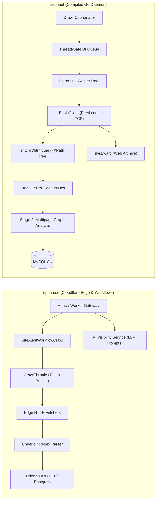
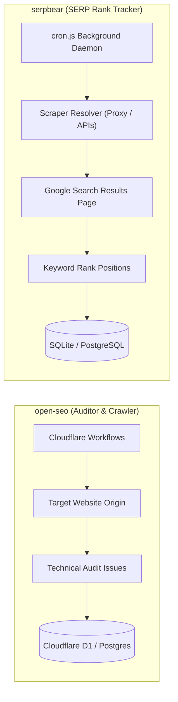

# open-seo — Comparative Analysis & Category Evaluation

> **Category**: SEO, Crawlers & Rank Tracking  
> **Architectural Role**: Serverless edge technical SEO auditor, durable workflow crawler & Generative Engine Optimization (GEO) engine  
> **Primary Stack**: TypeScript 5.x | Cloudflare Workers & Workflows | Drizzle ORM | Cloudflare D1 (SQLite) / PostgreSQL 16 | Token Bucket CrawlThrottle  
> **Peer Solutions Compared**: `seonaut`, `serpbear`  
> **Commercial SaaS Benchmarks**: Ahrefs, Semrush, Screaming Frog SEO Spider, Sitebulb, AccuRanker  

---

## 1. Executive Overview & Technical Identity: open-seo

**open-seo** represents the modern serverless edge tier within the **SEO, Crawlers & Rank Tracking** domain. Unlike legacy monolithic desktop crawlers or resource-heavy server daemons, `open-seo` is architected natively for Cloudflare Workers and Cloudflare Workflows. It executes durable, distributed crawl jobs that survive worker timeouts, maintaining strict schema parity between Cloudflare D1 (edge SQLite) and PostgreSQL 16 via Drizzle ORM. 

Beyond classical on-page technical audits (status codes, canonical links, schema JSON-LD, OpenGraph, title/meta tags), `open-seo` pioneers **Generative Engine Optimization (GEO)**—evaluating brand citability, product recommendations, and answer visibility across modern AI models (OpenAI ChatGPT, Anthropic Claude, Perplexity).

### Core Architectural Profile
- **Runtime & Language**: `TypeScript 5.x / Cloudflare Workers runtime`
- **Core Framework**: `TanStack Router, Better Auth, Hono edge gateway`
- **Persistence Layer**: `Cloudflare D1 (SQLite) / PostgreSQL 16 (via Drizzle ORM)` + `Cloudflare R2`
- **Concurrency & Queue Model**: `Cloudflare Workflows (SiteAuditWorkflowCrawl)` + `CrawlThrottle` token bucket
- **Domain Specialization**: Edge-native technical site auditing, durable serverless crawling & GEO AI citation tracking

---

## 2. Peer Solution Landscape (SEO, Crawlers & Rank Tracking)

Within this category, `open-seo` operates alongside the following peer solutions:

| Solution | Language & Runtime | Core Framework | Database / Cache | Queue / Concurrency | Primary Architectural Niche |
| :--- | :--- | :--- | :--- | :--- | :--- |
| **open-seo** (Current) | `TypeScript / Cloudflare` | `TanStack Router, Hono` | `Cloudflare D1 / PostgreSQL` | `Cloudflare Workflows` | **Serverless durable edge audit & GEO AI citation engine** |
| **seonaut** | `Go 1.25` | `Go Native / XPath` | `MySQL 8.x / MariaDB` | `Goroutine Worker Pool` | Ultra-fast concurrent raw HTML spidering & WARC archiving |
| **serpbear** | `TypeScript / Node.js` | `Next.js, Sequelize` | `SQLite / PostgreSQL` | `Node.js Cron Daemon` | Proxy-rotated Google SERP rank tracking & GSC sync |

---

## 3. Deep Head-to-Head Comparative Breakdown: open-seo vs Peers

### 3.1. open-seo vs. seonaut

**Comparative Focus**: `Serverless Durable Edge Workflows & GEO Engine` vs. `High-Concurrency Go Goroutine Spider & WARC Archiving`

#### Detailed Architectural Contrast
- **Execution Pipeline & Runtime**: `open-seo` executes in serverless V8 isolates across Cloudflare's global edge network. It delegates long-running crawls to Cloudflare Workflows (`SiteAuditWorkflowCrawl`), breaking crawls into durable step executions that persist state across worker reboots without process timeouts. In contrast, `seonaut` is a compiled Go binary executing on dedicated host infrastructure, coordinating concurrent goroutines via memory channels and persistent HTTP transport sockets (`http.Transport`).
- **Parsing Engine & Analysis Depth**: `open-seo` parses HTML using Cheerio and regex heuristics, focusing on DOM meta tags, canonical links, schema markup, and HTTP status codes, complemented by external LLM evaluation for AI search citability. `seonaut` parses HTML into an in-memory node tree using `antchfx/htmlquery` (XPath). It executes a two-stage evaluation: Stage 1 records per-page issues; Stage 2 traverses the entire internal link graph to uncover duplicate titles, orphan pages with zero inbound links, and circular canonical loops.
- **Persistence & Compliance Strategy**: `open-seo` maintains dual schema parity via Drizzle ORM, allowing operators to deploy either to Cloudflare D1 (serverless SQLite) or self-hosted PostgreSQL 16. `seonaut` stores relational crawl reports in MySQL/MariaDB and simultaneously writes raw compressed web captures to disk in ISO-standard Web ARChive (WARC) format via `slyrz/warc`.
- **Failure Modes & Bottlenecks**:
  - `open-seo`: Constrained by Cloudflare Workers subrequest limits, D1 write transaction throughput, and external LLM API rate limits. Target origin servers with aggressive rate limiting cause workflow sleep backoffs.
  - `seonaut`: Raw HTTP speed can inadvertently overwhelm target origins (DDoS risk) if crawl delays in `robots.txt` are ignored. Memory footprint grows if the thread-safe URL queue expands beyond physical RAM without disk-spill. Cannot parse JavaScript-rendered SPAs.

#### Architectural Comparison Matrix: open-seo vs. seonaut

| Architectural Dimension | open-seo | seonaut | Architectural Implication |
| :--- | :--- | :--- | :--- |
| **Throughput & Speed** | **60–180 pages/min** | **2,500–5,000 pages/min** | Seonaut's compiled Go TCP socket pool drastically outperforms serverless edge subrequests for large catalogs. |
| **State Durability** | **Cloudflare Workflows** | **In-Memory Channel Queue** | Open-SEO workflows checkpoint state at each step; Seonaut relies on MySQL commits and queue cursors. |
| **Search Paradigm** | **Traditional SEO + AI GEO** | **Traditional Technical SEO** | Open-SEO benchmarks generative AI brand citations (ChatGPT, Perplexity); Seonaut focuses on search engine spiders. |
| **Compliance & Archiving** | **Cloudflare R2 Snapshots** | **ISO-Standard WARC Files** | Seonaut creates forensically sound, replayable web archive files compliant with ISO 28500. |
| **Operational Footprint** | **Zero Server Maintenance** | **Sub-80MB RAM Go Daemon** | Open-SEO runs entirely serverless on Cloudflare; Seonaut requires a lightweight Linux host + MySQL. |

---

### 3.2. open-seo vs. serpbear

**Comparative Focus**: `Serverless Edge Site Crawler & GEO Engine` vs. `Proxy-Rotated Google SERP Rank Tracker`

#### Detailed Architectural Contrast
- **Target Surface & Ingress**: `open-seo` crawls target website domains directly (fetching HTML, sitemaps, and assets) to audit internal technical health. `serpbear` never crawls target websites; it queries Google search engine result pages (SERPs) to track where target domains rank for designated keywords.
- **Scraping & Anti-Bot Infrastructure**: `open-seo` acts as a polite web crawler, announcing a descriptive User-Agent and adhering to origin `robots.txt` directives via token-bucket rate limiting. `serpbear` actively circumvents aggressive Google anti-bot detection by routing requests through rotating residential proxies, inserting random jitter delays, cycling user agents, or delegating queries to 10+ commercial scraping APIs (Serper, SerpApi, SearchApi).
- **Data Model & Time-Series Analytics**: `open-seo` persists normalized crawl runs, URLs, and issue catalogs. `serpbear` models keywords and domains, appending daily rank observations into JSON history arrays and syncing with Google Search Console (GSC) APIs to reconcile scraped positions with verified impression data.
- **Failure Modes & Bottlenecks**:
  - `open-seo`: Subject to edge compute execution limits and target origin IP blocks.
  - `serpbear`: Direct proxy scraping is vulnerable to Google CAPTCHAs, IP bans, and DOM selector drift. If commercial API keys expire, rank tracking halts.

#### Architectural Comparison Matrix: open-seo vs. serpbear

| Architectural Dimension | open-seo | serpbear | Architectural Implication |
| :--- | :--- | :--- | :--- |
| **Functional Mission** | **On-Page Technical Audit & GEO** | **SERP Keyword Rank Tracking** | Complementary engines: Open-SEO optimizes the site; SerpBear monitors SERP outcomes. |
| **Target Surface** | **Customer / Target Domains** | **Google Search Result Pages** | SerpBear deals with adversarial anti-scraping countermeasures; Open-SEO audits public markup. |
| **Proxy & Anti-Detection** | **Not Required** | **Mandatory (Proxies or APIs)** | SerpBear requires residential proxy pools or commercial API credits; Open-SEO uses standard edge fetches. |
| **Time-Series Depth** | **Crawl Snapshot Diffs** | **Daily Keyword Rank Arrays** | SerpBear tracks daily position fluctuations over months; Open-SEO tracks audit health score trends. |

---

## 4. Capability & Feature Comparison Matrix

| Dimension / Capability | open-seo | seonaut | serpbear |
| :--- | :---: | :---: | :---: |
| **Whole-Site Technical Crawler** | ✅ (Cloudflare Workflows) | ✅ (High-Speed Go) | ❌ |
| **Google SERP Rank Tracking** | ❌ | ❌ | ✅ (Daily / Hourly) |
| **Generative Engine Optimization (GEO)** | ✅ (LLM Citations) | ❌ | ❌ |
| **ISO-Standard WARC Archiving** | ❌ | ✅ (`slyrz/warc`) | ❌ |
| **Google Search Console Integration** | ✅ (Native Sync) | ❌ | ✅ (Native Sync) |
| **Proxy Rotation & CAPTCHA Bypass** | ❌ | ❌ | ✅ (10+ Providers) |
| **Orphan & Canonical Loop Analysis** | ⚠️ Basic | ✅ (Two-Stage Graph) | ❌ |
| **Real-Time Progress Streaming** | ⚠️ Polling | ✅ (Gorilla WebSockets)| ❌ |
| **Deployment Footprint** | **Serverless Edge (Workers)**| **Single Go Binary (<80MB)**| **Node.js Container** |

---

## 5. Commercial Benchmark Positioning & MarketingStudio Fit

- **Against Screaming Frog & Sitebulb**: `open-seo` eliminates desktop software limitations and expensive per-seat licenses by offering an edge-native, durable web crawler that runs continuously in the cloud.
- **Against Ahrefs Brand Mentions**: `open-seo`'s Generative Engine Optimization (GEO) capabilities unlock next-generation visibility tracking that traditional SEO platforms currently lack.
- **MarketingStudio Synergy**: `open-seo` provides the on-demand pre-publication audit engine and AI visibility tracker, while `seonaut` executes high-speed weekly domain sweeps and `serpbear` logs daily keyword positions.
