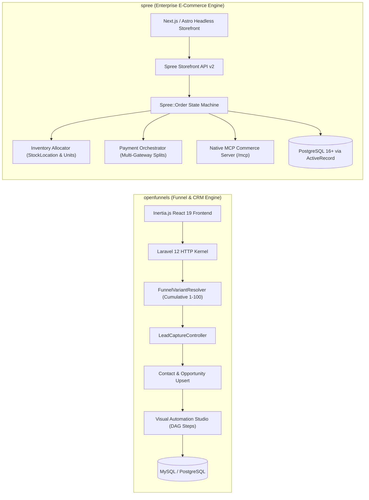
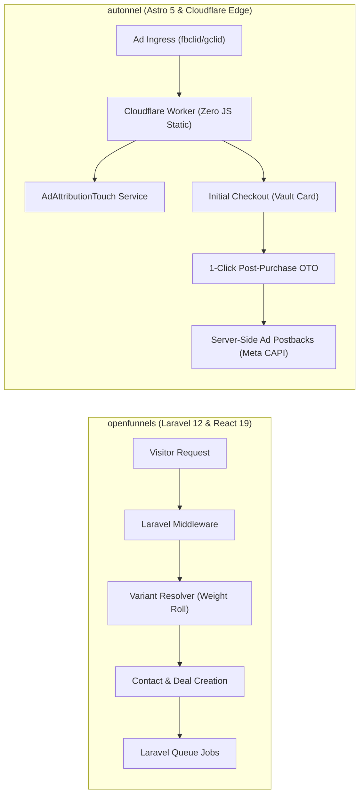

# openfunnels — Comparative Analysis & Category Evaluation

> **Category**: Sales Funnels & Checkout Engines  
> **Architectural Role**: Self-hosted conversion funnel builder, CRM opportunity pipeline, weighted A/B testing & visual automation studio  
> **Primary Stack**: PHP 8.3+ | Laravel 12+ & Inertia.js 2.0 | React 19 & Tailwind CSS | SQLite / MySQL / PostgreSQL | Redis Cache  
> **Peer Solutions Compared**: `spree`, `autonnel`  
> **Commercial SaaS Benchmarks**: ClickFunnels, Systeme.io, GoHighLevel, Kartra  

---

## 1. Executive Overview & Technical Identity: openfunnels

**openfunnels** represents the unified marketing automation and sales CRM funnel monolith within the **Sales Funnels & Checkout Engines** domain. Built in **PHP 8.3+** and **Laravel 12+** paired with **React 19** via **Inertia.js 2.0**, OpenFunnels eliminates the expensive licensing restrictions and artificial contact caps imposed by proprietary SaaS platforms like ClickFunnels and GoHighLevel.

OpenFunnels is architected around a single cohesive domain boundary: customer interactions captured on landing pages directly translate into relational CRM contacts, structured pipeline opportunities, and trigger payloads for asynchronous workflow state machines—completely eliminating brittle third-party integration webhooks (Zapier, Make). Its standout conversion feature is the **mathematical weighted A/B variant resolver** (`FunnelVariantResolver`), which uses cumulative weight distribution and 30-day persistent cookies to guarantee deterministic split-testing experiences and accurate conversion reporting.

### Core Architectural Profile
- **Runtime & Language**: `PHP 8.3+ / Laravel 12+ HTTP Kernel`
- **Core Framework**: `Inertia.js 2.0, React 19, Tailwind CSS, @dnd-kit visual builders`
- **Persistence Layer**: `MySQL 8.0 / PostgreSQL 16 / SQLite (Eloquent ORM)` + `Redis 7+`
- **Concurrency & Queue Model**: `Laravel Queue workers (php artisan queue:listen) with DAG state machine simulation`
- **Domain Specialization**: Unified funnel-to-CRM continuity, deterministic weighted A/B testing, custom multi-domain CNAME routing & visual workflow automation

---

## 2. Peer Solution Landscape (Sales Funnels & Checkout Engines)

Within this category, `openfunnels` operates alongside the following peer solutions:

| Solution | Language & Runtime | Core Framework | Database / Cache | Queue / Concurrency | Primary Architectural Niche |
| :--- | :--- | :--- | :--- | :--- | :--- |
| **openfunnels** (Current) | `PHP 8.3+ / Laravel 12` | `Inertia.js 2.0, React 19` | `MySQL / PostgreSQL` | `Laravel Queue Workers` | **Unified funnel-to-CRM continuity & weighted A/B variant resolver** |
| **spree** | `Ruby 3.3+ / Rails 8.0` | `Rails Core, Next/React` | `PostgreSQL 16+, Redis` | `Sidekiq / Redis` | Deterministic `Spree::Order` state machine & native MCP server |
| **autonnel** | `TypeScript / Edge` | `Astro 5, React` | `PostgreSQL (Hyperdrive)`| `Cloudflare Event Loop` | Edge 1-click post-purchase upsells (OTO) & server-side ad postbacks |

---

## 3. Deep Head-to-Head Comparative Breakdown: openfunnels vs Peers

### 3.1. openfunnels vs. spree

**Comparative Focus**: `Unified Funnel-to-CRM Monolith & Weighted A/B Testing` vs. `Deterministic Order State Machine & Multi-Store E-Commerce`

#### Detailed Architectural Contrast
- **Domain Mission & Topology**: `openfunnels` is an all-in-one lead generation and sales funnel platform that unifies landing page forms with an integrated CRM opportunity pipeline and workflow automation engine. `spree` is a dedicated enterprise e-commerce platform designed for complex physical and digital product catalogs, multi-store and multi-currency operations, regional warehouse stock allocation, and tiered B2B price books.
- **Order & Transaction Handling**: `spree` manages orders through a battle-tested, deterministic state machine (`Spree::Order`) with independent sub-states for payment (`balance_due`, `paid`, `void`) and shipment (`backorder`, `ready`, `shipped`). It prevents inventory over-allocation across physical warehouses. `openfunnels` models conversions as step events within a funnel; orders are recorded as transactional payments directly linked to CRM contacts and deals.
- **A/B Testing & Split Routing**: `openfunnels` natively incorporates an algorithmic A/B split-testing engine (`FunnelVariantResolver`) that computes cumulative weight distributions (1–100 integer rolls) and sets 30-day visitor cookies. `spree` relies on external experimentation platforms or headless edge middleware for traffic splitting.
- **AI Agent Readiness**: `spree` features a native Model Context Protocol (MCP) server (`/mcp`), enabling autonomous AI shopping agents to programmatically query catalogs and execute checkouts. `openfunnels` focuses on human marketer visual workflow canvases (`@dnd-kit`).

#### Architectural Comparison Matrix: openfunnels vs. spree

| Dimension | openfunnels | spree | Architectural Implication |
| :--- | :--- | :--- | :--- |
| **Primary Specialty** | **Lead Capture Funnels & CRM Deals** | **Enterprise Headless E-Commerce** | OpenFunnels captures and nurtures leads; Spree manages complex merchandise catalogs. |
| **State Machine Topology** | **Linear Funnel Steps & DAG Workflow** | **Multi-Axis `Spree::Order` Machine**| Spree provides formal transaction safety for multi-item physical checkouts. |
| **CRM Integration** | **Native Built-In CRM Opportunities** | **Requires External CRM Integration** | OpenFunnels unifies funnel submissions directly into deal stages without webhooks. |
| **A/B Split Testing** | **Native Weighted Variant Resolver** | **External Tool Required** | OpenFunnels splits traffic deterministically with persistent visitor cookies. |
| **AI / Agent Interface** | **Visual Human Drag-and-Drop Studio**| **Native Built-In MCP Server (`/mcp`)**| Spree allows AI commerce agents to browse, cart, and purchase programmatically. |

---

### 3.2. openfunnels vs. autonnel

**Comparative Focus**: `Unified Full-Stack CRM Monolith` vs. `Edge-Native 1-Click Upsells & Server-Side Ad Attribution`

#### Detailed Architectural Contrast
- **Deployment Plane & Speed**: `autonnel` compiles funnels to static HTML islands using Astro 5, running globally at the edge on Cloudflare Workers. It delivers sub-50ms TTFB for paid ad traffic. `openfunnels` is a standard PHP/Laravel application deployed on traditional Linux/Docker servers, utilizing Inertia.js to hydrate client-side React 19 views.
- **Upsell & Money Path Mechanics**: `autonnel` specializes in post-purchase 1-Click Upsells (OTO). When a buyer completes the initial order, their credit card is stored in Stripe's customer vault; subsequent upsell offers are charged instantly with a single button click. `openfunnels` supports standard multi-step forms and Stripe payments, but lacks native 1-click post-purchase vaulting.
- **Ad Attribution Recovery**: `autonnel` incorporates a Transactional Outbox Pattern to dispatch server-to-server conversion events (Meta CAPI, TikTok Events API, Google Ads), restoring tracking signals lost to browser ad blockers. `openfunnels` captures UTM parameters within the CRM, but does not provide automated server-side advertising postbacks.
- **CRM & Pipeline Management**: `openfunnels` provides a complete CRM system with contact histories, visual kanban deal boards, and automated DAG email sequences. `autonnel` focuses strictly on the checkout transaction, connecting to external e-commerce backends (Picocart, Shopify, WooCommerce).

#### Architectural Comparison Matrix: openfunnels vs. autonnel

| Dimension | openfunnels | autonnel | Architectural Implication |
| :--- | :--- | :--- | :--- |
| **Execution Architecture** | **Laravel 12 / Inertia Monolith** | **Astro 5 / Cloudflare Edge** | Autonnel provides lower latency on ad clicks; OpenFunnels provides richer admin tools. |
| **Post-Purchase Upsells** | **Standard Multi-Step Checkout** | **Native 1-Click OTO (Stripe Vault)** | Autonnel maximizes Average Order Value (AOV) through frictionless post-purchase charges. |
| **Ad Tracking Durability** | **First-Party CRM UTM Logging** | **Server-Side Postbacks (Meta CAPI)** | Autonnel bypasses browser ad blockers to optimize ad bidding algorithms. |
| **CRM & Deal Pipelines** | **Full Visual Kanban & Contacts** | **Orders Only (Catalog Agnostic)** | OpenFunnels manages the complete sales lifecycle from lead capture to deal close. |
| **A/B Split Testing** | **Mathematical Cumulative Weight** | **Basic Variant Routing** | OpenFunnels offers deeper variant weighting and persistent visitor affinity. |

---

## 4. Capability & Feature Comparison Matrix

| Dimension / Capability | openfunnels | spree | autonnel |
| :--- | :---: | :---: | :---: |
| **Unified CRM & Deal Pipelines** | ✅ Full CRM | ❌ | ⚠️ Orders only |
| **Weighted A/B Split Testing** | ✅ Native Cumulative | ❌ | ⚠️ Basic |
| **Deterministic Order State Machine** | ⚠️ Basic Steps | ✅ Strict `Spree::Order` | ⚠️ Checkout State |
| **1-Click Post-Purchase Upsells (OTO)** | ⚠️ Stripe API | ⚠️ Custom Gateway | ✅ Native Core Feature |
| **Server-Side Ad Attribution (Meta CAPI)**| ❌ | ⚠️ Via Webhooks | ✅ Native Outbox CAPI |
| **Native Model Context Protocol (MCP)** | ❌ | ✅ Built-in (`/mcp`) | ✅ Built-in (`src/skills`) |
| **Multi-Store & Multi-Currency** | ⚠️ Domains only | ✅ Full Multi-Store | ⚠️ Multi-tenant |
| **Multi-Warehouse Stock Allocation** | ❌ | ✅ `StockLocation` | ❌ |
| **Edge Deployment (Cloudflare Workers)** | ❌ | ❌ | ✅ Native |
| **Primary Language & Runtime** | PHP 8.3+ / Laravel 12 | Ruby 3.3+ / Rails 8 | TypeScript / Astro 5 |

---

## 5. Commercial Benchmark Positioning & MarketingStudio Fit

- **Against ClickFunnels & GoHighLevel**: `openfunnels` provides an unencumbered MIT-licensed monolith with zero per-funnel or per-contact fees, saving agencies \$97–\$297/month per client account while keeping all customer CRM data strictly sovereign.
- **MarketingStudio Synergy**: `openfunnels` serves as the primary B2B lead generation, high-touch consultation, and CRM pipeline engine in MarketingStudio, capturing incoming leads and advancing them across sales pipeline stages automatically.
