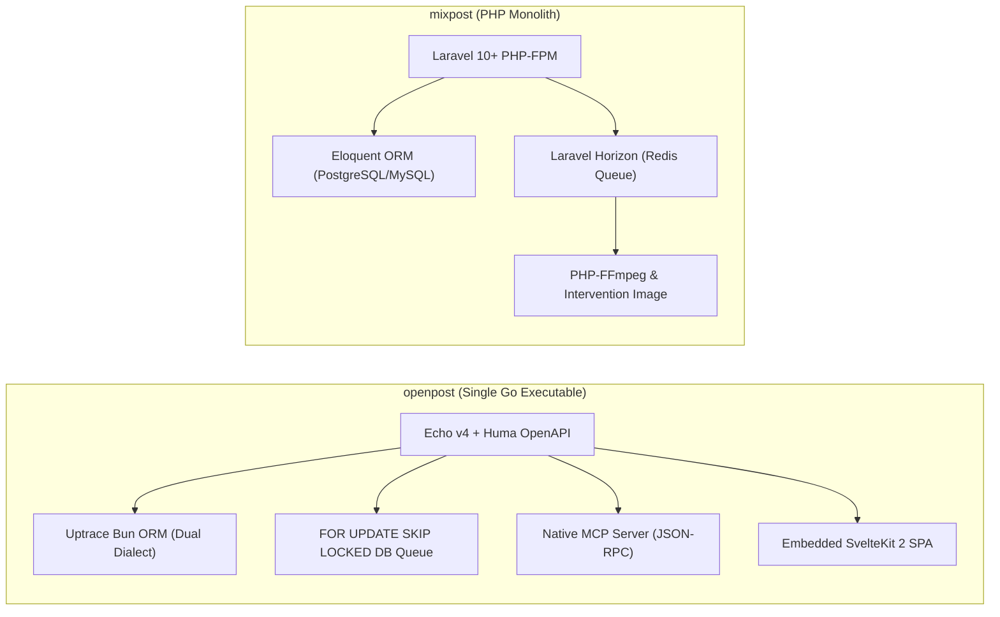
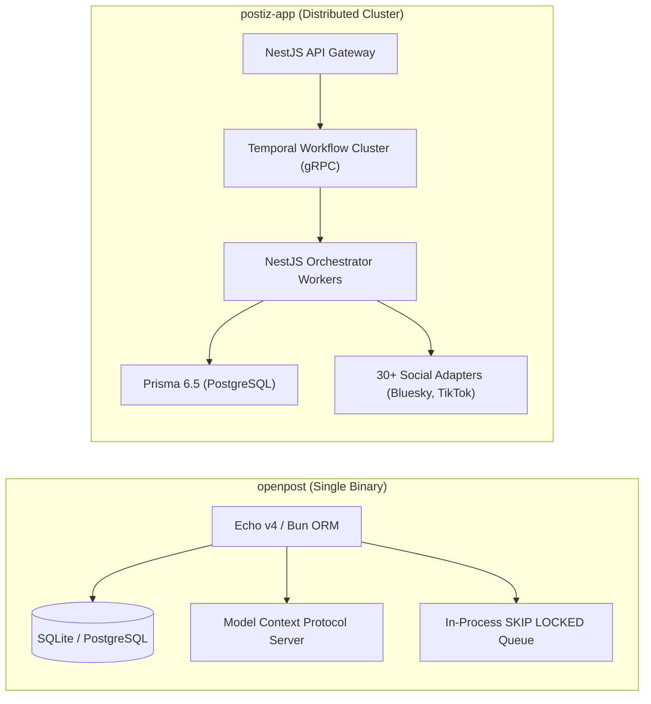
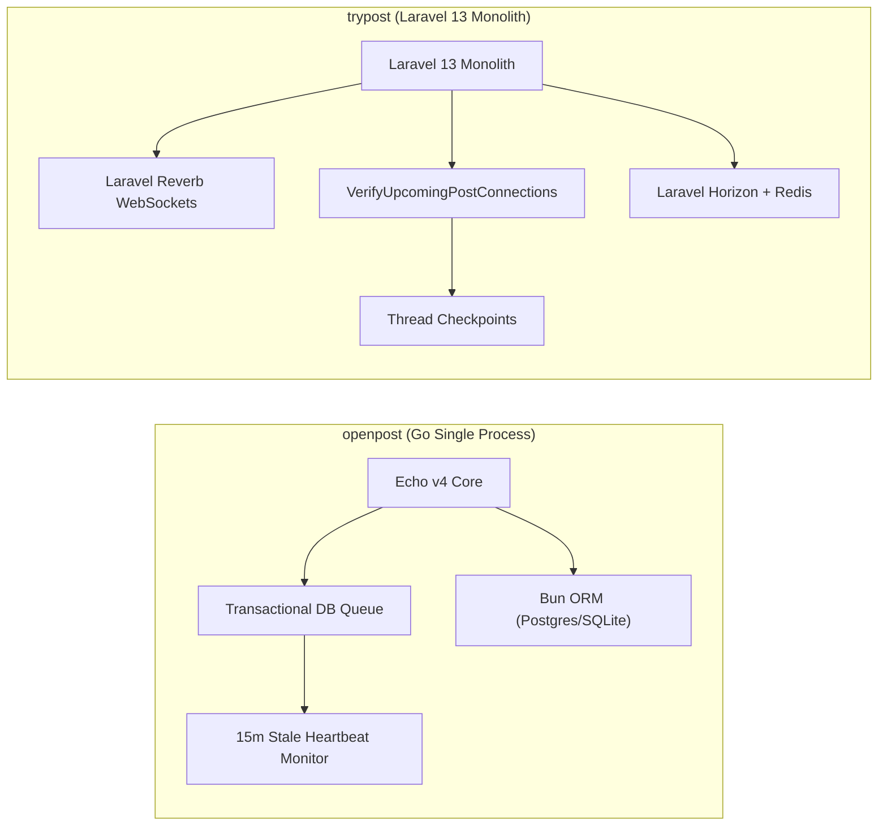
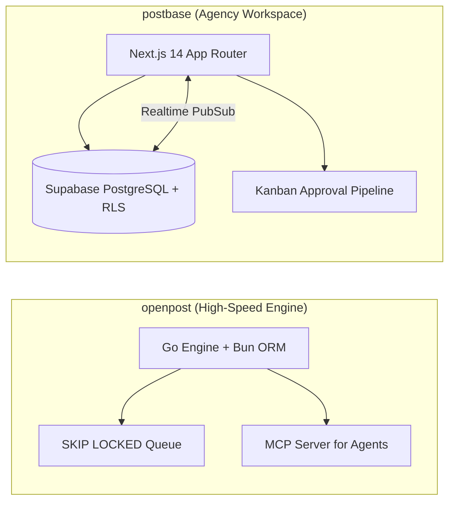

# openpost — Comparative Analysis & Category Evaluation

> **Category**: Social Media Management  
> **Architectural Role**: Single-binary Go social publishing studio, zero-broker queue engine & native MCP server  
> **Primary Stack**: Go 1.26+ | Echo v4, Huma v2 OpenAPI | SvelteKit 2 SPA | SQLite / PostgreSQL (Uptrace Bun ORM) | `SKIP LOCKED` DB Queue + Native MCP Server  
> **Peer Solutions Compared**: `mixpost`, `postiz-app`, `trypost`, `postbase`  
> **Commercial SaaS Benchmarks**: Buffer, Hootsuite, Later, Typefully, FeedHive  

---

## 1. Executive Overview & Technical Identity: openpost

**openpost** represents the single-binary, minimalist systems architecture tier within the **Social Media Management** domain. Designed to eliminate operational bloat and infrastructure sprawl, OpenPost collapses the conventional multi-tiered marketing stack into a single, highly optimized compiled Go binary. It packages an Echo v4 HTTP engine, Huma v2 typed OpenAPI router, embedded SvelteKit 2 (Svelte 5) reactive SPA, and a native **Model Context Protocol (MCP)** server into a standalone executable capable of running on a \$5 VPS (backed by embedded SQLite) while scaling seamlessly to multi-tenant cloud clusters (backed by PostgreSQL and S3-compatible storage).

OpenPost's core architectural innovations include:
1. **Zero-External-Queue Architecture**: Completely replaces standalone message brokers (Redis, RabbitMQ) with a high-throughput transactional database queue using `FOR UPDATE SKIP LOCKED` (PostgreSQL) and serialized advisory locks (SQLite), monitored by a 15-minute heartbeat stale-job watcher.
2. **First-Party Model Context Protocol (MCP) Server**: Natively implements the MCP specification over stdio and SSE, allowing AI coding assistants (Claude Code, Cursor, Windsurf) to inspect publication schedules, draft platform variants, manipulate media assets, and dispatch campaigns without brittle web scraping or custom glue code.
3. **Structured Thread Segment Model**: Unifies multi-part threads across Twitter, Bluesky, Mastodon, and Threads through a first-class `PublicationSegment` entity model that guarantees atomic ordering and platform-compliant character splits.

### Core Architectural Profile
- **Runtime & Language**: `Go 1.26+` (compiled native binary, zero external runtime dependencies)
- **Core Framework**: `Echo v4` HTTP engine + `Huma v2` typed OpenAPI gateway + embedded `SvelteKit 2` SPA
- **Persistence Layer**: `Uptrace Bun ORM` supporting dual dialects: zero-config embedded `SQLite 3` and clustered `PostgreSQL 16`
- **Queue & Concurrency Engine**: In-process database-backed transactional queue (`FOR UPDATE SKIP LOCKED`) with heartbeat recovery
- **Domain Specialization**: Single-binary deployment, native AI agent automation via MCP, and cross-platform thread orchestration

---

## 2. Peer Solution Landscape (Social Media Management)

Within this category, `openpost` operates alongside the following peer solutions:

| Solution | Language & Runtime | Core Framework | Database & ORM | Queue & Scheduler | Supported Platforms | License |
| :--- | :--- | :--- | :--- | :--- | :--- | :--- |
| **openpost** (Current) | `Go 1.26+` | `Echo v4, Huma v2, SvelteKit 2`| `SQLite / PostgreSQL (Bun ORM)` | `SKIP LOCKED DB Queue` | **X, Meta, LinkedIn, YouTube, Bluesky + Native MCP** | AGPL-3.0 |
| **mixpost** | `PHP 8.2+ / TS` | `Laravel, Inertia.js, Vue 3` | `MySQL / PostgreSQL (Eloquent)`| `Laravel Queue + Horizon` | 8+ Networks (X, FB, IG, LinkedIn, Masto, YouTube) | MIT |
| **postiz-app** | `TypeScript / Node 22+`| `NestJS 10, Next.js 14` | `PostgreSQL (Prisma 6.5)` | `Temporal.io Durable Workflows` | 30+ Networks (inc. TikTok, Bluesky, Nostr, Reddit) | AGPL-3.0 |
| **trypost** | `PHP 8.2+ / JS` | `Laravel 13, Vue 3, Reka UI` | `PostgreSQL / MySQL (Eloquent)` | `Horizon + Reverb WebSockets` | 13+ Networks (Pre-flight verifiers & checkpoints)| AGPL-3.0-only |
| **postbase** | `TypeScript / Node 20+`| `Next.js 14, Shadcn UI` | `PostgreSQL (Supabase RLS)` | `Server Actions + Realtime` | X, LinkedIn, Instagram (Kanban Approvals) | MIT |

---

## 3. Deep Head-to-Head Comparative Breakdown: openpost vs Peers

### 3.1. openpost vs. mixpost

**Comparative Focus**: `Single Go Binary + SKIP LOCKED DB Queue + MCP` vs. `Modular PHP/Laravel Package & Horizon`

#### Detailed Architectural Contrast
- **Deployment Footprint & Runtime**: `openpost` compiles its entire stack—HTTP routing, queue workers, ORM, media codecs, and SvelteKit 2 frontend—into a **single static Go binary** (<35MB) consuming less than 60MB of RAM. `mixpost` requires a full PHP application hosting stack: Nginx, PHP-FPM 8.2+, composer dependencies, an external Redis broker, and background supervisor processes for Laravel Horizon.
- **Queue Mechanics & Broker Dependencies**: `mixpost` relies on Redis to manage queue state and Laravel Horizon to monitor worker batches. `openpost` dispenses with external brokers entirely, executing jobs via an in-process queue supervisor using SQL `FOR UPDATE SKIP LOCKED` (PostgreSQL) or serialized advisory locks (SQLite). An automated 15-minute heartbeat monitor detects and requeues stalled worker jobs.
- **AI Agent Integration**: `openpost` is AI-native, implementing an official **Model Context Protocol (MCP)** server over stdio and SSE. LLM coding agents (Claude Code, Cursor, Windsurf) can interact with OpenPost tools directly to list scheduled posts, draft multi-segment publications, and schedule campaigns. `mixpost` offers optional OpenAI text generation API hooks, but has no agent protocol interface.
- **Data Modeling & Storage**: `mixpost` leverages Laravel's Eloquent ORM with strict relational tables and version variants (`mixpost_post_versions`). `openpost` utilizes **Uptrace Bun ORM**, supporting dual dialects: embedded zero-config SQLite for single-user VPS installations, and multi-tenant PostgreSQL 16 for team clusters.

#### Architectural Tradeoffs Matrix: openpost vs. mixpost

| Dimension | openpost | mixpost | Architectural Implication |
| :--- | :--- | :--- | :--- |
| **Operational Simplicity**| **Extreme (Single static Go binary)** | **Moderate (PHP-FPM + Redis + Horizon)**| OpenPost deploys instantly with zero broker dependencies; Mixpost requires PHP infrastructure. |
| **Queue Resilience** | **DB Locks (`SKIP LOCKED`) + 15m Watcher** | **Redis Queues + Horizon Supervision** | OpenPost survives Redis crashes by design; Mixpost relies on Redis persistence configuration. |
| **AI / Agent Interface** | **Native First-Party MCP Server** | **Basic OpenAI Text Prompting** | OpenPost is natively orchestrable by autonomous AI agents; Mixpost is human-centric. |
| **Content Inheritance** | **Structured Publication Segments** | **Advanced Original vs. Variant Model** | Mixpost provides more granular per-platform customization; OpenPost excels at thread splitting. |

---

### 3.2. openpost vs. postiz-app

**Comparative Focus**: `Lightweight Go Single Binary & Native MCP` vs. `Distributed Temporal Microservices & 30+ Channels`

#### Detailed Architectural Contrast
- **System Architecture & Complexity**: `postiz-app` is a distributed enterprise system composed of three separate Node.js services (`backend`, `frontend`, `orchestrator`), a dedicated Temporal.io gRPC workflow server, Elasticsearch/PostgreSQL for Temporal state, and Redis for BullMQ queues. `openpost` is a self-contained monolith in a single Go binary, eliminating microservice communication overhead and complex cluster ops.
- **Scheduling Durability**: `postiz-app` uses **Temporal.io durable workflow execution**, allowing scheduled jobs to pause, survive multi-day infrastructure outages, and resume without losing execution history. `openpost` relies on database scheduled timestamps and transactional row locks, which is resilient against process restarts but lacks Temporal's multi-day event-sourcing replay capabilities.
- **Platform Reach**: `postiz-app` supports over 30 channels, including emerging protocols (AT Protocol, Nostr, Farcaster) and developer platforms (Discord, Reddit). `openpost` focuses on 6 core marketing platforms (X, Meta, LinkedIn, YouTube, Bluesky, Mastodon).
- **AI Integration Paradigm**: `postiz-app` embeds AI into the frontend UI via Mastra framework agents and CopilotKit text assistants. `openpost` provides a system-level MCP server, turning the application into an AI tool accessible by external coding agents.

#### Architectural Tradeoffs Matrix: openpost vs. postiz-app

| Dimension | openpost | postiz-app | Architectural Implication |
| :--- | :--- | :--- | :--- |
| **Operational Footprint**| **Minimal (<60 MB RAM, single file)** | **Substantial (Multi-container + Temporal)** | OpenPost runs on ultra-low-cost VPS instances; Postiz requires enterprise cluster hosting. |
| **Workflow Durability** | **High (Database row locks & timers)** | **Extreme (Temporal Event-Sourced Workflows)**| Postiz workflows withstand multi-day external API freezes; OpenPost uses standard DB timers. |
| **Platform Ecosystem** | **6 Core Networks** | **30+ Networks (inc. Web3 / Fediverse)** | Postiz connects to niche and community channels; OpenPost covers primary channels. |
| **Agent Automation** | **Native Model Context Protocol (MCP)** | **UI CopilotKit & Internal Mastra Agents** | OpenPost can be driven directly by developer AI agents; Postiz serves human UI authors. |

---

### 3.3. openpost vs. trypost

**Comparative Focus**: `Single Go Binary with Bun ORM` vs. `Laravel 13 with Reverb WebSockets & Pre-Flight Verifiers`

#### Detailed Architectural Contrast
- **Error Mitigation & Failure Prevention**: `trypost` introduces a proactive **Pre-Flight Connection Verifier** (`VerifyUpcomingPostConnections`) running 15 minutes before scheduled publication, testing tokens against upstream APIs and rotating credentials before execution time. `openpost` relies on a reactive **15-minute heartbeat monitor** that inspects running database queue jobs, recovering stale or orphaned tasks after a worker crash.
- **Client Communication**: `trypost` integrates **Laravel Reverb**, a first-party WebSocket server, pushing publishing status updates, thread completion progress, and calendar adjustments directly to Vue clients in real time. `openpost` uses standard reactive SvelteKit 2 store updates and typed OpenAPI polling.
- **Thread Checkpoints**: `trypost` implements stateful thread checkpoints (`PublishCheckpoint`, `ThreadProgress`), allowing multi-tweet thread posts that hit midway rate limits to resume from the exact failed tweet. `openpost` uses `PublicationSegment` entities to order thread dispatches cleanly.

#### Architectural Tradeoffs Matrix: openpost vs. trypost

| Dimension | openpost | trypost | Architectural Implication |
| :--- | :--- | :--- | :--- |
| **Pre-Flight Testing** | **Reactive (Stale Heartbeat Watcher)** | **Proactive (1-Hour Pre-Flight Token Scan)**| TryPost catches expired credentials before jobs fire; OpenPost handles worker crashes. |
| **Broker Requirements** | **Zero External Broker (DB Queue)** | **Redis + Horizon + Reverb WebSockets** | OpenPost has no external service dependencies; TryPost requires Redis and WS daemons. |
| **Real-Time UI Updates** | **SvelteKit 2 State & REST Polling** | **Laravel Reverb (Native WebSockets)** | TryPost delivers instantaneous sub-second visual updates during publishing. |
| **Deployment Simplicity**| **Single Static Go Binary** | **PHP 8.2+ Application Stack** | OpenPost deploys via a single binary copy; TryPost requires PHP/Nginx/Redis ops. |

---

### 3.4. openpost vs. postbase

**Comparative Focus**: `High-Concurrency Go Publishing Engine + MCP` vs. `Collaborative Agency Kanban & Client Approvals`

#### Detailed Architectural Contrast
- **Architectural Scope**: `openpost` is an end-to-end publishing engine and content workspace with an internal image layout editor, video capture recipes, and automated queue execution in Go. `postbase` is an agency workflow workspace built on Next.js 14 and Supabase, designed specifically for copywriters, designers, and clients to review, comment on, and approve drafts before scheduling.
- **Queue & Data Persistence**: `openpost` handles queuing via SQL row locks (`SKIP LOCKED`) and manages media via AWS S3 / Cloudflare R2. `postbase` delegates data persistence, authentication, and realtime client synchronization to managed Supabase services.

#### Architectural Tradeoffs Matrix: openpost vs. postbase

| Dimension | openpost | postbase | Architectural Implication |
| :--- | :--- | :--- | :--- |
| **Infrastructure Independence**| **100% Standalone (Zero SaaS/BaaS)**| **Dependent on Supabase BaaS** | OpenPost can be deployed on any server; Postbase relies on Supabase services. |
| **AI / Agent Capabilities** | **Native First-Party MCP Server** | **Basic Client Mockups** | OpenPost exposes publishing tools directly to AI coding agents; Postbase is manual. |
| **Approval Pipeline** | **Single / Multi-Workspace Teams** | **Multi-Stage Kanban Sign-off** | Postbase specializes in client review workflows; OpenPost specializes in solo/team execution. |

---

## 4. Capability & Feature Comparison Matrix

| Dimension / Capability | openpost | mixpost | postiz-app | trypost | postbase |
| :--- | :---: | :---: | :---: | :---: | :---: |
| **Primary Architectural Niche** | **Single Go binary + SKIP LOCKED DB queue + MCP** | Battle-tested multi-network scheduling & video chunking | Temporal.io durable workflows & 30+ networks | Reverb WebSockets & pre-flight verifiers | Supabase-backed agency review kanban |
| **Runtime Language** | `Go 1.26+` | `PHP 8.2+ / TS` | `TypeScript / Node 22+` | `PHP 8.2+ / JS` | `TypeScript / Node` |
| **Framework** | `Echo v4, Huma v2, Svelte 2` | `Laravel, Inertia, Vue 3` | `NestJS 10, Next.js 14` | `Laravel 13, Vue 3, Inertia` | `Next.js 14, Shadcn UI` |
| **Database Persistence** | `SQLite / PostgreSQL (Bun ORM)`| `MySQL / PostgreSQL (Eloquent)`| `PostgreSQL (Prisma 6.5)` | `PostgreSQL / MySQL (Eloquent)`| `PostgreSQL (Supabase RLS)` |
| **Queue / Concurrency** | `SKIP LOCKED DB Queue` | `Laravel Queue + Horizon` | `Temporal.io + BullMQ` | `Horizon + Reverb WS` | `Server Actions + Realtime` |
| **Native MCP Server for Agents**| ✅ First-Party MCP (JSON-RPC) | ❌ | ⚠️ Tool wrapper | ❌ | ❌ |
| **External Queue Broker Required**| ❌ Zero (DB-backed) | ✅ Redis required | ✅ Redis + Temporal required | ✅ Redis required | ❌ Serverless |
| **Dual Dialect (SQLite / Postgres)**| ✅ Built-in Bun ORM | ⚠️ Configurable | ❌ Postgres only | ⚠️ Configurable | ❌ Postgres only |
| **Supported Platforms** | **6+ Networks** | **8+ Networks** | **30+ Networks** | **13+ Networks** | 3 Networks |
| **Resource Footprint (RAM)** | **<60 MB** | **~250 MB** | **~1.5 GB** | **~300 MB** | **~200 MB** |

---

## 5. Commercial Benchmark Positioning

When benchmarked against commercial SaaS leaders (**Buffer, Hootsuite, Later, Typefully, FeedHive**):
- **Zero Infrastructure Friction**: Traditional open-source social tools require orchestrating Redis, PostgreSQL, Node/PHP runtimes, and worker supervisors. OpenPost compiles into a single binary that runs on any Linux/macOS host with zero external dependencies.
- **Agentic AI Native**: As autonomous AI developer tools (Claude Code, Cursor, Windsurf) become the primary interface for marketing operations, OpenPost's native Model Context Protocol (MCP) server provides seamless programmatic control without scraping or brittle webhooks.
- **Data Sovereignty for Solo Founders**: Delivers total control over social media tokens, scheduled content queues, and customer media assets without paying monthly per-account SaaS subscriptions.

---

## 6. Strategic Takeaways & Role for MarketingStudio

In the unified **MarketingStudio** architecture:
1. **Primary Component to Adopt**: Adopt OpenPost's Model Context Protocol (MCP) server implementation (`apps/server/internal/mcp/`) to expose MarketingStudio's social publishing and asset creation pipelines to AI agents.
2. **Zero-Broker Queue Seam**: Implement OpenPost's `FOR UPDATE SKIP LOCKED` database queue pattern for lightweight installations where running standalone Redis or RabbitMQ clusters is cost-prohibitive.
3. **Peer Coexistence**:
   - Utilize `openpost`'s single-binary simplicity and MCP server for agentic automation.
   - Borrow `postiz-app`'s 30+ platform adapters for maximum social network reach.
   - Employ `trypost`'s pre-flight OAuth validation daemon to ensure expiring credentials never abort scheduled dispatches.
   - Integrate `mixpost`'s variant inheritance model for clean post versioning in the user interface.
