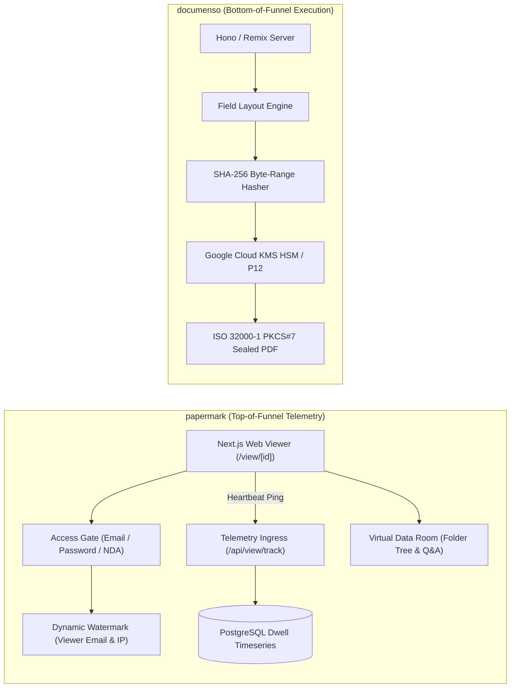
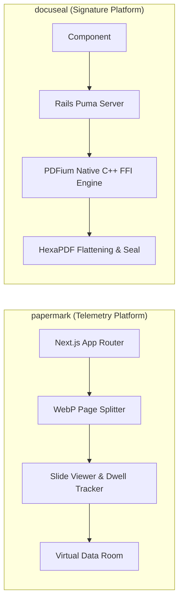
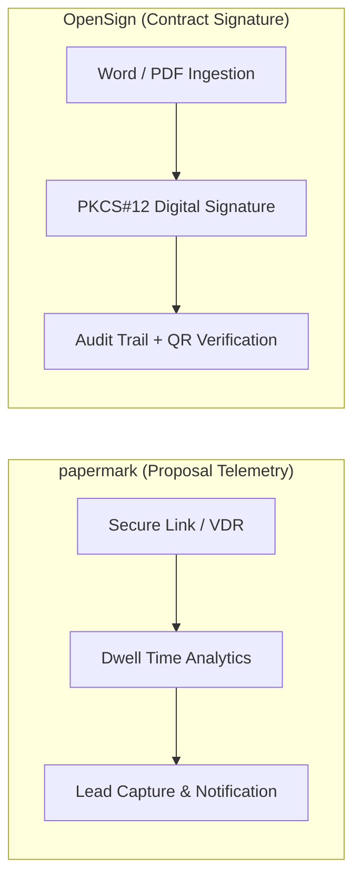

# papermark — Comparative Analysis & Category Evaluation

> **Category**: E-Signature & Document Tracking  
> **Architectural Role**: Open-source document sharing platform, Virtual Data Rooms (VDR) & per-page dwell time telemetry engine  
> **Primary Stack**: TypeScript 5.x | Next.js (App Router) | PostgreSQL (Prisma Multi-File) | Trigger.dev Workers | AWS S3 / Cloudflare R2 | BoxyHQ Jackson  
> **Peer Solutions Compared**: `documenso`, `docuseal`, `OpenSign`  
> **Commercial SaaS Benchmarks**: DocSend, Dropbox DocSend, Carta, Digify  

---

## 1. Executive Overview & Technical Identity: papermark

**papermark** represents the document viewing intelligence, lead qualification, and Virtual Data Room (VDR) tier within the **E-Signature & Document Tracking** domain. Developed as an open-source alternative to DocSend and Carta, Papermark solves the "black hole" problem of sales decks, investor pitch presentations, and confidential proposals—where senders lose complete visibility over whether a document was opened, who read it, which pages captured attention, and whether it was forwarded to unauthorized competitors.

Papermark transforms static PDFs into instrumented, secure web experiences. As recipients navigate through a document, the viewer emits continuous heartbeat beacons (`/api/view/track`) to record exact dwell time per slide. To prevent leaks, Papermark incorporates dynamic canvas watermarks that overlay the viewer's verified email and IP address across every page. Furthermore, Papermark includes enterprise Virtual Data Rooms (VDR) equipped with multi-tier folder permissions, role-based access control, and integrated Q&A conversation threads.

### Core Architectural Profile
- **Runtime & Language**: `TypeScript 5.x / Node.js 20+ LTS`
- **Core Framework**: `Next.js (App Router), React 18, Tailwind CSS`
- **Persistence Layer**: `PostgreSQL (Prisma multi-file schema) + AWS S3 / Cloudflare R2 blob storage`
- **Concurrency & Queue Model**: `Trigger.dev background worker cluster`
- **Domain Specialization**: Granular per-page viewing telemetry, dynamic leak-prevention watermarks, lead capture gates & Virtual Data Rooms (VDR)

---

## 2. Peer Solution Landscape (E-Signature & Document Tracking)

Within this category, `papermark` operates alongside the following peer solutions:

| Solution | Language & Runtime | Core Framework | Database / Cache | Queue / Concurrency | Primary Architectural Niche |
| :--- | :--- | :--- | :--- | :--- | :--- |
| **papermark** (Current) | `TypeScript / Node.js` | `Next.js, Tailwind` | `PostgreSQL (Prisma)` | `Trigger.dev Workers` | **Per-page dwell time heatmaps, dynamic watermarking & VDR** |
| **documenso** | `TypeScript / Node.js` | `Remix, Hono, tRPC` | `PostgreSQL 15 (Prisma+Kysely)`| `Inngest / DB Queue` | ISO 32000-1 PKCS#7 cryptographic sealing & Cloud KMS |
| **docuseal** | `Ruby 3.3+ / C++` | `Rails 7.2/8.0, Vue.js` | `PostgreSQL / SQLite3` | `Sidekiq / Redis` | High-throughput native C++ PDFium FFI & `<docuseal-form>` component |
| **OpenSign** | `JavaScript / Node.js` | `Express 5, Parse Server`| `MongoDB 7.x, Local/S3` | `Parse Cloud Code` | Turnkey Parse Server e-signature & LibreOffice `.docx` conversion |

---

## 3. Deep Head-to-Head Comparative Breakdown: papermark vs Peers

### 3.1. papermark vs. documenso

**Comparative Focus**: `Per-Page Slide Telemetry & Virtual Data Rooms` vs. `Cryptographically Binding Electronic Signatures`

#### Detailed Architectural Contrast
- **Commercial Funnel Alignment**: `papermark` operates at the top and middle of the revenue funnel (presentation, proposal review, investor due diligence), providing sales teams with behavioural telemetry on which pages prospect stakeholders scrutinize. `documenso` operates at the bottom of the funnel (contract execution), enforcing multi-party signing order and cryptographic seals on agreements.
- **Security & Integrity Model**: `papermark` deters document leaks through dynamic visual watermarks (rendering the viewer's email and IP directly across the canvas), domain restrictions, email verification, and clickwrap NDAs. `documenso` protects document integrity using cryptographic SHA-256 byte-range hashes and PKCS#7/CMS digital signatures verifiable in Adobe Acrobat.
- **Telemetry Ingestion Architecture**: `papermark` is architected for continuous, high-frequency telemetry. The browser sends periodic beacon payloads tracking viewport dwell time per slide. `documenso` logs discrete lifecycle milestones (`SENT`, `VIEWED`, `SIGNED`).
- **Failure Modes & Bottlenecks**:
  - `papermark`: Viewer drop-offs occur if rasterized WebP page assets load slowly from object storage; network firewalls can block telemetry heartbeat beacons.
  - `documenso`: Envelopes fail if external Cloud KMS HSM or RFC 3161 timestamping authorities experience transient downtime.

#### Architectural Comparison Matrix: papermark vs. documenso

| Dimension | papermark | documenso | Architectural Implication |
| :--- | :--- | :--- | :--- |
| **Primary Domain Objective** | **Viewer Intelligence & VDR Sharing** | **Contract Execution & Legal Signature** | Papermark qualifies deal momentum; Documenso executes legally binding contracts. |
| **Telemetry Granularity** | **Sub-Second Per-Page Dwell Time** | **Discrete Audit Timestamps** | Papermark pinpoints exactly which proposal slides captured stakeholder focus. |
| **Leak Deterrence** | **Dynamic Watermarking (Email/IP)** | **None (Access Control Only)** | Papermark deters unauthorized forwarding by stamping viewer identity over slides. |
| **Legal Admissibility** | **Access Verification Logs** | **ISO 32000-1 PKCS#7 Digital Seal** | Documenso complies with eIDAS AES/QES and the US ESIGN Act. |
| **Data Room Architecture** | **Multi-Folder VDR with Q&A** | **Single Envelopes & Templates** | Papermark coordinates complex multi-document M&A and fundraising due diligence. |

---

### 3.2. papermark vs. docuseal

**Comparative Focus**: `Per-Page Slide Telemetry & Virtual Data Rooms` vs. `Native C++ PDFium FFI & Mobile Signing Forms`

#### Detailed Architectural Contrast
- **Client Presentation Mechanism**: `papermark` splits uploaded documents into WebP images via Trigger.dev workers, rendering slides through a responsive web canvas viewer with pinch-to-zoom and page transitions. `docuseal` uses native C++ Google PDFium FFI bindings to rasterize PDFs on the server, serving them to a custom HTML element (`<docuseal-form>`) with interactive signature and initial inputs.
- **Interaction Model**: `papermark` is a read-only, telemetry-driven experience designed to capture engagement metrics and gate access via email capture. `docuseal` is an interactive form-filling and signing experience designed for zero-friction completion on mobile devices.

#### Architectural Comparison Matrix: papermark vs. docuseal

| Dimension | papermark | docuseal | Architectural Implication |
| :--- | :--- | :--- | :--- |
| **Primary Function** | **Document Telemetry & Due Diligence** | **Document Signing & Form Completion** | Papermark measures viewing time; Docuseal collects signatures and input fields. |
| **Embedding Method** | **Hosted URL / iFrame** | **Native `<docuseal-form>` Web Component**| Docuseal provides seamless inline form embedding for checkout flows. |
| **Page-by-Page Heatmaps** | **Native Core Capability** | **Not Supported** | Papermark provides visual analytics on viewer drop-offs. |

---

### 3.3. papermark vs. OpenSign

**Comparative Focus**: `Per-Page Slide Telemetry & Virtual Data Rooms` vs. `Parse Server Architecture & LibreOffice Conversion`

#### Detailed Architectural Contrast
- **Document Workflow**: `papermark` shares sales materials and measures prospect reading interest prior to commercial negotiation. `OpenSign` ingests agreements (including raw `.docx` files via headless LibreOffice), manages signer queues, and outputs sealed PDFs with public QR codes.

#### Architectural Comparison Matrix: papermark vs. OpenSign

| Dimension | papermark | OpenSign | Architectural Implication |
| :--- | :--- | :--- | :--- |
| **Core Workload** | **Presentation Analytics & VDR** | **Document Signing & Office Conversion** | Papermark arms sales reps with engagement data; OpenSign signs contracts. |
| **Office Conversion** | **PPTX Slide Decks** | **Native `.docx`/`.odt` via LibreOffice** | OpenSign supports diverse contract text formats; Papermark handles pitch decks. |
| **Verification Method** | **Email Gate & Watermarking** | **Public QR Code Scanning** | OpenSign enables instant third-party authenticity verification. |

---

## 4. Capability & Feature Comparison Matrix

| Dimension / Capability | papermark | documenso | docuseal | OpenSign |
| :--- | :---: | :---: | :---: | :---: |
| **Per-Page Dwell Time Telemetry** | ✅ (Sub-second) | ❌ | ❌ | ❌ |
| **Virtual Data Rooms (VDR)** | ✅ (Folders + Q&A) | ❌ | ❌ | ❌ |
| **Dynamic Identity Watermarking** | ✅ (Email & IP) | ❌ | ❌ | ❌ |
| **Email Capture & Lead Gating** | ✅ Native | ❌ | ⚠️ Signer only | ⚠️ Signer only |
| **ISO 32000-1 Cryptographic Seal** | ❌ | ✅ Full PKCS#7 | ⚠️ X.509 Seal | ✅ @signpdf |
| **Hardware KMS HSM Integration** | ❌ | ✅ (Google Cloud KMS) | ❌ | ❌ |
| **Native C++ PDFium Acceleration** | ❌ | ❌ | ✅ (lib/pdfium.rb) | ❌ |
| **Office (.docx) Auto-Conversion** | ⚠️ (PPTX) | ❌ | ⚠️ (HTML to PDF) | ✅ (LibreOffice) |
| **Embeddable Web Component** | ⚠️ iFrame | ⚠️ React SDK | ✅ `<docuseal-form>` | ⚠️ iFrame |
| **Primary Database** | PostgreSQL | PostgreSQL 15 | PostgreSQL / SQLite | MongoDB 7.x |

---

## 5. Commercial Benchmark Positioning & MarketingStudio Fit

- **Against DocSend & Dropbox Sign**: `papermark` eliminates high per-user monthly SaaS subscriptions (\$45–\$150/user/month), granting complete ownership over confidential pitch materials and due diligence logs.
- **MarketingStudio Synergy**: `papermark` serves as the top-of-funnel document engagement engine in MarketingStudio, instrumenting pitch decks, client proposals, and investment data rooms to alert sales reps when prospects review pricing slides.
