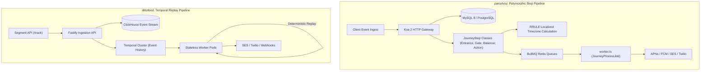
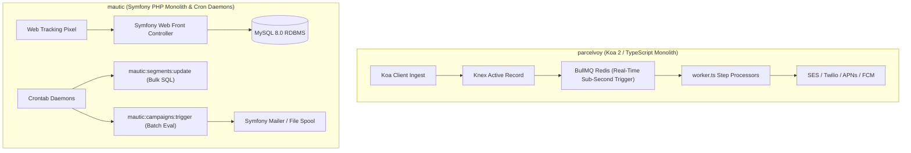
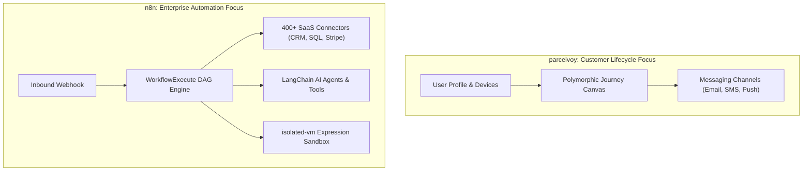

# parcelvoy — Comparative Analysis & Category Evaluation

> **Category**: Customer Lifecycle & Journeys  
> **Architectural Role**: Developer-first multi-channel customer lifecycle messaging & polymorphic journey engine  
> **Primary Stack**: TypeScript / Node.js 18+ | Koa 2, Knex | MySQL 8.0+ / PostgreSQL 15+ | BullMQ / Redis  
> **Peer Solutions Compared**: `dittofeed`, `laudspeaker`, `notifuse`, `mautic`, `n8n`  
> **Commercial SaaS Benchmarks**: Customer.io, Braze, OneSignal, Iterable, HubSpot Marketing Hub, Zapier  

---

## 1. Executive Overview & Technical Identity: parcelvoy

**parcelvoy** is an open-source, customer relationship and lifecycle messaging platform designed as a modern, developer-friendly alternative to proprietary tools like Braze, Iterable, and OneSignal. Written in TypeScript using a lightweight **Koa 2** and **Knex** architecture, Parcelvoy unifies cross-channel engagement—including transactional and marketing Email, SMS, Mobile Push notifications (APNs HTTP/2 and Google FCM), and In-App messages—under a single, event-driven orchestration engine.

At the core of Parcelvoy is its **Modular Step Journey Engine** (`apps/platform/src/journey`), which represents marketing automations as Directed Graphs using polymorphic TypeScript subclasses inheriting from `JourneyStep`. Featuring dedicated execution primitives for timezone-localized recurrence via **RRULE** (`JourneyEntrance` and `JourneyDelay`), conditional boolean gates (`JourneyGate`), randomized multivariate experiments (`JourneyExperiment`), and traffic rate smoothing (`JourneyBalancer`), Parcelvoy gives engineering and growth teams granular programmatic control over customer funnels.

### Core Architectural Profile
- **Runtime & Language**: `TypeScript 5+ / Node.js 18+` (ESM / CommonJS dual compatibility)
- **HTTP Server Framework**: `Koa 2` (`koa`, `@koa/router`, `koa-body`, `@koa/cors`)
- **Persistence Layer**: `Knex.js` with dual-dialect support for `MySQL 8.0+` (`mysql2`) and `PostgreSQL 15+` (`pg`)
- **Queue & Worker Engine**: `BullMQ` + `Redis` (Dedicated queues for journey processing, campaign sends, and analytics aggregations)
- **Timezone Scheduling**: `rrule` (RFC 5545) + `date-fns-tz` for timezone-aware daylight message dispatch
- **Mobile Push Core**: `node-pushnotifications` (Unified wrapper for Apple APNs HTTP/2 and Firebase Cloud Messaging)
- **Primary Architectural Niche**: Developer-first multi-channel engagement, polymorphic journey steps, and daylight-localized delivery

---

## 2. Peer Solution Landscape (Customer Lifecycle & Journeys)

Within the Customer Lifecycle & Journeys domain, `parcelvoy` operates alongside five distinct architectural peers:

| Solution | Language & Runtime | Core Framework | Database / Cache | Queue / Concurrency | Primary Architectural Niche |
| :--- | :--- | :--- | :--- | :--- | :--- |
| **parcelvoy** (Current) | `TypeScript / Node.js 18+` | `Koa 2, Knex` | `MySQL 8 / PostgreSQL` | `BullMQ / Redis` | **Polymorphic journey steps with RFC 5545 RRULE timezone scheduling** |
| **dittofeed** | `TypeScript / Node.js 20+` | `Fastify, Next.js` | `PostgreSQL + ClickHouse` | `Temporal.io Workflows` | Durable temporal workflows & streaming ClickHouse analytics |
| **laudspeaker** | `TypeScript / Node.js 18+` | `NestJS 10, React 18` | `PostgreSQL + ClickHouse` | `BullMQ / Redis` | Visual React Flow journey canvas with `JourneyLocation` state pointers |
| **notifuse** | `Go 1.25+` | `Native Go DDD` | `PostgreSQL / AlloyDB` | `Goroutine Worker Pools` | In-process Go Liquid/MJML compilation & multi-MTA gateway |
| **mautic** | `PHP 8.2+` | `Symfony 7.4, Twig` | `MySQL / PostgreSQL` | `Symfony Messenger + Cron` | Monolithic marketing automation, lead scoring & set-based segmentation |
| **n8n** | `TypeScript Monorepo` | `Node.js 20+, Vue 3` | `PostgreSQL / SQLite` | `WorkflowExecute DAG + BullMQ` | 400+ SaaS connectors & `isolated-vm` sandboxed execution |

---

## 3. Deep Head-to-Head Comparative Breakdown: parcelvoy vs Peers

### 3.1. parcelvoy vs. dittofeed

**Comparative Focus**: `Polymorphic Step Classes & RRULE Timezones` vs. `Temporal Event Sourcing & ClickHouse Scale`

#### Pipeline Topologies, Workflow Engines & Queue Mechanics
- **Step Class Hierarchy vs. Temporal Code Workflows**: `parcelvoy` structures customer journeys using an object-oriented class hierarchy inheriting from `JourneyStep` (`JourneyEntrance`, `JourneyDelay`, `JourneyAction`, `JourneyGate`, `JourneyExperiment`, `JourneyBalancer`, `JourneyExit`). Nodes encapsulate their own execution methods (`process()`, `next()`) and write state transitions to `journey_user_step`. `dittofeed` models journeys as a declarative graph executed by **Temporal.io** code workflows, where state is preserved in an immutable event history.
- **Context Accumulation Across Steps**: Parcelvoy’s `journey_user_step` table aggregates context payloads through `getDataMap()`, allowing downstream steps (e.g., an email sent 5 days later) to interpolate parameters captured at the entrance trigger. Dittofeed retains context in Temporal’s workflow memory space without database reads.
- **Timezone Scheduling via RRULE**: Parcelvoy integrates `rrule` (RFC 5545) with `date-fns-tz`. When a journey delay is set to *"Deliver next Friday at 9:00 AM"*, Parcelvoy projects the execution time relative to the recipient's local timezone. Dittofeed requires manual offset math within workflow logic.

#### Database Storage & Telemetry Architecture
- **Relational Knex vs. Dual-Store ClickHouse**: Parcelvoy persists users, attributes, mobile device tokens, event logs, and journey progress inside MySQL 8 or PostgreSQL using Knex. Dittofeed isolates high-volume telemetry into ClickHouse, storing only workspace and journey configuration in PostgreSQL. Under high event velocity (>10,000 events/sec), Parcelvoy’s relational database faces write lock contention, whereas Dittofeed’s ClickHouse columnar store scales effortlessly.

#### Failure Modes, Crash Recovery & Bottlenecks
- **Crash Recovery**: Parcelvoy manages step progress via `journey_user_step.ended_at`. If a BullMQ worker crashes mid-execution, the step remains incomplete; upon restart, the worker re-queries incomplete steps and completes execution idempotently. Dittofeed relies on Temporal's deterministic replay, which eliminates relational lock contention during high-concurrency recoveries.
- **Traffic Smoothing**: Parcelvoy introduces the `JourneyBalancer` step to throttle user throughput into downstream steps, preventing outbound spikes from overwhelming APIs or sales teams. Dittofeed manages concurrency via worker pool limits.

#### Architectural Comparison Matrix: parcelvoy vs. dittofeed

| Metric / Dimension | parcelvoy | dittofeed |
| :--- | :--- | :--- |
| **Workflow Architecture** | Polymorphic `JourneyStep` classes | Temporal code-as-workflow |
| **Timezone-Aware Delivery** | **Native RFC 5545 RRULE scheduling** | Manual delay math |
| **Traffic Shaping** | **Dedicated `JourneyBalancer` canvas step** | Worker concurrency limits |
| **Telemetry Persistence** | MySQL 8.0 / PostgreSQL relational tables | ClickHouse 23+ columnar warehouse |
| **Mobile Push Support** | **Unified APNs HTTP/2 & Google FCM** | Basic push adapters |
| **Template Compiler** | Node.js Handlebars + plaintext converter | Node.js React Email |

#### Where parcelvoy Excels over dittofeed
- **Timezone-Localized Daylight Delivery**: Native RRULE support guarantees contacts receive messages at appropriate daylight hours globally.
- **Extensible Step Subclasses**: Adding new custom steps (e.g., custom AI actions or CRM hooks) is clean and modular via `JourneyStep` subclassing.
- **Traffic Balancers**: `JourneyBalancer` protects downstream webhooks and internal teams from being flooded during marketing blasts.
- **Deep Mobile Push**: Unified APNs HTTP/2 and FCM integration with multi-device token management.

#### Where dittofeed Holds an Advantage over parcelvoy
- **Massive Ingestion Scale**: Absorbs tens of thousands of telemetry events per second via ClickHouse without relational table bloat.
- **Zero Dropped State**: Temporal guarantees exact-once execution and deterministic recovery without managing database step locks.
- **Segment CDP Compatibility**: Direct compatibility with existing Segment client integrations (`identify` / `track`).

---

### 3.2. parcelvoy vs. laudspeaker

**Comparative Focus**: `Polymorphic Step Classes & Traffic Balancers` vs. `React Flow Canvas & ClickHouse Analytics`

```mermaid
flowchart TD
    subgraph ParcelvoyStack ["parcelvoy (Koa 2 & Polymorphic Steps)"]
        PV_Ingest["Koa Ingest (/client/event)"] --> PV_Knex["Knex Active Record Models"]
        PV_Knex --> PV_Steps["JourneyStep Classes (Gate, Delay, Action, Balancer)"]
        PV_Steps --> PV_Ledger["journey_user_step Ledger (getDataMap)"]
        PV_Ledger --> PV_Bull["BullMQ Redis (Delay & Process Queues)"]
        PV_Bull --> PV_MTA["SES / Twilio / APNs / FCM"]
    end

    subgraph LaudspeakerStack ["laudspeaker (NestJS & React Flow)"]
        LS_Ingest["NestJS Ingest (/events)"] --> LS_CH[(ClickHouse Telemetry)]
        LS_Ingest --> LS_Canvas["React Flow Canvas + Graphlib"]
        LS_Canvas --> LS_Loc["JourneyLocation State Pointer"]
        LS_Loc --> LS_Bull["BullMQ Redis (Delayed ZSET)"]
        LS_Bull --> LS_MTA["SES / Twilio / Slack"]
    end
```

#### Pipeline Topologies, Workflow Engines & Queue Mechanics
- **Polymorphic Step Inheritance vs. Serialized Canvas Graph**: `parcelvoy` treats each node as an executable object (`JourneyStep` subclass) encapsulating its own state logic. `laudspeaker` treats the canvas as a serialized React Flow graph, validating topology via `@dagrejs/graphlib` and processing steps through a centralized NestJS service.
- **State Tracking Mechanics**: Laudspeaker tracks active user positions via the `JourneyLocation` entity (`journey_id`, `customer_id`, `step_id`, `step_entry_at`). Parcelvoy records step history in `journey_user_step` (`user_id`, `journey_id`, `step_id`, `delay_until`, `ended_at`, `data`), accumulating payload context across sequential nodes via `getDataMap()`.
- **Traffic Balancing**: Parcelvoy includes a `JourneyBalancer` step type that meters throughput into subsequent steps. Laudspeaker relies on global BullMQ queue rate limiters.

#### Database Storage & Telemetry Architecture
- **Relational vs. Dual-Store**: Laudspeaker integrates ClickHouse alongside PostgreSQL, allowing it to ingest high-frequency user actions and generate funnel reports without database contention. Parcelvoy relies entirely on MySQL or PostgreSQL, which simplifies deployment but limits telemetry ingestion throughput during high-traffic events.

#### Timezone & Push Notifications
- **RRULE vs. Temporal Polyfill**: Parcelvoy uses `rrule` to support recurring schedules and localized daylight delivery. Laudspeaker uses `@js-temporal/polyfill` for date math, but lacks RFC 5545 recurrence rules.
- **Mobile Push**: Parcelvoy includes native APNs HTTP/2 and FCM push notification support via `node-pushnotifications`. Laudspeaker supports push via FCM, but lacks deep APNs HTTP/2 device connection pooling.

#### Architectural Comparison Matrix: parcelvoy vs. laudspeaker

| Metric / Dimension | parcelvoy | laudspeaker |
| :--- | :--- | :--- |
| **Backend Framework** | Koa 2, Knex | NestJS 10, TypeORM |
| **Canvas Architecture** | Visual Canvas + Polymorphic `JourneyStep` | React Flow + `@dagrejs/graphlib` validation |
| **Telemetry Persistence** | MySQL 8.0 / PostgreSQL relational tables | ClickHouse 23+ columnar warehouse |
| **Timezone Scheduling** | **Native RFC 5545 RRULE localized delivery** | JS-Temporal standard calculations |
| **Traffic Smoothing** | **Dedicated `JourneyBalancer` canvas step** | Global queue rate limiting |
| **Context Retention** | Accumulated step data maps (`getDataMap`) | Re-queried customer JSONB attributes |

#### Where parcelvoy Excels over laudspeaker
- **Precision Timezone Scheduling**: Native RRULE support guarantees contacts receive messages at local daylight hours globally.
- **Extensible Step Subclassing**: Adding new journey primitives (e.g., custom AI actions or CRM hooks) is clean via `JourneyStep` inheritance.
- **Traffic Balancers**: `JourneyBalancer` prevents sudden event spikes from overwhelming outbound APIs and sales teams.
- **First-Class Mobile Push**: Native support for APNs HTTP/2 and Firebase FCM with device token management.

#### Where laudspeaker Holds an Advantage over parcelvoy
- **High-Velocity Telemetry Ingestion**: ClickHouse absorbs high-frequency event streams without relational lock contention.
- **Modern NestJS Architecture**: Clean modular dependency injection structure with TypeORM and NestJS microservices.
- **Multi-Identifier Stitching**: `customer.other_ids: text[]` array enables flexible cross-device identity merging.

---

### 3.3. parcelvoy vs. notifuse

**Comparative Focus**: `Full-Featured Multi-Channel Lifecycle Engine` vs. `High-Speed In-Process Go MJML Gateway`

```mermaid
flowchart TD
    subgraph ParcelvoyPipeline ["parcelvoy: Multi-Channel Lifecycle Platform"]
        PV_Event["User Events & Triggers"] --> PV_Journey["Polymorphic Journey Engine"]
        PV_Journey --> PV_Render["Node Handlebars Render"]
        PV_Render --> PV_Multi["Email, SMS, APNs, FCM, Webhooks"]
    end

    subgraph NotifusePipeline ["notifuse: In-Process Go Dispatch Gateway"]
        NF_API["REST / Broadcast Ingestion"] --> NF_GoCore["Go Goroutine Dispatcher"]
        NF_GoCore --> NF_GoMJML["Pure Go gomjml + liquidgo"]
        NF_GoMJML --> NF_Classifier["3-Way Bounce Classifier"]
        NF_Classifier --> NF_MTA["Multi-MTA Routing (SES / Postmark)"]
    end
```

#### Pipeline Topologies, Workflow Engines & Queue Mechanics
- **Full Lifecycle Platform vs. Notification Gateway**: `parcelvoy` provides complete lifecycle marketing: users traverse stateful journeys over weeks, branching based on events and delays across email, SMS, push, and webhooks. `notifuse` is an ultra-fast notification gateway: it ingests broadcast or transactional requests, compiles responsive MJML templates, and saturates delivery pipelines via Go goroutines.
- **Concurrency Implementation**: Parcelvoy uses Node.js asynchronous event loops distributed across Redis-backed BullMQ workers. Notifuse runs compiled native Go code leveraging lightweight goroutines (`GOMAXPROCS`), communicating through in-memory Go channels and PostgreSQL row-level locks.

#### Database Storage & Template Rendering Architecture
- **Template Rendering Velocity**: Parcelvoy compiles templates inside Node.js using Handlebars (`handlebars-utils`) with automated HTML-to-plaintext conversion. Notifuse compiles MJML and parses Liquid tags directly in Go using `gomjml` and `liquidgo`. Compiling in-process without spawning external Node.js subprocesses allows Notifuse to achieve sub-millisecond compile times (>10,000 emails/second).
- **Persistence Tier**: Both systems use relational persistence (Parcelvoy supports MySQL 8 and PostgreSQL 15+; Notifuse supports PostgreSQL 16 and AlloyDB).

#### Failure Modes, Crash Recovery & Bottlenecks
- **Bounce Classification**: Notifuse features an advanced 3-way bounce classification state machine (`BounceClassificationHard`, `SoftCount`, `SoftIgnore`) that normalizes inconsistent provider webhooks. Parcelvoy manages channel unsubscribes and hard bounces through topic subscription lists (`src/subscriptions`).
- **Resource Bottlenecks**: Parcelvoy’s primary bottleneck during massive blasts is Node.js CPU utilization during template rendering. Notifuse’s bottleneck is almost exclusively outbound network bandwidth and MTA API rate limits.

#### Architectural Comparison Matrix: parcelvoy vs. notifuse

| Metric / Dimension | parcelvoy | notifuse |
| :--- | :--- | :--- |
| **System Scope** | Full customer lifecycle & multi-channel journeys | High-performance notification delivery gateway |
| **Core Runtime** | TypeScript / Node.js 18+ (Koa 2) | Go 1.25+ (Compiled static binary) |
| **Email Template Compiler** | Node.js Handlebars + plaintext converter | In-process Go (`liquidgo` + `gomjml`) |
| **Rendering Performance** | ~300 emails/sec per core | **10,000+ emails/sec per core** |
| **Mobile Push Gateways** | **Native APNs (HTTP/2) & Google FCM** | Custom webhook / Basic |
| **Timezone-Aware Delivery** | **Native RFC 5545 RRULE localized scheduling** | Basic timezone offset |

#### Where parcelvoy Excels over notifuse
- **Stateful Customer Journeys**: Manages multi-day delays, event waits, conditional branches, and multivariate A/B testing splits.
- **Timezone-Localized Delivery**: Native RRULE support ensures global users receive messages during appropriate local hours.
- **Deep Mobile Push Support**: Native Apple APNs HTTP/2 and Firebase FCM integration with device token indexing.

#### Where notifuse Holds an Advantage over parcelvoy
- **Blazing Render & Dispatch Throughput**: In-process Go compilation delivers 30x higher template throughput with minimal CPU overhead.
- **Zero-Dependency Footprint**: Single compiled binary; eliminates Redis, ClickHouse, and Node.js operational overhead.
- **Transactional IP Protection**: Hardcoded `is_transactional_only` provider roles prevent marketing campaigns from burning critical sender reputations.

---

### 3.4. parcelvoy vs. mautic

**Comparative Focus**: `Modern TypeScript/Koa Lifecycle Engine` vs. `Enterprise PHP Marketing Monolith`

#### Pipeline Topologies, Workflow Engines & Queue Mechanics
- **Real-Time Event Ingestion vs. Cron-Polled Batching**: `parcelvoy` reacts to user events in real-time: inbound telemetry triggers BullMQ jobs that advance user steps in sub-second latency. `mautic` operates on a batch polling model: cron daemons trigger Symfony console commands (`mautic:segments:update`, `mautic:campaigns:trigger`) on 1- to 5-minute schedules.
- **Set-Based Database Segmentation**: Mautic utilizes set-based database queries (`INSERT INTO lead_lists_leads SELECT ...`) to recalculate segment memberships in bulk across millions of leads. Parcelvoy evaluates segment criteria using Knex dynamic query builders, which is more flexible for custom schemas but slower on multimillion-row tables.

#### Database Storage & Template Rendering Architecture
- **Normalized Relational Schemas**: Both systems utilize MySQL 8 or PostgreSQL. Mautic stores all application data—leads, dynamic attributes, campaign logs, landing pages, forms, and email tracking stats—inside MySQL via Doctrine ORM. Parcelvoy uses Knex Active Record models (`apps/platform/src/core/Model.ts`), keeping the schema focused on users, device tokens, journeys, and campaigns.

#### Deliverability, Governance & Suppression
- **Do-Not-Contact (DNC) Registry**: Mautic features an enterprise-grade `DoNotContact` entity tracking hard bounces, manual unsubscribes, and spam complaints across email, SMS, and push. It automatically monitors inbound IMAP bounce mailboxes (`MonitoredEmail/`). Parcelvoy manages unsubscribes via multi-channel topic subscriptions (`src/subscriptions`).

#### Architectural Comparison Matrix: parcelvoy vs. mautic

| Metric / Dimension | parcelvoy | mautic |
| :--- | :--- | :--- |
| **Runtime & Language** | TypeScript / Node.js 18+ (Koa 2) | PHP 8.2+ / Symfony 7.4 |
| **Trigger Responsiveness** | Real-time event streaming (< 2s) | Polled via Cron (1 to 5 min) |
| **Timezone-Aware Delivery** | **Native RFC 5545 RRULE localized scheduling** | Timezone offsets |
| **Marketing Scope** | Multi-channel lifecycle messaging | Full marketing suite (Forms, Pages, Lead scoring) |
| **Mobile Push Gateways** | **Native APNs (HTTP/2) & Google FCM** | Basic web push plugin |
| **Suppression Governance** | Channel topic subscriptions | Immutable multi-channel `DoNotContact` registry |

#### Where parcelvoy Excels over mautic
- **Sub-Second Trigger Responsiveness**: Reacts to user behavioral telemetry immediately rather than waiting for cron intervals.
- **Modern Developer Stack**: TypeScript, Koa 2, Knex, and modern React UI vs. legacy PHP/Symfony bundle architecture.
- **First-Class Mobile Push**: Native support for APNs HTTP/2 and Firebase FCM with device token management.
- **Traffic Balancers**: `JourneyBalancer` prevents sudden marketing blasts from overwhelming sales teams and downstream APIs.

#### Where mautic Holds an Advantage over mautic
- **Comprehensive Marketing Tools**: Native drag-and-drop landing page builders, progressive profiling web forms, and lead scoring.
- **Deliverability Governance**: Centralized Do-Not-Contact registry with automated IMAP bounce mailbox parsing.
- **Set-Based Database Segmentation**: Bulk SQL segment rebuilds handle massive static audiences with minimal memory usage.

---

### 3.5. parcelvoy vs. n8n

**Comparative Focus**: `Specialized Customer Lifecycle & Push Engine` vs. `Universal Systems Integration & AI Agents`

#### Pipeline Topologies, Workflow Engines & Queue Mechanics
- **Customer Lifecycle DAG vs. Universal Workflow DAG**: `parcelvoy`’s canvas is purpose-built for user communication: nodes represent message actions, delay timers, and segment filters tied to individual user IDs and device tokens. `n8n` is an unconstrained integration DAG: nodes ingest arbitrary JSON item arrays, query external databases, call REST APIs, and execute custom code.
- **Item Lineage Semantics**: n8n tracks paired-item lineage across complex transformations, ensuring data integrity during loops and list splitting. Parcelvoy operates on single-user context envelopes.
- **Code Sandboxing**: n8n executes user expressions and JavaScript snippets inside secure V8 isolates (`isolated-vm`), preventing rogue scripts from crashing the worker process. Parcelvoy uses standard Handlebars and Ajv JSON Schema validation.

#### Database Storage & Telemetry Architecture
- **Customer 360 vs. Stateless Orchestration**: Parcelvoy maintains an active user profile ledger in MySQL/PostgreSQL with indexed device tokens (`devices: Device[]`). n8n does not maintain a customer database; it persists workflow definitions, encrypted credentials (AES-256-GCM), and execution run snapshots.

#### Architectural Comparison Matrix: parcelvoy vs. n8n

| Metric / Dimension | parcelvoy | n8n |
| :--- | :--- | :--- |
| **Primary Domain** | Customer lifecycle messaging & mobile push | Universal API orchestration & AI workflows |
| **Canvas Engine** | Modular `JourneyStep` node hierarchy | Vue 3 / VueFlow DAG engine |
| **Integration Breadth**| Core messaging channels (SES, Twilio, APNs, FCM) | 400+ SaaS apps, databases, and APIs |
| **AI Capabilities** | None (Rule-based journeys) | Native LangChain nodes (Agents, Memory, Vector DBs) |
| **Customer & Device Ledger**| MySQL/PostgreSQL user profile & device tokens | None (Stateless execution engine) |
| **Timezone-Aware Delivery**| **Native RFC 5545 RRULE localized scheduling** | Cron node with timezone |

#### Where parcelvoy Excels over n8n
- **Native Customer Engagement**: Built-in concepts for users, segments, message templates, mobile device tokens, and channel subscriptions.
- **Long-Running Journey Timers**: Optimized for multi-week user onboarding and re-engagement campaigns.
- **Mobile Push Infrastructure**: Deep native APNs HTTP/2 and Firebase FCM integration.

#### Where n8n Holds an Advantage over parcelvoy
- **Massive SaaS Ecosystem**: Connects seamlessly with 400+ external platforms (CRMs, payment gateways, ERPs).
- **Autonomous AI Agents**: Visually construct self-healing conversational agents with tool calling and vector retrieval.
- **Granular Execution Debugging**: Step-by-step visual payload inspection and one-click replay from failed nodes.

---

## 4. Capability & Feature Comparison Matrix

| Capability / Dimension | parcelvoy | dittofeed | laudspeaker | notifuse | mautic | n8n |
| :--- | :---: | :---: | :---: | :---: | :---: | :---: |
| **Primary Architectural Role** | **Modular Multi-Channel Lifecycle** | Streaming Lifecycle CDP | Visual Journey Canvas | High-Speed Notification Gateway | Monolithic Marketing Automation | Multi-System DAG Automation |
| **Workflow Engine** | **BullMQ + Step Classes** | Temporal.io | BullMQ + Graphlib | Goroutine Pools | Symfony Messenger + Cron | `WorkflowExecute` DAG |
| **Timezone-Aware Delivery** | **✅ RFC 5545 RRULE** | ⚠️ Code offsets | ⚠️ JS-Temporal | ❌ | ⚠️ Timezone shifts | ✅ Cron Node |
| **Traffic Smoothing / Balancer**| **✅ `JourneyBalancer`** | ⚠️ Worker limits | ⚠️ Queue limits | ⚠️ Provider limits | ⚠️ Queue delays | ⚠️ Wait nodes |
| **Mobile Push Gateways** | **✅ Native APNs & FCM** | ⚠️ Basic adapters | ⚠️ FCM only | ❌ | ⚠️ Basic web push | ⚠️ Webhook push |
| **Telemetry Analytical Store** | ❌ (MySQL/Postgres) | **✅ ClickHouse** | **✅ ClickHouse** | ❌ (Postgres only) | ❌ (MySQL/Postgres) | ❌ (Relational only) |
| **In-Process MJML Compilation**| ❌ (Handlebars) | ❌ (Node.js) | ❌ (Node.js) | **✅ Pure Go (`gomjml`)** | ❌ (Twig) | ❌ (Node.js) |
| **Do-Not-Contact Registry** | ✅ Multi-topic preferences | ⚠️ Workspace lists | ⚠️ Attribute flags | ✅ Universal 3-way | **✅ Dedicated DNC entity**| ⚠️ Manual lookup |
| **400+ SaaS Integrations** | ❌ Core channels | ❌ Core channels | ❌ Core channels | ❌ Core channels | ⚠️ Legacy plugins | **✅ Native Ecosystem** |
| **License** | **MIT** | **MIT** | **MIT** | BSL 1.1 / AGPL-3.0 | GPL-3.0 | Fair-Code (SUEL) |

---

## 5. Commercial Benchmark Positioning

When evaluated against commercial SaaS benchmarks (**Customer.io, Braze, OneSignal, Iterable, HubSpot**):
- **Against Customer.io / Braze**: `parcelvoy` provides the closest developer-centric open-source alternative. By decoupling business logic from underlying delivery networks (allowing teams to connect their own AWS SES, Twilio, and APNs accounts), it eliminates steep SaaS message markups while retaining advanced journey capabilities like timezone localization and multivariate testing.
- **Against OneSignal**: Parcelvoy unifies mobile push (APNs HTTP/2 and FCM) directly with email and SMS journeys, preventing the channel silo problem that occurs when using standalone push providers.
- **Against Zapier / Make**: Parcelvoy focuses specifically on persistent customer lifecycle journeys rather than general-purpose multi-app data pipelines.

---

## 6. Strategic Takeaways & Role for MarketingStudio

In the unified **MarketingStudio** architecture:

1. **Adopt parcelvoy's Polymorphic `JourneyStep` Class Hierarchy**: Structure journey nodes as modular TypeScript subclasses inheriting from `JourneyStep`. This cleanly encapsulates step execution, branch conditions, and data mapping, making it effortless to add new custom step types (such as AI agent decision gates).
2. **Implement Native RRULE Timezone Scheduling**: Incorporate `rrule` and `date-fns-tz` into MarketingStudio's delay and schedule nodes to ensure that communications arrive during daytime hours relative to the recipient's local timezone.
3. **Incorporate `JourneyBalancer` Traffic Smoothing**: Embed rate-limiting balancers within journey graphs to prevent sudden marketing blast spikes from overwhelming internal sales representatives or downstream third-party webhooks.
4. **Harmonize with Peer Strengths**:
   - Utilize **dittofeed's** ClickHouse ingestion for high-velocity telemetry event streams.
   - Offload high-volume email compilation to **notifuse's** in-process Go MJML engine to reduce CPU costs during massive campaign sends.
   - Borrow **laudspeaker's** intuitive React Flow visual canvas for growth marketers.
   - Bridge outbound lifecycle events into **n8n** to trigger external CRM updates, Slack alerts, and autonomous AI agents.
