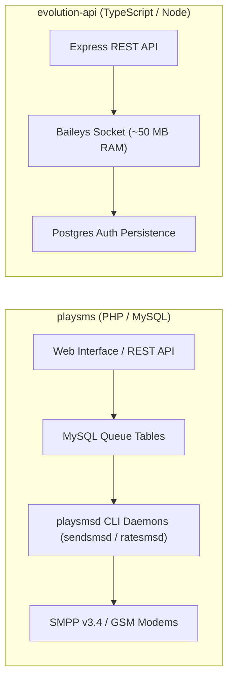
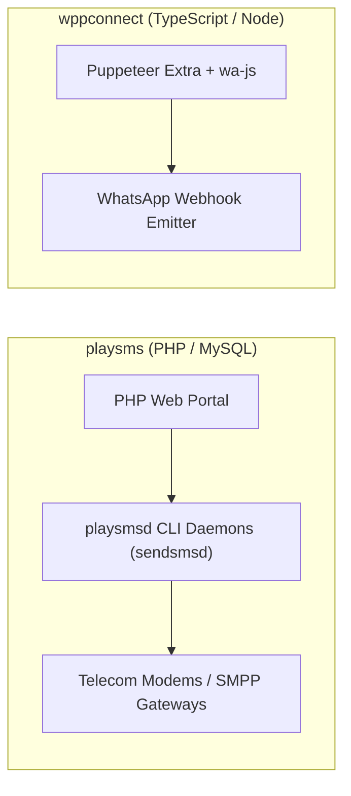
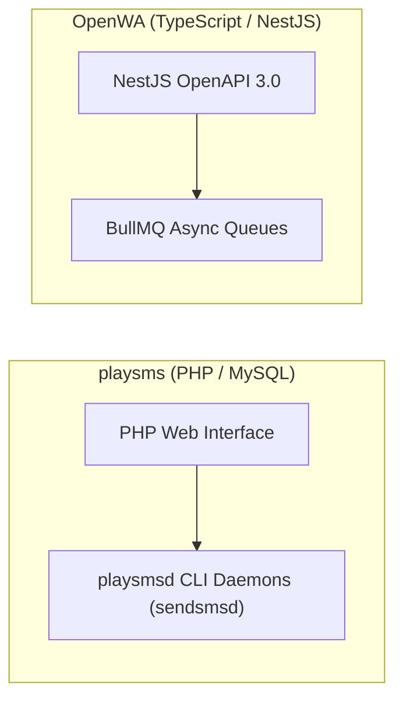
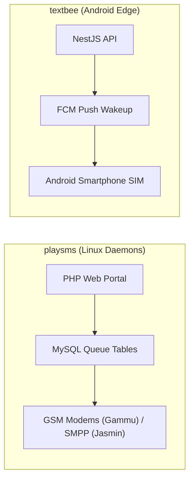
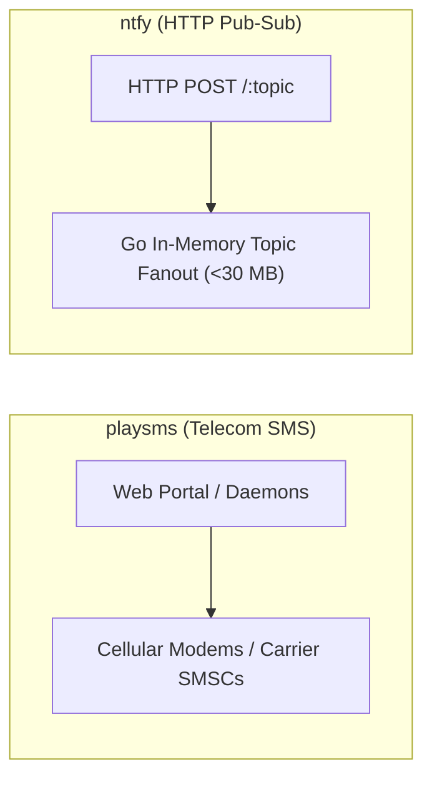

# playsms — Comparative Analysis & Category Evaluation

> **Category**: WhatsApp & Messaging Gateways  
> **Architectural Role**: Carrier SMS portal, rate-billing engine & multi-daemon telecom gateway manager  
> **Primary Stack**: PHP 8.1+ | Native PHP, Linux CLI Daemons (playsmsd) | MySQL 8.0+ / MariaDB | Linux Cron Daemons (sendsmsd, ratesmsd, dlrssmsd)  
> **Peer Solutions Compared**: `evolution-api`, `wppconnect`, `OpenWA`, `textbee`, `ntfy`  
> **Commercial SaaS Benchmarks**: Twilio SMS, Kannel, Jasmin, Infobip, Sinch, Route Mobile  

---

## 1. Executive Overview & Technical Identity: playsms

**playsms** represents the telecom portal and carrier billing standard within the **WhatsApp & Messaging Gateways** domain, distinguished by its core focus on **Pluggable telecom protocol gateways (SMPP via Jasmin/Kannel, GSM modems via Gammu, HTTP aggregators), prefix-based credit rating (`playsms_featureSimplerate`), and multi-process Linux background daemons (`playsmsd.php`)**.

### Core Architectural Profile
- **Runtime & Language**: `PHP 8.1+` (CLI and Apache/Nginx PHP-FPM)
- **Core Framework**: Native modular PHP architecture, `playsms/webservices`, `phpmailer/phpmailer`
- **Persistence Layer**: `MySQL 8.0+` or `MariaDB 10.6+` (Queue tables, user credit balances, prefix rate cards)
- **Concurrency & Queue Model**: Multi-process Linux CLI daemons (`playsmsd.php`: `sendsmsd`, `schdqueue`, `ratesmsd`, `dlrssmsd`, `recvsmsd`)
- **Domain Specialization**: `Carrier-grade SMS management, prefix billing rating & telecom protocol mediation`

---

## 2. Peer Solution Landscape (WhatsApp & Messaging Gateways)

Within this category, `playsms` operates alongside the following peer solutions:

| Solution | Language & Runtime | Core Framework | Database / Cache | Queue / Concurrency | Primary Architectural Niche |
| :--- | :--- | :--- | :--- | :--- | :--- |
| **playsms** (Current) | `PHP 8.1+` | `Native PHP, CLI Daemons` | `MySQL 8.0+` | `playsmsd Background Daemons`| **Classical carrier-grade SMS portal with prefix rating & SMPP** |
| **evolution-api** | `TypeScript / Node 20+`| `Express, Baileys, Prisma` | `PostgreSQL / MySQL, Redis`| `RabbitMQ / Kafka / SQS` | Direct binary socket WhatsApp with minimal RAM & DB auth |
| **wppconnect** | `TypeScript / Node 20+`| `Express, Puppeteer` | `Local Disk / SQLite` | `Node Event Emitters` | Complete browser-level WhatsApp Web emulation via Chromium DOM |
| **OpenWA** | `TypeScript / Node 22+`| `NestJS 11+, TypeORM` | `PostgreSQL, Redis` | `BullMQ Transactional Outbox`| Pluggable dual-engine (Baileys & WWebJS) with send idempotency |
| **textbee** | `TypeScript & Kotlin` | `NestJS 11+, Android SDK` | `MongoDB 7+, Redis` | `BullMQ Pacing Engine` | Decentralized carrier SMS using physical Android handsets |
| **ntfy** | `Go 1.26+` | `Native Go net/http` | `SQLite / PostgreSQL` | `Go Channels / sync.Map` | Ultra-fast zero-dependency push notification daemon (<30MB) |

---

## 3. Deep Head-to-Head Comparative Breakdown: playsms vs Peers

### 3.1. playsms vs. evolution-api

**Comparative Focus**: `Carrier GSM modem & SMPP routing interface` vs. `Direct binary socket WhatsApp with minimal RAM`

#### Architectural & Stack Differences
- **Channel Protocols & Transport**: playSMS is designed for telecommunications SMS networks, routing traffic over SMPP v3.4 (via Jasmin or Kannel connectors) or direct hardware GSM modem AT commands (via Gammu). Evolution API speaks the WhatsApp Noise Protocol over secure WebSockets directly to Meta's multi-device infrastructure.
- **Concurrency & Daemon Execution**: playSMS isolates web requests from message dispatching through 5 specialized background daemons running in Linux userspace (`playsmsd.php`), polling MySQL queue tables (`playsms_tblSMSOutgoing_queue`). Evolution API uses an asynchronous Node.js event-driven runtime dispatching messages directly to WebSockets or AMQP message brokers (RabbitMQ, Kafka, SQS).
- **Billing & Account Management**: playSMS includes a full-featured telecom billing engine (`playsms_featureSimplerate`) that validates user credits against prefix rate cards before queueing. Evolution API delegates billing and balance checks to upstream CRM platforms.

#### Where playsms Excels over evolution-api
- **Direct Carrier SMPP Termination**: Connects directly to mobile network operators (MNOs) for wholesale carrier SMS delivery.
- **Prefix Rating & Prepaid Credit Billing**: Complete multi-tier credit management for commercial SMS resellers.
- **Hardware GSM Modem Array Control**: Manages banks of physical cellular modems simultaneously via Gammu.

#### Where evolution-api Holds an Advantage over playsms
- **Modern WhatsApp Protocol Support**: Two-way interactive messaging with media, buttons, and catalogs.
- **Cloud-Native Deployment**: Packaged as standard Docker microservices without requiring Linux userspace background daemons.
- **Rich Multimedia Capabilities**: Opus PTT voice recordings, PDF documents, location pins, and clickable buttons.

#### Architectural Tradeoffs Matrix

| Architectural Dimension | playsms | evolution-api |
| :--- | :--- | :--- |
| **Primary Channel** | Telecom Carrier SMS | WhatsApp Multi-Device |
| **Runtime Architecture** | PHP Web Portal + Linux CLI Daemons (`playsmsd`) | Event-driven Node.js / Express microservice |
| **Protocol Integration** | SMPP v3.4, GSM AT Commands, HTTP REST | WhatsApp WebSockets (Noise Protocol) |
| **Billing & Rating** | Built-in prefix rate billing & prepaid credits | None (Delegated to upstream platform) |
| **Storage Engine** | MySQL 8.0+ / MariaDB queue tables | PostgreSQL / MySQL / Mongo + Redis |
| **Best-Fit Deployment** | Commercial SMS resellers, telecom aggregators | WhatsApp-driven SaaS, marketing CRM inboxes |

---

### 3.2. playsms vs. wppconnect

**Comparative Focus**: `Classical telecom SMS portal & daemon engine` vs. `Modern WhatsApp browser automation`

#### Architectural & Stack Differences
- **Channel Medium & Infrastructure**: playSMS bridges applications to cellular telephone networks and SMPP trunks. WPPConnect automates Google Chromium running the official WhatsApp Web client via Puppeteer Extra.
- **Resource Footprint**: playSMS runs on a standard LAMP stack consuming ~100 MB RAM across its daemons. WPPConnect requires heavy server infrastructure, consuming 400 MB to 750 MB RAM per active browser session.
- **User Management & Reselling**: playSMS includes a multi-tenant portal with sub-user accounts, rate sheets, and invoice billing. WPPConnect is an automation library/API without user billing or sub-account governance.

#### Where playsms Excels over wppconnect
- **Direct Carrier Connectivity**: High-throughput SMPP binds with cellular operators.
- **Low Server Footprint**: Runs on low-cost virtual servers without headless browser overhead.
- **Prepaid Rating & Billing Engine**: Complete credit accounting per destination country code.

#### Where wppconnect Holds an Advantage over playsms
- **Modern WhatsApp Capabilities**: Supports media, polls, buttons, and WhatsApp Channels (Newsletters).
- **Zero Telecom Hardware**: Connects instantly via a standard mobile phone QR code scan without modems.
- **Modern Developer Experience**: TypeScript API with rich DOM module hooks.

#### Architectural Tradeoffs Matrix

| Architectural Dimension | playsms | wppconnect |
| :--- | :--- | :--- |
| **Primary Channel** | Telecom Carrier SMS | WhatsApp Web |
| **Core Technology** | PHP 8.1+, MySQL, Linux Daemons | TypeScript, Node.js, Puppeteer |
| **Hardware Requirements** | Standard VPS + Telecom Modems / Trunks | High-spec cloud VPS (Heavy RAM) |
| **Billing & Credits** | Prefix rate billing & user balance tracking | None |
| **Best-Fit Deployment** | Commercial SMS gateways, wholesale telecom portals | Interactive WhatsApp chat, marketing bots |

---

### 3.3. playsms vs. OpenWA

**Comparative Focus**: `Carrier SMS portal & daemon engine` vs. `Modern WhatsApp gateway & outbox manager`

#### Architectural & Stack Differences
- **Framework & Architecture**: playSMS relies on procedural PHP and Linux userspace daemons polling database queues. OpenWA is built on NestJS 11+, TypeScript, TypeORM, and Redis BullMQ queues.
- **Delivery Guarantees**: OpenWA incorporates the **Transactional Outbox Pattern** to prevent dropped webhook events. playSMS relies on database polling and callback tables (`playsms_tblSMSOutgoing`).
- **Channel Focus**: OpenWA provides a pluggable dual-engine (Baileys and WWebJS) for WhatsApp messaging. playSMS provides a pluggable gateway architecture for SMS providers (Jasmin, Kannel, Twilio, Gammu).

#### Where playsms Excels over OpenWA
- **Telecom Carrier SMPP & Modem Routing**: Interfaces directly with telecom trunks and hardware GSM modems.
- **Prefix Rating & Prepaid Credit Billing**: Complete multi-tier credit management for commercial SMS resellers.
- **SMS Keyword Automation**: Built-in interactive SMS autoreplies, voting polls, and SMS-to-email routing.

#### Where OpenWA Holds an Advantage over playsms
- **Modern WhatsApp Protocol Support**: Two-way interactive messaging with media, buttons, and catalogs.
- **High-Throughput Asynchronous Architecture**: BullMQ queues handle bulk message dispatching with configurable human-like jitter delays.
- **Send Idempotency Protection**: Dedicated `send_idempotency_keys` table prevents duplicate messages during retries.

#### Architectural Tradeoffs Matrix

| Architectural Dimension | playsms | OpenWA |
| :--- | :--- | :--- |
| **Primary Channel** | Telecom Carrier SMS | WhatsApp Multi-Device |
| **Runtime Architecture** | PHP Web Portal + Linux CLI Daemons (`playsmsd`) | NestJS 11+ / TypeORM / BullMQ |
| **Queue Subsystem** | MySQL Database Queue Tables | Redis / BullMQ |
| **Billing & Credits** | Prefix rate billing & user balance tracking | None |
| **Best-Fit Deployment** | Commercial SMS gateways, wholesale telecom portals | Enterprise WhatsApp messaging, marketing CRM inboxes|

---

### 3.4. playsms vs. textbee

**Comparative Focus**: `Carrier GSM modem & SMPP portal` vs. `Android phone SMS gateway`

#### Architectural & Stack Differences
- **Hardware Integration Layer**: playSMS connects to physical USB GSM modems (using Gammu AT commands) or carrier SMSCs (using SMPP v3.4). Textbee connects to consumer Android smartphones via high-priority FCM push notifications.
- **Carrier Economics**: playSMS routes traffic through commercial telecom trunks or modem SIM cards. Textbee uses Android smartphones with unlimited consumer SIM cards, making per-message costs effectively \$0.00.
- **Throughput & Pacing**: playSMS can dispatch hundreds of SMS/sec over SMPP trunks. Textbee intentionally throttles sending to 1 SMS every 5 seconds per device to avoid carrier fraud blocks.

#### Where playsms Excels over textbee
- **Direct Carrier SMPP Termination**: Connects directly to mobile network operators for wholesale SMS delivery.
- **Prefix Rating & Prepaid Credit Billing**: Built-in billing engine for commercial SMS resellers.
- **High-Volume Throughput**: Commercial SMPP trunks handle hundreds of SMS per second without 5-second SIM pacing limits.

#### Where textbee Holds an Advantage over textbee
- **Zero Specialized Hardware**: No need for industrial multi-port USB GSM modems, PCIe cellular cards, or Linux AT command troubleshooting.
- **Modern Cloud Architecture**: NestJS REST API with OpenAPI 3.0 documentation and Docker deployment.
- **Zero Carrier SMS Costs**: Routes traffic through unlimited consumer SIM bundles.

#### Architectural Tradeoffs Matrix

| Architectural Dimension | playsms | textbee |
| :--- | :--- | :--- |
| **Hardware Tier** | Industrial GSM Modems / SMPP Trunks | Everyday Android smartphones |
| **Backend Stack** | PHP 8.1+, MySQL, Linux Daemons (`playsmsd`) | NestJS 11+, MongoDB, BullMQ, Redis |
| **Carrier Costs** | Wholesale carrier trunk rates | \$0.00 (Consumer unlimited SIM plans) |
| **Throughput Capacity** | 1,000+ SMS / second (SMPP v3.4) | 12 SMS / minute per device (Pacing limited) |
| **Best-Fit Deployment** | Wholesale SMS aggregators, carrier interconnects | Domestic sales outreach, 2FA alerts on a budget |

---

### 3.5. playsms vs. ntfy

**Comparative Focus**: `Telecom SMS portal & carrier routing` vs. `Lightweight HTTP pub-sub push server`

#### Architectural & Stack Differences
- **Transport Medium**: playSMS delivers standard SMS to mobile phones via carrier telecom networks and radio base stations. `ntfy` broadcasts push alerts to web browsers, iOS/Android apps, and desktop daemons via standard internet HTTP streaming (SSE, WebSockets, WebPush).
- **Resource Footprint**: playSMS requires PHP-FPM, MySQL, and five background Linux daemons. `ntfy` is a compiled Go binary consuming under 30 MB of RAM with zero external dependencies.
- **Cost Structure**: SMS messages via playSMS incur telco carrier trunk charges. `ntfy` notifications are completely free, operating over existing internet connections.

#### Where playsms Excels over ntfy
- **Universal Cellular Reach**: Delivers to offline mobile phones without requiring internet access or app installations.
- **Prefix Rate Billing & Reselling**: Complete commercial portal for managing customer credit balances.
- **Two-Way SMS Interactions**: Supports keyword autoreplies, SMS voting, and customer inbound routing.

#### Where ntfy Holds an Advantage over playsms
- **Zero-Cost Delivery**: Delivers instant alerts at \$0.00 cost over standard HTTP.
- **Sub-15ms Latency**: Push notifications arrive in milliseconds, compared to telecom SMS latency (2–10 seconds).
- **Modern Push Features**: Actionable buttons, clickable links, and multimedia file attachments.

#### Architectural Tradeoffs Matrix

| Architectural Dimension | playsms | ntfy |
| :--- | :--- | :--- |
| **Delivery Medium** | Telecom Carrier SMS (Cellular Radio) | HTTP Pub-Sub Push (SSE, WS, WebPush) |
| **Recipient Internet Requirement**| None | Required |
| **Cost per Message** | Carrier trunk rates | **$0.00** |
| **Delivery Latency** | ~2 - 10 seconds | **< 15 milliseconds** |
| **Base Production RAM** | ~100 MB RAM (PHP + Daemons + MySQL) | **< 30 MB RAM (Single Go Binary)** |
| **Best-Fit Deployment** | Commercial telecom portals, offline SMS delivery | DevOps monitoring, transactional push alerts |

---

## 4. Capability & Feature Comparison Matrix

| Dimension / Capability | playsms | evolution-api | wppconnect | OpenWA | textbee | ntfy |
| :--- | :---: | :---: | :---: | :---: | :---: | :---: |
| **Primary Channel** | **Telecom SMS** | WhatsApp | WhatsApp | WhatsApp | Android SMS | Push Alerts |
| **Underlying Engine** | Modem / SMPP | Baileys Socket | Chromium Web | Dual Engine | Android Intent / FCM | HTTP / WebPush |
| **RAM per Active Session**| ~25 MB | **~50 MB** | ~500 MB | ~80 MB / ~350 MB | ~30 MB (Mobile App) | **< 30 MB (Total)** |
| **Session DB Storage** | MySQL Queue Tables | **Postgres / Redis DB** | Local Disk Only | Postgres / BullMQ | MongoDB Documents | SQLite / Postgres |
| **Billing & Rating Engine** | **✅ Simplerate & Credits**| ❌ | ❌ | ❌ (Polar Subscriptions)| ❌ | ❌ (Stripe Tiers) |
| **Hardware Required** | GSM Modems / Trunks | Zero | Zero | Zero | Android Phone | Zero |

---

## 5. Commercial Benchmark Positioning

When benchmarked against commercial SaaS leaders (**Twilio SMS, Kannel, Jasmin, Infobip, Sinch, Route Mobile**):
- **Against Twilio SMS**: `playsms` allows organizations to build their own private SMS gateway, negotiating wholesale rates with local carriers and bypassing Twilio’s high retail margins.
- **Against Kannel / Jasmin**: playSMS provides the user-facing web management portal, rate cards, and billing ledgers that sit on top of low-level SMPP daemons like Jasmin or Kannel.
- **Against Infobip / Sinch**: For regional aggregators, playSMS enables localized multi-client SMS reselling with full data ownership.

---

## 6. Strategic Takeaways & Role for MarketingStudio

In the unified **MarketingStudio** architecture:
1. **Primary Component to Adopt**: Harvest playSMS's **Prefix-Based Rating and Credit Billing Mechanics** (`playsms_featureSimplerate`) to calculate SMS costs and manage outbound client campaign quotas.
2. **Utilize as Telecom Gateway Mediator**: Use playSMS or its gateway patterns when interfacing with hardware GSM modems or legacy telecom trunks.
3. **Reference Multi-Process Queue Architecture**: Inspect `playsmsd.php` for separating scheduled campaign promotion (`schdqueue`), outbound dispatch (`sendsmsd`), and delivery receipt handling (`dlrssmsd`).
