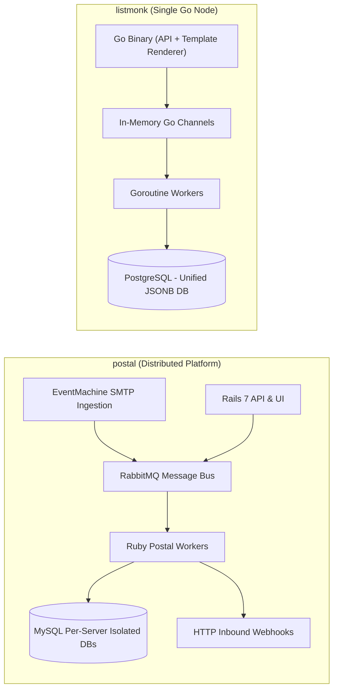
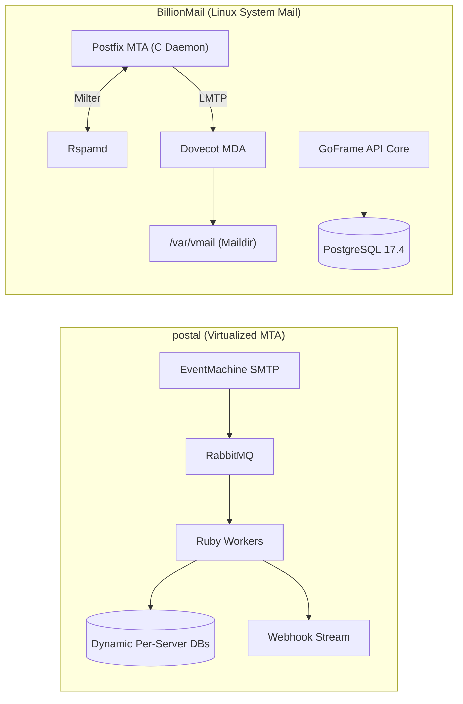
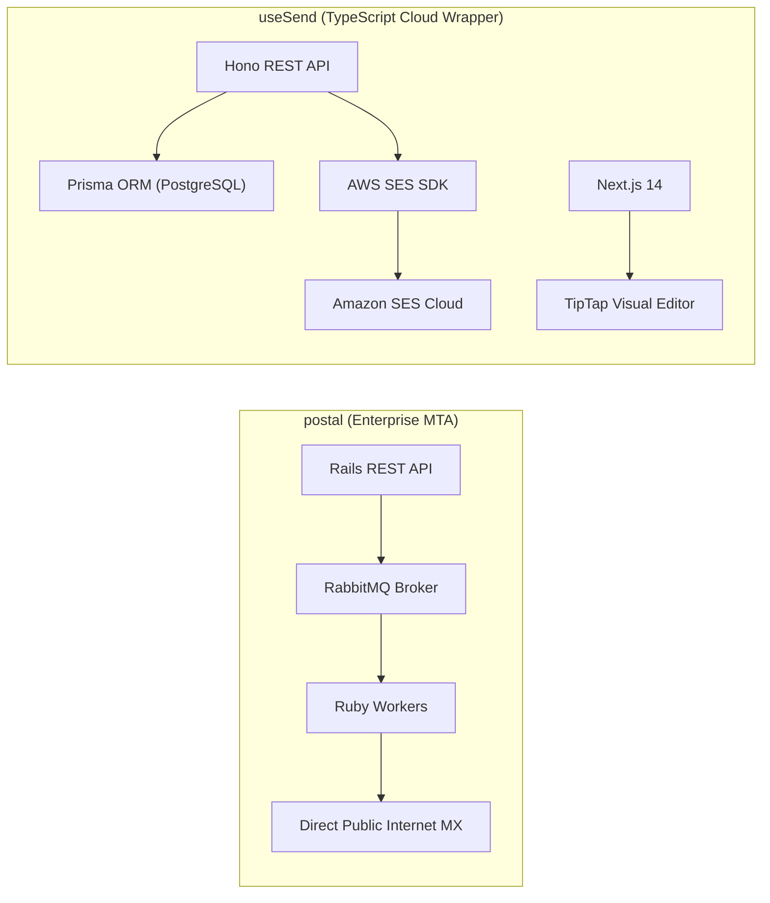
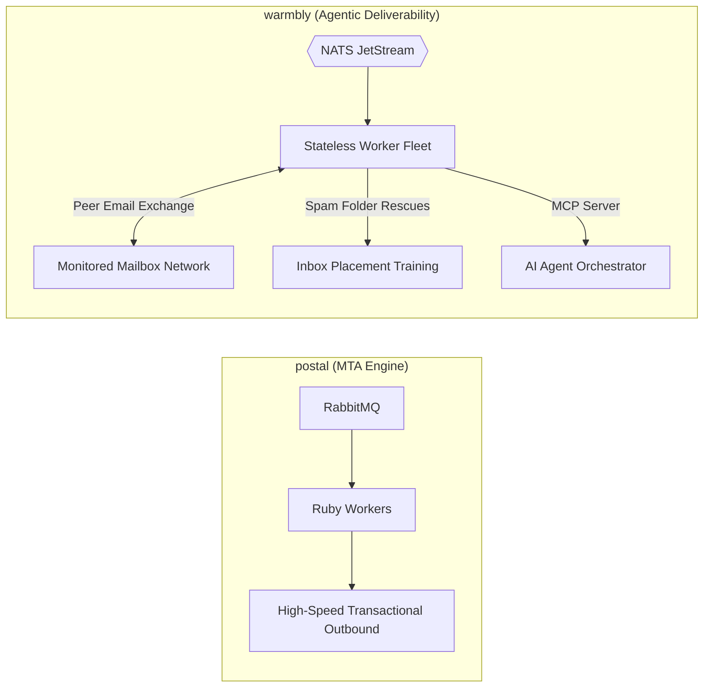
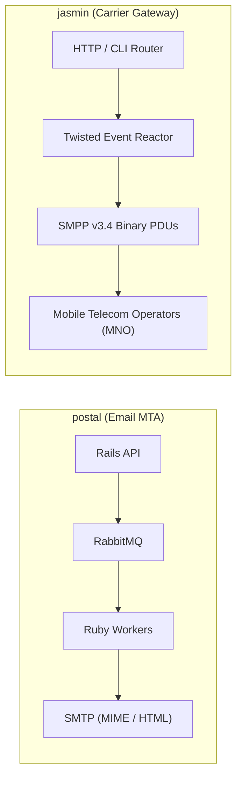

# postal — Comparative Analysis & Category Evaluation

> **Category**: Email Infrastructure & Delivery  
> **Architectural Role**: Distributed multi-tenant mail delivery platform, virtual MTA & inbound webhook engine  
> **Primary Stack**: Ruby 3.2+ | Rails 7, EventMachine | MariaDB / MySQL 10.5+, RabbitMQ | RabbitMQ Message Bus + Multi-Process Workers  
> **Peer Solutions Compared**: `listmonk`, `BillionMail`, `useSend`, `warmbly`, `jasmin`  
> **Commercial SaaS Benchmarks**: SendGrid, Postmark, Mailgun, Amazon SES  

---

## 1. Executive Overview & Technical Identity: postal

**postal** is an industrial-strength, open-source email delivery platform engineered by aTech Media / Krystal as a direct self-hosted alternative to enterprise transactional email services like SendGrid and Postmark. Unlike simple outbound relays, Postal operates as a complete virtualized mail transfer platform capable of handling both high-volume outbound delivery (via SMTP and REST API) and inbound routing (processing incoming emails and transforming them into structured JSON HTTP webhooks). Its standout architectural feature is hard multi-tenant virtualization: organizations can carve out independent virtual "Mail Servers", each with dedicated IP pools, custom DKIM signing keys, user credentials, and isolated message storage databases.

### Core Architectural Profile
- **Runtime & Language**: `Ruby 3.2+` (Rails 7 management app and async worker daemons)
- **High-Concurrency Daemon**: `EventMachine` powering the low-overhead, non-blocking SMTP receiver
- **Persistence Layer**: Multi-database MariaDB / MySQL architecture (central metadata DB + per-server message databases via `schema_template.sql`)
- **Queue & Message Bus**: `RabbitMQ` cluster utilizing AMQP exchanges for message buffering, retries, and dead-letter queues
- **Domain Specialization**: Multi-tenant transactional mail delivery, virtual mail server segregation, and inbound-to-webhook routing

---

## 2. Peer Solution Landscape (Email Infrastructure & Delivery)

Within this category, `postal` operates alongside the following peer solutions:

| Solution | Language & Runtime | Core Framework | Database / Cache | Queue / Concurrency | Primary Architectural Niche |
| :--- | :--- | :--- | :--- | :--- | :--- |
| **postal** (Current) | `Ruby 3.2+` | `Rails 7, EventMachine` | `MariaDB / MySQL, RabbitMQ` | `RabbitMQ Queues + Ruby Workers` | **Virtualized multi-tenant MTA & inbound webhooks** |
| **listmonk** | `Go 1.21+` | `Gin / Native Go` | `PostgreSQL 13+ (JSONB)` | `Goroutine Pool + TCP Sockets` | Raw bulk throughput on minimal RAM |
| **BillionMail** | `Go 1.24 / Docker` | `GoFrame v2, Postfix, Dovecot` | `PostgreSQL 17.4, Redis 7.4` | `Postfix Spool + Ants Pool` | Turnkey ISP-grade mail cluster & IP warmup |
| **useSend** | `TypeScript / Node` | `Next.js 14, Hono` | `PostgreSQL (Prisma ORM)` | `SES SDK Async + Node SMTP` | Modern developer experience & visual block canvas |
| **warmbly** | `Go 1.26` | `Gin, pgx/v5, go-redis` | `PostgreSQL 16+, Redis 7+` | `NATS JetStream + Stateless Fleet` | Agentic cold email, peer warmup & unibox |
| **jasmin** | `Python 3.9+` | `Twisted Async` | `Redis, RabbitMQ` | `Twisted Deferreds + AMQP` | Carrier-grade SMS gateway & SMPP v3.4 router |

---

## 3. Deep Head-to-Head Comparative Breakdown: postal vs Peers

### 3.1. postal vs. listmonk

**Comparative Focus**: `Distributed Multi-Tenant Rails/RabbitMQ MTA` vs. `Single-Binary Go Dispatcher`

#### Detailed Architectural Contrast
- **Delivery Pipeline Topology**: `postal` is structured as a decoupled distributed system with three distinct runtimes: a Rails 7 administrative web interface and REST API, an EventMachine SMTP listener daemon, and background Ruby dispatch workers communicating across RabbitMQ. In contrast, `listmonk` is a single static Go binary executing campaigns directly in-process and dispatching mail through third-party relays.
- **Queue Mechanics & Concurrency**: `postal` buffers all delivery requests and incoming messages in RabbitMQ queues (`bunny` client), providing durable, broker-enforced message persistence that survives application crashes. `listmonk` manages queues in volatile Go channel buffers in RAM, achieving higher dispatch speeds (1,500–3,500 msgs/sec vs. Postal's 400–800 msgs/sec) at the cost of broker-level durability.
- **Data Persistence & Isolation**: `postal` deploys a two-tier database model: a central MySQL database for users, organizations, and domains, and dynamically generated per-server MySQL databases (`postal-server-X`) for raw message payloads, delivery logs, and clicks. `listmonk` uses a single PostgreSQL database with JSONB subscriber attributes and GIN indexes.
- **Inbound Webhook Streaming**: `postal` terminates inbound MX traffic, parses multipart MIME payloads, extracts attachments, and streams clean JSON payloads to configured HTTP webhook URLs. `listmonk` does not support inbound email ingestion or webhook translation.

#### Architectural Tradeoffs Matrix: postal vs. listmonk

| Dimension | postal | listmonk | Architectural Implication |
| :--- | :--- | :--- | :--- |
| **Throughput** | **400–800 msgs/sec** | **1,500–3,500 msgs/sec** | listmonk eliminates RabbitMQ AMQP serialization and Ruby process overhead. |
| **Multi-Tenancy** | **Hard Virtual Mail Server Isolation** | **Logical Single-Tenant (Lists/Tags)**| Postal allows provisioning isolated virtual servers with dedicated databases and IP pools. |
| **Inbound Processing** | **Full Inbound-to-Webhook Engine** | **None (Bounce/Unsub webhooks only)** | Postal converts emails into webhook events; listmonk is purely an outbound sender. |
| **Operational Stack** | **Heavy (Rails, EventMachine, RabbitMQ, MySQL)**| **Ultra-Light (Single Go binary + Postgres)** | Postal requires multi-process supervision; listmonk runs in a lightweight container (<50MB RAM). |

---

### 3.2. postal vs. BillionMail

**Comparative Focus**: `Virtualized Ruby/RabbitMQ Multi-Tenant MTA` vs. `Native Linux Postfix/Dovecot Stack`

#### Detailed Architectural Contrast
- **Delivery Pipeline Topology**: `postal` implements an application-tier virtualized MTA written in Ruby, bypassing POSIX mail daemons entirely. `BillionMail` deploys the standard Linux mail stack (Postfix MTA, Dovecot MDA, Rspamd milter, ClamAV antivirus), orchestrating them via Go and Docker bridge networks.
- **Inbound Paradigm**: `postal` is built for developer applications: inbound emails are converted into HTTP POST webhooks or forwarded to other MTAs. `BillionMail` is built for human mailboxes: inbound emails are delivered via LMTP to Dovecot maildirs and accessed via IMAP/POP3 or Roundcube webmail.
- **Queue Mechanics**: `postal` uses RabbitMQ with advanced message ack/requeue logic across distributed worker nodes. `BillionMail` relies on Postfix's local disk spool directories (`incoming`, `active`, `deferred`), which provides POSIX durability but lacks RabbitMQ's distributed cluster flexibility.
- **Deliverability Automation**: `BillionMail` embeds automated IP warmup ramps (`WarmupDailyUpstairs` with 30% daily step-ups), Fail2ban jail automation, and automated Lego ACME TLS issuance. `postal` supports manual IP pool assignment and domain DKIM generation, but lacks automated reputation ramp-up algorithms.

#### Architectural Tradeoffs Matrix: postal vs. BillionMail

| Dimension | postal | BillionMail | Architectural Implication |
| :--- | :--- | :--- | :--- |
| **Target Consumer** | **Application Developers (APIs/Webhooks)** | **End Users & Mailbox Admins (IMAP/Webmail)**| Postal feeds software systems; BillionMail hosts organization mailboxes. |
| **Multi-Tenancy** | **Independent DBs & IP Pools per Org** | **Relational Table Rows in Shared Postgres** | Postal guarantees physical database segregation between tenants; BillionMail uses shared tables. |
| **Queue Subsystem** | **RabbitMQ Distributed Broker** | **Postfix POSIX Filesystem Spool** | Postal workers scale horizontally across server nodes; Postfix is tied to local filesystem I/O. |
| **Spam / Antivirus** | **Basic SpamAssassin Scoring** | **Rspamd Neural Milter + ClamAV + Fail2ban** | BillionMail provides deeper enterprise email security and automated rate protection. |

---

### 3.3. postal vs. useSend

**Comparative Focus**: `Industrial Multi-Tenant Private MTA` vs. `Agile Serverless TypeScript & SES Client`

#### Detailed Architectural Contrast
- **Delivery Pipeline Topology**: `postal` is an authoritative MTA that connects directly to destination MX servers, requiring dedicated IP addresses, reverse DNS (PTR) records, and active IP reputation management. `useSend` is an application-tier wrapper that delegates all transport, IP warming, and deliverability concerns to Amazon SES.
- **Developer & Template Experience**: `useSend` provides a modern developer experience: a fullstack TypeScript monorepo (Turborepo), Next.js 14 App Router, Hono edge API, Prisma ORM, and a visual drag-and-drop email canvas (`@usesend/email-editor`). `postal` provides a classic Rails MVC dashboard and basic HTML/text previews without visual block building.
- **Inbound Capabilities**: `postal` handles full inbound MX traffic with JSON webhook streaming. `useSend` has no inbound MX capabilities, relying on AWS SES receipt rules and SNS notifications for bounce/complaint handling.
- **Unit Economics**: `postal` incurs zero per-email fees, scaling to millions of sends for the fixed cost of VPS instances and IP allocations. `useSend` scales with AWS SES metered pricing (\$0.10 per 1,000 emails).

#### Architectural Tradeoffs Matrix: postal vs. useSend

| Dimension | postal | useSend | Architectural Implication |
| :--- | :--- | :--- | :--- |
| **Infrastructure Role** | **Self-Contained Virtual MTA** | **Cloud SES Wrapper & UI Builder** | Postal replaces SendGrid/SES; useSend requires AWS SES or an upstream relay. |
| **Template UX** | **Raw HTML / Plain Text** | **Visual Drag-and-Drop Canvas** | useSend enables visual email building; Postal expects pre-rendered HTML payloads. |
| **Delivery Cost** | **\$0 Variable (Fixed VPS & IP Cost)** | **Metered Cloud Billing (\$0.10/1k emails)** | Postal provides massive savings at enterprise scale (10M+ sends/month). |
| **Deployment Complexity**| **High (Multi-tier Ruby/RabbitMQ)** | **Low (TypeScript container + Postgres)** | useSend deploys rapidly to standard container platforms without broker configuration. |

---

### 3.4. postal vs. warmbly

**Comparative Focus**: `Transactional High-Throughput MTA` vs. `Autonomous Cold Email Deliverability Platform`

#### Detailed Architectural Contrast
- **Domain Specialization**: `postal` is engineered for transactional and application messaging (invoices, password resets, notifications) where messages must reach recipient inboxes in under two seconds with complete tracking logs. `warmbly` is engineered for cold outbound deliverability, deliberately pacing sends to low volumes, rotating sender inboxes across Google Workspace and Microsoft 365, and executing peer-to-peer warmup exchanges.
- **Execution Architecture**: `postal` relies on a centralized RabbitMQ broker and Ruby workers writing to local MySQL databases. `warmbly` enforces a strict control-plane / execution-plane separation: workers consume tasks from **NATS JetStream** or Kafka and never connect to PostgreSQL directly, enabling massive worker elasticity across disparate cloud environments.
- **Deliverability Remediation**: `postal` offers passive deliverability tools (domain DKIM verification, dedicated IP pools). `warmbly` actively repairs sender reputation by programmatically finding peer emails in spam folders, starring them, marking them as important, and moving them to the inbox to train ISP neural classification filters.

#### Architectural Tradeoffs Matrix: postal vs. warmbly

| Dimension | postal | warmbly | Architectural Implication |
| :--- | :--- | :--- | :--- |
| **Primary Workload** | **Transactional & High-Speed Notifications** | **Cold Outbound Outreach & Deliverability Warmup**| Postal delivers immediate transactional mail; warmbly warms cold mailboxes. |
| **Queue & Messaging** | **RabbitMQ Central Broker** | **NATS JetStream / Kafka Distributed Log** | warmbly's stateless workers avoid DB connections entirely; Postal workers write to MySQL. |
| **Deliverability Logic** | **Dedicated IP Pools & SPF/DKIM** | **Active Peer Warmup Network & Spam Rescue** | warmbly programmatically fixes low sender reputation; Postal expects clean lists. |
| **AI Integration** | **None** | **Native Model Context Protocol (MCP) Server** | warmbly can be inspected and driven by autonomous AI agents; Postal is API-driven. |

---

### 3.5. postal vs. jasmin

**Comparative Focus**: `Internet Transactional Email MTA` vs. `Telecommunication Carrier SMS Gateway`

#### Detailed Architectural Contrast
- **Protocol Tier**: `postal` operates over application-layer internet protocols (SMTP, SMTPS, HTTP JSON webhooks), parsing complex MIME tree structures, HTML styles, and binary file attachments. `jasmin` operates over telecommunication carrier protocols (**SMPP v3.4**), packing binary PDUs for transmission across mobile network operator links.
- **Routing & Accounting**: `postal` routes messages based on recipient domain MX DNS records and assigned IP pools. `jasmin` executes Least-Cost Routing (LCR) via an in-memory Redis engine, evaluating cellular prefixes (MCC/MNC) and decrementing real-time prepaid customer credit balances before transmission.

#### Architectural Tradeoffs Matrix: postal vs. jasmin

| Dimension | postal | jasmin | Architectural Implication |
| :--- | :--- | :--- | :--- |
| **Medium** | **Transactional & Inbound Email** | **Carrier-Grade Cellular SMS** | Solves email delivery vs. mobile carrier text messaging. |
| **Throughput** | **400–800 msgs/sec** | **1,000–2,500 SMS/sec** | Jasmin handles high-rate binary PDUs with sub-millisecond dispatch. |
| **Architecture** | **Rails 7 + EventMachine + RabbitMQ** | **Python Twisted + Redis + RabbitMQ** | Both leverage RabbitMQ, but Jasmin is event-driven Python while Postal is Rails MVC. |

---

## 4. Capability & Feature Comparison Matrix

| Dimension / Capability | postal | listmonk | BillionMail | useSend | warmbly | jasmin |
| :--- | :---: | :---: | :---: | :---: | :---: | :---: |
| **Primary Architectural Niche** | **Virtualized multi-tenant MTA & inbound webhooks** | Raw bulk throughput on minimal RAM | Turnkey ISP-grade mail cluster & IP warmup | Modern developer experience & visual block canvas | Agentic cold email, peer warmup & unibox | Carrier-grade SMS gateway & SMPP v3.4 router |
| **Runtime Language** | `Ruby 3.2+` | `Go 1.21+` | `Go 1.24 / Docker` | `TypeScript / Node` | `Go 1.26` | `Python 3.9+` |
| **Database Persistence** | `MariaDB / MySQL` | `PostgreSQL (JSONB)` | `PostgreSQL 17.4, Redis` | `PostgreSQL (Prisma)` | `PostgreSQL 16, Redis` | `Redis, RabbitMQ` |
| **Async Execution Model** | `RabbitMQ + Ruby Workers` | `Goroutine Pool + TCP Sockets` | `Postfix Spool + Ants Pool` | `SES SDK Async + Node SMTP`| `NATS JetStream + Stateless Fleet` | `Twisted Deferreds + AMQP` |
| **Virtual Mail Server Isolation**| ✅ Independent DBs & Credentials | ❌ Single tenant | ⚠️ Domain rows only | ✅ Teams model | ⚠️ Mailbox accounts | ✅ Multi-account |
| **Inbound Webhook Streaming** | ✅ Rich JSON Webhooks | ⚠️ Bounces/Unsub only | ❌ (Maildir IMAP) | ⚠️ SES events only | ⚠️ Unibox sync only | ✅ DLR receipts |
| **Visual Drag-and-Drop Editor**| ❌ | ❌ HTML / Markdown | ❌ | ✅ TipTap Canvas | ❌ | ❌ |
| **Automated Peer Warmup** | ❌ | ❌ | ✅ Rate ramp only | ❌ | ✅ Peer Network + Spam Rescue| ❌ |
| **Peak Throughput** | **400–800 msgs/sec** | **1,500–3,500+ msgs/sec** | **500–1,200 msgs/sec** | **300–600 msgs/sec** | **20–100/day per box** | **1,000–2,500 SMS/sec** |
| **Resource Footprint (RAM)** | **~1.2 GB** | **<50 MB** | **~1.5 GB** | **~250 MB** | **~80 MB** | **~300 MB** |

---

## 5. Commercial Benchmark Positioning

When benchmarked against commercial SaaS leaders (**SendGrid, Postmark, Mailgun, Amazon SES**):
- **SendGrid/Postmark Alternative**: `postal` is the closest 1:1 open-source clone of SendGrid and Postmark available. It reproduces their virtual server model, API keys, delivery status webhooks, click/open tracking, and message search capabilities.
- **Enterprise Isolation**: By spinning up separate MySQL databases for each virtual mail server, Postal provides true physical data segregation for SaaS providers managing multiple enterprise clients.
- **Operational Reality**: Unlike cloud APIs where deliverability and server scaling are fully managed, self-hosting Postal requires managing IP reputation, PTR records, RabbitMQ clustering, and MySQL storage growth.

---

## 6. Strategic Takeaways & Role for MarketingStudio

In the unified **MarketingStudio** architecture:
1. **Primary Component to Adopt**: Deploy Postal as the central transactional email engine and inbound MX gateway for MarketingStudio.
2. **Inbound Email Seam**: Route incoming domain MX records to Postal's EventMachine daemon, converting customer email replies into structured JSON webhooks that stream into MarketingStudio's Omnichannel Inbox.
3. **Peer Coexistence**:
   - Utilize `postal` for transactional notifications and inbound webhook ingestion.
   - Delegate high-volume marketing newsletters to `listmonk` for maximum throughput and minimal resource usage.
   - Use `useSend`'s visual block builder to author templates that are pushed to Postal for delivery.
   - Utilize `warmbly` to protect and warm sender domains before provisioning them inside Postal virtual servers.
