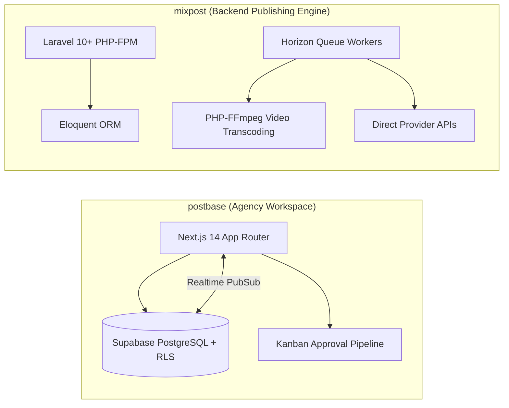
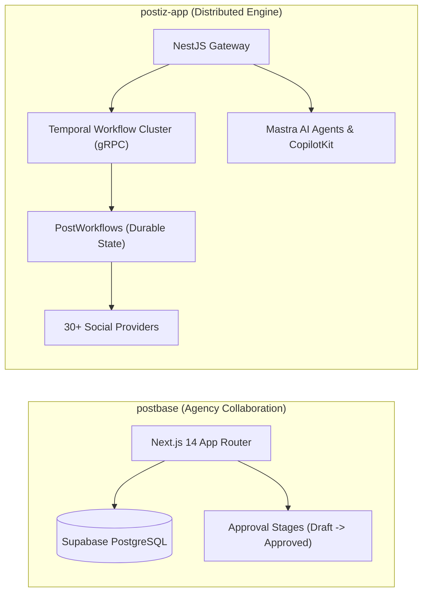
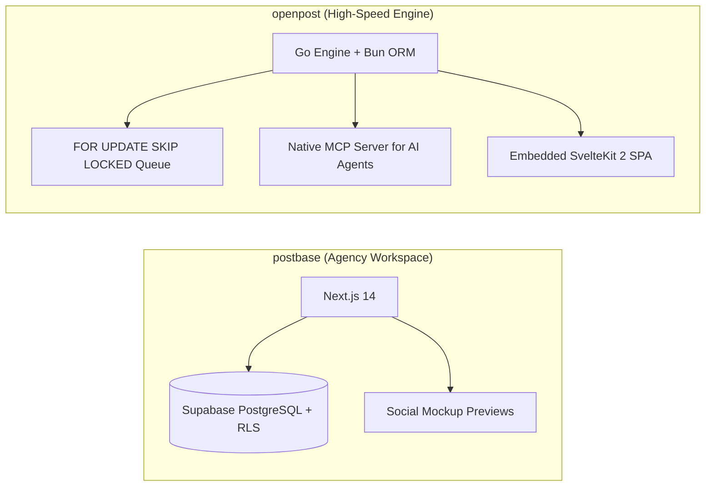
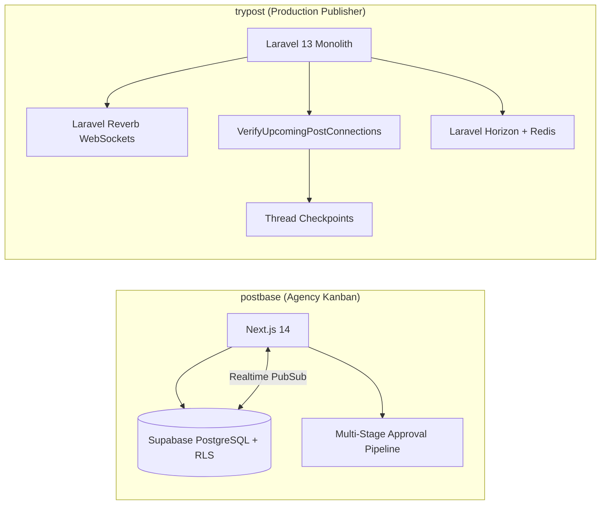

# postbase — Comparative Analysis & Category Evaluation

> **Category**: Social Media Management  
> **Architectural Role**: Collaborative agency social workspace, kanban draft approval pipeline & authentic platform previews  
> **Primary Stack**: TypeScript 5.3+ | Next.js 14 App Router, Shadcn UI | PostgreSQL via Supabase (RLS & Realtime) | Next.js Server Actions + Supabase Realtime  
> **Peer Solutions Compared**: `mixpost`, `postiz-app`, `openpost`, `trypost`  
> **Commercial SaaS Benchmarks**: Planoly, Later, Loomly, Buffer, Notion Social Schedulers  

---

## 1. Executive Overview & Technical Identity: postbase

**postbase** represents the collaboration-first and agency workflow tier within the **Social Media Management** domain. Rather than focusing on heavy video transcoding or low-level queue orchestration, Postbase is engineered around the human approval bottleneck that marketing agencies face: bridging the gap between content copywriters, graphic designers, account managers, and external clients. Built with **Next.js 14** App Router and **Supabase**, Postbase delivers a visual kanban board and calendar workspace where posts transition through formal approval stages (`Draft` -> `Needs Review` -> `Approved` -> `Scheduled` -> `Published`) with pixel-perfect mockups of how content will appear on Twitter (light/dark mode), LinkedIn, and Instagram.

Postbase's architecture leverages Supabase's managed PostgreSQL backend with **Row Level Security (RLS)** to enforce strict multi-tenant agency boundaries. Realtime updates across team members are synchronized via Supabase Realtime (PostgreSQL replication streams), enabling instant state synchronization without custom WebSocket server maintenance.

### Core Architectural Profile
- **Runtime & Language**: `TypeScript 5.3+` / `Node.js 20+` with modern Next.js 14 App Router and Server Actions
- **Core Framework**: `Next.js 14` + `React 18` + `Tailwind CSS` + `Shadcn UI` component primitives
- **Persistence Layer**: `PostgreSQL` via `Supabase` with strict Row Level Security (RLS) policies per workspace
- **Real-Time Synchronization**: `Supabase Realtime` (PostgreSQL logical decoding PubSub)
- **Domain Specialization**: Agency-client approval pipelines, kanban content scheduling, visual platform previews, and serverless-friendly deployment

---

## 2. Peer Solution Landscape (Social Media Management)

Within this category, `postbase` operates alongside the following peer solutions:

| Solution | Language & Runtime | Core Framework | Database & ORM | Queue & Scheduler | Supported Platforms | License |
| :--- | :--- | :--- | :--- | :--- | :--- | :--- |
| **postbase** (Current) | `TypeScript / Node 20+`| `Next.js 14, Shadcn UI` | `PostgreSQL (Supabase RLS)` | `Server Actions + Realtime` | **X, LinkedIn, Instagram (Kanban Approvals)** | MIT |
| **mixpost** | `PHP 8.2+ / TS` | `Laravel, Inertia.js, Vue 3` | `MySQL / PostgreSQL (Eloquent)`| `Laravel Queue + Horizon` | 8+ Networks (X, FB, IG, LinkedIn, Masto, YouTube) | MIT |
| **postiz-app** | `TypeScript / Node 22+`| `NestJS 10, Next.js 14` | `PostgreSQL (Prisma 6.5)` | `Temporal.io Durable Workflows` | 30+ Networks (inc. TikTok, Bluesky, Nostr, Reddit) | AGPL-3.0 |
| **openpost** | `Go 1.26+` | `Echo v4, Huma v2, SvelteKit 2`| `SQLite / PostgreSQL (Bun ORM)` | `SKIP LOCKED DB Queue` | X, Meta, LinkedIn, YouTube, Bluesky + Native MCP | AGPL-3.0 |
| **trypost** | `PHP 8.2+ / JS` | `Laravel 13, Vue 3, Reka UI` | `PostgreSQL / MySQL (Eloquent)` | `Horizon + Reverb WebSockets` | 13+ Networks (Pre-flight verifiers & checkpoints)| AGPL-3.0-only |

---

## 3. Deep Head-to-Head Comparative Breakdown: postbase vs Peers

### 3.1. postbase vs. mixpost

**Comparative Focus**: `Collaborative Agency Kanban & Supabase RLS` vs. `Industrial Multi-Platform Engine & FFmpeg`

#### Detailed Architectural Contrast
- **Core Mission & Workflow**: `postbase` focuses on the pre-publishing human workflow: drafting posts, requesting feedback, and securing client approval through a visual kanban pipeline. `mixpost` focuses on the technical mechanics of publication: processing video chunking with PHP-FFmpeg, managing variant inheritance (`mixpost_post_versions`), and isolating network delivery failures via Laravel Horizon's `Bus::batch()`.
- **Infrastructure & Deployment**: `postbase` is serverless-friendly, deployable in minutes to Vercel, Netlify, or Docker with a managed Supabase backend. `mixpost` requires traditional Linux hosting infrastructure, including PHP-FPM, Nginx, Redis, and supervisor daemons for background worker queues.
- **Data & Access Control**: `postbase` delegates authentication and tenancy to Supabase PostgreSQL Row Level Security (RLS) policies. `mixpost` executes role-based access control (RBAC) at the Laravel application layer via Eloquent global scopes and middleware.

#### Architectural Tradeoffs Matrix: postbase vs. mixpost

| Dimension | postbase | mixpost | Architectural Implication |
| :--- | :--- | :--- | :--- |
| **Approval Workflows** | **Formal Kanban Sign-off Pipeline** | **Single / Multi-Workspace Roles** | Postbase prevents unapproved client dispatches; Mixpost focuses on automated publishing. |
| **Media Pipeline** | **Basic Direct S3 Uploads** | **FFmpeg Poster Extraction & Video Chunking** | Mixpost handles complex video reels and transcoding; Postbase handles static images. |
| **Deployment Footprint**| **Serverless (Vercel + Supabase)** | **Containerized PHP-FPM + Redis + Horizon**| Postbase requires zero server ops; Mixpost requires managing PHP daemon infrastructure. |
| **Network Breadth** | **3 Networks (X, LinkedIn, IG)** | **8+ Networks (inc. YouTube, Pinterest)** | Mixpost covers far more social platforms and media formats than Postbase. |

---

### 3.2. postbase vs. postiz-app

**Comparative Focus**: `Collaborative Agency Kanban & Client Approvals` vs. `Enterprise Durable Multi-Platform Engine (Temporal + 30+ Networks)`

#### Detailed Architectural Contrast
- **System Architecture & Resilience**: `postiz-app` is a distributed, enterprise-grade publishing suite powered by **Temporal.io durable workflow execution**. Every post is a stateful workflow that can withstand infrastructure reboots and multi-day API rate limits. `postbase` uses lightweight Next.js Server Actions and scheduled timestamps, prioritizing simplicity and agency client collaboration over distributed fault tolerance.
- **Platform Coverage**: `postiz-app` supports over 30 networks, including Web3 and decentralized channels (Bluesky ATProto, Nostr, Farcaster, Reddit, Discord). `postbase` focuses on 3 mainstream business networks (Twitter/X, LinkedIn, Instagram).
- **Client Collaboration**: `postbase` excels with its client presentation layer, rendering authentic light/dark mockups for client sign-offs. `postiz-app` focuses on multi-platform content scheduling and AI-assisted drafting (via Mastra AI and CopilotKit).

#### Architectural Tradeoffs Matrix: postbase vs. postiz-app

| Dimension | postbase | postiz-app | Architectural Implication |
| :--- | :--- | :--- | :--- |
| **Publishing Durability** | **Next.js Server Actions (Basic)** | **Temporal Stateful Durable Workflows** | Postiz guarantees delivery across server crashes; Postbase relies on serverless execution. |
| **Platform Reach** | **3 Networks** | **30+ Networks** | Postiz connects to modern decentralized, developer, and community channels. |
| **Client Sign-off UX** | **Dedicated Multi-Stage Kanban Board** | **Workspace Role Access** | Postbase is tailored for agency-client sign-offs; Postiz is built for creator publishing. |
| **Operational Overhead** | **Minimal (Managed BaaS + Vercel)** | **High (Temporal Cluster + Redis + Microservices)**| Postbase deploys in minutes; Postiz requires enterprise infrastructure management. |

---

### 3.3. postbase vs. openpost

**Comparative Focus**: `Collaborative Agency Kanban & Client Approvals` vs. `High-Concurrency Go Publishing Engine + MCP Server`

#### Detailed Architectural Contrast
- **Infrastructure Footprint**: `openpost` is a standalone, single-binary Go application with zero external broker dependencies, utilizing SQL `FOR UPDATE SKIP LOCKED` for queue management and supporting dual-dialect SQLite and PostgreSQL. `postbase` depends on external Supabase BaaS infrastructure (PostgreSQL, Auth, Realtime, Storage) paired with a Next.js 14 frontend.
- **AI Agent Automation**: `openpost` natively implements the **Model Context Protocol (MCP)**, allowing external AI coding agents (Claude Code, Cursor) to manage publications programmatically. `postbase` provides no agent protocol interface, focusing on human copywriter and client interactions.

#### Architectural Tradeoffs Matrix: postbase vs. openpost

| Dimension | postbase | openpost | Architectural Implication |
| :--- | :--- | :--- | :--- |
| **Infrastructure Independence**| **Dependent on Supabase Services** | **100% Standalone Static Binary** | OpenPost can be deployed on any server; Postbase relies on managed Supabase BaaS. |
| **AI / Agent Capabilities** | **Human-Operated Client Mockups** | **Native First-Party MCP Server** | OpenPost is accessible directly by AI agents; Postbase requires human interaction. |
| **Approval Pipeline** | **Formal Kanban Sign-off Pipeline** | **Single / Multi-Workspace Teams** | Postbase specializes in agency client review; OpenPost focuses on solo/team execution. |

---

### 3.4. postbase vs. trypost

**Comparative Focus**: `Collaborative Agency Kanban & Client Approvals` vs. `Full-Featured Publishing Monolith & Pre-Flight Testing`

#### Detailed Architectural Contrast
- **Publishing Reliability**: `trypost` provides automated pre-flight connection verification (`VerifyUpcomingPostConnections`) scanning 1 hour before scheduled post times, rotating expiring OAuth tokens and preventing silent runtime failures. `postbase` relies on manual user approval, with minimal automated pre-flight testing.
- **Real-Time Client Sync**: `postbase` uses **Supabase Realtime** to sync kanban cards across browsers. `trypost` manages its own first-party WebSocket server via **Laravel Reverb**.
- **Platform Scope**: `trypost` supports 13+ networks with video chunking, thread checkpoints, and AI repurposing. `postbase` supports 3 networks focused on client previews.

#### Architectural Tradeoffs Matrix: postbase vs. trypost

| Dimension | postbase | trypost | Architectural Implication |
| :--- | :--- | :--- | :--- |
| **Publishing Scope** | **3 Networks (Basic Content)** | **13+ Networks (Video Chunking & Threads)**| TryPost handles complex multi-network dispatches; Postbase handles draft approvals. |
| **Pre-Flight Reliability**| **Manual Sign-off** | **Automated 1-Hour Pre-Flight Token Scan** | TryPost eliminates runtime token errors; Postbase checks credentials at dispatch time. |
| **Real-Time Engine** | **Managed Supabase Realtime** | **Self-Hosted Laravel Reverb WebSockets** | TryPost controls its WebSocket infrastructure; Postbase utilizes managed Supabase. |

---

## 4. Capability & Feature Comparison Matrix

| Dimension / Capability | postbase | mixpost | postiz-app | openpost | trypost |
| :--- | :---: | :---: | :---: | :---: | :---: |
| **Primary Architectural Niche** | **Supabase-backed agency review kanban** | Battle-tested multi-network scheduling & video chunking | Temporal.io durable workflows & 30+ networks | Single Go binary + SKIP LOCKED DB queue + MCP | Reverb WebSockets & pre-flight verifiers |
| **Runtime Language** | `TypeScript / Node` | `PHP 8.2+ / TS` | `TypeScript / Node 22+` | `Go 1.26+` | `PHP 8.2+ / JS` |
| **Framework** | `Next.js 14, Shadcn UI` | `Laravel, Inertia, Vue 3` | `NestJS 10, Next.js 14` | `Echo v4, Huma v2, Svelte 2` | `Laravel 13, Vue 3, Inertia` |
| **Database Persistence** | `PostgreSQL (Supabase RLS)` | `MySQL / PostgreSQL (Eloquent)`| `PostgreSQL (Prisma 6.5)` | `SQLite / PostgreSQL (Bun ORM)`| `PostgreSQL / MySQL (Eloquent)`|
| **Queue / Concurrency** | `Server Actions + Realtime` | `Laravel Queue + Horizon` | `Temporal.io + BullMQ` | `SKIP LOCKED DB Queue` | `Horizon + Reverb WS` |
| **Multi-Stage Kanban Approvals**| ✅ Native (`Draft` -> `Approved`)| ⚠️ Pro version | ⚠️ Workspace RBAC | ⚠️ Editorial states | ⚠️ Basic |
| **Platform Mockup Previews** | ✅ Pixel-perfect (Dark/Light) | ✅ Pixel-perfect | ⚠️ Standard | ⚠️ Segment preview | ✅ TipTap Canvas |
| **Supported Platforms** | 3 Networks | **8+ Networks** | **30+ Networks** | 6+ Networks | **13+ Networks** |
| **Deployment Model** | Serverless (Vercel + Supabase) | Containerized PHP / Horizon | Distributed Temporal Cluster | Single Static Go Binary | Containerized Laravel Monolith |

---

## 5. Commercial Benchmark Positioning

When benchmarked against commercial SaaS leaders (**Planoly, Later, Loomly, Buffer**):
- **Client Sign-Off Focus**: Marketing agencies spend dozens of hours sharing screenshots in Slack or client emails. Postbase captures this workflow natively, providing client-facing preview links and kanban status columns.
- **Serverless Simplicity**: Unlike platforms requiring background Redis queue workers, Postbase leverages Next.js 14 and Supabase, enabling zero-maintenance deployments on modern cloud platforms.
- **Scope Limitation**: For organizations seeking deep analytics, video transcoding, or decentralized network support (Bluesky, Mastodon), Postbase is too constrained and should be paired with an engine like Postiz or Mixpost.

---

## 6. Strategic Takeaways & Role for MarketingStudio

In the unified **MarketingStudio** architecture:
1. **Primary Component to Adopt**: Integrate Postbase's collaborative draft approval pipeline (`Draft` -> `Needs Review` -> `Approved` -> `Scheduled`) into MarketingStudio's content governance module.
2. **Platform Mockup Previews**: Adopt Postbase's authentic social preview cards (`TwitterPreview`, `LinkedInPreview`) in the content studio so writers and clients see exact renderings before scheduling.
3. **Peer Coexistence**:
   - Use `postbase`'s kanban approval workflow for team and client sign-offs.
   - Hand off approved posts to `postiz-app` or `mixpost` for resilient execution across 30+ networks.
   - Employ `trypost`'s pre-flight connection verifiers to guarantee account tokens are active.
   - Leverage `openpost`'s native MCP server for autonomous AI agent collaboration.
