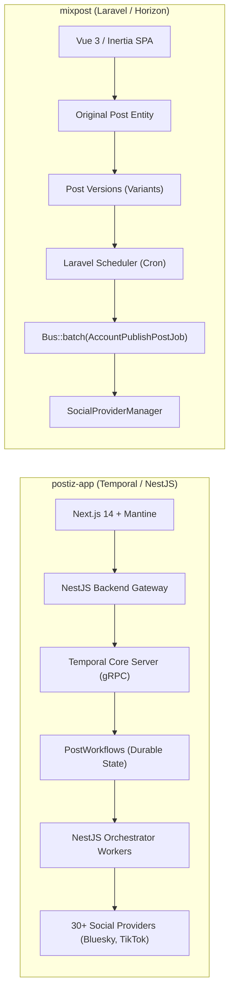
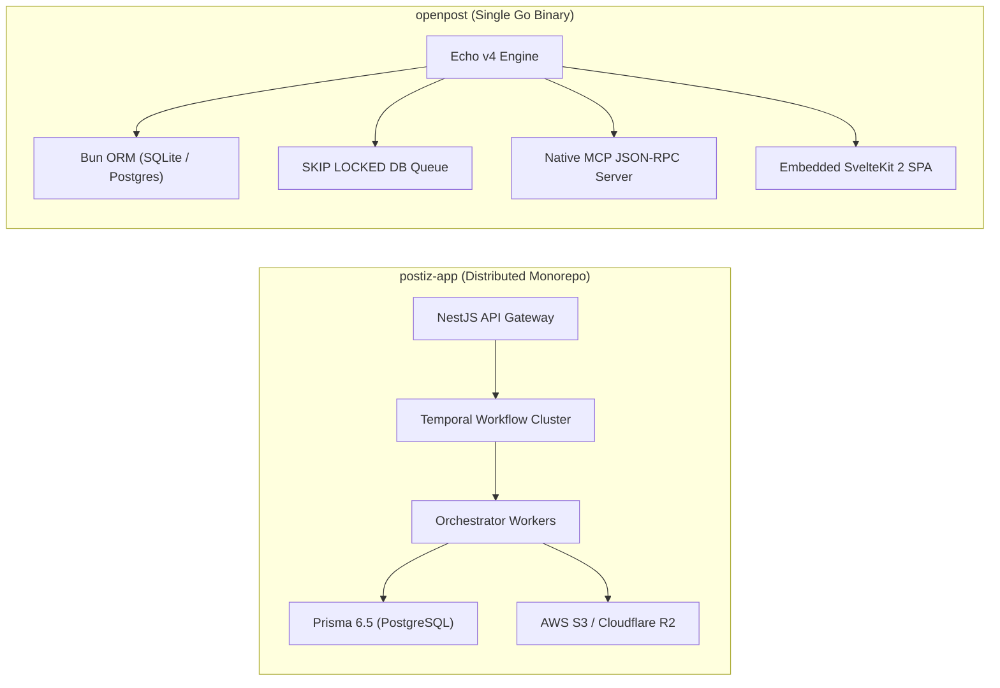
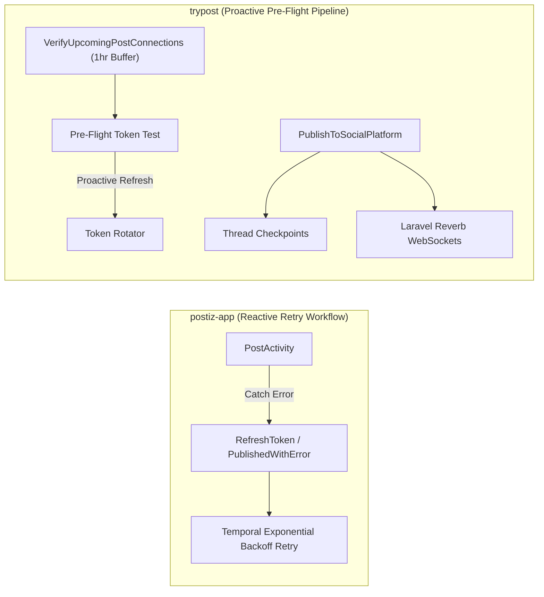
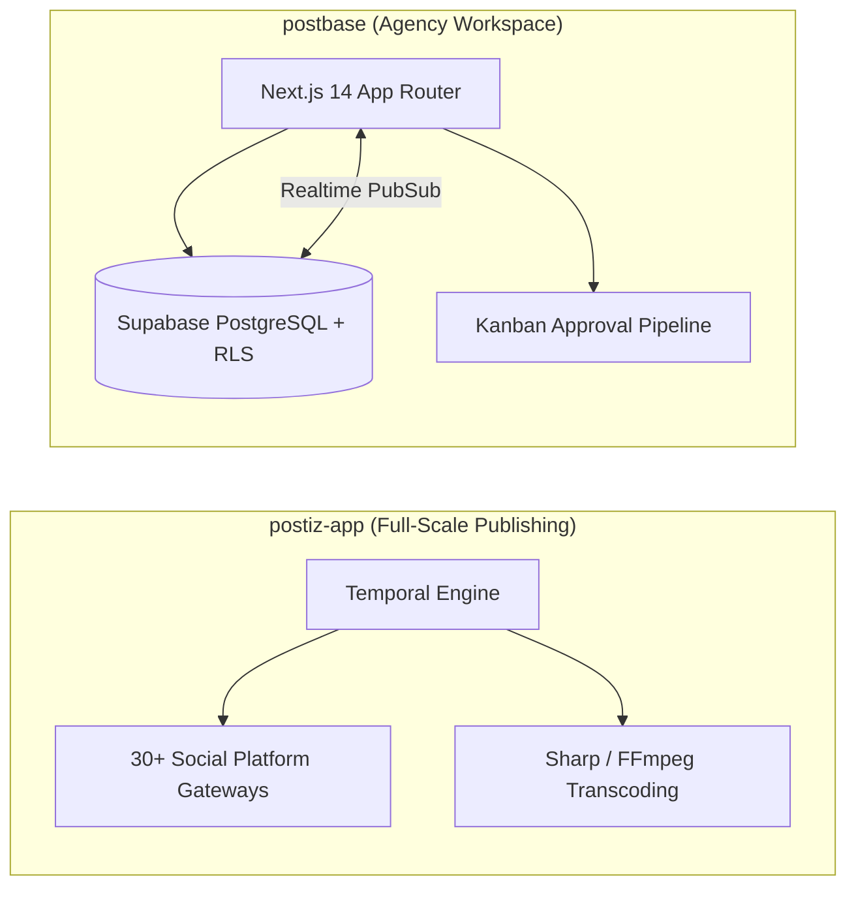

# postiz-app — Comparative Analysis & Category Evaluation

> **Category**: Social Media Management  
> **Architectural Role**: Enterprise durable workflow social scheduler, multi-network publishing engine & AI content studio  
> **Primary Stack**: TypeScript / Node 22+ | NestJS 10, Next.js 14 | PostgreSQL (Prisma 6.5) | Temporal.io Durable Workflows + BullMQ/Redis  
> **Peer Solutions Compared**: `mixpost`, `openpost`, `trypost`, `postbase`  
> **Commercial SaaS Benchmarks**: Buffer, Hootsuite, Later, Sprout Social, Typefully  

---

## 1. Executive Overview & Technical Identity: postiz-app

**postiz-app** (formerly Gitroom) represents the state of the art in distributed systems architecture within the **Social Media Management** domain. Built natively in modern TypeScript across a modular monorepo, Postiz moves beyond fragile cron pollers and volatile in-memory queues by anchoring its scheduling and publishing pipeline in **Temporal.io durable workflow execution**. Every scheduled post, video clip transcode, and OAuth token rotation is modeled as a stateful, fault-tolerant workflow capable of surviving server crashes, deployments, and multi-day API rate-limit backoffs without losing execution state or duplicating dispatches.

Postiz commands the widest multi-platform reach in the open-source ecosystem, supporting more than 30 social, community, and developer networks (including X, LinkedIn, Instagram, TikTok, YouTube, Reddit, Discord, Pinterest, Threads, Bluesky AT Protocol, Nostr, Farcaster, and Mastodon). Furthermore, it integrates deep AI capabilities via the **Mastra AI framework**, LangGraph, and in-canvas CopilotKit drafting.

### Core Architectural Profile
- **Runtime & Language**: `TypeScript` on `Node.js 22+` monorepo (Nx / Turborepo)
- **Core Framework**: `NestJS 10` (modular backend API gateway) + `Next.js 14` (SSR frontend with Mantine UI & CopilotKit)
- **Persistence Layer**: `PostgreSQL 16` managed via `Prisma 6.5` with multi-tenant organization isolation
- **Concurrency & Durable Execution**: `Temporal.io` workflow engine (gRPC) + `BullMQ / Redis` for auxiliary task processing
- **Domain Specialization**: Resilient multi-network scheduling (30+ channels), two-phase publishing fault isolation, AI content generation, and automated OAuth token rotation

---

## 2. Peer Solution Landscape (Social Media Management)

Within this category, `postiz-app` operates alongside the following peer solutions:

| Solution | Language & Runtime | Core Framework | Database & ORM | Queue & Scheduler | Supported Platforms | License |
| :--- | :--- | :--- | :--- | :--- | :--- | :--- |
| **postiz-app** (Current) | `TypeScript / Node 22+`| `NestJS 10, Next.js 14` | `PostgreSQL (Prisma 6.5)` | `Temporal.io Durable Workflows` | **30+ Networks (inc. TikTok, Bluesky, Nostr, Reddit)** | AGPL-3.0 |
| **mixpost** | `PHP 8.2+ / TS` | `Laravel, Inertia.js, Vue 3` | `MySQL / PostgreSQL (Eloquent)`| `Laravel Queue + Horizon` | 8+ Networks (X, FB, IG, LinkedIn, Masto, YouTube) | MIT |
| **openpost** | `Go 1.26+` | `Echo v4, Huma v2, SvelteKit 2`| `SQLite / PostgreSQL (Bun ORM)` | `SKIP LOCKED DB Queue` | X, Meta, LinkedIn, YouTube, Bluesky + Native MCP | AGPL-3.0 |
| **trypost** | `PHP 8.2+ / JS` | `Laravel 13, Vue 3, Reka UI` | `PostgreSQL / MySQL (Eloquent)` | `Horizon + Reverb WebSockets` | 13+ Networks (Pre-flight verifiers & checkpoints)| AGPL-3.0-only |
| **postbase** | `TypeScript / Node 20+`| `Next.js 14, Shadcn UI` | `PostgreSQL (Supabase RLS)` | `Server Actions + Realtime` | X, LinkedIn, Instagram (Kanban Approvals) | MIT |

---

## 3. Deep Head-to-Head Comparative Breakdown: postiz-app vs Peers

### 3.1. postiz-app vs. mixpost

**Comparative Focus**: `Temporal.io Durable Workflows & 30+ Networks` vs. `Modular Laravel Package & Variant Inheritance`

#### Detailed Architectural Contrast
- **Durable Scheduling & State Preservation**: `postiz-app` relies on **Temporal.io** to manage publication lifecycles. A scheduled post is instantiated as a persistent workflow that can sleep for days, weeks, or months. If a server node crashes, restarts, or deploys new code mid-execution, Temporal replays history up to the last successful activity without dropping execution state. `mixpost` uses traditional Linux cron jobs running every minute (`mixpost:run-scheduled-posts`), querying a database table and pushing jobs to Redis; if Redis crashes without AOF persistence or a worker drops a job, state can be lost.
- **Two-Phase Publish Fault Primitives**: `postiz-app` defines custom error primitives for edge cases: `PublishedWithError` (handles scenarios where video upload succeeds on YouTube or Instagram, but subsequent thumbnail tagging fails; retries skip video re-upload, preventing embarrassing duplicate posts) and `RefreshToken` (pauses the publish workflow, triggers an out-of-band OAuth token rotation activity, and resumes publication seamlessly). `mixpost` relies on try/catch blocks within isolated job batches (`Bus::batch()`).
- **Platform Breadth**: `postiz-app` supports over 30 channels, including emerging protocols (AT Protocol for Bluesky, Nostr relays, Farcaster hubs) and community networks (Reddit, Discord, Lemmy). `mixpost` covers 8 major marketing channels (X, Facebook, Instagram, LinkedIn, Mastodon, YouTube, Pinterest).
- **Architecture & Modularity**: `mixpost` can be embedded directly into an existing Laravel codebase as a composer package (`inovector/mixpost`). `postiz-app` is a distributed, multi-service TypeScript system requiring dedicated orchestration infrastructure.

#### Architectural Tradeoffs Matrix: postiz-app vs. mixpost

| Dimension | postiz-app | mixpost | Architectural Implication |
| :--- | :--- | :--- | :--- |
| **Fault Tolerance** | **Extreme (Temporal.io Durable Execution)** | **High (Laravel Horizon + `Bus::batch()`)** | Postiz workflows survive multi-day API rate limits and reboots; Mixpost relies on Redis job retries. |
| **Platform Reach** | **30+ Channels (inc. ATProto, Nostr, Reddit)**| **8 Core Marketing Networks** | Postiz covers modern decentralized and community networks; Mixpost focuses on mainstream feeds. |
| **Operational Stack** | **Complex (NestJS + Next.js + Temporal + Redis)**| **Moderate (PHP-FPM + Nginx + Redis + Horizon)**| Postiz requires operating a dedicated Temporal gRPC cluster; Mixpost runs on standard PHP hosting. |
| **Content Modeling** | **Single Post with Variant Inputs** | **Advanced Original vs. Variant Model** | Mixpost's versioning model provides cleaner per-network text and media divergence. |

---

### 3.2. postiz-app vs. openpost

**Comparative Focus**: `Distributed Temporal Microservices & 30+ Channels` vs. `Single Go Binary + SKIP LOCKED DB Queue + MCP Server`

#### Detailed Architectural Contrast
- **Infrastructure Footprint**: `postiz-app` is a distributed enterprise application composed of multiple Node.js processes (`apps/backend`, `apps/frontend`, `apps/orchestrator`), a Temporal server, Elasticsearch/PostgreSQL for Temporal state, and Redis for caching. `openpost` packages the entire platform into a **single statically compiled Go binary** with zero external broker requirements, capable of running on embedded SQLite or a single PostgreSQL database.
- **Queue Mechanics**: `postiz-app` uses Temporal durable task queues backed by gRPC. `openpost` replaces external message queues with a high-performance transactional database queue using `FOR UPDATE SKIP LOCKED` on PostgreSQL (or serialized advisory locks on SQLite), featuring an internal 15-minute stale-job heartbeat watcher.
- **AI Agent Automation & MCP**: `openpost` natively implements an official **Model Context Protocol (MCP)** server over stdio and SSE, allowing AI agents (Claude Code, Cursor, Windsurf) to query publication schedules, draft posts, and manipulate media assets directly. `postiz-app` incorporates internal AI agent workflows (Mastra framework, CopilotKit), but provides agent interaction primarily through frontend UI canvas controls rather than an open protocol server.
- **Platform Ecosystem**: `postiz-app` connects to 30+ platforms; `openpost` supports 6 core platforms (X, Meta, LinkedIn, YouTube, Bluesky, Mastodon).

#### Architectural Tradeoffs Matrix: postiz-app vs. openpost

| Dimension | postiz-app | openpost | Architectural Implication |
| :--- | :--- | :--- | :--- |
| **Operational Complexity**| **High** (Multi-container cluster + Temporal) | **Minimal** (Single static Go binary) | OpenPost runs on a \$5 VPS with zero external brokers; Postiz requires distributed cluster ops. |
| **Execution Guarantees** | **Temporal Stateful Durable Workflows** | **Database Transactional Locks (`SKIP LOCKED`)**| Postiz workflows maintain multi-day backoff timers; OpenPost relies on DB status rows and timers. |
| **Platform Breadth** | **30+ Networks** | **6+ Networks** | Postiz reaches TikTok, Reddit, Discord, and Web3; OpenPost focuses on core channels. |
| **AI Protocol Interface** | **UI CopilotKit & Mastra Framework** | **Native First-Party MCP Server** | OpenPost exposes tools directly to autonomous AI coding agents; Postiz embeds AI into the UI. |

---

### 3.3. postiz-app vs. trypost

**Comparative Focus**: `Temporal Durable Workflow Orchestration` vs. `Real-Time Reverb WebSockets & Pre-Flight Verifiers`

#### Detailed Architectural Contrast
- **Error Mitigation Strategy**: `postiz-app` is *reactively resilient*: when a scheduled publish activity fails due to an expired token or upstream 401 error, Temporal catches the error, triggers an out-of-band `RefreshToken` activity, and seamlessly retries the publish. `trypost` is *proactively preventive*: its `VerifyUpcomingPostConnections` daemon tests tokens 60 minutes before scheduled publication, refreshing expiring tokens and emailing admins via `PostAtRisk` alerts before failure occurs.
- **Real-Time Client Architecture**: `trypost` integrates **Laravel Reverb**, a first-party WebSocket server, pushing publishing status updates, thread completion progress, and calendar adjustments directly to Vue clients in real time. `postiz-app` coordinates UI state through Next.js server actions, React Query invalidations, and Mantine UI notifications.
- **Thread Checkpointing**: `trypost` implements stateful thread checkpoints (`PublishCheckpoint`, `ThreadProgress`), ensuring that multi-tweet thread posts that fail midway resume from the exact broken tweet. `postiz-app` executes thread publishing within activity loops, retrying the activity block based on Temporal retry policies.

#### Architectural Tradeoffs Matrix: postiz-app vs. trypost

| Dimension | postiz-app | trypost | Architectural Implication |
| :--- | :--- | :--- | :--- |
| **Token Verification** | **Reactive Catch & Refresh in Workflow** | **Proactive 1-Hour Pre-Flight Scanner** | TryPost eliminates runtime surprises; Postiz handles runtime token failure gracefully. |
| **Durable Orchestration** | **Temporal Stateful Workflows** | **Laravel Horizon Redis Queues** | Postiz workflows survive infrastructure redeploys and multi-day delays; TryPost relies on Redis. |
| **Real-Time WebSockets** | **Polling & React Query Refetch** | **Laravel Reverb (Native WebSockets)** | TryPost provides instant sub-second visual updates during publishing; Postiz updates on query refetch. |
| **Network Breadth** | **30+ Networks** | **13+ Networks** | Postiz supports far more niche, developer, and decentralized platforms than TryPost. |

---

### 3.4. postiz-app vs. postbase

**Comparative Focus**: `Enterprise Durable Multi-Platform Engine` vs. `Collaborative Agency Kanban & Client Approvals`

#### Detailed Architectural Contrast
- **Domain Specialization**: `postiz-app` is a comprehensive content studio and publishing engine built to handle heterogeneous social protocols, video transcoding, and reliable delivery across 30+ networks. `postbase` is an agency workflow workspace designed specifically for internal copywriters, designers, and clients to review, comment on, and sign off on posts before scheduling.
- **Data & Execution Tier**: `postiz-app` uses a multi-tier distributed backend (NestJS, Temporal, Redis, Prisma, PostgreSQL). `postbase` runs on a lightweight serverless stack (Next.js 14 App Router, Supabase PostgreSQL with Row Level Security, and Supabase Realtime).

#### Architectural Tradeoffs Matrix: postiz-app vs. postbase

| Dimension | postiz-app | postbase | Architectural Implication |
| :--- | :--- | :--- | :--- |
| **Publishing Resilience** | **Temporal Durable Execution (Zero Loss)** | **Next.js Server Actions (Basic)** | Postiz is built for guaranteed enterprise delivery; Postbase is built for agency draft review. |
| **Platform Reach** | **30+ Networks** | **3 Networks (X, LinkedIn, IG)** | Postiz has ten times the platform coverage of Postbase. |
| **Approval Workflow** | **Workspace Role-Based Access Control** | **Formal Kanban Approval Stages** | Postbase provides dedicated `Needs Review` -> `Approved` client sign-off pipelines. |
| **Operational Overhead** | **High (Requires Temporal & Redis Clusters)**| **Minimal (Serverless Vercel + Supabase)** | Postbase deploys in minutes with zero server management; Postiz requires cluster ops. |

---

## 4. Capability & Feature Comparison Matrix

| Dimension / Capability | postiz-app | mixpost | openpost | trypost | postbase |
| :--- | :---: | :---: | :---: | :---: | :---: |
| **Primary Architectural Niche** | **Temporal.io durable workflows & 30+ networks** | Battle-tested multi-network scheduling & video chunking | Single Go binary + SKIP LOCKED DB queue + MCP | Reverb WebSockets & pre-flight verifiers | Supabase-backed agency review kanban |
| **Runtime Language** | `TypeScript / Node 22+`| `PHP 8.2+ / TS` | `Go 1.26+` | `PHP 8.2+ / JS` | `TypeScript / Node` |
| **Framework** | `NestJS 10, Next.js 14` | `Laravel, Inertia, Vue 3` | `Echo v4, Huma v2, Svelte 2` | `Laravel 13, Vue 3, Inertia` | `Next.js 14, Shadcn UI` |
| **Database Persistence** | `PostgreSQL (Prisma 6.5)` | `MySQL / PostgreSQL (Eloquent)`| `SQLite / PostgreSQL (Bun ORM)`| `PostgreSQL / MySQL (Eloquent)`| `PostgreSQL (Supabase RLS)` |
| **Queue / Concurrency** | `Temporal.io + BullMQ` | `Laravel Queue + Horizon` | `SKIP LOCKED DB Queue` | `Horizon + Reverb WS` | `Server Actions + Realtime` |
| **Supported Platforms** | **30+ Networks** | **8+ Networks** | 6+ Networks | 13+ Networks | 3 Networks |
| **Durable Execution Guarantees**| ✅ Temporal Workflows | ⚠️ Horizon Retries | ⚠️ SKIP LOCKED Queue | ⚠️ Horizon Retries | ❌ Serverless |
| **Two-Phase Publish Primitives**| ✅ `PublishedWithError` / `RefreshToken` | ❌ | ❌ | ⚠️ Thread Checkpoints | ❌ |
| **Decentralized (Bluesky/Nostr)**| ✅ ATProto, Nostr, Farcaster | ⚠️ Mastodon only | ✅ Bluesky & Masto | ✅ Bluesky & Masto | ❌ |
| **Native AI Agent Integration** | ✅ Mastra Framework & CopilotKit | ⚠️ OpenAI API | ✅ First-Party MCP Server | ⚠️ Laravel AI | ⚠️ Basic |

---

## 5. Commercial Benchmark Positioning

When benchmarked against commercial SaaS leaders (**Buffer, Hootsuite, Later, Sprout Social, Typefully**):
- **Unrivaled Platform Breadth**: Proprietary tools rarely support modern developer and decentralized channels. Postiz bridges this divide by delivering first-class support for Bluesky, Nostr, Farcaster, Reddit, and Discord alongside standard corporate channels.
- **Enterprise Execution Guarantees**: By adopting Temporal.io, Postiz brings distributed systems engineering to social media marketing, eliminating the lost-post failures that plague SaaS tools when APIs return rate limits or temporary outages.
- **AI-Native Content Drafting**: Through Mastra AI agents and CopilotKit, Postiz allows marketing teams to brainstorm viral hooks, reformat long-form content, and slice video clips directly within the scheduling workspace.

---

## 6. Strategic Takeaways & Role for MarketingStudio

In the unified **MarketingStudio** architecture:
1. **Primary Component to Adopt**: Adopt Postiz's NestJS provider interfaces (`libraries/nestjs-libraries/src/providers/`) as the definitive social media adapter standard across MarketingStudio.
2. **Durable Workflow Seam**: Leverage Temporal.io for MarketingStudio's cross-channel scheduling engine, ensuring that campaigns spanning email, social, SMS, and blog posts execute with transactional durability.
3. **Peer Coexistence**:
   - Utilize `postiz-app`'s platform adapters to reach 30+ networks.
   - Borrow `mixpost`'s variant inheritance model for clean post versioning in the UI.
   - Integrate `trypost`'s 1-hour pre-flight OAuth validation daemon to proactively catch expiring tokens.
   - Expose MarketingStudio social workflows to autonomous AI agents using `openpost`'s Model Context Protocol (MCP) server design.
