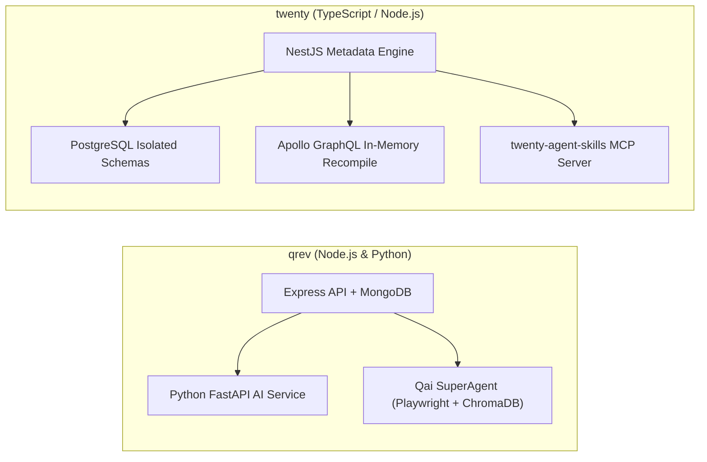
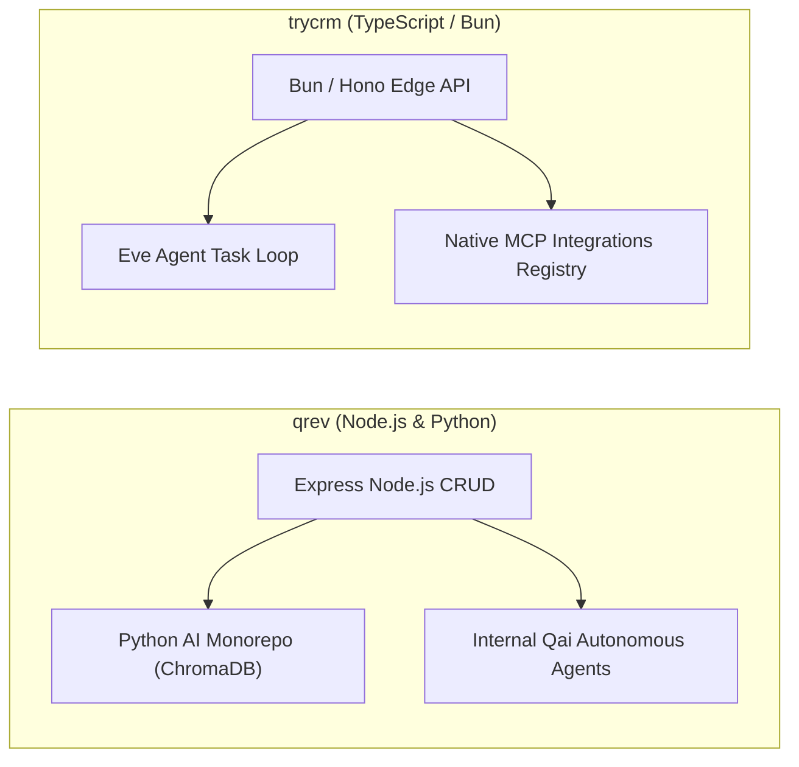
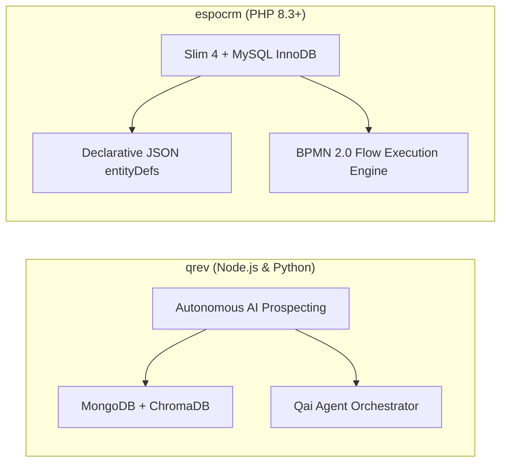
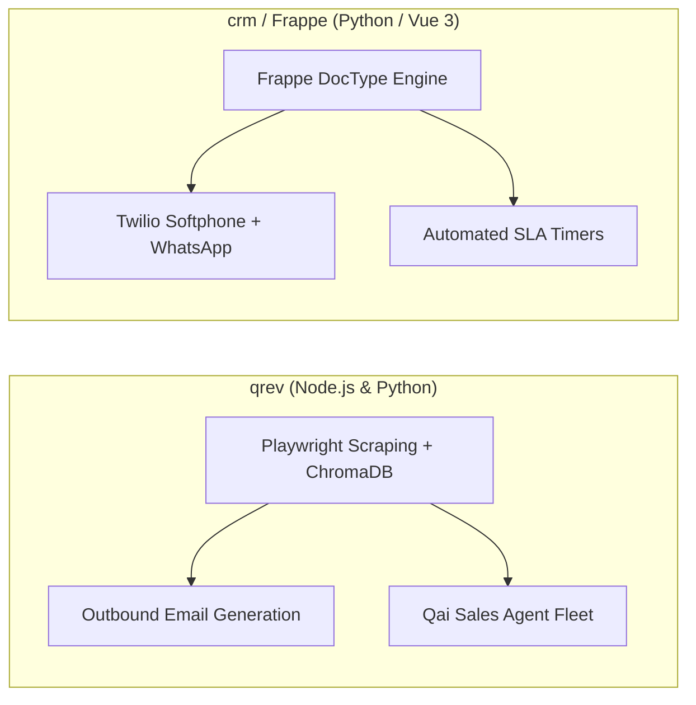
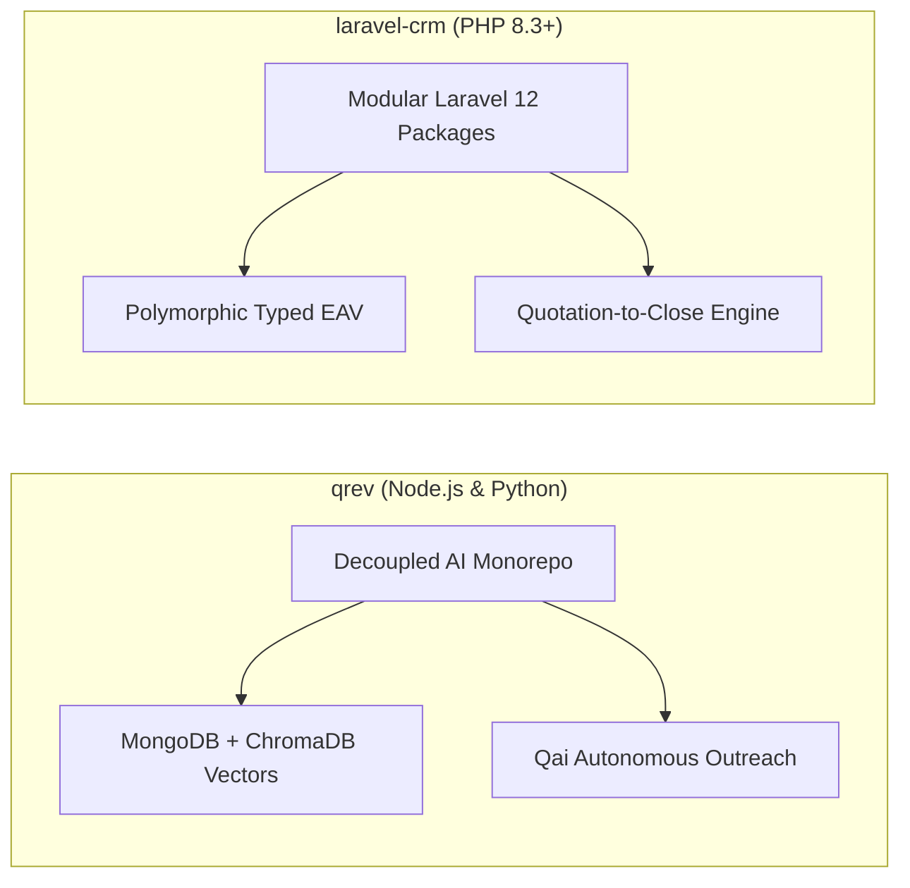
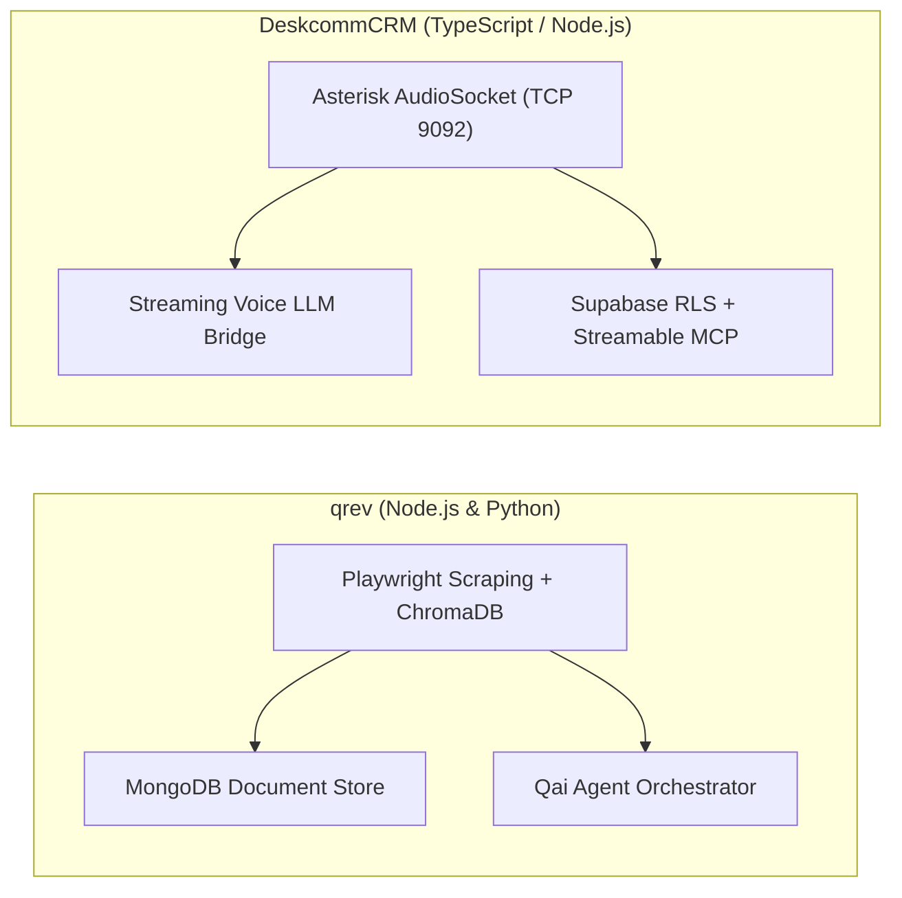
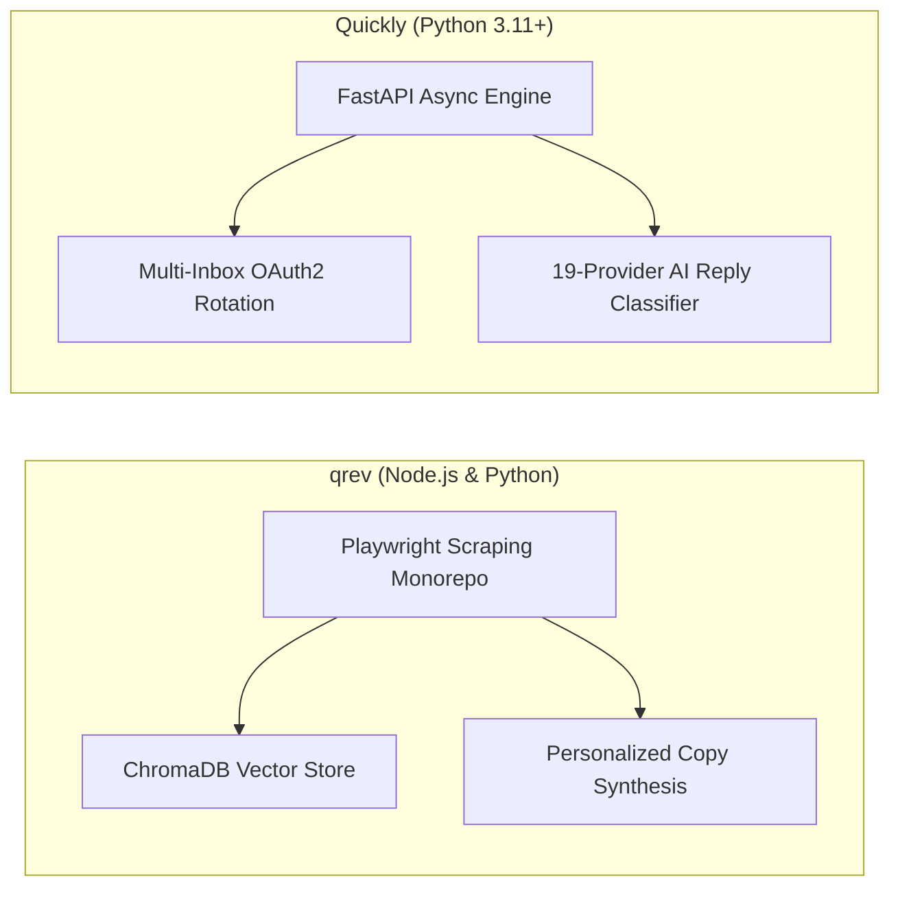
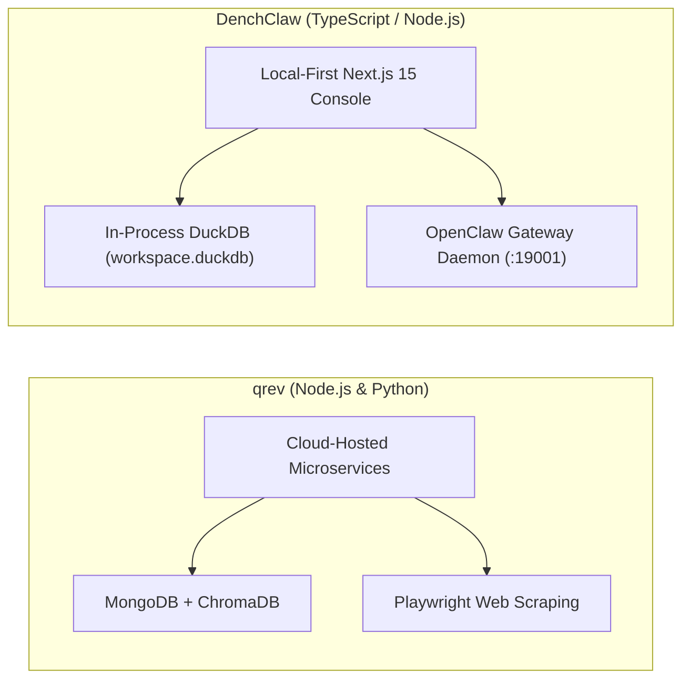
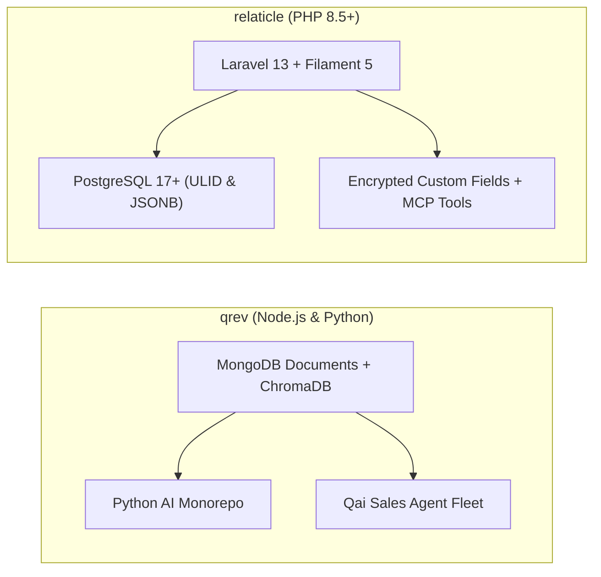

# qrev — Comparative Analysis & Category Evaluation

> **Category**: CRM & Contact Management  
> **Architectural Role**: Autonomous SDR digital worker platform & AI agentic CRM  
> **Primary Stack**: TypeScript / Node.js 18+ & Python 3.11+ | Express.js, FastAPI, Next.js | MongoDB 5.x+, ChromaDB, SQLite/PostgreSQL | LangChain & LlamaIndex  
> **Peer Solutions Compared**: `twenty`, `trycrm`, `espocrm`, `crm`, `laravel-crm`, `DeskcommCRM`, `Quickly`, `DenchClaw`, `relaticle`  
> **Commercial SaaS Benchmarks**: Apollo.io, ZoomInfo, Salesforce, HubSpot CRM, Lemlist  

---

## 1. Executive Overview & Technical Identity: qrev

**qrev** is an open-source, agent-first CRM and autonomous sales development representative (SDR) platform (`qrev-ai/qrev`). Engineered to eliminate the manual data-entry overhead of legacy CRM monoliths, qrev deploys an intelligent agent fleet orchestrated by **Qai** (its core sales intelligence superagent).

qrev's architectural foundation is a **Decoupled Multi-Runtime Topology**. Rather than burdening the web server with heavy AI computation, qrev splits its architecture between a Node.js/Express application for operational CRM CRUD and WebSocket notifications, and a dedicated Python 3.11+ AI microservice monorepo (`ai/projects/`). The Python service coordinates Playwright headless web scrapers, Google Places extractors, ChromaDB vector stores, and LlamaIndex RAG pipelines to autonomously enrich prospects, synthesize company dossiers, and draft personalized multi-touch outreach sequences.

### Core Architectural Profile
- **Runtime & Languages**: `Node.js 18.18+` (Express API) & `Python 3.11+` (Poetry-managed FastAPI AI service)
- **Primary Operational Database**: `MongoDB 5.x+` with Mongoose ODM (flexible document storage for contacts, companies, campaigns)
- **Vector & Retrieval Persistence**: `ChromaDB` (semantic embeddings for prospect matching) & `SQLite / PostgreSQL` (SQLAlchemy 2.0 for agent task states)
- **Agent Frameworks**: LangChain, LlamaIndex, OpenAI API, AWS Bedrock
- **Scraping & Data Extraction**: Playwright headless browser automation, BeautifulSoup4, Google Places API
- **External Communications**: Google Pub/Sub (real-time Gmail push sync), Zoom API (transcriptions), AWS SES (email sending)
- **Domain Specialization**: Autonomous AI digital sales worker CRM, deep company dossier web scraping, vector RAG email personalization

---

## 2. Peer Solution Landscape (CRM & Contact Management)

| Solution | Language & Runtime | Core Framework | Database / Persistence | Queue & Concurrency | Primary Architectural Niche |
| :--- | :--- | :--- | :--- | :--- | :--- |
| **qrev** (Current) | `Node.js & Python` | `Express & FastAPI` | `MongoDB & ChromaDB` | `Node-cron & FastTasks` | **Dual-runtime Qai superagent orchestrator & LangChain RAG** |
| **twenty** | `TypeScript / Node.js` | `NestJS, React, Vite` | `PostgreSQL 15+, TypeORM` | `BullMQ / Redis` | Dynamic runtime schemas & in-memory GraphQL compilation |
| **trycrm** | `TypeScript / Bun` | `Bun, Hono, Next.js` | `PostgreSQL, Prisma` | `Bun Async Loop / Eve` | Agentic-first CRM with native MCP tool registry & Eve runtime |
| **espocrm** | `PHP 8.3+` | `Slim 4, Backbone.js` | `MySQL 8.0+ / MariaDB` | `Multi-Process daemon.php` | Visual BPMN 2.0 flow execution engine & JSON entityDefs |
| **crm** (Frappe) | `Python 3.10+, JS` | `Frappe, Vue 3.5` | `MariaDB 10.6+, Redis` | `Redis Queue (RQ) / Celery` | Declarative DocType metadata, built-in SLAs & Twilio WebRTC |
| **laravel-crm** (Krayin) | `PHP 8.3+` | `Laravel 12.0, Vue.js` | `MySQL 8.0, Eloquent` | `Laravel Queue / Reverb` | Modular composer packages via Concord & polymorphic typed EAV |
| **DeskcommCRM** | `TypeScript / Node.js`| `Next.js 14, Supabase` | `PostgreSQL 16, pgvector` | `AudioSocket TCP / Workers`| Asterisk AudioSocket binary TCP telephony & streamable MCP |
| **Quickly** | `Python 3.11+` | `FastAPI, Next.js 14` | `PostgreSQL, SQLAlchemy` | `Asyncio Slot Reservation` | High-velocity multi-inbox rotation, jitter scheduler & MCP |
| **DenchClaw** | `TypeScript / Node.js`| `Next.js 15, DuckDB` | `In-Process DuckDB` | `In-Process SQL / OpenClaw`| Embedded columnar SQL, OpenClaw AI Gateway & Composio MCP |
| **relaticle** | `PHP 8.5+` | `Laravel 13, Filament 5`| `PostgreSQL 17+ (ULID)` | `Laravel Horizon / Redis` | Native `RelaticleServer` MCP tools, per-field encryption & ULIDs |

---

## 3. Deep Head-to-Head Comparative Breakdown: qrev vs Peers

### 3.1. qrev vs. twenty

#### Multi-Runtime Topology vs. Monolithic NestJS
- **qrev**: Employs a decoupled multi-runtime architecture. Node.js handles standard REST CRUD, while compute-intensive AI operations (web scraping, vector search, copy synthesis) execute inside a Poetry-managed Python 3.11+ microservice.
- **twenty**: Unified TypeScript monorepo where NestJS handles all backend operations, metadata compilation, and BullMQ worker queues in a single runtime.

#### Data Modeling: MongoDB Documents vs. Dynamic PostgreSQL Schemas
- **qrev**: Relies on MongoDB's schema-less document architecture (Mongoose ODM). Contacts, accounts, and enrichment dossiers absorb unstructured scraped attributes directly without DDL table modifications.
- **twenty**: Programmatically provisions workspace-isolated PostgreSQL schemas (`workspace_<id>`), generating physical relational tables, indexes, and dynamic GraphQL types.

#### Autonomous Prospecting vs. Agent Skills
- **qrev**: Features an internal autonomous agent fleet led by **Qai**. Actively crawls target company websites using Playwright (`projects/scraper`) and synthesizes personalized email copy.
- **twenty**: Acts as a platform for external agents (Claude, Cursor), exposing auto-generated Model Context Protocol (MCP) tool endpoints.

#### Architectural Tradeoffs Matrix: qrev vs. twenty

| Dimension | qrev | twenty | Architectural Evaluation |
| :--- | :--- | :--- | :--- |
| **Autonomous Prospecting** | Native Playwright scrapers & dossier generator | Manual data entry / external sync | **qrev** actively gathers lead intelligence |
| **Data Integrity & Relational Depth**| MongoDB documents + ChromaDB | PostgreSQL schemas + foreign keys | **twenty** provides superior relational data integrity |
| **Deployment Complexity** | Node.js + Python + MongoDB + ChromaDB | Single Node.js + PostgreSQL container | **twenty** is simpler to deploy and maintain |
| **API Architecture** | Traditional Express REST API | Dynamic in-memory Apollo GraphQL | **twenty** provides superior query flexibility |

---

### 3.2. qrev vs. trycrm

#### Autonomous SDR Architecture
- **qrev**: Houses an internal agent ecosystem built with LangChain, LlamaIndex, and ChromaDB. Executes multi-step prospecting tasks, RAG document retrieval, and email generation within its own Python microservice.
- **trycrm**: Built around the Model Context Protocol (MCP) and the Eve agent framework. Connects external MCP tool servers (LinkedIn, Google Search, Apollo) directly to an internal agent loop in TypeScript.

#### Runtime & Compute Footprint
- **qrev**: Heavy dual-runtime deployment (~250 MB RAM for Node.js + additional container memory for Python/Playwright/ChromaDB).
- **trycrm**: Ultra-lightweight Bun 1.1+ runtime (~150 MB RAM), executing low-latency agent tasks natively in TypeScript.

#### Architectural Tradeoffs Matrix: qrev vs. trycrm

| Dimension | qrev | trycrm | Architectural Evaluation |
| :--- | :--- | :--- | :--- |
| **Web Crawling & Extraction**| Built-in Playwright headless browser scrapers | Relies on external search MCP tools | **qrev** performs direct HTML scraping & parsing |
| **Agent Protocol Standardization**| LangChain tool calling wrappers | Native Model Context Protocol (MCP) | **trycrm** adheres to open agent protocol standards |
| **Runtime Architecture** | Multi-runtime (Node.js + Python) | Single-runtime (Bun 1.1+) | **trycrm** offers lower operational complexity |
| **Vector RAG Memory** | Native ChromaDB vector store | In-memory facts table (`ContactFact`) | **qrev** handles larger unstructured document corpora |

---

### 3.3. qrev vs. espocrm

#### System Focus: Digital Workers vs. Enterprise Process Governance
- **qrev**: Replaces human sales reps with autonomous AI agents that discover, research, score, and contact prospects.
- **espocrm**: Provides human revenue teams with enterprise governance, visual BPMN 2.0 workflow modeling, formula script evaluations, and multi-tier ACL security.

#### Architectural Tradeoffs Matrix: qrev vs. espocrm

| Dimension | qrev | espocrm | Architectural Evaluation |
| :--- | :--- | :--- | :--- |
| **Prospecting Automation** | Playwright web scraping & AI drafting | Not supported natively | **qrev** automates outbound prospecting |
| **Workflow Capabilities** | Agent task execution loops | Visual BPMN 2.0 flowchart engine | **espocrm** handles complex multi-step approvals |
| **Persistence Stability** | MongoDB document collections | MySQL InnoDB relational tables | **espocrm** provides 10+ years of relational stability |
| **Resource Efficiency** | Heavy (Node.js + Python AI) | Lightweight (~120 MB RAM) | **espocrm** operates with minimal overhead |

---

### 3.4. qrev vs. crm (Frappe CRM)

#### Outbound Discovery vs. Omnichannel Communication
- **qrev**: Outbound-focused system. Crawls domains to discover prospect bios and company metrics, generating outbound cold sequences.
- **crm (Frappe CRM)**: Inbound-focused omnichannel CRM. Features an embedded Twilio Voice softphone, bi-directional WhatsApp, and automated SLA timers to ensure human reps respond to leads promptly.

#### Architectural Tradeoffs Matrix: qrev vs. crm (Frappe)

| Dimension | qrev | crm (Frappe CRM) | Architectural Evaluation |
| :--- | :--- | :--- | :--- |
| **Lead Discovery** | Playwright web scrapers + Google Places | Inbound web-to-lead & marketing capture | **qrev** actively discovers net-new prospects |
| **Telephony & VoIP** | Zoom recording sync | Native Twilio Voice SDK in browser | **crm** supports live browser softphone dialing |
| **Lead SLA Accountability**| Agent task logs | Automated minute-level SLA timers | **crm** actively prevents lead neglect |
| **Frontend UI** | React 18 dashboard | Vue 3.5 / TailwindCSS / Pinia | **crm** provides a cleaner, more reactive UI |

---

### 3.5. qrev vs. laravel-crm (Krayin CRM)

#### Core Capabilities
- **qrev**: Automated AI prospecting, domain intelligence extraction, and personalized copy generation.
- **laravel-crm**: Mid-funnel deal tracking, rotting lead detection, product catalogs, and automated PDF quotation generation.

#### Architectural Tradeoffs Matrix: qrev vs. laravel-crm

| Dimension | qrev | laravel-crm | Architectural Evaluation |
| :--- | :--- | :--- | :--- |
| **Autonomous Prospecting** | Native Playwright scrapers & RAG copy | Not supported | **qrev** automates outbound prospecting |
| **Quotation Engine** | None | Native multi-currency PDF quote generator | **laravel-crm** handles formal proposals & billing |
| **Data Architecture** | MongoDB documents + ChromaDB | MySQL relational EAV | **laravel-crm** guarantees relational consistency |
| **Operational Simplicity** | Multi-service Node.js + Python | Single PHP/MySQL server | **laravel-crm** is substantially simpler to host |

---

### 3.6. qrev vs. DeskcommCRM

#### Telephony vs. Web Scraping
- **qrev**: Lacks real-time telephony capabilities. Enriches prospects via web scraping and drafts outbound emails.
- **DeskcommCRM**: Telephony-first sales operating system. Streams raw binary PCM audio over TCP port 9092 directly between Asterisk PBX and streaming LLMs for real-time AI voice calling.

#### AI Agent Protocol
- **qrev**: LangChain and LlamaIndex tool execution engine.
- **DeskcommCRM**: Native Model Context Protocol (MCP) server at `/api/mcp` with automated AI-to-human escalation tools (`handoff.ts`).

#### Architectural Tradeoffs Matrix: qrev vs. DeskcommCRM

| Dimension | qrev | DeskcommCRM | Architectural Evaluation |
| :--- | :--- | :--- | :--- |
| **Telephony & Voice** | Zoom API recording sync only | Native Asterisk AudioSocket binary TCP | **DeskcommCRM** supports sub-second AI voice calling |
| **Autonomous Web Scraping**| Playwright headless browser crawlers | Inbound webhook ingestion | **qrev** gathers deep company dossier intelligence |
| **Database Encryption** | Unencrypted MongoDB documents | Deterministic `pgcrypto` AES encryption | **DeskcommCRM** secures sensitive identifiers at rest |
| **Agent Protocol** | LangChain tool calling wrappers | Official Streamable MCP server | **DeskcommCRM** conforms to standard MCP protocols |

---

### 3.7. qrev vs. Quickly

#### Outreach Execution vs. Prospect Research
- **qrev**: Focuses on the research and copy synthesis phase: crawling domains, summarizing executive bios, and drafting dynamic emails via RAG.
- **Quickly**: Focuses on the high-velocity email delivery phase: rotating hundreds of Google and Microsoft OAuth accounts, managing send-time jitter, and auto-classifying replies into intent states.

#### Architectural Tradeoffs Matrix: qrev vs. Quickly

| Dimension | qrev | Quickly | Architectural Evaluation |
| :--- | :--- | :--- | :--- |
| **Outbound Volume Scaling**| Single sending account | Multi-inbox OAuth rotation with jitter | **Quickly** protects domain deliverability |
| **Lead Research & Dossiers**| Playwright scrapers + ChromaDB RAG | Ingests pre-built CSV/API lead lists | **qrev** synthesizes deep prospect research |
| **Reply Intent Triage** | Handled within agent task loop | 19-provider automated AI reply classifier| **Quickly** auto-categorizes inbound replies |
| **Resource Efficiency** | ~250 MB+ RAM (Dual runtime) | ~60 MB RAM (Pure async Python) | **Quickly** is substantially lighter |

---

### 3.8. qrev vs. DenchClaw

#### Topology: Cloud Microservices vs. Local-First Columnar Engine
- **qrev**: Cloud-hosted multi-service application requiring separate Node.js, Python, MongoDB, and ChromaDB processes.
- **DenchClaw**: Local-first sovereign workspace running directly on an operator's workstation with an embedded DuckDB file (`workspace.duckdb`).

#### Analytical Query Performance
- **qrev**: Analytical filtering across leads requires MongoDB aggregation pipelines and vector similarity lookups.
- **DenchClaw**: Vectorized in-process columnar SQL queries execute across hundreds of thousands of records in sub-millisecond timeframes.

#### Architectural Tradeoffs Matrix: qrev vs. DenchClaw

| Dimension | qrev | DenchClaw | Architectural Evaluation |
| :--- | :--- | :--- | :--- |
| **Web Crawling** | Playwright headless browser scrapers | Composio web fetch tools | **qrev** provides deeper autonomous web crawling |
| **Analytical Query Speed** | MongoDB network queries (15-40ms) | In-process vectorized DuckDB (<1ms) | **DenchClaw** executes analytics instantaneously |
| **Data Sovereignty** | Stored on cloud MongoDB cluster | 100% sovereign local DuckDB file | **DenchClaw** guarantees zero cloud data leakage |
| **Local Tool Execution** | Server-side execution only | Local terminal sandboxing & CLI | **DenchClaw** allows agents to execute local commands |

---

### 3.9. qrev vs. relaticle

#### Architecture: AI Digital Worker vs. Secure Database of Record
- **qrev**: Engineered as an autonomous SDR fleet that searches for leads, crawls domains, and generates copy using un-indexed document storage.
- **relaticle**: Engineered as a secure, developer-first CRM record-of-truth. Features chronological ULIDs, per-field AES encryption, Filament 5 reactive UI, and native Model Context Protocol tools.

#### Architectural Tradeoffs Matrix: qrev vs. relaticle

| Dimension | qrev | relaticle | Architectural Evaluation |
| :--- | :--- | :--- | :--- |
| **Autonomous Prospecting** | Playwright scrapers & RAG copy | Activity logging & email participant sync | **qrev** actively gathers prospect intelligence |
| **Data Governance & Security**| Flexible MongoDB documents | Per-field AES encrypted PostgreSQL JSONB | **relaticle** provides superior security & compliance |
| **AI Protocol (MCP)** | LangChain tool execution engine | Native Model Context Protocol (MCP) | **relaticle** adheres to standard MCP protocols |
| **Primary Keys & Indexing** | MongoDB ObjectIDs | Chronological ULIDs | **relaticle** optimizes B-tree database indexing |

---

## 4. Capability & Feature Comparison Matrix

| Dimension / Capability | qrev | twenty | trycrm | espocrm | crm (Frappe) | laravel-crm | DeskcommCRM | Quickly | DenchClaw | relaticle |
| :--- | :---: | :---: | :---: | :---: | :---: | :---: | :---: | :---: | :---: | :---: |
| **Autonomous Web Scraping**| ✅ Playwright | ❌ | ⚠️ Tool call | ❌ | ❌ | ❌ | ❌ | ❌ | ⚠️ Fetch tool | ❌ |
| **Vector RAG Copywriting** | ✅ ChromaDB | ❌ | ⚠️ Prompts | ❌ | ❌ | ❌ | ⚠️ pgvector | ❌ | ❌ | ⚠️ AISummary |
| **Native MCP / AI Skills** | ⚠️ LangChain | ✅ Full SDK | ✅ Native Core | ❌ REST only | ❌ RPC only | ❌ REST only | ✅ Streamable | ✅ Streamable | ✅ Composio MCP | ✅ RelaticleServer |
| **Dynamic Custom Objects** | ⚠️ Mongo | ✅ Full DDL | ⚠️ JSON facts | ✅ JSON Meta | ✅ DocType | ⚠️ EAV | ❌ Static | ❌ Static | ✅ DuckDB EAV | ✅ Encrypted EAV |
| **Multi-Tenant Schemas** | ⚠️ Org ID | ✅ Schema/Tenant| ⚠️ Org ID | ⚠️ Role ACL | ✅ Frappe Sites| ⚠️ Channels | ✅ Postgres RLS| ⚠️ Single-team | ✅ Local File | ✅ Workspace Model |
| **Resource Footprint** | ~250 MB RAM | ~500 MB RAM | ~150 MB RAM | ~120 MB RAM | ~400 MB RAM | ~100 MB RAM | ~200 MB RAM | **~60 MB RAM** | ~100 MB RAM | ~120 MB RAM |

---

## 5. Commercial Benchmark Positioning

When benchmarked against commercial SaaS leaders (**Apollo.io, ZoomInfo, Salesforce, HubSpot CRM, Lemlist**):
- **Against Apollo.io & ZoomInfo**: qrev provides autonomous company research and executive contact discovery using open web crawling and Playwright scrapers, eliminating recurring per-credit data fees.
- **Against Salesforce**: qrev replaces human SDR data-entry workflows with autonomous digital workers.
- **Against Lemlist**: qrev synthesizes personalized outreach copy referencing specific prospect metrics via deep RAG rather than generic template variables.
- **Data Sovereignty**: Open-source deployment ensures proprietary company dossiers and prospect lists remain private.

---

## 6. Strategic Takeaways & Role for MarketingStudio

In the unified **MarketingStudio** architecture:
1. **Primary Component to Adopt**: Harvest qrev's **Playwright Web Scraping & Company Dossier Synthesizer** (`ai/projects/scraper/`) as MarketingStudio's automated prospect enrichment worker.
2. **RAG Personalization Pattern**: Adopt qrev's LlamaIndex and ChromaDB retrieval patterns for generating personalized cold email copy tailored to recipient firmographics.
3. **Decoupled Architecture**: Follow qrev's design of separating compute-heavy Python AI scrapers from the transactional CRM web gateway.
