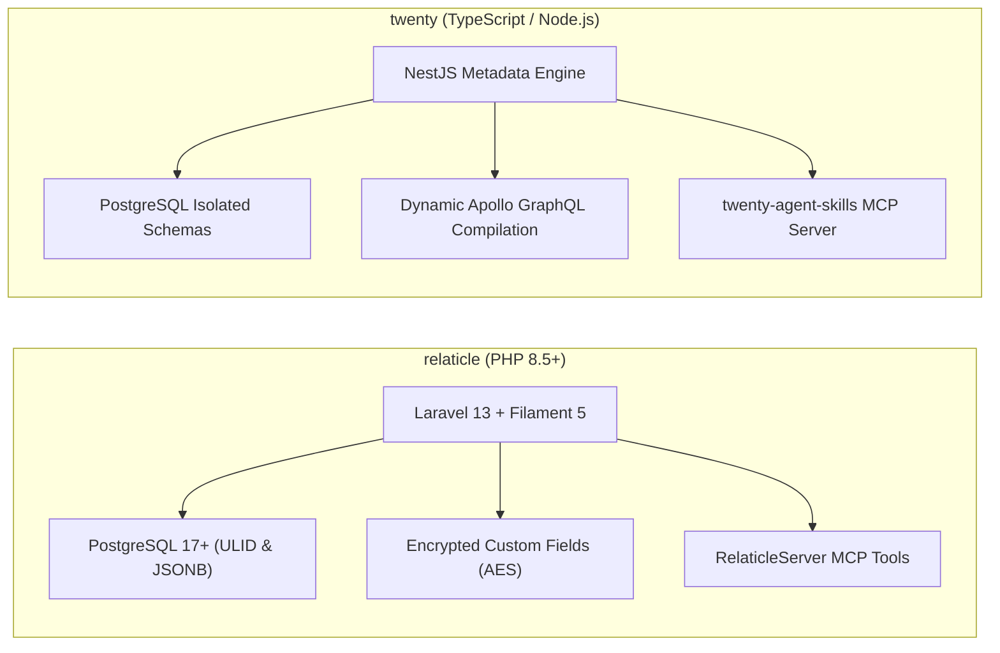
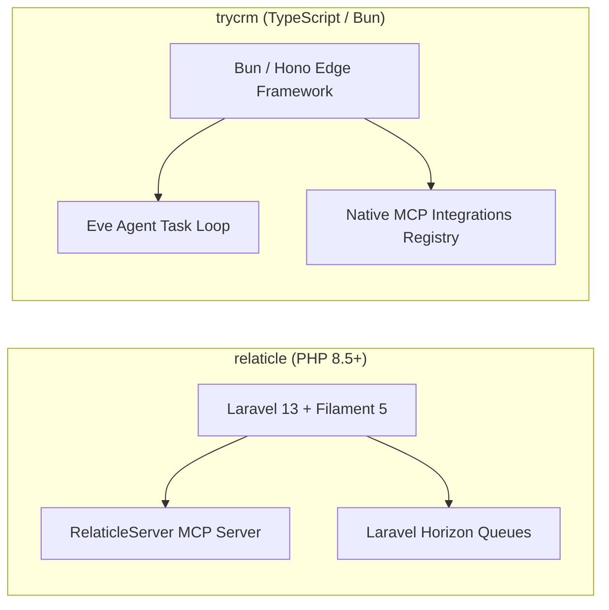
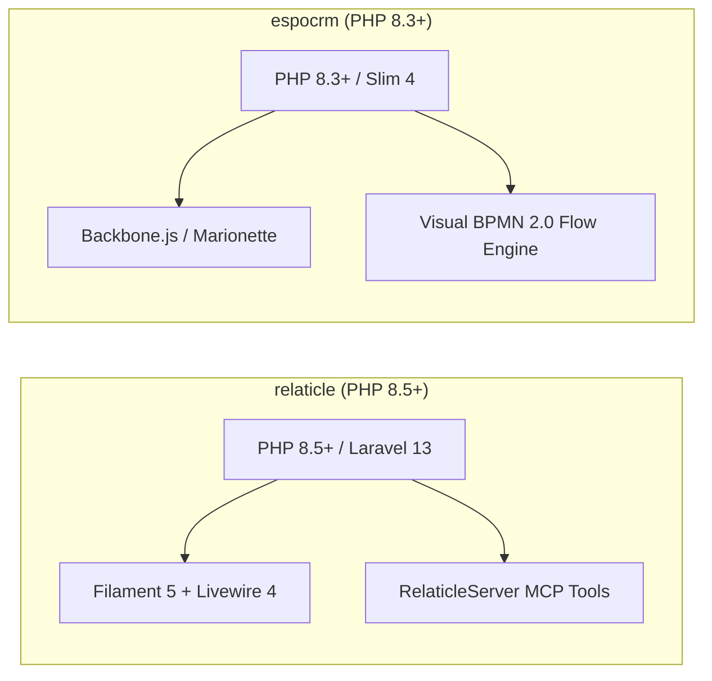
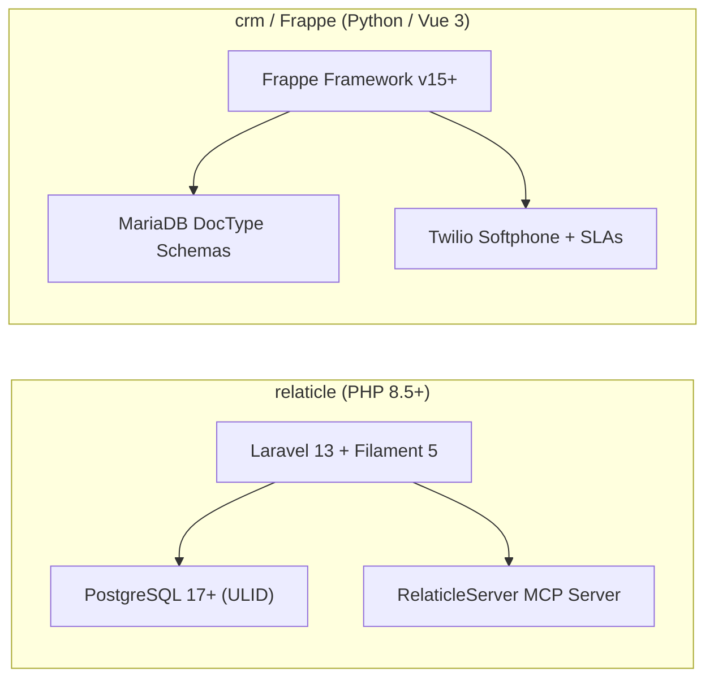
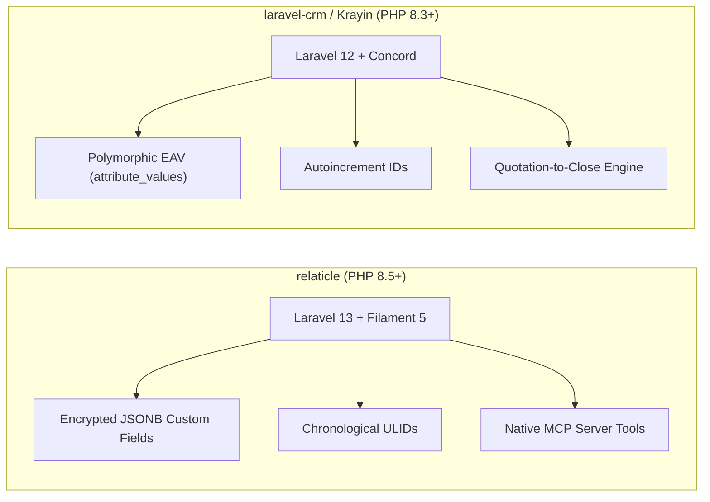
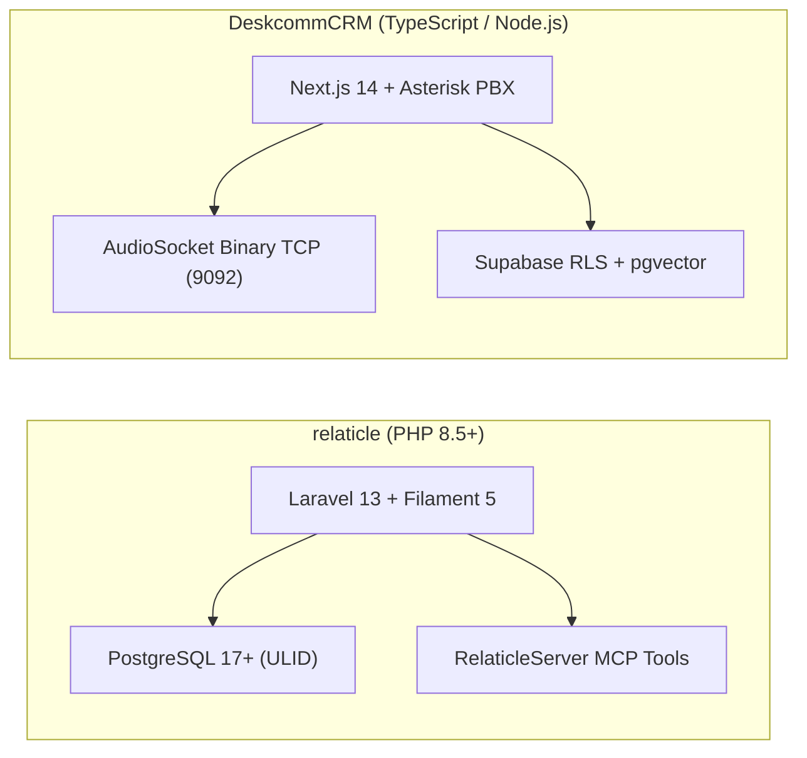
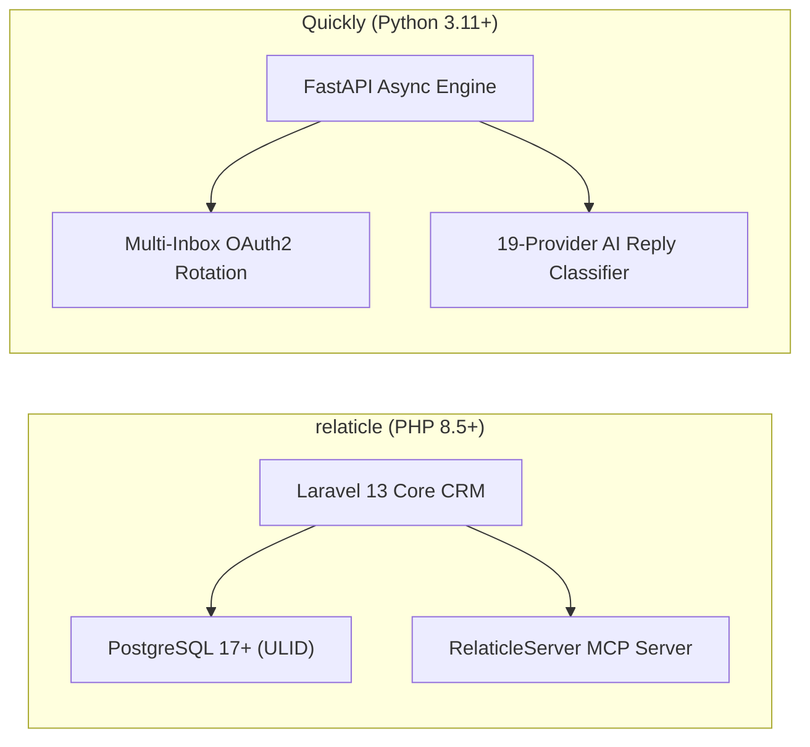
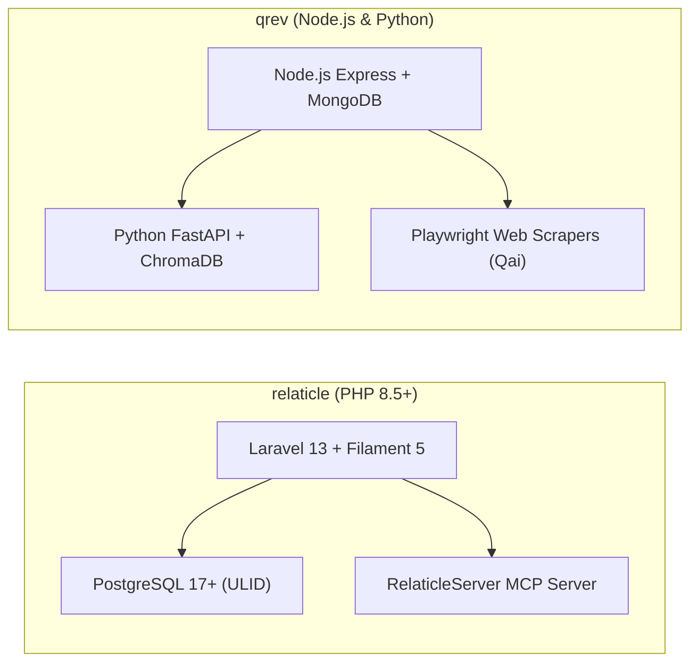
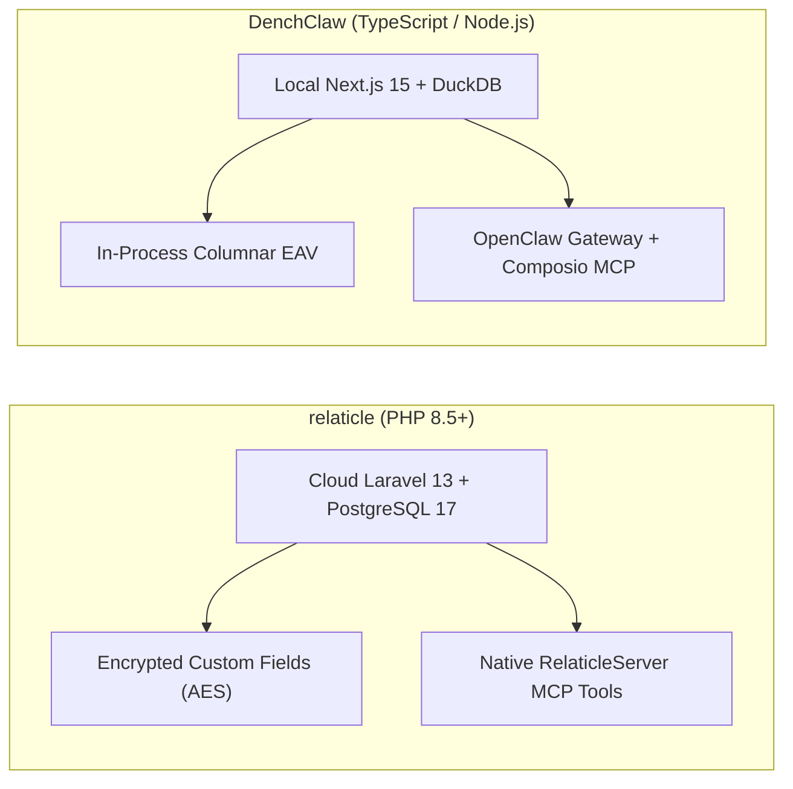

# relaticle — Comparative Analysis & Category Evaluation

> **Category**: CRM & Contact Management  
> **Architectural Role**: Agent-native modern CRM with encrypted dynamic custom fields & native MCP  
> **Primary Stack**: PHP 8.5+ | Laravel 13.x, Filament 5, Livewire 4, TailwindCSS | PostgreSQL 17+ (ULID & JSONB) | Laravel Horizon / Redis  
> **Peer Solutions Compared**: `twenty`, `trycrm`, `espocrm`, `crm`, `laravel-crm`, `DeskcommCRM`, `Quickly`, `qrev`, `DenchClaw`  
> **Commercial SaaS Benchmarks**: Salesforce, HubSpot CRM, Attio, Close.com, Clay.com  

---

## 1. Executive Overview & Technical Identity: relaticle

**relaticle** is a next-generation, agent-native open-source CRM engineered with modern PHP 8.5+ and Laravel 13, featuring an administrative user interface powered by **Filament 5** and **Livewire 4** (`Relaticle/relaticle`). Designed specifically for developer-led teams, high-growth startups, and AI-forward enterprises, relaticle redefines the customer relationship platform by treating autonomous AI agents as first-class workspace participants alongside human sales teams.

relaticle's architectural foundation rests on four core pillars:
1. **Native Model Context Protocol (MCP) Server**: Implements an official MCP server (`App\Mcp\Servers\RelaticleServer`) enabling LLMs (Claude, Cursor, ChatGPT) to introspect CRM schemas, perform prospect deduplication, update deal stages, and aggregate pipeline revenues via standardized tools.
2. **Encrypted Dynamic Custom Fields**: Solves schema flexibility without DDL migration downtime through a dynamic field engine (`CustomField`, `CustomFieldValue`) that stores attributes in PostgreSQL 17+ JSONB columns with per-field AES application encryption.
3. **High-Velocity Chronological ULIDs**: Employs Universally Unique Lexicographically Sortable Identifiers (ULIDs) across all models, ensuring distributed uniqueness while preserving B-tree index locality.
4. **Reactive Real-Time Admin Console**: Built on Filament 5 and Livewire 4, delivering sub-50ms reactive UI updates without the overhead of heavy client-side JavaScript SPA bundles.

### Core Architectural Profile
- **Runtime & Language**: `PHP 8.5+` (strict typing, match expressions, native attributes) & `Node.js 22+` (Vite)
- **Application Framework**: `Laravel 13.x` (latest framework optimizations, single-responsibility action classes)
- **Admin UI & Reactivity**: `Filament 5`, `Livewire 4`, Alpine.js, TailwindCSS
- **Persistence Layer**: `PostgreSQL 17+` (native JSONB indexing, partial indexes, and ULID primary keys)
- **Concurrency & Queues**: `Redis` with `Laravel Horizon` managing supervisor workers for email participant syncing and AI meeting summarization (`AISummaryJob`)
- **Agent Protocols**: Native Model Context Protocol (MCP) Server (`config/mcp.php`, `App\Mcp\Servers\RelaticleServer`)
- **Data Security**: Laravel Sanctum (token abilities, token hashing), Passkeys / WebAuthn, per-field AES encryption
- **Domain Specialization**: Agent-native enterprise CRM with native MCP server, encrypted dynamic fields, ULIDs, and reactive Filament 5 UX

---

## 2. Peer Solution Landscape (CRM & Contact Management)

| Solution | Language & Runtime | Core Framework | Database / Persistence | Queue & Concurrency | Primary Architectural Niche |
| :--- | :--- | :--- | :--- | :--- | :--- |
| **relaticle** (Current) | `PHP 8.5+` | `Laravel 13, Filament 5`| `PostgreSQL 17+ (ULID)` | `Laravel Horizon / Redis` | **Native RelaticleServer MCP tools, per-field encryption & ULIDs** |
| **twenty** | `TypeScript / Node.js` | `NestJS, React, Vite` | `PostgreSQL 15+, TypeORM` | `BullMQ / Redis` | Dynamic runtime schemas & in-memory GraphQL compilation |
| **trycrm** | `TypeScript / Bun` | `Bun, Hono, Next.js` | `PostgreSQL, Prisma` | `Bun Async Loop / Eve` | Agentic-first CRM with native MCP tool registry & Eve runtime |
| **espocrm** | `PHP 8.3+` | `Slim 4, Backbone.js` | `MySQL 8.0+ / MariaDB` | `Multi-Process daemon.php` | Visual BPMN 2.0 flow execution engine & JSON entityDefs |
| **crm** (Frappe) | `Python 3.10+, JS` | `Frappe, Vue 3.5` | `MariaDB 10.6+, Redis` | `Redis Queue (RQ) / Celery` | Declarative DocType metadata, built-in SLAs & Twilio WebRTC |
| **laravel-crm** (Krayin) | `PHP 8.3+` | `Laravel 12.0, Vue.js` | `MySQL 8.0, Eloquent` | `Laravel Queue / Reverb` | Modular composer packages via Concord & polymorphic typed EAV |
| **DeskcommCRM** | `TypeScript / Node.js`| `Next.js 14, Supabase` | `PostgreSQL 16, pgvector` | `AudioSocket TCP / Workers`| Asterisk AudioSocket binary TCP telephony & streamable MCP |
| **Quickly** | `Python 3.11+` | `FastAPI, Next.js 14` | `PostgreSQL, SQLAlchemy` | `Asyncio Slot Reservation` | High-velocity multi-inbox rotation, jitter scheduler & MCP |
| **qrev** | `Node.js & Python` | `Express & FastAPI` | `MongoDB & ChromaDB` | `Node-cron & FastTasks` | Dual-runtime Qai superagent orchestrator & LangChain RAG |
| **DenchClaw** | `TypeScript / Node.js`| `Next.js 15, DuckDB` | `In-Process DuckDB` | `In-Process SQL / OpenClaw`| Embedded columnar SQL, OpenClaw AI Gateway & Composio MCP |

---

## 3. Deep Head-to-Head Comparative Breakdown: relaticle vs Peers

### 3.1. relaticle vs. twenty

#### Metadata Engine & Field Storage
- **relaticle**: Stores dynamic custom attributes inside PostgreSQL 17+ JSONB structures with per-field AES application encryption (`CustomFieldValue`). Adding custom fields requires zero database DDL table alterations. Partial GIN indexes on unencrypted JSONB keys ensure fast lookups.
- **twenty**: Programmatically issues SQL DDL (`CREATE TABLE`, `ALTER TABLE`) inside dedicated PostgreSQL schemas (`workspace_<id>`), dynamically compiling Apollo GraphQL types in memory. Fields exist as physical database columns with standard B-tree indexes.

#### Security & Compliance at Rest
- **relaticle**: Implements native per-field application-level AES encryption. Sensitive fields (e.g. proprietary contract values, customer tax IDs) are encrypted before hitting the database, satisfying strict GDPR/HIPAA compliance.
- **twenty**: Relies on standard database-level transparent data encryption (TDE) or volume encryption.

#### Model Context Protocol (MCP) Implementations
- **relaticle**: Provides `App\Mcp\Servers\RelaticleServer` with five core tools (`GetCrmSchemaTool`, `ListPeopleTool`, `ListCompaniesTool`, `ListOpportunitiesTool`, `AggregateOpportunitiesTool`).
- **twenty**: Dynamically generates MCP tools matching whatever custom entities have been provisioned in the workspace.

#### Architectural Tradeoffs Matrix: relaticle vs. twenty

| Dimension | relaticle | twenty | Architectural Evaluation |
| :--- | :--- | :--- | :--- |
| **Custom Field Security** | Per-field AES application encryption | Database-level encryption only | **relaticle** provides superior sensitive data protection |
| **Query Performance** | JSONB lookups + application decryption | Native indexed PostgreSQL columns | **twenty** scales better for complex multi-field analytics |
| **Primary Keys** | Chronological ULIDs | Standard UUID v4 | **relaticle** optimizes B-tree database index locality |
| **UI Tech Stack** | Filament 5 / Livewire 4 / TailwindCSS | React 18 / Vite / Linear-style UX | **twenty** provides a snappier client-side SPA feel |

---

### 3.2. relaticle vs. trycrm

#### Architecture: Enterprise Governance vs. Autonomous AI SDR
- **relaticle**: Enterprise CRM designed for collaborative human teams and AI agents. Features structured multi-tenant workspaces (`Workspace`, `Membership`), granular role-based access control (Owner, Admin, Member, Guest), and a comprehensive Filament 5 admin dashboard.
- **trycrm**: Agentic-first system where AI digital workers are the primary users. Focuses on autonomous task loops (`AgentTask`, `AgentRun`), extracting facts from Slack, and executing outbound outreach.

#### Concurrency & Workers
- **relaticle**: Uses Redis with **Laravel Horizon** to supervise background queues for email participant parsing and meeting summarization (`AISummaryJob`).
- **trycrm**: Uses Bun's asynchronous event loop and the Eve framework to execute sequential tool-calling loops.

#### Architectural Tradeoffs Matrix: relaticle vs. trycrm

| Dimension | relaticle | trycrm | Architectural Evaluation |
| :--- | :--- | :--- | :--- |
| **Admin UI & Governance**| Full Filament 5 reactive admin console | Minimalist Next.js dashboard | **relaticle** provides richer human management tools |
| **Agent Autonomy** | Agent tool execution via MCP | Full autonomous agent task loop | **trycrm** is purpose-built as an autonomous digital worker |
| **Data Encryption** | Per-field AES encryption at rest | Unencrypted database columns | **relaticle** provides stronger data security |
| **Runtime Efficiency** | Traditional PHP-FPM / Horizon | Ultra-lightweight Bun 1.1+ runtime | **trycrm** boots and executes requests faster |

---

### 3.3. relaticle vs. espocrm

#### Modern PHP Stack: Laravel 13/Filament 5 vs. Slim 4/Backbone.js
- **relaticle**: Built on modern PHP 8.5+ and **Laravel 13**, featuring an administrative console powered by **Filament 5** and **Livewire 4**. Delivers reactive updates, strict typing, and clean single-responsibility action classes.
- **espocrm**: Built on Slim 4 and custom ORM components, with a legacy Backbone.js/Marionette frontend.

#### Workflow Automation vs. AI Agent Tools
- **relaticle**: Relies on Laravel Horizon background jobs and native Model Context Protocol tools for AI agent execution.
- **espocrm**: Features a mature visual **BPMN 2.0 flow engine** (`application/Espo/Core/BPM/`) supporting complex enterprise decision trees, approval loops, and timer delays.

#### Architectural Tradeoffs Matrix: relaticle vs. espocrm

| Dimension | relaticle | espocrm | Architectural Evaluation |
| :--- | :--- | :--- | :--- |
| **Frontend Architecture** | Modern Filament 5 / Livewire 4 | Backbone.js / Marionette (Legacy) | **relaticle** delivers a vastly superior developer & UI experience |
| **Workflow Capabilities** | Horizon jobs & event listeners | Full visual BPMN 2.0 engine | **espocrm** handles complex multi-step approval workflows |
| **AI Agent Readiness** | Native Model Context Protocol (MCP) | Traditional REST API | **relaticle** connects natively with AI agents |
| **Field Encryption** | Per-field AES application encryption | Database-level encryption only | **relaticle** provides superior protection for sensitive fields |

---

### 3.4. relaticle vs. crm (Frappe CRM)

#### Telephony & Communication Channels
- **relaticle**: Focuses on deep email integration (`packages/EmailIntegration`) and calendar meeting sync. Telephony requires third-party webhooks.
- **crm (Frappe CRM)**: Features a native browser softphone powered by `@twilio/voice-sdk` and Exotel, native WhatsApp Cloud API integration, and automated rolling-response SLA timers.

#### Architectural Tradeoffs Matrix: relaticle vs. crm (Frappe)

| Dimension | relaticle | crm (Frappe CRM) | Architectural Evaluation |
| :--- | :--- | :--- | :--- |
| **VoIP Softphone** | Activity timeline logging only | Native Twilio Voice SDK in browser | **crm** supports direct phone dialing out of the box |
| **AI Protocol (MCP)** | Native Model Context Protocol (MCP) | Whitelisted Python RPC endpoints | **relaticle** connects natively with AI agents |
| **Data Encryption** | Per-field AES application encryption | Database-level encryption only | **relaticle** secures sensitive custom attributes at rest |
| **SLA Tracking** | Horizon background jobs | Automated minute-level SLA timers | **crm** actively prevents lead neglect |

---

### 3.5. relaticle vs. laravel-crm (Krayin CRM)

#### Custom Field Design: Encrypted JSONB vs. Polymorphic EAV
- **relaticle**: Stores dynamic fields in PostgreSQL 17+ using native JSONB with per-field AES application encryption (`CustomFieldValue`). Partial GIN indexes provide high-speed filtering without database joins.
- **laravel-crm**: Stores custom fields in MySQL `attribute_values` across typed columns. Querying across multiple attributes requires multi-table self-joins that degrade query speed.

#### Quotation-to-Close Engine
- **relaticle**: Focuses on relationship management, deals, and AI summarization.
- **laravel-crm**: Includes a complete native **Quotation-to-Close engine** (`packages/Webkul/Quote`), featuring product inventories, tax rules, and automated PDF quotation rendering.

#### Primary Keys & Agent Protocols
- **relaticle**: Uses chronological **ULIDs** and features a native Model Context Protocol (MCP) server.
- **laravel-crm**: Uses standard auto-increment integer IDs and traditional Laravel Sanctum REST endpoints.

#### Architectural Tradeoffs Matrix: relaticle vs. laravel-crm

| Dimension | relaticle | laravel-crm | Architectural Evaluation |
| :--- | :--- | :--- | :--- |
| **Custom Field Security** | Per-field AES encrypted PostgreSQL JSONB | Unencrypted MySQL EAV columns | **relaticle** secures sensitive customer data at rest |
| **Custom Field Queries** | JSONB lookups + partial GIN indexes | Multi-table self-joins on EAV | **relaticle** provides faster dynamic field queries |
| **Quotation Engine** | Deals and stages only | Built-in PDF quotation generator | **laravel-crm** handles formal proposals & billing |
| **AI Protocol** | Native Model Context Protocol (MCP) | Traditional REST endpoints | **relaticle** connects natively with AI agents |

---

### 3.6. relaticle vs. DeskcommCRM

#### Specialization: CRM Record-of-Truth vs. Telephony Call Center
- **relaticle**: General-purpose CRM database of record with rich email threading, meeting summarization, and Filament 5 administration.
- **DeskcommCRM**: Call-center operating system with direct Asterisk PBX **AudioSocket** binary TCP streaming for sub-second AI voice conversations.

#### Architectural Tradeoffs Matrix: relaticle vs. DeskcommCRM

| Dimension | relaticle | DeskcommCRM | Architectural Evaluation |
| :--- | :--- | :--- | :--- |
| **Telephony Integration** | Activity timeline logging only | Native Asterisk AudioSocket binary TCP | **DeskcommCRM** supports sub-second AI voice calling |
| **Admin UI Framework** | Filament 5 + Livewire 4 | TailwindCSS + Radix UI Primitives | **relaticle** provides a richer reactive admin console |
| **Custom Field Engine** | Encrypted JSONB dynamic custom fields | Static Supabase schema | **relaticle** provides zero-DDL field customization |
| **Vector Search** | Relational queries | pgvector semantic embeddings | **DeskcommCRM** supports vector RAG search |

---

### 3.7. relaticle vs. Quickly

#### Functional Position in Sales Funnel
- **relaticle**: Core CRM database of record managing contacts, companies, opportunities, and full customer interaction history.
- **Quickly**: Cold email sequencing engine rotating hundreds of Google and Microsoft OAuth accounts with automated send-time jitter.

#### Architectural Tradeoffs Matrix: relaticle vs. Quickly

| Dimension | relaticle | Quickly | Architectural Evaluation |
| :--- | :--- | :--- | :--- |
| **Outbound Emailing** | Standard IMAP/SMTP mail sync | Multi-inbox OAuth rotation with jitter | **Quickly** prevents email sender domain burn |
| **CRM Data Governance**| Deep contact/account models + ULIDs | Minimalist lead and sequence tables | **relaticle** acts as the core database of record |
| **AI Reply Analysis** | Background AI summarization job | Native 19-provider LLM intent classifier | **Quickly** auto-categorizes prospect intent |
| **Memory Footprint** | ~120 MB RAM | ~60 MB RAM | **Quickly** is exceptionally lightweight |

---

### 3.8. relaticle vs. qrev

#### System Architecture
- **relaticle**: Enterprise CRM database of record with Filament 5 admin UI, email participant resolution, meeting summarization, and per-field AES encryption.
- **qrev**: Autonomous SDR digital worker fleet led by **Qai**, running Playwright web scrapers and ChromaDB vector RAG to synthesize personalized sales copy.

#### Architectural Tradeoffs Matrix: relaticle vs. qrev

| Dimension | relaticle | qrev | Architectural Evaluation |
| :--- | :--- | :--- | :--- |
| **Autonomous Prospecting** | Email participant sync & notes | Playwright web scrapers & RAG copy | **qrev** actively gathers prospect intelligence |
| **Data Governance & Security**| Per-field AES encrypted PostgreSQL JSONB | Flexible MongoDB documents | **relaticle** provides superior security & compliance |
| **AI Protocol (MCP)** | Native Model Context Protocol (MCP) | LangChain tool execution engine | **relaticle** adheres to standard MCP protocols |
| **Primary Keys & Indexing** | Chronological ULIDs | MongoDB ObjectIDs | **relaticle** optimizes B-tree database indexing |

---

### 3.9. relaticle vs. DenchClaw

#### Deployment & Execution Context
- **relaticle**: Cloud-native, multi-workspace enterprise CRM designed for collaborative human and AI sales teams.
- **DenchClaw**: Local-first workstation engine running on an operator's local machine with an embedded columnar DuckDB file (`workspace.duckdb`).

#### Query Speed: PostgreSQL 17 vs. Columnar DuckDB
- **relaticle**: Queries execute against PostgreSQL 17 over network connections (5-15ms latency).
- **DenchClaw**: Queries execute in-process via DuckDB's vectorized columnar engine in sub-millisecond timeframes (<1ms).

#### Architectural Tradeoffs Matrix: relaticle vs. DenchClaw

| Dimension | relaticle | DenchClaw | Architectural Evaluation |
| :--- | :--- | :--- | :--- |
| **Deployment Topology** | Cloud-native multi-workspace CRM | Local-first sovereign workstation | **relaticle** is built for collaborative teams |
| **Analytical Query Speed** | PostgreSQL network queries (5-15ms) | In-process vectorized DuckDB (<1ms) | **DenchClaw** executes analytics instantaneously |
| **Data Security & Privacy** | Per-field AES application encryption | Physical local file custody | **relaticle** secures fields on shared servers |
| **SaaS Tool Integrations** | Custom MCP server tools | Composio 150+ pre-built connectors | **DenchClaw** provides broader third-party tool reach |

---

## 4. Capability & Feature Comparison Matrix

| Dimension / Capability | relaticle | twenty | trycrm | espocrm | crm (Frappe) | laravel-crm | DeskcommCRM | Quickly | qrev | DenchClaw |
| :--- | :---: | :---: | :---: | :---: | :---: | :---: | :---: | :---: | :---: | :---: |
| **Native MCP / AI Skills** | ✅ RelaticleServer | ✅ Full SDK | ✅ Native Core | ❌ REST only | ❌ RPC only | ❌ REST only | ✅ Streamable | ✅ Streamable | ⚠️ LangChain | ✅ Composio MCP |
| **Field-Level Encryption** | ✅ AES Per-Field | ⚠️ Postgres | ❌ | ⚠️ Sensitive | ⚠️ Password | ❌ | ✅ pgcrypto | ❌ | ❌ | ❌ |
| **Primary Key Indexing** | ✅ Chrono ULID | Standard UUID | Standard UUID | String / Auto | String / Auto | Autoincrement | Standard UUID | Auto / Int | MongoDB ID | In-Process Row |
| **Modern Reactive UI** | ✅ Filament 5 | ✅ Linear UX | ✅ Linear UX | ❌ Backbone | ⚠️ Vue/Desk | ❌ Blade | ⚠️ Next.js | ⚠️ Tailwind | ⚠️ React | ✅ Next.js 15 |
| **Dynamic Custom Objects** | ✅ Encrypted EAV | ✅ Full DDL | ⚠️ JSON facts | ✅ JSON Meta | ✅ DocType | ⚠️ EAV | ❌ Static | ❌ Static | ⚠️ Mongo | ✅ DuckDB EAV |
| **Embedded Softphone / CTI** | ❌ | ❌ | ❌ | ⚠️ Plugin | ✅ Twilio SDK | ❌ | ✅ AudioSocket | ❌ | ❌ | ❌ |
| **Multi-Tenant Schemas** | ✅ Workspace Model| ✅ Schema/Tenant| ⚠️ Org ID | ⚠️ Role ACL | ✅ Frappe Sites| ⚠️ Channels | ✅ Postgres RLS| ⚠️ Single-team | ⚠️ Org ID | ✅ Local File |
| **Resource Footprint** | ~120 MB RAM | ~500 MB RAM | ~150 MB RAM | ~120 MB RAM | ~400 MB RAM | ~100 MB RAM | ~200 MB RAM | **~60 MB RAM** | ~250 MB RAM | ~100 MB RAM |

---

## 5. Commercial Benchmark Positioning

When benchmarked against commercial SaaS leaders (**Salesforce, HubSpot CRM, Attio, Close.com, Clay.com**):
- **Against Salesforce**: relaticle provides an agile, developer-first CRM with clean Laravel 13 code, chronological ULIDs, and native Model Context Protocol tools without enterprise bloat or recurring per-seat licensing.
- **Against Attio**: relaticle delivers flexible custom fields with per-field AES encryption, combining modern design with strict data privacy compliance.
- **Against HubSpot CRM**: relaticle features a snappy administrative UI built with Filament 5 and Livewire 4, eliminating punitive tier-based pricing as contact databases expand.
- **Data Sovereignty**: 100% self-hosted on private PostgreSQL servers, guaranteeing that proprietary customer records and encryption keys remain under organizational control.

---

## 6. Strategic Takeaways & Role for MarketingStudio

In the unified **MarketingStudio** architecture:
1. **Primary Component to Adopt**: Harness relaticle's **Native Model Context Protocol (MCP) Server** pattern (`App\Mcp\Servers\RelaticleServer`), providing AI sales agents with structured tools (`GetCrmSchemaTool`, `ListPeopleTool`, `ListCompaniesTool`, `ListOpportunitiesTool`, `AggregateOpportunitiesTool`).
2. **Encrypted Custom Field Pattern**: Adopt relaticle's per-field AES application encryption strategy for securing sensitive customer attributes at rest within PostgreSQL JSONB structures.
3. **ULID Primary Key Architecture**: Standardize on chronological ULIDs across MarketingStudio models to optimize B-tree database indexing and distributed identity generation.
