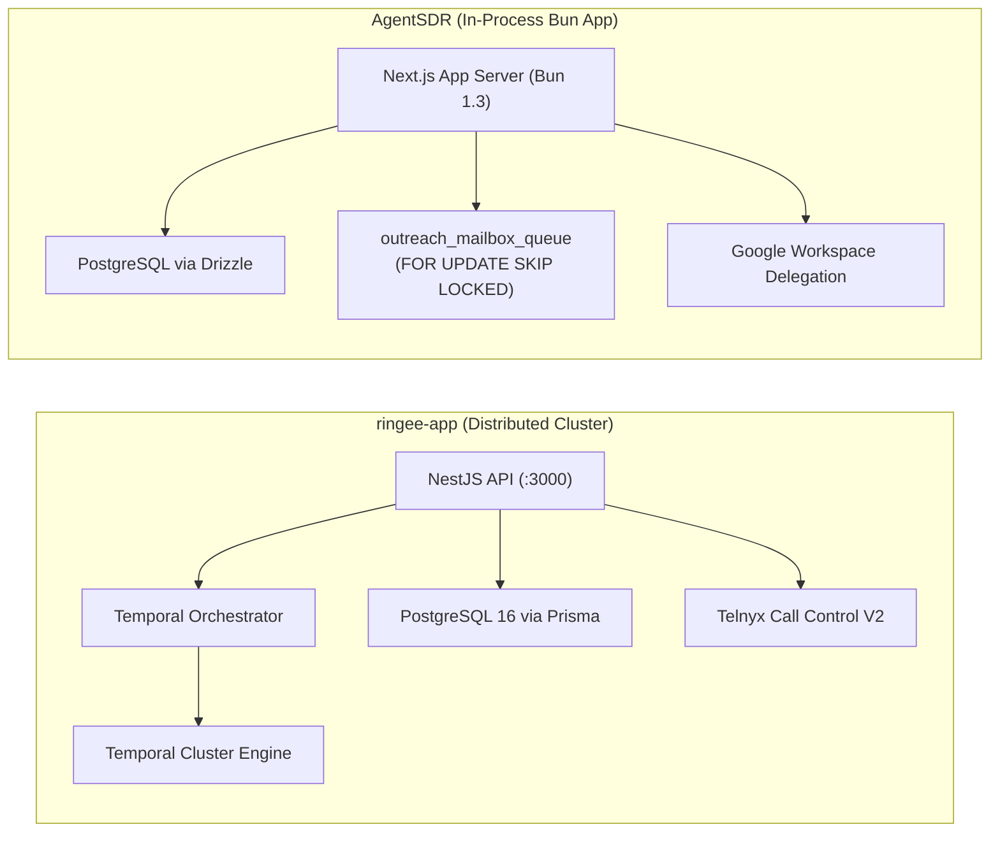
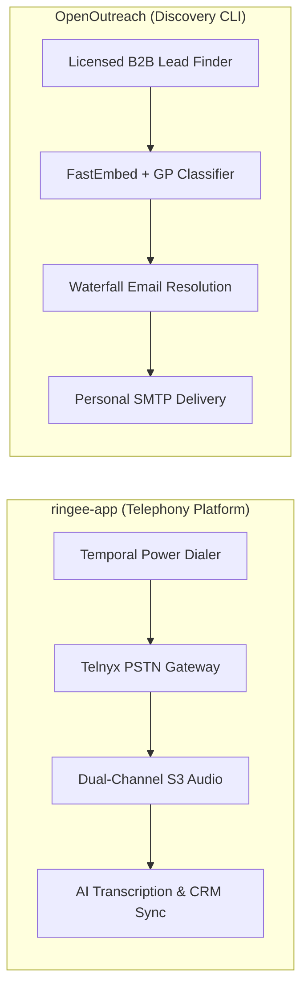
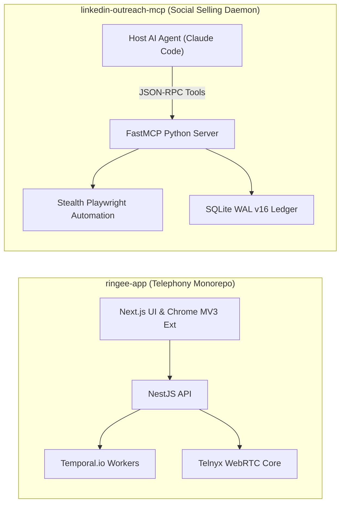
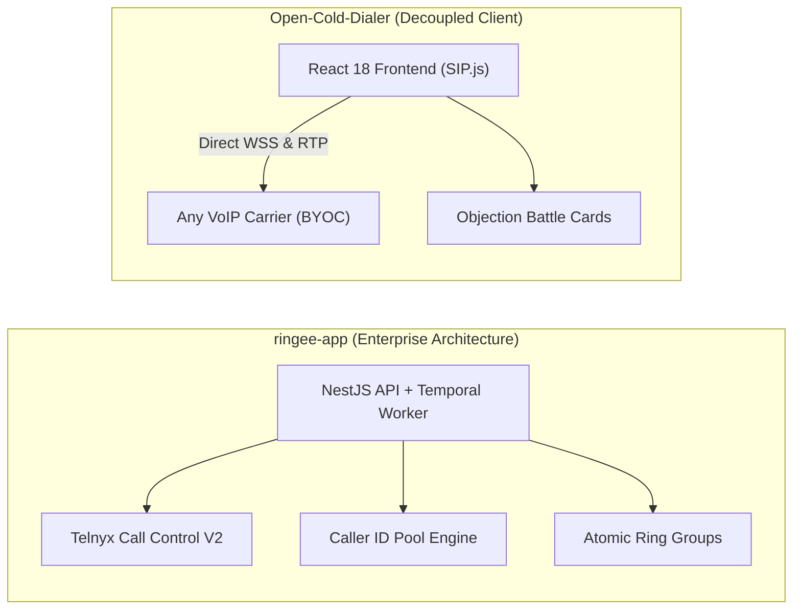

# ringee-app — Comparative Analysis & Category Evaluation

> **Category**: Cold Outreach & AI SDR  
> **Architectural Role**: Enterprise multi-tenant outbound telephony platform, power dialer & CRM sync engine  
> **Primary Stack**: TypeScript, NestJS 11, Next.js 14, Zustand 5 | Telnyx WebRTC | PostgreSQL 16, Prisma ORM 6.16 | Temporal.io Durable Workflows, Redis 7 | AGPL-3.0  
> **Peer Solutions Compared**: `AgentSDR`, `OpenOutreach`, `linkedin-outreach-mcp`, `Open-Cold-Dialer`  
> **Commercial SaaS Benchmarks**: Kixie, Aircall, PhoneBurner, Dialpad, Close CRM Telephony  

---

## 1. Executive Overview & Technical Identity: ringee-app

**ringee-app** is an open-source, enterprise-grade multi-tenant sales engagement and cloud telephony platform designed to streamline high-volume outbound calling, power dialing, and inbound call distribution. Architected as a modular TypeScript monorepo using pnpm workspaces, Ringee bridges the gap between raw telecom carriers (specifically Telnyx PSTN and WebRTC infrastructure) and customer-facing revenue workflows.

Rather than relying on fragile webhook callbacks or browser-only dialers, Ringee features a decoupled headless dialer engine (`@ringee/dialer-core`), automated local presence caller ID rotation, durable stateful campaign orchestration via Temporal.io, and bi-directional synchronization with modern CRMs like HubSpot and Attio.

### Core Architectural Profile
- **Monorepo Architecture**: `TypeScript 5.9+` managed with `pnpm workspaces` and `Turborepo`
- **Backend Framework**: `NestJS 11` + `Express 5` with modular dependency injection, guards, and Swagger OpenAPI specs
- **Frontend Framework**: `Next.js 14` (App Router) + `React 18`, paired with a Chrome Manifest V3 click-to-call extension
- **Durable Orchestration**: `Temporal.io SDK` (`@temporalio/workflow`, `@temporalio/worker`) executing fault-tolerant dialer campaigns
- **Telephony & Media Engine**: Telnyx Call Control V2 API + `@telnyx/webrtc` client with headless `Zustand 5.0` call state machines
- **Database & Cache**: `PostgreSQL 16` via `Prisma ORM 6.16` (50+ models) and `Redis 7.x` for distributed presence and rate limits
- **Domain Specialization**: High-volume power dialing, local presence caller ID pools, atomic ring groups, and automated CRM sync

---

## 2. Peer Solution Landscape (Cold Outreach & AI SDR)

Within this category, `ringee-app` operates alongside four specialized peer solutions:

| Solution | Language & Runtime | Core Framework | Database & ORM | Queue & Concurrency Model | Primary Architectural Niche |
| :--- | :--- | :--- | :--- | :--- | :--- |
| **ringee-app** (Current) | `TypeScript / Node 20+` | `NestJS 11, Next.js 14` | `PostgreSQL 16, Prisma` | `Temporal.io Durable Workflows` | Enterprise contact center & power dialer cluster |
| **AgentSDR** | `TypeScript / Bun 1.3` | `Next.js 16, React 19` | `PostgreSQL 15+, Drizzle` | `Postgres FOR UPDATE SKIP LOCKED` | Autonomous multi-channel AI SDR & inbox rotator |
| **OpenOutreach** | `Python 3.11+` | `Django 5.2+ (Headless)` | `SQLite 3 (WAL + IMMEDIATE)` | `Synchronous Bounded Batches` | Active-learning lead discovery & waterfall resolution |
| **linkedin-outreach-mcp** | `Python 3.10+` | `FastMCP SDK 1.30+` | `SQLite 3 (WAL, v16)` | `Asyncio Coroutines + Jitter Backoff` | Stealth LinkedIn automation for LLM agent swarms |
| **Open-Cold-Dialer** | `TypeScript / Node 20+` | `React 18, Vite, Express` | `SQLite / Supabase, Drizzle` | `SIP.js Client Event Loop over WSS` | Carrier-agnostic browser WebRTC power dialer |

---

## 3. Deep Head-to-Head Comparative Breakdown: ringee-app vs Peers

### 3.1. ringee-app vs. AgentSDR

**Comparative Focus**: Distributed enterprise telephony platform with durable Temporal workflows vs. in-process relational AI SDR web application.

#### Architectural & Stack Differences
- **System Architecture & Packaging**: `ringee-app` is structured as an enterprise monorepo using pnpm workspaces, dividing functionality across specialized micro-services (`apps/backend`, `apps/orchestrator`, `apps/hubspot`, `apps/attio`, `packages/dialer-core`). `AgentSDR` is packaged as a unified fullstack application running on the `Bun 1.3` runtime, consolidating CRM, email queue scheduling, and basic calling into one container.
- **Workflow Durability & Queue Mechanics**: `ringee-app` uses **Temporal.io** (`@temporalio/workflow`) to orchestrate outbound campaigns. Campaign runs are durable, event-sourced workflows that survive server restarts, worker crashes, and network partitions. If a worker goes offline mid-call, Temporal recovers the exact execution state. `AgentSDR` manages outbound jobs through a two-tier PostgreSQL relational queue (`outreach_mailbox_queue`) with `SELECT ... FOR UPDATE SKIP LOCKED` tick intervals, optimized for cold email dispatch rather than long-running multi-leg telephony states.
- **Telephony & Reputation Infrastructure**: `ringee-app` features an advanced telephony plane: headless WebRTC state management (`@ringee/dialer-core`), dynamic local presence pools (`CallerIdPoolMember`) that rotate outbound numbers matching prospect area codes, and daily DID usage caps (`CallerIdDailyUsage`) to prevent spam flags. `AgentSDR` provides a simple browser calling station backed by an auxiliary `call-worker` service, primarily focusing on email deliverability and Google Workspace domain-wide delegation.
- **CRM Integration Architecture**: `ringee-app` maintains dedicated micro-apps (`apps/hubspot`, `apps/attio`) driven by an outbox pattern (`TriggerLoopOutboxEvent`) to sync dual-channel audio recordings, transcript segments, and dispositions bi-directionally. `AgentSDR` implements an internal native CRM with custom pipeline stages and sentiment classification.

#### Architectural Comparison Matrix: ringee-app vs. AgentSDR

| Dimension | ringee-app | AgentSDR |
| :--- | :--- | :--- |
| **System Architecture** | Distributed Monorepo Microservices (NestJS + Next.js) | In-process App Server + Bun cron scheduler |
| **Workflow Engine** | Temporal.io Event-Sourced Durable Workflows | PostgreSQL Relational Queue (`FOR UPDATE SKIP LOCKED`) |
| **Primary Channel Focus** | Outbound Telephony, Power Dialing & Inbound PBX | Cold Email Cadences & Multi-Inbox Rotation |
| **Telephony Engine** | Headless `@ringee/dialer-core` + Telnyx Call Control | Built-in WebRTC softphone + call-worker microservice |
| **Caller ID Protection** | Dynamic local presence pool & area code rotation | Standard daily mailbox sending limits |
| **Database & ORM** | PostgreSQL 16 via Prisma ORM 6.16 (50+ models) | PostgreSQL 15+ via Drizzle ORM |
| **State Caching** | Redis 7.x (ioredis + Keyv) | In-memory Next.js / Bun state |
| **CRM Integration** | Bi-directional sync apps (HubSpot, Attio) | Internal native CRM + Unipile bridge |
| **Deployment Footprint** | ~750 MB RAM (Cluster) | ~250 MB RAM (Bun + Postgres) |

---

### 3.2. ringee-app vs. OpenOutreach

**Comparative Focus**: High-concurrency telephony campaign cluster vs. lightweight active-learning email discovery CLI.

#### Architectural & Stack Differences
- **Domain Specialization**: `ringee-app` is purpose-built for real-time telephone conversations (power dialing, inbound hunt groups, audio transcription, and CRM logging). `OpenOutreach` is an autonomous top-of-funnel lead discovery and cold email tool that transforms product specs into verified prospect lists and personalized emails.
- **Runtime Footprint & Complexity**: `OpenOutreach` is a zero-daemon Python CLI tool installable via `uv tool` (~60 MB RAM) running on an embedded SQLite WAL database. `ringee-app` is a production enterprise platform requiring PostgreSQL, Redis, Temporal, and S3 object storage (~750 MB RAM).
- **Workflow Complementarity**: The two systems form a natural sequence: `OpenOutreach` discovers target leads and verifies phone numbers via BetterContact waterfall enrichment; `ringee-app` ingests those phone numbers into high-volume power dialing campaigns with area code matching.

#### Architectural Comparison Matrix: ringee-app vs. OpenOutreach

| Dimension | ringee-app | OpenOutreach |
| :--- | :--- | :--- |
| **Primary Channel** | Outbound/Inbound Telephony & CTI | B2B Cold Email & Lead Discovery |
| **Runtime Topology** | Multi-container microservice cluster | Zero-daemon standalone CLI tool |
| **Orchestration Model** | Temporal.io durable distributed workflows | Bounded synchronous batch execution |
| **Persistence Engine** | PostgreSQL 16 via Prisma ORM | SQLite 3 (WAL mode, IMMEDIATE locking) |
| **AI Strategy** | Post-call speech transcription & LLM summaries | FastEmbed + Gaussian Process active-learning walks |
| **Telephony Plane** | Telnyx Call Control V2 & WebRTC client | None (Text-only email delivery) |
| **Deployment Complexity** | High (Multi-container orchestration) | Minimal (Single `uv tool run` command) |

---

### 3.3. ringee-app vs. linkedin-outreach-mcp

**Comparative Focus**: Enterprise telephony contact center vs. Model Context Protocol (MCP) LinkedIn social selling daemon.

#### Architectural & Stack Differences
- **Execution Surface & Protocol**: `ringee-app` provides graphical user interfaces (Next.js web portal, Manifest V3 Chrome extension for click-to-call) and REST APIs. `linkedin-outreach-mcp` exposes 60+ typed tools over the open Model Context Protocol (MCP), specifically engineered for autonomous control by LLM agents.
- **Communication Vector**: `ringee-app` is engineered for synchronous phone calls (SIP/WebRTC audio). `linkedin-outreach-mcp` operates in asynchronous social networking (connection requests, InMails, profile signal tracking) with humanized typing delays and tone-of-voice cloning.
- **Persistence & State**: `ringee-app` uses Prisma ORM over PostgreSQL with Redis caching. `linkedin-outreach-mcp` runs an embedded SQLite database (`user_version = 16`) storing agent decision journals and OS Keychain secrets.

#### Architectural Comparison Matrix: ringee-app vs. linkedin-outreach-mcp

| Dimension | ringee-app | linkedin-outreach-mcp |
| :--- | :--- | :--- |
| **Primary Channel** | Voice Telephony (PSTN / WebRTC) | LinkedIn Social Prospecting & InMail |
| **Operator Model** | Human SDRs & Automated Power Dialer | Autonomous AI Agent Swarms (FastMCP) |
| **Primary Interface** | Next.js Dashboard & Chrome MV3 Extension | 60+ Model Context Protocol (MCP) Tools |
| **Workflow Engine** | Temporal.io event-sourced state machines | In-process agent swarm & decision ledger |
| **Data Persistence** | PostgreSQL 16 via Prisma ORM | SQLite 3 (WAL, v16) + OS Keychain |
| **Caller / Tone Strategy**| Local presence area code rotation | Tone-of-voice synthesizer & post analysis |
| **Memory Footprint** | ~750 MB RAM | ~90 MB RAM |

---

### 3.4. ringee-app vs. Open-Cold-Dialer

**Comparative Focus**: Distributed enterprise contact center platform vs. lightweight browser-direct WebRTC softphone.

#### Architectural & Stack Differences
- **Signaling & Carrier Architecture**: In `Open-Cold-Dialer`, the browser establishes direct SIP over WSS connections with carrier endpoints (SignalWire, Telnyx, Twilio, Asterisk), bypassing the backend for audio. In `ringee-app`, telephony is orchestrated through server-side Telnyx Call Control V2 APIs, issuing temporary WebRTC session credentials to client agents while controlling call routing, transfers, and bridge legs server-side.
- **Workflow Durability**: `Open-Cold-Dialer` manages campaign state client-side in the browser tab; closing the tab halts the dialing queue. `ringee-app` runs dialing campaigns inside **Temporal.io** workers; campaigns continue progressing autonomously on the server regardless of frontend browser state.
- **Inbound Telephony & ACD**: `Open-Cold-Dialer` is strictly an outbound dialer. `ringee-app` provides enterprise PBX capabilities: atomic multi-agent ring groups (`RingGroup`), simultaneous or sequential ringing, desk phone SIP provisioning (BYOD), and automated call transfers.
- **Carrier Independence**: `Open-Cold-Dialer` can terminate calls over any SIP proxy or PBX via standard WebSockets. `ringee-app` is heavily optimized for Telnyx infrastructure.

#### Architectural Comparison Matrix: ringee-app vs. Open-Cold-Dialer

| Dimension | ringee-app | Open-Cold-Dialer |
| :--- | :--- | :--- |
| **System Scale** | Multi-service enterprise telephony cluster | Lightweight single-server softphone |
| **Telephony Control** | Server-side Telnyx Call Control V2 + WebRTC | Client-side SIP.js over WSS |
| **Carrier Freedom** | Telnyx-centric implementation | Carrier-agnostic BYOC (Twilio, Asterisk, SignalWire)|
| **Campaign Persistence**| Temporal.io durable server workflows | Browser tab in-memory state |
| **Caller ID Protection**| Dynamic local presence pool & usage limits | Static user-selected caller ID |
| **Inbound Call Handling**| Atomic ring groups, hunt queues, BYOD SIP | None (Outbound only) |
| **Call Guidance** | Post-call LLM transcripts & summary | Live objection-handling battle cards |
| **CRM Integration** | Native bi-directional sync (HubSpot, Attio) | CSV export |

---

## 4. Capability & Feature Comparison Matrix

| Dimension / Capability | ringee-app | AgentSDR | OpenOutreach | linkedin-outreach-mcp | Open-Cold-Dialer |
| :--- | :---: | :---: | :---: | :---: | :---: |
| **Durable Workflow State (Temporal)**| ✅ Temporal.io Core | ⚠️ DB queue retry | ❌ | ⚠️ 12-stage backoff | ❌ |
| **Local Presence Caller ID Rotation** | ✅ Area Code Pools | ❌ | ❌ | ❌ | ❌ |
| **Headless Dialer Engine** | ✅ `@ringee/dialer-core` | ❌ | ❌ | ❌ | ❌ |
| **Browser WebRTC Calling** | ✅ Telnyx WebRTC | ✅ Built-in Softphone | ❌ | ❌ | ✅ SIP.js WebRTC |
| **Inbound Atomic Ring Groups** | ✅ Full ACD | ❌ | ❌ | ❌ | ❌ |
| **Carrier Independence (BYOC)** | ⚠️ Telnyx-centric | ⚠️ Custom bridge | ❌ | ❌ | ✅ Any SIP WSS |
| **Dual-Channel Call Recording** | ✅ Carrier-side Mix | ✅ Microservice S3 | ❌ | ❌ | ⚠️ Client capture |
| **Bi-Directional CRM Sync** | ✅ HubSpot & Attio | ⚠️ Native CRM only | ⚠️ CSV Export | ⚠️ Webhook bridge | ❌ |
| **Do-Not-Call (DNC) List** | ✅ Full Table | ❌ | ⚠️ Suppression list | ⚠️ Tombstones | ✅ Internal `dnc_list` |
| **Memory Footprint** | ~750 MB RAM | ~250 MB RAM | **~60 MB RAM** | ~90 MB RAM | ~120 MB RAM |

---

## 5. Commercial Benchmark Positioning

When benchmarked against commercial sales engagement and dialer platforms (**Kixie, Aircall, PhoneBurner, Dialpad, Close CRM**):
- **Against Kixie & PhoneBurner**: Kixie charges $65–$95/user/month for local-presence dialing. `ringee-app` provides an open-source implementation of dynamic caller ID pool rotation (`CallerIdPoolMember`), cycling numbers to match prospect area codes and prevent spam flagging at zero software markup.
- **Against Aircall & Dialpad**: Aircall enforces strict per-seat billing and vendor lock-in. `ringee-app` provides an open-source contact center monorepo with atomic ring groups, desk phone SIP provisioning, and Chrome extension click-to-call.
- **Against Close CRM Telephony**: Ringee's dedicated CRM sync workers (`apps/hubspot`, `apps/attio`) automatically post call recordings, AI-generated conversation summaries, and disposition outcomes directly into CRM timelines without requiring custom Zapier workflows.

---

## 6. Strategic Takeaways & Role for MarketingStudio

In MarketingStudio's outbound architecture:
1. **Primary Component to Adopt**: Harness `ringee-app`'s **headless dialer core (`@ringee/dialer-core`) and local presence caller ID rotation algorithm**, preventing outbound numbers from being flagged as spam by carrier analytics engines.
2. **Adopt Temporal.io for Long-Running Telephony Workflows**: Utilize Temporal durable execution patterns for multi-step outbound calling campaigns, ensuring calls survive network drops and server restarts.
3. **Synergistic Integration**:
   - Ingest verified phone numbers from `OpenOutreach` waterfall resolution into Ringee's campaign queues.
   - Combine with `Open-Cold-Dialer`'s carrier-agnostic SIP configuration to extend Ringee beyond Telnyx to Twilio, SignalWire, and private Asterisk PBX trunks.
