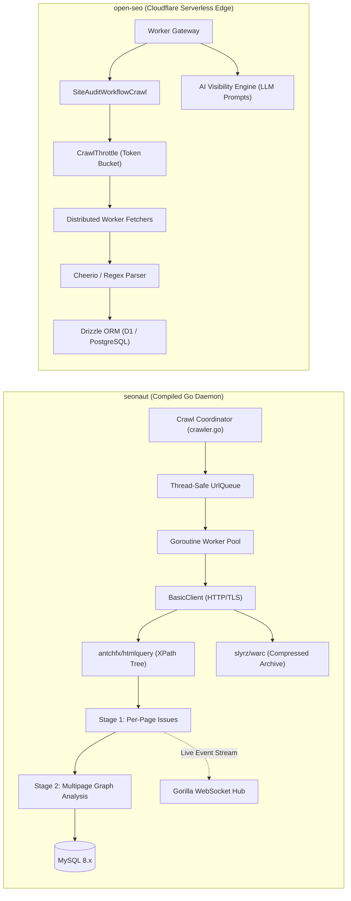
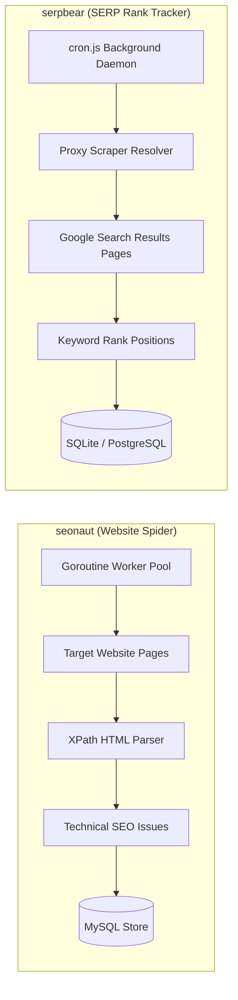

# seonaut — Comparative Analysis & Category Evaluation

> **Category**: SEO, Crawlers & Rank Tracking  
> **Architectural Role**: High-speed concurrent website crawler, graph-level technical auditor & ISO WARC archiver  
> **Primary Stack**: Go 1.25 | antchfx/htmlquery (XPath) | MySQL 8.x / MariaDB | Gorilla WebSockets | slyrz/warc  
> **Peer Solutions Compared**: `open-seo`, `serpbear`  
> **Commercial SaaS Benchmarks**: Screaming Frog SEO Spider, Sitebulb, Ahrefs Site Audit, DeepCrawl  

---

## 1. Executive Overview & Technical Identity: seonaut

**seonaut** represents the high-throughput, systems-level crawling engine within the **SEO, Crawlers & Rank Tracking** domain. Developed in compiled Go 1.25, `seonaut` serves as a high-speed, server-hosted open-source alternative to desktop crawlers like Screaming Frog and legacy Python/Java spiders. Operating with an extraordinarily small memory footprint (typically under 80MB RAM for deep multi-thousand-page audits), `seonaut` leverages Go's native goroutine worker pools and persistent HTTP transport sockets to crawl hundreds of pages per second.

`seonaut` decouples technical issue evaluation into an efficient two-stage pipeline: an immediate per-page inspection phase (status codes, H1-H6 tags, hreflang, schema) streaming real-time metrics over WebSockets, followed by a graph-wide cross-page analysis phase (uncovering orphan pages, duplicate title tags, and circular canonical loops). Uniquely among open-source crawlers, `seonaut` integrates `slyrz/warc`, generating ISO-standard Web ARChive (WARC) snapshot archives of crawled sites for regulatory compliance and historical diffing.

### Core Architectural Profile
- **Runtime & Language**: `Go 1.25 (compiled static binary)`
- **Core Framework**: `Go standard library, internal/crawler multiplexer`
- **Persistence Layer**: `MySQL 8.x / MariaDB (go-sql-driver/mysql)` + local WARC disk storage
- **Concurrency & Queue Model**: `Thread-safe UrlQueue + Goroutine worker pool (Persistent HTTP transport)`
- **Domain Specialization**: High-speed multi-thousand-page domain crawling, internal graph issue detection & ISO WARC archiving

---

## 2. Peer Solution Landscape (SEO, Crawlers & Rank Tracking)

Within this category, `seonaut` operates alongside the following peer solutions:

| Solution | Language & Runtime | Core Framework | Database / Cache | Queue / Concurrency | Primary Architectural Niche |
| :--- | :--- | :--- | :--- | :--- | :--- |
| **seonaut** (Current) | `Go 1.25` | `Go Native / XPath` | `MySQL 8.x / MariaDB` | `Goroutine Worker Pool` | **Ultra-fast concurrent raw HTML spidering & WARC archiving** |
| **open-seo** | `TypeScript / Cloudflare` | `TanStack Router, Hono` | `Cloudflare D1 / PostgreSQL` | `Cloudflare Workflows` | Serverless durable edge audit & GEO AI citation engine |
| **serpbear** | `TypeScript / Node.js` | `Next.js, Sequelize` | `SQLite / PostgreSQL` | `Node.js Cron Daemon` | Proxy-rotated Google SERP rank tracking & GSC sync |

---

## 3. Deep Head-to-Head Comparative Breakdown: seonaut vs Peers

### 3.1. seonaut vs. open-seo

**Comparative Focus**: `High-Concurrency Native Go Spider & WARC Archiving` vs. `Serverless Durable Edge Workflows & GEO Engine`

#### Detailed Architectural Contrast
- **Concurrency & Throughput**: `seonaut` compiles directly to machine code, utilizing Go's lightweight goroutines and channels to crawl 2,500–5,000 pages per minute on minimal hardware. Persistent `http.Transport` connection pools maximize socket reuse and reduce TLS handshake latency. `open-seo` operates on serverless V8 isolates using Cloudflare Workflows, deliberately throttled by token-bucket rate limiters (`CrawlThrottle`) to adhere to edge subrequest quotas (60–180 pages/min).
- **DOM Traversal & Analysis Pipeline**: `seonaut` parses raw HTML tokens into an XPath-queryable DOM using `antchfx/htmlquery`. Its two-stage pipeline separates instantaneous per-page evaluations from full-domain graph traversal, detecting complex structural issues like orphan pages (pages with no inbound links), circular redirect chains, and duplicate metadata. `open-seo` parses pages using Cheerio and regex heuristics, focusing on immediate page-level metrics and brand citability across generative AI answer engines.
- **Data Durability & Archiving**: `seonaut` writes relational issue matrices into MySQL/MariaDB and serializes exact raw HTTP request/response streams into compressed Web ARChive (WARC) files via `slyrz/warc`. `open-seo` stores audit results in Cloudflare D1 or PostgreSQL via Drizzle ORM, storing optional page snapshots in Cloudflare R2 object storage.
- **Failure Modes & Bottlenecks**:
  - `seonaut`: Unthrottled goroutines can saturate target origin servers if crawl-delays are misconfigured. The memory frontier (`UrlQueue`) must be managed carefully for sites exceeding 500,000 URLs. Lacks a headless Chromium engine to crawl client-side rendered Single Page Applications (SPAs).
  - `open-seo`: Constrained by serverless worker execution limits, edge database write throughput, and external LLM API rate limits.

#### Architectural Comparison Matrix: seonaut vs. open-seo

| Dimension | seonaut | open-seo | Architectural Implication |
| :--- | :--- | :--- | :--- |
| **Throughput & Speed** | **2,500–5,000 pages/min** | **60–180 pages/min** | Seonaut is built for enterprise-scale domain sweeps; Open-SEO is tuned for bounded edge audits. |
| **Multi-Page Graph Audits** | **Stage 2 Cross-Analysis** | **Single-Run Aggregations** | Seonaut detects orphan pages, internal link distribution, and canonical loops across the full crawl graph. |
| **Search Engine Scope** | **Traditional Search Engines** | **Search Engines + AI Models (GEO)** | Open-SEO tracks LLM citations (ChatGPT, Perplexity); Seonaut is dedicated to traditional web spiders. |
| **Historical Archival** | **ISO-Standard WARC Files** | **R2 Object Snapshots** | Seonaut generates forensically sound, replayable archives compliant with web preservation standards. |
| **Telemetry & Reporting** | **Gorilla WebSocket Broadcast** | **REST / Webhooks** | Seonaut streams real-time crawl counters and error frames directly to the browser via WebSockets. |

---

### 3.2. seonaut vs. serpbear

**Comparative Focus**: `High-Speed Website Spider & Structural Auditor` vs. `Proxy-Rotated Google SERP Rank Tracker`

#### Detailed Architectural Contrast
- **Domain Mission & Target**: `seonaut` crawls customer domains to detect broken hyperlinks, missing meta tags, schema syntax errors, and redirect loops. `serpbear` queries search engines (primarily Google) to detect where target domains rank for competitive search terms.
- **Concurrency & Anti-Bot Strategy**: `seonaut` prioritizes maximum velocity while respecting origin `robots.txt` rules and crawl delays. `serpbear` must deliberately throttle requests, inserting randomized jitter and rotating through residential proxy pools to bypass Google's aggressive bot-detection algorithms and CAPTCHA challenges.
- **Persistence Architecture**: `seonaut` stores deep relational graphs of URLs, anchor texts, issues, and HTTP headers in MySQL. `serpbear` maintains time-series keyword rank arrays in SQLite or PostgreSQL, calculating 24-hour and 7-day position deltas and synchronizing with Google Search Console APIs.
- **Failure Modes & Bottlenecks**:
  - `seonaut`: Fails to execute client-side JavaScript; vulnerable to IP blocking if target sites employ aggressive Cloudflare/Akamai WAFs.
  - `serpbear`: Subject to Google CAPTCHA blocks, residential proxy latency, and DOM selector breaking changes on Google's search result layout.

#### Architectural Comparison Matrix: seonaut vs. serpbear

| Dimension | seonaut | serpbear | Architectural Implication |
| :--- | :--- | :--- | :--- |
| **Core Workload** | **Domain Crawl & Graph Audit** | **SERP Keyword Rank Tracking** | Seonaut evaluates the health of the website; SerpBear evaluates visibility on search engines. |
| **Target Surface** | **Target Website HTML & Sitemaps** | **Google SERP HTML & JSON** | Seonaut interacts directly with the site; SerpBear interacts with search engine result pages. |
| **Network Infrastructure** | **Direct High-Concurrency TCP** | **Rotating Residential Proxies / APIs** | SerpBear requires dedicated proxy rotation or third-party scraping APIs to avoid IP bans. |
| **Data Structure** | **Graph of URLs, Links & Issues** | **Keyword Time-Series Arrays** | Seonaut stores multi-relational crawl graphs; SerpBear stores linear historical rank positions. |

---

## 4. Capability & Feature Comparison Matrix

| Dimension / Capability | seonaut | open-seo | serpbear |
| :--- | :---: | :---: | :---: |
| **High-Speed Domain Spidering** | ✅ (2,500–5,000/min) | ⚠️ (60–180/min) | ❌ |
| **Google SERP Rank Tracking** | ❌ | ❌ | ✅ (Daily / Hourly) |
| **Generative Engine Optimization (GEO)** | ❌ | ✅ (LLM Citations) | ❌ |
| **ISO-Standard WARC Archiving** | ✅ (`slyrz/warc`) | ❌ | ❌ |
| **Orphan Page & Canonical Loop Detection** | ✅ (Stage 2 Graph) | ⚠️ Basic | ❌ |
| **Real-Time WebSocket Progress** | ✅ (Gorilla WS) | ⚠️ Polling | ❌ |
| **Google Search Console Integration** | ❌ | ✅ (Native) | ✅ (Native) |
| **Proxy Rotation & CAPTCHA Bypass** | ❌ | ❌ | ✅ (10+ Providers) |
| **Runtime Resource Footprint** | **~40–80 MB RAM** | **Serverless Edge** | **~150–250 MB RAM** |

---

## 5. Commercial Benchmark Positioning & MarketingStudio Fit

- **Against Screaming Frog SEO Spider**: `seonaut` provides a centralized, server-hosted crawling daemon accessible via web interfaces and APIs, freeing teams from desktop software constraints and local RAM limitations.
- **Against Sitebulb**: `seonaut` executes two-stage graph analysis to uncover structural link flow and orphan URLs at ten times the crawl velocity.
- **MarketingStudio Synergy**: `seonaut` serves as the primary high-volume website spider in MarketingStudio's scheduled auditing pipeline, feeding structural issue telemetry into CRM tickets while `serpbear` monitors daily keyword rankings.
