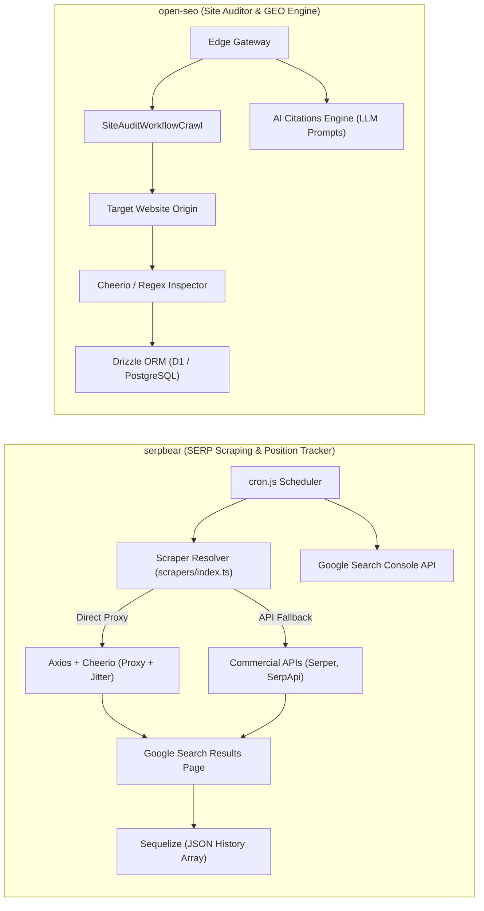
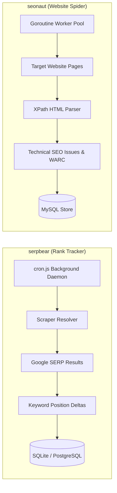

# serpbear — Comparative Analysis & Category Evaluation

> **Category**: SEO, Crawlers & Rank Tracking  
> **Architectural Role**: Proxy-rotated search engine rank tracker, multi-provider scraping gateway & GSC analytics suite  
> **Primary Stack**: TypeScript / Node.js LTS | Next.js (Pages Router) | Sequelize ORM | SQLite (`data/serpbear.db`) / PostgreSQL | Rotating Proxies & Commercial APIs  
> **Peer Solutions Compared**: `open-seo`, `seonaut`  
> **Commercial SaaS Benchmarks**: Ahrefs Rank Tracker, Semrush Position Tracking, AccuRanker, Nightwatch  

---

## 1. Executive Overview & Technical Identity: serpbear

**serpbear** represents the search results position intelligence and rank monitoring engine within the **SEO, Crawlers & Rank Tracking** domain. Developed in TypeScript and Next.js, `serpbear` is engineered as a self-hosted alternative to expensive SaaS rank trackers (Ahrefs, Semrush, AccuRanker) that charge restrictive per-keyword monthly fees. By running on self-hosted infrastructure, `serpbear` allows marketing teams and digital agencies to monitor unlimited domains and thousands of keywords without software subscription markups.

`serpbear`'s core architectural strength lies in its **swappable multi-provider scraping subsystem** (`scrapers/index.ts`). To overcome Google's aggressive anti-bot detection and CAPTCHA algorithms, SerpBear supports direct residential HTTP/SOCKS proxy rotation with randomized user agents and request jitter, as well as native drivers for 10+ commercial SERP APIs (Serper.dev, SerpApi, SearchApi, ScrapingAnt, ValueSerp). Ranking positions are saved to SQLite or PostgreSQL via Sequelize ORM, cross-referenced with verified Google Search Console (GSC) organic performance metrics, and broadcast via weekly email digests.

### Core Architectural Profile
- **Runtime & Language**: `TypeScript / Node.js LTS`
- **Core Framework**: `Next.js (Pages Router), React, Tailwind CSS`
- **Persistence Layer**: `SQLite (data/serpbear.db) / PostgreSQL (via Sequelize ORM)`
- **Concurrency & Queue Model**: `Node.js background cron daemon (cron.js) + asynchronous scraper resolver`
- **Domain Specialization**: Proxy-rotated Google SERP rank tracking, mobile/desktop geo-monitoring & Google Search Console synchronization

---

## 2. Peer Solution Landscape (SEO, Crawlers & Rank Tracking)

Within this category, `serpbear` operates alongside the following peer solutions:

| Solution | Language & Runtime | Core Framework | Database / Cache | Queue / Concurrency | Primary Architectural Niche |
| :--- | :--- | :--- | :--- | :--- | :--- |
| **serpbear** (Current) | `TypeScript / Node.js` | `Next.js, Sequelize` | `SQLite / PostgreSQL` | `Node.js Cron Daemon` | **Proxy-rotated Google SERP rank tracking & GSC sync** |
| **open-seo** | `TypeScript / Cloudflare` | `TanStack Router, Hono` | `Cloudflare D1 / PostgreSQL` | `Cloudflare Workflows` | Serverless durable edge audit & GEO AI citation engine |
| **seonaut** | `Go 1.25` | `Go Native / XPath` | `MySQL 8.x / MariaDB` | `Goroutine Worker Pool` | Ultra-fast concurrent raw HTML spidering & WARC archiving |

---

## 3. Deep Head-to-Head Comparative Breakdown: serpbear vs Peers

### 3.1. serpbear vs. open-seo

**Comparative Focus**: `Proxy-Rotated Google SERP Rank Tracker` vs. `Serverless Durable Edge Workflows & GEO Engine`

#### Detailed Architectural Contrast
- **Functional Mission**: `serpbear` is dedicated entirely to tracking keyword position ranks on Google search results pages across geographic locations (countries/cities) and device types (mobile vs desktop). `open-seo` audits internal website architectures, diagnosing technical on-page errors, and benchmarks brand visibility across generative AI answer engines (ChatGPT, Claude, Perplexity).
- **Network Ingress & Anti-Bot Strategy**: `serpbear` must continuously combat search engine bot defenses. It uses residential proxy rotation with custom request headers and timing jitter, or delegates scraping to commercial proxy APIs. `open-seo` fetches public HTML pages directly using serverless Cloudflare Workers, observing `robots.txt` guidelines via an internal token-bucket rate limiter (`CrawlThrottle`).
- **Data Persistence & Histograms**: `serpbear` stores keywords within `Domain` records, maintaining historical rank positions as serialized JSON arrays in SQLite or PostgreSQL. `open-seo` persists normalized relational tables for audits, crawls, and categorized issue severity (`ERROR`, `WARNING`, `INFO`).
- **Failure Modes & Bottlenecks**:
  - `serpbear`: Subject to IP bans, CAPTCHA hurdles, and Google layout changes when using direct proxies; commercial APIs introduce external per-query API costs.
  - `open-seo`: Subject to edge subrequest quotas and LLM provider token limits.

#### Architectural Comparison Matrix: serpbear vs. open-seo

| Dimension | serpbear | open-seo | Architectural Implication |
| :--- | :--- | :--- | :--- |
| **Primary Specialty** | **Keyword Rank Tracking** | **Site Health Auditing & GEO** | SerpBear evaluates organic position outcomes; Open-SEO evaluates on-page factors and AI citations. |
| **Scraping Pipeline** | **Multi-Provider Proxy / API Hub** | **Direct Cloudflare Edge Fetch** | SerpBear requires proxy networks or commercial SERP APIs; Open-SEO uses direct edge requests. |
| **AI Answer Tracking** | **Traditional Search Engine Only** | **Generative Engine Optimization (GEO)** | Open-SEO tests brand citations in LLM answers; SerpBear monitors classical Google search rankings. |
| **Persistence Schema** | **Sequelize (JSON Rank Arrays)** | **Drizzle ORM (Relational Tables)** | SerpBear models time-series rank trends; Open-SEO models relational issue hierarchies. |
| **GSC Reconciliation**| **Native API Sync** | **Native API Sync** | Both platforms synchronize with Google Search Console to compare scraped data with verified clicks. |

---

### 3.2. serpbear vs. seonaut

**Comparative Focus**: `Google Keyword Rank Tracking & SERP Scraper` vs. `High-Speed Raw HTML Website Spider & WARC Archiver`

#### Detailed Architectural Contrast
- **Workload Topology**: `serpbear` executes low-volume, highly paced HTTP GET queries against search engines, extracting ranked URLs from Google result blocks (`div.g`). `seonaut` executes high-volume, concurrent HTTP GET queries against entire client websites, traversing internal link graphs at thousands of pages per minute.
- **Concurrency & Execution Mechanics**: `serpbear` operates on a single Node.js cron process, pacing requests with intentional latency (jitter) to prevent triggering anti-bot alarms. `seonaut` utilizes Go's goroutine pools and persistent TCP connection reuse to maximize network throughput and minimize CPU overhead.
- **Archiving & Compliance**: `serpbear` maintains time-series position records and alerts users when rankings drop. `seonaut` captures full raw HTML responses and serializes them into compressed ISO-standard WARC files for legal compliance and point-in-time diffing.
- **Failure Modes & Bottlenecks**:
  - `serpbear`: Google CAPTCHA blocks when proxies leak; proxy latency delays daily rank runs.
  - `seonaut`: Cannot execute JavaScript-rendered SPAs; risk of rate-limiting target origins if worker counts are too high.

#### Architectural Comparison Matrix: serpbear vs. seonaut

| Dimension | serpbear | seonaut | Architectural Implication |
| :--- | :--- | :--- | :--- |
| **Core Target** | **Search Engine Result Pages (SERP)** | **Client / Target Website Architecture** | Distinct operational targets: external search engine rankings vs. internal site architecture. |
| **Execution Pacing** | **Intentional Delay / Jitter** | **Maximum Concurrency** | SerpBear paces requests to evade bot detection; Seonaut saturates bandwidth to complete crawls rapidly. |
| **Network Layer** | **Residential Proxies & Commercial APIs** | **Direct Persistent HTTP Transport** | SerpBear routes through proxy pools; Seonaut opens direct TCP sockets with keep-alive. |
| **Data Output** | **Rank Position History & Deltas** | **Broken Links, Redirect Loops, WARC** | SerpBear outputs visibility trends; Seonaut outputs technical fix tickets and web archives. |

---

## 4. Capability & Feature Comparison Matrix

| Dimension / Capability | serpbear | open-seo | seonaut |
| :--- | :---: | :---: | :---: |
| **Google SERP Rank Tracking** | ✅ (Daily / Hourly) | ❌ | ❌ |
| **Whole-Site Domain Crawler** | ❌ | ✅ (Cloudflare Workflows) | ✅ (High-Speed Go) |
| **Proxy Rotation & CAPTCHA Bypass** | ✅ (10+ Providers) | ❌ | ❌ |
| **Google Search Console Integration** | ✅ (Native Sync) | ✅ (Native Sync) | ❌ |
| **Generative Engine Optimization (GEO)** | ❌ | ✅ (LLM Citations) | ❌ |
| **ISO-Standard WARC Archiving** | ❌ | ❌ | ✅ (`slyrz/warc`) |
| **Email Alerting on Rank Drops** | ✅ (Nodemailer) | ⚠️ Webhooks | ❌ |
| **Database Storage** | SQLite / PostgreSQL | D1 / PostgreSQL | MySQL / MariaDB |
| **Operational Memory Footprint** | **~150–250 MB RAM** | **Serverless Edge** | **~40–80 MB RAM** |

---

## 5. Commercial Benchmark Positioning & MarketingStudio Fit

- **Against Ahrefs & Semrush Rank Trackers**: `serpbear` eliminates exorbitant per-keyword pricing tiers. A business tracking 2,000 keywords saves \$200–\$500/month by hosting SerpBear with low-cost proxy credits.
- **Against AccuRanker**: `serpbear` provides direct on-premise data ownership, eliminating reliance on third-party cloud data stores for sensitive ranking intelligence.
- **MarketingStudio Synergy**: `serpbear` handles all daily keyword position tracking and GSC reconciliation, alerting marketing teams to SEO gains or algorithm penalties, while `seonaut` and `open-seo` provide the underlying technical crawl diagnostics to fix discovered ranking drops.
