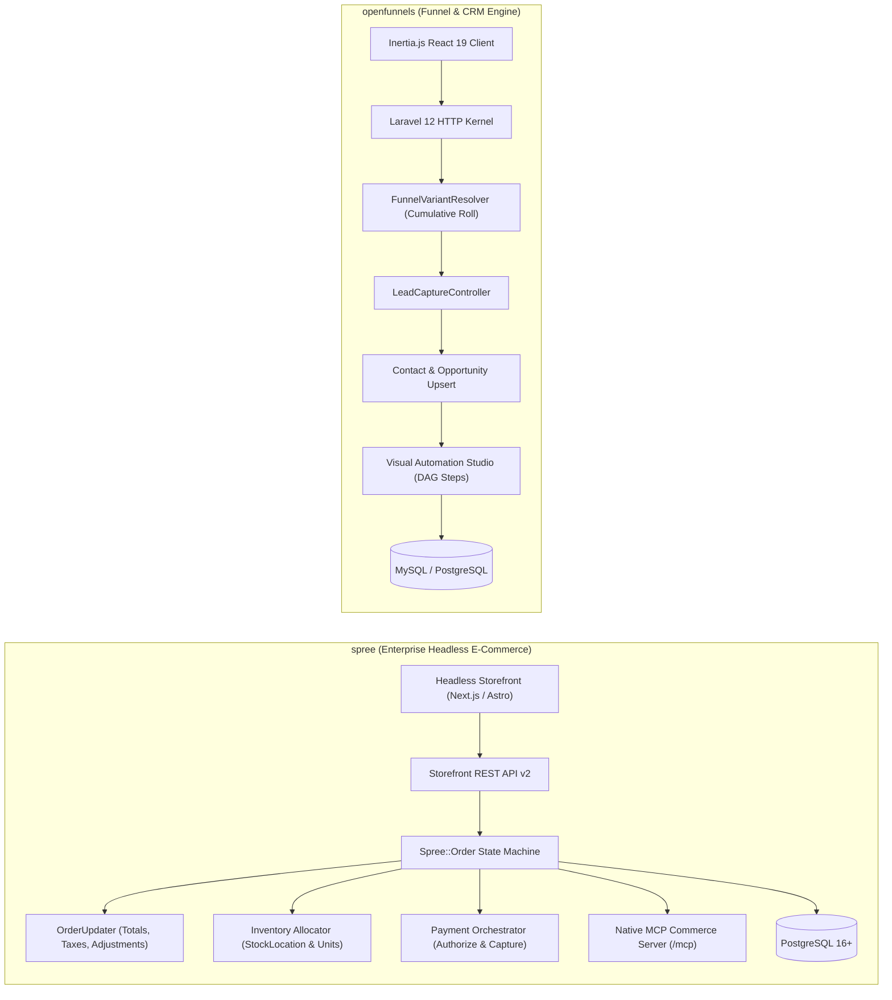
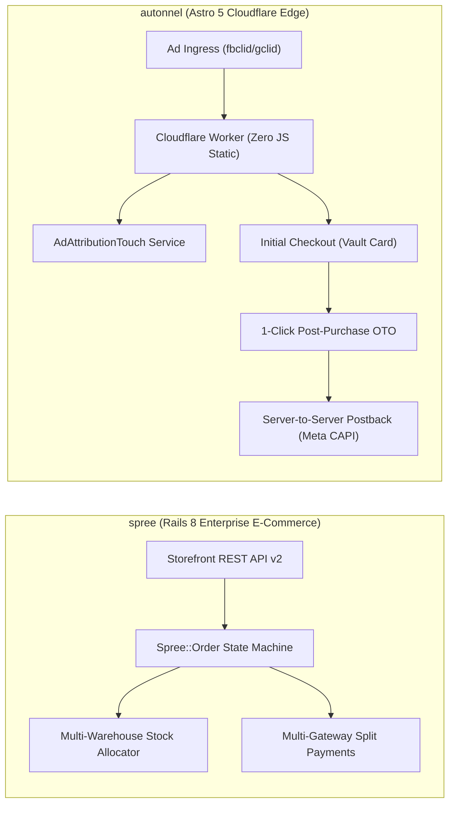

# spree — Comparative Analysis & Category Evaluation

> **Category**: Sales Funnels & Checkout Engines  
> **Architectural Role**: Enterprise headless e-commerce engine, deterministic multi-axis order state machine & native MCP commerce server  
> **Primary Stack**: Ruby 3.3+ / Rails 7.2/8.0 | PostgreSQL 16+ (ActiveRecord) | Redis 7+ & Sidekiq | TypeScript & React Admin | OpenTelemetry  
> **Peer Solutions Compared**: `openfunnels`, `autonnel`  
> **Commercial SaaS Benchmarks**: Shopify Plus, BigCommerce, Commerce Layer, Saleor  

---

## 1. Executive Overview & Technical Identity: spree

**Spree Commerce** is a production-grade, headless e-commerce platform and API-first monorepo engineered in **Ruby on Rails 7.2/8.0** alongside a modern **TypeScript / React** frontend ecosystem. Serving global enterprises, marketplace aggregators, and high-volume direct-to-consumer brands, Spree delivers a battle-tested e-commerce engine featuring a deterministic order state machine, multi-store and multi-currency architecture, granular multi-warehouse inventory allocation, composable promotion engines, and native Model Context Protocol (MCP) server endpoints for autonomous AI commerce agents.

Unlike lightweight funnel builders or marketing landing page tools, Spree guarantees complete transactional integrity across complex, high-concurrency commerce operations. Its core domain engine sequences orders through strict state boundaries, ensuring that payment authorizations, multi-warehouse shipments, tax calculations, and stock reservations never encounter invalid states or race conditions.

### Core Architectural Profile
- **Runtime & Language**: `Ruby 3.3+ (Puma application server cluster) + TypeScript`
- **Core Framework**: `Ruby on Rails 7.2/8.0 Core Engine, Storefront REST API v2, Platform API v2, React Admin`
- **Persistence Layer**: `PostgreSQL 16+ (ActiveRecord ORM) + Redis 7+ (caching, sessions, and Sidekiq)`
- **Concurrency & Queue Model**: `Deterministic Spree::Order state machine + Sidekiq asynchronous workers`
- **Domain Specialization**: Multi-store enterprise e-commerce, multi-warehouse stock allocation (`Spree::StockLocation`), composable promotion rules & native AI agent MCP integration

---

## 2. Peer Solution Landscape (Sales Funnels & Checkout Engines)

Within this category, `spree` operates alongside the following peer solutions:

| Solution | Language & Runtime | Core Framework | Database / Cache | Queue / Concurrency | Primary Architectural Niche |
| :--- | :--- | :--- | :--- | :--- | :--- |
| **spree** (Current) | `Ruby 3.3+ / Rails 8.0` | `Rails Core, Next/React` | `PostgreSQL 16+, Redis` | `Sidekiq / Redis` | **Deterministic `Spree::Order` state machine & native MCP server** |
| **openfunnels** | `PHP 8.3+ / Laravel 12` | `Inertia.js 2.0, React 19` | `MySQL / PostgreSQL` | `Laravel Queue Workers` | Unified funnel-to-CRM continuity & weighted A/B variant resolver |
| **autonnel** | `TypeScript / Edge` | `Astro 5, React` | `PostgreSQL (Hyperdrive)`| `Cloudflare Event Loop` | Edge 1-click post-purchase upsells (OTO) & server-side ad postbacks |

---

## 3. Deep Head-to-Head Comparative Breakdown: spree vs Peers

### 3.1. spree vs. openfunnels

**Comparative Focus**: `Deterministic Order State Machine & Multi-Store E-Commerce` vs. `Unified Funnel-to-CRM Monolith & Weighted A/B Testing`

#### Detailed Architectural Contrast
- **State Machine Rigor & Checkout Decoupling**: `spree` models orders through an auditable, multi-axis state machine. Unlike simple checkout steps, `Spree::Order` decouples the primary checkout status (`cart` -> `address` -> `delivery` -> `payment` -> `confirm` -> `complete`) from independent payment states (`balance_due`, `paid`, `void`) and shipment states (`backorder`, `ready`, `shipped`, `partial`). `openfunnels` treats checkouts as linear steps in a marketing funnel, capturing contact inputs and firing payment charges through Stripe.
- **Catalog & Inventory Architecture**: `spree` is engineered for complex retail operations: tracking physical inventory units down to individual SKU items across multiple geographic warehouses (`Spree::StockLocation`), managing backorders, calculating regional sales taxes (Avalara, TaxJar), and evaluating composable promotion rule trees. `openfunnels` focuses on flat digital products, subscriptions, and consultation services without multi-warehouse logistics.
- **CRM vs. Commerce Focus**: `openfunnels` includes a built-in sales CRM with visual deal pipelines, contact activity timelines, and DAG-based automated email workflows. `spree` focuses strictly on the transactional e-commerce engine, delegating CRM relationships to external platforms.
- **AI Agent Integration**: `spree` features a built-in Model Context Protocol (MCP) server (`/mcp`), exposing high-level tools that allow autonomous AI shopping agents to programmatically search catalogs, manage carts, apply discounts, and execute checkouts. `openfunnels` provides no native MCP interface.

#### Architectural Comparison Matrix: spree vs. openfunnels

| Dimension | spree | openfunnels | Architectural Implication |
| :--- | :--- | :--- | :--- |
| **Core Architecture** | **Headless E-Commerce Monorepo** | **Inertia.js Full-Stack Monolith** | Spree separates frontend storefronts from core commerce; OpenFunnels unifies everything. |
| **Order State Safety** | **Multi-Axis Deterministic State Machine**| **Linear Funnel Steps** | Spree prevents race conditions in multi-item orders, split shipments, and refund flows. |
| **Inventory & Warehouses** | **Multi-Warehouse (`StockLocation`)** | **None (Flat Products Only)** | Spree tracks physical inventory and automated warehouse routing out of the box. |
| **Sales CRM & Deals** | **Requires External CRM** | **Native Built-In CRM Pipelines** | OpenFunnels hydrates CRM deals and contacts directly from landing page forms. |
| **AI / Agent Readiness** | **Native Built-In MCP Server (`/mcp`)** | **None (Visual Marketer UI)** | Spree allows autonomous AI agents to interact with the commerce engine via MCP. |

---

### 3.2. spree vs. autonnel

**Comparative Focus**: `Enterprise Multi-Warehouse Commerce & State Integrity` vs. `Edge-Native 1-Click Upsells & Server-Side Ad Attribution`

#### Detailed Architectural Contrast
- **Deployment Topology & Latency**: `spree` is deployed on Ruby on Rails application servers backed by PostgreSQL and Sidekiq Redis workers, prioritizing deep relational integrity and complex domain logic. `autonnel` compiles landing pages and checkouts to static HTML islands using Astro 5, executing on Cloudflare Workers edge nodes with sub-50ms TTFB for direct-response paid advertising traffic.
- **Post-Purchase Upsell Mechanics**: `autonnel` specializes in 1-Click Post-Purchase Upsells (OTO). When an initial order is completed, the payment method is vaulted (Stripe SetupIntents), allowing customers to add complementary products with a single click without re-entering card numbers. `spree` supports standard multi-step checkouts and order adjustments, requiring custom extensions to execute 1-click post-purchase vaults.
- **Advertising Attribution Durability**: `autonnel` includes a native server-side conversion postback engine (`JobOutbox`) that preserves ad click identifiers (`fbclid`, `gclid`, `ttclid`) across checkout redirects, firing server-to-server conversion events to Meta CAPI, TikTok Events API, and Google Ads. `spree` stores UTMs as metadata attributes, relying on external customer data platforms for server-side attribution.
- **Both Include Native MCP Servers**: Both Spree and Autonnel feature Model Context Protocol (MCP) servers. Spree's MCP server empowers AI shopping agents to execute purchases programmatically, while Autonnel's MCP server allows coding agents to generate and optimize sales funnels from natural-language prompts.

#### Architectural Comparison Matrix: spree vs. autonnel

| Dimension | spree | autonnel | Architectural Implication |
| :--- | :--- | :--- | :--- |
| **Catalog Sophistication** | **Enterprise Multi-SKU & Multi-Warehouse**| **Catalog Agnostic (Picocart / Shopify)** | Spree manages complex merchandise catalogs; Autonnel focuses on conversion paths. |
| **Post-Purchase Upsells** | **Standard Checkout Steps** | **Native 1-Click Post-Purchase OTO** | Autonnel maximizes Average Order Value (AOV) via zero-friction post-purchase charges. |
| **Server-Side Ad Tracking** | **Order Metadata / External CDP** | **Native Outbox Postbacks (Meta CAPI)** | Autonnel recovers 15–30% of ad conversions lost to browser ad blockers. |
| **Deployment Plane** | **Puma / Docker Server Infrastructure**| **Cloudflare Workers Global Edge** | Autonnel achieves lower TTFB on cold ad traffic; Spree supports deeper backend transactions. |
| **Model Context Protocol**| **Native MCP Commerce Server (`/mcp`)** | **Native MCP Funnel Server (`src/skills`)**| Both support AI agents: Spree for automated purchasing; Autonnel for automated funnel creation. |

---

## 4. Capability & Feature Comparison Matrix

| Dimension / Capability | spree | openfunnels | autonnel |
| :--- | :---: | :---: | :---: |
| **Deterministic Order State Machine** | ✅ Strict `Spree::Order` | ⚠️ Basic Steps | ⚠️ Checkout State |
| **Multi-Warehouse Inventory Tracking** | ✅ `StockLocation` | ❌ | ❌ |
| **Multi-Store & Multi-Currency** | ✅ Full Multi-Store | ⚠️ Domains only | ⚠️ Multi-tenant |
| **Native Model Context Protocol (MCP)** | ✅ Built-in (`/mcp`) | ❌ | ✅ Built-in (`src/skills`) |
| **1-Click Post-Purchase Upsells (OTO)** | ⚠️ Custom Gateway | ⚠️ Stripe API | ✅ Native Core Feature |
| **Server-Side Ad Postbacks (Meta CAPI)** | ⚠️ Via Webhooks | ❌ | ✅ Native Outbox CAPI |
| **Weighted A/B Split Testing** | ❌ | ✅ Native Cumulative | ⚠️ Basic Variants |
| **Unified CRM & Deal Pipelines** | ❌ | ✅ Full CRM | ⚠️ Orders only |
| **Runtime & Language** | Ruby 3.3+ / Rails 8 | PHP 8.3+ / Laravel 12 | TypeScript / Astro 5 |
| **License** | **BSD 3-Clause** | **MIT** | **Apache-2.0** |

---

## 5. Commercial Benchmark Positioning & MarketingStudio Fit

- **Against Shopify Plus**: `spree` provides complete code and data sovereignty, eliminates mandatory revenue share transaction fees, and allows deep custom state-machine customization.
- **Against BigCommerce**: `spree` delivers a fully open-source, extensible Rails 8 foundation with native MCP agent tooling that proprietary SaaS platforms cannot match.
- **MarketingStudio Synergy**: `spree` functions as the transactional e-commerce engine for physical product catalogs, multi-warehouse fulfillment, and automated AI shopping agents within the broader MarketingStudio ecosystem.
