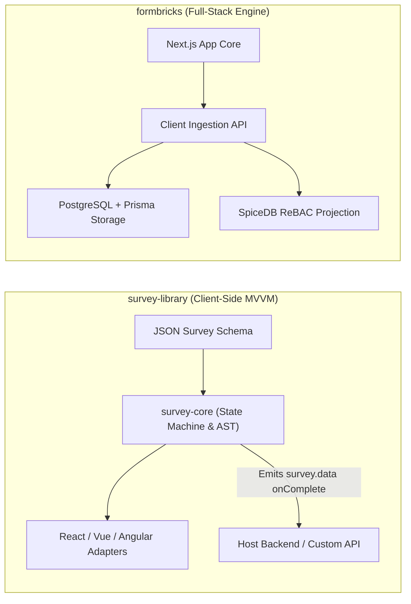
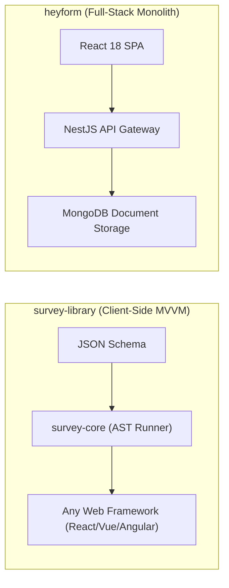
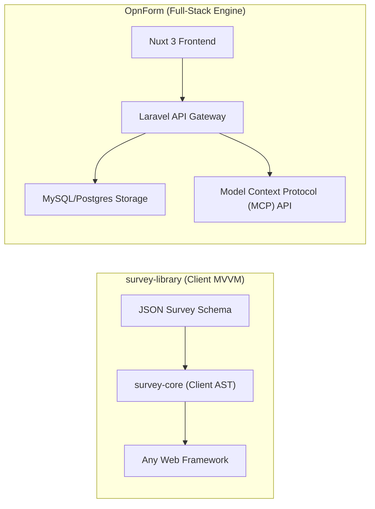
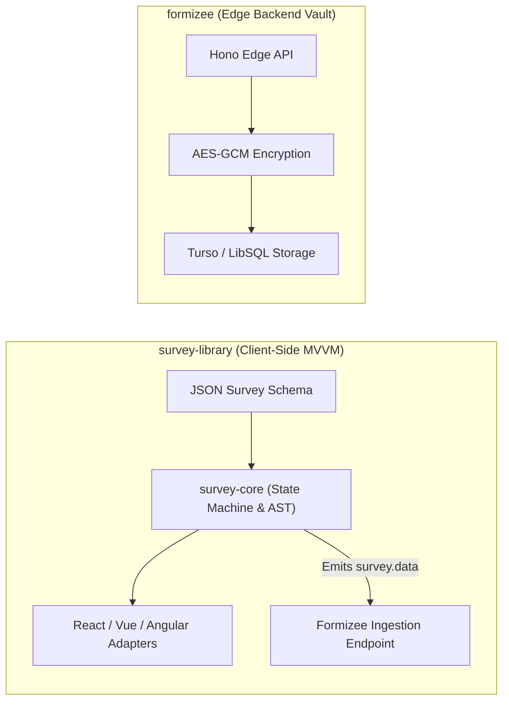
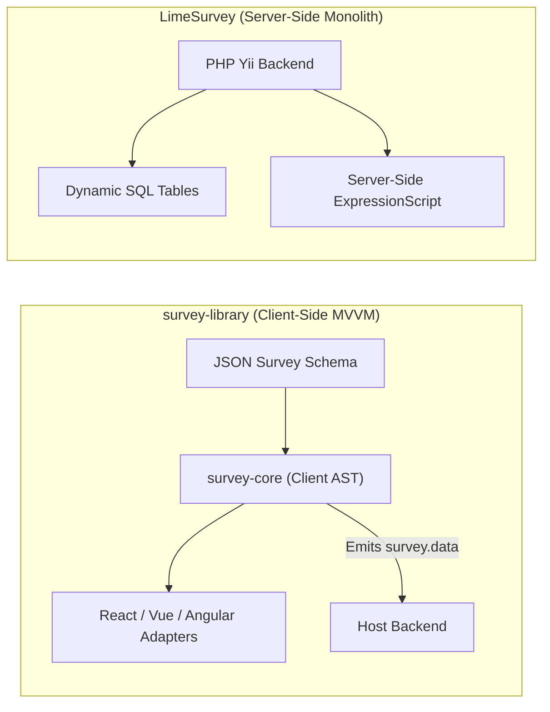
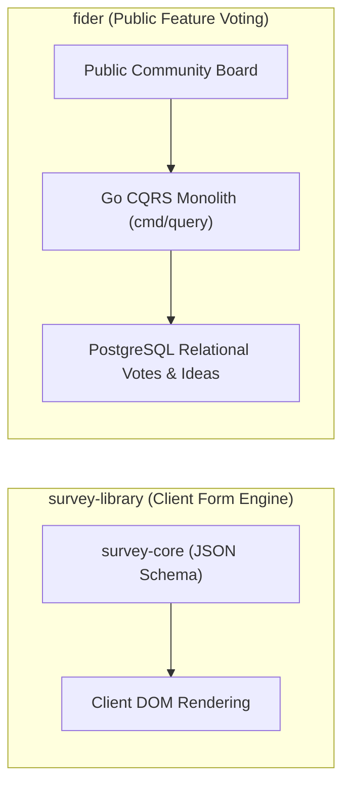
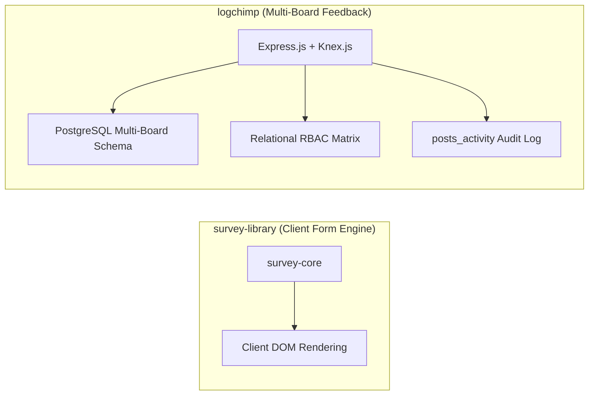
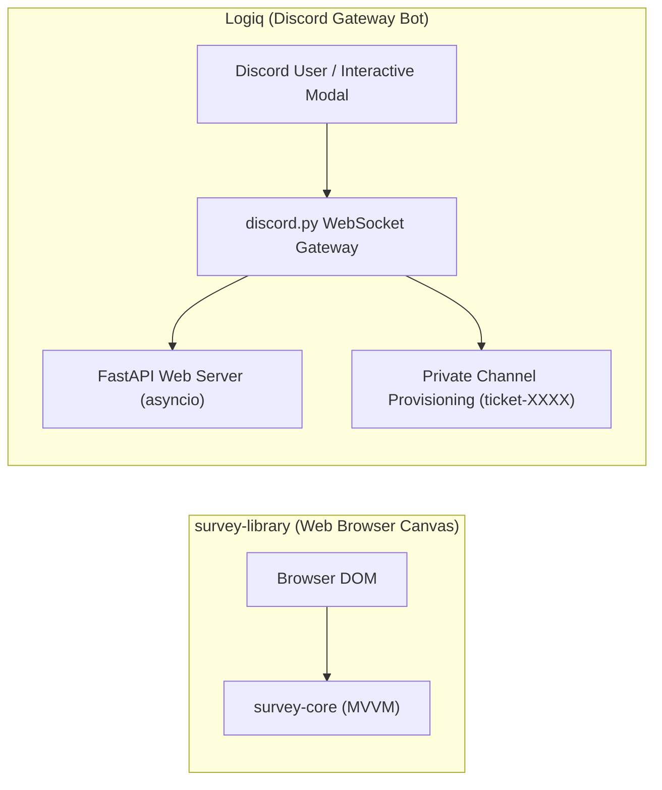
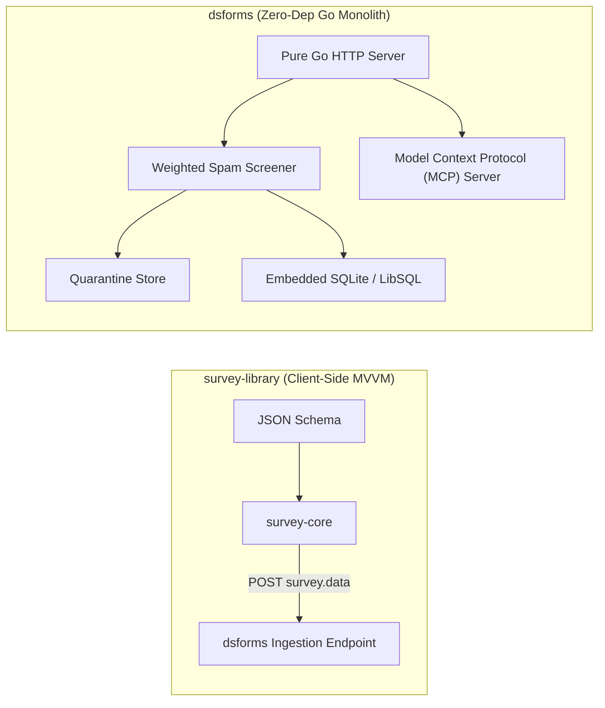

# survey-library — Comparative Analysis & Category Evaluation

> **Category**: Forms, Surveys & Feedback  
> **Architectural Role**: Framework-agnostic reactive survey engine, JSON schema compiler & client-side MVVM suite  
> **Primary Stack**: TypeScript 5.3+ | Framework-Agnostic MVVM Core (`survey-core`) | React, Vue 3, Angular, Knockout Adapters | Pure Client-Side (BYO Backend)  
> **Peer Solutions Compared**: `formbricks`, `heyform`, `OpnForm`, `formizee`, `LimeSurvey`, `fider`, `logchimp`, `Logiq`, `dsforms`  
> **Commercial SaaS Benchmarks**: Typeform, Qualtrics, Formstack, Google Forms  

---

## 1. Executive Overview & Technical Identity: survey-library (SurveyJS)

**SurveyJS (`survey-library`)** is the industry-standard, framework-agnostic form and survey rendering engine. Deployed across thousands of commercial SaaS platforms, healthcare systems, and enterprise internal tools, SurveyJS provides an unconstrained, self-hosted, headless alternative to Typeform, Qualtrics, and Google Forms. It decouples survey definitions from any specific backend, framework, or cloud vendor through a comprehensive, standardized **JSON Survey Schema**.

### Core Architectural Profile
- **Runtime & Language**: `TypeScript 5.3+` running 100% in browser memory.
- **Architectural Pattern**: **Model-View-ViewModel (MVVM)** architecture. The reactive foundation (`@surveyjs/survey-core`) manages all business invariants, calculations, and validation rules, completely decoupled from DOM operations.
- **UI Framework Portability**: Native presentation adapters bind the core model to framework-native virtual DOM trees:
  - `survey-react-ui`: React 18/19 components.
  - `survey-vue3-ui`: Vue 3 Composition API.
  - `survey-angular-ui`: Angular 16+ components and directives.
  - `survey-js-ui`: Vanilla Web Components and Knockout.
- **Logic & AST Expression Runner**: Built-in expression tokenizer and Abstract Syntax Tree (AST) evaluator (`ExpressionRunner`) supporting ternary operators, conditional visibility (`visibleIf`), enable rules (`enableIf`), and custom math functions (`FunctionsFactory`).
- **Complex Hierarchies & Dynamic Arrays**: Natively supports nested collapsible `Panels`, repeatable dynamic matrix grids (`matrixdynamic`), and dynamic panel iterators (`paneldynamic`).
- **Real-Time Cascading REST Endpoints**: Dynamically loads select choices, autocomplete tags, and cascading geographical lists via declarative asynchronous REST configurations (`choicesRestful`).
- **Accessibility & Compliance**: Certified for WCAG 2.1 AA, Section 508, high-contrast themes, ARIA live-regions, and keyboard navigation.

---

## 2. Peer Solution Landscape (Forms, Surveys & Feedback)

Within this category, `survey-library` operates alongside the following peer solutions:

| Solution | Language & Runtime | Core Framework | Database / Cache | Queue / Concurrency | Primary Architectural Niche |
| :--- | :--- | :--- | :--- | :--- | :--- |
| **survey-library** (Current) | `TypeScript 5.3+` | `Framework-Agnostic MVVM` | `Pure Client-Side (BYO)`| `Synchronous / Web Workers`| Declarative JSON survey engine with AST expression evaluator |
| **formbricks** | `TypeScript / Node` | `Next.js Monorepo` | `PostgreSQL, Prisma` | `BullMQ / Redis` | In-app micro-surveys, ReBAC access, telemetry |
| **heyform** | `TypeScript / Node` | `NestJS 10+, React 18` | `MongoDB, Redis` | `Bull Queue / Redis` | Conversational multi-step forms with polymorphic document answers |
| **OpnForm** | `PHP 8.2+ / TypeScript` | `Laravel 11, Nuxt 3` | `MySQL / PostgreSQL` | `Laravel Horizon / Redis` | No-code dynamic forms with versioned revisions & MCP agent drafts |
| **formizee** | `TypeScript / Edge` | `Hono, Turborepo` | `LibSQL / Turso, Drizzle` | `Cloudflare KV / Async` | Zero-knowledge AES-256-GCM encrypted headless form vault |
| **LimeSurvey** | `PHP 8.1+` | `Yii Framework` | `MySQL / PostgreSQL` | `PHP CLI Workers` | Enterprise statistical surveys with dynamic runtime SQL tables |
| **fider** | `Go 1.22+` | `Go HTTP Monolith` | `PostgreSQL 14+` | `Goroutines, Channels` | Compiled CQRS public feature voting portal with sub-20ms latency |
| **logchimp** | `TypeScript / Node` | `Express.js, Vue 3` | `PostgreSQL, Knex.js` | `BullMQ / Redis` | Multi-board customer feedback roadmap with RBAC and audit trail |
| **Logiq** | `Python 3.10+` | `FastAPI, discord.py` | `SQLite / PostgreSQL` | `asyncio Event Loop` | Discord-native community ticketing bot & FastAPI REST management |
| **dsforms** | `Go 1.22+` | `Pure Go HTTP` | `SQLite / LibSQL (pure Go)`| `Go Worker Channels` | Zero-dependency headless form backend with forensic spam quarantine |

---

## 3. Deep Head-to-Head Comparative Breakdown: survey-library vs Peers

### 3.1. survey-library vs. formbricks

**Comparative Focus**: `Framework-agnostic client-side MVVM JSON engine` vs. `Full-stack in-app micro-survey suite & ReBAC`

#### Architectural Differences:
- **Architectural Boundary**: SurveyJS (`survey-library`) is a pure client-side library. It has zero backend opinions: it accepts a standardized JSON survey schema, handles user interaction and validation inside the browser, and emits a structured `survey.data` object on completion for the host app to store. Formbricks is an end-to-end full-stack SaaS platform providing an admin UI, survey builder, API gateway, telemetry collectors, and PostgreSQL storage.
- **Framework Portability**: Formbricks' survey UI is tightly integrated with React and Next.js. SurveyJS implements a framework-agnostic core (`packages/survey-core`) that binds via two-way reactive observables to native adapters: `survey-react-ui`, `survey-vue3-ui`, `survey-angular-ui`, and plain JavaScript.
- **Expression Evaluation**: SurveyJS includes an embedded tokenizing expression parser (`ExpressionRunner`) supporting complex ternary expressions, dynamic matrix grids (`matrixdynamic`), dynamic panel iterators (`paneldynamic`), and declarative cascading REST lookups (`choicesRestful`).

#### Architectural Comparison Matrix:

| Dimension | survey-library (SurveyJS) | formbricks |
| :--- | :--- | :--- |
| **System Boundary** | Pure client-side component library (Bring Your Own Backend) | Full-stack platform (DB, Backend, Jobs, Dashboard, SDK) |
| **Framework Support** | Framework-agnostic: React, Vue 3, Angular, Knockout, Web Components | React / Next.js / Iframe embed |
| **Complex Form Types** | Dynamic matrix grids, panel iterators, cascading REST lookups | Multi-step cards, NPS ratings, single/multi-choice |
| **Backend Coupling** | Completely decoupled; emits raw JSON to any backend | Locked to PostgreSQL, Prisma, Redis, Next.js |
| **Operational Overhead** | Zero server infrastructure; runs 100% in browser memory | Requires managing Node.js servers, Redis, and PostgreSQL |

---

### 3.2. survey-library vs. heyform

**Comparative Focus**: `Framework-agnostic JSON engine` vs. `Conversational React/NestJS form builder`

#### Architectural Differences:
- **System Scope**: HeyForm is an end-to-end full-stack SaaS platform comprising a visual form builder, GraphQL backend, database storage, and Redis queues. SurveyJS is a pure client-side library. It has zero backend dependencies, parsing a declarative JSON schema and emitting `survey.data` upon completion for any arbitrary backend to store.
- **UI Framework Independence**: HeyForm's frontend is strictly coupled to React 18 and Vite. SurveyJS implements a framework-agnostic MVVM core (`@surveyjs/survey-core`) with native rendering adapters for React, Vue 3, Angular, and Vanilla Web Components.
- **Form Complexity**: SurveyJS natively supports nested panels, dynamic matrix grids (`matrixdynamic`), panel iterators, and cascading asynchronous REST lookups (`choicesRestful`). HeyForm focuses on linear conversational question sequences.

#### Architectural Comparison Matrix:

| Dimension | survey-library (SurveyJS) | heyform |
| :--- | :--- | :--- |
| **Architecture Boundary** | Pure client-side component engine (BYO Backend) | Full-stack platform (API, DB, UI, Queues) |
| **UI Framework Binding** | Framework-agnostic: React, Vue 3, Angular, Knockout | React 18 only |
| **Complex Form Hierarchies** | Dynamic matrices, panel iterators, cascading REST lookups | Linear conversational steps |
| **Server Requirements** | Zero server infrastructure; 100% browser runtime | Node.js, MongoDB, Redis |
| **License** | MIT (Core Engine) | AGPLv3 / Commercial |

---

### 3.3. survey-library vs. OpnForm

**Comparative Focus**: `Client-side JSON engine` vs. `Laravel/Nuxt no-code form builder with MCP drafts`

#### Architectural Differences:
- **System Boundary**: SurveyJS is an embeddable component engine. OpnForm is a complete full-stack web application with a visual drag-and-drop form builder, Laravel backend, database storage, email notifications, and integrations.
- **UI Framework Support**: SurveyJS provides a framework-agnostic MVVM core with native rendering adapters for React, Vue 3, Angular, and Vanilla Web Components. OpnForm's frontend is strictly built with Vue 3 and Nuxt 3.
- **AI Agent Automation**: OpnForm provides native MCP tools and endpoints (`/api/agent-drafts/*`), allowing autonomous agents to draft and deploy complete forms programmatically. SurveyJS relies on external code to generate its declarative JSON schemas.

#### Architectural Comparison Matrix:

| Dimension | survey-library (SurveyJS) | OpnForm |
| :--- | :--- | :--- |
| **Architecture Boundary** | Pure client-side component engine (BYO Backend) | Full-stack platform (API, DB, UI, Horizon Queues) |
| **UI Framework Binding** | Framework-agnostic: React, Vue 3, Angular, Knockout | Vue 3 / Nuxt 3 |
| **Complex Form Hierarchies** | Dynamic matrices, panel iterators, cascading REST lookups | Standard input blocks and visual logic |
| **Server Requirements** | Zero server infrastructure; 100% browser runtime | PHP 8.2+, MySQL, Redis |
| **AI Agent Support** | None (pure JSON parser) | Native Model Context Protocol (MCP) draft endpoints |

---

### 3.4. survey-library vs. formizee

**Comparative Focus**: `Client UI state engine` vs. `Edge-native zero-knowledge encrypted headless form vault`

#### Architectural Differences:
- **Architectural Synergy**: SurveyJS is a pure frontend UI rendering library with zero backend capabilities. Formizee is a pure backend ingestion API with zero frontend UI. They form an ideal architectural pair: developers can render complex, multi-page questionnaires using SurveyJS and submit the resulting `survey.data` directly to a Formizee endpoint (`POST /v1/f/{slug}`) for zero-knowledge encrypted storage.
- **Data Validation & Logic**: SurveyJS executes deep AST expression evaluation (`ExpressionRunner`), cascading REST lookups (`choicesRestful`), and input validations inside the browser. Formizee focuses purely on edge ingestion, rate limiting, honeypot checking, and encryption.

#### Architectural Comparison Matrix:

| Dimension | survey-library (SurveyJS) | formizee |
| :--- | :--- | :--- |
| **Architectural Layer** | Client-side UI rendering & state engine | Backend ingestion API & encrypted vault |
| **Logic & Calculation** | Full in-memory AST evaluator & dynamic matrices | None (ingests submitted payloads) |
| **Encryption** | None (relies on host ingestion endpoint) | Zero-knowledge AES-256-GCM at edge |
| **Server Requirements** | Zero server infrastructure (100% browser runtime) | Cloudflare Workers / Node.js + LibSQL |
| **Integration Synergy** | Ideal client UI renderer for Formizee headless endpoints | Ideal backend vault for SurveyJS JSON submissions |

---

### 3.5. survey-library vs. LimeSurvey

**Comparative Focus**: `Framework-agnostic client-side MVVM JSON engine` vs. `Full-stack server-rendered research engine & dynamic SQL tables`

#### Architectural Differences:
- **System Scope**: SurveyJS (`survey-library`) is a pure client-side library. It has zero backend opinions: it accepts a standardized JSON survey schema, handles user interaction and validation inside browser memory, and emits `survey.data` on completion. LimeSurvey is a complete, self-contained research platform with server-rendered UI, database persistence, and admin consoles.
- **Logic Execution**: SurveyJS executes its `ExpressionRunner` AST entirely inside the browser's JavaScript runtime, supporting dynamic matrix grids (`matrixdynamic`), panel iterators, and cascading asynchronous REST lookups (`choicesRestful`). LimeSurvey evaluates ExpressionScript primarily on the server via PHP (with accompanying JavaScript validation).
- **Framework Support**: SurveyJS provides native bindings for React, Vue 3, Angular, and Vanilla Web Components. LimeSurvey's frontend relies on server-rendered Twig templates and jQuery/Vanilla JS.

#### Architectural Comparison Matrix:

| Dimension | survey-library (SurveyJS) | LimeSurvey |
| :--- | :--- | :--- |
| **Architecture Boundary** | Pure client-side component engine (BYO Backend) | Full-stack platform (API, DB, UI, Admin Console) |
| **UI Framework Binding** | Framework-agnostic: React, Vue 3, Angular, Knockout | Twig templating / jQuery / Vanilla JS |
| **Logic Execution** | In-browser `ExpressionRunner` AST engine | Server-side ExpressionScript evaluation |
| **Server Requirements** | Zero server infrastructure; 100% browser runtime | PHP 8.1+, MySQL/PostgreSQL, Web server |
| **Statistical Export** | Raw JSON (requires downstream transformation) | Native SPSS, R, Stata formats |

---

### 3.6. survey-library vs. fider

**Comparative Focus**: `Client-side survey library` vs. `Compiled Go CQRS public feature voting portal`

#### Architectural Differences:
- **Domain Purpose**: SurveyJS renders structured questionnaires for data collection. Fider is an open community suggestion portal where users publicly submit ideas, upvote proposals, and track official roadmap progress.
- **Architectural Layer**: SurveyJS is a client-side component library with zero server code. Fider is a compiled, single-binary Go 1.22+ application with PostgreSQL (~40MB RAM) running a Command Query Responsibility Segregation (CQRS) architecture.

#### Architectural Comparison Matrix:

| Dimension | survey-library (SurveyJS) | fider |
| :--- | :--- | :--- |
| **Core Interaction** | Private structured questionnaire rendering | Public collaborative idea suggestion and upvoting |
| **Architectural Layer** | Client-side frontend component library | Compiled Go 1.22+ backend monolith with React frontend |
| **Persistence** | None (Bring Your Own Backend) | Relational PostgreSQL with CQRS handlers |
| **Runtime Footprint** | 0 MB server RAM (runs in browser) | ~40 MB RAM (<20ms latency) |
| **Primary Use Case** | Complex multi-page forms and enterprise questionnaires | Public customer feedback portals and voting roadmaps |

---

### 3.7. survey-library vs. logchimp

**Comparative Focus**: `Client-side survey library` vs. `Multi-board feedback tracking with RBAC and changelogs`

#### Architectural Differences:
- **Domain Focus**: SurveyJS is an in-browser form renderer. Logchimp organizes public or private feature discovery across multiple categorized `Boards`, connecting submitted ideas to interactive roadmap columns and product changelogs.
- **Backend Requirements**: SurveyJS requires no backend server. Logchimp is a Node.js/Express application utilizing Knex.js, PostgreSQL, and Redis BullMQ workers.

#### Architectural Comparison Matrix:

| Dimension | survey-library (SurveyJS) | logchimp |
| :--- | :--- | :--- |
| **Primary Domain** | Client-side form and survey rendering | Multi-board feedback management and public roadmaps |
| **Backend Layer** | None (Bring Your Own Backend) | Express.js + Knex.js on PostgreSQL |
| **Audit Trails** | None | Immutable activity stream (`posts_activity`) |
| **Access Control** | Controlled by host application | Granular relational RBAC matrix |
| **Runtime Footprint** | 0 MB server RAM | ~120 MB RAM |

---

### 3.8. survey-library vs. Logiq

**Comparative Focus**: `Client-side web engine` vs. `Discord-native modal ticketing & channel triage`

#### Architectural Differences:
- **Target Surface**: SurveyJS executes inside standard web browsers via React, Vue 3, or Angular. Logiq executes inside Discord chat servers, interacting with users via persistent buttons and native modal dialogs (`discord.ui.Modal`).
- **Workflow Pipeline**: SurveyJS emits JSON data on form completion. Logiq provisions isolated private Discord text channels (`ticket-{username}`) with role-based permission overwrites.
- **Runtime Environment**: SurveyJS runs in client JavaScript. Logiq runs a single-process concurrent Python 3.10+ application, running a Discord gateway bot and a FastAPI server within an `asyncio` event loop.

#### Architectural Comparison Matrix:

| Dimension | survey-library (SurveyJS) | Logiq |
| :--- | :--- | :--- |
| **Platform Ingress** | Web browsers (React/Vue/Angular) | Discord client via native interaction modals |
| **Submission Output** | Structured JSON object (`survey.data`) | Isolated private support text channel in Discord |
| **Runtime & Language** | TypeScript / Browser JS | Python 3.10+ (discord.py + FastAPI via asyncio) |
| **Persistence** | Decoupled (host responsibility) | SQLite / PostgreSQL / MongoDB |
| **Best Architectural Fit** | Enterprise web applications and intake portals | Community customer support within Discord |

---

### 3.9. survey-library vs. dsforms

**Comparative Focus**: `Client-side UI engine` vs. `Zero-dependency pure Go headless backend with quarantine scoring`

#### Architectural Differences:
- **Architectural Complementarity**: SurveyJS is a pure frontend UI rendering library with zero backend capabilities. dsforms is a pure backend ingestion API with zero frontend UI. They are complementary: developers can render complex, multi-page questionnaires using SurveyJS and submit the resulting `survey.data` directly to a dsforms endpoint (`POST /f/{id}`) for forensic spam screening and embedded SQLite persistence.
- **Spam Mitigation**: SurveyJS handles input validation on the client. dsforms implements an auditable **Quarantine Architecture**: `internal/screen` evaluates weighted honeypot traps (`_gotcha`, `hp_field`), timing heuristics, and domain analysis, holding suspicious leads in an isolated quarantine queue (`is_held: 1`).
- **Autonomous AI Agent Readiness**: dsforms embeds a native Model Context Protocol (MCP) server for autonomous agent operations and an integrated viral waitlist engine with referral queue-jumping. SurveyJS has no server components.

#### Architectural Comparison Matrix:

| Dimension | survey-library (SurveyJS) | dsforms |
| :--- | :--- | :--- |
| **Architectural Layer** | Client-side UI rendering & state engine | Headless backend ingestion & quarantine engine |
| **Runtime Environment** | Web browser memory (0 MB server RAM) | Single compiled Go binary (~25 MB RAM) |
| **Spam Defense Strategy** | Client-side input validation regexes | Weighted heuristic scoring with auditable quarantine holding queue |
| **AI Agent Interface** | None | Native embedded Model Context Protocol (MCP) server with PII redaction |
| **Integration Synergy** | Ideal client UI renderer for dsforms backend endpoints | Ideal lightweight backend store for SurveyJS JSON submissions |

---

## 4. Capability & Feature Comparison Matrix

| Dimension / Capability | survey-library | formbricks | heyform | OpnForm | formizee | LimeSurvey | fider | logchimp | Logiq | dsforms |
| :--- | :---: | :---: | :---: | :---: | :---: | :---: | :---: | :---: | :---: | :---: |
| **Framework-Agnostic MVVM** | ✅ Core Engine| ❌ | ❌ | ❌ | ❌ | ❌ | ❌ | ❌ | ❌ | ❌ |
| **Dynamic Matrix Grids** | ✅ Native | ⚠️ Basic | ⚠️ Basic | ⚠️ Basic | ✅ Supported | ❌ | ❌ | ❌ | ❌ | ❌ |
| **Cascading REST Choice Lookups**| ✅ Native | ❌ | ❌ | ❌ | ❌ | ⚠️ Complex | ❌ | ❌ | ❌ | ❌ |
| **Conversational Typeform UI**| ✅ Supported | ⚠️ Compact modal | ✅ Full Screen | ✅ Full Screen | ❌ (Headless) | ❌ | ❌ | ❌ | ❌ | ❌ |
| **Targeted In-App Popups** | ⚠️ UI Embed | ✅ Native SDK | ⚠️ Iframe | ⚠️ Iframe | ❌ | ❌ | ❌ | ❌ | ❌ | ❌ |
| **Headless Form API Endpoint** | ❌ (Client Only)| ⚠️ API Routes | ❌ | ❌ | ✅ Edge Native | ❌ | ❌ | ❌ | ❌ | ✅ Single Binary |
| **Public Feature Voting** | ❌ | ❌ | ❌ | ❌ | ❌ | ❌ | ✅ Pure CQRS | ✅ Multi-Board | ❌ | ❌ |
| **Changelog & Public Roadmap** | ❌ | ❌ | ❌ | ❌ | ❌ | ❌ | ⚠️ Basic | ✅ Integrated | ❌ | ❌ |
| **Discord Chat Ticket Modals** | ❌ | ❌ | ❌ | ❌ | ❌ | ❌ | ❌ | ❌ | ✅ Native UI | ❌ |
| **Viral Waitlist & Referrals** | ❌ | ❌ | ❌ | ❌ | ❌ | ❌ | ❌ | ❌ | ❌ | ✅ Integrated |
| **AI Agent MCP Integration** | ❌ | ⚠️ REST API | ❌ | ✅ Agent Drafts| ⚠️ API Keys | ❌ | ❌ | ❌ | ⚠️ LLM Cog | ✅ Native MCP |
| **Zero-Knowledge Encryption** | ❌ | ❌ | ❌ | ❌ | ✅ AES-256-GCM | ❌ | ❌ | ❌ | ❌ | ❌ |
| **Runtime Memory Footprint** | **0 MB (Client)** | ~250 MB | ~300 MB | ~150 MB | **~35 MB (Edge)** | ~180 MB | **~40 MB** | ~120 MB | ~90 MB | **~25 MB** |

---

## 5. Commercial Benchmark Positioning

When benchmarked against commercial SaaS leaders (**Typeform, Qualtrics, Formstack, Google Forms**):
- **Zero Vendor Lock-In & Portability**: Standardized JSON Survey Schemas allow organizations to author once and render across React, Vue, Angular, or mobile webviews without backend coupling.
- **Enterprise Complexity Without Monoliths**: Supports complex matrix grids, cascading asynchronous REST choice loading, dynamic panel iterators, and custom mathematical functions directly within browser memory.
- **Accessibility & Compliance**: Fully meets WCAG 2.1 AA and Section 508 standards out of the box, ensuring compliance in enterprise and government deployments.

---

## 6. Strategic Takeaways & Role for MarketingStudio

In the unified **MarketingStudio** architecture:
1. **Primary Component to Adopt**: Deploy `survey-library` (`@surveyjs/survey-core`) inside MarketingStudio's frontend design system to render complex, multi-page customer surveys, dynamic evaluation matrices, and onboarding flows across React and Vue components.
2. **Interoperability Seam**: Configure SurveyJS `onComplete` handlers to emit standardized `survey.data` directly into MarketingStudio's headless ingestion endpoints (`formizee` / `dsforms`).
3. **Complementary Ecosystem Delegation**: Where SurveyJS handles client-side form rendering, delegate in-app micro-survey targeting to `formbricks`, conversational landing pages to `heyform` / `OpnForm`, and community feature roadmaps to `fider` / `logchimp`.
