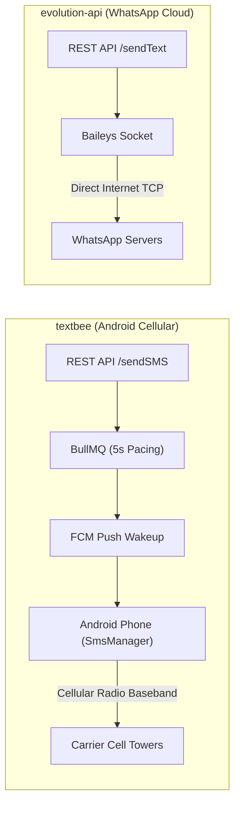
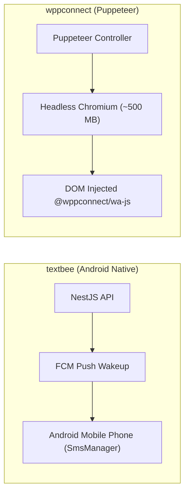
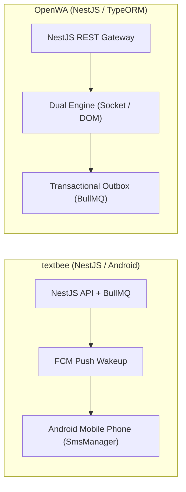
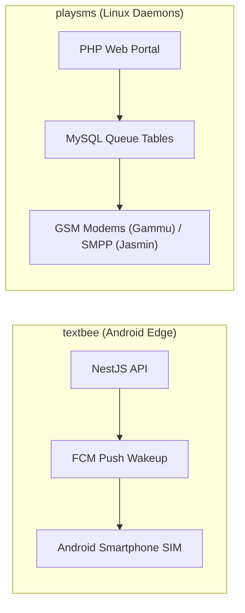
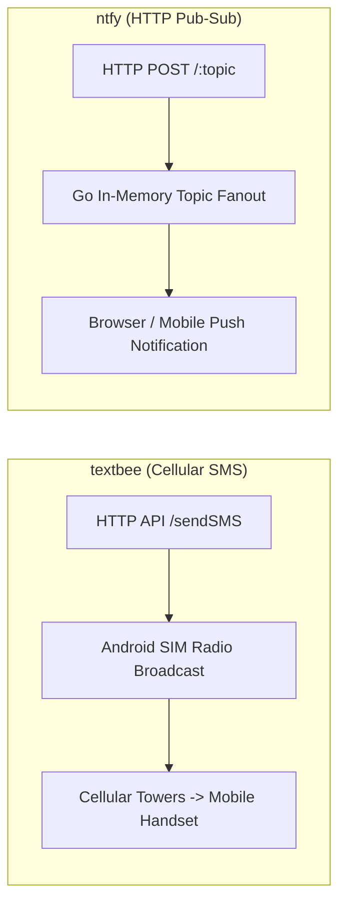

# textbee — Comparative Analysis & Category Evaluation

> **Category**: WhatsApp & Messaging Gateways  
> **Architectural Role**: Decentralized Android-powered SMS gateway & SIM dispatch fabric  
> **Primary Stack**: TypeScript 5.4+, Kotlin | NestJS 11+, Android Jetpack, Mongoose | MongoDB 7+, Redis 7+ | BullMQ + Firebase Cloud Messaging (FCM)  
> **Peer Solutions Compared**: `evolution-api`, `wppconnect`, `OpenWA`, `playsms`, `ntfy`  
> **Commercial SaaS Benchmarks**: Twilio SMS, Vonage SMS, Sinch, SimpleTexting, TextMagic  

---

## 1. Executive Overview & Technical Identity: textbee

**textbee** represents the decentralized carrier-cost disruption standard within the **WhatsApp & Messaging Gateways** domain, distinguished by its core focus on **Converting physical Android smartphones into high-availability cellular SMS gateways, dual-SIM carrier routing, hardware dispatch pacing (5s delay), and high-priority FCM wakeup push notifications**.

### Core Architectural Profile
- **Runtime & Language**: `TypeScript 5.4+` (Cloud API), `Kotlin` (Android App targeting API 26–35)
- **Core Framework**: `NestJS 11+`, `Mongoose 9.0+`, `Android Jetpack WorkManager & TelephonyManager`
- **Persistence Layer**: `MongoDB 7+` (Devices, SMS, batches, tombstones), `Redis 7+` (`ioredis`)
- **Concurrency & Queue Model**: `Bull` (v4.16+) queue with hardware pacing limiter + `firebase-admin` (FCM)
- **Domain Specialization**: `Decentralized Android SMS gateway, zero-cost SIM card dispatching & 2-way SMS webhooks`

---

## 2. Peer Solution Landscape (WhatsApp & Messaging Gateways)

Within this category, `textbee` operates alongside the following peer solutions:

| Solution | Language & Runtime | Core Framework | Database / Cache | Queue / Concurrency | Primary Architectural Niche |
| :--- | :--- | :--- | :--- | :--- | :--- |
| **textbee** (Current) | `TypeScript & Kotlin` | `NestJS 11+, Android SDK` | `MongoDB 7+, Redis` | `BullMQ Pacing Engine` | **Decentralized carrier SMS using physical Android handsets** |
| **evolution-api** | `TypeScript / Node 20+`| `Express, Baileys, Prisma` | `PostgreSQL / MySQL, Redis`| `RabbitMQ / Kafka / SQS` | Direct binary socket WhatsApp with minimal RAM & DB auth |
| **wppconnect** | `TypeScript / Node 20+`| `Express, Puppeteer` | `Local Disk / SQLite` | `Node Event Emitters` | Complete browser-level WhatsApp Web emulation via Chromium DOM |
| **OpenWA** | `TypeScript / Node 22+`| `NestJS 11+, TypeORM` | `PostgreSQL, Redis` | `BullMQ Transactional Outbox`| Pluggable dual-engine (Baileys & WWebJS) with send idempotency |
| **playsms** | `PHP 8.1+` | `Native PHP, CLI Daemons` | `MySQL 8.0+` | `playsmsd Background Daemons`| Classical carrier-grade SMS portal with prefix rating & SMPP |
| **ntfy** | `Go 1.26+` | `Native Go net/http` | `SQLite / PostgreSQL` | `Go Channels / sync.Map` | Ultra-fast zero-dependency push notification daemon (<30MB) |

---

## 3. Deep Head-to-Head Comparative Breakdown: textbee vs Peers

### 3.1. textbee vs. evolution-api

**Comparative Focus**: `Zero-cost Android cellular SMS gateway` vs. `Direct binary socket WhatsApp with minimal RAM`

#### Architectural & Stack Differences
- **Physical Transport & Channel**: Textbee converts HTTP commands into physical radio transmissions over mobile cellular networks (GSM/LTE/5G) via Android handsets. Evolution API communicates over internet TCP WebSockets directly to Meta's WhatsApp multi-device infrastructure.
- **Hardware Pacing & Throughput**: Sending hundreds of SMS back-to-back through consumer SIM cards triggers telecom fraud algorithms. Textbee enforces an architectural pacing delay (`DEFAULT_SMS_SEND_DELAY_SECONDS = 5`) between successive SMS transmissions on the same device. Evolution API sends messages at line rate (20–50 msgs/second) over encrypted WebSockets.
- **Delivery Guarantees**: Textbee registers Android `PendingIntent` callbacks (`SentIntent` confirming tower handoff and `DeliveryIntent` confirming arrival on the recipient handset). Evolution API consumes WhatsApp delivery acknowledgments (`SERVER_ACK`, `DELIVERY_ACK`, `READ`).

#### Where textbee Excels over evolution-api
- **Universal Mobile Reach**: Reaches every mobile phone globally without requiring WhatsApp installation.
- **Zero Third-Party Aggregator Fees**: Replaces expensive Twilio SMS fees with unlimited local carrier SIM bundles.
- **Dual-SIM Slot Selection**: Dynamically routes outbound SMS through SIM 1 or SIM 2 based on destination network prefix.

#### Where evolution-api Holds an Advantage over textbee
- **Sub-Second Transmission Latency**: Messages dispatch in <200ms compared to Textbee's 3–8 second mobile radio turnaround.
- **Rich Media & Formatting**: Supports native Opus voice recordings, PDF documents, and interactive buttons.
- **No Physical Hardware**: Operates 100% in cloud containers without physical phones or SIM cards.

#### Architectural Tradeoffs Matrix

| Architectural Dimension | textbee | evolution-api |
| :--- | :--- | :--- |
| **Messaging Channel** | Cellular Carrier SMS (GSM / LTE) | WhatsApp Multi-Device |
| **Hardware Requirement** | Physical Android smartphone(s) with SIM cards | Zero (Cloud VPS / Docker container) |
| **Message Throughput** | 1 msg every 5 seconds per SIM (Carrier Pacing) | ~20 - 50 msgs/second per instance |
| **Delivery Latency** | ~3 - 8 seconds (FCM Push + Radio handoff) | < 200 ms |
| **Rich Media Capabilities** | Plaintext SMS (160 chars) / Basic MMS | Audio PTT, Video, Documents, Images, Polls |
| **Best-Fit Deployment** | 2FA verification codes, local SMS alerts, notifications| Rich customer engagement, chat support, D2C sales|

---

### 3.2. textbee vs. wppconnect

**Comparative Focus**: `Decentralized Android SMS gateway` vs. `Headless Chromium WhatsApp automation`

#### Architectural & Stack Differences
- **Execution Environment**: Textbee offloads message transmission to an edge hardware node (an Android smartphone running a Kotlin background service). WPPConnect runs headless Google Chromium inside the server container via Puppeteer Extra.
- **Resource Footprint**: Textbee’s NestJS backend consumes ~60 MB RAM, and the Kotlin companion app runs as an efficient foreground service (~30 MB RAM). WPPConnect consumes 400 MB to 750 MB RAM per active browser session.
- **Protocol Ban Mechanics**: Textbee avoids bans by pacing SMS dispatching across cellular SIMs. WPPConnect avoids bans by injecting into official WhatsApp Web client JavaScript bundles (`Store.*`).

#### Where textbee Excels over wppconnect
- **Zero Browser Overhead**: No heavy Chromium browser instances, canvas rendering, or Xvfb requirements.
- **Universal Carrier Reach**: Delivers to basic feature phones and landlines with SMS capability.
- **Cost Reduction**: Replaces \$0.01 - \$0.05/SMS Twilio costs with zero-cost carrier SIM plans.

#### Where wppconnect Holds an Advantage over textbee
- **Rich Media & Interactive UI**: Voice notes, PDF documents, location pins, and clickable buttons.
- **Sub-Second Delivery**: Delivers messages across WebSockets in under 1 second.
- **No Physical Devices to Maintain**: Zero risk of battery drain, Wi-Fi drops, or hardware failure.

#### Architectural Tradeoffs Matrix

| Architectural Dimension | textbee | wppconnect |
| :--- | :--- | :--- |
| **Messaging Channel** | Cellular Carrier SMS | WhatsApp Web |
| **Underlying Engine** | Android native `SmsManager` | Puppeteer Chromium DOM |
| **Hardware Requirement** | Low-spec VPS + Physical Android smartphone | High-spec cloud VPS (6-8 GB for 10 sessions) |
| **Message Delivery Latency** | ~3 - 8 seconds (FCM Push + Radio handoff) | ~800 ms - 2 seconds |
| **Rich Media Capabilities** | Plaintext SMS (160 chars) | Audio PTT, Video, Documents, Newsletters |
| **Best-Fit Deployment** | Transactional OTPs, lead SMS alerts, local outreach| Rich customer engagement, product catalogs |

---

### 3.3. textbee vs. OpenWA

**Comparative Focus**: `Decentralized Android SMS gateway` vs. `Multi-engine WhatsApp gateway`

#### Architectural & Stack Differences
- **Messaging Scope**: Textbee handles cellular SMS through consumer mobile devices. OpenWA handles WhatsApp through a pluggable dual-engine (Baileys and WWebJS).
- **Backend Framework**: Both solutions share a modern NestJS 11+ backend. Textbee uses `@nestjs/mongoose` with MongoDB to store device heartbeat records and SMS batch documents. OpenWA uses TypeORM with PostgreSQL to enforce relational outbox event tables.
- **Queueing Models**: Textbee uses BullMQ to pace outbound SMS transmissions (5s delay) to avoid cellular carrier fraud detection. OpenWA uses BullMQ to implement a transactional webhook outbox and batch bulk campaigns with randomized jitter.

#### Where textbee Excels over OpenWA
- **Universal Mobile Reach**: Sends standard cellular SMS to any mobile phone globally without requiring WhatsApp.
- **Zero Third-Party Aggregator Fees**: Replaces expensive Twilio SMS fees with zero-cost carrier SIM bundles.
- **Dual-SIM Slot Selection**: Dynamically routes outbound SMS through SIM 1 or SIM 2 based on destination network prefix.

#### Where OpenWA Holds an Advantage over OpenWA
- **Pluggable Dual-Engine Architecture**: Toggle between Baileys and Puppeteer per session without changing application code.
- **Transactional Webhook Outbox**: Guaranteed event delivery during downstream server downtime.
- **Rich Media & Interactive UI**: Voice notes, PDF documents, location pins, and clickable buttons.

#### Architectural Tradeoffs Matrix

| Architectural Dimension | textbee | OpenWA |
| :--- | :--- | :--- |
| **Messaging Channel** | Cellular Carrier SMS | WhatsApp Multi-Device |
| **Hardware Requirement** | Physical Android smartphone(s) with SIM cards | Zero (Cloud VPS / Docker container) |
| **Engine Architecture** | Android native `SmsManager` via FCM Push | Pluggable Dual-Engine (Baileys / WebJS) |
| **Delivery Latency** | ~3 - 8 seconds (FCM Push + Radio handoff) | < 200 ms (Baileys) |
| **Best-Fit Deployment** | 2FA verification codes, local SMS alerts, notifications| Rich customer engagement, chat support, D2C sales|

---

### 3.4. textbee vs. playsms

**Comparative Focus**: `Android phone SMS gateway` vs. `Carrier GSM modem & SMPP portal`

#### Architectural & Stack Differences
- **Telecom Hardware Interface**: Textbee turns consumer Android phones into gateways via a Kotlin app communicating over FCM push notifications. playSMS interfaces with hardware GSM cellular modems (via Gammu AT commands) or carrier SMSCs (via SMPP v3.4).
- **Architecture Generation**: Textbee is a modern NestJS/MongoDB stack with real-time FCM integration. playSMS is a classical PHP web portal driven by background Linux daemons (`playsmsd.php`) polling MySQL tables.
- **Billing & Multi-User Governance**: playSMS includes a prefix-based rating engine (`playsms_featureSimplerate`) that deducts user credit balances. Textbee provides modern subscription management via `@polar-sh/sdk`.

#### Where textbee Excels over playsms
- **Zero Specialized Hardware**: No need for industrial multi-port USB GSM modems, PCIe cellular cards, or Linux AT command troubleshooting.
- **Modern Cloud Architecture**: NestJS REST API with OpenAPI 3.0 documentation and Docker deployment.
- **Modern Android Jetpack Client**: Seamless background execution via `WorkManager` and `TelephonyManager`.

#### Where playsms Holds an Advantage over textbee
- **Direct Carrier SMPP Termination**: Connects directly to mobile network operators for wholesale SMS delivery.
- **Prefix Rating & Prepaid Credit Billing**: Built-in billing engine for commercial SMS resellers.
- **High-Volume Throughput**: Commercial SMPP trunks handle hundreds of SMS per second without 5-second SIM pacing limits.

#### Architectural Tradeoffs Matrix

| Architectural Dimension | textbee | playsms |
| :--- | :--- | :--- |
| **Hardware Tier** | Everyday Android smartphones | Industrial GSM Modems / SMPP Trunks |
| **Backend Stack** | NestJS 11+, MongoDB, BullMQ, Redis | PHP 8.1+, MySQL, Linux Daemons (`playsmsd`) |
| **Carrier Costs** | \$0.00 (Consumer unlimited SIM plans) | Wholesale carrier trunk rates |
| **Throughput Capacity** | 12 SMS / minute per device (Pacing limited) | 1,000+ SMS / second (SMPP v3.4) |
| **Best-Fit Deployment** | Domestic sales outreach, 2FA alerts on a budget | Wholesale SMS aggregators, carrier interconnects |

---

### 3.5. textbee vs. ntfy

**Comparative Focus**: `Decentralized cellular SMS gateway` vs. `Lightweight HTTP pub-sub push server`

#### Architectural & Stack Differences
- **Channel Medium**: Textbee dispatches cellular SMS over mobile carrier networks, reaching mobile phones via native cellular basebands without internet connectivity. `ntfy` delivers push notifications over HTTP (WebSockets, SSE, WebPush) requiring internet-connected client devices.
- **Resource Footprint**: Textbee runs on NestJS, MongoDB, and Redis. `ntfy` is a compiled Go binary consuming under 30 MB of RAM with zero external databases.
- **Directionality**: Textbee supports two-way communication (receives incoming SMS from recipients). `ntfy` is primarily an alert broadcasting pipeline.

#### Where textbee Excels over ntfy
- **Reaches Offline Recipients**: SMS arrives on phones without cellular data or Wi-Fi connectivity.
- **Universal Mobile Reach**: Reaches any mobile phone number without requiring specialized client apps or topic subscriptions.
- **Two-Way Conversational SMS**: Intercepts customer SMS replies and triggers webhooks into CRMs.

#### Where ntfy Holds an Advantage over textbee
- **Negligible Footprint & Zero Hardware**: Single Go binary running on <30 MB RAM with zero mobile phones required.
- **Zero Delivery Delay**: Push notifications arrive in under 15 milliseconds across WebSockets.
- **Rich Action Buttons**: Notifications include clickable HTTP callbacks, links, and file attachments.

#### Architectural Tradeoffs Matrix

| Architectural Dimension | textbee | ntfy |
| :--- | :--- | :--- |
| **Primary Channel** | Cellular Carrier SMS | HTTP Pub-Sub Push Notifications |
| **Recipient Internet Requirement**| None (Cellular radio connection only) | Required (Wi-Fi or cellular data) |
| **Hardware Footprint** | Physical Android phone(s) | Compiled Go binary (<30 MB RAM) |
| **Delivery Latency** | ~3 - 8 seconds | **< 15 milliseconds** |
| **Best-Fit Deployment** | Customer SMS outreach, OTPs, booking confirmations| Internal DevOps alerts, transactional push notifications|

---

## 4. Capability & Feature Comparison Matrix

| Dimension / Capability | textbee | evolution-api | wppconnect | OpenWA | playsms | ntfy |
| :--- | :---: | :---: | :---: | :---: | :---: | :---: |
| **Primary Channel** | **Android SMS** | WhatsApp | WhatsApp | WhatsApp | Telecom SMS | Push Alerts |
| **Underlying Engine** | Android Intent / FCM | Baileys Socket | Chromium Web | Dual Engine | Modem / SMPP | HTTP / WebPush |
| **RAM per Active Session**| ~30 MB (Mobile App) | **~50 MB** | ~500 MB | ~80 MB / ~350 MB | ~25 MB | **< 30 MB (Total)** |
| **Session DB Storage** | MongoDB Documents | **Postgres / Redis DB** | Local Disk Only | Postgres / BullMQ | MySQL Queue Tables | SQLite / Postgres |
| **Delivery Rate Limit** | 5s Pacing Delay | None | None | Jitter Delays | Modem Baud Limits | Bandwidth Metering |
| **Two-Way Messaging** | ✅ Inbound Webhooks | ✅ Full Support | ✅ Full Support | ✅ Full Support | ✅ Keyword Autoreply| ❌ One-Way Alerts |
| **Hardware Required** | **Physical Android Phone**| Zero | Zero | Zero | GSM Modems | Zero |

---

## 5. Commercial Benchmark Positioning

When benchmarked against commercial SaaS leaders (**Twilio SMS, Vonage SMS, Sinch, SimpleTexting, TextMagic**):
- **Against Twilio SMS**: `textbee` eliminates per-message fees (\$0.0079–\$0.05/SMS) and 10DLC campaign registration overhead, delivering unlimited domestic SMS through consumer phone plans.
- **Against SimpleTexting / TextMagic**: Textbee provides a 100% self-hosted API and web dashboard with zero recurring subscription fees.
- **Against Hardware SMS Modems**: Textbee uses modern Android smartphones connected over Wi-Fi instead of expensive, fragile multi-port USB cellular hardware.

---

## 6. Strategic Takeaways & Role for MarketingStudio

In the unified **MarketingStudio** architecture:
1. **Primary Component to Adopt**: Deploy `textbee` as the **Low-Cost Domestic SMS Dispatcher** for regional transactional alerts, appointment reminders, and 2FA verification codes.
2. **Utilize Dual-SIM Optimization**: Pair Android phones with Dual-SIM cards from different carriers to achieve redundancy and cheaper on-net termination.
3. **Incorporate Hardware Pacing**: Strictly enforce the 5-second pacing interval between SMS transmissions to protect SIM cards from carrier spam filters.
