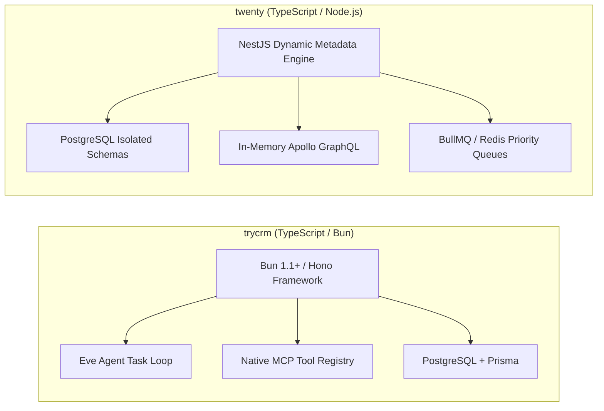
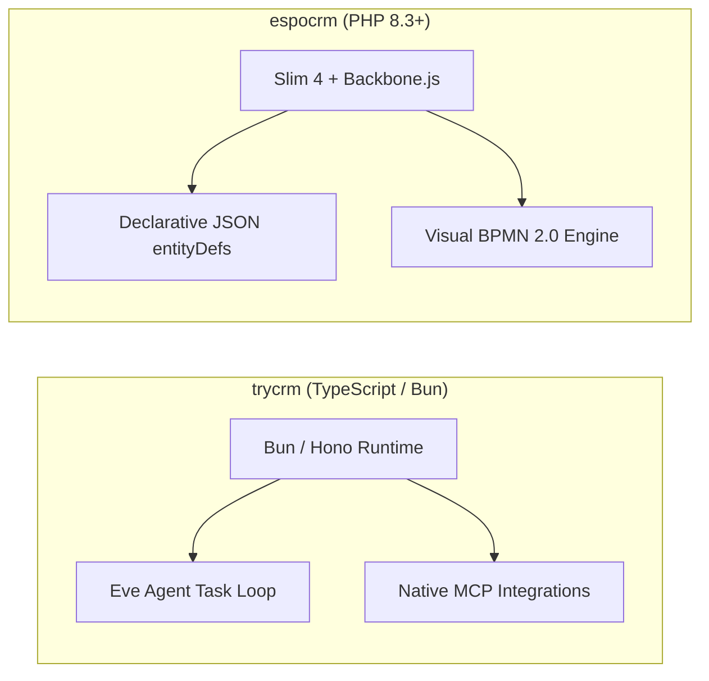
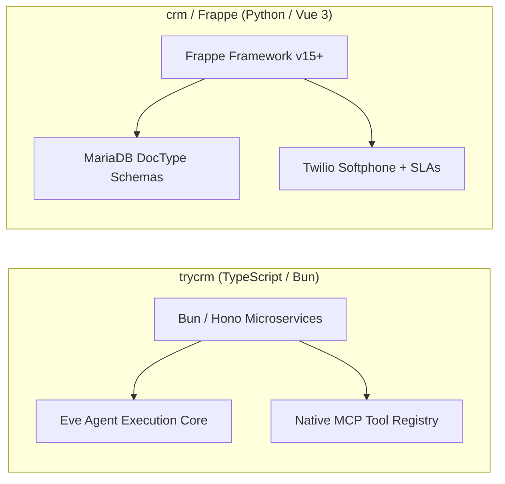
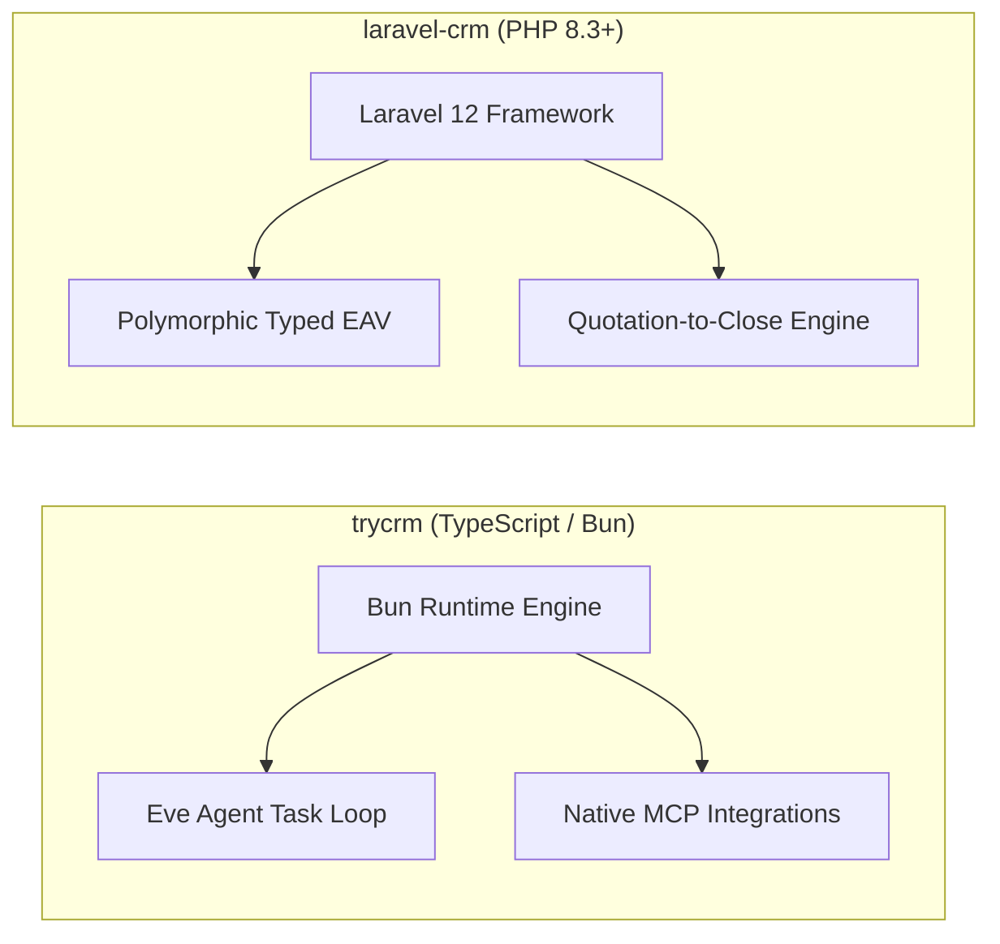
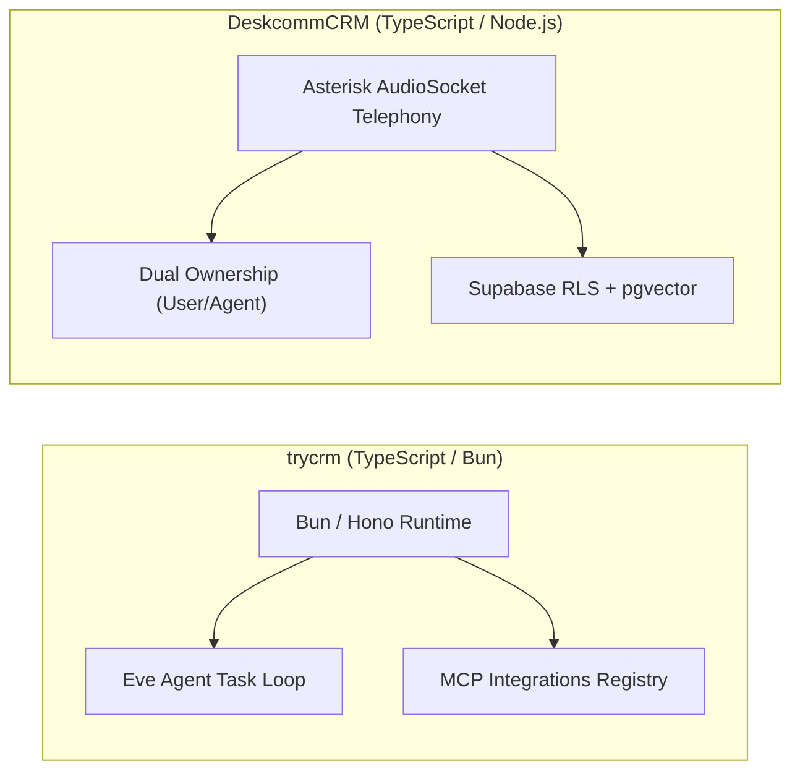
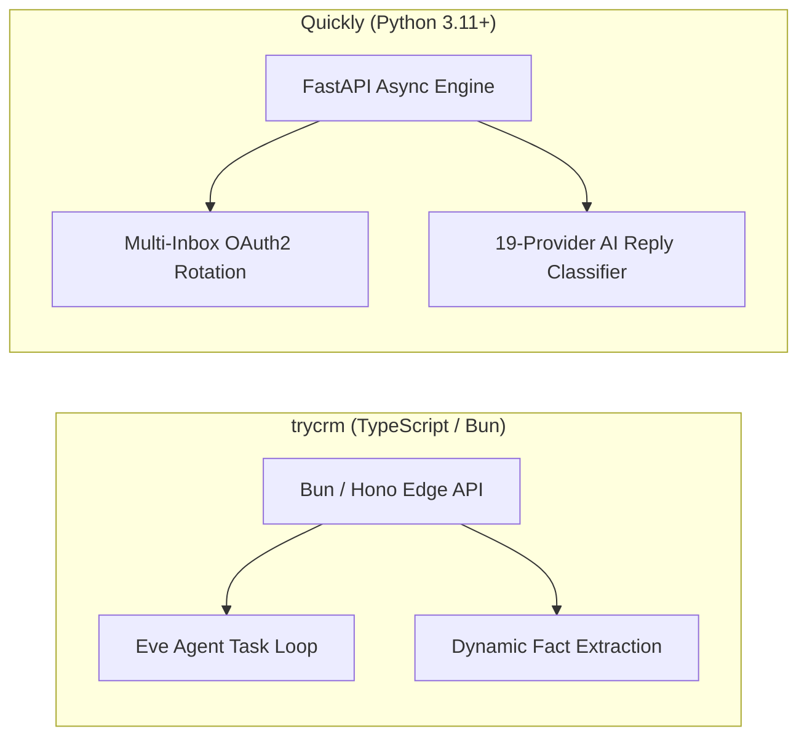
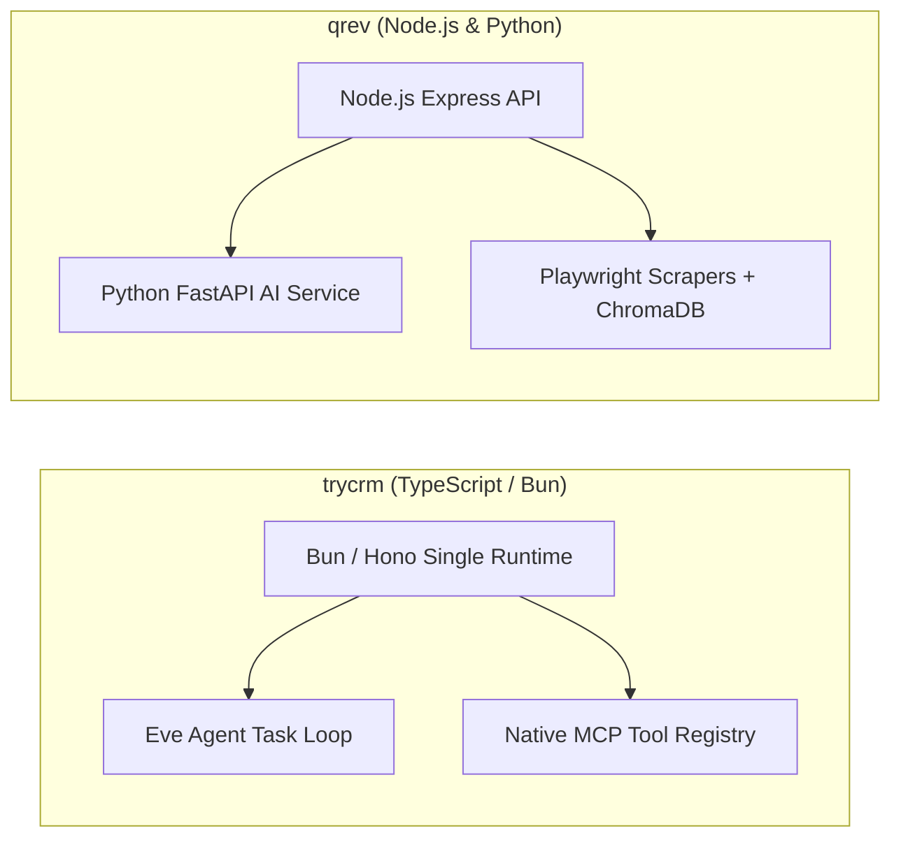
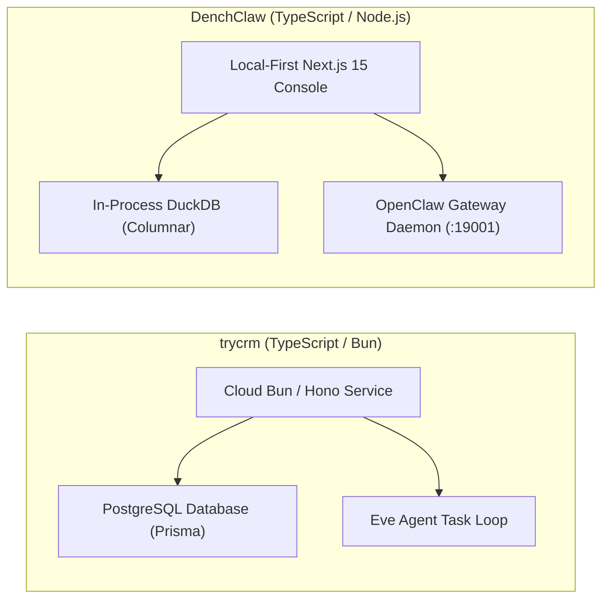
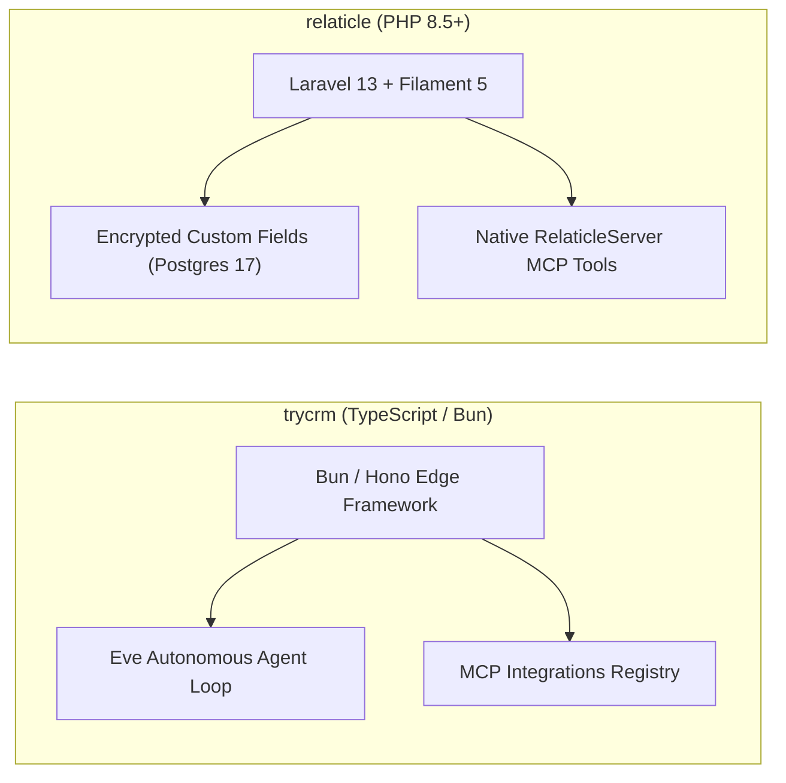

# trycrm (Comp AI CRM) — Comparative Analysis & Category Evaluation

> **Category**: CRM & Contact Management  
> **Architectural Role**: Agentic-first autonomous AI sales CRM with native MCP tool registry  
> **Primary Stack**: TypeScript 5.4+ / Bun 1.1+ | Bun, Hono, Next.js 14 | PostgreSQL 15+, Prisma ORM | Eve Agent Framework & MCP Protocol  
> **Peer Solutions Compared**: `twenty`, `espocrm`, `crm`, `laravel-crm`, `DeskcommCRM`, `Quickly`, `qrev`, `DenchClaw`, `relaticle`  
> **Commercial SaaS Benchmarks**: Salesforce, HubSpot CRM, Attio, Pipedrive, Close.com  

---

## 1. Executive Overview & Technical Identity: trycrm (Comp AI CRM)

**trycrm** (developed by Comp AI) is an agentic-first open-source customer relationship management system engineered natively in TypeScript on the **Bun runtime**, **Hono**, and **Next.js 14** (`trycompai/crm`). While legacy CRMs treat AI as a bolt-on chatbot or passive assistant, Comp AI CRM makes the **autonomous AI agent a first-class citizen** alongside human sales representatives.

In trycrm, AI agents have their own workspaces, permission scopes, tool registries via the **Model Context Protocol (MCP)**, execution memory buffers, and audit trails. The system's architectural identity centers on its **Native MCP Integrations Subsystem** (`packages/mcp-integrations`), its **Eve Agent Framework Execution Loop** (`apps/agent`), and its dynamic **Contact Fact Extraction Engine** (`ContactFact`, `ContactBrief`), all operating with near-zero latency on the Bun runtime.

### Core Architectural Profile
- **Runtime & Language**: `TypeScript 5.4+ / Bun 1.1+` (lightning-fast execution and native package management)
- **API Framework**: `Hono` (edge-compatible, low-latency microservice router in `apps/api`)
- **Frontend Dashboard**: `Next.js 14` (App Router), React 18, TailwindCSS, Nuqs (URL state management)
- **Persistence & ORM**: `PostgreSQL 15+` with `Prisma ORM` (`packages/db/prisma/schema.prisma`)
- **Agent Protocols & Runtimes**: Official Model Context Protocol (MCP) SDK, Eve agent framework (`apps/agent`)
- **Agent Auditing & Ledgers**: Native transaction tables (`AgentTask`, `AgentRun`, `AgentAction`, `AgentAuditEvent`) recording step-by-step LLM reasoning and tool outputs
- **Team Collaboration**: Deep Slack channel mappings (`SlackChannel`, `SlackMemberMatch`) for joint deal closing
- **Domain Specialization**: Autonomous AI digital SDR CRM, native MCP server/client registry, contact fact extraction, and high-speed Bun runtime (~150 MB RAM)

---

## 2. Peer Solution Landscape (CRM & Contact Management)

| Solution | Language & Runtime | Core Framework | Database / Persistence | Queue & Concurrency | Primary Architectural Niche |
| :--- | :--- | :--- | :--- | :--- | :--- |
| **trycrm** (Current) | `TypeScript / Bun` | `Bun, Hono, Next.js` | `PostgreSQL, Prisma` | `Bun Async Loop / Eve` | **Agentic-first CRM with native MCP tool registry & Eve runtime** |
| **twenty** | `TypeScript / Node.js` | `NestJS, React, Vite` | `PostgreSQL 15+, TypeORM` | `BullMQ / Redis` | Dynamic runtime schemas & in-memory GraphQL compilation |
| **espocrm** | `PHP 8.3+` | `Slim 4, Backbone.js` | `MySQL 8.0+ / MariaDB` | `Multi-Process daemon.php` | Visual BPMN 2.0 flow execution engine & JSON entityDefs |
| **crm** (Frappe) | `Python 3.10+, JS` | `Frappe, Vue 3.5` | `MariaDB 10.6+, Redis` | `Redis Queue (RQ) / Celery` | Declarative DocType metadata, built-in SLAs & Twilio WebRTC |
| **laravel-crm** (Krayin) | `PHP 8.3+` | `Laravel 12.0, Vue.js` | `MySQL 8.0, Eloquent` | `Laravel Queue / Reverb` | Modular composer packages via Concord & polymorphic typed EAV |
| **DeskcommCRM** | `TypeScript / Node.js`| `Next.js 14, Supabase` | `PostgreSQL 16, pgvector` | `AudioSocket TCP / Workers`| Asterisk AudioSocket binary TCP telephony & streamable MCP |
| **Quickly** | `Python 3.11+` | `FastAPI, Next.js 14` | `PostgreSQL, SQLAlchemy` | `Asyncio Slot Reservation` | High-velocity multi-inbox rotation, jitter scheduler & MCP |
| **qrev** | `Node.js & Python` | `Express & FastAPI` | `MongoDB & ChromaDB` | `Node-cron & FastTasks` | Dual-runtime Qai superagent orchestrator & LangChain RAG |
| **DenchClaw** | `TypeScript / Node.js`| `Next.js 15, DuckDB` | `In-Process DuckDB` | `In-Process SQL / OpenClaw`| Embedded columnar SQL, OpenClaw AI Gateway & Composio MCP |
| **relaticle** | `PHP 8.5+` | `Laravel 13, Filament 5`| `PostgreSQL 17+ (ULID)` | `Laravel Horizon / Redis` | Native `RelaticleServer` MCP tools, per-field encryption & ULIDs |

---

## 3. Deep Head-to-Head Comparative Breakdown: trycrm vs Peers

### 3.1. trycrm vs. twenty

#### Core Architectural Archetype
- **trycrm**: Built from the ground up for autonomous AI sales agents. The core domain models (`AgentTask`, `AgentRun`, `AgentAction`, `AgentAuditEvent`) treat AI agents as primary workspace users that discover tools dynamically via MCP and execute asynchronous sales tasks.
- **twenty**: General-purpose metadata-driven enterprise CRM. Excels at providing human sales teams with dynamic custom business objects, isolated database schemas, and Linear-style keyboard-first UI views.

#### Metadata Engine vs. Fact Extraction
- **trycrm**: Uses a static Prisma schema. Custom entity context is captured dynamically via unstructured fact extraction tables (`ContactFact`, `ContactBrief`) derived by LLMs from email threads and Slack discussions.
- **twenty**: Features a true dynamic metadata engine that issues real SQL DDL (`CREATE TABLE`, `ALTER TABLE`) inside workspace-scoped PostgreSQL schemas, dynamically compiling Apollo GraphQL types without code changes.

#### Runtime & Concurrency
- **trycrm**: Powered by the **Bun 1.1+** runtime and Hono framework (~150 MB RAM), delivering ultra-fast boot times and high-speed execution loops for AI agents.
- **twenty**: Node.js 20+ with NestJS and TypeORM, utilizing BullMQ over Redis (~500 MB RAM) to manage complex queue priorities and audit streams.

#### Architectural Tradeoffs Matrix: trycrm vs. twenty

| Dimension | trycrm | twenty | Architectural Evaluation |
| :--- | :--- | :--- | :--- |
| **Agentic Workflow Native** | Core Eve agent loop + MCP registry | Skills package over GraphQL | **trycrm** is purpose-built as an autonomous digital worker CRM |
| **Custom Object Extensibility** | Static Prisma schema + JSON facts | Dynamic Postgres schemas + DDL | **twenty** excels for complex custom relational data models |
| **Tenant Isolation** | Row-level (`organization_id`) | Schema-per-workspace (`workspace_<id>`) | **twenty** guarantees superior enterprise tenant isolation |
| **Runtime Footprint** | ~150 MB RAM (Bun / Hono) | ~500 MB RAM (Node.js / NestJS) | **trycrm** is significantly lighter and faster to boot |

---

### 3.2. trycrm vs. espocrm

#### Primary Operator: AI Agents vs. Human Revenue Teams
- **trycrm**: Autonomous AI digital workers execute outbound research, LinkedIn prospecting, and pipeline updates.
- **espocrm**: Human sales representatives and enterprise managers operate under strict multi-tier role/team ACLs, visual BPMN 2.0 workflows, and formula scripts.

#### Workflow Modeling vs. Agentic Autonomy
- **trycrm**: Relies on autonomous LLM reasoning loops within the Eve framework to select tools and determine next actions.
- **espocrm**: Relies on deterministic, visual **BPMN 2.0 flowcharts** (`application/Espo/Core/BPM/`) with explicit conditional gateways, user decision tasks, and approval loops.

#### Architectural Tradeoffs Matrix: trycrm vs. espocrm

| Dimension | trycrm | espocrm | Architectural Evaluation |
| :--- | :--- | :--- | :--- |
| **Primary Operator** | Autonomous AI digital sales agents | Human sales reps & managers | Distinct operational paradigms |
| **Agent Tool Calling** | Native Model Context Protocol (MCP) | Requires custom REST API wrappers | **trycrm** connects natively with LLMs |
| **Process Governance** | Autonomous agent task loops | Visual BPMN 2.0 flowchart engine | **espocrm** handles complex enterprise approval logic |
| **Custom Schema** | Static schema with JSON facts | Visual Entity Manager (JSON) | **espocrm** supports full enterprise custom objects |

---

### 3.3. trycrm vs. crm (Frappe CRM)

#### Communication Modality & Channel Integration
- **trycrm**: Focuses on asynchronous AI agent tool actions (LinkedIn lookups, search MCP tools, email drafts) and Slack channel collaboration (`SlackMemberMatch`).
- **crm (Frappe CRM)**: Focuses on synchronous human omnichannel communication: embedded browser softphone calling via `@twilio/voice-sdk`, bi-directional WhatsApp Cloud API, and active SLA timers.

#### Architectural Tradeoffs Matrix: trycrm vs. crm (Frappe)

| Dimension | trycrm | crm (Frappe CRM) | Architectural Evaluation |
| :--- | :--- | :--- | :--- |
| **Primary Workflow** | Autonomous AI agents + tool loops | Human sales reps + omnichannel | Distinct operational archetypes |
| **Telephony & Calling** | External MCP tool required | Native Twilio Voice SDK softphone | **crm** supports direct browser phone calls |
| **AI Protocol** | Native Model Context Protocol (MCP) | Whitelisted Python RPC endpoints | **trycrm** is purpose-built for AI agents |
| **ERP Connectivity** | Standalone CRM | Seamless Frappe ERPNext integration | **crm** connects to accounting and supply chain |

---

### 3.4. trycrm vs. laravel-crm (Krayin CRM)

#### Sales Lifecycle Focus
- **trycrm**: Top-of-funnel and mid-funnel autonomous prospect research, fact extraction, and outreach.
- **laravel-crm**: Bottom-funnel deal closing. Manages product inventories, rotting lead alerts, and multi-currency PDF quotations with automated tax rules.

#### Architectural Tradeoffs Matrix: trycrm vs. laravel-crm

| Dimension | trycrm | laravel-crm | Architectural Evaluation |
| :--- | :--- | :--- | :--- |
| **Operational Target** | Autonomous AI sales agents | Human sales teams & agencies | Distinct operational archetypes |
| **Quotation Engine** | None | Full PDF quote engine with taxes/SKUs | **laravel-crm** handles formal proposals & billing |
| **AI Agent Tooling** | Native Model Context Protocol (MCP) | Traditional REST endpoints | **trycrm** is purpose-built for agentic tool use |
| **Runtime Engine** | Bun 1.1+ / Hono (~150 MB RAM) | PHP 8.3+ / Laravel 12 (~100 MB RAM) | Both provide efficient operational runtimes |

---

### 3.5. trycrm vs. DeskcommCRM

#### Communication Modality: Asynchronous Research vs. Live Voice
- **trycrm**: Asynchronous digital worker platform coordinating web scrapers, LinkedIn MCP tools, and email drafts.
- **DeskcommCRM**: Synchronous telecom and messaging engine. Connects Asterisk PBX **AudioSocket** streams directly over raw TCP (port 9092) into streaming speech-to-text and LLM voice pipelines for live telephone calls.

#### AI Agent Escalation
- **trycrm**: Agents log execution steps and audit events in database tables.
- **DeskcommCRM**: Includes a native tool-level **AI-to-Human Handoff** engine (`handoff.ts`), allowing AI voice agents to qualify callers and transfer the live call to human reps (`force_human: true`).

#### Architectural Tradeoffs Matrix: trycrm vs. DeskcommCRM

| Dimension | trycrm | DeskcommCRM | Architectural Evaluation |
| :--- | :--- | :--- | :--- |
| **Primary Channel** | Asynchronous email, Slack & web search | Real-time voice telephony + WhatsApp | Complementary channels for sales GTM |
| **Telephony Engine** | External MCP tool required | Native Asterisk AudioSocket binary stream| **DeskcommCRM** is built for call center operations |
| **Agent Auditing** | Detailed `AgentAuditEvent` ledgers | Call audio recording & transcript logs | **trycrm** provides deeper step-by-step agent tracking |
| **Database Engine** | Standard Postgres with Prisma | Supabase Postgres with RLS & pgvector | **DeskcommCRM** provides built-in RAG vector search |

---

### 3.6. trycrm vs. Quickly

#### Autonomous Research vs. Scaled Email Sequencing
- **trycrm**: Focuses on deep individual prospect research: scanning email threads and Slack channels to extract bulleted facts (`ContactFact`) and crafting tailored outreach.
- **Quickly**: Focuses on high-volume outbound email delivery: rotating hundreds of Google Workspace and Microsoft 365 OAuth inboxes with randomized jitter and auto-triaging replies via 19 LLM providers.

#### Architectural Tradeoffs Matrix: trycrm vs. Quickly

| Dimension | trycrm | Quickly | Architectural Evaluation |
| :--- | :--- | :--- | :--- |
| **Mass Cold Outreach** | Single-mailbox agent outreach | Multi-inbox rotation across 100+ accounts | **Quickly** scales outbound volume safely |
| **Prospect Context** | Continuous dynamic fact extraction | Static custom template variables | **trycrm** builds deeper contextual prospect briefs |
| **AI Reply Analysis** | LLM prompt within agent run | Native 19-provider LLM intent classifier | **Quickly** provides structured intent classification |
| **Runtime Efficiency** | ~150 MB RAM (Bun / Hono) | ~60 MB RAM (FastAPI Async) | Both are exceptionally lightweight |

---

### 3.7. trycrm vs. qrev

#### Architecture: Unified Bun Runtime vs. Decoupled Multi-Service
- **trycrm**: Unified TypeScript monorepo running atop the Bun 1.1+ runtime, executing agent tasks natively with Prisma and PostgreSQL.
- **qrev**: Decoupled multi-runtime platform splitting Node.js/Express (MongoDB) from a compute-intensive Python 3.11+ AI service (ChromaDB, LangChain, Playwright).

#### Autonomous Capabilities
- **trycrm**: Connects external MCP servers to an internal agent loop.
- **qrev**: Features a turnkey autonomous sales superagent (**Qai**) that scrapes company websites using Playwright and drafts personalized RAG emails.

#### Architectural Tradeoffs Matrix: trycrm vs. qrev

| Dimension | trycrm | qrev | Architectural Evaluation |
| :--- | :--- | :--- | :--- |
| **Agent Protocol Standardization**| Native Model Context Protocol (MCP) | LangChain tool calling wrappers | **trycrm** adheres to open agent protocol standards |
| **Web Scraping** | Relies on external search MCP tools | Built-in Playwright headless browser scrapers | **qrev** performs direct HTML crawling & parsing |
| **Runtime Architecture** | Single-runtime (Bun 1.1+) | Multi-runtime (Node.js + Python) | **trycrm** offers lower operational complexity |
| **Vector RAG Memory** | Fact extraction table (`ContactFact`) | Native ChromaDB vector store | **qrev** handles larger unstructured document corpora |

---

### 3.8. trycrm vs. DenchClaw

#### Topology: Cloud Microservices vs. Local-First Columnar Engine
- **trycrm**: Cloud-native platform running on managed servers or Docker, connecting to remote PostgreSQL databases.
- **DenchClaw**: Local-first sovereign workspace running directly on an operator's workstation with an embedded DuckDB file (`workspace.duckdb`).

#### Analytical Performance vs. Agentic Workflow
- **trycrm**: Standard relational queries over PostgreSQL via Prisma.
- **DenchClaw**: Vectorized in-process columnar SQL queries executing in sub-millisecond timeframes (<1ms).

#### Architectural Tradeoffs Matrix: trycrm vs. DenchClaw

| Dimension | trycrm | DenchClaw | Architectural Evaluation |
| :--- | :--- | :--- | :--- |
| **Data Custody** | Cloud / server PostgreSQL database | 100% sovereign local DuckDB file | **DenchClaw** eliminates cloud vendor custody |
| **Analytical Query Speed** | Standard Prisma relational queries | Sub-millisecond vectorized DuckDB | **DenchClaw** handles deep tabular analytics faster |
| **Runtime Engine** | Bun 1.1+ / Hono (~150 MB RAM) | Next.js 15 / React 19 (~100 MB RAM) | Both provide highly efficient modern runtimes |
| **SaaS Connectors** | Custom MCP connection modules | Composio 150+ pre-built integrations | **DenchClaw** provides broader out-of-the-box SaaS tools |

---

### 3.9. trycrm vs. relaticle

#### Architecture: Agent-First Operator vs. Enterprise Workspace Governance
- **trycrm**: Engineered for autonomous AI agents executing tasks, logging thoughts, and connecting external MCP tool servers.
- **relaticle**: Engineered for human teams and AI agents collaborating within enterprise workspaces, featuring a rich Filament 5 admin dashboard, chronological ULIDs, and per-field AES encryption.

#### Agent Integration Architecture
- Both platforms prioritize the Model Context Protocol (MCP). trycrm manages an outgoing MCP client registry (`packages/mcp-integrations`) to connect third-party tool servers, while relaticle implements an incoming MCP server (`RelaticleServer`) that grants external LLMs structured access to CRM records.

#### Architectural Tradeoffs Matrix: trycrm vs. relaticle

| Dimension | trycrm | relaticle | Architectural Evaluation |
| :--- | :--- | :--- | :--- |
| **Admin UI & Governance**| Minimalist Next.js dashboard | Full Filament 5 reactive admin console | **relaticle** provides richer human management tools |
| **Agent Autonomy** | Full autonomous agent task loop | Agent tool execution via MCP | **trycrm** is purpose-built as an autonomous digital worker |
| **Data Encryption** | Unencrypted database columns | Per-field AES encryption at rest | **relaticle** provides stronger data security |
| **Runtime Efficiency** | Ultra-lightweight Bun 1.1+ runtime | Traditional PHP-FPM / Horizon | **trycrm** boots and executes requests faster |

---

## 4. Capability & Feature Comparison Matrix

| Dimension / Capability | trycrm | twenty | espocrm | crm (Frappe) | laravel-crm | DeskcommCRM | Quickly | qrev | DenchClaw | relaticle |
| :--- | :---: | :---: | :---: | :---: | :---: | :---: | :---: | :---: | :---: | :---: |
| **Agentic Task & Run Ledgers** | ✅ Native Tables| ⚠️ Queues | ❌ | ❌ | ❌ | ⚠️ Worker | ❌ | ⚠️ Qai Tasks | ⚠️ Subagents | ⚠️ Horizon |
| **Native MCP Tool Registry** | ✅packages/mcp | ✅ twenty-skills| ❌ REST only | ❌ RPC only | ❌ REST only | ✅ Streamable | ✅ Streamable | ⚠️ LangChain | ✅ Composio MCP | ✅ RelaticleServer |
| **Contact Fact Extraction** | ✅ ContactFact | ❌ | ❌ | ❌ | ❌ | ❌ | ❌ | ⚠️ ChromaDB | ❌ | ⚠️ AISummary |
| **Slack Channel Deal Mapping**| ✅ Native | ❌ | ⚠️ Plugin | ❌ | ❌ | ❌ | ❌ | ⚠️ Webhook | ⚠️ Composio | ❌ |
| **Dynamic Custom Objects** | ⚠️ JSON facts | ✅ Full DDL | ✅ JSON Meta | ✅ DocType | ⚠️ EAV | ❌ Static | ❌ Static | ⚠️ Mongo | ✅ DuckDB EAV | ✅ Encrypted EAV |
| **Embedded Softphone / CTI** | ❌ | ❌ | ⚠️ Plugin | ✅ Twilio SDK | ❌ | ✅ AudioSocket | ❌ | ❌ | ❌ | ❌ |
| **Multi-Tenant Schemas** | ⚠️ Org ID | ✅ Schema/Tenant| ⚠️ Role ACL | ✅ Frappe Sites| ⚠️ Channels | ✅ Postgres RLS| ⚠️ Single-team | ⚠️ Org ID | ✅ Local File | ✅ Workspace Model |
| **Resource Footprint** | ~150 MB RAM | ~500 MB RAM | ~120 MB RAM | ~400 MB RAM | ~100 MB RAM | ~200 MB RAM | **~60 MB RAM** | ~250 MB RAM | ~100 MB RAM | ~120 MB RAM |

---

## 5. Commercial Benchmark Positioning

When benchmarked against commercial SaaS leaders (**Salesforce, HubSpot CRM, Attio, Pipedrive, Close.com**):
- **Against Salesforce**: trycrm flips the legacy paradigm on its head: instead of paying high per-seat licenses for human data entry, trycrm empowers autonomous AI agents to research, qualify, and update records automatically.
- **Against Attio**: trycrm incorporates modern minimalist design and keyboard shortcuts while focusing specifically on AI digital workers rather than manual spreadsheet views.
- **Against HubSpot CRM**: trycrm eliminates contact tier penalties and natively embeds Model Context Protocol tool calling.
- **Data Sovereignty**: Open-source under MIT, allowing companies to run their autonomous sales agent fleet on private cloud servers.

---

## 6. Strategic Takeaways & Role for MarketingStudio

In the unified **MarketingStudio** architecture:
1. **Primary Component to Adopt**: Harness trycrm's **Agent Task & Audit Ledger Architecture** (`AgentTask`, `AgentRun`, `AgentAction`, `AgentAuditEvent`) as the tracking standard for all autonomous AI SDR activities.
2. **MCP Registry Integration**: Adopt trycrm's Model Context Protocol client manager (`packages/mcp-integrations`) to connect third-party tool servers (LinkedIn, search engines, enrichment APIs) to MarketingStudio agents.
3. **Fact Extraction Engine**: Replicate trycrm's `ContactFact` extraction pipeline to distill long email threads and chat transcripts into structured prospect bullets.
