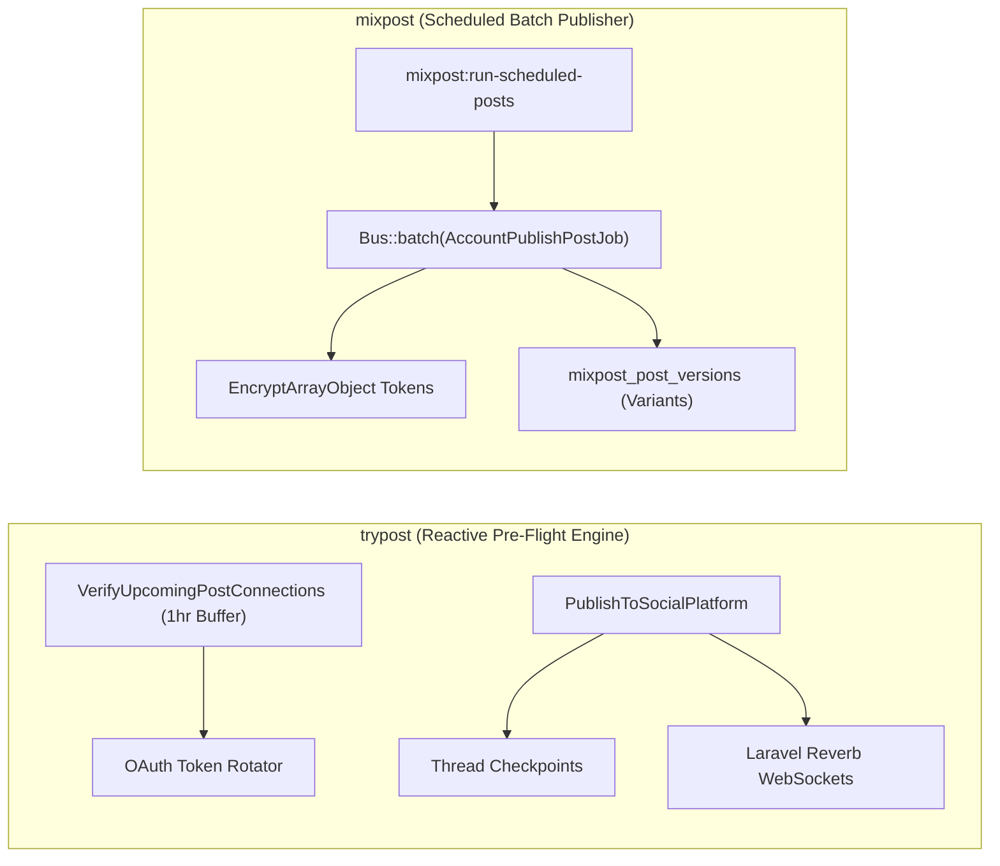
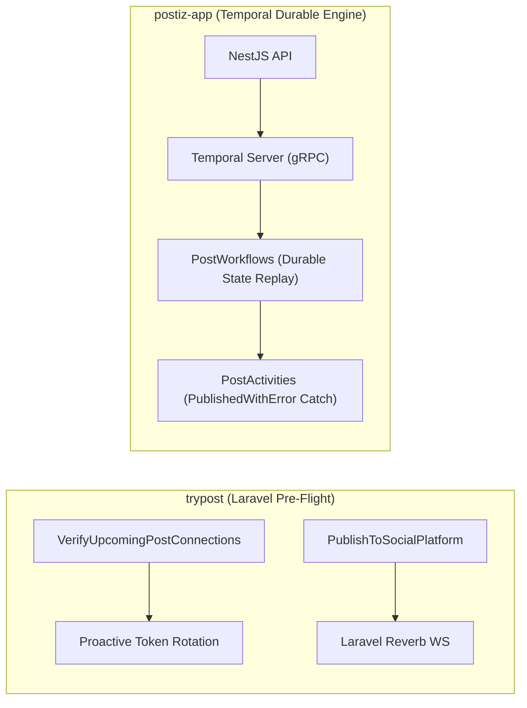
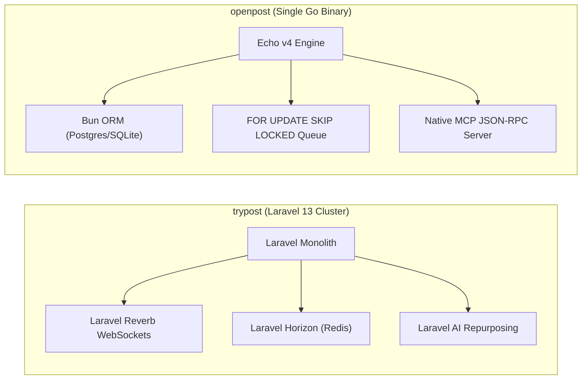
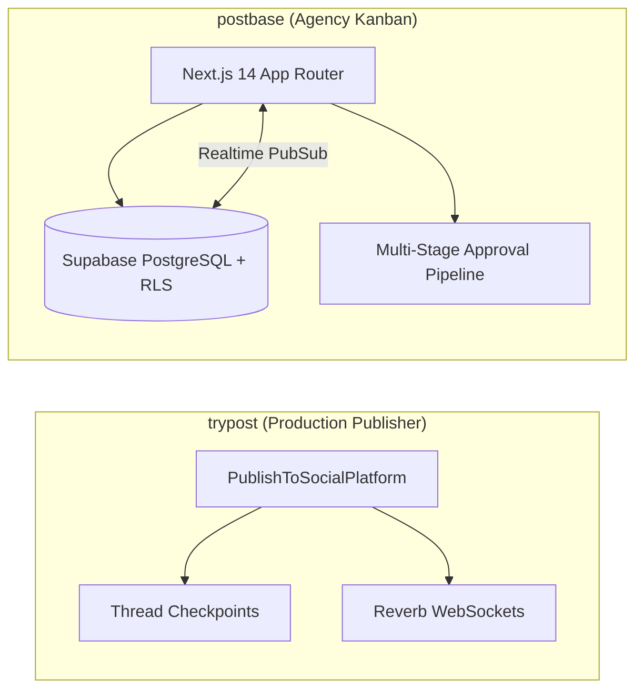

# trypost — Comparative Analysis & Category Evaluation

> **Category**: Social Media Management  
> **Architectural Role**: Real-time social publishing engine, proactive pre-flight verification & collaborative agency studio  
> **Primary Stack**: PHP 8.2+ | Laravel 13, Inertia.js 3.5+, Vue 3 | PostgreSQL 16 / MySQL, Redis | Laravel Horizon + Laravel Reverb WebSockets  
> **Peer Solutions Compared**: `mixpost`, `postiz-app`, `openpost`, `postbase`  
> **Commercial SaaS Benchmarks**: Buffer, Hootsuite, Later, Sprout Social, Typefully  

---

## 1. Executive Overview & Technical Identity: trypost

**trypost** represents the reactive real-time and proactive reliability tier within the **Social Media Management** domain. Built on modern **Laravel 13**, **Vue 3**, **Inertia.js 3.5+**, and **Laravel Reverb**, TryPost is engineered to eradicate the silent failure epidemic common in social media schedulers—where expired OAuth tokens, revoked platform scopes, or format violations are discovered only after a scheduled campaign fails to publish.

TryPost solves this through its automated **Pre-Flight Connection Verifier** (`VerifyUpcomingPostConnections`). Scanning all posts entering a rolling 1-hour risk window, TryPost proactively tests access tokens against live upstream provider endpoints, automatically executes refresh token rotations before expiration, and issues emergency `PostAtRisk` email alerts to workspace administrators if an account requires human re-authorization. In addition, TryPost incorporates stateful **Thread Checkpoints** (`PublishCheckpoint`) to ensure multi-tweet threads that encounter mid-sequence rate limits resume from the exact failed tweet rather than duplicating earlier posts.

### Core Architectural Profile
- **Runtime & Language**: `PHP 8.2+` (strict types, readonly properties) + modern Vue 3 / TypeScript frontend with Reka UI
- **Core Framework**: `Laravel 13` monolith with Inertia.js 3.5+ and Tailwind CSS v4
- **Real-Time Engine**: `Laravel Reverb` first-party WebSocket server (sub-second broadcasting of publishing progress and calendar events)
- **Persistence Layer**: `PostgreSQL 16` or `MySQL 8.0` via `Eloquent ORM` with encrypted credential stores
- **Concurrency & Reliability**: `Laravel Horizon` + Redis queue cluster, augmented with proactive pre-flight workers and thread checkpoint recovery
- **Domain Specialization**: Real-time collaborative scheduling (13+ networks), pre-flight credential verification, thread-level fault recovery, and autonomous AI feed repurposing

---

## 2. Peer Solution Landscape (Social Media Management)

Within this category, `trypost` operates alongside the following peer solutions:

| Solution | Language & Runtime | Core Framework | Database & ORM | Queue & Scheduler | Supported Platforms | License |
| :--- | :--- | :--- | :--- | :--- | :--- | :--- |
| **trypost** (Current) | `PHP 8.2+ / JS` | `Laravel 13, Vue 3, Reka UI` | `PostgreSQL / MySQL (Eloquent)` | `Horizon + Reverb WebSockets` | **13+ Networks (Pre-flight verifiers & checkpoints)**| AGPL-3.0-only |
| **mixpost** | `PHP 8.2+ / TS` | `Laravel, Inertia.js, Vue 3` | `MySQL / PostgreSQL (Eloquent)`| `Laravel Queue + Horizon` | 8+ Networks (X, FB, IG, LinkedIn, Masto, YouTube) | MIT |
| **postiz-app** | `TypeScript / Node 22+`| `NestJS 10, Next.js 14` | `PostgreSQL (Prisma 6.5)` | `Temporal.io Durable Workflows` | 30+ Networks (inc. TikTok, Bluesky, Nostr, Reddit) | AGPL-3.0 |
| **openpost** | `Go 1.26+` | `Echo v4, Huma v2, SvelteKit 2`| `SQLite / PostgreSQL (Bun ORM)` | `SKIP LOCKED DB Queue` | X, Meta, LinkedIn, YouTube, Bluesky + Native MCP | AGPL-3.0 |
| **postbase** | `TypeScript / Node 20+`| `Next.js 14, Shadcn UI` | `PostgreSQL (Supabase RLS)` | `Server Actions + Realtime` | X, LinkedIn, Instagram (Kanban Approvals) | MIT |

---

## 3. Deep Head-to-Head Comparative Breakdown: trypost vs Peers

### 3.1. trypost vs. mixpost

**Comparative Focus**: `Real-Time Reverb WebSockets & Pre-Flight Verifiers` vs. `Modular Laravel Package & Variant Versions`

#### Detailed Architectural Contrast
- **Credential Failure Defense**: `trypost` implements active, proactive verification: `VerifyUpcomingPostConnections` runs every 15 minutes, inspecting posts due in the next 60 minutes. It issues lightweight upstream API validation requests, performs token rotation if TTL is short, and alerts admins if an account is disconnected. `mixpost` uses passive verification, refreshing tokens only on a daily scheduled cron; if a token is revoked or expires between runs, the scheduled post job fails at publish time and logs an error in `mixpost_post_accounts`.
- **Thread Resiliency & Checkpoints**: When publishing multi-part threads (e.g., 5-tweet chains), `trypost` maintains stateful checkpoints (`PublishCheckpoint`, `ThreadProgress`). If Twitter rate-limits the sequence midway, subsequent retries resume from the exact failed tweet rather than duplicating initial tweets. `mixpost` executes posts as atomic account batches without mid-thread resume cursors.
- **Client Synchronization**: `trypost` deploys **Laravel Reverb**, a first-party event-driven WebSocket server. Publishing progress bars, calendar drag-and-drop operations, and background analytics updates are broadcast live to Vue clients over WebSockets. `mixpost` relies on standard Inertia.js page visits and frontend polling.
- **Architecture & Modularity**: `mixpost` is engineered as an embeddable composer package (`inovector/mixpost`) with an advanced "Original vs. Variant" inheritance model (`mixpost_post_versions`). `trypost` is structured as a dedicated, standalone Laravel application monolith.

#### Architectural Tradeoffs Matrix: trypost vs. mixpost

| Dimension | trypost | mixpost | Architectural Implication |
| :--- | :--- | :--- | :--- |
| **Pre-Flight Validation**| **Active 1-Hour Buffer Verification** | **Passive Cron Refresh** | TryPost catches token expirations before post time; Mixpost discovers failures at dispatch. |
| **Thread Fault Recovery**| **Stateful Thread Checkpoints** | **Atomic Batch Execution** | TryPost resumes interrupted threads without duplicate posts; Mixpost retries whole jobs. |
| **Real-Time Client Updates**| **Laravel Reverb WebSockets** | **Inertia Navigation & Polling** | TryPost updates client interfaces instantaneously via persistent WebSocket channels. |
| **Modularity & Embeddability**| **Dedicated Monolithic Application** | **Embeddable Composer Package** | Mixpost drops into existing Laravel apps; TryPost is designed as a standalone SaaS portal. |

---

### 3.2. trypost vs. postiz-app

**Comparative Focus**: `Laravel 13 Reverb & Pre-Flight Verification` vs. `Temporal.io Durable Workflows & 30+ Networks`

#### Detailed Architectural Contrast
- **Durability & Execution Philosophy**: `postiz-app` achieves fault tolerance through **Temporal.io durable workflow execution**. Every scheduled post is a durable workflow that can sleep for months; if a server reboot or external rate limit occurs, Temporal replays execution history and sleeps until rate limits reset. `trypost` approaches reliability through *proactive prevention*: its pre-flight verifiers test connections 60 minutes prior to scheduled dispatch, preventing jobs from firing with stale credentials, while relying on standard Redis queues in Laravel Horizon.
- **Real-Time Mechanics**: `trypost` provides sub-second live user interface updates using native **Laravel Reverb** WebSockets. `postiz-app` relies on React Query invalidations, REST polling, and Mantine UI toast alerts.
- **Platform Breadth**: `postiz-app` connects to 30+ networks, including Web3 and decentralized protocols (Bluesky ATProto, Nostr, Farcaster, Reddit, Discord). `trypost` supports 13 core networks (including Bluesky, Google Business Profile, Telegram, and Pinterest).
- **Stack Footprint**: `trypost` operates as a cohesive PHP 8.2+ / Laravel 13 monolith requiring Redis and Reverb. `postiz-app` requires orchestrating three Node.js services, a Temporal cluster, PostgreSQL, and Redis.

#### Architectural Tradeoffs Matrix: trypost vs. postiz-app

| Dimension | trypost | postiz-app | Architectural Implication |
| :--- | :--- | :--- | :--- |
| **Failure Strategy** | **Proactive Prevention (1hr Pre-Flight)** | **Reactive Durability (Temporal Workflows)**| TryPost prevents credential failures before they happen; Postiz recovers gracefully when they fail. |
| **Real-Time Client UX** | **Native Laravel Reverb WebSockets** | **React Query Polling / Invalidation** | TryPost pushes real-time publishing status updates over persistent WebSockets. |
| **Operational Overhead** | **Moderate (PHP Monolith + Reverb + Redis)**| **High (NestJS + Next.js + Temporal + Redis)** | TryPost is simpler to manage; Postiz requires maintaining a dedicated Temporal cluster. |
| **Supported Networks** | **13+ Networks** | **30+ Networks (inc. ATProto, Nostr)** | Postiz connects to modern decentralized, developer, and community channels. |

---

### 3.3. trypost vs. openpost

**Comparative Focus**: `Laravel 13 Monolith + Reverb WebSockets + Horizon` vs. `Single Go Binary + SKIP LOCKED DB Queue + MCP`

#### Detailed Architectural Contrast
- **Infrastructure & Broker Dependencies**: `trypost` requires a standard enterprise PHP runtime environment with Redis for Horizon queues and a running Laravel Reverb WebSocket daemon. `openpost` compiles everything into a **single static Go binary** (<35MB) with zero broker dependencies, utilizing SQL `FOR UPDATE SKIP LOCKED` on PostgreSQL (or serialized advisory locks on SQLite) for queue execution.
- **AI Integration**: `trypost` incorporates **Laravel AI** to ingest external RSS feeds, YouTube channels, and blogs via `PollRepurposeSource`, automatically reformatting long-form articles into social posts. `openpost` implements an official **Model Context Protocol (MCP)** server over stdio and SSE, exposing publication scheduling, graphic editing, and calendar tools directly to autonomous AI agents (Claude Code, Cursor).
- **Failure Monitoring**: `trypost` relies on its proactive 1-hour pre-flight verifier. `openpost` relies on a reactive 15-minute heartbeat monitor that detects and recovers crashed worker jobs in the database queue.

#### Architectural Tradeoffs Matrix: trypost vs. openpost

| Dimension | trypost | openpost | Architectural Implication |
| :--- | :--- | :--- | :--- |
| **Deployment Footprint**| **Moderate (PHP-FPM, Redis, Reverb, Horizon)**| **Minimal (Single static Go binary)** | OpenPost runs on a single VPS with zero broker config; TryPost requires PHP/Redis ops. |
| **Real-Time UI Updates**| **Laravel Reverb WebSockets** | **SvelteKit 2 State & Typed REST Polling**| TryPost provides sub-second live progress updates; OpenPost uses standard reactive stores. |
| **AI Protocol Scope** | **Internal Laravel AI Feed Repurposing** | **Native First-Party MCP Server** | OpenPost can be driven directly by developer AI agents; TryPost focuses on content generation. |
| **Failure Detection** | **Proactive Pre-Flight Token Testing** | **Reactive 15-Minute Heartbeat Recovery** | TryPost eliminates token errors before dispatch; OpenPost recovers crashed queue jobs. |

---

### 3.4. trypost vs. postbase

**Comparative Focus**: `Full-Featured Publishing Monolith & Pre-Flight Testing` vs. `Collaborative Agency Kanban & Client Approvals`

#### Detailed Architectural Contrast
- **Functional Mission**: `trypost` is an end-to-end publishing, scheduling, and analytics suite supporting 13+ social networks with video chunking, thread checkpoints, and automated token rotation. `postbase` focuses specifically on client collaboration: drafting posts, rendering mock platform previews, and managing kanban approval states (`Draft` -> `Needs Review` -> `Approved` -> `Scheduled`).
- **Real-Time Infrastructure**: `trypost` manages its own WebSocket broadcasting server via **Laravel Reverb**. `postbase` delegates realtime state synchronization to managed Supabase Realtime subscriptions.

#### Architectural Tradeoffs Matrix: trypost vs. postbase

| Dimension | trypost | postbase | Architectural Implication |
| :--- | :--- | :--- | :--- |
| **Publishing Scope** | **13+ Networks with Video Chunking** | **3 Networks (Basic Text & Image)** | TryPost handles complex multi-network delivery; Postbase handles client draft approvals. |
| **Real-Time Layer** | **Self-Hosted Laravel Reverb Server** | **Managed Supabase Realtime PubSub** | TryPost runs on private infrastructure; Postbase utilizes managed Supabase BaaS. |
| **Operational Stack** | **PHP 8.2+ / Laravel 13 Monolith** | **Serverless Next.js 14 + Supabase** | Postbase deploys to Vercel/Supabase; TryPost runs in containerized environments. |

---

## 4. Capability & Feature Comparison Matrix

| Dimension / Capability | trypost | mixpost | postiz-app | openpost | postbase |
| :--- | :---: | :---: | :---: | :---: | :---: |
| **Primary Architectural Niche** | **Reverb WebSockets & pre-flight verifiers** | Battle-tested multi-network scheduling & video chunking | Temporal.io durable workflows & 30+ networks | Single Go binary + SKIP LOCKED DB queue + MCP | Supabase-backed agency review kanban |
| **Runtime Language** | `PHP 8.2+ / JS` | `PHP 8.2+ / TS` | `TypeScript / Node 22+` | `Go 1.26+` | `TypeScript / Node` |
| **Framework** | `Laravel 13, Vue 3, Inertia` | `Laravel, Inertia, Vue 3` | `NestJS 10, Next.js 14` | `Echo v4, Huma v2, Svelte 2` | `Next.js 14, Shadcn UI` |
| **Database Persistence** | `PostgreSQL / MySQL (Eloquent)`| `MySQL / PostgreSQL (Eloquent)`| `PostgreSQL (Prisma 6.5)` | `SQLite / PostgreSQL (Bun ORM)`| `PostgreSQL (Supabase RLS)` |
| **Queue / Concurrency** | `Horizon + Reverb WS` | `Laravel Queue + Horizon` | `Temporal.io + BullMQ` | `SKIP LOCKED DB Queue` | `Server Actions + Realtime` |
| **Pre-Flight Connection Verifier**| ✅ Proactive 1hr Buffer | ⚠️ Scheduled check | ⚠️ Activity catch | ⚠️ Cron check | ❌ |
| **Stateful Thread Checkpoints** | ✅ Native Checkpoints | ❌ | ⚠️ Activity retry | ⚠️ Segment queue | ❌ |
| **Real-Time WebSockets** | ✅ Laravel Reverb (Native) | ❌ (Polling) | ⚠️ BullMQ Events | ⚠️ SSE / Polling | ✅ Supabase Realtime |
| **AI Content Repurposing** | ✅ Laravel AI / RSS Ingestion | ⚠️ OpenAI API | ✅ Mastra Framework | ⚠️ Basic OpenAI | ❌ |
| **Supported Platforms** | **13+ Networks** | **8+ Networks** | **30+ Networks** | 6+ Networks | 3 Networks |

---

## 5. Commercial Benchmark Positioning

When benchmarked against commercial SaaS leaders (**Buffer, Hootsuite, Later, Sprout Social, Typefully**):
- **Eradication of Silent Runtime Failures**: By verifying access tokens and platform connections 1 hour before scheduled execution, TryPost prevents the common failure where marketers discover an important campaign failed to publish due to an unnotified token expiration.
- **Thread Recovery Economics**: On X/Twitter, where API v2 rate limits are aggressive, mid-thread failures often force manual post deletions or duplicate dispatches. TryPost's thread checkpointing makes multi-tweet storytelling safe and predictable.
- **Low-Latency Collaboration**: Laravel Reverb enables real-time collaborative editing, instant calendar drag-and-drop feedback, and live post progress bars without third-party Pusher subscription fees.

---

## 6. Strategic Takeaways & Role for MarketingStudio

In the unified **MarketingStudio** architecture:
1. **Primary Component to Adopt**: Integrate TryPost's `VerifyUpcomingPostConnections` daemon into MarketingStudio's master scheduler to proactively validate credentials 1 hour before scheduled dispatches.
2. **Thread Checkpoint Seam**: Replicate TryPost's `PublishCheckpoint` pattern for long Twitter and Bluesky threads to ensure mid-thread failures resume without duplicating earlier content.
3. **Peer Coexistence**:
   - Utilize `trypost`'s pre-flight verifiers and Laravel Reverb WebSockets for high-reliability publishing.
   - Borrow `mixpost`'s variant inheritance model for clean post versioning.
   - Connect to `postiz-app`'s platform adapters to expand beyond 13 networks into Web3 and Discord.
   - Expose the system to AI developer agents using `openpost`'s native Model Context Protocol (MCP) server.
