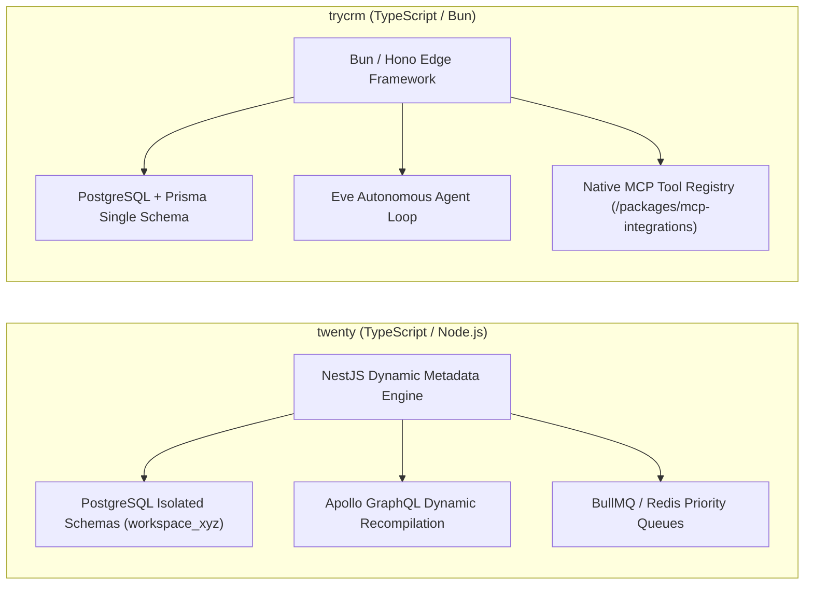
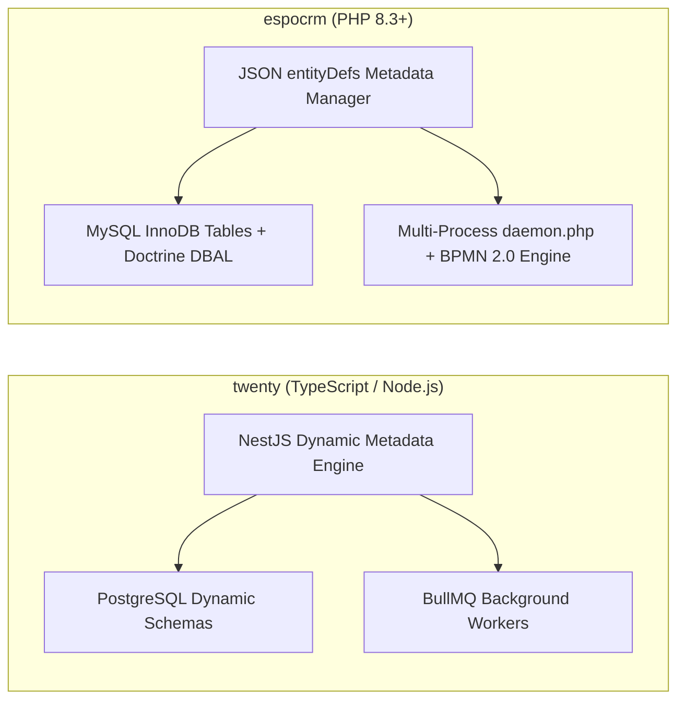
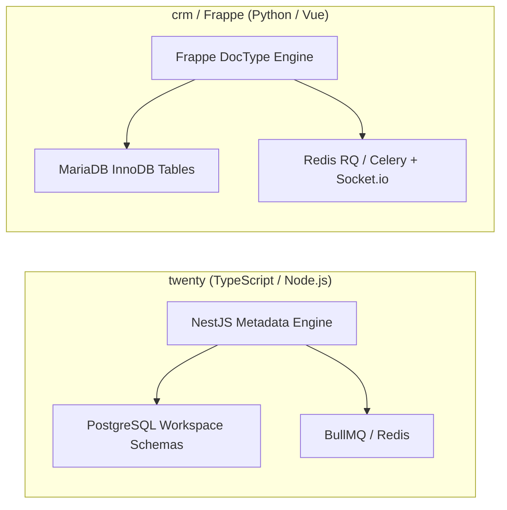
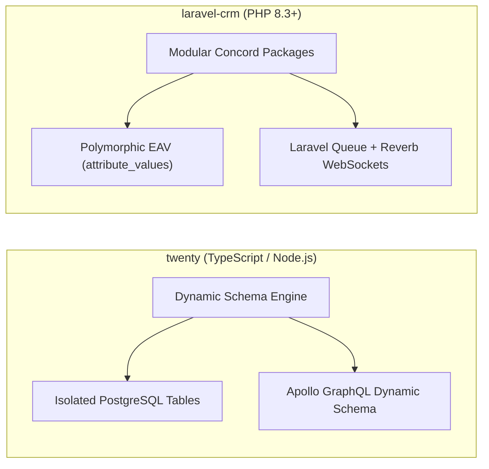
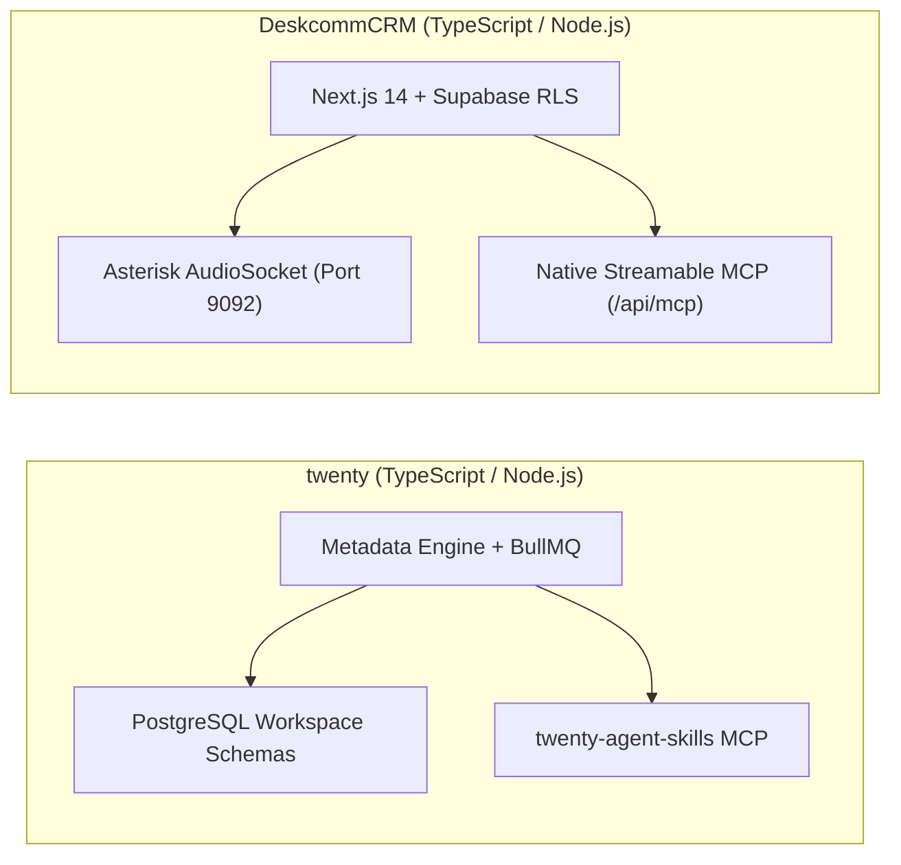
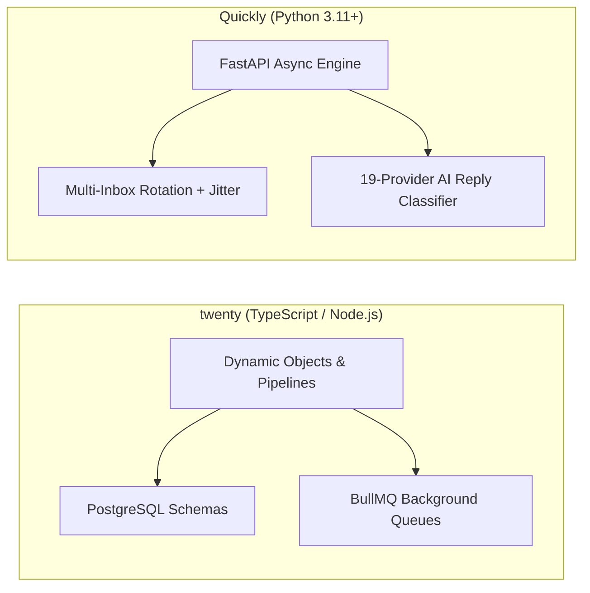
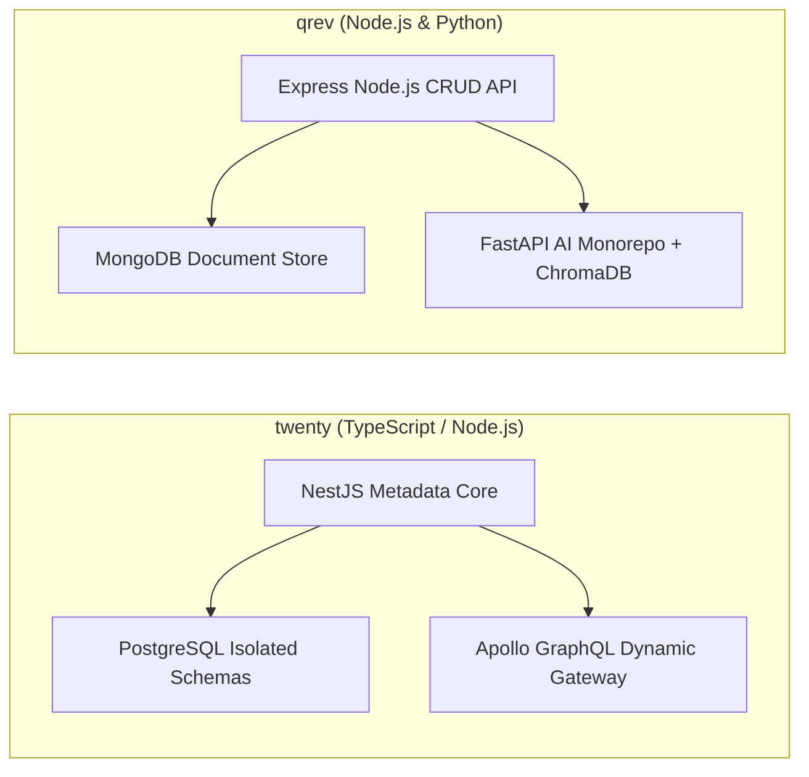
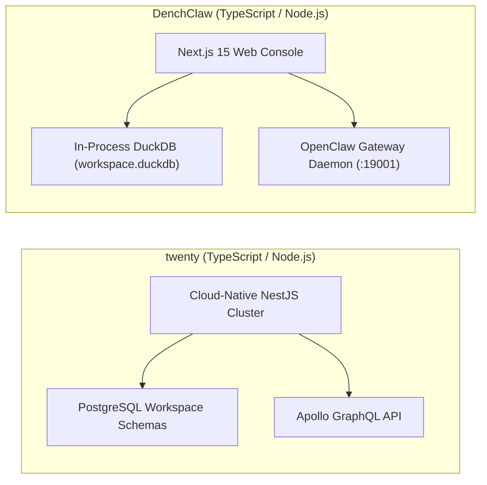
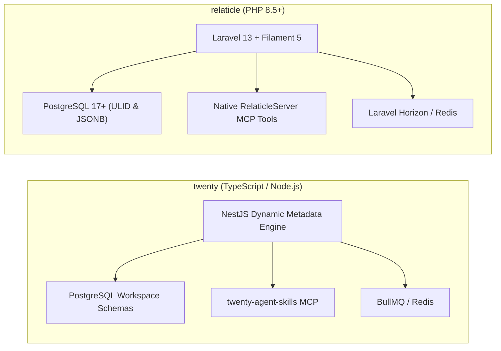

# twenty — Comparative Analysis & Category Evaluation

> **Category**: CRM & Contact Management  
> **Architectural Role**: Next-generation metadata-driven CRM with dynamic runtime schema generation  
> **Primary Stack**: TypeScript 5.4+ / Node.js 20+ | NestJS 10+, React 18, Vite | PostgreSQL 15+, TypeORM | BullMQ / Redis  
> **Peer Solutions Compared**: `trycrm`, `espocrm`, `crm`, `laravel-crm`, `DeskcommCRM`, `Quickly`, `qrev`, `DenchClaw`, `relaticle`  
> **Commercial SaaS Benchmarks**: Salesforce, HubSpot CRM, Attio, Pipedrive, Close.com  

---

## 1. Executive Overview & Technical Identity: twenty

**twenty** is a modern, extensible open-source CRM architected in TypeScript as an open-core alternative to Salesforce and Attio. Developed within an Nx/Yarn monorepo (`twentyhq/twenty`), Twenty's defining architectural breakthrough is its **Dynamic Metadata Engine** (`packages/twenty-server/src/engine/`). 

Rather than confining organizations to rigid relational tables or forcing un-indexed key-value EAV tables, Twenty isolates each workspace in a dedicated PostgreSQL database schema (`workspace_<id>`) and compiles database tables, columns, foreign keys, indexes, and Apollo GraphQL schema mutations dynamically at runtime without restarting the application or executing manual code migrations.

### Core Architectural Profile
- **Runtime & Language**: `TypeScript 5.4+ / Node.js 20+` (ESM native, Nx monorepo)
- **Core Framework**: `NestJS 10+` (dependency injection, modular microservices) & `React 18 / Vite` (Linear-inspired keyboard-first UX)
- **Persistence Layer**: `PostgreSQL 15+, TypeORM` with dual-tier storage (Core Metadata schema vs. Workspace Data schemas)
- **Concurrency & Queue Model**: `BullMQ / Redis` with decoupled priority queues and `EventEmitter2` event bus
- **API & Protocol Layer**: Code-first Apollo GraphQL Server with dynamic metadata type compilation, NestJS REST controllers, and native Model Context Protocol (`packages/twenty-agent-skills`)
- **Domain Specialization**: Next-generation metadata-driven CRM with runtime schema isolation and native AI agent capabilities

---

## 2. Peer Solution Landscape (CRM & Contact Management)

| Solution | Language & Runtime | Core Framework | Database / Persistence | Queue & Concurrency | Primary Architectural Niche |
| :--- | :--- | :--- | :--- | :--- | :--- |
| **twenty** (Current) | `TypeScript / Node.js` | `NestJS, React, Vite` | `PostgreSQL 15+, TypeORM` | `BullMQ / Redis` | **Dynamic runtime schemas & in-memory GraphQL compilation** |
| **trycrm** | `TypeScript / Bun` | `Bun, Hono, Next.js` | `PostgreSQL, Prisma` | `Bun Async Loop / Eve` | Agentic-first CRM with native MCP tool registry & Eve runtime |
| **espocrm** | `PHP 8.3+` | `Slim 4, Backbone.js` | `MySQL 8.0+ / MariaDB` | `Multi-Process daemon.php` | Visual BPMN 2.0 flow execution engine & JSON entityDefs |
| **crm** (Frappe) | `Python 3.10+, JS` | `Frappe, Vue 3.5` | `MariaDB 10.6+, Redis` | `Redis Queue (RQ) / Celery` | Declarative DocType metadata, built-in SLAs & Twilio WebRTC |
| **laravel-crm** (Krayin) | `PHP 8.3+` | `Laravel 12.0, Vue.js` | `MySQL 8.0, Eloquent` | `Laravel Queue / Reverb` | Modular composer packages via Concord & polymorphic typed EAV |
| **DeskcommCRM** | `TypeScript / Node.js`| `Next.js 14, Supabase` | `PostgreSQL 16, pgvector` | `AudioSocket TCP / Workers`| Asterisk AudioSocket binary TCP telephony & streamable MCP |
| **Quickly** | `Python 3.11+` | `FastAPI, Next.js 14` | `PostgreSQL, SQLAlchemy` | `Asyncio Slot Reservation` | High-velocity multi-inbox rotation, jitter scheduler & MCP |
| **qrev** | `Node.js & Python` | `Express & FastAPI` | `MongoDB & ChromaDB` | `Node-cron & FastTasks` | Dual-runtime Qai superagent orchestrator & LangChain RAG |
| **DenchClaw** | `TypeScript / Node.js`| `Next.js 15, DuckDB` | `In-Process DuckDB` | `In-Process SQL / OpenClaw`| Embedded columnar SQL, OpenClaw AI Gateway & Composio MCP |
| **relaticle** | `PHP 8.5+` | `Laravel 13, Filament 5`| `PostgreSQL 17+ (ULID)` | `Laravel Horizon / Redis` | Native `RelaticleServer` MCP tools, per-field encryption & ULIDs |

---

## 3. Deep Head-to-Head Comparative Breakdown: twenty vs Peers

### 3.1. twenty vs. trycrm

#### Metadata Engine & Schema Provisioning
- **twenty**: Operates a dual-tier metadata engine. Core tables (`core.custom_object`, `core.custom_field`, `core.relation_metadata`) track entity definitions. When custom entities are added, Twenty issues transactional DDL queries (`CREATE TABLE`, `ALTER TABLE`) directly into a dedicated PostgreSQL schema (`workspace_<id>.<entity>`). The Apollo GraphQL schema is dynamically recompiled in memory, immediately exposing typed queries and mutations without restarting.
- **trycrm**: Relies on a static Prisma schema (`packages/db/prisma/schema.prisma`). Custom entity attributes are handled via unstructured JSON columns and fact extraction tables (`ContactFact`, `ContactBrief`). Adding net-new relational entities requires editing Prisma schema files and executing `prisma migrate deploy`.

#### Concurrency, Background Workers & Queuing
- **twenty**: Employs NestJS with BullMQ running over Redis. Workloads (email IMAP sync, calendar events, webhooks, search indexing) are partitioned into distinct queues with configurable concurrency, exponential backoff retries, and dead-letter handling. Mutation side-effects are decoupled using `EventEmitter2`.
- **trycrm**: Utilizes Bun's native asynchronous event loop and lightweight Hono route handlers. Asynchronous tasks and agent loops execute within the Eve agent framework (`apps/agent`), recording sequential execution steps into `AgentTask`, `AgentRun`, and `AgentAction` tables.

#### API Design & AI Agent Ergonomics
- **twenty**: Exposes auto-generated GraphQL queries/mutations and REST endpoints for all core and custom objects. AI agent integration is provided via `packages/twenty-agent-skills` and `packages/twenty-claude-skills`, which dynamically map custom workspace objects into Model Context Protocol (MCP) tools.
- **trycrm**: Built from day one specifically for autonomous AI agents. Features a centralized MCP tool manager (`packages/mcp-integrations`) that dynamically registers external MCP servers (LinkedIn, Google Search, Apollo) and exposes CRM tools directly to LLMs, complete with fine-grained audit logging (`AgentAuditEvent`).

#### Data Isolation & Multi-Tenancy
- **twenty**: Enforces strict multi-tenancy at the database level by provisioning an isolated PostgreSQL schema per tenant workspace (`workspace_<workspace_id>`). Schema isolation prevents noisy-neighbor query contamination and makes tenant backup/deletion trivial.
- **trycrm**: Implements shared-table multi-tenancy where all organizations share tables segmented by an `organization_id` foreign key column.

#### Architectural Tradeoffs Matrix: twenty vs. trycrm

| Dimension | twenty | trycrm | Architectural Evaluation |
| :--- | :--- | :--- | :--- |
| **Custom Object Extensibility** | Dynamic Postgres schemas + DDL | Static Prisma schema + JSON facts | **twenty** excels for complex custom relational data models |
| **Agentic Workflow Native** | Skills package over GraphQL | Core Eve agent loop + MCP registry | **trycrm** is purpose-built as an autonomous digital worker CRM |
| **Tenant Isolation** | Schema-per-workspace (`workspace_<id>`) | Row-level (`organization_id`) | **twenty** guarantees superior enterprise tenant isolation |
| **Runtime Footprint** | ~500 MB RAM (Node.js/NestJS) | ~150 MB RAM (Bun/Hono) | **trycrm** is significantly lighter and faster to boot |

---

### 3.2. twenty vs. espocrm

#### Metadata Engine & Schema Provisioning
- **twenty**: Dynamic metadata engine executing programmatic DDL in PostgreSQL. Schema alterations are instantaneous, triggering in-memory GraphQL AST recompilation.
- **espocrm**: Employs a declarative file-based JSON metadata system (`application/Espo/Resources/metadata/entityDefs/` and `custom/Espo/Custom/Resources/metadata/entityDefs/`). When entities or fields are modified via the visual Entity Manager, JSON files are written to disk, merged, and executed against MySQL via Doctrine DBAL 4.4 alter tables. Espo includes a built-in **Formula Scripting Engine** with an AST evaluator for dynamic field computations.

#### Concurrency, Background Workers & Queuing
- **twenty**: Asynchronous operations managed via Redis-backed BullMQ workers in Node.js.
- **espocrm**: Operates a multi-process queue processor (`daemon.php`) using `spatie/async` and `react/child-process`, alongside periodic `cron.php` executions. Real-time push updates are dispatched through a native Ratchet WebSocket server (`websocket.php`).

#### API Design & AI Agent Ergonomics
- **twenty**: Modern Apollo GraphQL and auto-generated REST APIs, paired with first-class Model Context Protocol toolkits (`packages/twenty-agent-skills`).
- **espocrm**: Traditional REST API built on Slim 4 with HMAC and Bearer token authentication. Espo lacks native MCP tooling out of the box, requiring external middleware or custom API wrappers for LLM agent integration.

#### Workflow & Business Process Management
- **twenty**: Event-driven webhook and action triggers coordinated via BullMQ jobs.
- **espocrm**: Features a complete, enterprise-grade **BPMN 2.0 flow execution engine** (`application/Espo/Core/BPM/`). Supports visual flowcharts, conditional gateways, timer delays, approval events, and automated service tasks.

#### Architectural Tradeoffs Matrix: twenty vs. espocrm

| Dimension | twenty | espocrm | Architectural Evaluation |
| :--- | :--- | :--- | :--- |
| **API Architecture** | Dynamic Apollo GraphQL + REST | Slim 4 REST API | **twenty** provides superior client query flexibility via GraphQL |
| **BPM & Workflow Engine** | Event Bus + Queue triggers | Native visual BPMN 2.0 engine | **espocrm** is dramatically superior for complex enterprise workflows |
| **AI Agent Ergonomics** | Native MCP server tools | Legacy REST / Webhooks | **twenty** natively connects with modern LLMs |
| **Persistence Maturity** | PostgreSQL 15+ (TypeORM) | MySQL / MariaDB (Doctrine DBAL) | **espocrm** leverages 10+ years of battle-tested enterprise stability |

---

### 3.3. twenty vs. crm (Frappe CRM)

#### Metadata Engine & Schema Provisioning
- **twenty**: Dynamic runtime schema creation inside PostgreSQL workspace schemas. Modifying an entity immediately updates the in-memory GraphQL AST without running CLI migration tools.
- **crm (Frappe CRM)**: Built upon the Frappe Framework's declarative **DocType** engine (`crm/fcrm/doctype/`). Schemas are defined in JSON files. Schema alterations modify MariaDB tables during `bench migrate`, automatically generating REST endpoints (`/api/resource/{DocType}`) and dynamic Vue 3 form layouts (`crm_fields_layout`).

#### Concurrency, Background Workers & Queuing
- **twenty**: BullMQ workers manage background tasks, email synchronization, and webhook events asynchronously on Redis.
- **crm (Frappe CRM)**: Utilizes Python RQ (Redis Queue) and Celery workers coordinated by `frappe.tasks` hooks. Uniquely features an automated **SLA Supervisor** that enforces first-response and rolling-response target timers on leads. Real-time document collaboration is handled via a Node.js Socket.io daemon.

#### Telephony & Omnichannel Integration
- **twenty**: Delegates telephony to external CTI integrations via REST webhooks.
- **crm (Frappe CRM)**: Features out-of-the-box browser softphone calling powered by `@twilio/voice-sdk` and Exotel, complete with automatic call recording storage in `crm_call_log` and native WhatsApp Cloud API integration (`whatsapp.py`).

#### Multi-Tenancy Models
- **twenty**: Implements PostgreSQL schema-per-workspace isolation on a single database cluster.
- **crm (Frappe CRM)**: Relies on Frappe Sites multi-tenancy, provisioning completely separate MariaDB databases per tenant site, resolved via HTTP Host headers.

#### Architectural Tradeoffs Matrix: twenty vs. crm (Frappe)

| Dimension | twenty | crm (Frappe CRM) | Architectural Evaluation |
| :--- | :--- | :--- | :--- |
| **Custom Object Velocity** | Instant runtime DDL + GraphQL recompile | JSON DocType + `bench migrate` | **twenty** eliminates manual migration steps |
| **Telephony & Calling** | API activity logging only | Embedded Twilio Voice SDK softphone | **crm** provides native browser VoIP dialing out of the box |
| **SLA Tracking** | Custom queue worker scripts | Native automated SLA timers & alerts | **crm** natively prevents leads from rotting |
| **Ecosystem Integration** | Standalone CRM platform | Frappe ERP, Desk, HR ecosystem | **crm** seamlessly links with broader ERP systems |

---

### 3.4. twenty vs. laravel-crm (Krayin CRM)

#### Metadata Engine & Schema Provisioning
- **twenty**: True relational custom tables with dynamic DDL in PostgreSQL schemas. Fields exist as physical database columns with indexes.
- **laravel-crm**: Employs a polymorphic **Entity-Attribute-Value (EAV)** engine (`packages/Webkul/Attribute`). Dynamic fields are declared in `attributes`, while data is persisted across typed columns (`text_value`, `integer_value`, `boolean_value`, `date_value`, `json_value`) in the `attribute_values` table. Any model using the `CustomAttribute` trait interacts with custom properties transparently.

#### Query Performance & Reporting Scalability
- **twenty**: Because custom fields exist as native columns inside PostgreSQL, filtering, sorting, and aggregating across multiple custom attributes executes via native B-tree indexes with minimal overhead.
- **laravel-crm**: Querying or sorting across multiple custom fields requires multi-table self-joins against `attribute_values`, creating severe performance bottlenecks when tables scale past hundreds of thousands of records.

#### Concurrency & Real-Time Broadcasting
- **twenty**: Asynchronous jobs run via BullMQ; frontend receives updates via Apollo Client cache invalidation and WebSockets.
- **laravel-crm**: Uses Laravel 12 Queue workers with Redis or database drivers. Pipeline stage updates and activities are broadcast in real time across sales reps via **Laravel Reverb** WebSockets.

#### Architectural Tradeoffs Matrix: twenty vs. laravel-crm

| Dimension | twenty | laravel-crm | Architectural Evaluation |
| :--- | :--- | :--- | :--- |
| **Custom Field Storage** | Native PostgreSQL columns | Polymorphic typed EAV table | **twenty** provides 10x-50x faster analytical query performance |
| **Schema Migration Risk** | Dynamic DDL requires careful locks | Zero DDL operations (rows only) | **laravel-crm** exhibits zero migration lock risk |
| **Package Modularity** | Yarn/Nx monorepo packages | Composer packages via Concord | **laravel-crm** allows modular dropping of unused CRM packages |
| **AI Readiness** | Native MCP server tools | Traditional Laravel Sanctum REST | **twenty** is natively agent-ready |

---

### 3.5. twenty vs. DeskcommCRM

#### Architectural Focus & Voice Integration
- **twenty**: General-purpose metadata-driven enterprise CRM. Telephony is handled via third-party integrations and standard activity logs.
- **DeskcommCRM**: Telephony-native sales operating system. Features direct integration with Asterisk PBX 20+ via **AudioSocket** (`workers/voice-agent`). Instead of lossy WebRTC bridges, raw 8kHz/16kHz PCM audio streams over pure TCP (port 9092) directly into LLM speech pipelines, enabling conversational AI voice agents with sub-second latency.

#### AI Agent & MCP Integration
- **twenty**: Provides `twenty-agent-skills` that introspect dynamically created workspace schemas and expose typed tools.
- **DeskcommCRM**: Provides an official Model Context Protocol (MCP) server at `/api/mcp` using `@modelcontextprotocol/sdk`. Features an intelligent **AI-to-Human Handoff** tool (`handoff.ts`), allowing AI voice agents or chat bots to qualify leads and cleanly transfer the call/record to human reps (`force_human: true`).

#### Persistence & Security Model
- **twenty**: Schema-per-workspace PostgreSQL isolation.
- **DeskcommCRM**: Shared PostgreSQL database on Supabase enforcing PostgreSQL Row-Level Security (RLS) on every table scoped to `organization_id`. Encrypts sensitive customer data (CPF/CNPJ) deterministically using `pgcrypto` and integrates `pgvector` for semantic knowledge retrieval.

#### Architectural Tradeoffs Matrix: twenty vs. DeskcommCRM

| Dimension | twenty | DeskcommCRM | Architectural Evaluation |
| :--- | :--- | :--- | :--- |
| **Telephony Architecture** | Third-party webhook logging | Native Asterisk AudioSocket TCP stream | **DeskcommCRM** is vastly superior for AI voice & call centers |
| **Schema Customizability**| Dynamic runtime objects & fields | Static Prisma / Supabase schema | **twenty** is vastly superior for custom business entities |
| **Multi-Tenant Security** | PostgreSQL isolated schemas | PostgreSQL Row-Level Security (RLS) | Both achieve enterprise isolation via different mechanisms |
| **AI Agent Handoff** | Manual task creation | Native automated tool-level handoff | **DeskcommCRM** has built-in agent-to-human escalation logic |

---

### 3.6. twenty vs. Quickly

#### Domain Specialization & Workload Profile
- **twenty**: Core CRM record-of-truth managing accounts, contacts, opportunities, custom objects, and full customer lifecycle history.
- **Quickly**: Specialized cold outbound email platform engineered to replace Instantly and Smartlead. Focuses entirely on high-velocity email sequences, multi-inbox rotation across Google Workspace and Microsoft 365 OAuth accounts, and inbox reputation protection.

#### Concurrency & Execution Engine
- **twenty**: Node.js/NestJS running BullMQ over Redis.
- **Quickly**: Pure asynchronous Python 3.11+ using FastAPI, Uvicorn, and SQLAlchemy 2.0 with `asyncpg`. Features a dedicated slot reservation algorithm (`queue_logic.py`) with randomized send-time jitter, calculating optimal send windows across hundreds of mailboxes without triggering spam heuristics.

#### AI & Agent Capabilities
- **twenty**: Exposes MCP tools for workspace records.
- **Quickly**: Exposes a streamable MCP endpoint at `/api/mcp` (`mcp_leads.py`) alongside a custom first-party n8n community node package (`n8n-node/`). Includes an automated **19-provider AI reply classifier** (`ai_classifier.py`) that categorizes incoming responses into six intent states (`interested`, `not_interested`, `out_of_office`, etc.).

#### Architectural Tradeoffs Matrix: twenty vs. Quickly

| Dimension | twenty | Quickly | Architectural Evaluation |
| :--- | :--- | :--- | :--- |
| **Primary Domain** | Enterprise CRM record-of-truth | Cold email sequencing & inbox rotation | Complementary architectures for GTM execution |
| **Outbound Scaling** | Standard SMTP/IMAP sync | Multi-inbox OAuth rotation with jitter | **Quickly** protects domain reputation during mass outreach |
| **AI Response Triage** | Manual review or custom webhook | Native 19-provider LLM intent classifier | **Quickly** automates inbound cold email triage |
| **Resource Efficiency** | ~500 MB RAM | ~60 MB RAM | **Quickly** is exceptionally lightweight |

---

### 3.7. twenty vs. qrev

#### Architecture & Multi-Runtime Decoupling
- **twenty**: Unified TypeScript monorepo with NestJS backend, TypeORM, and PostgreSQL.
- **qrev**: Decoupled hybrid multi-runtime architecture. The operational CRM layer runs in Node.js/Express with MongoDB (Mongoose), while compute-intensive agentic workflows are delegated over HTTP to a dedicated Python 3.11+ AI monorepo (Poetry-managed FastAPI service with ChromaDB, LangChain, and LlamaIndex).

#### Data Modeling & Custom Attributes
- **twenty**: Structured relational schemas generated dynamically in PostgreSQL.
- **qrev**: Flexible document storage in MongoDB. Contacts, companies, and deals can absorb unstructured enrichment data directly without schema validation, supplemented by ChromaDB vector collections for semantic prospect search.

#### Autonomous Sales Fleet
- **twenty**: Exposes MCP tools that allow external agents (Claude, Cursor) to act on the CRM.
- **qrev**: Deploys an internal autonomous sales agent fleet led by **Qai** (core sales intelligence orchestrator). Background workers execute Playwright scrapers (`projects/scraper`) to crawl company websites and Google Places listings, synthesizing personalized multi-touch outreach copy automatically.

#### Architectural Tradeoffs Matrix: twenty vs. qrev

| Dimension | twenty | qrev | Architectural Evaluation |
| :--- | :--- | :--- | :--- |
| **Data Integrity** | Strict relational schemas + foreign keys | Document store (MongoDB) + ChromaDB | **twenty** provides superior transactional integrity |
| **Built-In Prospecting** | Manual input / API sync | Playwright web crawling & enrichment | **qrev** natively gathers lead intelligence autonomously |
| **Runtime Topology** | Single Node.js/Postgres stack | Split Node.js + Python AI microservice | **twenty** is simpler to deploy and operate |
| **Agent Paradigm** | Tool provider for external LLMs | Fleet of pre-configured internal agents | **qrev** provides turnkey autonomous SDR behavior |

---

### 3.8. twenty vs. DenchClaw

#### Execution Topology & Deployment Model
- **twenty**: Cloud-native, multi-tenant web application intended for team deployments on Kubernetes, Docker Compose, or managed cloud infrastructure.
- **DenchClaw**: Local-first, sovereign sales workspace engine engineered to run directly on developer and sales operator workstations. All customer data, email threads, and deal valuations reside in a local embedded DuckDB file (`workspace.duckdb`).

#### Query Performance & Metadata Engine
- **twenty**: Relational tables created dynamically inside PostgreSQL schemas. Query speed depends on database network roundtrips and connection pool latency.
- **DenchClaw**: Implements a dynamic EAV schema (`objects`, `fields`, `entries`, `entry_fields`) directly over DuckDB. Because DuckDB is an in-process vectorized columnar database, complex joins and relationship strength calculations (`strength-score.ts`) execute in sub-millisecond timeframes directly in memory.

#### AI Agent Sandboxing & Tool Runtime
- **twenty**: Exposes MCP tools for remote AI agents.
- **DenchClaw**: Runs a standalone local agent gateway daemon via **OpenClaw** (`~/.openclaw-dench` on port 19001). Pairs directly with the Composio SDK (`@composio/core`) and an embedded local terminal server, allowing AI agents to run shell scripts, fetch live URLs, and interact with 150+ SaaS tools safely on the local workstation.

#### Architectural Tradeoffs Matrix: twenty vs. DenchClaw

| Dimension | twenty | DenchClaw | Architectural Evaluation |
| :--- | :--- | :--- | :--- |
| **Deployment Model** | Cloud-native multi-user CRM | Local-first single-workstation workspace | **twenty** suits teams; **DenchClaw** suits sovereign individuals |
| **Analytical Query Speed** | Network SQL latency (5-20ms) | In-process vectorized DuckDB (<1ms) | **DenchClaw** is dramatically faster for local analytical crunching |
| **Concurrency Model** | High (PostgreSQL multi-writer MVCC) | Single-writer file lock (queue retries) | **twenty** handles hundreds of concurrent human/agent writers |
| **Data Sovereignty** | Host-dependent (private cloud) | 100% sovereign local DuckDB file | **DenchClaw** guarantees zero third-party cloud data leakage |

---

### 3.9. twenty vs. relaticle

#### Metadata Engine & Field Extensibility
- **twenty**: Programmatically provisions workspace-scoped PostgreSQL schemas (`workspace_<id>.<object>`), altering tables and rebuilding in-memory GraphQL ASTs dynamically.
- **relaticle**: Employs an extensible dynamic custom fields architecture (`CustomField`, `CustomFieldValue`, `CustomFieldSection`). Stores values in PostgreSQL 17+ with native JSONB and per-field AES encryption, avoiding DDL table alterations entirely while securing sensitive attributes at rest.

#### Concurrency & Asynchronous Workers
- **twenty**: BullMQ workers manage background jobs and webhook events.
- **relaticle**: Powered by Redis with **Laravel Horizon**, providing automated worker scaling, tag-based job monitoring, and balanced job queues for participant extraction (`packages/EmailIntegration`) and meeting transcription summarization (`AISummaryJob`).

#### Agent & MCP Tooling
- **twenty**: Auto-generates MCP tools reflecting custom workspace objects via `twenty-agent-skills`.
- **relaticle**: Features a dedicated, first-class Model Context Protocol server (`App\Mcp\Servers\RelaticleServer`) defined via `config/mcp.php`. Exposes specialized tools including `GetCrmSchemaTool`, `ListPeopleTool`, `ListCompaniesTool`, `ListOpportunitiesTool`, and `AggregateOpportunitiesTool`, authenticated with granular token abilities.

#### Identity & Data Modeling
- **twenty**: Relies on standard UUID v4 primary keys across dynamic PostgreSQL tables.
- **relaticle**: Implements Universally Unique Lexicographically Sortable Identifiers (**ULIDs**) across all core entities (`People`, `Company`, `Opportunity`), combining 128-bit collision resistance with chronological database index locality.

#### Architectural Tradeoffs Matrix: twenty vs. relaticle

| Dimension | twenty | relaticle | Architectural Evaluation |
| :--- | :--- | :--- | :--- |
| **Object Schema Creation** | Native tables in Postgres schemas | Encrypted JSONB attribute values | **twenty** yields faster multi-attribute SQL analytics |
| **Data Security & Privacy** | Standard database encryption | Per-field AES application encryption | **relaticle** provides superior protection for sensitive fields |
| **Primary Key Indexing** | Standard UUID v4 | Chronological ULIDs | **relaticle** optimizes B-tree index locality |
| **UI Tech Stack** | React 18, Vite, Linear-style UI | Filament 5, Livewire 4, TailwindCSS | **twenty** offers a snappier keyboard-first SPA experience |

---

## 4. Capability & Feature Comparison Matrix

| Dimension / Capability | twenty | trycrm | espocrm | crm (Frappe) | laravel-crm | DeskcommCRM | Quickly | qrev | DenchClaw | relaticle |
| :--- | :---: | :---: | :---: | :---: | :---: | :---: | :---: | :---: | :---: | :---: |
| **Dynamic Custom Objects** | ✅ Full DDL | ⚠️ JSON facts | ✅ JSON Meta | ✅ DocType | ⚠️ EAV | ❌ Static | ❌ Static | ⚠️ Mongo | ✅ DuckDB EAV | ✅ Encrypted EAV |
| **Native MCP / AI Skills** | ✅ Full SDK | ✅ Native Core | ❌ REST only | ❌ RPC only | ❌ REST only | ✅ Streamable | ✅ Streamable | ⚠️ LangChain | ✅ Composio MCP | ✅ RelaticleServer |
| **Modern Keyboard-First UI** | ✅ Linear UX | ✅ Linear UX | ❌ Backbone | ⚠️ Vue/Desk | ❌ Blade | ⚠️ Next.js | ⚠️ Tailwind | ⚠️ React | ✅ Next.js 15 | ✅ Filament 5 |
| **Embedded Softphone / CTI** | ❌ | ❌ | ⚠️ Plugin | ✅ Twilio SDK | ❌ | ✅ AudioSocket | ❌ | ❌ | ❌ | ❌ |
| **Visual BPMN Workflows** | ⚠️ BullMQ flows| ⚠️ Agent Tasks | ✅ Enterprise | ⚠️ Doc Workflow| ⚠️ Event Rules | ❌ | ⚠️ Sequences | ⚠️ Agent Loop | ⚠️ Gateway Crons| ⚠️ Horizon Jobs |
| **GraphQL API** | ✅ Auto-gen | ❌ (REST) | ❌ (REST) | ❌ (REST) | ❌ (REST) | ❌ (REST) | ❌ (REST) | ❌ (REST) | ❌ (In-Process) | ❌ (REST) |
| **Multi-Tenant Schemas** | ✅ Schema/Tenant| ⚠️ Org ID | ⚠️ Role ACL | ✅ Frappe Sites| ⚠️ Channels | ✅ Postgres RLS| ⚠️ Single-team | ⚠️ Org ID | ✅ Local File | ✅ Workspace Model |
| **Resource Footprint** | ~500 MB RAM | ~150 MB RAM | ~120 MB RAM | ~400 MB RAM | ~100 MB RAM | ~200 MB RAM | **~60 MB RAM** | ~250 MB RAM | ~100 MB RAM | ~120 MB RAM |

---

## 5. Commercial Benchmark Positioning

When benchmarked against commercial SaaS leaders (**Salesforce, HubSpot CRM, Attio, Pipedrive, Close.com**):
- **Against Salesforce**: `twenty` matches Salesforce's custom object capabilities and permission models without proprietary Apex lock-in, licensing friction, or legacy technical debt.
- **Against Attio**: `twenty` directly rivals Attio's spreadsheet-style views, relational database modeling, and snappy modern user experience, while remaining 100% open-source under AGPL-3.0.
- **Against HubSpot CRM**: `twenty` provides instant keyboard navigation, command palette actions, and eliminates predatory contact-tier pricing escalations.
- **Data Sovereignty**: Complete self-hosting on private cloud infrastructure guarantees full compliance with GDPR, HIPAA, and enterprise confidentiality requirements.

---

## 6. Strategic Takeaways & Role for MarketingStudio

In the unified **MarketingStudio** architecture:
1. **Primary Component to Adopt**: Harness `twenty`'s **PostgreSQL Schema-Per-Workspace Dynamic Metadata Engine** as the core database architecture for tenant-isolated custom objects, pipelines, and accounts.
2. **AI Agent Tool Seam**: Standardize on `twenty-agent-skills` to expose auto-generated Model Context Protocol (MCP) tool endpoints for autonomous SDRs and revenue agents.
3. **Peer Coexistence Strategy**:
   - Pair `twenty` (core metadata and pipeline record-of-truth) with `DeskcommCRM`'s Asterisk AudioSocket telephony daemon for real-time AI voice calling.
   - Deploy `Quickly` as the high-velocity cold email dispatch engine to safeguard primary domain reputation.
   - Utilize `DenchClaw`'s in-process DuckDB engine for high-throughput relationship scoring and lead deduplication analytics.
