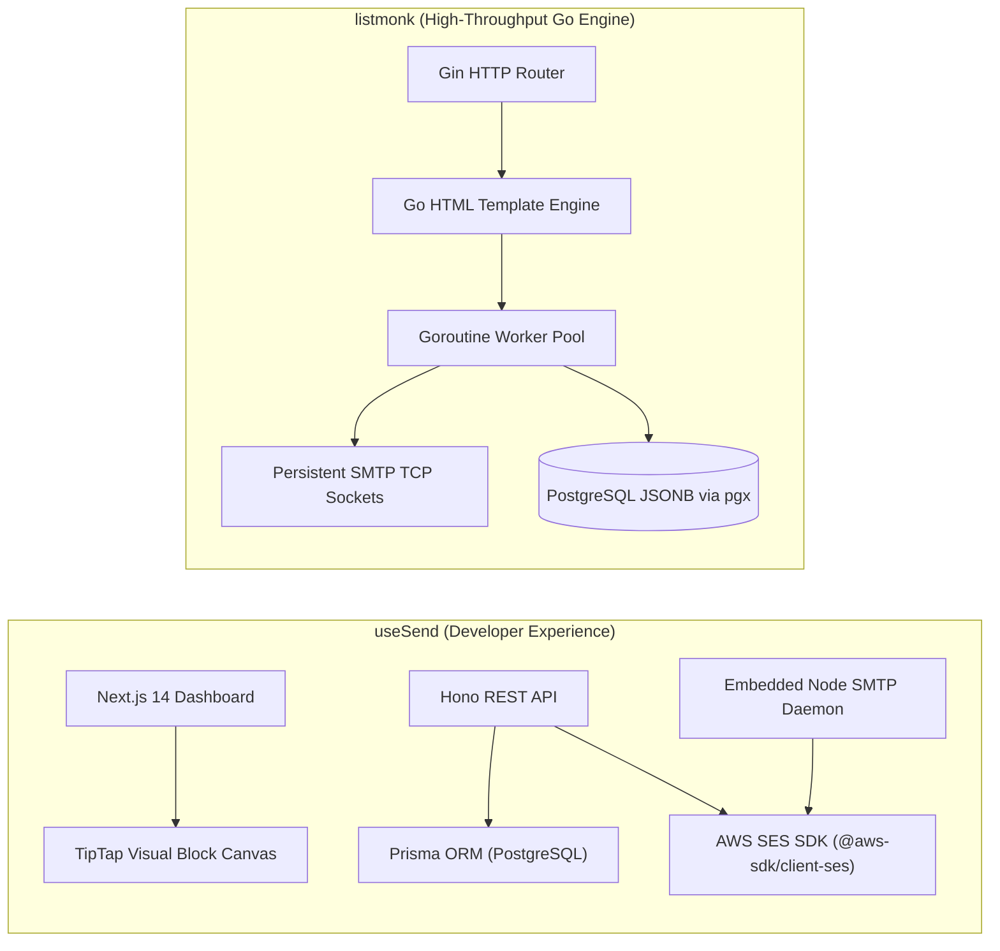
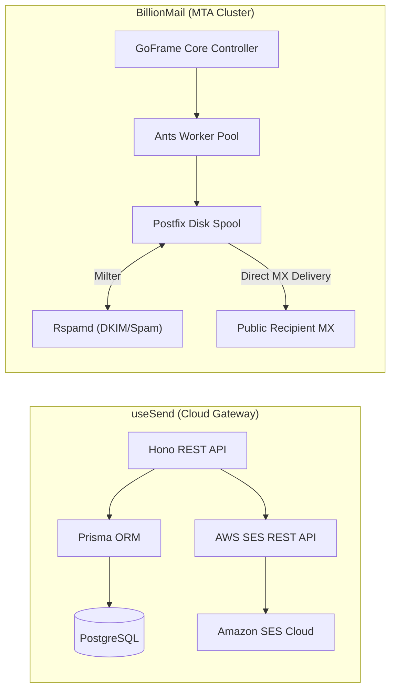
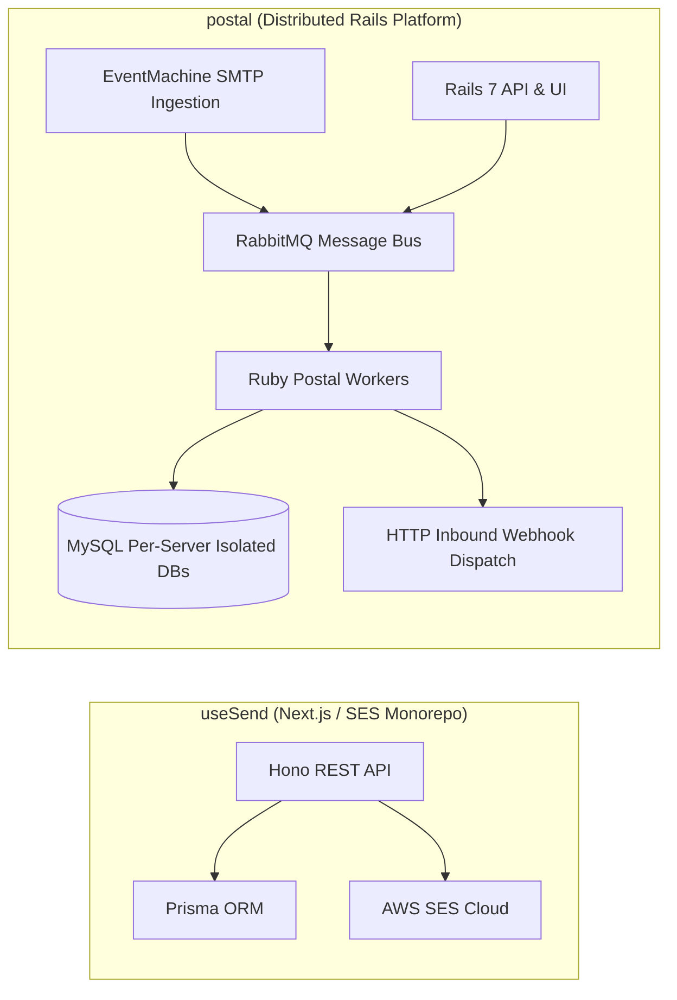
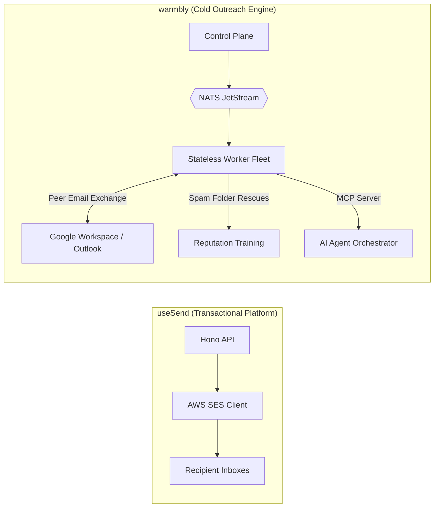
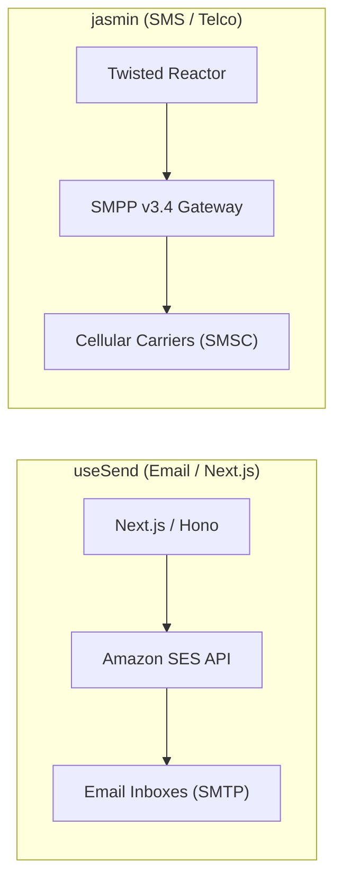

# useSend — Comparative Analysis & Category Evaluation

> **Category**: Email Infrastructure & Delivery  
> **Architectural Role**: Developer-first transactional email platform, visual block builder & SES API gateway  
> **Primary Stack**: TypeScript 5.3+ | Next.js 14 App Router, Hono | PostgreSQL (Prisma ORM) | In-process Async / SES SDK + Embedded SMTP Bridge  
> **Peer Solutions Compared**: `listmonk`, `BillionMail`, `postal`, `warmbly`, `jasmin`  
> **Commercial SaaS Benchmarks**: Resend, Postmark, SendGrid, Amazon SES  

---

## 1. Executive Overview & Technical Identity: useSend

**useSend** represents the modern developer experience (DX) and frontend-centric tier within the **Email Infrastructure & Delivery** domain. Designed as an agile, open-source alternative to Resend, useSend bridges the gap between code-driven template development and visual drag-and-drop authoring. Built entirely in TypeScript across a Turborepo monorepo, useSend couples high-speed API ingestion via **Hono** with an interactive visual block editor (`@usesend/email-editor`) built on TipTap and Radix UI. It delegates physical mail delivery and ISP reputation management to Amazon SES via `@aws-sdk/client-ses`, while maintaining an embedded Node.js SMTP server daemon (`apps/smtp-server`) to accept traditional SMTP traffic.

### Core Architectural Profile
- **Runtime & Language**: `TypeScript 5.3+` / `Node.js 20+` monorepo managed with `pnpm` and `Turborepo`
- **Core Framework**: `Next.js 14` (App Router dashboard) + `Hono` (lightweight edge-compatible transactional API)
- **Persistence Layer**: `PostgreSQL` managed via `Prisma ORM` (`apps/web/prisma/schema.prisma`)
- **Transport & Relay Engine**: Direct AWS SES SDK client (`@aws-sdk/client-ses`) + embedded Nodemailer SMTP bridge
- **Domain Specialization**: Transactional email dispatch, visual block-based email composition, and automatic DNS verification (SPF, DKIM, DMARC)

---

## 2. Peer Solution Landscape (Email Infrastructure & Delivery)

Within this category, `useSend` operates alongside the following peer solutions:

| Solution | Language & Runtime | Core Framework | Database / Cache | Queue / Concurrency | Primary Architectural Niche |
| :--- | :--- | :--- | :--- | :--- | :--- |
| **useSend** (Current) | `TypeScript / Node` | `Next.js 14, Hono` | `PostgreSQL (Prisma ORM)` | `SES SDK Async + Node SMTP` | **Modern developer experience & visual block canvas** |
| **listmonk** | `Go 1.21+` | `Gin / Native Go` | `PostgreSQL 13+ (JSONB)` | `Goroutine Pool + TCP Sockets` | Raw bulk throughput on minimal RAM |
| **BillionMail** | `Go 1.24 / Docker` | `GoFrame v2, Postfix, Dovecot` | `PostgreSQL 17.4, Redis 7.4` | `Postfix Spool + Ants Pool` | Turnkey ISP-grade mail cluster & IP warmup |
| **postal** | `Ruby 3.2+` | `Rails 7, EventMachine` | `MariaDB / MySQL, RabbitMQ` | `RabbitMQ Queues + Ruby Workers` | Virtualized multi-tenant MTA & inbound webhooks |
| **warmbly** | `Go 1.26` | `Gin, pgx/v5, go-redis` | `PostgreSQL 16+, Redis 7+` | `NATS JetStream + Stateless Fleet` | Agentic cold email, peer warmup & unibox |
| **jasmin** | `Python 3.9+` | `Twisted Async` | `Redis, RabbitMQ` | `Twisted Deferreds + AMQP` | Carrier-grade SMS gateway & SMPP v3.4 router |

---

## 3. Deep Head-to-Head Comparative Breakdown: useSend vs Peers

### 3.1. useSend vs. listmonk

**Comparative Focus**: `Developer-First TypeScript/Hono & SES Platform` vs. `High-Volume Go Campaign Engine`

#### Detailed Architectural Contrast
- **Delivery Pipeline Topology**: `useSend` acts as an application-tier transactional router. Inbound sending requests trigger Hono API routes, serialize records through Prisma ORM into PostgreSQL, and dispatch directly to Amazon SES via HTTPS API calls. `listmonk` is engineered for bulk campaign throughput, compiling recipient lists from PostgreSQL using raw SQL with `pgx` and streaming messages over persistent TCP connection pools directly to SMTP relays.
- **Queue Mechanics & Concurrency**: `useSend` executes asynchronous Node.js promise chains, offloading queuing durability and delivery throttling to AWS SES. `listmonk` manages concurrency within the Go runtime, utilizing buffered channels and worker goroutines with token-bucket rate limiters, achieving 1,500–3,500 msgs/sec compared to useSend's 300–600 msgs/sec.
- **Template Authoring UX**: `useSend` includes `@usesend/email-editor`, a modern drag-and-drop visual block builder powered by TipTap and Radix UI that outputs responsive HTML, ideal for non-technical team members. `listmonk` relies on standard HTML/Markdown text inputs rendered via Go's `html/template` engine.
- **Data Modeling & Schema**: `useSend` maintains strict compile-time TypeScript typing across its database entities (`Domain`, `Email`, `ApiKey`, `Team`) using Prisma ORM. `listmonk` models subscribers with a dynamic PostgreSQL `JSONB` attributes column, indexed via GIN for runtime ad-hoc segmentation.

#### Architectural Tradeoffs Matrix: useSend vs. listmonk

| Dimension | useSend | listmonk | Architectural Implication |
| :--- | :--- | :--- | :--- |
| **Throughput** | **300–600 msgs/sec** | **1,500–3,500 msgs/sec** | useSend is network-bound by AWS SES HTTPS round-trips; listmonk streams persistent TCP sockets. |
| **Template Authoring** | **Visual Drag-and-Drop Canvas** | **Raw HTML / Markdown** | useSend enables non-developers to build visual templates; listmonk requires HTML coding. |
| **Data Model Typing** | **Strict Prisma ORM TypeScript** | **Dynamic PostgreSQL JSONB** | useSend provides compile-time safety across frontend/backend; listmonk provides schema-free flexibility. |
| **Memory Footprint** | **~250 MB** | **<50 MB** | listmonk's compiled Go binary is drastically lighter than Next.js and Node.js runtime instances. |

---

### 3.2. useSend vs. BillionMail

**Comparative Focus**: `Agile Serverless TypeScript & SES Client` vs. `Autonomous Turnkey MTA Stack`

#### Detailed Architectural Contrast
- **Delivery Pipeline Topology**: `useSend` has no local MTA, MX listener, or spam filter; it delegates actual delivery and infrastructure management to AWS SES. `BillionMail` deploys a complete, self-contained Linux mail server cluster (Postfix MTA, Dovecot MDA, Rspamd milter, ClamAV antivirus, Lego ACME TLS) running on local VPS instances, directly terminating internet MX records.
- **Operational Complexity**: `useSend` requires only a PostgreSQL database and an AWS SES API key, deploying seamlessly in Docker or serverless environments. `BillionMail` requires managing a complex multi-container Docker stack, configuring reverse DNS (PTR), monitoring Postfix mail queues, and maintaining IP reputation.
- **Unit Economics**: `useSend` scales with variable AWS SES metered pricing (\$0.10 per 1,000 emails). `BillionMail` provides complete cost independence: sending 5,000,000 emails costs \$0 beyond the base compute VPS.

#### Architectural Tradeoffs Matrix: useSend vs. BillionMail

| Dimension | useSend | BillionMail | Architectural Implication |
| :--- | :--- | :--- | :--- |
| **Operational Overhead** | **Very Low** (Managed SES relay) | **Substantial** (Full Linux MTA cluster) | useSend requires no Linux mail administration; BillionMail requires Postfix/Dovecot ops. |
| **Cost at Scale** | **Variable Cloud Fees (\$0.10/1k)** | **Fixed VPS Cost (\$0 per email)** | BillionMail provides massive savings at 5M+ monthly sends; useSend adds up on high volume. |
| **Mailbox Hosting** | **None (Outbound API only)** | **Full IMAP/POP3 Mailbox Hosting** | BillionMail hosts actual user inboxes and Roundcube webmail; useSend only dispatches outbound mail. |
| **Template UX** | **Modern Drag-and-Drop Canvas** | **None** | useSend provides modern authoring tools; BillionMail is pure infrastructure. |

---

### 3.3. useSend vs. postal

**Comparative Focus**: `Lightweight Next.js/Hono/SES Wrapper` vs. `Industrial Multi-Tenant Private MTA`

#### Detailed Architectural Contrast
- **Infrastructure Architecture**: `useSend` is a fullstack web application written in modern TypeScript (Next.js 14, Hono, Prisma) designed to operate as a developer wrapper over Amazon SES. `postal` is a full-featured open-source mail delivery platform written in Ruby on Rails and EventMachine that manages its own RabbitMQ message broker, MX routing, and delivery daemons.
- **Inbound Webhook Streaming**: `postal` includes a complete inbound email processing pipeline: incoming emails are received via SMTP, parsed, and converted into structured JSON payloads delivered to customer HTTP webhooks. `useSend` has no native inbound MX processing, relying on AWS SES event webhooks for bounces and complaints.
- **Multi-Tenancy Model**: `useSend` implements team-based multi-tenancy at the application layer via Prisma relational tables. `postal` enforces hard multi-tenant isolation by dynamically generating independent MySQL databases (`postal-server-X`) for each virtual mail server.

#### Architectural Tradeoffs Matrix: useSend vs. postal

| Dimension | useSend | postal | Architectural Implication |
| :--- | :--- | :--- | :--- |
| **MTA Independence** | **Dependent on AWS SES** | **Fully Independent Private MTA** | Postal operates directly on port 25; useSend requires an external cloud delivery service. |
| **Inbound Processing** | **None (Bounce/Complaint only)** | **Full Inbound-to-Webhook Engine** | Postal transforms incoming emails into webhooks; useSend is strictly an outbound sender. |
| **Developer UX & Stack**| **Modern TypeScript / Next.js 14** | **Ruby on Rails 7 & EventMachine** | useSend aligns with modern TypeScript fullstack teams; Postal requires Ruby/RabbitMQ expertise. |
| **Template Building** | **TipTap Block Visual Editor** | **Raw HTML / Plain Text** | useSend includes visual block canvas; Postal expects pre-rendered HTML payloads. |

---

### 3.4. useSend vs. warmbly

**Comparative Focus**: `Transactional Template Builder & SES Client` vs. `Agentic Cold Email Deliverability Platform & Peer Warmup Network`

#### Detailed Architectural Contrast
- **Target Workload**: `useSend` is built for transactional triggers (order confirmations, password resets, welcome emails) sent to warm, opt-in users via Amazon SES. `warmbly` is engineered for cold outbound sales outreach, where emails are sent to uncontacted prospects across dozens of rotating Google Workspace and Microsoft 365 mailboxes.
- **Queue & Worker Architecture**: `useSend` relies on in-process async Node.js calls to AWS SES. `warmbly` implements a decoupled control-plane / execution-plane architecture utilizing **NATS JetStream** or Kafka: stateless Go workers pull tasks from event streams and execute mailbox syncs and peer warmup exchanges without touching PostgreSQL.
- **Deliverability Automation**: `useSend` provides passive DNS record verification (DKIM, SPF, DMARC) via DNS over HTTPS (DoH). `warmbly` runs an active peer warmup network that programmatically opens emails, marks them as important, and rescues them from spam folders to train ISP spam filters.
- **AI / Agentic Capabilities**: `useSend` has no AI orchestration. `warmbly` embeds an official Model Context Protocol (MCP) server and AI inbox agent (`ai_inbox_agent.go`) for autonomous response classification and drafting.

#### Architectural Tradeoffs Matrix: useSend vs. warmbly

| Dimension | useSend | warmbly | Architectural Implication |
| :--- | :--- | :--- | :--- |
| **Email Category** | **Transactional (Opt-in Customers)** | **Cold Outreach (Outbound Prospects)** | useSend sends instant transactional alerts; warmbly executes paced cold sales campaigns. |
| **Worker Architecture** | **In-Process Next.js / Hono** | **Stateless Go Worker Fleet over NATS** | warmbly workers scale horizontally without DB pool exhaustion; useSend runs in-process. |
| **Deliverability Logic** | **Static DNS Verification** | **Active Peer Warmup & Spam Rescue** | warmbly repairs poor domain reputation; useSend relies on clean lists to avoid SES suspension. |
| **AI / Agent Support** | **None** | **Native Model Context Protocol (MCP)** | warmbly integrates with Claude Code and AI agents; useSend is human/API triggered. |

---

### 3.5. useSend vs. jasmin

**Comparative Focus**: `TypeScript Transactional Email API` vs. `Python Twisted Carrier SMS/SMPP Gateway`

#### Detailed Architectural Contrast
- **Protocol Tier & Transport**: `useSend` operates over HTTPS, interacting with AWS SES to format and transmit HTML email documents. `jasmin` operates at the telecommunications layer, implementing the binary **SMPP v3.4** protocol over persistent TCP sockets to send SMS messages through cellular Mobile Network Operators (MNOs).
- **Core Engine Mechanics**: `useSend` is built on TypeScript, Next.js 14, Hono, and Prisma. `jasmin` is an asynchronous event-driven Python daemon powered by Twisted, Redis, and RabbitMQ, executing real-time Least-Cost Routing (LCR) and carrier delivery receipts (DLR).

#### Architectural Tradeoffs Matrix: useSend vs. jasmin

| Dimension | useSend | jasmin | Architectural Implication |
| :--- | :--- | :--- | :--- |
| **Medium** | **HTML Transactional Email** | **Cellular SMS (Short Message Service)** | Solves email notifications vs mobile SMS text dispatch. |
| **Runtime Stack** | **TypeScript / Next.js / Prisma** | **Python Twisted / Redis / RabbitMQ** | Modern fullstack TypeScript vs event-driven Python telco stack. |
| **Infrastructure Tier** | **Cloud API Wrapper (Amazon SES)** | **Carrier Protocol Engine (SMPP v3.4)** | useSend consumes cloud APIs; Jasmin bridges directly to telco infrastructure. |

---

## 4. Capability & Feature Comparison Matrix

| Dimension / Capability | useSend | listmonk | BillionMail | postal | warmbly | jasmin |
| :--- | :---: | :---: | :---: | :---: | :---: | :---: |
| **Primary Architectural Niche** | **Modern developer experience & visual block canvas** | Raw bulk throughput on minimal RAM | Turnkey ISP-grade mail cluster & IP warmup | Virtualized multi-tenant MTA & inbound webhooks | Agentic cold email, peer warmup & unibox | Carrier-grade SMS gateway & SMPP v3.4 router |
| **Runtime Language** | `TypeScript / Node` | `Go 1.21+` | `Go 1.24 / Docker` | `Ruby 3.2+` | `Go 1.26` | `Python 3.9+` |
| **Database Persistence** | `PostgreSQL (Prisma)` | `PostgreSQL (JSONB)` | `PostgreSQL 17.4, Redis` | `MariaDB / MySQL` | `PostgreSQL 16, Redis` | `Redis, RabbitMQ` |
| **Async Execution Model** | `SES SDK Async + Node SMTP` | `Goroutine Pool + TCP Sockets` | `Postfix Spool + Ants Pool` | `RabbitMQ + Ruby Workers` | `NATS JetStream + Stateless Fleet` | `Twisted Deferreds + AMQP` |
| **Visual Drag-and-Drop Editor**| ✅ TipTap Canvas | ❌ HTML / Markdown | ❌ | ❌ | ❌ | ❌ |
| **Embedded SMTP Server** | ✅ Node.js Bridge | ❌ Relay client | ✅ Postfix (C daemon) | ✅ EventMachine (Ruby) | ❌ Client only | ❌ (SMPP only) |
| **Automatic DNS Verification** | ✅ DoH Polling | ❌ | ✅ Miekg/dns Validator | ⚠️ Web UI checks | ⚠️ Account check | ❌ |
| **Public MX Receiver (Inbound)**| ❌ Relay only | ❌ Relay only | ✅ Postfix + Dovecot | ✅ EventMachine SMTP | ❌ Client polling only | ✅ Carrier SMS Gateway |
| **Peak Throughput** | **300–600 msgs/sec** | **1,500–3,500+ msgs/sec** | **500–1,200 msgs/sec** | **400–800 msgs/sec** | **20–100/day per box** | **1,000–2,500 SMS/sec** |
| **Resource Footprint (RAM)** | **~250 MB** | **<50 MB** | **~1.5 GB** | **~1.2 GB** | **~80 MB** | **~300 MB** |

---

## 5. Commercial Benchmark Positioning

When benchmarked against commercial SaaS leaders (**Resend, Postmark, SendGrid, Amazon SES**):
- **Resend Open-Source Alternative**: `useSend` captures the clean developer experience, React/TypeScript alignment, and modern dashboard aesthetics that popularized Resend, while allowing teams to retain full source-level control.
- **Visual Builder Inclusion**: Unlike raw developer APIs (SendGrid, Postmark) that force teams to either write raw HTML strings or pay for separate third-party template tools, useSend packages a rich drag-and-drop block editor directly into the core platform.
- **Cloud Dependency**: Because useSend relies on AWS SES for physical delivery, users remain subject to AWS SES sending limits, bounce rate thresholds (<5%), and per-thousand email fees.

---

## 6. Strategic Takeaways & Role for MarketingStudio

In the unified **MarketingStudio** architecture:
1. **Primary Component to Adopt**: Extract and integrate useSend's `@usesend/email-editor` package as the primary visual email composer across MarketingStudio's campaign and transactional builders.
2. **Developer API Seam**: Adopt useSend's Hono API design and Prisma database models for MarketingStudio's internal transactional email microservice.
3. **Peer Coexistence**:
   - Utilize `useSend`'s visual block canvas to design marketing newsletters, but dispatch them via `listmonk` for maximum throughput and minimal RAM usage.
   - Route high-volume transactional sends through `postal` or `BillionMail` when zero-variable-cost self-hosted delivery is required.
   - Utilize `warmbly` to maintain sender reputation for mailboxes assigned to automated sequences.
