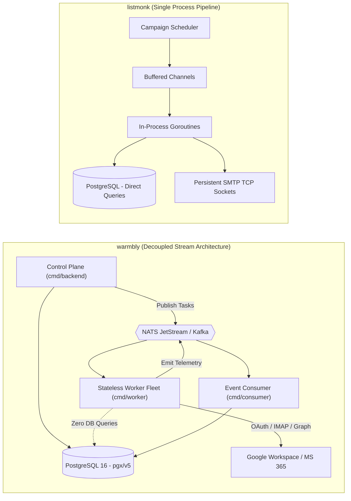
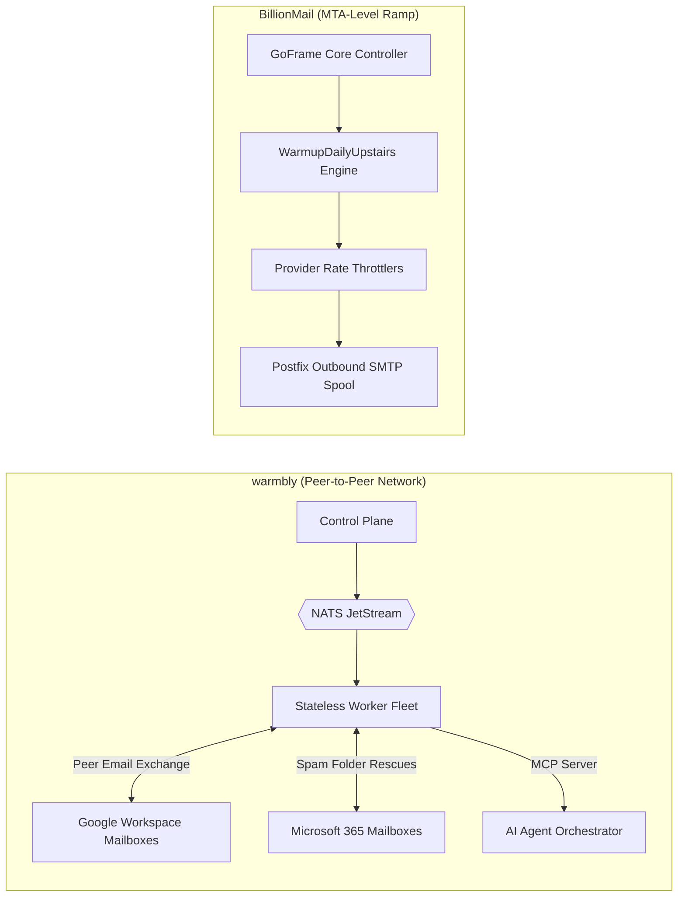
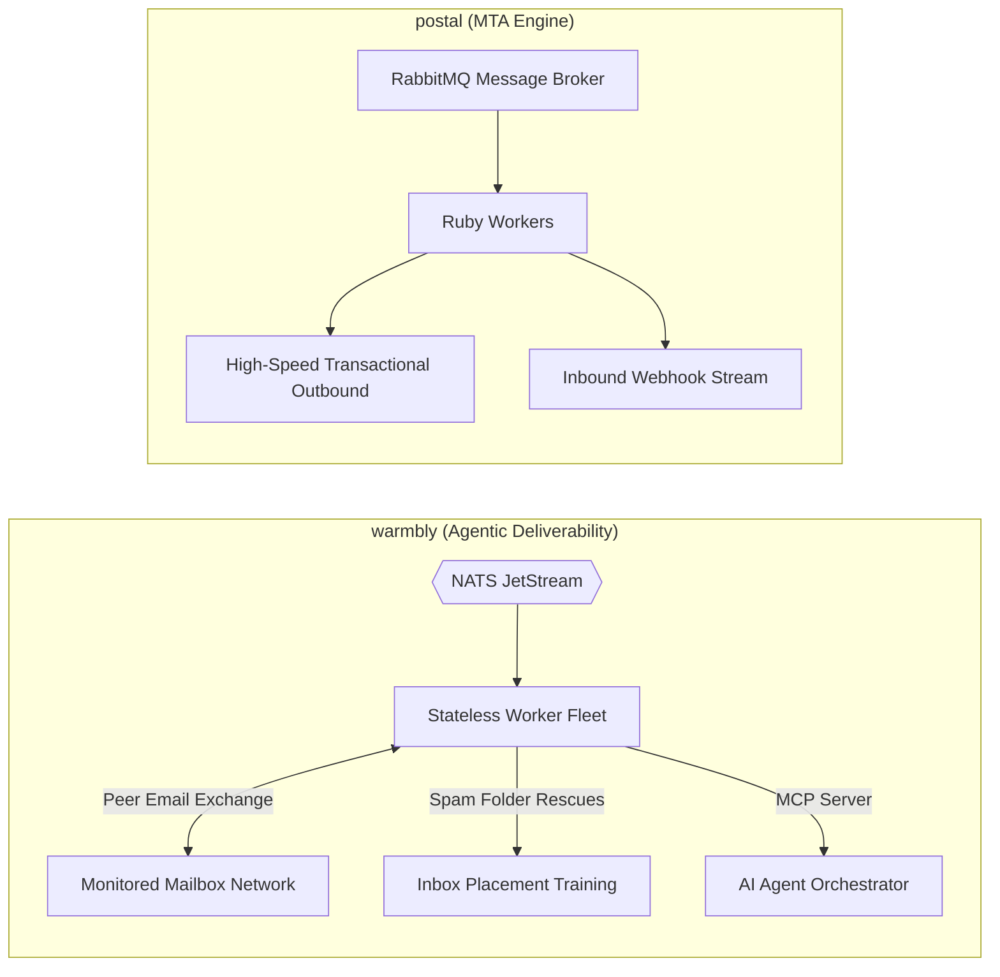
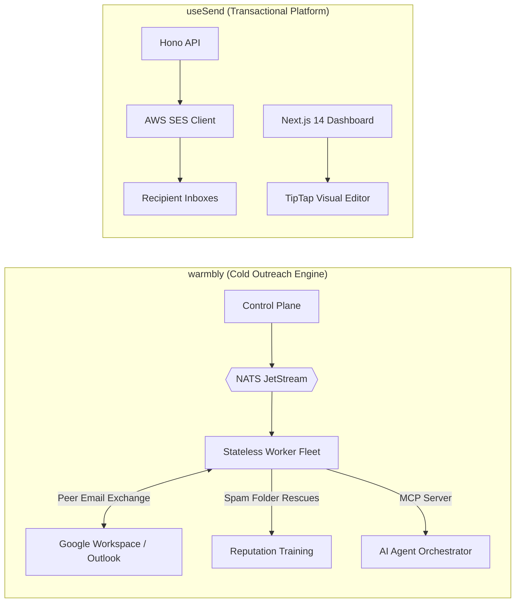
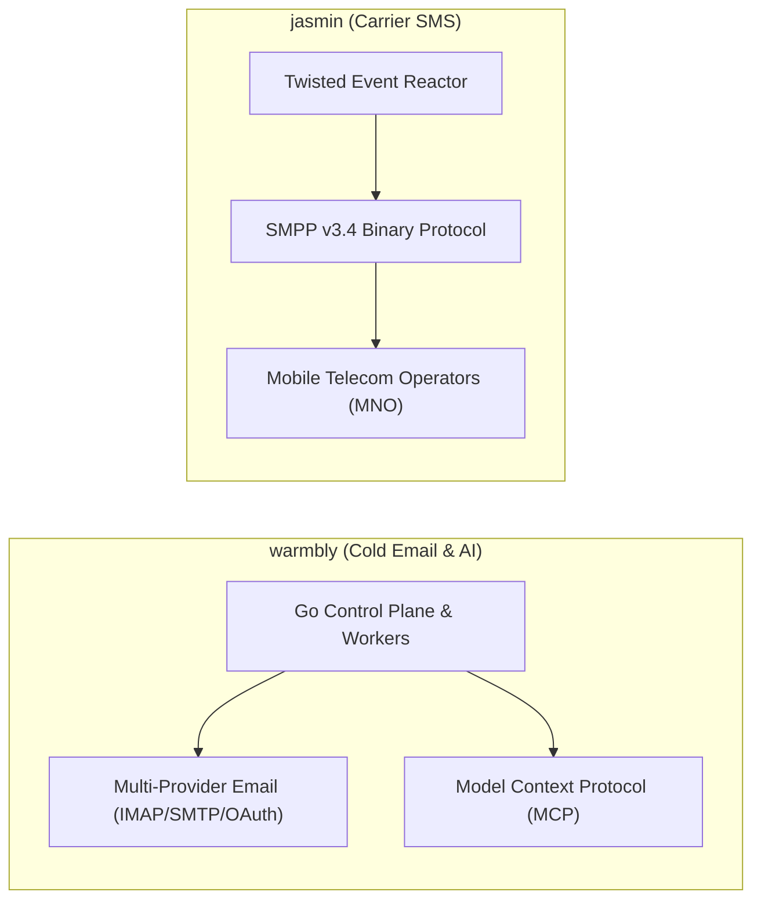

# warmbly — Comparative Analysis & Category Evaluation

> **Category**: Email Infrastructure & Delivery  
> **Architectural Role**: Autonomous agentic cold email platform, monitored peer warmup network & unified inbox engine  
> **Primary Stack**: Go 1.26 | Gin, pgx/v5, go-redis/v9 | PostgreSQL 16+, Redis 7+ | NATS JetStream / Kafka + Stateless Go Worker Fleet  
> **Peer Solutions Compared**: `listmonk`, `BillionMail`, `postal`, `useSend`, `jasmin`  
> **Commercial SaaS Benchmarks**: Instantly.ai, Lemlist, Smartlead, Clay, Close CRM  

---

## 1. Executive Overview & Technical Identity: warmbly

**warmbly** represents the outbound deliverability and agentic automation tier within the **Email Infrastructure & Delivery** domain. Designed to replace proprietary cold outreach stacks (such as Instantly, Lemlist, and Smartlead), warmbly executes outreach campaigns directly through existing user email accounts (Google Workspace, Microsoft 365, generic SMTP/IMAP) while continuously elevating sender domain reputation through a collaborative, monitored peer-to-peer warmup network.

Its architectural hallmark is a strict **control-plane and execution-plane separation**: the backend control plane (`cmd/backend`, `cmd/consumer`) manages business logic in PostgreSQL 16, publishing execution envelopes to a distributed message bus (**NATS JetStream** or Apache Kafka). A horizontally scalable fleet of stateless Go workers (`cmd/worker`) pulls tasks and interacts with external mail APIs without ever establishing a database connection, completely insulating PostgreSQL from connection pool exhaustion. Furthermore, warmbly natively implements a first-party **Model Context Protocol (MCP)** server, enabling LLMs to review prospect replies, classify sentiment, and draft follow-ups.

### Core Architectural Profile
- **Runtime & Language**: `Go 1.26` (high-concurrency compiled binaries) + React 19 / TypeScript frontend
- **Core Framework**: `Gin` HTTP engine with custom error wrappers (`errx`) and CORS middleware
- **Persistence Layer**: `PostgreSQL 16+` via `jackc/pgx/v5` connection pools + `Redis 7+` via `go-redis/v9` for locks (`redsync`) and rate limits
- **Queue & Message Bus**: `NATS JetStream` / `Apache Kafka` event streaming, driving a fleet of stateless execution workers
- **Domain Specialization**: Peer-to-peer cold email deliverability warmup, automated spam folder rescue, unified multi-mailbox inbox (`unibox`), and AI-driven CRM sequences

---

## 2. Peer Solution Landscape (Email Infrastructure & Delivery)

Within this category, `warmbly` operates alongside the following peer solutions:

| Solution | Language & Runtime | Core Framework | Database / Cache | Queue / Concurrency | Primary Architectural Niche |
| :--- | :--- | :--- | :--- | :--- | :--- |
| **warmbly** (Current) | `Go 1.26` | `Gin, pgx/v5, go-redis` | `PostgreSQL 16+, Redis 7+` | `NATS JetStream + Stateless Fleet` | **Agentic cold email, peer warmup & unibox** |
| **listmonk** | `Go 1.21+` | `Gin / Native Go` | `PostgreSQL 13+ (JSONB)` | `Goroutine Pool + TCP Sockets` | Raw bulk throughput on minimal RAM |
| **BillionMail** | `Go 1.24 / Docker` | `GoFrame v2, Postfix, Dovecot` | `PostgreSQL 17.4, Redis 7.4` | `Postfix Spool + Ants Pool` | Turnkey ISP-grade mail cluster & IP warmup |
| **postal** | `Ruby 3.2+` | `Rails 7, EventMachine` | `MariaDB / MySQL, RabbitMQ` | `RabbitMQ Queues + Ruby Workers` | Virtualized multi-tenant MTA & inbound webhooks |
| **useSend** | `TypeScript / Node` | `Next.js 14, Hono` | `PostgreSQL (Prisma ORM)` | `SES SDK Async + Node SMTP` | Modern developer experience & visual block canvas |
| **jasmin** | `Python 3.9+` | `Twisted Async` | `Redis, RabbitMQ` | `Twisted Deferreds + AMQP` | Carrier-grade SMS gateway & SMPP v3.4 router |

---

## 3. Deep Head-to-Head Comparative Breakdown: warmbly vs Peers

### 3.1. warmbly vs. listmonk

**Comparative Focus**: `Decoupled Agentic Cold Outreach & Peer Warmup Platform` vs. `Opt-in Bulk Newsletter Dispatcher`

#### Detailed Architectural Contrast
- **Delivery Pipeline Topology & Goals**: `warmbly` targets cold outbound sales outreach. It paces sends intentionally to 20–50 emails per day per mailbox across multiple domains to prevent spam classification, running an active peer-to-peer warmup network where participant accounts open, star, and rescue emails from spam folders. `listmonk` targets opt-in newsletters and mass alerts, optimizing for maximum throughput (1,500–3,500 msgs/sec) over persistent TCP socket connections.
- **Queue Mechanics & Scalability**: `warmbly` strictly enforces a decoupled architecture: workers consume tasks from **NATS JetStream** consumer groups and **never connect to PostgreSQL**, allowing the worker fleet to scale to hundreds of nodes across disparate networks without exhausting database connections. `listmonk` runs workers in-process, querying PostgreSQL directly using `pgx` connection pools.
- **Data Persistence & Domain Model**: `warmbly` tracks mailbox health, daily quotas, warmup sequences, and multi-turn conversational threads (`email_threads`, `crm_leads`). `listmonk` models subscribers with a dynamic `JSONB` column, utilizing GIN indexing and SQL CTEs for list segmentation.
- **AI Agent Automation**: `warmbly` embeds an official Model Context Protocol (MCP) server and AI inbox agent framework (`ai_inbox_agent.go`), allowing LLMs to inspect prospect replies in the unibox and draft responses. `listmonk` contains no AI or agent tooling.

#### Architectural Tradeoffs Matrix: warmbly vs. listmonk

| Dimension | warmbly | listmonk | Architectural Implication |
| :--- | :--- | :--- | :--- |
| **Sending Velocity** | **Paced (20–50/day per box)** | **Extreme (1,500–3,500 msgs/sec)** | warmbly avoids ISP rate limits via human simulation; listmonk flushes bulk queues at maximum speed. |
| **Worker Scalability** | **Infinite (Stateless via NATS)** | **Bounded by DB Connection Limits** | warmbly workers never query PostgreSQL; listmonk workers query the central database directly. |
| **Deliverability Logic** | **Active Peer Warmup & Spam Rescue** | **Passive Bounce Processing** | warmbly programmatically repairs domain reputation; listmonk requires pre-warmed infrastructure. |
| **Agent / MCP Support** | **Native Model Context Protocol Server** | **None** | warmbly can be orchestrated directly by autonomous AI agents; listmonk is human-operated. |

---

### 3.2. warmbly vs. BillionMail

**Comparative Focus**: `Agentic Peer-to-Peer Warmup Network & Unibox` vs. `ISP-Level Multi-IP Warmup Engine`

#### Detailed Architectural Contrast
- **Warmup Methodology**: `warmbly` operates an active, collaborative **peer network**: business accounts connected by different organizations exchange multi-turn, AI-generated emails. If an email lands in a recipient's spam folder, the recipient worker rescues the email, marks it as important, and stars it, training ISP neural filters (Gmail Priority Inbox, Microsoft SmartScreen) to classify the sender domain as trusted. `BillionMail` uses passive outbound rate throttling (`WarmupDailyUpstairs` with 30% daily step-ups) to prevent new server IPs from exceeding ISP velocity thresholds.
- **Infrastructure Footprint**: `warmbly` does not run an MTA or mail server; it acts as an intelligent client connecting to external email providers (Google Workspace, Microsoft 365, IMAP/SMTP). `BillionMail` is a complete self-hosted mail server cluster (Postfix, Dovecot, Rspamd, ClamAV) replacing external providers entirely.
- **Unified Inbox (`unibox`)**: `warmbly` features a centralized multi-account unibox synchronizing threads across dozens of disconnected Google and Microsoft accounts in real time via WebSockets. `BillionMail` provides standard IMAP/POP3 access and Roundcube webmail for hosted accounts.

#### Architectural Tradeoffs Matrix: warmbly vs. BillionMail

| Dimension | warmbly | BillionMail | Architectural Implication |
| :--- | :--- | :--- | :--- |
| **Warmup Strategy** | **Collaborative Peer Spam Rescue** | **Outbound Rate-Ramp Throttling** | warmbly creates positive engagement signals; BillionMail prevents IP burning via rate caps. |
| **Infrastructure Role** | **Multi-Account Client & Unibox** | **Full Self-Hosted Mail Server** | warmbly orchestrates external accounts; BillionMail runs the physical mail infrastructure. |
| **AI / Agentic Reach** | **Native MCP Server & Response Agents** | **None** | warmbly exposes tools to LLMs for automated email triage; BillionMail is infrastructure-focused. |
| **Operational Stack** | **Go + NATS + Redis + Postgres** | **Go + Postfix + Dovecot + Rspamd** | warmbly requires message streaming ops; BillionMail requires Linux mail server sysadmin. |

---

### 3.3. warmbly vs. postal

**Comparative Focus**: `Autonomous Cold Email Deliverability Platform` vs. `Transactional High-Throughput MTA`

#### Detailed Architectural Contrast
- **Core Mission**: `warmbly` is engineered for outbound prospecting, sales cadences, and domain warmup, ensuring emails reach human inboxes rather than promotional or spam tabs. `postal` is an industrial-strength transactional MTA designed to dispatch mission-critical application emails (receipts, password resets) in sub-second timeframes and convert incoming replies into HTTP webhooks.
- **Broker & Queue Topologies**: `warmbly` relies on **NATS JetStream** or Kafka event streams, pairing them with an elastic fleet of stateless Go workers. `postal` uses RabbitMQ queues with Ruby EventMachine listeners, writing transmission logs to dynamic, per-server MySQL databases.
- **Deliverability Tooling**: `postal` provides dedicated IP pool assignment and DKIM generation per virtual server. `warmbly` provides real-time mailbox health scoring, reply-rate simulation, automated spam rescues, and gradual sending ramp-ups.

#### Architectural Tradeoffs Matrix: warmbly vs. postal

| Dimension | warmbly | postal | Architectural Implication |
| :--- | :--- | :--- | :--- |
| **Workload Type** | **Cold Outbound & Deliverability Warmup**| **Transactional & System Messaging** | warmbly manages paced sales cadences; Postal handles high-speed transactional bursts. |
| **Database Architecture**| **Single PostgreSQL Core (Workers Detached)**| **Dynamic Per-Server Isolated MySQL DBs** | warmbly workers never connect to DB; Postal writes every message to dedicated server DBs. |
| **Inbound Handling** | **Unified Multi-Mailbox Unibox** | **Inbound MX to HTTP Webhook Translation** | warmbly aggregates inboxes for human/AI review; Postal routes emails to software endpoints. |
| **AI Integration** | **Native Model Context Protocol (MCP)** | **None** | warmbly provides agentic tools out of the box; Postal is an application developer tool. |

---

### 3.4. warmbly vs. useSend

**Comparative Focus**: `Agentic Cold Email Deliverability Platform & Peer Warmup Network` vs. `Transactional Template Builder & SES Client`

#### Detailed Architectural Contrast
- **Audience & Context**: `warmbly` is designed for sales development representatives (SDRs) and outbound marketers reaching cold prospects across unverified domains. `useSend` is built for product teams sending transactional messages to verified opt-in users via Amazon SES.
- **Sending Infrastructure**: `warmbly` rotates sends across multiple connected business accounts (Google Workspace, Microsoft 365, private SMTP) to distribute volume. `useSend` routes all traffic through a centralized AWS SES account, risking account-level suspension if bounce or complaint rates exceed Amazon's strict thresholds.
- **Template Authoring UX**: `useSend` features `@usesend/email-editor`, a drag-and-drop block email editor built on TipTap and Radix UI. `warmbly` provides plain-text and lightweight HTML drafting optimized for cold outreach, prioritizing conversational realism over rich graphical styling.

#### Architectural Tradeoffs Matrix: warmbly vs. useSend

| Dimension | warmbly | useSend | Architectural Implication |
| :--- | :--- | :--- | :--- |
| **Email Paradigm** | **Cold Outbound Sales & Warmup** | **Transactional Application Email** | warmbly paces multi-inbox rotation; useSend sends immediate transactional alerts. |
| **Template Design** | **Plain-Text & Conversational HTML** | **Visual Drag-and-Drop Canvas** | useSend is designed for branded marketing/product emails; warmbly mimics human 1-to-1 notes. |
| **Worker Architecture** | **Stateless Go Worker Fleet over NATS** | **In-Process Next.js / Hono Async** | warmbly scales workers across machines; useSend runs in-process with AWS SES API calls. |
| **Deliverability Safeguards**| **Automated Peer Warmup & Spam Rescues** | **Passive DNS Verification** | warmbly actively manages sender reputation; useSend delegates delivery to AWS SES. |

---

### 3.5. warmbly vs. jasmin

**Comparative Focus**: `Agentic Multi-Mailbox Outreach & Warmup Engine` vs. `Carrier SMS/SMPP Gateway`

#### Detailed Architectural Contrast
- **Communication Channel**: `warmbly` operates across corporate email protocols (IMAP, SMTP, Google Workspace API, Microsoft Graph API). `jasmin` operates in telecommunications, implementing **SMPP v3.4** to communicate directly with mobile carrier SMS centers.
- **Concurrency & Architecture**: `warmbly` uses Go 1.26 with NATS JetStream event streaming to pace human-like email sending. `jasmin` uses Python Twisted to route thousands of SMS messages per second with real-time balance enforcement and least-cost routing.

#### Architectural Tradeoffs Matrix: warmbly vs. jasmin

| Dimension | warmbly | jasmin | Architectural Implication |
| :--- | :--- | :--- | :--- |
| **Medium** | **Cold Email & Peer Warmup Network** | **Cellular SMS (Short Message Service)** | Solves email sales outreach vs mobile text messaging. |
| **Throughput Target** | **Intentional Low-Volume (20–50/day/box)**| **1,000–2,500 SMS/sec** | Jasmin maximizes routing speed; warmbly throttles to prevent spam detection. |
| **AI Integration** | **Native MCP Server & Inbox Agents** | **None** | warmbly exposes tools to LLMs; Jasmin is a carrier routing daemon. |

---

## 4. Capability & Feature Comparison Matrix

| Dimension / Capability | warmbly | listmonk | BillionMail | postal | useSend | jasmin |
| :--- | :---: | :---: | :---: | :---: | :---: | :---: |
| **Primary Architectural Niche** | **Agentic cold email, peer warmup & unibox** | Raw bulk throughput on minimal RAM | Turnkey ISP-grade mail cluster & IP warmup | Virtualized multi-tenant MTA & inbound webhooks | Modern developer experience & visual block canvas | Carrier-grade SMS gateway & SMPP v3.4 router |
| **Runtime Language** | `Go 1.26` | `Go 1.21+` | `Go 1.24 / Docker` | `Ruby 3.2+` | `TypeScript / Node` | `Python 3.9+` |
| **Database Persistence** | `PostgreSQL 16, Redis` | `PostgreSQL (JSONB)` | `PostgreSQL 17.4, Redis` | `MariaDB / MySQL` | `PostgreSQL (Prisma)` | `Redis, RabbitMQ` |
| **Async Execution Model** | `NATS JetStream + Stateless Fleet` | `Goroutine Pool + TCP Sockets` | `Postfix Spool + Ants Pool` | `RabbitMQ + Ruby Workers` | `SES SDK Async + Node SMTP`| `Twisted Deferreds + AMQP` |
| **Automated Peer Warmup** | ✅ Peer Network + Spam Rescue| ❌ | ✅ Rate ramp only | ❌ | ❌ | ❌ |
| **Multi-Inbox Rotation** | ✅ Google, MS 365, SMTP | ❌ | ⚠️ Domain mailboxes | ❌ | ❌ | ❌ |
| **Unified Inbox (`unibox`)** | ✅ Real-time WebSocket Sync | ❌ | ⚠️ Roundcube Webmail | ❌ | ❌ | ❌ |
| **Native AI / MCP Support** | ✅ First-Party MCP Server | ❌ | ❌ | ❌ | ❌ | ❌ |
| **Resource Footprint (RAM)** | **~80 MB** | **<50 MB** | **~1.5 GB** | **~1.2 GB** | **~250 MB** | **~300 MB** |

---

## 5. Commercial Benchmark Positioning

When benchmarked against commercial SaaS leaders (**Instantly.ai, Lemlist, Smartlead, Clay**):
- **SaaS Cost Replacement**: Proprietary cold outreach platforms charge \$97 to \$297/month for multi-inbox warmup and sending. Warmbly provides the identical peer-to-peer reputation ramp and unified inbox completely free and open source.
- **Stateless Architecture**: By decoupling workers from PostgreSQL via NATS JetStream, warmbly can scale to thousands of mailboxes without encountering the database connection bottlenecks common in competing open-source scripts.
- **Agentic Future-Proofing**: Warmbly's first-party Model Context Protocol (MCP) server enables AI development environments (Claude Code, Cursor, Windsurf) to monitor, triage, and reply to leads programmatically.

---

## 6. Strategic Takeaways & Role for MarketingStudio

In the unified **MarketingStudio** architecture:
1. **Primary Component to Adopt**: Integrate warmbly's automated peer warmup network and multi-mailbox rotation engine to protect MarketingStudio domains.
2. **Unified Inbox Seam**: Adopt warmbly's `unibox` WebSocket architecture to aggregate customer email conversations into MarketingStudio's Omnichannel CRM.
3. **Peer Coexistence**:
   - Utilize `warmbly` to warm up new mailboxes and run low-volume cold cadences.
   - Hand off high-volume newsletter and announcement lists to `listmonk`.
   - Route transactional system events through `postal` or `BillionMail`.
   - Embed `useSend`'s visual block builder for template authoring.
