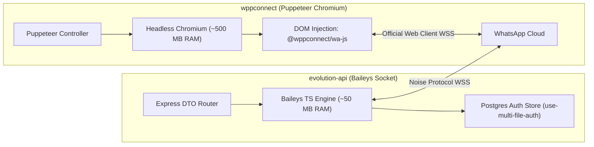
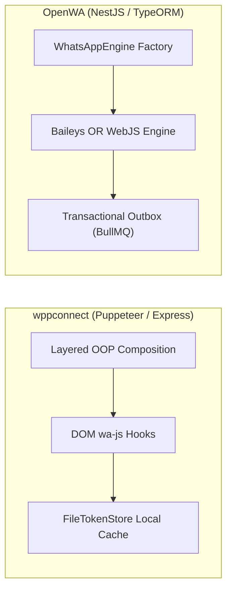
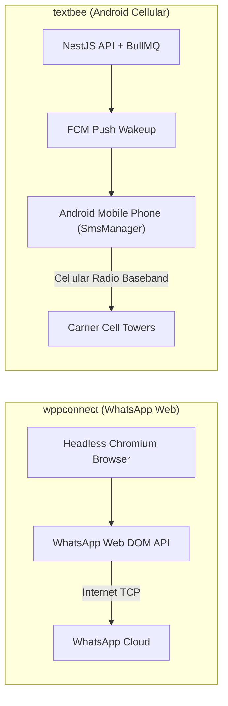
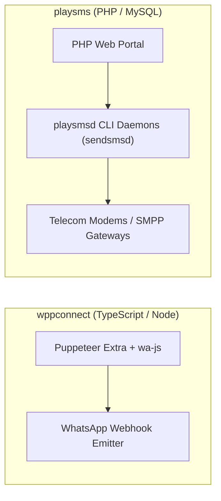
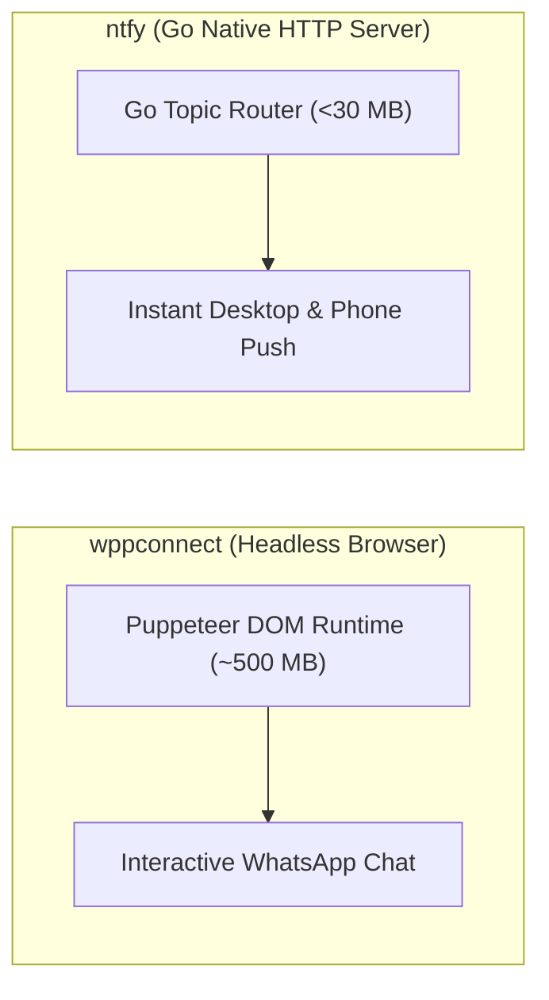

# wppconnect — Comparative Analysis & Category Evaluation

> **Category**: WhatsApp & Messaging Gateways  
> **Architectural Role**: Headless-browser WhatsApp Web automation framework & DOM injector  
> **Primary Stack**: TypeScript 5.9+, Node.js 20+ | Puppeteer Extra, @wppconnect/wa-js, Sharp | FileTokenStore / SQLite / Memory | Node EventEmitter  
> **Peer Solutions Compared**: `evolution-api`, `OpenWA`, `textbee`, `playsms`, `ntfy`  
> **Commercial SaaS Benchmarks**: WhatsApp Cloud API (Meta), Twilio WhatsApp, Respond.io, Wati, ManyChat  

---

## 1. Executive Overview & Technical Identity: wppconnect

**wppconnect** represents the browser-fidelity and anti-ban automation standard within the **WhatsApp & Messaging Gateways** domain, distinguished by its core focus on **In-browser DOM module hooking (`@wppconnect/wa-js`), Puppeteer stealth bot evasion, and official WhatsApp Web protocol fidelity**.

### Core Architectural Profile
- **Runtime & Language**: `TypeScript 5.9+`, `Node.js 20+ LTS` (ES2022)
- **Core Framework**: `puppeteer` (v24.x), `puppeteer-extra-plugin-stealth`, `@wppconnect/wa-js`
- **Persistence Layer**: `FileTokenStore` (local JSON tokens), `MemoryTokenStore`, browser IndexedDB / localStorage
- **Concurrency & Queue Model**: Node.js `EventEmitter` event loop + Chromium browser process management
- **Domain Specialization**: `Headless Chromium WhatsApp automation, WhatsApp Channels (Newsletters), Catalogs & Polls`

---

## 2. Peer Solution Landscape (WhatsApp & Messaging Gateways)

Within this category, `wppconnect` operates alongside the following peer solutions:

| Solution | Language & Runtime | Core Framework | Database / Cache | Queue / Concurrency | Primary Architectural Niche |
| :--- | :--- | :--- | :--- | :--- | :--- |
| **wppconnect** (Current) | `TypeScript / Node 20+`| `Express, Puppeteer` | `Local Disk / SQLite` | `Node Event Emitters` | **Complete browser-level WhatsApp Web emulation via Chromium DOM** |
| **evolution-api** | `TypeScript / Node 20+`| `Express, Baileys, Prisma` | `PostgreSQL / MySQL, Redis`| `RabbitMQ / Kafka / SQS` | Direct binary socket WhatsApp with minimal RAM & DB auth |
| **OpenWA** | `TypeScript / Node 22+`| `NestJS 11+, TypeORM` | `PostgreSQL, Redis` | `BullMQ Transactional Outbox`| Pluggable dual-engine (Baileys & WWebJS) with send idempotency |
| **textbee** | `TypeScript & Kotlin` | `NestJS 11+, Android SDK` | `MongoDB 7+, Redis` | `BullMQ Pacing Engine` | Decentralized carrier SMS using physical Android handsets |
| **playsms** | `PHP 8.1+` | `Native PHP, CLI Daemons` | `MySQL 8.0+` | `playsmsd Background Daemons`| Classical carrier-grade SMS portal with prefix rating & SMPP |
| **ntfy** | `Go 1.26+` | `Native Go net/http` | `SQLite / PostgreSQL` | `Go Channels / sync.Map` | Ultra-fast zero-dependency push notification daemon (<30MB) |

---

## 3. Deep Head-to-Head Comparative Breakdown: wppconnect vs Peers

### 3.1. wppconnect vs. evolution-api

**Comparative Focus**: `Headless Chromium DOM injection` vs. `Direct binary socket WhatsApp with minimal RAM`

#### Architectural & Stack Differences
- **Execution Runtime & Memory Overhead**: WPPConnect executes within a live headless Google Chromium browser instance using Puppeteer Extra. It injects a compiled Webpack bundle (`@wppconnect/wa-js`) into the WhatsApp Web page context, hooking internal React/Webpack modules (`Store.*`). Each active session consumes **400 MB to 750 MB of RAM**. Evolution API connects via `@whiskeysockets/baileys` directly over raw TCP WebSockets using the Noise Protocol Framework, consuming only **40 MB to 80 MB of RAM** per instance.
- **Session Auth Persistence**: WPPConnect serializes browser cookies, IndexedDB, and localStorage to local disk via `FileTokenStore` or memory adapters. Evolution API saves cryptographic session keys, pre-keys, and tokens directly to PostgreSQL or Redis using custom Prisma auth handlers, allowing stateless container deployments.
- **Anti-Ban Resilience**: WPPConnect executes real Meta client code inside Chromium; its browser fingerprint, canvas rendering, WebAudio stack, and network stanzas are 100% authentic, offering high resistance to automated bot bans during marketing campaigns. Evolution API's pure socket protocol can break when Meta updates binary protobuf definitions.

#### Where wppconnect Excels over evolution-api
- **Official Browser Authenticity**: Significantly lower risk of reverse-engineering bans on high-volume marketing outreach.
- **Advanced WhatsApp Web Features**: Native access to WhatsApp Channels (Newsletters), Communities, Catalogs, and Polls via internal DOM modules.
- **In-Browser Audio/Media Rendering**: Native Web Audio API generates authentic recorded voice waveforms.

#### Where evolution-api Holds an Advantage over wppconnect
- **10x Higher Instance Density**: Host 50–100 active WhatsApp numbers on a modest 4 GB VPS, compared to only 5–8 sessions on WPPConnect.
- **Database Session Persistence**: Sessions survive Docker updates without requiring persistent local filesystem volumes.
- **Enterprise Event Mesh**: Native streaming to RabbitMQ, Apache Kafka, AWS SQS, and NATS.

#### Architectural Tradeoffs Matrix

| Architectural Dimension | wppconnect | evolution-api |
| :--- | :--- | :--- |
| **Execution Runtime** | `puppeteer` + `@wppconnect/wa-js` (Chromium DOM) | `@whiskeysockets/baileys` (Pure TypeScript Socket)|
| **RAM Footprint (per session)**| ~400 - 750 MB RAM | **~40 - 80 MB RAM** |
| **Auth Persistence** | Local Disk JSON / Memory (`FileTokenStore`) | PostgreSQL, MySQL, Redis (`Prisma Auth Store`) |
| **Anti-Ban Resilience** | **Maximum (Authentic official browser context)** | Moderate (Requires protobuf synchronization) |
| **Container Portability** | Stateful containers (requires persistent disk) | **Stateless containers (state in DB)** |
| **Enterprise Message Queues**| Node EventEmitters / Webhooks | RabbitMQ, Kafka, AWS SQS, NATS |
| **Best-Fit Deployment** | Anti-ban campaigns, WhatsApp Newsletters & Catalogs| Multi-tenant SaaS, high-density CRM gateways |

---

### 3.2. wppconnect vs. OpenWA

**Comparative Focus**: `Puppeteer DOM injection framework` vs. `NestJS pluggable dual-engine with transactional outbox`

#### Architectural & Stack Differences
- **Engine Abstraction**: WPPConnect is strictly coupled to headless Chromium automation via Puppeteer. OpenWA implements a pluggable `WhatsAppEngine` interface that allows individual sessions to choose between **Baileys** (lightweight socket) and **WWebJS** (Puppeteer) dynamically, giving operators flexible resource allocation.
- **Webhook Reliability**: WPPConnect emits events through Node.js EventEmitters directly to HTTP callbacks. OpenWA implements the **Transactional Outbox Pattern**: inbound events are written atomically to PostgreSQL before BullMQ dispatches them with exponential backoff.
- **Architecture & Layering**: WPPConnect organizes its API through a clean object-oriented inheritance chain: `ControlsLayer` $\rightarrow$ `UILayer` $\rightarrow$ `RetrieverLayer` $\rightarrow$ `SenderLayer` $\rightarrow$ `ListenerLayer` $\rightarrow$ `Whatsapp`. OpenWA follows NestJS 11+ modularity with TypeORM entities, DTO validation, and API key guards.

#### Where wppconnect Excels over OpenWA
- **Deep DOM Injection Framework**: `@wppconnect/wa-js` provides deep hooks into private WhatsApp Web React internals, exposing fine-grained features like Newsletter management and Communities.
- **Stealth Evasion Suite**: Built-in evasions for canvas fingerprinting, WebGL vendor strings, and navigator properties.
- **Clean Layered OOP Library**: Can be imported directly as a clean TypeScript library into custom Node.js applications.

#### Where OpenWA Holds an Advantage over wppconnect
- **Dual-Engine Flexibility**: Run low-risk sessions on lightweight Baileys sockets and high-risk numbers on Chromium.
- **Transactional Webhook Outbox**: Guaranteed event delivery during downstream server downtime.
- **Send Idempotency Engine**: Dedicated idempotency keys prevent duplicate sends during network timeouts.

#### Architectural Tradeoffs Matrix

| Architectural Dimension | wppconnect | OpenWA |
| :--- | :--- | :--- |
| **Engine Strategy** | Headless Chromium Puppeteer only | **Pluggable Dual-Engine (Baileys & WWebJS)** |
| **Architecture Pattern** | Layered OOP Class Inheritance | NestJS 11+ Modular Monolith with TypeORM |
| **Webhook Delivery Guarantee**| Best-effort EventEmitter callbacks | **Transactional Outbox Pattern with BullMQ** |
| **Send Deduplication** | None (Caller responsibility) | **Send Idempotency Key Table** |
| **DOM Hooking Precision** | `@wppconnect/wa-js` (High-fidelity hooks) | `whatsapp-web.js` injection bundle |
| **Best-Fit Deployment** | Custom standalone bots, newsletter managers | Enterprise marketing platforms requiring strict SLAs |

---

### 3.3. wppconnect vs. textbee

**Comparative Focus**: `Browser-emulated WhatsApp gateway` vs. `Decentralized Android SMS gateway`

#### Architectural & Stack Differences
- **Transport Mechanism**: WPPConnect controls a desktop browser instance over the internet to interact with WhatsApp's multi-device cloud. Textbee bridges REST requests to physical Android smartphones via FCM push notifications, instructing the phone's native `SmsManager` to dispatch SMS via cellular radio baseband.
- **Operating Costs & Media**: WPPConnect sends rich interactive WhatsApp messages, audio files, documents, and videos at \$0.00 cost. Textbee sends standard cellular SMS (160 characters) at \$0.00 carrier cost using unlimited consumer SIM plans.
- **System Footprint**: WPPConnect consumes 500 MB+ RAM on a cloud server for Chromium. Textbee uses negligible server memory, offloading the physical radio dispatch to battery-powered Android hardware.

#### Where wppconnect Excels over textbee
- **Rich Multimedia Capabilities**: Send high-resolution images, video clips, Opus audio notes, and interactive polls.
- **Sub-Second Latency**: Messages dispatch within ~800ms compared to Textbee's 3–8 second mobile radio turnaround.
- **No Physical Devices to Manage**: Completely hosted in cloud containers without physical hardware or SIM cards.

#### Where textbee Holds an Advantage over wppconnect
- **Universal SMS Compatibility**: Reaches every mobile phone globally without requiring WhatsApp installation.
- **Carrier Pacing & Dual SIM**: Automatically alternates between SIM 1 and SIM 2 with a 5-second pacing delay to prevent carrier fraud blocks.
- **Zero Third-Party Aggregator Markup**: Eliminates Twilio SMS fees without protocol ban risks.

#### Architectural Tradeoffs Matrix

| Architectural Dimension | wppconnect | textbee |
| :--- | :--- | :--- |
| **Messaging Channel** | WhatsApp Web | Cellular Carrier SMS |
| **Underlying Engine** | Puppeteer Chromium DOM | Android native `SmsManager` |
| **Hardware Requirement** | High-spec cloud VPS (6-8 GB for 10 sessions) | Low-spec VPS + Physical Android smartphone |
| **Message Delivery Latency** | ~800 ms - 2 seconds | ~3 - 8 seconds (FCM Push + Radio handoff) |
| **Rich Media Capabilities** | Audio PTT, Video, Documents, Newsletters | Plaintext SMS (160 chars) |
| **Best-Fit Deployment** | Rich customer engagement, product catalogs | Transactional OTPs, lead SMS alerts, local outreach|

---

### 3.4. wppconnect vs. playsms

**Comparative Focus**: `Modern WhatsApp browser automation` vs. `Classical telecom SMS portal & daemon engine`

#### Architectural & Stack Differences
- **Channel & Protocol Focus**: WPPConnect automates the consumer WhatsApp Web client. playSMS is an enterprise telecom portal managing GSM modems (via Gammu AT commands) and carrier-grade SMPP v3.4 connections (via Jasmin or Kannel).
- **Execution Model**: WPPConnect is an asynchronous Node.js process controlling headless Chromium. playSMS is a multi-process Linux daemon architecture (`playsmsd.php`) polling relational MySQL database tables.
- **Billing Architecture**: playSMS features a built-in telco rating and credit engine (`playsms_featureSimplerate`) that deducts user account balances based on destination prefix. WPPConnect is an unmetered API gateway.

#### Where wppconnect Excels over playsms
- **Modern WhatsApp Protocol Support**: Two-way interactive messaging with media, buttons, and catalogs.
- **Zero Telecom Hardware**: Connects instantly via a standard mobile phone QR code scan without modems or SMPP binds.
- **Modern TypeScript Stack**: Easy to integrate with modern webhooks, Node.js microservices, and CRMs.

#### Where playsms Holds an Advantage over playsms
- **Direct Carrier SMPP Connectivity**: Interfaces directly with mobile network operators for wholesale SMS termination.
- **Prepaid Credit & Rate Engine**: Complete multi-user billing for commercial SMS aggregators.
- **Extensive Telecom Hardware Support**: Controls arrays of physical USB GSM modems simultaneously.

#### Architectural Tradeoffs Matrix

| Architectural Dimension | wppconnect | playsms |
| :--- | :--- | :--- |
| **Primary Channel** | WhatsApp Web | Telecom Carrier SMS |
| **Core Technology** | TypeScript, Node.js, Puppeteer | PHP 8.1+, MySQL, Linux Daemons |
| **Hardware Requirements** | Cloud VPS (Heavy RAM) | Standard VPS + Telecom Modems / Trunks |
| **Billing & Credits** | None | Prefix rate billing & user balance tracking |
| **Message Format** | Rich multimedia, polls, newsletters | Plaintext SMS, flash SMS, unicode SMS |
| **Best-Fit Deployment** | Interactive WhatsApp chat, marketing bots | Commercial SMS gateways, wholesale telecom portals |

---

### 3.5. wppconnect vs. ntfy

**Comparative Focus**: `Two-way conversational WhatsApp automation` vs. `Lightweight HTTP pub-sub push server`

#### Architectural & Stack Differences
- **Functional Paradigm**: WPPConnect is an interactive two-way WhatsApp messaging engine with support for multimedia, groups, and incoming customer chats. `ntfy` is a lightweight, one-way HTTP pub-sub notification engine designed to broadcast push alerts to mobile phones and browsers via simple curl commands.
- **Resource Footprint**: WPPConnect requires 400–750 MB RAM per active session to run Google Chromium. `ntfy` is a compiled Go binary consuming under 30 MB of RAM while handling hundreds of thousands of concurrent client connections.
- **Deployment Complexity**: WPPConnect requires configuring Chromium sandboxes, font dependencies, and stealth flags. `ntfy` is a single standalone executable with zero external dependencies.

#### Where wppconnect Excels over ntfy
- **Bi-Directional Customer Conversations**: Receive incoming customer inquiries and hold conversations.
- **Universal Consumer Reach**: Delivers messages to standard WhatsApp apps without requiring users to install specialized alert clients.
- **Rich Media & Interactive UI**: Voice notes, PDF documents, location pins, and clickable buttons.

#### Where ntfy Holds an Advantage over wppconnect
- **20x Lower Memory Footprint**: Single Go binary running on <30 MB RAM.
- **Zero Risk of Account Bans**: Operates over standard HTTP without Meta terms-of-service restrictions.
- **Zero-Dependency Simplicity**: Start sending push notifications with a single curl command.

#### Architectural Tradeoffs Matrix

| Architectural Dimension | wppconnect | ntfy |
| :--- | :--- | :--- |
| **Primary Domain Focus** | Two-way WhatsApp Web automation | One-way HTTP pub-sub push notifications |
| **Runtime & Language** | TypeScript / Node.js (Puppeteer Chromium) | Compiled Go 1.26+ (Zero dependencies) |
| **Delivery Model** | WhatsApp Web DOM evaluation | HTTP SSE, WebSockets, WebPush, UnifiedPush |
| **Memory Footprint** | ~500 MB RAM per active session | **< 30 MB RAM total** |
| **Account Ban Risk** | Low (Official web client context) | **Zero (Open HTTP protocol)** |
| **Best-Fit Deployment** | Interactive WhatsApp chat, customer support | System monitoring, DevOps alerts, instant lead push|

---

## 4. Capability & Feature Comparison Matrix

| Dimension / Capability | wppconnect | evolution-api | OpenWA | textbee | playsms | ntfy |
| :--- | :---: | :---: | :---: | :---: | :---: | :---: |
| **Primary Channel** | WhatsApp | WhatsApp | WhatsApp | Android SMS | Telecom SMS | Push Alerts |
| **Underlying Engine** | Chromium Web | Baileys Socket | Dual Engine | Android Intent / FCM | Modem / SMPP | HTTP / WebPush |
| **RAM per Active Session**| ~500 MB | **~50 MB** | ~80 MB / ~350 MB | ~30 MB (Mobile App) | ~25 MB | **< 30 MB (Total)** |
| **Session Persistence** | Local Disk Only | **Postgres / Redis DB** | Postgres / BullMQ | MongoDB Documents | MySQL Queue Tables | SQLite / Postgres |
| **DOM Injection Hooks** | **@wppconnect/wa-js**| None (Protobuf) | whatsapp-web.js | None | None | None |
| **WhatsApp Channels/Newsletters**| ✅ Full Support | ⚠️ Basic | ⚠️ Basic | ❌ | ❌ | ❌ |
| **Anti-Ban Resilience** | **Maximum (Browser DOM)**| Moderate | Pluggable Engine Switch | Carrier Pacing | MNO Authorized | N/A |

---

## 5. Commercial Benchmark Positioning

When benchmarked against commercial SaaS leaders (**WhatsApp Cloud API (Meta), Twilio WhatsApp, Respond.io, Wati, ManyChat**):
- **Against Meta WhatsApp Cloud API**: `wppconnect` eliminates conversation charges, allows sending interactive messages without pre-approved templates, and operates from existing phone numbers.
- **Against Wati / ManyChat**: WPPConnect provides a self-hosted engine for building custom WhatsApp bot builders and marketing funnels without subscriber tiers.
- **Against Browser Extensions**: WPPConnect provides headless, server-side orchestration that runs reliably in background Linux servers.

---

## 6. Strategic Takeaways & Role for MarketingStudio

In the unified **MarketingStudio** architecture:
1. **Primary Component to Adopt**: Deploy `wppconnect` as a specialized **Anti-Ban Strategy Node** for sensitive outbound marketing campaigns where authentic browser DOM execution is required.
2. **Utilize for WhatsApp Channels & Newsletters**: Leverage WPPConnect's `@wppconnect/wa-js` hooks for managing WhatsApp broadcast Channels, Communities, and e-commerce Catalogs.
3. **Isolate Heavy Instances in Dedicated Containers**: Sandbox WPPConnect Chromium processes with dedicated memory limits (1 GB per instance) to prevent browser memory leaks from impacting MarketingStudio's core API.
