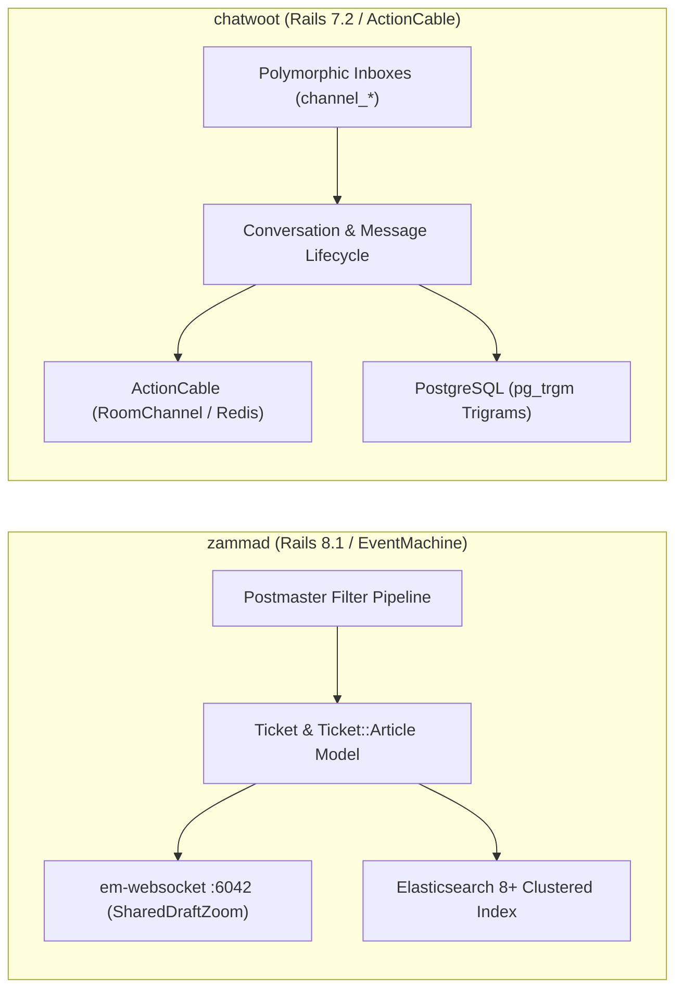
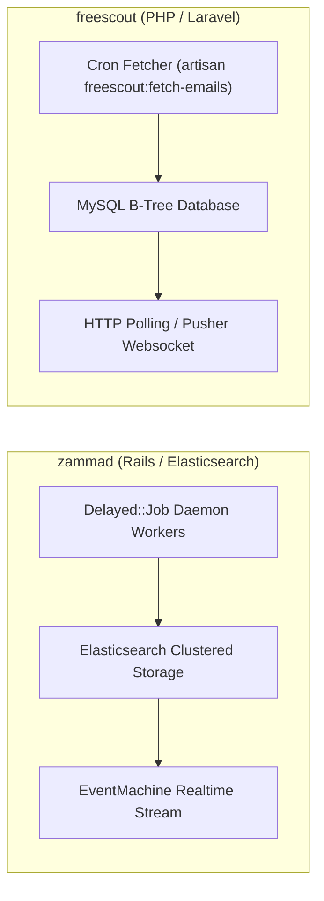
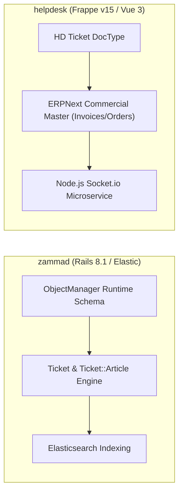
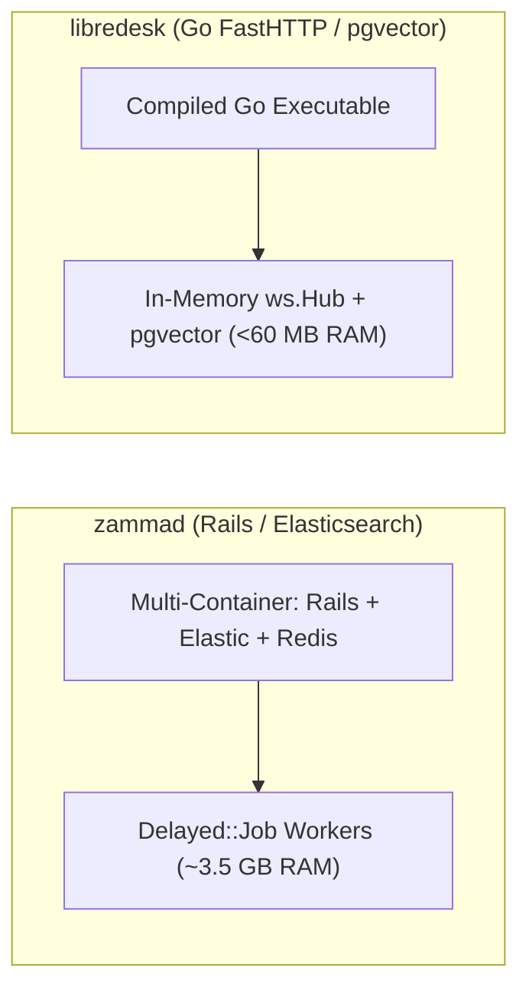
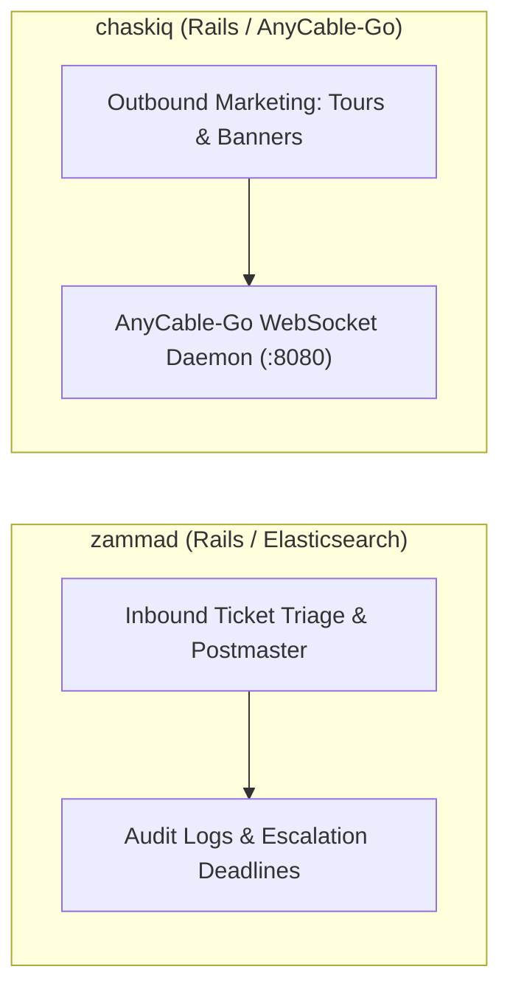
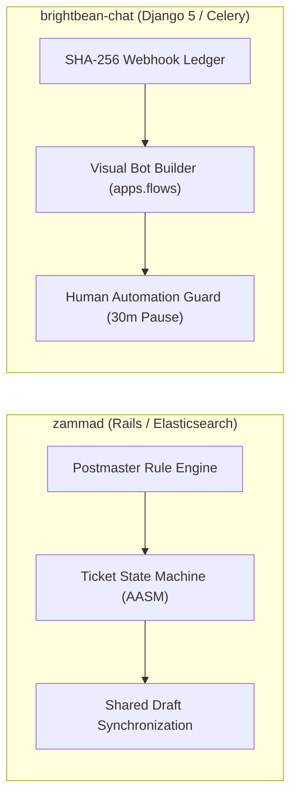

# zammad — Comparative Analysis & Category Evaluation

> **Category**: Omnichannel Helpdesk & Support  
> **Architectural Role**: Enterprise support ticketing, ITIL compliance & audit tracking  
> **Primary Stack**: Ruby 3.4+ | Rails 8.1, TypeScript/Vite | PostgreSQL/MySQL + Elasticsearch 8+ | Delayed::Job + EventMachine WS  
> **Peer Solutions Compared**: `chatwoot`, `freescout`, `helpdesk`, `libredesk`, `chaskiq`, `brightbean-chat`  
> **Commercial SaaS Benchmarks**: Zendesk, Freshdesk, ServiceNow, Jira Service Management, Intercom  

---

## 1. Executive Overview & Technical Identity: zammad

**zammad** represents the enterprise-grade ITIL gold standard within the **Omnichannel Helpdesk & Support** domain, distinguished by its core focus on **Clustered Elasticsearch search, multi-calendar SLA escalations, runtime dynamic schemas (Object Manager), and live shared-draft collaboration**.

### Core Architectural Profile
- **Runtime & Language**: `Ruby 3.4+` (Rails 8.1 / Puma)
- **Core Framework**: `Rails 8.1`, `TypeScript`, `Vite`, `GraphQL Ruby`
- **Persistence Layer**: `PostgreSQL 14+` or `MySQL 8.0+`, `Elasticsearch 8+ / OpenSearch`, `Redis 7+`
- **Concurrency & Queue Model**: `Delayed::Job` (multi-threaded database-backed queue) + `em-websocket` (EventMachine daemon on port 6042)
- **Domain Specialization**: `Enterprise ITIL support ticketing, audit logging & CTI telephony`

---

## 2. Peer Solution Landscape (Omnichannel Helpdesk & Support)

Within this category, `zammad` operates alongside the following peer solutions:

| Solution | Language & Runtime | Core Framework | Database / Cache | Queue / Concurrency | Primary Architectural Niche |
| :--- | :--- | :--- | :--- | :--- | :--- |
| **zammad** (Current) | `Ruby 3.4+` | `Rails 8.1, TypeScript` | `PostgreSQL/MySQL + Elastic 8+` | `Delayed::Job + EventMachine WS` | **Enterprise ITIL ticketing, dynamic Object Manager & audit trails** |
| **chatwoot** | `Ruby 3.4+` | `Rails 7.2, Vue 3` | `PostgreSQL 14+, Redis` | `Sidekiq + ActionCable` | Polymorphic multi-channel inbox & real-time live chat |
| **freescout** | `PHP 8.1-8.3` | `Laravel 5.5 LTS, Blade` | `MySQL 8+ / MariaDB / Postgres` | `Laravel Queue / CLI Cron` | Low-overhead shared email inboxes with modular add-ons |
| **helpdesk** | `Python 3.10+, Node 20+`| `Frappe Framework v15, Vue 3`| `MariaDB, Redis, SQLite` | `Python RQ + Node Socket.io` | SLA policies & seamless integration with Frappe/ERPNext apps |
| **libredesk** | `Go 1.25+` | `FastHTTP, Fastglue` | `PostgreSQL 15+, pgvector` | `Native Goroutines + FastHTTP WS` | Sub-60MB RAM footprint with compiled high-concurrency Go |
| **chaskiq** | `Ruby 3.3.5+, Node 20+` | `Rails 7.2, React 18` | `PostgreSQL, Redis, Nightfury` | `Sidekiq + AnyCable-Go WS` | Intercom-style proactive tours, campaigns & outbound messages |
| **brightbean-chat** | `Python 3.11+, Node 20+`| `Django 5, Django Ninja` | `PostgreSQL 15+, Redis` | `Celery + Django Channels` | Multi-tenant visual flow automation with human-takeover contract |

---

## 3. Deep Head-to-Head Comparative Breakdown: zammad vs Peers

### 3.1. zammad vs. chatwoot

**Comparative Focus**: `Elasticsearch ITIL ticketing & dynamic schema` vs. `Polymorphic multi-channel live chat`

#### Architectural & Stack Differences
- **Channel Multiplexing & Ingress Processing**: Zammad structures customer communications as formal `Tickets` containing `Ticket::Article` rows. Inbound email streams pass through `Channel::Filter::Postmaster` which evaluates raw RFC headers, SpamAssassin scores, and regex matching rules before assigning group or priority. Chatwoot instead routes inbound webhooks through dedicated polymorphic channel tables (`channel_web_widgets`, `channel_whatsapp`, `channel_email`).
- **Real-Time WebSocket & Concurrency Architecture**: Zammad offloads persistent agent WebSocket connections from the Rails application server to an independent `em-websocket` (EventMachine) daemon listening on port 6042. This powers Zammad's live shared-draft collaboration (`Ticket::SharedDraftZoom`): as an agent types, draft content is synchronized across the socket to other viewing agents with avatar indicators. Chatwoot uses Rails `ActionCable` on Redis Pub/Sub, tracking presence via Redis Sorted Sets.
- **Search & Schema Extensibility**: Zammad mandates **Elasticsearch 8+** in production, indexing all ticket subjects, article bodies, and raw MIME attachments for sub-millisecond full-text retrieval across millions of historical items. Chatwoot relies on PostgreSQL `pg_trgm` GIN indexes. Furthermore, Zammad's **Object Manager** (`ObjectManager::Attribute`) enables administrators to add dynamic custom attributes to Tickets, Users, and Organizations at runtime without database migration downtime.

#### Where zammad Excels over chatwoot
- **ITIL Service Management & Compliance**: Detailed audit histories (`Ticket::History`), time accounting per article (`Ticket::TimeAccounting`), and granular group permissions.
- **Sub-Millisecond Search at Hyperscale**: Clustered Elasticsearch index handles massive ticket archives that would cause PostgreSQL queries to degrade.
- **Zero-Downtime Dynamic Custom Fields**: Add custom drop-downs, date pickers, and regex-validated fields without executing Rails schema migrations.

#### Where chatwoot Holds an Advantage over zammad
- **Modern Social & Live Chat Channels**: Superior native support for WhatsApp Cloud API, Instagram DMs, Facebook Pages, and live website widgets.
- **Lower Operational Footprint**: Operates without requiring an Elasticsearch JVM cluster, cutting server memory requirements by 2–3 GB.
- **Agile Conversational Workflows**: More intuitive user interface for modern high-velocity sales and real-time customer success conversations.

#### Architectural Tradeoffs Matrix

| Architectural Dimension | zammad | chatwoot |
| :--- | :--- | :--- |
| **Primary Domain Focus** | Enterprise ITIL ticketing & customer support | Omnichannel conversational customer engagement |
| **Real-Time Transport** | EventMachine WebSocket Server (`em-websocket :6042`)| Rails ActionCable (Redis Pub/Sub) |
| **Search Engine Engine** | **Elasticsearch 8+ / OpenSearch (Mandatory)** | PostgreSQL `pg_trgm` GIN Trigrams |
| **Schema Mutation Model** | Dynamic runtime `ObjectManager` (No migrations) | Static ActiveRecord migrations + JSONB |
| **Agent Collision Control** | Live Shared Draft sync (`Ticket::SharedDraftZoom`)| Viewing lock & typing indicator |
| **Minimum Production RAM**| **~3.5 - 5.0 GB RAM** | ~2.5 GB RAM |
| **Best-Fit Deployment** | Regulated enterprise, IT helpdesk, strict SLA audits | High-velocity D2C, SaaS live chat, social support |

---

### 3.2. zammad vs. freescout

**Comparative Focus**: `Enterprise ITIL ticketing suite` vs. `Lightweight PHP shared email mailbox`

#### Architectural & Stack Differences
- **Architecture Scale & Footprint**: Zammad is an enterprise monolith built on Rails 8.1, Elasticsearch, Redis, and EventMachine requiring 3.5 GB+ RAM. FreeScout is a minimalist Laravel application running on PHP-FPM and MySQL, consuming ~150 MB RAM on a standard LAMP/LEMP virtual server.
- **Email Processing & Ingress Pipeline**: Zammad processes inbound mail continuously via threaded `Delayed::Job` worker daemons executing `Channel::Filter::Postmaster`. FreeScout executes a scheduled artisan command (`artisan freescout:fetch-emails`) every minute via Linux cron, decoding RFC-822 headers (`In-Reply-To`, `References`) to map replies to conversations.
- **Real-Time Collaboration**: Zammad streams instantaneous ticket updates and shared drafts over WebSockets. FreeScout relies on periodic HTTP polling or external Pusher services, keeping server complexity at an absolute minimum.

#### Where zammad Excels over freescout
- **Full-Text Clustered Search**: Searches millions of tickets and attachments in milliseconds via Elasticsearch.
- **Multi-Calendar SLAs**: Configures distinct business hours, regional holidays, and response deadlines per customer tier.
- **CTI Telephony Integration**: Native screen-pop on incoming phone calls linking directly to customer history.

#### Where freescout Holds an Advantage over zammad
- **Extreme Operational Simplicity**: Deploys on any standard shared hosting or cheap VPS with standard PHP and MySQL.
- **Frictionless Shared Email Workflows**: Replicates Help Scout's clean shared mailbox interface without ITIL bureaucracy.
- **Extensive Modular Plugin System**: Drop-in modules in `Modules/` enable modular expansion without core codebase modifications.

#### Architectural Tradeoffs Matrix

| Architectural Dimension | zammad | freescout |
| :--- | :--- | :--- |
| **Primary Domain Focus** | Enterprise ITIL support ticketing | Clean shared email mailbox (Help Scout clone) |
| **Infrastructure Stack** | Rails 8, Elasticsearch, Redis, EventMachine | PHP 8.1+, Laravel, MySQL / MariaDB |
| **Real-Time Engine** | Standalone EventMachine WebSocket server | HTTP Long-Polling / Pusher WebSockets |
| **Search Mechanism** | Clustered Elasticsearch 8+ | Standard MySQL B-Tree / Full-Text indexes |
| **Base Production RAM** | ~3.5 - 5.0 GB RAM | **~150 MB RAM** |
| **SLA Enforcement** | Multi-calendar, holiday-aware escalation engine | Optional add-on module |
| **Best-Fit Deployment** | Large IT departments, multi-tier SLAs | Small teams, startups, low-cost shared mailboxes |

---

### 3.3. zammad vs. helpdesk (Frappe)

**Comparative Focus**: `Standalone ITIL ticketing & Object Manager` vs. `Python/Frappe DocType ticketing integrated with ERPNext`

#### Architectural & Stack Differences
- **Application Framework & Ecosystem**: Zammad is a standalone Ruby on Rails 8.1 platform with its own database schema. Frappe Helpdesk is an app built on the Frappe Framework (Python 3.10+ / WSGI), executing inside the Frappe bench alongside ERPNext.
- **Commercial Data Binding**: Zammad integrates with CRM systems via REST webhooks. Frappe Helpdesk has native in-memory DocType access to ERPNext customer records, open invoices, active subscriptions, and shipment tracking without API latency.
- **SLA Mechanics**: Zammad evaluates complex multi-calendar escalation deadlines via `SLAEvaluator`. Frappe Helpdesk implements **Hold-Time SLA Pausing**: when a ticket status enters *On Hold* or *Waiting on Customer*, the countdown timer halts, adding `total_hold_time` back to the resolution deadline upon resumption.

#### Where zammad Excels over helpdesk
- **Search Performance**: Dedicated Elasticsearch cluster outperforms MariaDB/SQLite full-text searches across large ticket archives.
- **Real-Time Shared Drafts**: Agents view live draft updates from colleagues in real time (`Ticket::SharedDraftZoom`).
- **Comprehensive Postmaster Mail Filtering**: Granular rule conditions for evaluating raw email headers and spam flags.

#### Where helpdesk Holds an Advantage over helpdesk
- **Native ERP Context**: Agents have immediate visibility into customer order histories and payment statuses.
- **Hold-Time SLA Pausing**: Prevents unfair SLA penalties while awaiting external customer feedback.
- **Lighter Footprint**: Runs comfortably on ~500 MB RAM without requiring an Elasticsearch cluster.

#### Architectural Tradeoffs Matrix

| Architectural Dimension | zammad | helpdesk (Frappe) |
| :--- | :--- | :--- |
| **Primary Domain Focus** | Standalone enterprise ITIL ticketing | ERP-integrated customer support ticketing |
| **Core Framework** | Ruby on Rails 8.1 (Puma) | Python 3.10+ / Frappe Framework v15 (WSGI) |
| **Real-Time Architecture**| EventMachine daemon (:6042) | Standalone Node.js Socket.io server (:9000) |
| **Search Engine Engine** | Clustered Elasticsearch 8+ | SQLite local client cache (`search_sqlite.py`) |
| **ERP Data Access** | REST API webhooks | Native direct DocType linking (ERPNext) |
| **SLA Hold Pausing** | Static escalation timestamps | Dynamic hold-time pause and resume |
| **Best-Fit Deployment** | Organizations requiring pure ITIL ticketing | Businesses running their operations on ERPNext |

---

### 3.4. zammad vs. libredesk

**Comparative Focus**: `Feature-rich Rails/Elasticsearch helpdesk` vs. `Sub-60MB high-throughput Go binary`

#### Architectural & Stack Differences
- **Resource Footprint & Compilation**: Zammad requires a heavy multi-container architecture (Ruby, DelayedJob, Redis, Elasticsearch, Puma) consuming 3.5 GB+ RAM. LibreDesk compiles into a single native Go binary running on `valyala/fasthttp` and consuming under 60 MB of RAM.
- **Search Architecture**: Zammad offloads all search indexing to an external Elasticsearch cluster. LibreDesk leverages PostgreSQL GIN trigrams (`pg_trgm`) for fuzzy text searches and PostgreSQL `pgvector` for semantic document embeddings.
- **WebSocket Concurrency**: Zammad uses an EventMachine daemon. LibreDesk implements an in-memory concurrent Go WebSocket hub (`ws.Hub`) utilizing `sync.RWMutex` to distribute updates across thousands of agents with near-zero latency.

#### Where zammad Excels over libredesk
- **Mature Enterprise Tooling**: Multi-tier SLAs, business calendars, CTI telephony screen-pops, and time accounting per ticket article.
- **Dynamic Schema Management**: Object Manager allows UI-driven schema mutations without modifying code.
- **Proven Enterprise Track Record**: Battle-tested in large corporations and government institutions.

#### Where libredesk Holds an Advantage over zammad
- **60x Lower Memory Overhead**: Runs on tiny virtual servers (<60MB base RSS vs 3,500MB+), dramatically reducing cloud hosting bills.
- **Native AI Vector Copilot**: Built-in `pgvector` knowledge retrieval directly in Go background routines.
- **Single-Binary Deployment**: Zero external dependencies other than PostgreSQL and Redis.

#### Architectural Tradeoffs Matrix

| Architectural Dimension | zammad | libredesk |
| :--- | :--- | :--- |
| **Primary Domain Focus** | Enterprise ITIL ticketing & governance | High-throughput compiled support engine |
| **Runtime & Execution** | Ruby on Rails 8.1 (Interpreted) | Go 1.25 compiled binary (Machine code) |
| **Search Engine** | Clustered Elasticsearch 8+ | PostgreSQL `pg_trgm` + `pgvector` embeddings |
| **Real-Time Streaming** | EventMachine WebSocket (`em-websocket`) | FastHTTP WebSockets (`ws.Hub`) |
| **Base Production RAM** | ~3,500 MB RAM | **< 60 MB RAM** |
| **Custom Schema Fields** | Object Manager (Runtime UI) | Static PostgreSQL schema migrations |
| **Best-Fit Deployment** | Complex enterprise IT departments | High-load cloud-native backends, cost-sensitive VPS |

---

### 3.5. zammad vs. chaskiq

**Comparative Focus**: `ITIL ticketing & audit compliance` vs. `Conversational marketing, product tours & AnyCable-Go`

#### Architectural & Stack Differences
- **Functional Paradigm**: Zammad is an ITIL support ticketing system designed to track SLAs, resolve customer bugs, and maintain audit compliance. Chaskiq is a conversational marketing suite (Intercom clone) focused on acquiring leads, launching in-app product tours (`Tour`), and dispatching outbound marketing campaigns (`Campaign`).
- **Real-Time WebSocket Tier**: Zammad uses `em-websocket` (port 6042) for internal agent collaboration and shared drafts. Chaskiq uses **AnyCable-Go** (port 8080) communicating via gRPC to Rails, allowing it to sustain over 100,000 simultaneous persistent visitor socket connections.
- **Data Model & API**: Zammad models tickets and articles accessed via REST and GraphQL. Chaskiq models composite `ConversationPart` records and dynamic audience segments (`Segment`) accessed via Apollo GraphQL.

#### Where zammad Excels over chaskiq
- **ITIL Support & SLA Escalations**: Comprehensive response time guarantees, escalation warnings, and business calendar calculations.
- **Clustered Search Speed**: Instant full-text search across large enterprise ticket archives via Elasticsearch.
- **Telephony & Email Multi-Channel Power**: Deep CTI PBX integration and sophisticated Postmaster mail filtering.

#### Where chaskiq Holds an Advantage over zammad
- **Outbound Marketing & Product Tours**: Interactive UI walkthroughs and targeted marketing drip campaigns.
- **Massive Visitor Concurrency**: AnyCable-Go effortlessly handles viral traffic spikes on public website widgets.
- **Behavioral Audience Targeting**: Automatically triggers messages based on real-time visitor event tracking.

#### Architectural Tradeoffs Matrix

| Architectural Dimension | zammad | chaskiq |
| :--- | :--- | :--- |
| **Primary Domain Focus** | Enterprise ITIL ticketing & governance | Conversational marketing & product tours |
| **WebSocket Engine** | EventMachine daemon (`em-websocket`) | **AnyCable-Go (Go gRPC daemon, 100k+ conns)** |
| **Search Mechanism** | Elasticsearch 8+ Cluster | PostgreSQL JSONB queries |
| **Outbound Capabilities** | Notification emails & auto-replies | Drip campaigns, in-app tours, popup banners |
| **Audience Segmentation** | Organization and user groups | Real-time behavioral segments (`Segment`) |
| **Best-Fit Deployment** | Formal customer service & IT service desks | SaaS onboarding, product-led growth marketing |

---

### 3.6. zammad vs. brightbean-chat

**Comparative Focus**: `ITIL enterprise ticketing` vs. `Visual flow automation & human takeover contract`

#### Architectural & Stack Differences
- **Core Technology Stack**: Zammad is built on Ruby on Rails 8.1 with Delayed::Job and Elasticsearch. Brightbean-Chat is built on Python 3.11+ and Django 5 with Celery workers, Redis, and Django Channels.
- **Automation Philosophy**: Zammad automates ticket handling via rule-based Postmaster filters, triggers, and macros. Brightbean-Chat provides a visual drag-and-drop conversational bot builder (`apps.flows`) that executes interactive decision trees across WhatsApp and webchat.
- **Human-Takeover Contract**: Zammad prevents collisions between agents using shared drafts. Brightbean-Chat prevents collisions between bots and humans: sending an agent reply sets `automation_paused_until = now() + 30m`, shutting down automated flows while a human agent is active.

#### Where zammad Excels over brightbean-chat
- **Enterprise Ticketing & Audit Logs**: Immutable audit history, time tracking per article, and organization hierarchies.
- **Search Performance**: Clustered Elasticsearch handles high-volume message histories with zero query latency.
- **Multi-Calendar SLAs**: Tracks first-response, update, and solution deadlines across multiple global calendars.

#### Where brightbean-chat Holds an Advantage over brightbean-chat
- **Visual Drag-and-Drop Bot Builder**: Non-technical team members can visually design complex chatbot flows.
- **Deterministic Human-Takeover Guard**: Eliminates bot interference during live human customer conversations.
- **Outbound Pacing Limiter**: Built-in `SendBucket` token-bucket rate limiter prevents WhatsApp bans during bulk campaigns.

#### Architectural Tradeoffs Matrix

| Architectural Dimension | zammad | brightbean-chat |
| :--- | :--- | :--- |
| **Primary Domain Focus** | Enterprise ITIL ticketing & governance | Visual chatbot automation & shared inbox |
| **Runtime & Backend** | Ruby on Rails 8.1 / Delayed::Job | Python 3.11 / Django 5 (ASGI) / Celery |
| **Bot Automation Engine** | Rule triggers and canned macros | Native visual flow graph (`apps.flows`) |
| **Human Takeover** | Agent collision locks & shared drafts | Deterministic 30-min pause (`automation_paused_until`)|
| **Search Engine** | Clustered Elasticsearch 8+ | PostgreSQL indexes |
| **Best-Fit Deployment** | Internal IT desks, complex SLA customer support| Marketing lead generation, automated WhatsApp bots|

---

## 4. Capability & Feature Comparison Matrix

| Dimension / Capability | zammad | chatwoot | freescout | helpdesk | libredesk | chaskiq | brightbean-chat |
| :--- | :---: | :---: | :---: | :---: | :---: | :---: | :---: |
| **Primary Architectural Niche** | **Elasticsearch ITIL ticketing & dynamic schema** | Polymorphic multi-channel inbox & live chat | Low-overhead shared email inboxes | SLA policies & ERPNext commercial context | Sub-60MB RAM footprint with Go binary | Intercom-style proactive tours & AnyCable | Visual flow automation & human-takeover contract |
| **Runtime Language** | `Ruby 3.4+` | `Ruby 3.4+` | `PHP 8.1+` | `Python / JS` | `Go 1.25+` | `Ruby 3.3+` | `Python 3.11+` |
| **Database Persistence** | `PostgreSQL/MySQL + Elastic` | `PostgreSQL, Redis` | `MySQL / MariaDB` | `MariaDB, Redis` | `PostgreSQL, pgvector`| `PostgreSQL, Redis` | `PostgreSQL, Redis` |
| **Real-Time Streaming** | EventMachine WebSockets | ActionCable WebSockets | HTTP Polling / Pusher | Node.js Socket.io | Native Go FastHTTP WS | AnyCable-Go Daemon | Django Channels (ASGI) |
| **Search Engine Engine** | **Elasticsearch 8+ Cluster** | PostgreSQL GIN Trigrams | MySQL B-Tree Indexes | SQLite Local Cache | PostgreSQL Trigrams | PostgreSQL JSONB | PostgreSQL Indexes |
| **Base Production RAM** | ~3.5 GB RAM | ~2.5 GB RAM | **~150 MB RAM** | ~500 MB RAM | **< 60 MB RAM** | ~2.0 GB RAM | ~350 MB RAM |

---

## 5. Commercial Benchmark Positioning

When benchmarked against commercial SaaS leaders (**Zendesk, Freshdesk, ServiceNow, Jira Service Management, Intercom**):
- **Against Zendesk**: `zammad` is the closest open-source equivalent to Zendesk Support, replicating its ITIL ticket lifecycles, SLA escalation clocks, and macro triggers with zero per-agent subscription licensing.
- **Against Freshdesk / Jira Service Management**: Zammad provides complete data sovereignty and private cloud hosting, eliminating vendor lock-in for organizations with strict GDPR or HIPAA compliance mandates.
- **Against Intercom**: While Zammad includes a live chat module, teams requiring modern conversational marketing, proactive popups, and conversational sales will find `chatwoot` or `chaskiq` better aligned with those workflows.

---

## 6. Strategic Takeaways & Role for MarketingStudio

In the unified **MarketingStudio** architecture:
1. **Primary Component to Adopt**: Replicate Zammad's **Live Shared Draft Synchronization** (`Ticket::SharedDraftZoom`) across the WebSocket layer to eliminate duplicate agent responses.
2. **Incorporate Multi-Calendar SLA Logic**: Adopt Zammad's calendar-aware escalation engine to track first-response and resolution deadlines across international timezones and regional holidays.
3. **Adopt Dynamic Schema Extensions**: Implement Zammad's `ObjectManager` design pattern in MarketingStudio's CRM tier to enable custom field creation on contacts and conversations at runtime without database migrations.
