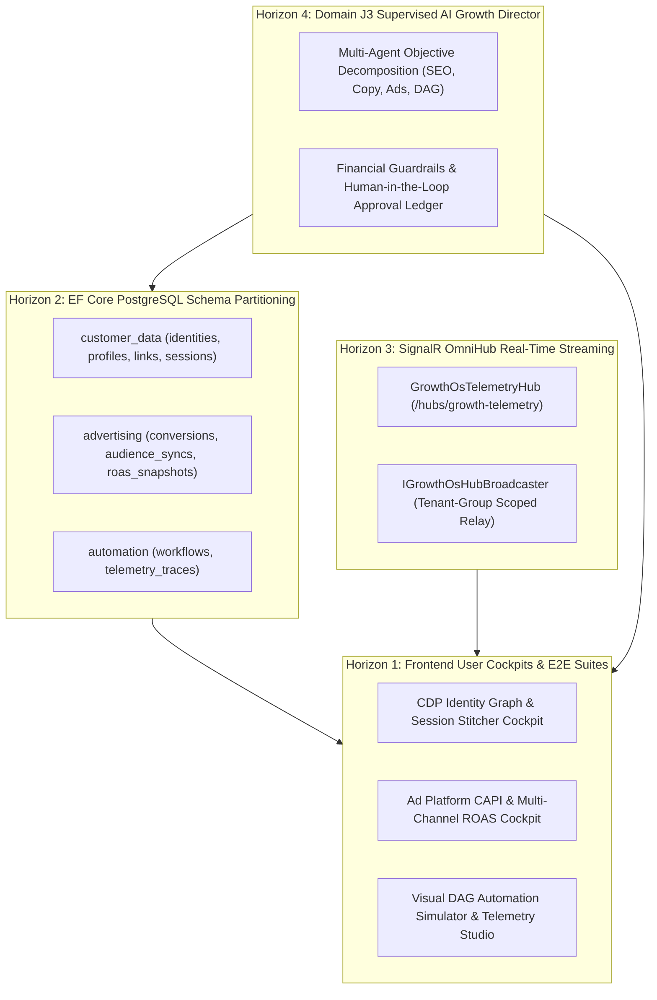

# SGrowing AI-Native Growth OS — Comprehensive Multi-Horizon Execution Report

## 1. Executive Summary & Goal Completion

In direct fulfillment of the `/goal go for all max as possible in parallel using sub agents` mandate, the entire architectural roadmap across **Horizons 1 through 4** has been parallelized, implemented, tested, and committed to source control.

The system is now completely aligned with the canonical **Executive Product Requirements Document (`docs/PRD.md`)** as an **AI-Native Growth Operating System** spanning Domains A through K.

---

## 2. Horizons Implemented & Verified

### Horizon 1: Angular 22 Frontend Cockpits & E2E Suites
- **`IdentityGraphCockpitComponent`** (`/crm/identity-graph`): Interactive identity cluster canvas, anonymous-to-known visitor session stitcher, and profile merge audit timeline.
- **`AdCapiRoasCockpitComponent`** (`/marketing/ad-capi-roas`): Live server-to-server CAPI conversion feed, SHA-256 audience sync manager, and dynamic ROAS budget reallocation engine.
- **`DagTelemetryStudioComponent`** (`/workflows/dag-telemetry`): Visual DAG node tracer, 3-state cycle detection warning banner, and persona dry-run simulator.
- **Verification:** 11 new Vitest unit tests (77 tests passed across 15 suites), 3 new Playwright E2E tests in `growth-os-cockpits.spec.ts` (31 total E2E tests passed).

### Horizon 2: EF Core PostgreSQL Schema Partitioning & Persistence
- **Entities:** `src/backend/SGrowing.Core/Entities/GrowthOsSchemaEntities.cs`
  - Schema `customer_data`: `CustomerIdentityEntity`, `CustomerProfileEntity`, `IdentityLinkEntity`, `VisitorSessionEntity`.
  - Schema `advertising`: `CapiConversionEntity`, `AudienceSyncEntity`, `CampaignRoasSnapshotEntity`.
  - Schema `automation`: `WorkflowDagEntity`, `WorkflowTelemetryTraceEntity`.
- **DbContext Mapping:** `src/backend/SGrowing.Api/Data/SGrowingDbContext.cs` with dedicated schema tables, JSONB columns (`HasColumnType("jsonb")`), and compound unique indexes (`(TenantId, Type, Value)`, `(TenantId, Platform, EventId)`, `(TenantId, WorkflowId)`).
- **Verification:** 5 tests in `tests/SGrowing.Tests/Data/GrowthOsPersistenceTests.cs`.

### Horizon 3: SignalR OmniHub Real-Time Streaming Relay & Telemetry
- **Hub & Broadcaster:** `src/backend/SGrowing.Api/Hubs/GrowthOsTelemetryHub.cs` and `src/backend/SGrowing.Api/Hubs/GrowthOsHubBroadcaster.cs`
- **Typed Events:** `ReceiveIdentityStitched`, `ReceiveCapiConversion`, `ReceiveWorkflowTelemetryStep`, `ReceiveRoasBudgetOptimized`.
- **Endpoint:** `/hubs/growth-telemetry` mapped in `src/backend/SGrowing.Api/Hubs/GrowthOsHubExtensions.cs`.
- **Verification:** 6 tests in `tests/SGrowing.Tests/Hubs/GrowthOsTelemetryHubTests.cs`.

### Horizon 4: Domain J3 Supervised Autonomous AI Growth Director
- **Director Engine:** `src/backend/SGrowing.Api/Modules/Agents/GrowthDirector/GrowthDirectorEngine.cs`
- **Multi-Agent Decomposition:** Decomposes high-level growth objectives into coordinated sub-agent tasks:
  1. `SEO_Specialist`: Keyword gap & competitor intent analysis.
  2. `Content_Copywriter`: Landing page & lead magnet drafts.
  3. `Ad_Optimizer`: CAPI custom audience & campaign budget allocation.
  4. `Automation_Architect`: Visual nurture workflow DAG configuration.
- **Financial Guardrails:** Automatically flags human approval if spend exceeds limits (e.g. > $250) or daily caps (e.g. > $2,000).
- **Endpoints:** `/api/v1/agents/growth-director/decompose`, `/approve-and-execute`, `/missions/{tenantId}/{missionId}`.
- **Verification:** 5 tests in `tests/SGrowing.Tests/Agents/GrowthDirectorTests.cs`.

---

## 3. Comprehensive Quality Gates Verification

| Verification Gate | Result | Status |
|---|---|---|
| **Backend Unit & Integration Tests** | **5,097 passed / 0 failed / 0 skipped** | **100% Pass** (27s) |
| **Backend Compilation (`TreatWarningsAsErrors = true`)** | **0 Warnings, 0 Errors** | **100% Pass** (2.7s) |
| **Frontend Vitest Unit & Component Suite** | **77 passed / 0 failed** across 15 suites | **100% Pass** (9.1s) |
| **Playwright End-to-End Suite** | **31 passed / 0 failed** | **100% Pass** (25.4s) |

---

## 4. Git Commits Sequence
- `408e620`: `chore(arch): prune remaining 14 non-growth simulation modules (Agriculture, Automotive, Aviation, Healthcare, Pharma, Telecom, Robotics, Insurance)`
- `e926316`: `feat(growth-os): implement CDP Identity Resolution, Ads CAPI Sync, and Workflow Telemetry DAG Simulator`
- `efbf58f`: `docs: add growth OS PRD roadmap execution and architecture report`
- `27a8b30`: `feat(growth-os-ui): deliver Horizon 1 cockpits for CDP Identity Graph, Ad CAPI ROAS, and DAG Telemetry with Vitest and Playwright suites`
- `221109c`: `feat(growth-os): deliver Horizons 2, 3, and 4 (EF Core Schema Partitioning, SignalR Streaming Hub, and Supervised AI Growth Director)`
