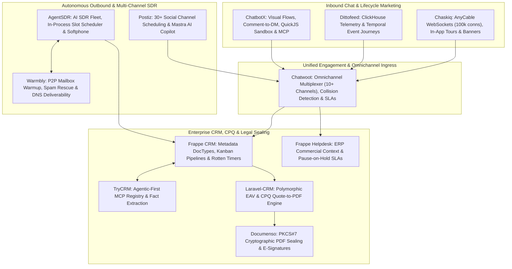

# Comprehensive Feature & Functionality Specification: The 12 Core Inspiration Repositories

> **Master Architecture & Functional Reference Document**  
> **Source Repositories**: `ChatbotX`, `AgentSDR`, `Postiz`, `Chaskiq`, `Warmbly`, `Chatwoot`, `Frappe CRM`, `TryCRM`, `Frappe Helpdesk`, `Dittofeed`, `Documenso`, `Laravel-CRM (Krayin)`  
> **Target Convergence Platform**: SGrowing Agentic Revenue Engine & Omnichannel Operating System  

---

## 1. Executive Master Taxonomy & Comparative Landscape

The table below summarizes the technical identity, core architecture, domain pillar, and competitive edge of each of the 12 primary inspiration repositories:

| # | Repository | Primary Domain Pillar | Runtime & Core Framework | Persistence & Caching | Background & Concurrency | Key Architectural Innovation | Commercial SaaS Equivalent |
|---|---|---|---|---|---|---|---|
| **1** | **ChatbotX** | Agentic Chat Marketing & Conversational Funnels | TypeScript, Node.js 24, Next.js 15, Turborepo | PostgreSQL 16 (Kysely), TimescaleDB, Redis 7+ | BullMQ Worker Cluster | QuickJS WASM Sandbox + Dedicated MCP Server + TimescaleDB Funnel Analytics | ManyChat, Chatfuel, Respond.io |
| **2** | **AgentSDR** | Autonomous Outbound AI SDR & Outreach | TypeScript, Bun 1.3, Next.js 16, React 19 | PostgreSQL 15+ (Drizzle ORM), Better Auth | In-Process Slot Scheduler + Tick Workers | Multi-Inbox Rotation + Google Workspace Domain-Wide Delegation + Sentiment Classifier + WebRTC Softphone | 11x.ai, Artisan, Apollo, Lemlist |
| **3** | **Postiz** | Multi-Platform Social Media Automation | TypeScript, Node.js 22+, NestJS 10, Next.js 14 | PostgreSQL 16 (Prisma 6.5), AWS S3 / Cloudflare R2 | Temporal.io Durable Workflows, BullMQ, Redis | 30+ Social Providers + Temporal Stateful Retries + Two-Phase Publish Guarantees (`PublishedWithError`) + Mastra AI | Buffer, Hootsuite, Sprout Social |
| **4** | **Chaskiq** | Conversational Support, In-App Tours & Messaging | Ruby 3.3.5, Rails 7.2, AnyCable, GraphQL Ruby | PostgreSQL 14+, Redis 7+, Nightfury Metrics | AnyCable-Go Daemon + Sidekiq Worker Pool | Decoupled AnyCable-Go WebSocket Tier (100k+ connections) + In-App Tours/Banners + Dynamic Behavioral Segments | Intercom, Drift, Crisp |
| **5** | **Warmbly** | P2P Mailbox Warmup & Autonomous Cold Email | Go 1.26 (Gin Engine, pgx/v5), NATS JetStream, Kafka | PostgreSQL 16, Redis 7+ (Locks & Limits) | Stateless Go Worker Fleet (`cmd/worker`) | P2P Monitored Warmup Network + Automated Spam Rescue + Control/Execution Plane Decoupling + AI Inbox Agent | Instantly.ai, Smartlead, Lemlist |
| **6** | **Chatwoot** | Omnichannel Customer Engagement & Shared Inbox | Ruby 3.4, Rails 7.2, Vue.js 3, ActionCable | PostgreSQL 14+, Redis 7+ (Presence & Queues) | Sidekiq Multi-Queue Workers | Shared Inbox Multiplexer across 10+ channels + Operator Collision Detection + Contact Identity Merging + Multi-Tier SLAs | Zendesk, Front, Intercom, Help Scout |
| **7** | **Frappe CRM** | Enterprise Metadata-Driven CRM & Pipelines | Python 3.10+, Frappe Framework v15, Vue 3.5 | MariaDB 10.6+ / PostgreSQL, Redis Cache & Queue | Frappe Background Workers (RQ / Celery) | Declarative JSON DocType Metadata Engine + Lead Rotting Timers (`rotten_days`) + Browser Twilio VoIP + Territory Polygons | Salesforce Sales Cloud, HubSpot Sales Hub |
| **8** | **TryCRM** | Agentic-First CRM for Autonomous AI Sales Agents | TypeScript, Bun 1.3, Next.js 14, Hono Framework | PostgreSQL, Prisma ORM | Autonomous Eve Agent Runner (`apps/agent`) | First-Class Agent Permissions + MCP Tool Registry + Contact Fact/Brief Extraction + Agent Audit Event Stream | Clay, Attio, Salesforce Einstein |
| **9** | **Frappe Helpdesk** | Omnichannel Support Ticketing & ERP Context | Python 3.10+, Frappe Framework v15, Vue 3 | MariaDB / PostgreSQL, Redis, Socket.io | Frappe Short & Long RQ Queues | Deep ERPNext Commercial Context (Orders/Invoices) + Pause-on-Hold SLAs + Dynamic Team Assignment Rules | Zendesk Support, Freshdesk, Jira Service Desk |
| **10** | **Dittofeed** | Event-Driven Customer Journeys & Telemetry | TypeScript, Fastify API, Next.js Dashboard | ClickHouse (Time-Series Events), PostgreSQL (Meta) | Temporal.io Workflow Engine, Kafka Ingress | Dual Storage (ClickHouse + Postgres) + Temporal Stateful Customer Journeys + Segment-compatible Telemetry | Customer.io, Braze, Iterable |
| **11** | **Documenso** | Cryptographic E-Signatures & PDF Sealing | TypeScript, React Router v7 (Remix), Hono | PostgreSQL 15 (Prisma + Kysely), S3 Storage | Inngest Event Engine / Local DB Queue | PKCS#7 / CMS Digital Signatures + Google Cloud KMS HSM / Local P12 + RFC 3161 TSA Timestamps + Tamper-Evident Audit Certificate | DocuSign, Adobe Acrobat Sign, PandaDoc |
| **12** | **Laravel-CRM** | Modular EAV Sales Pipeline & CPQ Engine | PHP 8.3+, Laravel 12.0, Konekt Concord, Vue.js | MySQL 8.0, Redis, Laravel Reverb WebSockets | Laravel Queue Workers | Polymorphic EAV Attribute Engine + Stage Rotting Days + CPQ Quotations-to-PDF + Reverb Real-Time Broadcasts | Pipedrive, Zoho CRM, SugarCRM |

---

## 2. Deep-Dive Repository Feature & Functional Extractions

---

### 2.1 ChatbotX (`ChatbotXIO/ChatbotX`)
*Agentic Chat Marketing Platform & Omnichannel Conversational Automation Hub*

#### A. Core Architecture & System Topology
- **Monorepo Structure**: Governed by Turborepo 2.11 and pnpm 10.34 with strict Biome linting. Comprises deployable microservices:
  - `apps/builder`: Visual drag-and-drop canvas, workspace admin, CRM operator desk.
  - `apps/realtime`: High-throughput WebSocket server (`ws` 8.20+) for live chat dispatch.
  - `apps/worker`: BullMQ background queue consumer and drip sequence dispatcher.
  - `apps/javascript-executor`: Sandboxed QuickJS WebAssembly runtime for executing custom tenant scripts.
  - `apps/mcp-server`: Model Context Protocol server exposing bot tools over stdio/SSE.
- **Persistence Layer**: PostgreSQL 16+ accessed via Kysely (80+ strongly typed tables) combined with TimescaleDB hypertables for time-series conversion and event logging.
- **Asynchronous Flow Orchestration**: Inbound webhooks are immediately normalized by `packages/channel-registry`, HMAC verified, and enqueued into Redis 7+ BullMQ queues. Workers execute graph traversal without blocking the HTTP ingress tier.

#### B. Complete Functional Feature Taxonomy
1. **Visual Drag-and-Drop Flow Canvas (`packages/flow-config`)**:
   - Directed acyclic graph (DAG) builder with interactive node-edge editing.
   - **Node Types**:
     - *Message Node*: Rich text, single images, image carousels with CTA buttons, audio clips, video links, file attachments.
     - *Interactive Buttons & Quick Replies*: Postback buttons, URL redirect buttons, call phone buttons, dynamic payload attachments.
     - *User Input Node*: Waits for visitor response with strict validation types (Email, US/International Phone, Number, Date, Free-text Regex). Employs state checkpointing in PostgreSQL to resume flows across multi-day conversational pauses.
     - *Condition / Decision Node (`packages/decision-config`)*: Multi-way branching evaluating tag presence, custom variable values, time-of-day, channel origin, or prior interaction count with `AND`/`OR` grouping.
     - *Delay Timer Node*: Relative delays (seconds, minutes, hours, days) or absolute delays (wait until specific date/time, respecting recipient timezone).
     - *Webhook Dispatch Node*: External HTTP calls (GET, POST, PUT, DELETE) with custom headers, HMAC signature injection, and JSON response mapping back into contact variables.
     - *AI Generation Node*: Invokes LLMs (Claude, GPT-4o) with dynamic system prompts, context memory, and variable interpolation to synthesize personalized conversational turns.
     - *Custom Script Node*: Executes JavaScript transformations inside the isolated QuickJS sandbox.
2. **Social Media Comment-to-Lead Automation (`packages/automated-response`)**:
   - Real-time listening to public comments across Meta platforms (Facebook post comments, Instagram post and Reel comments).
   - Rule-based keyword matching (Exact match, Contains, Regex, Negation) such as "PRICE", "INFO", "DISCOUNT".
   - **Two-Fold Atomic Reaction**:
     - Automatically generates a randomized public reply comment to satisfy platform engagement algorithms.
     - Simultaneously opens a private 1-on-1 Direct Message (DM) thread containing the lead qualification sequence.
3. **Omnichannel Ingress & Egress (`packages/channel-registry`)**:
   - WhatsApp Business Cloud API (Official Meta Cloud API, template messages, interactive button messages, list messages, media messages).
   - Instagram Direct Messaging (Meta Graph API, Story mentions, Story replies, direct messages).
   - Facebook Messenger (Pages messaging, persistent menu, get started payload).
   - Telegram Bot API (Inline keyboards, custom commands, broadcast channels).
   - TikTok Messaging API (Direct messages, business account interactions).
   - Threads & Zalo Official API support.
4. **Multi-Channel Broadcast & Drip Sequence Scheduler (`packages/sequence-scheduler`)**:
   - **Broadcast Campaigns**: Targeted mass dispatches filtered by tags, custom bot variables, and opt-in status. Employs dynamic rate-limiting to adhere to WhatsApp tier restrictions (Tier 1: 1k, Tier 2: 10k, Tier 3: 100k/day).
   - **Drip Marketing Sequences**: Pre-scheduled multi-step follow-ups over days or weeks (e.g., Day 0: Lead magnet delivery, Day 2: Case study, Day 4: Consultation booking).
   - **Dynamic Abort Rules**: Automatically unenrolls a contact from a nurture sequence upon trigger conditions (e.g. tag added: "Customer", deal closed, or appointment booked).
5. **Native Model Context Protocol (MCP) Server (`apps/mcp-server`)**:
   - Exposes standardized RPC tools for autonomous AI agents (OpenClaw, Claude, Hermes):
     - `get_contact_profile`: Fetches demographic and behavioral variables for a contact.
     - `update_bot_variable`: Modifies custom fields (e.g. updating deal size or lead qualification score).
     - `trigger_flow`: Hands off the conversation to a structured visual workflow.
     - `pause_automation`: Suspends automated bot rules while an AI agent handles nuanced negotiation.
6. **Two-Tier Variable & Mustache Templating System (`packages/variables`)**:
   - `system_field`: Immutable core attributes (`first_name`, `last_name`, `phone`, `email`, `language`, `timezone`).
   - `bot_field`: Tenant-defined custom attributes (`budget`, `crm_lead_id`, `industry`, `intent_score`).
   - Mustache interpolation across all message copy: `{{first_name}}`, `{{bot.product_interest}}`.
7. **TimescaleDB Funnel Analytics (`packages/analytics`)**:
   - High-throughput ingestion of interaction telemetry into TimescaleDB hypertables.
   - Tracks message delivery receipts, read statuses, button click-through rates, drop-off nodes, and SLA operator response times.
   - Continuous aggregates deliver instantaneous conversion reporting without impacting core transactional databases.

---

### 2.2 AgentSDR (`Kandid-ai/AgentSDR`)
*Autonomous AI Sales Development Representative & Multi-Channel Outreach Engine*

#### A. Core Architecture & System Topology
- **Runtime & Execution**: TypeScript executed on Bun 1.3 with Next.js 16 (App Router) and React 19.
- **Database & Multitenancy**: PostgreSQL 15+ managed via Drizzle ORM. Multi-tenancy enforced through organization scoping with Better Auth, ensuring fail-closed credential isolation.
- **Asynchronous Execution Loop**: In-process slot scheduler (`scheduled_job_runs`) driving:
  - `outreachMailboxQueue`: Daily quota and slot allocator.
  - `/api/outreach/tick`: Tick execution engine dispatching outbound messages.
  - `runSearchQueue`: Lead ingestion and automated enrichment scraper.
- **Microservices & Hardware Bridges**:
  - `services/call-worker`: WebRTC calling worker managing live audio recording and S3 uploads.
  - `extensions/whatsapp-recorder`: Browser extension bridge for WhatsApp Web automation.

#### B. Complete Functional Feature Taxonomy
1. **Multi-Channel Outbound Orchestration**:
   - **Cold Email**: Integrates with Google Workspace (Gmail API via Service Account Domain-Wide Delegation), Microsoft 365 (Microsoft Graph API), and generic SMTP/IMAP servers.
   - **LinkedIn Automation**: Powered via Unipile API for automated profile visits, connection requests with personalized notes, free InMails, and direct message sequences.
   - **WhatsApp Outreach**: Outbound messaging and automated follow-ups via Unipile and WhatsApp Web headless extension.
   - **Browser-Based Cold Calling Station**: WebRTC softphone built on LiveKit with auto-dialing, click-to-call, live DTMF keypad, call disposition tagging, and automatic stereo audio recording to AWS S3 / Cloudflare R2.
2. **Deliverability Protection & Inbox Rotation**:
   - **Multi-Inbox Rotation**: Pools dozens of sending mailboxes across multiple domains into a single campaign. Automatically cycles through inboxes to distribute sending volume.
   - **Domain Pacing & Volume Quotas**: Enforces strict daily caps per mailbox (e.g. 30-50 emails/day) and minimum delays between dispatches (3-8 minutes randomized) to prevent domain reputation damage.
   - **Google Service Account Domain-Wide Delegation**: Avoids fragile per-user OAuth tokens by authorizing a master service account across an entire Google Workspace domain.
3. **Lead Management & Spreadsheet CRM (AG Grid)**:
   - High-performance AG Grid frontend supporting thousands of active prospects.
   - Inline column editing, custom status dropdowns, CSV lead bulk import, and dynamic column formula calculation.
   - **QuickJS Sandboxed Formula Engine**: Safely executes user-defined JavaScript formulas on spreadsheet cells without risking host server injection.
4. **AI Personalization & BYOK Engine**:
   - Bring-Your-Own-Key (BYOK) architecture supporting OpenAI, Anthropic Claude, and OpenRouter.
   - Company website scraping and automated value proposition matching.
   - Knowledge base retrieval with vector citation grounding to eliminate hallucinations.
   - Dynamic prompt generation for personalized email icebreakers, pain-point references, and subject line variants.
5. **Sentiment & Intent Classification**:
   - Inbound email and message categorization powered by LLM zero-shot classification:
     - *Interested*: Automatically stops sequence, flags lead as Hot, and triggers calendar booking workflow.
     - *Meeting Booked*: Closes outbound campaign and creates CRM Deal opportunity.
     - *Not Interested / Objection*: Logs objection reason and drafts tailored re-engagement or archives contact.
     - *Out of Office (OOO)*: Extracts return date and reschedules sequence resumption.
     - *Wrong Contact / Referral*: Extracts referred colleague's name/email and creates a new lead.
     - *Unsubscribe / DNC*: Instantly adds email and domain to global Do Not Contact suppression list.
6. **Unified CRM Activity Timeline**:
   - Consolidated chronological timeline per prospect tracking every outbound email, open event, link click, inbound reply, LinkedIn message, WhatsApp exchange, and recorded phone call.

---

### 2.3 Postiz (`gitroomhq/postiz-app`)
*Enterprise Open-Source Social Media Scheduling & Content Management Engine*

#### A. Core Architecture & System Topology
- **Core Stack**: TypeScript, Node.js 22+, NestJS 10 API backend, Next.js 14 frontend (Mantine UI + CopilotKit), PostgreSQL 16 managed via Prisma ORM 6.5.
- **Workflow Orchestration Engine**: **Temporal.io** durable execution cluster managing all background jobs, scheduled dispatches, video processing, and token rotations.
- **Stateful Durability**: Every post is backed by a Temporal workflow capable of surviving server reboots, network partitioning, and multi-day exponential backoffs without duplicate publishing or dropped jobs.
- **Media Pipeline**: FFmpeg and Sharp for server-side image optimization, aspect ratio transcoding, and video slicing with direct AWS S3 / Cloudflare R2 presigned upload URLs.

#### B. Complete Functional Feature Taxonomy
1. **30+ Social & Federated Network Adapters (`SocialProvider`)**:
   - **Mainstream Social**: X/Twitter (OAuth 1.0a & 2.0, threads, media upload), Facebook (Pages, Groups), Instagram (Feed posts, Reels, Stories, Carousels), LinkedIn (Personal Profiles, Organization Pages, Document carousels), TikTok (Business & Creator Direct Publishing), YouTube (Shorts, Long-form videos with resumable chunked upload).
   - **Community & Developer Platforms**: Reddit (Subreddit posting, link/text/media), Discord (Webhooks, bot channels), Slack, Pinterest (Board pins), Dribbble, Medium, Dev.to, Hashnode.
   - **Decentralized & Federated Protocols**: Bluesky (AT Protocol, rich facets, mentions), Mastodon (ActivityPub), Threads, Farcaster (Neynar API), Nostr, Lemmy.
2. **Temporal.io Stateful Publishing Workflows (`apps/orchestrator`)**:
   - `PostWorkflow`: Coordinates schedule delay timers, media preparation activities, remote API publishing, and analytics registration.
   - `RefreshTokenWorkflow`: Automated proactive token renewal for OAuth 2.0 integrations before expiration (e.g. LinkedIn 60-day, Meta 60-day).
   - `ClippingWorkflow`: Asynchronous slicing and transcoding of long-form video into social-ready vertical clips (9:16).
   - `StreakWorkflow`: Gamified publishing tracking to incentivize creator consistency.
3. **Safe Partial Failure Primitives & Two-Phase Publishing**:
   - Eliminates duplicate posts on external platforms caused by retry loops.
   - Custom exception handling:
     - `PublishedWithError`: Post succeeded remotely (e.g. YouTube video uploaded), but non-critical secondary activity failed (e.g. pinned comment or thumbnail upload). Workflow marks post as published and does not re-upload video on retry.
     - `RefreshToken`: Intercepts 401/403 expired credentials, pauses execution, triggers `RefreshTokenWorkflow`, and resumes post execution seamlessly.
     - `Disconnect`: Marks integration as revoked and alerts the tenant without crashing worker queues.
4. **AI-Powered Content Generation (Mastra AI & CopilotKit)**:
   - Embedded Mastra AI agent framework and CopilotKit in-canvas drafting assistant.
   - **Viral Hook Generator**: Analyzes high-engagement social formats to propose engaging hook variants.
   - **Platform-Specific Rewriter**: Adapts a master message into tailored formats across channels (e.g., converting a 1,000-word article into a 5-tweet thread for X, a bulleted summary for LinkedIn, and a caption with hashtags for Instagram).
   - **Model Context Protocol (MCP)**: Exposes social scheduling and calendar tools to external AI agents.
5. **Visual Content Calendar & Workspace Collaboration**:
   - Drag-and-drop interactive monthly, weekly, and daily calendar views.
   - Multi-stage editorial approval workflows (Draft → In Review → Approved → Scheduled).
   - Multi-tenant role permissions: Organization Owner, Admin, Editor, Content Contributor, Client Viewer.
   - Native link shortener with UTM campaign tracking, custom branded domains, and click analytics.

---

### 2.4 Chaskiq (`chaskiq/chaskiq`)
*Open-Source Conversational Marketing, Support Suite & Intercom Alternative*

#### A. Core Architecture & System Topology
- **Technology Stack**: Ruby 3.3.5, Rails 7.2, React 18, GraphQL Ruby, AnyCable, Sidekiq, PostgreSQL 14+, Redis 7+.
- **Decoupled Real-Time Layer**: Utilizes **AnyCable-Go** (compiled Go binary) as the WebSocket termination daemon, handling 100,000+ persistent visitor connections per server node. Communicates with Rails backend controllers via gRPC, completely eliminating Ruby thread-blocking connection exhaustion.
- **GraphQL Architecture**: Frontend SPA and embedded messenger communicate via GraphQL queries and mutations (`/graphql`) backed by real-time ActionCable subscriptions.

#### B. Complete Functional Feature Taxonomy
1. **Interactive Product Tours (`Tour`)**:
   - In-app interactive guided walkthroughs for user onboarding and feature adoption.
   - Step-by-step element highlighting using CSS selectors, backdrop dimming, tooltip positioning (Top, Bottom, Left, Right), and multi-page URL navigation.
   - Completion tracking, dismissal events, and branching tour steps based on user interaction.
2. **Targeted In-App Banners & Modals (`Banner`)**:
   - In-app visual messages delivered dynamically to active web application users.
   - Supports top/bottom notification bars, centered modal dialogs, and slide-in toast callouts.
   - Delivery conditions based on URL path regex, session duration, device type, and audience segment.
3. **Behavioral Audience Segmentation (`Segment`)**:
   - Real-time dynamic evaluation of visitor profiles (`AppUser`).
   - Complex filtering across demographic properties (Country, Language, Browser, OS), engagement metrics (Session count, First seen, Last seen), and arbitrary custom JSONB properties (`properties`).
   - Automatically re-evaluates segment membership upon inbound event streams.
4. **Automated Conversational Triage (Bot Tasks / `BotTask`)**:
   - Visual conversational bots deployed directly inside the visitor chat widget.
   - Multi-step qualification paths collecting visitor name, corporate email, team size, and primary objective.
   - Conditional escalation: Routes qualified high-value leads directly to live sales reps; defers support questions to the ticket queue or knowledge base.
5. **Unified Omnichannel Helpdesk**:
   - Collapses live website chat, inbound email ticketing, WhatsApp, Slack, and Twitter DMs into a single operator desk.
   - Atomic conversation parts model (`Conversation`, `ConversationPart`) supporting public agent replies, private internal notes, author attribution, and system status changes.
6. **Outbound Drip Campaigns (`Campaign`)**:
   - Scheduled and event-triggered email and in-app automated campaigns.
   - Rich WYSIWYG / Markdown email authoring with template variables and automated unsubscribe tracking.
7. **Modular Integration Packages (`AppPackage`)**:
   - Extensible plugin architecture supporting third-party connectors:
     - Slack App (Bi-directional thread synchronization allowing agents to respond to visitor chats directly from Slack channels).
     - WhatsApp Business Gateway.
     - Calendly (Embeds interactive booking calendars directly inside the chat conversation).
     - Zoom (One-click generation and embedding of video call links).
8. **Embeddable Visitor Messenger SDK (`chaskiq-widget.js`)**:
   - Lightweight, customizable web messenger widget supporting custom brand colors, launcher icons, sound notifications, attachment uploads, and offline message caching.

---

### 2.5 Warmbly (`warmbly/warmbly`)
*Autonomous Cold Email Platform, P2P Warmup Network & Unified Inbox Engine*

#### A. Core Architecture & System Topology
- **Core Stack**: Go 1.26 (Gin Web Framework, `pgx/v5` high-performance PostgreSQL driver, `go-redis/v9`), NATS JetStream / Apache Kafka event bus, React 19 frontend.
- **Strict Control/Execution Plane Separation**:
  - *Control Plane (`cmd/backend`, `cmd/consumer`)*: Manages REST API gateways, PostgreSQL database, Redis distributed locks, and NATS JetStream task queues.
  - *Execution Plane (`cmd/worker`)*: Fleet of horizontally scalable, stateless Go workers that execute SMTP/IMAP dispatches and mailbox synchronization. **Workers never connect to PostgreSQL directly**, eliminating database connection pool exhaustion.

#### B. Complete Functional Feature Taxonomy
1. **Monitored Peer-to-Peer (P2P) Mailbox Warmup Network**:
   - Interconnects thousands of real, monitored business mailboxes across Google Workspace, Microsoft 365, and custom private domains.
   - Generates natural, multi-turn conversational email threads between peer accounts using LLMs (simulating organic business dialogues with natural subject lines and body copy).
   - Injects cryptographic verification tokens into message headers to identify warmup exchanges without user detection.
2. **Autonomous Spam Rescue & Reputation Training**:
   - Recipient worker processes continuously scan the Spam and Junk folders of peer mailboxes.
   - **Automated Rescue Protocol**: If a peer warmup email lands in Spam, the worker programmatically:
     - Rescues the message and moves it to the Primary Inbox or dedicated Warmup folder.
     - Marks the email as "Not Spam" and flags it as Important / Starred.
     - Simulates human reading delays and dispatches a contextual positive reply.
   - Programmatically trains machine-learning spam filters (Google Priority Inbox, Microsoft SmartScreen) to classify the sending domain as high-reputation.
3. **Automated Sending Ramp-Up & Throttling Schedules**:
   - Algorithmic daily volume ramp (e.g., Day 1-3: 5 emails/day; ramping +2 to +4 daily until reaching optimal target volume of 35-50/day).
   - Configurable target reply rate simulation (maintains 30-45% reply ratio).
   - Randomized sending jitter (e.g., 180 to 450 seconds between consecutive dispatches) to replicate human behavioral patterns.
4. **Comprehensive DNS & Deliverability Diagnostics**:
   - Real-time automated verification of domain configuration:
     - **SPF (Sender Policy Framework)**: Validates `v=spf1` syntax, include directives, and lookup limits.
     - **DKIM (DomainKeys Identified Mail)**: Verifies 1024-bit and 2048-bit cryptographic key alignment.
     - **DMARC (Domain-based Message Authentication, Reporting, and Conformance)**: Validates policy enforcement (`p=none`, `p=quarantine`, `p=reject`) and reporting tags.
     - **BIMI (Brand Indicators for Message Identification)**: Checks SVG logo validation and VMC certificate presence.
     - **MX & Blacklist Auditing**: Monitors DNS MX records and cross-references 50+ major email blacklists (Spamhaus, Barracuda, SORBS).
5. **Unified Multi-Mailbox Inbox (`unibox`)**:
   - Synchronizes dozens of external Google Workspace, Outlook 365, and IMAP accounts into a single real-time inbox.
   - Sub-second thread updates via WebSockets.
   - Contextual AI auto-drafting for inbound replies.
6. **AI Inbox Agent (`ai_inbox_agent.go`) & MCP Server**:
   - Official Model Context Protocol (MCP) server endpoints allowing external agents to query inbox threads and dispatch replies.
   - Autonomous classification of prospect responses into CRM pipeline stages.

---

### 2.6 Chatwoot (`chatwoot/chatwoot`)
*Omnichannel Customer Engagement Suite & Shared Inbox Multiplexer*

#### A. Core Architecture & System Topology
- **Core Stack**: Ruby 3.4, Rails 7.2, Vue.js 3, Vite, PostgreSQL 14+, Redis 7+, Sidekiq, ActionCable WebSockets.
- **Monolithic Ingress Multiplexer**: Centralizes disparate communication protocols into an internal canonical message representation across Web, Mobile, Social, and Messaging APIs.
- **Asynchronous Execution Pipeline**: Rails controllers offload webhook parsing and external API calls to Sidekiq queues (`default`, `mailers`, `scheduled_jobs`).

#### B. Complete Functional Feature Taxonomy
1. **Omnichannel Shared Inbox Multiplexer**:
   - Ingests and synchronizes bi-directional conversations across 10+ ingress channels:
     - *Website Live Chat Widget*: Customizable Vue 3 widget with real-time WebSockets, attachment support, and proactive greeting prompts.
     - *Meta Graph API*: Facebook Pages Messenger, Instagram Direct Messaging.
     - *WhatsApp Business Cloud API*: Official Cloud API and on-premise WhatsApp Business API.
     - *Email Ticketing*: Inbound IMAP polling or webhook processing via ActionMailbox (Mailgun, SendGrid, Postmark).
     - *Telephony SMS*: Twilio and Bandwidth two-way SMS integration.
     - *Community Channels*: Telegram Bot API, LINE Messaging API.
     - *Custom API Channel*: Generic webhook-based channel with HMAC authentication for proprietary apps.
2. **Real-Time Agent Collision Detection & Presence**:
   - Redis-backed distributed operator presence tracking.
   - Real-time visual indicators displaying which agents are currently viewing or typing on a conversation.
   - Prevents duplicate replies and conflicting status modifications through optimistic UI locks.
3. **Deterministic Identity Resolution & Merging**:
   - Decouples high-level `Contacts` from channel-specific endpoints (`ContactInboxes`).
   - Automatically links inbound interactions from disparate channels to a single master contact based on verified email or phone numbers.
   - Full contact merging capability: Merges duplicate customer records while atomically migrating conversation histories, tags, and custom attributes.
4. **Intelligent Workload Balancing & Auto-Assignment**:
   - **Round-Robin Auto-Assignment**: Evenly distributes incoming conversations across available agents in a team.
   - **Agent Capacity Policies**: Enforces maximum concurrent conversation limits per agent to prevent operator burnout.
   - **Availability Management**: Agents toggle status (Online, Busy, Offline); system automatically re-routes conversations when agents go offline.
5. **Multi-Tier Service Level Agreements (SLA) & CSAT Tracking**:
   - **SLA Policies**: Configurable response targets for *First Response Time (FRT)* and *Resolution Time*.
   - **Business Hours & Holiday Calendars**: SLA breach calculations respect organization-defined working hours and public holidays.
   - **SLA Breach Monitoring**: Background workers continuously evaluate breach countdowns, escalating overdue conversations to team leads.
   - **Customer Satisfaction (CSAT) Surveys**: Localized 5-star rating surveys automatically dispatched upon conversation resolution with feedback collection.
6. **Agent Productivity Suite**:
   - Canned responses with dynamic slash command shortcuts (`/pricing`, `/refund`).
   - Private internal agent notes (`private: true`) for internal team collaboration hidden from the customer.
   - Conversation labels, custom attributes, automated routing rules, and multi-lingual operator UI.
7. **Agent Bot Orchestration**:
   - Connects to external conversational bot runtimes (Dialogflow, Rasa, custom webhook bots).
   - Supports automated bot triage with seamless handover to human agents when complex inquiries arise.

---

### 2.7 Frappe CRM (`frappe/crm`)
*Modern Open-Source CRM on the Frappe Framework, Python & Reactive Vue 3*

#### A. Core Architecture & System Topology
- **Core Stack**: Python 3.10+, Frappe Framework v15, MariaDB 10.6+ / PostgreSQL 14+, Redis, Celery / RQ background queues, Vue 3.5 Single-Page Application (`frappe-ui`), Vite 8, TailwindCSS.
- **Metadata-Driven Architecture**: Business entities are defined declaratively as JSON DocType schemas, enabling dynamic custom field provisioning, permission matrices, and workflow state machines without altering underlying database tables.

#### B. Complete Functional Feature Taxonomy
1. **Declarative JSON DocType Metadata System**:
   - Extensible data model supporting Leads, Deals, Contacts, Organizations, and Campaigns.
   - Zero-code custom field creation (Data, Select, Check, Date, Currency, Link, Table).
   - Granular Role-Based Access Control (RBAC) with field-level read/write permissions.
2. **Interactive Deal Pipeline & Kanban Engine**:
   - High-performance Vue 3 Kanban board with drag-and-drop deal stage progression.
   - Real-time calculation of pipeline stage totals, weighted probability revenue forecasting, and expected close dates.
   - Custom filter presets, list views, and saved dashboard views.
3. **Automated Lead Stagnation ("Rotten Leads")**:
   - Configurable `rotten_days` parameter assigned to pipeline stages (e.g., Stage "Contacted" marked rotten after 3 days of inactivity).
   - Visual red/amber indicators highlight stalled opportunities on Kanban cards and list views.
   - Triggers automated escalation tasks, manager notifications, or lead re-assignments.
4. **Unified Omnichannel Activity Timeline (`activities.py`)**:
   - Single consolidated chronological feed per Lead/Deal record.
   - Synchronizes inbound and outbound emails, WhatsApp message threads, browser VoIP call logs, internal team comments, and system audit changes.
5. **Browser-Native VoIP Telephony & Call Logging**:
   - Direct integration with Twilio Voice SDK and Exotel softphone inside the Vue interface.
   - One-click click-to-dial on phone numbers across all CRM records.
   - Inbound call screen-pop displaying matched customer records.
   - Automatic call duration tracking, call disposition tagging, and audio recording playback embedded in the lead timeline.
6. **Geographic Territory Management**:
   - Interactive territory mapping engine built on Leaflet and Leaflet-Draw.
   - Administrators draw geographic polygon boundaries directly on a map.
   - Automated routing assigns new leads to territory sales managers based on prospect address geolocation.
7. **Sales Lead SLA & Escalation Engine**:
   - SLA timers enforcing initial sales response times on newly ingested inbound leads.
   - Rolling response timers monitoring ongoing lead communication cadence.

---

### 2.8 TryCRM / Comp AI CRM (`trycompai/crm`)
*Agentic-First Open-Source CRM for Autonomous AI Sales Agents*

#### A. Core Architecture & System Topology
- **Core Stack**: TypeScript, Bun 1.3 runtime, Next.js 14 frontend, Hono REST API framework (`apps/api`), PostgreSQL, Prisma ORM (`packages/db`).
- **Agentic-First Philosophy**: Engineered specifically so that autonomous AI sales agents operate as first-class team members alongside human reps with isolated permissions, dedicated workspaces, memory stores, and full auditability.

#### B. Complete Functional Feature Taxonomy
1. **Model Context Protocol (MCP) Server & Tool Registry (`packages/mcp-integrations`)**:
   - Native integration with the Model Context Protocol (MCP) standard.
   - Exposes structured CRM tools allowing AI agents to:
     - Search and introspect lead and account records.
     - Enrich company firmographics via web search and LinkedIn MCP servers.
     - Update deal stages, probability scores, and meeting dates.
     - Log activity summaries and assign follow-up tasks to human reps.
2. **Autonomous Agent Task Runner (`apps/agent`)**:
   - Background execution loop based on the Eve Agent Framework.
   - Manages multi-step asynchronous research and outreach workflows without blocking user API requests.
3. **Transparent Agent Auditing (`AgentAuditEvent`, `AgentTask`)**:
   - Complete forensic audit trail of all AI agent operations.
   - Logs agent internal chain-of-thought reasoning, tool execution parameters, returned payloads, decision rationales, and LLM token expenditures.
4. **Automated Fact Extraction & Contact Briefs**:
   - Background LLM extraction pipeline continuously analyzing incoming emails, call transcripts, and Slack communications.
   - Populates structured `ContactFact` records (e.g., "Company expanding to Europe in Q3", "Budget approved at $100k", "Evaluating competitor X").
   - Synthesizes rolling `ContactBrief` summaries giving human sales reps an instant 3-bullet briefing before client calls.
5. **Bidirectional Slack Workspace Integration**:
   - Slack app integration monitoring designated sales channels.
   - Extracts deal context and customer updates directly from internal team discussions.
   - Allows sales reps to trigger CRM actions and agent tasks via Slack slash commands and mentions.
6. **Ultra-Low Latency Bun & Hono API Gateway**:
   - Leverages Bun's native HTTP server and Hono's lightweight routing tree for microsecond API response times during heavy agent tool calling.

---

### 2.9 Frappe Helpdesk (`frappe/helpdesk`)
*Omnichannel Customer Support & Helpdesk Platform Built on Frappe Framework*

#### A. Core Architecture & System Topology
- **Core Stack**: Python 3.10+, Frappe Framework v15, MariaDB 10.6+ / PostgreSQL 14+, Redis, Node.js Socket.io real-time microservice, Vue.js 3, TailwindCSS, Frappe UI.
- **Enterprise ERP Unification**: Directly integrates with the ERPNext ecosystem, allowing support tickets to link directly with commercial enterprise transactions.

#### B. Complete Functional Feature Taxonomy
1. **Deep Commercial ERP Context Integration**:
   - Natively binds customer tickets (`HD Ticket`) to ERPNext business records:
     - Customer billing status, overdue invoices, and credit limits.
     - Sales Orders, Delivery Notes, and shipment tracking numbers.
     - Warranty contracts, Service Level Agreements, and serialized asset records.
   - Support agents can view customer purchasing history and create return authorizations directly from the ticket view.
2. **Multi-Tier SLA Engine with Pause-on-Hold Logic**:
   - Granular SLA policies across Priority levels (Urgent, High, Medium, Low).
   - Separate countdown thresholds for First Response Time (FRT) and Resolution Time.
   - **Intelligent Pause-on-Hold**: Automatically pauses SLA breach countdown timers when a ticket is moved to "Pending Customer Response" or "Awaiting Vendor Part", preventing unfair SLA violations during customer delays.
   - Enforces business working hours and holiday schedules (`HD Holiday`).
3. **Dynamic Support Team & Agent Assignment Rules (`HDAssignmentRule`)**:
   - Automated routing of inbound tickets based on customer tier, product category, issue type, or language.
   - Team queues (`HD Team`) and individual agent (`HD Agent`) load balancing.
   - Round-robin dispatching factoring in agent shift schedules and maximum active ticket capacity.
4. **Customer Self-Service Web Portal (`CustomerPortal`)**:
   - Dedicated customer-facing desk interface.
   - Allows end-users to create tickets, view resolution status, upload attachments, and read public knowledge base articles.
5. **Customer Satisfaction (CSAT) Feedback Engine**:
   - Automated post-resolution survey emails containing one-click satisfaction links (`HD Ticket Feedback Option`).
   - Detailed feedback metrics dashboard tracking team and agent CSAT scores over time.
6. **Saved Replies & Dynamic Macro Interpolation**:
   - Standardized template library for recurring support issues.
   - Dynamic interpolation of ticket fields (`{{ticket.customer}}`, `{{ticket.agent}}`, `{{ticket.priority}}`).
7. **Reactive Vue 3 Single-Page Interface**:
   - Built on Frappe UI and Socket.io for instantaneous ticket list filtering, split-pane ticket navigation, keyboard shortcuts, and live typing indicators.

---

### 2.10 Dittofeed (`dittofeed/dittofeed`)
*Open-Source Omnichannel Customer Engagement & Event-Driven Journey Platform*

#### A. Core Architecture & System Topology
- **Core Stack**: TypeScript, Fastify REST API (`packages/api`), Next.js Dashboard (`packages/dashboard`), Temporal.io workflow orchestrator, ClickHouse time-series event warehouse, PostgreSQL metadata store, Kafka ingestion pipeline.
- **Dual-Database Architecture**:
  - *ClickHouse*: Ingests and stores billions of immutable time-series user events and traits at immense scale.
  - *PostgreSQL*: Stores relational workspace metadata, journey DAG definitions, email templates, and segment rules.
- **Stateful Journey Execution**: Employs Temporal.io to manage long-running customer journeys that span weeks or months with guaranteed state persistence across server restarts.

#### B. Complete Functional Feature Taxonomy
1. **Event-Driven Customer Journey Orchestrator**:
   - Open-source alternative to Customer.io, Braze, and Iterable.
   - Visual drag-and-drop customer journey builder.
   - **Journey Node Types**:
     - *Entry Trigger Node*: Users enter journeys based on segment membership or event triggers (e.g., "Account Created").
     - *Message Node*: Multi-channel message dispatches (Email, SMS, Mobile Push, Webhook).
     - *Delay Node*: Pauses journey execution for a defined duration (hours, days, weeks).
     - *Wait-Until Node*: Pauses execution until a specific event occurs OR a maximum timeout expires (e.g., "Wait up to 3 days for user to invite a teammate; if not, send reminder").
     - *Condition Branch Node*: Evaluates user attributes and splits the journey path based on behavior.
     - *Exit Node*: Removes user from the journey.
2. **Temporal.io Journey Durability**:
   - Every individual user journey is modeled as an independent, deterministic Temporal workflow.
   - Execution state, sleep timers, and conditional signal handlers survive infrastructure crashes, worker deployments, and database failovers without message duplication or journey abortion.
3. **Dynamic Behavioral Segmentation**:
   - Continuously evaluates user segment membership against ClickHouse event streams and user trait tables.
   - Supports complex temporal queries (e.g., "Users who performed event `checkout_completed` at least 2 times in the last 30 days AND whose `plan_tier` is `enterprise`").
4. **Multi-Channel Delivery Providers**:
   - **Email**: Integrations with SendGrid, Amazon SES, Postmark, and generic SMTP.
   - **SMS**: Native integration with Twilio SMS.
   - **Mobile Push**: Firebase Cloud Messaging (FCM) and Apple APNs.
   - **Webhooks**: Outbound HTTP webhooks dispatching payloads to external CRMs and Zapier/Make.
5. **Segment-Compatible Telemetry Ingestion**:
   - Standardized HTTP ingestion endpoints compliant with the Segment specification:
     - `/api/public/apps/identify`: Sets user traits (email, name, company, subscription status).
     - `/api/public/apps/track`: Records discrete user behavioral events with JSON payloads.
     - `/api/public/apps/page` & `/api/public/apps/screen`: Captures web and mobile screen views.
   - Seamlessly connects with Reverse ETL tools (Census, Hightouch) and Segment SDKs.

---

### 2.11 Documenso (`documenso/documenso`)
*Open-Source Enterprise Document Signing Infrastructure & Cryptographic PDF Sealing*

#### A. Core Architecture & System Topology
- **Core Stack**: TypeScript, React Router v7 (Remix), Hono API server, PostgreSQL 15 (Prisma ORM + Kysely), Inngest event coordinator / local DB queue, `@libpdf/core`, `pdfjs-dist`.
- **Cryptographic Signing Infrastructure**:
  - Implements PKCS#7 / CMS digital signatures using SHA-256 byte-range hashes.
  - Supports private signing keys via local PKCS#12 (`.p12`) certificates or Google Cloud KMS Hardware Security Modules (HSM).
  - RFC 3161 Time-Stamp Authority (TSA) integration for legally binding cryptographic timestamps.

#### B. Complete Functional Feature Taxonomy
1. **Legally Binding Electronic Signatures (SES, AES, QES)**:
   - Self-hosted, legally compliant alternative to DocuSign and Adobe Acrobat Sign complying with eIDAS (EU) and ESIGN / UETA (US) regulations.
   - Supports Simple Electronic Signatures (SES), Advanced Electronic Signatures (AES), and Qualified Electronic Signatures (QES via Cloud Signature Consortium standards).
2. **Multi-Tenant Document & Envelope Lifecycle**:
   - Full lifecycle management: Draft → Pending Signatures → Completed / Voided / Expired.
   - Multi-recipient signing workflows supporting flexible order:
     - *Sequential Signing*: Recipient B only receives signing invitation after Recipient A completes signing.
     - *Parallel Signing*: All recipients can sign concurrently.
   - Recipient roles: Signer, Approver, CC (receives completed copy), In-Person Signer.
3. **Visual Drag-and-Drop Field Placement Engine**:
   - Drag-and-drop interface mapping fields directly onto PDF page coordinates with normalized $(X, Y, \text{Width}, \text{Height})$ viewport ratios.
   - **Supported Field Types**:
     - *Signature Pad*: Drawn vector signature, typed calligraphy, or uploaded signature image.
     - *Initials Field*: Initial placement across multiple document pages.
     - *Text Input*: Single-line or multiline text inputs with validation rules.
     - *Date Signed*: Auto-populates current signing timestamp.
     - *Checkbox & Radio Groups*: Conditional agreements and option selections.
     - *Dropdown Select*: Single selection from defined options.
4. **Cryptographic Sealing & Tamper-Evident Signatures**:
   - Upon completion by all signers, the document sealing workflow executes:
     - Renders visual signature representations onto the underlying PDF canvas.
     - Calculates SHA-256 byte-range hashes across the entire document structure.
     - Injects a PKCS#7 / CMS cryptographic signature container into the PDF trailer.
     - Queries an external RFC 3161 Time-Stamp Authority (TSA) server to append a trusted cryptographic timestamp token.
     - Any post-signing byte modification invalidates the digital signature when opened in Adobe Acrobat or PDF viewers.
5. **Tamper-Evident Certificate of Completion**:
   - Automatically generates and appends an official summary Certificate of Completion to the final signed PDF.
   - Records recipient names, verified email addresses, IP addresses, geolocations, user-agent device fingerprints, document ID, completion timestamp, and SHA-256 document checksum.
6. **Immutable Audit Trail (`DocumentAuditLog`)**:
   - Append-only audit ledger recording every lifecycle event: Document Created, Invitation Sent, Document Opened, Field Filled, Document Signed, Document Voided, Document Downloaded.
7. **Reusable Document Templates**:
   - Allows users to create master templates with pre-placed fields and placeholder recipient roles (e.g., "Customer", "Vendor", "Witness").
   - Instant envelope generation via API with dynamic pre-filled field data.
8. **Headless Embedding & Multi-Tier APIs**:
   - Embedded signing widget for rendering inside third-party web portals and mobile iframes via secure tokenized URLs.
   - Dual API access: REST API v1 (`ts-rest`) for standard contracts and tRPC / OpenAPI v2 for high-speed programmatic RPC.

---

### 2.12 Laravel-CRM / Krayin CRM (`krayin/laravel-crm`)
*Enterprise Modular CRM Framework Engineered on Laravel 12 & Polymorphic EAV*

#### A. Core Architecture & System Topology
- **Core Stack**: PHP 8.3+, Laravel 12.0, MySQL 8.0, Laravel Reverb (real-time WebSockets), Laravel Sanctum authentication, Prettus L5 Repository Pattern, Vue.js, TailwindCSS.
- **Modular Package-Based Architecture**: Business capabilities are decoupled into independent composer packages inside `packages/Webkul/` (Lead, Contact, Attribute, Quote, Activity, Email, Automation, DataGrid) orchestrated via Konekt Concord proxies.

#### B. Complete Functional Feature Taxonomy
1. **Polymorphic Entity-Attribute-Value (EAV) Storage Engine (`Webkul/Attribute`)**:
   - Dynamic schema extensibility without executing raw database `ALTER TABLE` migrations.
   - Custom attributes can be provisioned on Leads, Contacts (Persons), Organizations, and Products.
   - Supports typed storage columns inside `attribute_values`:
     - Text, Textarea, Rich Text (HTML).
     - Select Dropdown, Multi-Select Checkboxes.
     - Boolean (True/False toggle).
     - Date and Datetime.
     - Currency and Price.
     - File and Image Attachments.
2. **Sales Pipeline & Kanban with Automated Rotting (`Webkul/Lead`)**:
   - Visual drag-and-drop Kanban board driven by Vue 3 and Sortable.js.
   - Multi-pipeline management with customizable stages and probability weightings.
   - **Automated Rotten Lead Detection**: Configurable `rotten_days` per pipeline stage (e.g. 5 days in "Proposal Sent"). Leads exceeding this duration are visually marked as rotten, signaling urgent re-engagement.
3. **Configure, Price, Quote (CPQ) & Invoice Engine (`Webkul/Quote`)**:
   - Comprehensive quotation and closing module linked directly to deal opportunities.
   - **Product Catalog Management**: Products with SKUs, quantity tracking, and multi-tier pricing.
   - **Multi-Currency & Tax Engine**: Automatic currency exchange rate conversions, per-item tax calculations, and discount rules (percentage or fixed value).
   - **Automated PDF Quotation Generation**: Generates professionally styled PDF quotation documents ready for email dispatch to prospects.
4. **Sales Activity & Task Management (`Webkul/Activity`)**:
   - Centralized tracking of Calls, In-Person Meetings, Lunch appointments, Follow-up Tasks, and Notes.
   - Due date notifications, calendar synchronization, and automated activity completion tracking.
5. **Email Synchronization & IMAP Threading (`Webkul/Email`)**:
   - Two-way IMAP/SMTP synchronization engine (`webklex/laravel-imap`).
   - Automatically matches inbound and outbound customer emails to corresponding Lead and Contact timelines using message threading headers (`In-Reply-To`, `References`).
6. **Workflow Automation & Event Triggers (`Webkul/Automation`)**:
   - Event-Condition-Action automation builder.
   - Triggers automated workflows on entity events (e.g., "When Lead status changes to Won, generate Quotation, create onboarding Activity, and send webhook notification").
7. **High-Performance DataGrid & Serialization (`Webkul/DataGrid`)**:
   - Reusable server-side DataGrid component handling sort, pagination, and multi-field filtering over hundreds of thousands of records.
   - One-click export to CSV, XLS, and PDF formats with user-saved view configurations.

---

## 3. Cross-Cutting Convergence: Architectural Synergy for SGrowing

By synthesizing the core capabilities of all 12 inspiration repositories, SGrowing establishes an unprecedented, fully unified enterprise revenue engine:

### Architectural Synergy Breakdown:
1. **Unified Messaging & Channel Normalization**:
   - `Chatwoot` multiplexes 10+ inbound customer channels (WhatsApp, Instagram, Messenger, Email, SMS, Telegram, Web).
   - `ChatbotX` automates social comment-to-DM funnels and visual drag-and-drop conversational funnels.
   - `Chaskiq` decouples high-concurrency web messenger connections using AnyCable-Go, while providing in-app product tours and banners.
   - `Postiz` handles scheduled publishing across 30+ social networks with Temporal durable workflows and two-phase publish guarantees.
2. **Autonomous Outbound Prospecting & Deliverability**:
   - `AgentSDR` manages outbound AI SDR campaigns across Email, LinkedIn, WhatsApp, and browser cold calls with automated reply sentiment classification.
   - `Warmbly` guarantees email deliverability through a closed-loop P2P warmup network with automated spam rescues and DNS diagnostics.
   - `Dittofeed` orchestrates long-term, event-driven customer lifecycle journeys using ClickHouse event streams and Temporal state machines.
3. **Agentic CRM, Commercial CPQ & Legal Closing**:
   - `Frappe CRM` provides declarative metadata schemas, interactive deal Kanban boards, rotten lead timers, and territory mapping.
   - `TryCRM` delivers first-class AI agent autonomy with Model Context Protocol (MCP) tool integration, transparent audit ledgers, and contact fact extraction.
   - `Laravel-CRM` provides polymorphic EAV dynamic fields and a Configure, Price, Quote (CPQ) tax and discount engine.
   - `Documenso` executes legally binding, cryptographically sealed e-signatures with PKCS#7 signatures, RFC 3161 timestamps, and audit certificates.
   - `Frappe Helpdesk` connects support ticketing directly with ERP commercial context (orders, billing, warranties) with pause-on-hold SLA rules.
