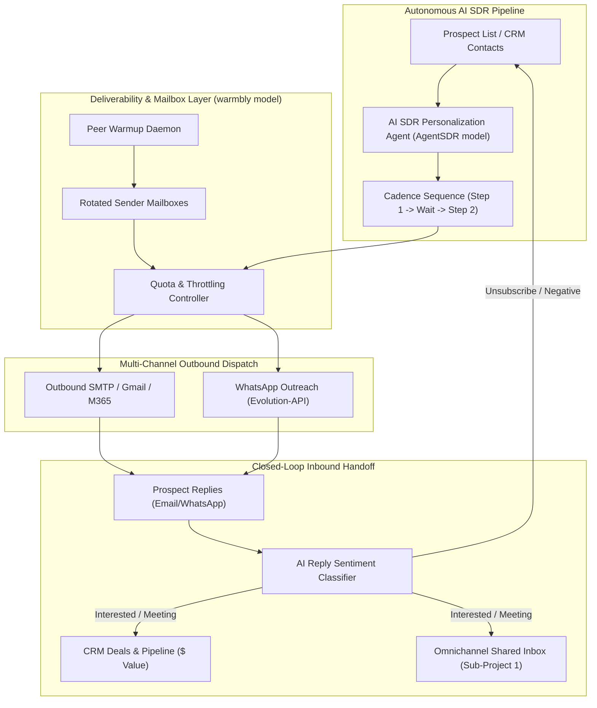

# Autonomous AI SDR & Cold Outbound Engine
## Sub-Project 2 Architecture & Design Specification

> **Date:** 2026-10-25  
> **Status:** Approved (`/goal Step 1`)  
> **System Scope:** Mailbox Warmup & Deliverability Engine, Multi-Touch Cadences, Autonomous AI SDR Personalization, Reply Sentiment Classifier, Deal Pipeline Creation, and Shared Inbox Handoff.

---

### 1. Executive Summary & Goals

Sub-Project 1 created the destination: the **Omnichannel Shared Inbox** and **Customer 360 CRM**.
Sub-Project 2 builds the **growth engine**: the **Autonomous AI SDR & Cold Outbound Engine** (synthesizing architectural patterns from `AgentSDR`, `warmbly`, and `OpenOutreach` from `.archify`).

Key capabilities:
1. **Sender Mailbox & Warmup Reputation Engine (`warmbly` model):**
   - Mailbox rotation across secondary domains to prevent domain burning.
   - Automated ramp-up schedules (e.g. 5 emails/day ramping up to 40/day).
   - Deliverability health audits (SPF, DKIM, DMARC, custom tracking domains).
   - Monitored peer-to-peer warmup simulation to maintain high sender scores.
2. **Multi-Touch Cadence Engine (`AgentSDR` & `OpenOutreach` model):**
   - Multi-step sequences combining Cold Email, LinkedIn touchpoints, and WhatsApp pings with configurable delay intervals.
   - Dynamic template variables (`{{first_name}}`, `{{company}}`, `{{icebreaker}}`, `{{problem_statement}}`).
   - Stop-on-reply automation: Immediately terminates sequence when prospect responds.
3. **Autonomous AI SDR Agent:**
   - Synthesizes prospect data (company domain, job title, industry, recent news).
   - Generates 1-to-1 personalized hooks, problem statements, and CTAs.
4. **Autonomous Inbound Reply Sentiment Classifier & Closed-Loop Handoff:**
   - Evaluates inbound prospect responses:
     - **Interested / Meeting Request:** Automatically creates a `Deal` in the CRM pipeline, marks enrollment as `Replied`, and transfers the conversation directly into the **Shared Inbox** for human closing.
     - **Unsubscribe / Negative:** Automatically marks contact as opted-out, terminates remaining cadence steps, and records audit trail.
     - **Out of Office:** Temporarily pauses cadence until prospect return date.
5. **Concurrent Cadence Dispatcher:**
   - Background hosted service respecting per-mailbox daily rate limits and sending windows (e.g., 9:00 AM - 5:00 PM in prospect timezone).

---

### 2. High-Level Architecture & Flow



---

### 3. Core Entities & Database Schema

#### 3.1 Mailbox & Deliverability Entities
* **`SenderAccount`**:
  * `Id` (UUID), `TenantId`, `Email`, `DisplayName`, `Provider` (`GoogleWorkspace`, `Microsoft365`, `CustomSmtp`), `DailyQuota` (default 40), `SentTodayCount`, `WarmupEnabled` (bool), `WarmupRampDailyIncrement` (default 3), `HealthScore` (0-100), `IsActive` (bool), `CreatedAtUtc`.
* **`WarmupRecord`**:
  * `Id`, `TenantId`, `SenderAccountId`, `PeerEmail`, `Direction` (`Sent`, `Received`), `Status` (`Inbox`, `SpamRescued`), `OccurredAtUtc`.

#### 3.2 Outbound Cadence Entities
* **`OutboundCampaign`**:
  * `Id` (UUID), `TenantId`, `Name`, `Status` (`Draft`, `Active`, `Paused`, `Completed`), `SenderPoolAccountIds` (`Guid[]`), `CreatedAtUtc`.
* **`CadenceStep`**:
  * `Id` (UUID), `TenantId`, `CampaignId`, `StepNumber` (1, 2, 3), `DelayDays` (e.g. 0 for first, 3 for follow-up), `Channel` (`Email`, `WhatsApp`), `SubjectTemplate`, `BodyTemplate`.
* **`ProspectEnrollment`**:
  * `Id` (UUID), `TenantId`, `CampaignId`, `ContactId`, `CurrentStepNumber`, `Status` (`Pending`, `Active`, `Replied`, `Bounced`, `Unsubscribed`, `Completed`), `PersonalizedHook` (text), `NextRunAtUtc`, `LastDispatchedAtUtc`.

#### 3.3 Deal Pipeline Entity (CRM Expansion)
* **`Deal`**:
  * `Id` (UUID), `TenantId`, `ContactId`, `CompanyId` (nullable), `Title`, `Amount` (decimal), `Stage` (`Prospecting`, `Qualified`, `Proposal`, `Won`, `Lost`), `SourceCampaignId` (nullable), `CreatedAtUtc`.

---

### 4. Autonomous AI SDR & Sentiment Mechanics

1. **Personalization Generation:**
   ```csharp
   public record SdrPersonalizationInput(string FirstName, string LastName, string Company, string? Industry, string? Role);
   public record SdrPersonalizationOutput(string Icebreaker, string ProblemStatement, string CallToAction);
   ```
2. **Sentiment Classification:**
   ```csharp
   public enum ReplySentiment { Interested, Objection, Unsubscribe, OutOfOffice, Neutral }
   ```
   When `ReplySentiment.Interested` is detected:
   - Creates a `Deal` with `Stage = Qualified` and initial estimated value.
   - Changes `ProspectEnrollment.Status = Replied` (terminating remaining follow-up emails).
   - Generates a high-priority conversation entry in `Omnichannel Shared Inbox` with label `Hot Lead`.

---

### 5. Implementation & Verification Plan

1. **Unit & Logic Tests**:
   - Mailbox daily ramp-up and quota rotation calculations.
   - Cadence step scheduling (delay days calculation).
   - AI SDR prompt builder and hook synthesis.
   - Reply sentiment classifier (Interested vs Unsubscribe vs OutOfOffice).
2. **Integration & Background Dispatcher Tests**:
   - `CadenceDispatcherService`: Querying due prospect enrollments, rotating sender accounts, dispatching messages, updating step indices.
   - Closed-loop handoff: Simulating prospect reply $\rightarrow$ Deal created in CRM $\rightarrow$ Shared Inbox real-time notification.
3. **Angular 19 Studio UI**:
   - Outbound Campaign List & Step Builder.
   - Mailbox Health & Warmup Monitor.
   - Deal Pipeline Kanban snapshot.
