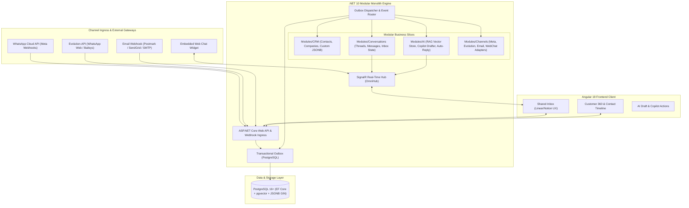
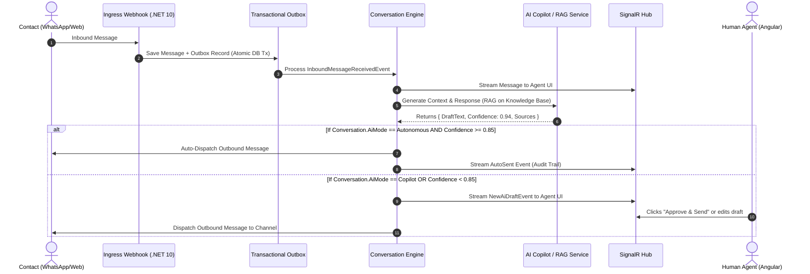

# AI Omnicommunication Platform: Inbound Omnichannel Inbox & CRM Foundation
## Sub-Project 1 Architecture & Design Specification

> **Date:** 2026-10-25  
> **Status:** Approved (`/goal Approach 1`)  
> **System Scope:** Inbound Omnichannel Inbox, CRM Core, Channel Gateways (Dual WhatsApp, Email, Webchat), Real-time SignalR Hub, and Hybrid AI Copilot/Auto-Responder.

---

### 1. Executive Summary & Goals

The **AI Omnicommunication Platform** unifies customer messaging across fragmented communication channels (WhatsApp, Email, Web Chat) into a single, real-time shared inbox linked directly to a high-performance Customer 360 CRM.

Sub-Project 1 delivers the operational foundation:
1. **Multi-Tenant Core & Identity:** Tenant scoping, workspace permissions, user roles (Agent, Admin, Bot).
2. **CRM Contact & Activity Engine:** Unified customer profiles with strongly-typed core properties and a dynamic `CustomFields` PostgreSQL `jsonb` column (with GIN indexes) validated by tenant-scoped field schemas.
3. **Omnichannel Messaging Engine:** Normalized conversation and message models (inspired by `chatwoot` reverse-engineered in `.archify`), conversation assignment, priority, tags, and state machines (`open`, `snoozed`, `resolved`).
4. **Channel Gateway Adapters:**
   - **Dual WhatsApp:** Official Meta Cloud API (webhook ingress + cloud template dispatch) and Evolution-API sidecar (QR-code Baileys multi-device sessions).
   - **Email:** Transactional & two-way email gateway via webhooks and SMTP.
   - **Web Chat Widget:** Lightweight embedded live-chat client connected via WebSocket / SignalR.
5. **Real-Time SignalR Hub:** Sub-100ms bidirectional event streaming for new messages, typing indicators, read receipts, and conversation updates.
6. **Hybrid AI Copilot & Autonomous Agent:** Vector/semantic RAG search over business documents, automatic draft generation for human 1-click approval, confidence-based auto-reply rules, and automatic human escalation.

---

### 2. High-Level System Architecture



---

### 3. Core Domain Entities & Database Schema

Derived from patterns analyzed in `.archify` (`chatwoot`, `twenty`, and `evolution-api`):

#### 3.1 CRM Entities
* **`Tenant`**: `Id` (UUID), `Name`, `Slug`, `CreatedAt`, `IsActive`.
* **`User`**: `Id` (UUID), `TenantId`, `Email`, `FullName`, `Role` (`Admin`, `Agent`, `Bot`), `AvatarUrl`.
* **`Contact`**:
  * Strongly typed: `Id` (UUID), `TenantId`, `FirstName`, `LastName`, `Email`, `Phone`, `LifecycleStage` (`Lead`, `Prospect`, `Customer`, `Churned`), `CreatedAt`, `UpdatedAt`.
  * Dynamic: `CustomFields` (`jsonb`, GIN index `ix_contacts_custom_fields`), `Tags` (`text[]`).
* **`Company`**: `Id`, `TenantId`, `Name`, `Domain`, `Industry`, `CustomFields`.
* **`Activity`**: `Id`, `TenantId`, `ContactId`, `Type` (`Message`, `Call`, `Note`, `StageChange`), `Payload` (`jsonb`), `CreatedAt`.

#### 3.2 Conversation & Messaging Entities
* **`Inbox`**: `Id` (UUID), `TenantId`, `Name`, `ChannelType` (`WhatsAppCloud`, `WhatsAppEvolution`, `Email`, `WebChat`), `Config` (`jsonb` - credentials, tokens, webhook secrets).
* **`Conversation`**:
  * `Id` (UUID), `TenantId`, `InboxId`, `ContactId`, `AssigneeId` (nullable `User.Id`).
  * `Status` (`Open`, `Snoozed`, `Resolved`).
  * `Priority` (`Urgent`, `High`, `Normal`, `Low`).
  * `AiMode` (`Autonomous`, `Copilot`, `Disabled`).
  * `LastMessageAt`, `CreatedAt`, `UpdatedAt`.
* **`Message`**:
  * `Id` (UUID), `TenantId`, `ConversationId`, `SenderType` (`Contact`, `Agent`, `Bot`, `System`).
  * `SenderId` (UUID, nullable).
  * `ContentType` (`Text`, `Image`, `Document`, `Audio`, `Location`).
  * `Content` (`text`), `MediaUrl` (`text`), `Metadata` (`jsonb`).
  * `ExternalMessageId` (`text`, unique index for deduplication).
  * `DeliveryStatus` (`Queued`, `Sent`, `Delivered`, `Read`, `Failed`).
  * `CreatedAt`.
* **`AiDraft`**:
  * `Id`, `TenantId`, `ConversationId`, `SuggestedReply` (`text`), `ConfidenceScore` (`float`), `Sources` (`jsonb`), `Status` (`Drafted`, `Accepted`, `Rejected`, `AutoSent`), `CreatedAt`.

#### 3.3 Transactional Outbox Entity
* **`OutboxMessage`**:
  * `Id` (UUID), `TenantId`, `OccurredOnUtc`, `EventType` (`text`), `Payload` (`jsonb`), `ProcessedOnUtc` (nullable), `RetryCount`, `Error` (nullable).

---

### 4. Channel Adapters & Webhook Normalization

All inbound channel events are normalized into a unified DTO before entering the application core:

```csharp
public record InboundChannelMessage(
    Guid TenantId,
    string ChannelType, // "whatsapp_cloud", "evolution_api", "email", "webchat"
    string ExternalSenderId, // Phone E.164, Email, or Web Session UUID
    string? SenderName,
    string ExternalMessageId,
    string ContentType,
    string Content,
    string? MediaUrl,
    JsonDocument? RawPayload
);
```

1. **Meta WhatsApp Cloud API**: Ingests `messages` array from Meta Webhook POST, validates HMAC SHA-256 signature, extracts text/media, resolves or creates `Contact` by E.164 phone.
2. **Evolution-API**: Receives `messages.upsert` webhook from local/cloud Baileys daemon, normalizes WhatsApp remoteJid (`@s.whatsapp.net`), deduplicates via external ID.
3. **Email Gateway**: Ingests inbound parsed email webhooks (e.g., Postmark Inbound / SendGrid Inbound Parse), extracts body text/HTML and attachments, resolves `Contact` by sender email.
4. **Web Chat Widget**: Direct SignalR invocation `SendMessage(conversationId, text)`.

---

### 5. Hybrid AI Copilot & Auto-Responder Architecture



---

### 6. Angular 19 Client Structure

Organized cleanly by feature:
```
src/app/
├── core/
│   ├── auth/ (JWT & tenant context)
│   ├── signalr/ (OmniHub real-time connection service)
│   └── api/ (Generated .NET API client)
├── features/
│   ├── inbox/
│   │   ├── conversation-list/ (Filter by Open/Snoozed/Resolved, channels, unread)
│   │   ├── conversation-detail/ (Message stream, typing indicators, media bubbles)
│   │   ├── message-composer/ (Rich text, canned responses, attachments)
│   │   ├── ai-copilot-panel/ (Draft preview, confidence badge, 1-click approve)
│   │   └── contact-sidebar/ (Contact details, custom fields editor, company, activity timeline)
│   ├── contacts/ (CRM contact directory, filtering by tags, custom attributes)
│   └── settings/ (Channel connections: WhatsApp QR scan, Meta API keys, Email config)
```

---

### 7. Implementation & Testing Verification Gates

1. **Unit Tests (xUnit + FluentAssertions):**
   - Inbound webhook payload parsers (Meta WhatsApp, Evolution-API, Email).
   - Conversation status transitions and assignment rules.
   - Dynamic JSONB field validation against schema definitions.
2. **Integration Tests (Testcontainers + PostgreSQL):**
   - Outbox processing reliability and idempotency checks (prevent duplicate message ingestion).
   - End-to-end webhook-to-database-to-outbox pipeline.
   - SignalR hub message streaming.
3. **E2E / Browser Verification:**
   - Multi-tab Angular shared inbox real-time sync via SignalR.
   - WhatsApp message simulated dispatch and AI copilot draft generation.
