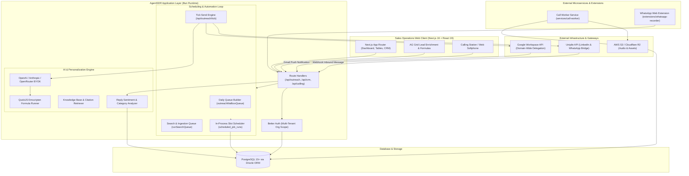
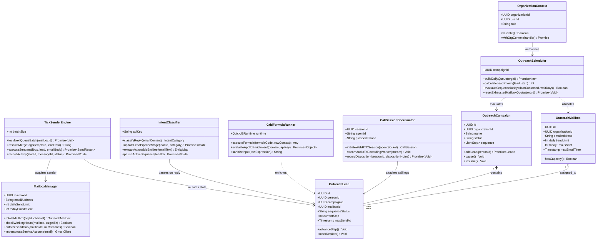
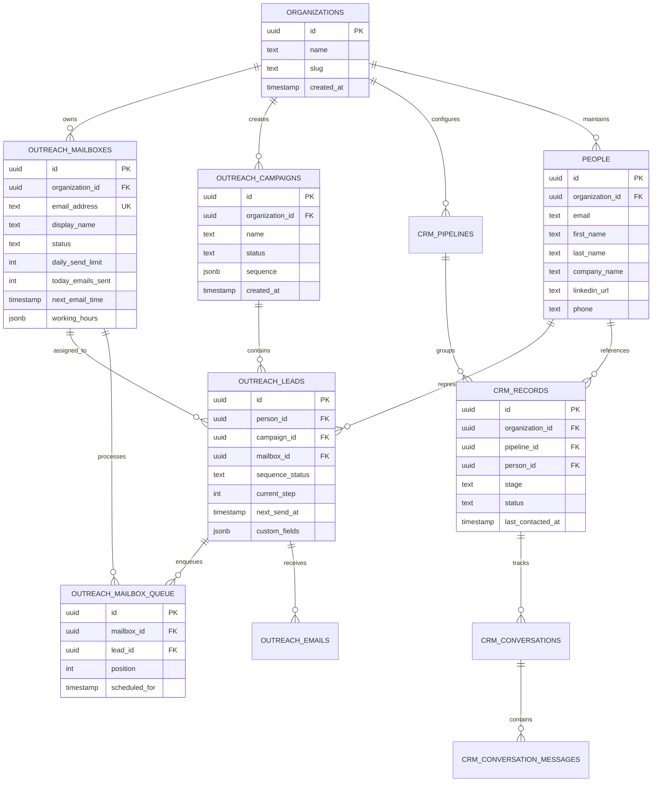
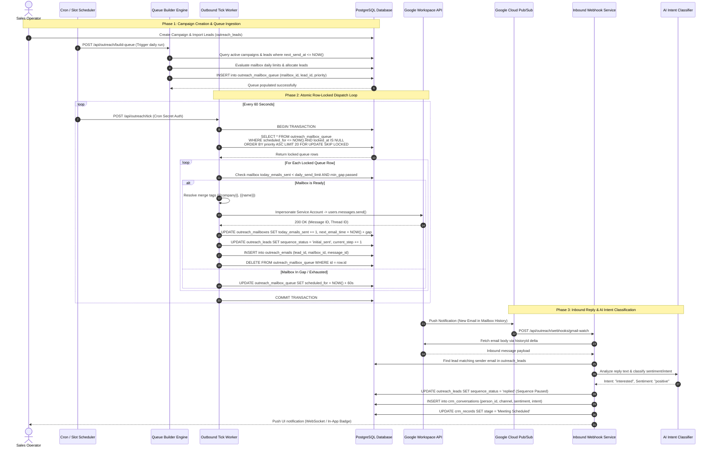

# AgentSDR - Architecture & Technical Wiki

> **Autonomous AI Sales Development Representative & Multi-Channel Outreach Engine**  
> GitHub: [Kandid-ai/AgentSDR](https://github.com/Kandid-ai/AgentSDR.git) | Stack: TypeScript, Bun 1.3, Next.js 16, React 19, Drizzle ORM, PostgreSQL, Better Auth, Unipile | License: MIT

---

## 1. Executive Summary & Value Proposition

**AgentSDR** is an open-source, multi-tenant AI Sales Development Representative (SDR) platform engineered to automate multi-channel outbound prospecting. It integrates cold email deliverability engines, LinkedIn automation, WhatsApp messaging, browser-assisted cold calling, and an AI-assisted CRM into a self-hosted platform.

Operating as a fleet of intelligent software agents and scheduling loops, AgentSDR automates lead ingestion, account research, hyper-personalized copy generation, multi-inbox rotation, sentiment/intent classification of prospect responses, and automated CRM deal progression.

### Core Problems Solved
- **High Outbound SDR Overhead**: Eliminates repetitive SDR tasks (prospect qualification, drafting personalized emails, manual multi-channel follow-ups) through autonomous agent workflows.
- **Deliverability Degradation & Domain Burning**: Solves spam penalties using organization-wide inbox rotation, domain-level pacing, Google Service Account domain-wide delegation, and strict daily sending limits.
- **Fragmented Multi-Channel Outreach**: Unifies Email, LinkedIn, WhatsApp, and browser cold calls into a consolidated CRM timeline, eliminating siloed tools.
- **Generic AI Outreach Spam**: Employs dynamic context merging, knowledge base citations, and QuickJS sandboxed formula evaluation to compose contextual outreach.
- **Multi-Tenant Account Isolation**: Implements fail-closed organization-scoped database queries, credential encryption, and isolated per-tenant sending rules.

---

## 2. High-Level System Architecture

AgentSDR is built on Next.js 16 (App Router) and React 19 executed on the high-performance Bun runtime. The system coordinates synchronous API operations and asynchronous outbound background jobs through an in-process slot scheduler and specialized microservice workers.



### 2.1 Core Domain & Service Class Architecture



---

## 3. Technology Stack & Key Dependencies

- **Language & Runtime**: TypeScript 5.4+, Bun 1.3.14 (high-performance execution and package management)
- **Frontend & Fullstack Framework**: Next.js 16.2.9 (App Router, Server Actions, Server Components), React 19.2.4
- **Database & Data Access**: PostgreSQL 15+, Drizzle ORM (`drizzle-orm` 0.45.2, `postgres` 3.4.9, `drizzle-kit` 0.30)
- **Authentication & Tenancy**: Better Auth 1.7.7 with multi-tenancy (`organizations`, `members`, `teams`, `invitations`)
- **Queue & Async Execution**: Postgres-backed queue architecture (`outreach_mailbox_queue`, `scheduled_job_runs`, `crm_jobs`)
- **AI Models & Orchestration**: Anthropic Claude SDK (`@anthropic-ai/sdk` 0.120), OpenAI SDK (`openai` 6.45), OpenRouter BYOK
- **Scripting & Sandbox**: QuickJS Emscripten (`quickjs-emscripten` 0.32), FormulaJS (`@formulajs/formulajs` 4.6.1) for safe client-authored formulas
- **Telephony & Messaging**: Unipile SDK (`unipile-node-sdk` 1.9.3) for LinkedIn and WhatsApp; Libphonenumber-js 1.13; WebRTC softphone
- **UI & Grid**: AG Grid Community/React 36.1, Radix UI primitives, Lucide React, Tailwind CSS v4, TipTap Rich Text Editor
- **Cloud Storage & Email**: AWS S3 SDK (`@aws-sdk/client-s3`), Google APIs (`googleapis` 174.0), Nodemailer 9.0

---

## 4. Repository Layout & Key Modules

```
AgentSDR/
├── db/
│   ├── schema.sql                   # 200KB baseline PostgreSQL schema definition
│   └── seed.sql                     # Initial seed for pipelines, categories, and stages
├── docker/                          # Dockerfiles for app and background call-worker
├── extensions/
│   └── whatsapp-recorder/           # Chrome extension for WhatsApp Web session bridging
├── services/
│   └── call-worker/                 # Standalone Node/Bun background calling audio processor
├── src/
│   ├── app/                         # Next.js App Router
│   │   ├── (auth)/                  # Better Auth sign-in, signup, invite verification
│   │   ├── (dashboard)/             # Campaigns, CRM, Grid, Mailboxes, Analytics UI
│   │   └── api/                     # REST API endpoints
│   │       ├── calling/             # Softphone sessions and call campaign dispatch
│   │       ├── crm/                 # Leads, pipelines, conversations, sequences
│   │       ├── grid/                # Spreadsheet tables, formula runners, enrichment
│   │       ├── outreach/            # Campaigns, mailboxes, build-queue, tick sender
│   │       └── webhooks/            # Unipile, Gmail Pub/Sub, and WhatsApp webhooks
│   ├── components/                  # React 19 UI components (AG Grid, Kanban, Modals)
│   ├── jobs/                        # Cron routines (runOutreach, runSearchQueue, resetLimits)
│   ├── lib/
│   │   ├── auth/                    # Better Auth configuration, permissions, tenant guards
│   │   ├── calls/                   # Softphone session state machine and audio handling
│   │   ├── channels/                # Sending rules registry, rate limiters, channel config
│   │   ├── crm/                     # CRM schema, stage transitions, sequence orchestrator
│   │   ├── grid/                    # Dynamic columns, QuickJS sandbox, Apollo/HTTP runners
│   │   ├── linkedin/                # LinkedIn introspected Drizzle schema and sync routines
│   │   ├── outreach/                # Cold email schema, lead importer, queue builder, sender
│   │   ├── platform/                # Encrypted credential store for Unipile, S3, and Google
│   │   └── tenancy/                 # Org-context middleware, query helpers (inOrg, runInOrg)
│   └── services/                    # Unipile LinkedIn & WhatsApp gateway integrations
├── bun.lock                         # Bun dependency lockfile
├── drizzle.config.ts                # Drizzle ORM configuration with table allowlist filter
└── package.json                     # Project manifest and scripts
```

---

## 5. Core Features & Capabilities

### 5.1 Multi-Inbox Rotation & Domain-Wide Delegation
AgentSDR decouples campaign logic from sending mailboxes. Connected via Google Workspace domain-wide delegation (Service Account impersonation), mailboxes do not require individual OAuth or passwords. 
- Mailbox assignment occurs dynamically at send time via round-robin allocation among mailboxes with remaining daily capacity (`dailySendLimit`, default 30 emails/day).
- Strict send gaps (e.g., minimum 180 seconds between emails per mailbox) and per-mailbox working hours (timezone-aware windows) prevent deliverability spikes.

### 5.2 Two-Tier Postgres Queue Architecture (`build-queue` and `tick`)
Instead of relying on external Redis queues for outbound scheduling, AgentSDR runs an optimized relational queue:
1. **Daily Queue Builder (`/api/outreach/build-queue`)**: Runs once daily, evaluating all active campaigns, sequence step delays (`waitDays`), and lead statuses (`pending`, `in_follow_up`). It calculates priority orders and populates `outreach_mailbox_queue`.
2. **Tick Engine (`/api/outreach/tick`)**: Runs frequently (every 1-2 minutes). It locks the next due item per available mailbox using `SELECT ... FOR UPDATE SKIP LOCKED`, resolves merge tags, executes the send via Google Workspace or SMTP, updates counters, and removes the queue row.

### 5.3 Unified CRM & Autonomous Intent Classification
Incoming messages from Gmail Push Webhooks or Unipile (LinkedIn/WhatsApp) are funneled into `crm_conversations`.
- The AI classification engine analyzes prospect sentiment and maps replies to predefined categories (`interested`, `not_interested`, `customer`, `other`).
- Automatically transitions leads through pipeline stages, pauses active email sequences upon receiving replies, and drafts context-aware responses incorporating company knowledge documents.

### 5.4 Lead Enrichment Spreadsheet Grid & QuickJS Sandbox
The platform contains a built-in spreadsheet module (`grid_workbooks`, `grid_tables`, `grid_columns`, `grid_rows`):
- Supports runtime column additions via dynamic SQL schema mutations.
- Allows user-defined formula columns executed inside an isolated WebAssembly QuickJS sandbox (`quickjs-emscripten`) with `@formulajs/formulajs`, preventing server-side code execution risks.
- Supports automated HTTP and Apollo enrichment columns with SSRF protection blocking local/private IP ranges.

### 5.5 Browser-Based Cold Calling & WhatsApp Extension
- **Calling Stations**: Facilitates outbound voice campaigns directly inside the browser using WebRTC, logging call recordings, durations, outcomes, and disposition notes to `call_sessions`.
- **WhatsApp Web Extension (`whatsapp-recorder`)**: An isolated Chrome extension that captures sessions and routes WhatsApp conversations into AgentSDR's centralized CRM.

---

## 6. Data Models & Schema Architecture

AgentSDR's data architecture is multi-tenant by design. All core tables enforce `organization_id` foreign keys with fail-closed query scopes.



### Core Entity Attributes
- **`organizations`**: Master tenant entity. Controls tenant isolation, memberships, and role assignments (`owner`, `admin`, `member`).
- **`outreach_mailboxes`**: Senders authorized via Google Workspace Domain-Wide Delegation. Stores `working_hours` (JSONB per-day intervals), `daily_send_limit` (int), `today_emails_sent` (int), and Gmail cursor `last_history_id`.
- **`outreach_campaigns`**: Outbound email sequence campaigns. `sequence` (JSONB) stores steps with `stepNumber`, `subject`, `body`, and `waitDays`.
- **`outreach_leads`**: Join entity between `people` and `outreach_campaigns`. Tracks `sequence_status` (`pending`, `initial_sent`, `in_follow_up`, `sequence_completed`, `reply_received`, `bounced`), `current_step` (int), and custom merge fields.
- **`outreach_mailbox_queue`**: Active execution queue table. Ordered by `position` and `scheduled_for`, consumed atomically by `/api/outreach/tick`.
- **`crm_records` & `crm_conversations`**: Unified prospect state. Links multi-channel interactions (Email, LinkedIn, WhatsApp, Calls) to a single prospect profile.

---


### 6.1 Comprehensive Database Schema Specification

The underlying persistence architecture relies on PostgreSQL 15+ managed via Drizzle ORM with fail-closed multi-tenancy keys (`organization_id`).

#### Table: `public.organizations`
Master tenant container enforcing tenant boundaries across campaigns, mailboxes, and CRM records.

| Column | Type | Constraints | Default | Description |
| :--- | :--- | :--- | :--- | :--- |
| `id` | `UUID` | `PRIMARY KEY` | `gen_random_uuid()` | Unique immutable organization identifier |
| `name` | `VARCHAR(255)` | `NOT NULL` | - | Commercial display name of the workspace |
| `slug` | `VARCHAR(100)` | `NOT NULL, UNIQUE` | - | URL-safe slug for subdomains and API routing |
| `logo_url` | `TEXT` | `NULLABLE` | `NULL` | Public asset CDN URL for organization branding |
| `metadata` | `JSONB` | `NOT NULL` | `'{}'` | Tenant configuration, feature flags, and billing limits |
| `created_at` | `TIMESTAMPTZ` | `NOT NULL` | `NOW()` | Audit creation timestamp |
| `updated_at` | `TIMESTAMPTZ` | `NOT NULL` | `NOW()` | Row modification timestamp |

*Indexes:* `idx_org_slug` (`UNIQUE btree (slug)`), `idx_org_created_at` (`btree (created_at)`).

---

#### Table: `public.outreach_mailboxes`
Stores provisioned sending accounts authenticated via Google Workspace Domain-Wide Delegation or SMTP.

| Column | Type | Constraints | Default | Description |
| :--- | :--- | :--- | :--- | :--- |
| `id` | `UUID` | `PRIMARY KEY` | `gen_random_uuid()` | Unique mailbox identifier |
| `organization_id` | `UUID` | `NOT NULL, FK -> organizations(id) ON DELETE CASCADE` | - | Parent tenant isolation key |
| `email_address` | `VARCHAR(255)` | `NOT NULL` | - | Outbound sending address (e.g., rep@company.com) |
| `display_name` | `VARCHAR(255)` | `NOT NULL` | - | Sender identity displayed in prospect mail clients |
| `provider` | `VARCHAR(50)` | `NOT NULL` | `'google'` | Authentication provider (`google`, `smtp`, `microsoft`) |
| `status` | `VARCHAR(50)` | `NOT NULL` | `'active'` | Operational status (`active`, `paused`, `error`, `exhausted`) |
| `daily_send_limit` | `INTEGER` | `NOT NULL` | `30` | Maximum cold emails dispatched per 24-hour cycle |
| `today_emails_sent`| `INTEGER` | `NOT NULL` | `0` | Dispatched counter; reset daily at midnight tenant TZ |
| `min_gap_seconds` | `INTEGER` | `NOT NULL` | `180` | Required idle spacing between consecutive dispatches |
| `next_email_time` | `TIMESTAMPTZ` | `NULLABLE` | `NULL` | Next permissible dispatch timestamp enforcing gap rule |
| `working_hours` | `JSONB` | `NOT NULL` | `'{"mon":{"start":"09:00","end":"17:00"}}'` | Active sending window definitions in local timezone |
| `timezone` | `VARCHAR(50)` | `NOT NULL` | `'UTC'` | Timezone governing working hours and quota reset |
| `last_history_id` | `VARCHAR(100)` | `NULLABLE` | `NULL` | Gmail Pub/Sub sync cursor for delta message polling |
| `created_at` | `TIMESTAMPTZ` | `NOT NULL` | `NOW()` | Registration timestamp |

*Indexes:* `idx_mailboxes_org_status` (`btree (organization_id, status)`), `idx_mailboxes_email` (`btree (email_address)`), `idx_mailboxes_next_send` (`btree (next_email_time)`).

---

#### Table: `public.outreach_campaigns`
Defines multi-step drip campaigns, sequence cadence, and target audience configurations.

| Column | Type | Constraints | Default | Description |
| :--- | :--- | :--- | :--- | :--- |
| `id` | `UUID` | `PRIMARY KEY` | `gen_random_uuid()` | Unique campaign identifier |
| `organization_id` | `UUID` | `NOT NULL, FK -> organizations(id) ON DELETE CASCADE` | - | Tenant scope key |
| `name` | `VARCHAR(255)` | `NOT NULL` | - | Operator-defined campaign label |
| `status` | `VARCHAR(50)` | `NOT NULL` | `'draft'` | Lifecycle state (`draft`, `active`, `paused`, `completed`) |
| `sequence` | `JSONB` | `NOT NULL` | `'[]'` | Ordered array of sequence steps, wait days, templates |
| `track_opens` | `BOOLEAN` | `NOT NULL` | `false` | Enable/disable 1x1 tracking pixel insertion |
| `track_clicks` | `BOOLEAN` | `NOT NULL` | `false` | Enable/disable link wrapping for click tracking |
| `stop_on_reply` | `BOOLEAN` | `NOT NULL` | `true` | Automatically pause lead upon receiving response |
| `created_at` | `TIMESTAMPTZ` | `NOT NULL` | `NOW()` | Record creation timestamp |
| `updated_at` | `TIMESTAMPTZ` | `NOT NULL` | `NOW()` | Last sequence edit timestamp |

*Indexes:* `idx_campaigns_org_status` (`btree (organization_id, status)`), `idx_campaigns_created` (`btree (created_at)`).

---

#### Table: `public.outreach_leads`
Join record linking individual prospect contacts (`people`) to specific outbound campaigns.

| Column | Type | Constraints | Default | Description |
| :--- | :--- | :--- | :--- | :--- |
| `id` | `UUID` | `PRIMARY KEY` | `gen_random_uuid()` | Unique campaign enrollment identifier |
| `organization_id` | `UUID` | `NOT NULL, FK -> organizations(id) ON DELETE CASCADE` | - | Multi-tenant organization scope key |
| `person_id` | `UUID` | `NOT NULL, FK -> people(id) ON DELETE RESTRICT` | - | Associated human prospect entity |
| `campaign_id` | `UUID` | `NOT NULL, FK -> outreach_campaigns(id) ON DELETE CASCADE` | - | Target campaign sequence |
| `mailbox_id` | `UUID` | `NULLABLE, FK -> outreach_mailboxes(id) ON DELETE SET NULL` | `NULL` | Pinned or dynamically rotated sending mailbox |
| `sequence_status` | `VARCHAR(50)` | `NOT NULL` | `'pending'` | Current state (`pending`, `initial_sent`, `in_follow_up`, `completed`, `replied`, `bounced`) |
| `current_step` | `INTEGER` | `NOT NULL` | `1` | Zero-indexed or 1-indexed pointer to sequence array |
| `next_send_at` | `TIMESTAMPTZ` | `NULLABLE` | `NOW()` | Earliest scheduled dispatch time for current step |
| `last_sent_at` | `TIMESTAMPTZ` | `NULLABLE` | `NULL` | Timestamp of previous email dispatch |
| `custom_fields` | `JSONB` | `NOT NULL` | `'{}'` | Custom CSV/API merge tags (`{{company}}`, `{{painPoint}}`) |
| `created_at` | `TIMESTAMPTZ` | `NOT NULL` | `NOW()` | Enrollment timestamp |

*Indexes:* `idx_leads_org_campaign` (`btree (organization_id, campaign_id)`), `idx_leads_status_next_send` (`btree (sequence_status, next_send_at)`), `idx_leads_person_campaign` (`UNIQUE btree (person_id, campaign_id)`).

---

#### Table: `public.outreach_mailbox_queue`
High-concurrency relational queue locked via `FOR UPDATE SKIP LOCKED` during tick runs.

| Column | Type | Constraints | Default | Description |
| :--- | :--- | :--- | :--- | :--- |
| `id` | `UUID` | `PRIMARY KEY` | `gen_random_uuid()` | Unique queue entry identifier |
| `organization_id` | `UUID` | `NOT NULL, FK -> organizations(id) ON DELETE CASCADE` | - | Tenant partitioning key |
| `mailbox_id` | `UUID` | `NOT NULL, FK -> outreach_mailboxes(id) ON DELETE CASCADE` | - | Mailbox reserved for this dispatch item |
| `lead_id` | `UUID` | `NOT NULL, FK -> outreach_leads(id) ON DELETE CASCADE` | - | Target recipient lead record |
| `step_number` | `INTEGER` | `NOT NULL` | `1` | Step sequence index to execute |
| `priority` | `INTEGER` | `NOT NULL` | `100` | Dispatch priority (lower number executes first) |
| `scheduled_for` | `TIMESTAMPTZ` | `NOT NULL` | `NOW()` | Timestamp after which the item becomes eligible |
| `locked_at` | `TIMESTAMPTZ` | `NULLABLE` | `NULL` | Worker lease acquisition timestamp |
| `locked_by` | `VARCHAR(100)` | `NULLABLE` | `NULL` | Worker instance hostname / PID |

*Indexes:* `idx_queue_lock_fetch` (`btree (mailbox_id, scheduled_for, priority)` WHERE `locked_at IS NULL`), `idx_queue_lead` (`btree (lead_id)`).

---

#### Table: `public.crm_conversations`
Unified conversation thread aggregating inbound and outbound interactions across all channels.

| Column | Type | Constraints | Default | Description |
| :--- | :--- | :--- | :--- | :--- |
| `id` | `UUID` | `PRIMARY KEY` | `gen_random_uuid()` | Unique conversation thread identifier |
| `organization_id` | `UUID` | `NOT NULL, FK -> organizations(id) ON DELETE CASCADE` | - | Tenant boundary key |
| `person_id` | `UUID` | `NOT NULL, FK -> people(id) ON DELETE CASCADE` | - | Linked prospect entity |
| `channel` | `VARCHAR(50)` | `NOT NULL` | `'email'` | Communication medium (`email`, `linkedin`, `whatsapp`, `call`) |
| `sentiment` | `VARCHAR(50)` | `NULLABLE` | `NULL` | AI sentiment result (`positive`, `neutral`, `negative`) |
| `intent` | `VARCHAR(50)` | `NULLABLE` | `NULL` | Classified intent (`interested`, `objection`, `wrong_contact`, `unsubscribe`) |
| `is_unread` | `BOOLEAN` | `NOT NULL` | `true` | Flag indicating unhandled inbound messages |
| `last_message_at` | `TIMESTAMPTZ` | `NOT NULL` | `NOW()` | Most recent message timestamp for inbox sorting |

*Indexes:* `idx_conv_org_unread` (`btree (organization_id, is_unread)`), `idx_conv_person` (`btree (person_id)`), `idx_conv_last_message` (`btree (last_message_at DESC)`).

---

## 7. API Architecture, Webhooks & Key Endpoints

AgentSDR exposes Next.js Route Handlers utilizing authenticated organization context (`withOrgContext`).

### 7.1 Outbound Campaign Management
- **`GET /api/outreach/campaigns`**: Lists all outbound campaigns for the active organization.
- **`POST /api/outreach/campaigns`**: Creates a new campaign sequence.

```json
// POST /api/outreach/campaigns Request Payload
{
  "name": "Q4 Enterprise SaaS Decision Makers",
  "sequence": [
    {
      "stepNumber": 1,
      "subject": "Quick question regarding {{company}}'s outbound stack",
      "body": "Hi {{firstName}},\n\nNoticed {{company}} is expanding sales ops...",
      "waitDays": 0
    },
    {
      "stepNumber": 2,
      "subject": "Re: Quick question regarding {{company}}'s outbound stack",
      "body": "Hi {{firstName}},\n\nFollowing up on my previous note...",
      "waitDays": 3
    }
  ]
}
```

### 7.2 Lead Import & Column Mapping
- **`POST /api/outreach/campaigns/[id]/leads/import`**: Accepts CSV or XLSX lead lists, auto-maps standard columns (`email`, `firstName`, `lastName`, `company`), and serializes unrecognized columns into `customFields`.

### 7.3 Outbound Scheduler Execution
- **`POST /api/outreach/build-queue`**: Triggers daily priority scheduling for active campaigns.
- **`POST /api/outreach/tick`**: Executes due sends across authorized mailboxes. Protected by cron authentication header (`Authorization: Bearer <CRON_SECRET>`).

```json
// POST /api/outreach/tick Response
{
  "processed": 14,
  "successful": 14,
  "failed": 0,
  "mailboxesActive": 6,
  "nextTickRecommendedInSeconds": 60
}
```

### 7.4 Webhook Ingestion
- **`POST /api/outreach/webhooks/gmail-watch`**: Google Cloud Pub/Sub webhook endpoint receiving push notifications on mailbox history events. Fetches delta changes via Gmail History API, classifies incoming email, and updates lead sequence status.
- **`POST /api/webhooks/unipile`**: Inbound webhook for LinkedIn connection requests, messages, and WhatsApp conversations.

---


### 7.5 End-to-End Operational Lifecycle Sequence

The following sequence illustrates the complete operational workflow from daily queue generation, atomic row-locked tick dispatch, Google Workspace transmission, and inbound webhook sentiment triage.



---

## 8. Strategic Value & Takeaways for MarketingStudio

### Reusable Architectural Patterns
1. **Google Service Account Domain-Wide Delegation for Mailboxes**:
   Instead of requiring per-user OAuth tokens that expire and break cold email sequences, AgentSDR configures a single Google Cloud Service Account with domain-wide delegation. Adding new sending mailboxes (`sales@domain1.com`, `outreach@domain2.com`) requires only entering the email address—no individual credential management.
2. **Relational Table-Based Queue with Row-Level Locking (`SKIP LOCKED`)**:
   Replacing complex Redis/BullMQ worker clusters with PostgreSQL-native `outreach_mailbox_queue` and `SELECT ... FOR UPDATE SKIP LOCKED` simplifies deployment into a single database stack while eliminating queue-database state divergence.
3. **Sandboxed Formula Execution via QuickJS WebAssembly**:
   Executing custom prospect scoring or dynamic copy interpolation using QuickJS compiled to WebAssembly provides an enterprise-safe runtime that allows operators to write flexible formulas without compromising server process security.
4. **Unified Multi-Channel CRM Data Seeding**:
   The architectural unification of LinkedIn (Unipile), Email (Google/SMTP), WhatsApp, and WebRTC Softphone into a normalized `crm_conversations` model delivers the ideal blueprint for MarketingStudio's Omnichannel Outbound Hub.
